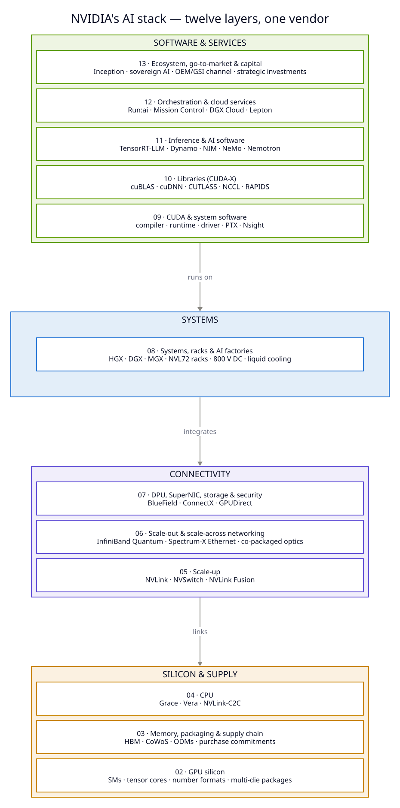
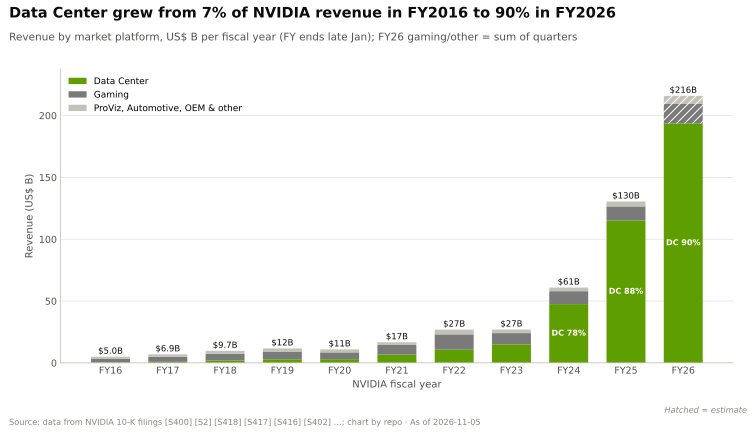
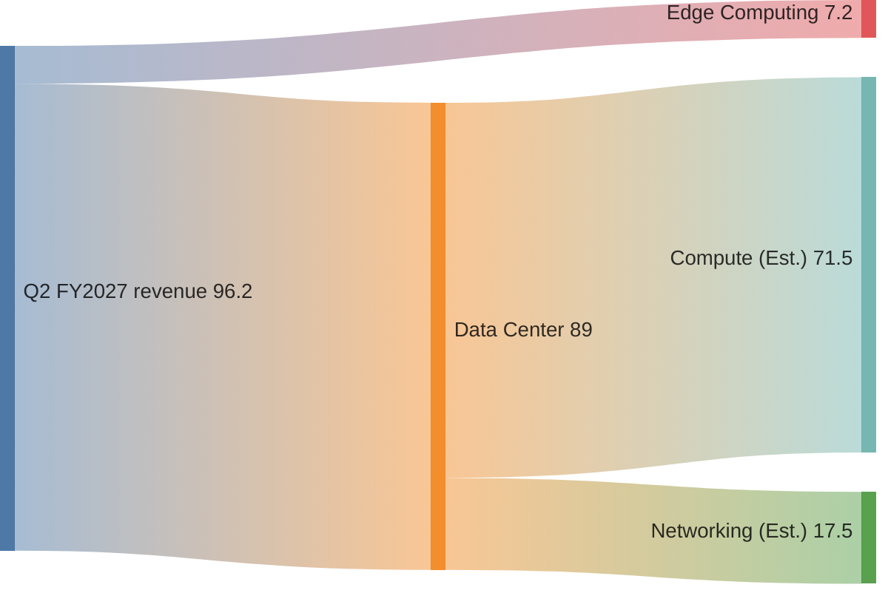
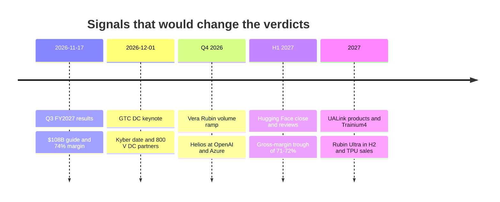

# 00 — Executive summary: how and why NVIDIA became indispensable

Synthesis · the whole repository on one page per depth · ~22 min read · Last verified: 2026-11-05

## ⚡ The Executive Take

- **The answer in one line: NVIDIA sells the whole AI factory as one system, refreshed every year, and its
  rivals sell parts of it.** It took ~87% of AI data-center silicon revenue in 2025, against ~90% in 2023, while
  that pool grew from ~$53B to ~$224B (Est., repo calculation) [[S416]](sources/bibliography.md#s416)[[S1]](sources/bibliography.md#s1)[[S660]](sources/bibliography.md#s660)[[S661]](sources/bibliography.md#s661)[[S663]](sources/bibliography.md#s663). Data Center was 90% of FY2026
  revenue of $215.9B [[S1]](sources/bibliography.md#s1)[[S402]](sources/bibliography.md#s402).
- **Demand is not the constraint; supply and margin are.** Q2 FY2027 revenue was $96.2B (+106% y/y) at a 75.0%
  GAAP [gross margin](glossary.md#gross-margin), and Q3 is guided to $108B ± 2% [[S405]](sources/bibliography.md#s405)[[S3]](sources/bibliography.md#s3). 🟢 Management frames ~70%
  FY2028 growth as [supply-constrained](glossary.md#supply-constrained) and guides the margin to a 71–72% trough in
  Q4 FY2027 on memory costs, then 72–73% in FY2028 [[S90085]](sources/bibliography.md#s90085)[[S90086]](sources/bibliography.md#s90086)[[S18000]](sources/bibliography.md#s18000).
- **The [moat](glossary.md#moat) is the bundle, not the chip.** 🔴 On this repo's layer verdicts it is deepest in
  libraries (4.5 of 5), supply, scale-up, racks and ecosystem (4.0 each), and thinnest in CPUs and cloud services
  (2.0) [[S1500]](sources/bibliography.md#s1500). The gap is narrowing in 6 of 12 layers and widening only in supply, where commitments reached
  $279B [[S407]](sources/bibliography.md#s407).
- **The money and the moat sit in different places.** The GPU is the profit engine: a B200 costs ~$6,400 to build
  against a $30–40K price (Est.) [[S35020]](sources/bibliography.md#s35020)[[S35026]](sources/bibliography.md#s35026). CUDA and the [CUDA-X](glossary.md#cuda-x) libraries, the deepest moats, are free and
  earn their keep by protecting that margin [[S1509]](sources/bibliography.md#s1509)[[S1510]](sources/bibliography.md#s1510).
- **Challengers are real, and they win first on price at the largest buyers.** AMD's MI455X matches or beats Rubin
  on paper (432 vs 288 GB of [HBM](glossary.md#hbm), 23.3 vs 19.2 TB/s) [[S144]](sources/bibliography.md#s144)[[S90093]](sources/bibliography.md#s90093)[[S33005]](sources/bibliography.md#s33005); Anthropic has access to up to 1M Google
  [TPUs](glossary.md#tpu) [[S653]](sources/bibliography.md#s653); Broadcom's AI revenue rose from ~12% to ~19% of NVIDIA's Data Center revenue
  [[S2516]](sources/bibliography.md#s2516)[[S1500]](sources/bibliography.md#s1500). OpenAI, Anthropic and Meta now run multi-vendor portfolios [[S24000]](sources/bibliography.md#s24000)[[S174]](sources/bibliography.md#s174)[[S24004]](sources/bibliography.md#s24004).
- **The bear case is concentration, financing and substitution, not weak demand.** One direct customer was 16%
  of Q2 FY2027 revenue [[S90069]](sources/bibliography.md#s90069); NVIDIA bought $42.4B of equity in H1 FY2027, ~24% of revenue [[S90072]](sources/bibliography.md#s90072)[[S18007]](sources/bibliography.md#s18007).
  🔴 The repo's most probable bear outcome is gross margin drifting from 75% toward the mid-60s [[S18027]](sources/bibliography.md#s18027).
- **What to watch next:** Q3 FY2027 results on 2026-11-17 [[S17005]](sources/bibliography.md#s17005), the GTC DC keynote on 2026-12-01 [[S90047]](sources/bibliography.md#s90047),
  the Vera Rubin volume ramp [[S90009]](sources/bibliography.md#s90009), AMD Helios at OpenAI [[S90021]](sources/bibliography.md#s90021), external TPU sales [[S90027]](sources/bibliography.md#s90027), the $12.9B
  [Hugging Face](glossary.md#hugging-face) close [[S11500]](sources/bibliography.md#s11500) and China licences [[S90032]](sources/bibliography.md#s90032).

![Five small bar-chart panels, one per thesis point. 1: DeepSeek-R1 tokens per second per GPU at 50 tokens/s per user rise from about 308 on H200 to about 6,261 on a GB300 NVL72 rack, about 20 times. 2: software alone lifted a B200 from about 2,000 to 4,600 tokens/s per GPU between February and May 2025, 2.3 times. 3: supply and capacity commitments rose from $119B to $279B in one quarter. 4: NVIDIA's private equity stakes rose from $3.4B (January 2025) to $51.2B (July 2026), about 15 times. 5: Broadcom's AI revenue rose from about 12% of NVIDIA's data-center revenue (2024-25 average) to about 19% in calendar Q3 2026.](assets/charts/00-thesis-in-five-numbers.svg)

## The five-point thesis

The core question of this repository is how and why NVIDIA became indispensable in AI training and inference. The
answer has five parts. The first three explain the mechanism, the fourth the reinforcement, and the fifth the
limit. Each links to the pages where the evidence lives.

```mermaid
flowchart LR
    T1["① Sells the system<br/>NVL72 rack, ~$35B per GW"]:::nvidia --> I(["Lowest cost per token<br/>on the default stack"])
    T2["② Software compounds<br/>CUDA, CUDA-X, Dynamo"]:::nvidia --> T1
    T3["③ Scale buys supply<br/>$279B commitments"]:::nvidia --> T1
    I --> M["~75% gross margin<br/>funds $18.5B R&D a year"]
    M --> T2
    M --> T3
    M --> T4["④ Capital and ecosystem<br/>~$99B of stakes"]:::nvidia
    T4 --> I
    T5["⑤ TPU, AMD, custom ASICs"]:::rival -. "cap price at the largest buyers" .-> M
    classDef nvidia fill:#5F9E00,color:#ffffff,stroke:#3F6B00
    classDef rival fill:#C4314B,color:#ffffff,stroke:#8E1F33
```

**1. NVIDIA sells a system, not a chip.** The unit of sale grew from a $129K DGX-1 server in 2016 to a ~$4.0M
GB300 [NVL72](glossary.md#nvl72) rack and a ~$7.8M Vera Rubin NVL72 (both Est., Morgan Stanley) [[S310]](sources/bibliography.md#s310)[[S332]](sources/bibliography.md#s332)[[S330]](sources/bibliography.md#s330). Inside that rack
NVIDIA specifies the GPUs, the CPUs, the 72-GPU [NVLink](glossary.md#nvlink) domain, the NICs, the copper spine, the
power shelves and the liquid cooling; ODMs assemble it at ~2–3% gross margin [[S5000]](sources/bibliography.md#s5000)[[S332]](sources/bibliography.md#s332). Its CEO puts NVIDIA's
content in a 1 GW [AI factory](glossary.md#ai-factory) at ~$35B of a $50–60B total [[S398]](sources/bibliography.md#s398). The system matters because
modern models are bound by memory and communication, not arithmetic ([P3](primers/P3-the-four-bottlenecks.md)). At
50 tokens/s per user, a GB300 NVL72 serves ~6,261 DeepSeek-R1 tokens/s per GPU, ~20× an H200 and ~8× an AMD MI355X
[[S621]](sources/bibliography.md#s621). Per megawatt the gap over H200 is ~13× [[S621]](sources/bibliography.md#s621)[[S622]](sources/bibliography.md#s622).

**2. Software turns every GPU into more tokens, every quarter.** [CUDA](glossary.md#cuda) is native in all 12 major
frameworks and engines this repo tracks (36 of 36 points), against 26 for AMD's [ROCm](glossary.md#rocm) and 4 for Qualcomm Cloud AI
[[S587]](sources/bibliography.md#s587)[[S580]](sources/bibliography.md#s580)[[S586]](sources/bibliography.md#s586)[[S596]](sources/bibliography.md#s596). New models run on it on day 0. When DeepSeek-V4-Pro launched, AMD's MI355X needed 8 days
to run [FP4](glossary.md#fp4) and 27 days to serve 50 tokens/s per user [[S633]](sources/bibliography.md#s633)[[S631]](sources/bibliography.md#s631). Software also lifts installed hardware. MLPerf
DeepSeek-R1 throughput on an unchanged GB300 NVL72 rose 2.9× in a year [[S601]](sources/bibliography.md#s601)[[S603]](sources/bibliography.md#s603), and [TensorRT-LLM](glossary.md#tensorrt-llm) alone took a
B200 from ~2,000 to 4,600 tokens/s per GPU in four months [[S646]](sources/bibliography.md#s646). The lock-in is real but uneven. 🔴 This repo
scores it 4.5 of 5 for self-hosting enterprises and 2.75 for frontier labs, which can afford to port [[S1509]](sources/bibliography.md#s1509).

**3. Scale buys supply, speed and cadence.** NVIDIA held $279B of supply and capacity commitments at Q2 FY2027,
up from $119B a quarter earlier [[S407]](sources/bibliography.md#s407)[[S404]](sources/bibliography.md#s404), and booked ~60% of TSMC's 2026 [CoWoS](glossary.md#cowos) wafers (🟡
Est.) [[S379]](sources/bibliography.md#s379). R&D of $18.5B in FY2026 was only ~9% of revenue [[S401]](sources/bibliography.md#s401). That pays for an
[annual cadence](glossary.md#annual-cadence): Blackwell Ultra in 2025, Vera Rubin shipping since August 2026, 🟢
Rubin Ultra in H2 2027 and 🟢 Feynman in 2028 [[S500]](sources/bibliography.md#s500)[[S90009]](sources/bibliography.md#s90009)[[S35018]](sources/bibliography.md#s35018)[[S109]](sources/bibliography.md#s109). NVIDIA dates its GPUs 26–40 months
before they ship, which lets buyers plan gigawatt sites around its calendar (🔴 repo analysis) [[S17006]](sources/bibliography.md#s17006).

**4. Capital and ecosystem make NVIDIA the default counterparty.** NVIDIA's equity stakes total ~$99B (a CNBC
aggregation of the July 2026 10-Q) [[S90073]](sources/bibliography.md#s90073). They include ~$30B in OpenAI (🟡) and up to $10B in Anthropic
[[S90015]](sources/bibliography.md#s90015)[[S90075]](sources/bibliography.md#s90075). Sovereign AI brought in more than ~$30B in FY2026 [[S90071]](sources/bibliography.md#s90071). AI clouds, industrial and enterprise
buyers ([ACIE](glossary.md#acie)) took ~$40.3B, 45% of Q2 FY2027 Data Center revenue, mostly through partners and
[neoclouds](glossary.md#neocloud) [[S406]](sources/bibliography.md#s406). The same loop draws the
[circular-financing](glossary.md#circular-financing) critique: H1 FY2027 equity purchases equal ~24% of revenue,
Lucent's ratio at its 2000 peak [[S90072]](sources/bibliography.md#s90072)[[S18007]](sources/bibliography.md#s18007).

**5. Indispensable today, contestable at the margin.** No rival matches the stack. In chapter 15's matrix, the
closest, Google's TPU, is level or ahead in 5 of 12 layers, and 60% of all rival-by-layer cells score "behind"
[[S15014]](sources/bibliography.md#s15014). Yet buyers no longer need to match the stack to discipline NVIDIA's price. Custom
[ASIC](glossary.md#asic) servers reach ~27.8% of 2026 AI server units in TrendForce's count [[S2517]](sources/bibliography.md#s2517), and an owned
Ironwood TPU costs ~$1.21 a chip-hour against ~$2.31 for a GB300 (Est., SemiAnalysis) [[S622]](sources/bibliography.md#s622). 🔴 Repo verdict:
rivals cap NVIDIA's [pricing power](glossary.md#pricing-power) at the largest buyers well before they dent its volume
([chapter 15](cross-cutting/15-competitive-landscape/index.md)).

> [!TIP]
> **Worked example — how a 75%-margin vendor still sells the cheapest token.** Chapter 14's model puts a GB300
> NVL72 token at ~$0.16 per million at 50 tokens/s per user (Est., P10–P90 $0.13–0.23) [[S14000]](sources/bibliography.md#s14000)[[S621]](sources/bibliography.md#s621). NVIDIA's
> gross margin is only ~24% of that cost; capital charges are ~70% and electricity ~6% [[S14000]](sources/bibliography.md#s14000). Throughput varies
> ~30× across platforms per megawatt, so throughput, not price, sets the cost. 🔴 At that operating point even a free MI355X,
> TPU v7 or Trainium3 makes dearer tokens than a paid-for GB300 [[S14000]](sources/bibliography.md#s14000). **Conclusion:** NVIDIA's margin survives
> because its system lowers the buyer's cost per token. The lead is conditional, though: at 100 tokens/s per user
> GB300 (~$1.74/M) draws level with TPU v7 ($1.46–1.72) (🔴 modelled) [[S14000]](sources/bibliography.md#s14000).

🔧 Under the hood: why "indispensable" is not the same as "monopoly"

Indispensable here means that, for most buyers in 2026, there is no faster or cheaper way to turn capital and
power into tokens at scale than an NVIDIA rack. That rests on three things a rival must match at once: a competitive
accelerator, a 72-GPU-class scale-up domain with the networking around it, and day-0 software for every new model.
AMD now has the first and is shipping the second (Helios), and is closing the third on a weeks-long lag [[S144]](sources/bibliography.md#s144)
[[S90020]](sources/bibliography.md#s90020)[[S631]](sources/bibliography.md#s631). Google has all three, but mostly for its own workloads and a few anchor customers [[S653]](sources/bibliography.md#s653)[[S552]](sources/bibliography.md#s552).

What NVIDIA lacks is control over its largest customers' alternatives: the buyers behind most of Data Center
revenue also design TPU, Trainium, Maia and MTIA [[S90069]](sources/bibliography.md#s90069)[[S90026]](sources/bibliography.md#s90026)[[S90035]](sources/bibliography.md#s90035)[[S90044]](sources/bibliography.md#s90044). The right model is a
price-setting incumbent with credible substitutes at the top of the market and few below it, which is why chapter
18's most probable bear outcome is margin pressure, not lost volume [[S18027]](sources/bibliography.md#s18027).

## The stack in one picture

The repository splits NVIDIA's AI business into twelve layers, from GPU silicon at the bottom to ecosystem, go-to-
market and capital at the top. Read the cake bottom-up as the path of a token. Silicon and memory do the
arithmetic ([layer 02](layers/02-gpu-silicon/index.md), [layer 03](layers/03-memory-packaging-supply-chain/index.md)).
The CPU feeds them ([layer 04](layers/04-cpu-grace-vera/index.md)). [Scale-up](glossary.md#scale-up) and
[scale-out](glossary.md#scale-out) fabrics make thousands of GPUs act as one
([05](layers/05-scale-up-nvlink-nvswitch/index.md), [06](layers/06-scale-out-scale-across-networking/index.md),
[07](layers/07-dpu-supernic-storage-security/index.md)). The rack turns parts into a powered, cooled computer
([08](layers/08-systems-racks-ai-factories/index.md)). Then four software layers turn that computer into fast
kernels, delivered speed, served tokens and paid GPU-hours
([09](layers/09-cuda-and-system-software/index.md)–[12](layers/12-orchestration-and-cloud-services/index.md)).
Capital and channels turn all of it into financed demand
([13](layers/13-ecosystem-gtm-and-capital/index.md)).

What makes NVIDIA unusual is not that it plays in every layer. It is that it changes every layer together, every
year, as one product, so rivals must match a moving bundle, not a part.

> [!TIP]
> **Worked example — one gigawatt through the stack.** At a [PUE](glossary.md#pue) of 1.15, 1 GW leaves ~870 MW for IT. A GB300 NVL72
> needs ~132 kW plus ~21% for its share of network and storage, so ~160 kW. That is room for **~5,400 racks and
> ~390,000 GPUs** (layer-08 repo arithmetic) [[S1508]](sources/bibliography.md#s1508)[[S387]](sources/bibliography.md#s387)[[S337]](sources/bibliography.md#s337). NVIDIA's CEO prices such a factory at
> **$50–60B, ~$35B of it NVIDIA content** [[S398]](sources/bibliography.md#s398). Bernstein's ~$35B and Barclays' $32.5–42B are of the same order
> [[S6025]](sources/bibliography.md#s6025)[[S27012]](sources/bibliography.md#s27012). **Conclusion:** at gigawatt scale NVIDIA invoices roughly 58–70% of the budget. No supplier of a
> single layer comes close to that share of wallet.

## The numbers that matter

| Metric | Value | Why it matters | Source |
|---|---|---|---|
| FY2026 revenue | $215.9B (+65%) | ~43× FY2016's $5.0B | [[S1]](sources/bibliography.md#s1)[[S400]](sources/bibliography.md#s400) |
| FY2026 Data Center revenue | $193.7B, 90% of revenue | The AI business is the company | [[S1]](sources/bibliography.md#s1)[[S402]](sources/bibliography.md#s402) |
| FY2026 networking revenue | ~$31.4B (Est.), from $8.6B in FY2024 | The Mellanox franchise, now ~20% of Data Center | [[S402]](sources/bibliography.md#s402)[[S416]](sources/bibliography.md#s416) |
| Q2 FY2027 revenue / Data Center | $96.2B (+106% y/y) / $89.0B (+117% y/y) | Growth re-accelerated on Blackwell Ultra | [[S405]](sources/bibliography.md#s405) |
| Q2 FY2027 Data Center mix | Hyperscale ~$48.7B (55%); ACIE ~$40.3B (45%) | Almost half of demand comes without a hyperscaler | [[S406]](sources/bibliography.md#s406)[[S90011]](sources/bibliography.md#s90011) |
| Q2 FY2027 networking | ~$17.5B (Est., +18% q/q); Spectrum-X 2.6× y/y | Ethernet is now NVIDIA's growth line | [[S408]](sources/bibliography.md#s408)[[S90012]](sources/bibliography.md#s90012) |
| Q2 FY2027 GAAP gross margin | 75.0% | Pricing power at peak volume | [[S405]](sources/bibliography.md#s405) |
| Q3 FY2027 guidance | $108B ± 2%; gross margin 74% ± 50 bp; no China DC compute | Results due 2026-11-17 | [[S3]](sources/bibliography.md#s3)[[S90085]](sources/bibliography.md#s90085)[[S17005]](sources/bibliography.md#s17005) |
| FY2028 preliminary outlook | 🟢 ~70% revenue growth, supply-constrained | Consensus had expected ~45% | [[S90086]](sources/bibliography.md#s90086)[[S18000]](sources/bibliography.md#s18000) |
| Gross-margin path | 🟢 Trough 71–72% in Q4 FY2027; 72–73% in FY2028 | Memory costs above plan; price rises follow | [[S90085]](sources/bibliography.md#s90085)[[S18000]](sources/bibliography.md#s18000) |
| Supply and capacity commitments | $279B (2.9× quarterly revenue) | Allocation as a weapon, and a fixed cost in a downturn | [[S407]](sources/bibliography.md#s407)[[S18027]](sources/bibliography.md#s18027) |
| Largest direct customer | 16% of Q2 FY2027 revenue; three were 44% of H1 | Concentration is the amplifier of every other risk | [[S90069]](sources/bibliography.md#s90069) |
| Equity stakes | ~$99B; H1 FY2027 purchases $42.4B | The capital loop and the circular-financing debate | [[S90073]](sources/bibliography.md#s90073)[[S90072]](sources/bibliography.md#s90072) |
| Share of AI data-center silicon revenue | ~87% (2025) vs ~90% (2023) (Est.) | Share has barely moved while the pool quadrupled | [[S416]](sources/bibliography.md#s416)[[S660]](sources/bibliography.md#s660)[[S663]](sources/bibliography.md#s663) |
| Market value | ~$5.3–5.8T (Aug–Oct 2026); 🔴 ~14× guided FY2028 earnings | The market already prices a peak | [[S18004]](sources/bibliography.md#s18004)[[S18005]](sources/bibliography.md#s18005)[[S18027]](sources/bibliography.md#s18027) |

Two features of the latest quarter stand out. Data Center now splits two ways: hyperscale and ACIE roughly 55:45
by customer [[S406]](sources/bibliography.md#s406), compute and networking roughly 80:20 by product [[S405]](sources/bibliography.md#s405)[[S408]](sources/bibliography.md#s408). And the guide is a supply guide:
management says FY2028 growth is limited by what supply allows [[S18000]](sources/bibliography.md#s18000). At GTC 2026 it sized Blackwell plus Vera Rubin demand at
$1 trillion through 2027 (🟡 outlets differ on "orders" versus "revenue opportunity") [[S90001]](sources/bibliography.md#s90001)[[S90002]](sources/bibliography.md#s90002).

Q2 FY2027 revenue by platform, US$ B. The compute/networking split is estimated from the reported +18% q/q
networking growth on Q1's $14.8B [[S405]](sources/bibliography.md#s405)[[S408]](sources/bibliography.md#s408)[[S90014]](sources/bibliography.md#s90014).

> [!TIP]
> **Worked example — what the guide is worth in dollars.** Each point of gross margin on the $108B Q3 guide is
> ~$1.1B of quarterly gross profit, so the guided slide from 75% to the 71–72% trough costs ~$3–4B a quarter at that
> revenue level (repo arithmetic) [[S3]](sources/bibliography.md#s3)[[S90085]](sources/bibliography.md#s90085). Chapter 18's FY2028 path, ~$697B of revenue at a ~72.5% margin, gives
> ~$505B of gross profit (🔴 repo arithmetic) [[S18027]](sources/bibliography.md#s18027)[[S18000]](sources/bibliography.md#s18000). If margin instead drifts to 65%, the repo's most
> probable bear case, gross profit falls to ~$453B on the same revenue, ~$52B less. **Conclusion:** NVIDIA's
> earnings risk sits in margin points, not in units shipped, and memory prices now move those points.

🔧 Under the hood: reconciling the Q2 FY2027 mix numbers

Q1 FY2027 networking was a record $14.8B [[S90014]](sources/bibliography.md#s90014); for Q2 NVIDIA said networking grew 18% q/q, so this repo uses
~$17.5B (14.8 × 1.18), marked "Est." [[S408]](sources/bibliography.md#s408)[[S90012]](sources/bibliography.md#s90012). Compute is Data Center minus networking, ~$71.5B. The customer
split (hyperscale ~$48.7B, ACIE ~$40.3B) comes from the CFO commentary [[S406]](sources/bibliography.md#s406). Both splits add to $89.0B but cut the
same revenue differently, so they cannot share one flow. Margins are GAAP; GAAP and non-GAAP have differed by ~0.1
point since Q1 FY2027 [[S403]](sources/bibliography.md#s403).

## Layer by layer: the verdicts

Each paragraph condenses the layer's index, eight-question table and competition page. The score is this repo's
1–5 [moat score](glossary.md#moat-score) and the arrow the [gap trend](glossary.md#gap-trend), both 🔴 repo judgement
recorded with evidence in `data/x00_layer_verdicts.csv` [[S1500]](sources/bibliography.md#s1500); the [cheat sheet](CHEATSHEET.md) puts them in
one table.

**[Layer 02 · GPU silicon](layers/02-gpu-silicon/index.md) — contested, 3.0 ↘.** Rubin delivers 35 [PFLOPS](glossary.md#flops) of dense
[NVFP4](glossary.md#nvfp4), ~280× V100's 16-bit peak, though only ~32× at 16-bit, so most of the gain came from smaller number formats
[[S33005]](sources/bibliography.md#s33005)[[S33010]](sources/bibliography.md#s33010)[[S100]](sources/bibliography.md#s100). The September–October 2026 revision cut Rubin's HBM4 bandwidth from 22 to 19.2 TB/s and
NVLink 6 from 3.6 to 3.0 TB/s per GPU [[S90006]](sources/bibliography.md#s90006)[[S90007]](sources/bibliography.md#s90007). On paper AMD's MI455X now leads on memory (432 GB, 23.3
TB/s, ~21% more bandwidth) [[S144]](sources/bibliography.md#s144)[[S90093]](sources/bibliography.md#s90093). 🔴 The silicon lead is months, not generations [[S1502]](sources/bibliography.md#s1502). The layer is still the profit engine.

**[Layer 03 · Memory, packaging and supply chain](layers/03-memory-packaging-supply-chain/index.md) — deep, 4.0 ↗.**
For inference, memory binds before compute; HBM is ~45% of a B200's build cost (Est.) [[S35020]](sources/bibliography.md#s35020). NVIDIA buys from the
same three HBM makers as its rivals, so its edge is allocation, not technology: $279B of commitments and ~60% of
2026 CoWoS (🟡 Est.) [[S407]](sources/bibliography.md#s407)[[S379]](sources/bibliography.md#s379). This is the one layer where the gap is widening. The price is a fixed cost that
made NVIDIA the shock absorber in the $4.5B H20 charge [[S414]](sources/bibliography.md#s414).

**[Layer 04 · CPU](layers/04-cpu-grace-vera/index.md) — thin, 2.0 →.** Grace and Vera matter for integration. A
coherent NVLink-C2C link gives each Vera Rubin GPU ~900 GB/s to its host and ~750 GB of CPU memory [[S128]](sources/bibliography.md#s128)[[S4019]](sources/bibliography.md#s4019)
[[S100]](sources/bibliography.md#s100)[[S102]](sources/bibliography.md#s102). But the CPUs are ~2% of a ~$7.8M rack (Est.) [[S331]](sources/bibliography.md#s331), and AMD's 256-core EPYC Venice anchors the Helios
rack [[S4028]](sources/bibliography.md#s4028)[[S538]](sources/bibliography.md#s538). [Agentic](glossary.md#agentic-ai) AI may turn standalone CPUs into a new socket market, with CPU:GPU ratios moving toward
1:2–1:1 [[S4012]](sources/bibliography.md#s4012)[[S4013]](sources/bibliography.md#s4013).

**[Layer 05 · Scale-up (NVLink, NVSwitch)](layers/05-scale-up-nvlink-nvswitch/index.md) — deep, 4.0 ↘.** The NVL72
is the signature product. Vera Rubin's domain reaches 216 TB/s after the 2026 cut, carried over a copper spine that
avoids ~19 kW and ~$0.7M of optics per rack (Est.) [[S200]](sources/bibliography.md#s200)[[S201]](sources/bibliography.md#s201)[[S5000]](sources/bibliography.md#s5000)[[S5016]](sources/bibliography.md#s5016). AMD's Helios claims 260 TB/s over
[UALink](glossary.md#ualink)-on-Ethernet, and Google's TPU pods reach 9,216 chips [[S226]](sources/bibliography.md#s226)[[S232]](sources/bibliography.md#s232). Open UALink products
arrive in 2027 [[S90051]](sources/bibliography.md#s90051). [NVLink Fusion](glossary.md#nvlink-fusion) is NVIDIA's counter: it opens the link to 13
partners, including Qualcomm, Fujitsu, Intel and AWS Trainium4, but keeps NVIDIA silicon in every system (🟡)
[[S131]](sources/bibliography.md#s131)[[S518]](sources/bibliography.md#s518)[[S5018]](sources/bibliography.md#s5018).

**[Layer 06 · Scale-out networking](layers/06-scale-out-scale-across-networking/index.md) — contested, 3.0 →.**
Mellanox ($6.9B in 2019) became a ~$31.4B-a-year business [[S464]](sources/bibliography.md#s464)[[S402]](sources/bibliography.md#s402). Buyers chose Ethernet, about two-thirds of
AI back-end switch sales in 1Q 2026 (🟡 Dell'Oro), and NVIDIA followed with [Spectrum-X](glossary.md#spectrum-x), up
2.6× y/y [[S90054]](sources/bibliography.md#s90054)[[S408]](sources/bibliography.md#s408). Broadcom shipped a 102.4 Tb/s switch ~12 months before Spectrum-6, and Celestica led AI
back-end switching in 1Q 2026 [[S274]](sources/bibliography.md#s274)[[S6019]](sources/bibliography.md#s6019)[[S90054]](sources/bibliography.md#s90054). NVIDIA's edge is [NIC](glossary.md#nic), switch and [NCCL](glossary.md#nccl) tuning sold as a bundle.

**[Layer 07 · DPU, SuperNIC, storage and security](layers/07-dpu-supernic-storage-security/index.md) — contested,
3.0 ↘.** Each GPU now gets its own [SuperNIC](glossary.md#supernic): 400 Gb/s on GB200, 800 on GB300, 1.6 Tb/s on
Vera Rubin [[S266]](sources/bibliography.md#s266)[[S264]](sources/bibliography.md#s264)[[S33004]](sources/bibliography.md#s33004). BlueField-4 turns flash into a KV-cache tier for inference [[S7511]](sources/bibliography.md#s7511). [Hyperscalers](glossary.md#hyperscaler)
run their own offload (AWS Nitro, Google Titanium), and Helios gives each GPU 2.4 Tb/s of AMD Pensando NICs
[[S292]](sources/bibliography.md#s292)[[S228]](sources/bibliography.md#s228). Storage software margin goes to partners such as VAST Data, DDN and WEKA [[S1507]](sources/bibliography.md#s1507).

**[Layer 08 · Systems, racks and AI factories](layers/08-systems-racks-ai-factories/index.md) — deep, 4.0 ↘.**
Power per NVIDIA system rose from 3.2 kW (DGX-1) to ~132 kW (GB300 NVL72) and ~600 kW planned for Kyber, so liquid
cooling and 800 V DC power are now part of the product [[S310]](sources/bibliography.md#s310)[[S337]](sources/bibliography.md#s337)[[S305]](sources/bibliography.md#s305)[[S90063]](sources/bibliography.md#s90063). The output metric is
[tokens per megawatt](glossary.md#tokens-per-megawatt), where GB300 NVL72 leads [[S621]](sources/bibliography.md#s621)[[S622]](sources/bibliography.md#s622). AMD's Helios (31 TB of
[HBM4](glossary.md#hbm4), ~1.5× Vera Rubin's) ships from around end-Q3 2026 and leads on 3 of 7 rack metrics on paper
[[S90020]](sources/bibliography.md#s90020)[[S90021]](sources/bibliography.md#s90021)[[S1508]](sources/bibliography.md#s1508).

**[Layer 09 · CUDA and system software](layers/09-cuda-and-system-software/index.md) — contested, 3.5 ↘.** The moat is
the long tail: ~6M developers, flat since 2025, and native support in every major framework [[S528]](sources/bibliography.md#s528)[[S587]](sources/bibliography.md#s587). Erosion is
real. torch.compile, [Triton](glossary.md#triton), [vLLM](glossary.md#vllm) and [SGLang](glossary.md#sglang) run on several vendors, AMD's lag on a new frontier model fell to 26
days, and Qualcomm closed its ~$3.9B purchase of Modular (Mojo/MAX) on 2026-07-29 [[S578]](sources/bibliography.md#s578)[[S580]](sources/bibliography.md#s580)[[S631]](sources/bibliography.md#s631)[[S9511]](sources/bibliography.md#s9511). 🔴 The
3.5 score rounds layer 09's segment average of ~3.6 [[S1509]](sources/bibliography.md#s1509).

**[Layer 10 · Libraries (CUDA-X)](layers/10-libraries-cuda-x/index.md) — deepest, 4.5 →.** NVIDIA cites "hundreds
of libraries" [[S10047]](sources/bibliography.md#s10047). In this repo's 15-domain test no rival leads in any, and AMD matches 3 [[S1510]](sources/bibliography.md#s1510). The AI core
(GEMM, attention, collectives) is the copyable part; AMD's RCCL is built from NCCL's own code [[S10002]](sources/bibliography.md#s10002). The long tail
of data, simulation and science libraries is not. Libraries are free; their value appears in GPU pricing.

**[Layer 11 · Inference and AI software](layers/11-inference-and-ai-software/index.md) — contested, 3.0 →.** [Dynamo](glossary.md#dynamo)
1.0 shipped as Apache-2.0 open source at GTC 2026 [[S90066]](sources/bibliography.md#s90066). Splitting [prefill](glossary.md#prefill) from [decode](glossary.md#decode) lifted B200 throughput
~2.5× per GPU on long prompts [[S621]](sources/bibliography.md#s621). Little here locks customers in. Open engines run on AMD and TPU, and Google's
TPU served one large model ~18% cheaper per token than B200 [[S580]](sources/bibliography.md#s580)[[S625]](sources/bibliography.md#s625). Direct software revenue is ~$2B a year,
under 1% of Data Center [[S11011]](sources/bibliography.md#s11011); pull-through is the point.

**[Layer 12 · Orchestration and cloud services](layers/12-orchestration-and-cloud-services/index.md) — thin, 2.0 →.**
NVIDIA bought the control plane (Run:ai ~$700M, SchedMD) and open-sourced much of it [[S479]](sources/bibliography.md#s479)[[S12000]](sources/bibliography.md#s12000)[[S12510]](sources/bibliography.md#s12510); DGX
Cloud turned inward and Lepton routes developers to partner clouds (🟡) [[S90068]](sources/bibliography.md#s90068)[[S598]](sources/bibliography.md#s598). Hyperscalers own the
customer, the control plane and their own chips [[S1512]](sources/bibliography.md#s1512). NVIDIA plays as a counterparty, with ~$65B of cloud
commitments and a $6.3B CoreWeave backstop [[S407]](sources/bibliography.md#s407)[[S90067]](sources/bibliography.md#s90067).

**[Layer 13 · Ecosystem, go-to-market and capital](layers/13-ecosystem-gtm-and-capital/index.md) — deep, 4.0 ↘.**
[Sovereign AI](glossary.md#sovereign-ai) passed ~$30B in FY2026, and announced country deals name ~1.03M NVIDIA GPUs
[[S90071]](sources/bibliography.md#s90071)[[S13003]](sources/bibliography.md#s13003)[[S13000]](sources/bibliography.md#s13000). Private stakes grew from $3.4B to $51.2B in 18 months [[S13043]](sources/bibliography.md#s13043)[[S90072]](sources/bibliography.md#s90072). The balance-sheet
gap is widening, but the demand gap is narrowing. Broadcom's AI revenue, the clearest gauge of the hyperscaler-plus-Broadcom
coalition, went from ~11–14% to ~19% of NVIDIA's Data Center revenue in about two years [[S2516]](sources/bibliography.md#s2516)[[S1513]](sources/bibliography.md#s1513).

> [!TIP]
> **Worked example — reading a verdict: why scale-up scores 4 but trends down.** A Vera Rubin rack's NVLink fabric
> carries 72 × 3.0 TB/s = **216 TB/s**, while its 72 ConnectX-9 NICs carry 28.8 TB/s in both directions: **7.5×**
> more bandwidth stays inside the rack than leaves it [[S200]](sources/bibliography.md#s200)[[S33004]](sources/bibliography.md#s33004). Matching that needs a switch, a [SerDes](glossary.md#serdes), a
> copper or optical spine and a collective library, all at once. That explains the 4. AMD's Helios claims 260 TB/s
> and UALink products are expected in 2027, so the trend is down [[S226]](sources/bibliography.md#s226)[[S90051]](sources/bibliography.md#s90051). **Conclusion:** a high score with a
> falling arrow is the most common verdict in this repo. It describes a lead that is real today but has a visible
> expiry date.

## Where the moat is strongest, and where it is weakest

![Horizontal bar chart of the repo's moat score for each of NVIDIA's twelve stack layers, coloured by gap trend. Libraries (CUDA-X) 4.5, stable; memory and supply 4.0, widening; scale-up NVLink 4.0, systems and racks 4.0 and ecosystem and capital 4.0, all narrowing; CUDA 3.5, narrowing; GPU silicon 3.0 and DPU/SuperNIC 3.0 narrowing; scale-out networking 3.0 and inference software 3.0 stable; CPU 2.0 and orchestration and cloud 2.0 stable. The gap is narrowing in 6 of 12 layers and widening only in supply. Rivals scored behind NVIDIA range from 4 of 12 (GPU silicon, cloud) to 11 of 12 (ecosystem).](assets/charts/00-moat-strength-by-layer.svg)

| Rank | Layer | Moat score | Trend | What holds the moat | Where it leaks |
|---|---|---:|:---:|---|---|
| 1 | [10 Libraries](layers/10-libraries-cuda-x/index.md) | 4.5 | → | Tuning across every GPU generation; 15-domain breadth | AI core copyable (RCCL from NCCL) [[S10002]](sources/bibliography.md#s10002) |
| 2 | [03 Memory & supply](layers/03-memory-packaging-supply-chain/index.md) | 4.0 | ↗ | $279B commitments; ~60% of 2026 CoWoS [[S407]](sources/bibliography.md#s407)[[S379]](sources/bibliography.md#s379) | HBM makers capture the margin [[S35020]](sources/bibliography.md#s35020) |
| 3 | [05 Scale-up](layers/05-scale-up-nvlink-nvswitch/index.md) | 4.0 | ↘ | 72-GPU domain in volume; copper spine [[S5000]](sources/bibliography.md#s5000) | Helios 260 TB/s; UALink 2027 [[S226]](sources/bibliography.md#s226)[[S90051]](sources/bibliography.md#s90051) |
| 4 | [08 Systems](layers/08-systems-racks-ai-factories/index.md) | 4.0 | ↘ | Annual rack design, ODM ecosystem [[S3014]](sources/bibliography.md#s3014) | Helios ships from end-Q3 2026 [[S90020]](sources/bibliography.md#s90020) |
| 5 | [13 Ecosystem & capital](layers/13-ecosystem-gtm-and-capital/index.md) | 4.0 | ↘ | ~$99B of stakes; channel reach [[S90073]](sources/bibliography.md#s90073) | Broadcom coalition at ~19% of NVIDIA DC [[S2516]](sources/bibliography.md#s2516) |
| 6 | [09 CUDA](layers/09-cuda-and-system-software/index.md) | 3.5 | ↘ | Long tail, day-0 support [[S633]](sources/bibliography.md#s633) | Frontier labs port; ROCm lag 26 days [[S631]](sources/bibliography.md#s631) |
| 7 | [02 GPU silicon](layers/02-gpu-silicon/index.md) | 3.0 | ↘ | Cadence, NVFP4, two-die packaging [[S100]](sources/bibliography.md#s100) | MI455X matches or beats on paper [[S144]](sources/bibliography.md#s144)[[S90093]](sources/bibliography.md#s90093) |
| 8 | [06 Scale-out](layers/06-scale-out-scale-across-networking/index.md) | 3.0 | → | NIC–switch–NCCL bundle [[S464]](sources/bibliography.md#s464) | Merchant Ethernet, Ultra Ethernet [[S274]](sources/bibliography.md#s274)[[S575]](sources/bibliography.md#s575) |
| 9 | [07 DPU & SuperNIC](layers/07-dpu-supernic-storage-security/index.md) | 3.0 | ↘ | ConnectX lead at 1.6 Tb/s [[S33004]](sources/bibliography.md#s33004) | Captive offload; Pensando [[S292]](sources/bibliography.md#s292)[[S228]](sources/bibliography.md#s228) |
| 10 | [11 Inference software](layers/11-inference-and-ai-software/index.md) | 3.0 | → | Rack co-design, per-model tuning [[S621]](sources/bibliography.md#s621) | Open engines; TPU cost per token [[S625]](sources/bibliography.md#s625) |
| 11 | [04 CPU](layers/04-cpu-grace-vera/index.md) | 2.0 | → | Coherent C2C link [[S129]](sources/bibliography.md#s129) | x86 and hyperscaler Arm [[S4028]](sources/bibliography.md#s4028) |
| 12 | [12 Orchestration & cloud](layers/12-orchestration-and-cloud-services/index.md) | 2.0 | → | Allocation and capital [[S407]](sources/bibliography.md#s407) | Hyperscalers own the customer [[S90026]](sources/bibliography.md#s90026) |

Three patterns stand out. The deepest moats are not in the chip but in libraries, supply allocation and the
rack-scale system, which are slow and expensive to copy. The gap is narrowing in half the layers, each time because
a challenger attacks a *part* (AMD's chip and rack, UALink's fabric, open serving engines). And the thin layers, CPU
and cloud, are ones NVIDIA never needed to win; it co-opts them through NVLink Fusion, the $5B Intel stake and
neocloud backstops [[S90031]](sources/bibliography.md#s90031)[[S4009]](sources/bibliography.md#s4009)[[S90067]](sources/bibliography.md#s90067).

![Scatter chart placing NVIDIA's twelve stack layers by moat score (x, 1 to 5) and direct value capture (y, 1 to 5). Top: GPU silicon (moat 3.0, capture 5) is the profit engine; scale-up NVLink and systems (4.0, 4) and scale-out networking (3.0, 4) also earn well. Bottom right: libraries (4.5, 2), CUDA (3.5, 2) and memory and supply (4.0, 1) are deep moats that earn little directly and protect the GPU margin. Bottom left: CPU (2.0, 2) and orchestration and cloud (2.0, 1) are thin on both. Ecosystem and capital sits at 4.0, 3. All scores are repo judgement.](assets/charts/00-moat-vs-value-capture.svg)

The second chart adds money. NVIDIA books gross profit in the GPU, the scale-up fabric, the network and the rack;
libraries, CUDA and supply allocation earn little directly but defend that profit. A challenger that copies only the
profitable parts (a chip, a rack) runs into the defensive layers; one that copies only the defensive parts (a
portable compiler) earns nothing until it also ships hardware.

![Stacked horizontal bar chart counting, for each of NVIDIA's twelve stack layers, how many of 12 rivals score behind, different approach, parity or leads in the chapter-15 matrix. 87 of 144 cells are behind, 43 different, 7 parity and 7 leads. Libraries (10 behind) and ecosystem and capital (11 behind) are the most one-sided layers; GPU silicon (4 behind, 2 parity) and orchestration and cloud (4 behind, 3 leads) are the most contested. Rivals lead in CPUs (AMD), scale-out switching (Broadcom), inference cost (Google TPU, Cerebras) and cloud services (Google, AWS, Microsoft).](assets/charts/00-rival-verdicts-by-layer.svg)

> [!TIP]
> **Worked example — what a software gap costs in hardware terms.** On day 27 after DeepSeek-V4-Pro's release, a
> B200 delivered ~5× an MI355X's tokens per GPU on SemiAnalysis's test [[S631]](sources/bibliography.md#s631). Suppose the MI355X costs half as much
> to own per hour (🔴 illustrative). Its cost per token is still 5 ÷ 2 = **2.5× higher** until its software catches up
> [[S1509]](sources/bibliography.md#s1509). **Conclusion:** the free software layers are what let NVIDIA charge for the paid ones. Every new model
> family re-opens a window in which a cheaper chip makes dearer tokens.

🔧 Under the hood: how the moat scores were built, and their limits

Each layer was scored from 1 to 5 on one question: how long and how much would it take a buyer or a rival to get
around NVIDIA in this layer? The inputs were the layer's Executive Take, its eight-question table (especially Q4
source of advantage, Q5 strongest challenger and Q6 replication cost), its competition verdict matrix and chapter
15's rival-by-layer matrix [[S1502]](sources/bibliography.md#s1502)[[S1513]](sources/bibliography.md#s1513)[[S15014]](sources/bibliography.md#s15014). A 3 means rivals are at parity on some dimensions while NVIDIA
leads on integration. A 5 means no rival is close and switching takes years. No layer scores 5.

The gap trend uses the layer page's own description of the last ~12 months. Where a layer is mixed, the trend follows
the competition verdict. In layer 13, for example, the balance-sheet gap is widening, but the layer page judges the
demand gap to be narrowing, so the arrow points down [[S1513]](sources/bibliography.md#s1513). The value-capture score (1–5) measures how much of the
layer's spend NVIDIA books directly as gross profit, not how important the layer is.

These are judgements, not measurements; any score could move by half a point. The rival-verdict counts are
mechanical but weight a hyperscaler and a start-up equally. Use the ranking and the arrows, not the decimals.

## The bear case in brief

![Risk heatmap with likelihood on the x-axis and impact on the y-axis, each scored 1 to 5, plus a ranked bar panel. Scores (likelihood x impact): hyperscaler custom ASICs 16 (4x4), circular financing and the capex cycle 15 (3x5), customer concentration 12 (3x4), inference commoditization 12 (4x3), software abstraction eroding CUDA 9 (3x3), power constraints 8 (4x2), China and export controls 8 (4x2), antitrust 6 (3x2), open interconnect standards 6 (3x2) and TSMC/Taiwan concentration 5 (1x5), a low-probability, extreme-impact tail. All scores are the repo's judgement.](assets/charts/18-risk-heatmap.svg)

[Chapter 18](cross-cutting/18-vulnerabilities-and-bear-case.md) makes the strongest honest case against NVIDIA,
risk by risk, and scores each for likelihood and impact. The headline is that the bear case is not "demand is weak".
It is that today's demand is concentrated, partly self-financed and substitutable, and that all three show up in
price before they show up in volume [[S18027]](sources/bibliography.md#s18027).

| Risk (chapter 18 score) | The bear argument, in one line | NVIDIA's best counter |
|---|---|---|
| Hyperscaler ASICs (16) | Broadcom's quarterly AI revenue is ~19% of NVIDIA's Data Center; Anthropic has up to 1M TPUs [[S2516]](sources/bibliography.md#s2516)[[S653]](sources/bibliography.md#s653) | Rivals cap price, not volume; NVLink Fusion co-opts Trainium4 [[S518]](sources/bibliography.md#s518) |
| Circular financing and capex cycle (15) | Commitments of 2.9× quarterly revenue vs ~1.4× before the FY2023 bust [[S407]](sources/bibliography.md#s407) | $50.3B of operating cash flow in one quarter funds it [[S403]](sources/bibliography.md#s403) |
| Customer concentration (12) | One direct customer 16%; three 44% of H1 FY2027 [[S90069]](sources/bibliography.md#s90069) | ACIE is 45% of Data Center and growing [[S406]](sources/bibliography.md#s406) |
| Inference commoditization (12) | Open engines run anywhere; TPU ~18% cheaper per token [[S580]](sources/bibliography.md#s580)[[S625]](sources/bibliography.md#s625) | Rack-scale serving keeps the cost lead at chat speeds [[S14000]](sources/bibliography.md#s14000) |
| Software abstraction (9) | Triton, JAX and Mojo make code portable [[S578]](sources/bibliography.md#s578)[[S9511]](sources/bibliography.md#s9511) | Day-0 support and the library long tail [[S633]](sources/bibliography.md#s633)[[S1510]](sources/bibliography.md#s1510) |

The other five risks score lower. Power constraints and China/export controls score 8 each, antitrust and open
interconnect standards 6 each, and the TSMC/Taiwan concentration 5, a low-probability, extreme-impact tail
[[S18027]](sources/bibliography.md#s18027). The structural point is correlation. Risks 1, 2 and 7 run through the same five or six buyers, who are
both NVIDIA's largest customers and its most capable substitutes [[S90069]](sources/bibliography.md#s90069)[[S90011]](sources/bibliography.md#s90011).

> [!NOTE]
> **🐂 Bull view.** Demand still exceeds supply, and management guides ~70% FY2028 growth with the market valuing the
> company near 14× guided FY2028 earnings, a multiple that implies only ~2% a year of growth afterwards (🔴 repo
> arithmetic) [[S18000]](sources/bibliography.md#s18000)[[S18027]](sources/bibliography.md#s18027). Every challenger attacks one or two layers; none ships the whole system at volume.

> [!WARNING]
> **🐻 Bear view.** The price umbrella is already shrinking at the top. Chapter 14 estimates that a ~20% GB300
> price cut would match Google's internal TPU cost at 100 tokens/s per user [[S14000]](sources/bibliography.md#s14000). The largest buyers have
> written multi-gigawatt contracts with AMD, Broadcom and Google to make that threat credible [[S24000]](sources/bibliography.md#s24000)[[S174]](sources/bibliography.md#s174)[[S653]](sources/bibliography.md#s653).
> Margin, not revenue, is the variable to watch.

> [!TIP]
> **Worked example — the price ceiling an ASIC sets.** Case study CS3 estimates that matching the TPU's cost per token
> would take NVIDIA's margin on that business to ~62% (🔴) [[S23010]](sources/bibliography.md#s23010). Apply that only to hyperscale (~55% of Data
> Center revenue) and keep 75% elsewhere: 0.55 × 62% + 0.45 × 75% ≈ **68%** [[S90011]](sources/bibliography.md#s90011)[[S18027]](sources/bibliography.md#s18027). On ~$697B of guided
> FY2028 revenue, 4.5 points below the guided ~72.5% is ~$31B of gross profit a year (🔴 repo arithmetic). **Conclusion:**
> the ASIC threat is worth tens of billions of dollars a year without NVIDIA losing a single hyperscale order.

## What to watch, November 2026 to mid-2027

| Event or signal | When | What to look for | What would change the picture |
|---|---|---|---|
| Q3 FY2027 results | 2026-11-17 [[S17005]](sources/bibliography.md#s17005) | Data Center vs the $108B guide; 74% margin; "supply-constrained" language [[S3]](sources/bibliography.md#s3)[[S90085]](sources/bibliography.md#s90085) | Softer supply language would raise the [Osborne effect](glossary.md#osborne-effect) risk [[S17006]](sources/bibliography.md#s17006) |
| GTC DC keynote | 2026-12-01 [[S90047]](sources/bibliography.md#s90047) | Kyber date, Rubin CPX status, 800 V DC partners [[S507]](sources/bibliography.md#s507)[[S90063]](sources/bibliography.md#s90063) | A confirmed Kyber slip to 2028 gives open-fabric racks a year [[S507]](sources/bibliography.md#s507)[[S508]](sources/bibliography.md#s508) |
| Vera Rubin ramp | Volume Q4 2026, growth through H1 2027 [[S90009]](sources/bibliography.md#s90009) | Shipments against the revised 19.2 TB/s spec [[S90006]](sources/bibliography.md#s90006) | Further spec cuts would test roadmap credibility |
| AMD Helios | First shipments ~end Q3 2026; OpenAI from Q4 2026 [[S90020]](sources/bibliography.md#s90020)[[S90021]](sources/bibliography.md#s90021) | Volume deployments at OpenAI, Oracle and Azure (🟡) [[S90022]](sources/bibliography.md#s90022)[[S90024]](sources/bibliography.md#s90024) | Rack-scale volume would make AMD a true second source |
| External TPU sales | 2026–2027 | Anthropic's up to 1M TPUs; Meta talks to buy; Oracle hosting from 2027 [[S653]](sources/bibliography.md#s653)[[S90025]](sources/bibliography.md#s90025)[[S552]](sources/bibliography.md#s552) | Merchant-like TPU sales would cap NVIDIA pricing beyond Google |
| Hugging Face close | Targeted H1 2027 [[S11500]](sources/bibliography.md#s11500) | EU review and DOJ interest; neutrality pledges [[S11027]](sources/bibliography.md#s11027)[[S11028]](sources/bibliography.md#s11028) | Conditions would test NVIDIA as a neutral model platform |
| China | Ongoing | H200 licences vs revenue recognised (none yet); guidance excludes China DC compute [[S90081]](sources/bibliography.md#s90081)[[S90032]](sources/bibliography.md#s90032) | A third-country rule reaching the Gulf matters more than China [[S18027]](sources/bibliography.md#s18027) |
| Broadcom AI revenue | Next quarter guided $21.7B [[S2516]](sources/bibliography.md#s2516) | The ASIC share of NVIDIA's Data Center revenue | A sustained rise above ~20% would confirm the ASIC risk |

> [!TIP]
> **Worked example — sizing the China option.** Chapter 18, using case study CS6, sizes China's data-center market
> for NVIDIA at ~$17.5B a year (🔴). At a 75% gross margin that is ~$13.1B of gross profit. The 25% revenue levy on
> licensed H200 sales cuts the effective margin to 50%, or ~$8.8B, so **the levy costs ~$4.4B a year**, about 1% of
> guided FY2028 gross profit [[S18027]](sources/bibliography.md#s18027)[[S90032]](sources/bibliography.md#s90032). **Conclusion:** China has become an option, not a pillar. The policy
> risk worth watching is any rule that reaches sovereign buyers elsewhere.

## What this means for a corp dev reader

The synthesis suggests three ways to read the stack for partnership, investment or acquisition questions. The full
treatment, mapped layer by layer against Qualcomm's public datacenter efforts, is in
[chapter 19 — Implications for Qualcomm](cross-cutting/19-implications-for-qualcomm.md). It uses public information
only and is framed as questions for leadership.

| Where a layer sits | Layers | What it implies for a challenger or partner |
|---|---|---|
| Earns and defends (money and moat) | 05 scale-up, 08 systems | Hardest to attack head-on; partnering (NVLink Fusion, MGX) or an open alternative (UALink, ESUN) are the options [[S131]](sources/bibliography.md#s131)[[S90052]](sources/bibliography.md#s90052) |
| Earns, thinner moat | 02 GPU silicon, 06 scale-out | Where challengers already compete on specs and price: AMD, Broadcom, custom ASICs [[S144]](sources/bibliography.md#s144)[[S274]](sources/bibliography.md#s274) |
| Defends, earns little | 03 supply, 09 CUDA, 10 libraries | Portability assets and supply partnerships are the leverage points: Modular, HBM base dies, CoWoS allocation [[S9511]](sources/bibliography.md#s9511)[[S3007]](sources/bibliography.md#s3007)[[S379]](sources/bibliography.md#s379) |
| Thin on both | 04 CPU, 12 cloud | Open sockets: agentic CPUs, schedulers and neocloud channels [[S4013]](sources/bibliography.md#s4013)[[S12510]](sources/bibliography.md#s12510) |

Public examples show each route in use: AWS put NVLink Fusion on Trainium4 [[S90034]](sources/bibliography.md#s90034), and AMD bought rack design
with ZT Systems ($4.9B) [[S8527]](sources/bibliography.md#s8527). Qualcomm, on public information, is on several routes at once: an NVLink Fusion CPU
partner [[S131]](sources/bibliography.md#s131), AI200 and AI250 inference racks [[S173]](sources/bibliography.md#s173), a Dragonfly AI300 with UALink and [ESUN](glossary.md#esun) [[S90060]](sources/bibliography.md#s90060), the ~$3.9B
Modular purchase [[S9511]](sources/bibliography.md#s9511) and a custom-silicon agreement with AWS [[S90087]](sources/bibliography.md#s90087). Chapter 19 asks which positions compound.

> [!TIP]
> **Worked example — how fast the price umbrella can close.** Suppose a challenger prices its rack 30% below NVIDIA's
> today (🔴 illustrative). If NVIDIA cut its system price ~20%, the step chapter 14 estimates would match Google's
> internal TPU cost at 100 tokens/s per user, NVIDIA would still keep a ~66% gross margin (🔴) [[S14000]](sources/bibliography.md#s14000). The
> challenger's discount would shrink to 1 − 0.70 ÷ 0.80 = **12.5%**. **Conclusion:** any business case for a
> second-source accelerator should be tested at NVIDIA's *post-cut* price, because NVIDIA can afford the cut and the
> challenger's [price umbrella](glossary.md#price-umbrella) shrinks at once.

## 🎯 Corp Dev Lens

1. **Underwrite against the system, not the chip.** Every challenger claim should be translated into
   [cost per million tokens](glossary.md#cost-per-million-tokens) at a named interactivity, on measured throughput
   [[S14000]](sources/bibliography.md#s14000)[[S621]](sources/bibliography.md#s621). Chip-level parity or better (AMD's MI455X) did not translate into revenue parity: NVIDIA's data-center revenue
   lead over AMD widened from 3.3× to 13× between early 2023 and mid-2026 [[S450]](sources/bibliography.md#s450)[[S543]](sources/bibliography.md#s543)[[S405]](sources/bibliography.md#s405).
2. **Follow the margin, not the share.** Share of AI silicon revenue moved only from ~90% to ~87% in two years
   [[S416]](sources/bibliography.md#s416)[[S660]](sources/bibliography.md#s660)[[S663]](sources/bibliography.md#s663). The more sensitive signal is the gross-margin path from 75% to the guided 71–72% trough, and
   whether hyperscale pricing pushes it toward the repo's mid-60s bear case [[S90085]](sources/bibliography.md#s90085)[[S18027]](sources/bibliography.md#s18027).
3. **The defensive layers are where portability assets get priced.** Groq's ~$20B licence (~2.9× its last private
   valuation), Qualcomm's ~$3.9B Modular purchase and NVIDIA's $12.9B Hugging Face deal all price software or
   architecture that changes switching costs [[S90019]](sources/bibliography.md#s90019)[[S9511]](sources/bibliography.md#s9511)[[S11500]](sources/bibliography.md#s11500). Which independent compiler, serving and
   kernel assets remain, and who could buy them?
4. **Supply is the one widening gap.** With $279B committed and ~60% of 2026 CoWoS [[S407]](sources/bibliography.md#s407)[[S379]](sources/bibliography.md#s379), what HBM and
   packaging capacity can a new entrant secure for 2027–2028, and is a supply partnership worth more than a design
   acquisition?
5. **Partner or compete is a layer-by-layer choice.** NVLink Fusion lets rivals' CPUs and accelerators ship into
   NVIDIA's rack calendar, while UALink and ESUN keep an open path [[S131]](sources/bibliography.md#s131)[[S90051]](sources/bibliography.md#s90051)[[S90052]](sources/bibliography.md#s90052). Chapter 19 maps where each
   path fits for Qualcomm on public information.

## 📚 Sources

<!-- Auto-generated from the [S…] citations on this page by `make build`. Edit sources/registry/*.csv, not this list. -->

- [**S1**](sources/bibliography.md#s1) NVIDIA Corporation via SEC EDGAR, *NVIDIA Announces Financial Results for Fourth Quarter and Fiscal 2026 (Form 8-K exhibit 99.1)*, 2026-02-25. [Link](https://www.sec.gov/Archives/edgar/data/1045810/000104581026000019/q4fy26pr.htm)
- [**S3**](sources/bibliography.md#s3) StorageNewsletter, *NVIDIA Q2 Fiscal 2027 results coverage: revenue $96.2B*, 2026-08-27. [Link](https://www.storagenewsletter.com/2026/08/27/nvidia-fiscal-2q27-financial-results/)
- [**S100**](sources/bibliography.md#s100) NVIDIA Technical Blog, *Inside the NVIDIA Vera Rubin Platform: Six New Chips, One AI Supercomputer*, 2026-01-05. [Link](https://developer.nvidia.com/blog/inside-the-nvidia-rubin-platform-six-new-chips-one-ai-supercomputer/)
- [**S102**](sources/bibliography.md#s102) NVIDIA, *NVIDIA DGX Vera Rubin NVL72*, 2026. [Link](https://www.nvidia.com/en-us/data-center/dgx-vera-rubin-nvl72/)
- [**S109**](sources/bibliography.md#s109) NVIDIA Blog, *NVIDIA GTC 2026: Live Updates on What's Next in AI*, 2026-03-16. [Link](https://blogs.nvidia.com/blog/gtc-2026-news/)
- [**S128**](sources/bibliography.md#s128) NVIDIA, *NVIDIA GH200 Grace Hopper Superchip*, 2023-08. [Link](https://www.nvidia.com/en-us/data-center/grace-hopper-superchip/)
- [**S129**](sources/bibliography.md#s129) NVIDIA, *NVIDIA Grace CPU*, 2023. [Link](https://www.nvidia.com/en-us/data-center/grace-cpu/)
- [**S131**](sources/bibliography.md#s131) NVIDIA Newsroom, *NVIDIA NVLink Fusion: semi-custom AI infrastructure partner ecosystem (Computex 2025)*, 2025-05-19. [Link](https://nvidianews.nvidia.com/news/nvidia-nvlink-fusion-semi-custom-ai-infrastructure-partner-ecosystem)
- [**S144**](sources/bibliography.md#s144) AMD Newsroom, *AMD Unveils Vision for an Open AI Ecosystem, Detailing New Silicon, Software and Systems at Advancing AI 2025*, 2025-06-12. [Link](https://www.amd.com/en/newsroom/press-releases/2025-6-12-amd-unveils-vision-for-an-open-ai-ecosystem-detai.html)
- [**S173**](sources/bibliography.md#s173) Qualcomm, *Qualcomm Unveils AI200 and AI250 - Redefining Rack-Scale Data Center Inference*, 2025-10-27. [Link](https://www.qualcomm.com/news/releases/2025/10/qualcomm-unveils-ai200-and-ai250-redefining-rack-scale-data-cent)
- [**S174**](sources/bibliography.md#s174) OpenAI, *OpenAI and Broadcom announce strategic collaboration to deploy 10 gigawatts of OpenAI-designed AI accelerators*, 2025-10-13. [Link](https://openai.com/index/openai-and-broadcom-announce-strategic-collaboration/)
- [**S200**](sources/bibliography.md#s200) NVIDIA, *NVIDIA NVLink and NVLink Switch (product page with NVLink and NVLink Switch specification tables)*, 2026-09. [Link](https://www.nvidia.com/en-us/data-center/nvlink/)
- [**S201**](sources/bibliography.md#s201) VideoCardz, *NVIDIA quietly cuts Vera Rubin specs, HBM4 bandwidth and NVLink 6 speeds now lower*, 2026-10. [Link](https://videocardz.com/newz/nvidia-quietly-cuts-vera-rubin-specs-hbm4-bandwidth-and-nvlink-6-speeds-now-lower)
- [**S226**](sources/bibliography.md#s226) AMD, *AMD Helios Rackscale Solution (product page)*, 2026. [Link](https://www.amd.com/en/products/rackscale-solutions/helios.html)
- [**S228**](sources/bibliography.md#s228) Spheron, *AMD Helios rack-scale AI on GPU cloud: deploy MI455X inference with UALink and Ultra Ethernet (2026 guide)*, 2026. [Link](https://www.spheron.network/blog/amd-helios-rack-scale-mi455x-gpu-cloud/)
- [**S232**](sources/bibliography.md#s232) Google Cloud, *TPU7x (Ironwood) - Cloud TPU documentation*, 2025-11. [Link](https://docs.cloud.google.com/tpu/docs/tpu7x)
- [**S264**](sources/bibliography.md#s264) NVIDIA Newsroom, *NVIDIA Announces New Switches Optimized for Trillion-Parameter GPU Computing and AI Infrastructure (Quantum-X800, Spectrum-X800, ConnectX-8)*, 2024-03-18. [Link](https://nvidianews.nvidia.com/news/networking-switches-gpu-computing-ai)
- [**S266**](sources/bibliography.md#s266) NVIDIA Newsroom, *NVIDIA Quantum-2 Takes Supercomputing to New Heights, Into the Cloud*, 2021-11-09. [Link](https://nvidianews.nvidia.com/news/nvidia-quantum-2-takes-supercomputing-to-new-heights-into-the-cloud)
- [**S274**](sources/bibliography.md#s274) Broadcom, *Broadcom ships Tomahawk 6: world's first 102.4 Tbps switch*, 2025-06-03. [Link](https://investors.broadcom.com/news-releases/news-release-details/broadcom-ships-tomahawk-6-worlds-first-1024-tbps-switch)
- [**S292**](sources/bibliography.md#s292) Amazon Web Services, *Elastic Fabric Adapter (EFA) and AWS Nitro System documentation*, 2025. [Link](https://aws.amazon.com/hpc/efa/)
- [**S305**](sources/bibliography.md#s305) DatacenterDynamics, *Nvidia's Rubin Ultra NVL576 rack expected to be 600kW, coming second half of 2027*, 2025-03-19. [Link](https://datacenterdynamics.com/en/news/nvidias-rubin-ultra-nvl576-rack-expected-to-be-600kw-coming-second-half-of-2027)
- [**S310**](sources/bibliography.md#s310) AnandTech (Ryan Smith), *NVIDIA unveils the DGX-1 HPC server: 8 Teslas, 3U, Q2 2016*, 2016-04-05. [Link](https://www.anandtech.com/show/10229)
- [**S330**](sources/bibliography.md#s330) PC Gamer, *A single Nvidia Vera Rubin rack is estimated to cost $7,803,148 with over $2 million of that figure spent on memory alone*, 2026-05. [Link](https://pcgamer.com/hardware/a-single-nvidia-vera-rubin-rack-is-estimated-to-cost-usd7-803-148-with-over-usd2-million-of-that-figure-spent-on-memory-alone)
- [**S331**](sources/bibliography.md#s331) Wccftech, *NVIDIA's Vera Rubin rack hit with 435% memory price surge, pushing HBM4 & LPDDR5X bill to $2M of $7.8M total*, 2026-05. [Link](https://wccftech.com/nvidia-vera-rubin-rack-hit-with-memory-price-surge-pushing-hbm4-lpddr5x-bill-to-2m-of-7-8m-total/)
- [**S332**](sources/bibliography.md#s332) Tiger Brokers (iTiger), *Morgan Stanley's BOM analysis of NVIDIA's Rubin: GPU share declines; PCB, MLCC and ABF substrate values soar*, 2026-05-20. [Link](https://www.itiger.com/news/1188068712)
- [**S337**](sources/bibliography.md#s337) Spheron, *NVIDIA GB300 (rental and specifications)*, 2026. [Link](https://spheron.network/gpu-rental/gb300/)
- [**S379**](sources/bibliography.md#s379) TrendForce News, *TSMC CoWoS capacity and customer allocation estimates (TrendForce / Morgan Stanley, as reported)*, 2025. [Link](https://www.trendforce.com/news/)
- [**S387**](sources/bibliography.md#s387) Uptime Institute, *Uptime Institute Global Data Center Survey 2024*, 2024-07. [Link](https://uptimeinstitute.com/resources/research-and-reports/uptime-institute-global-data-center-survey-results-2024)
- [**S398**](sources/bibliography.md#s398) NVIDIA Investor Relations, *NVIDIA Q2 FY2026 earnings call (2025-08-27): AI factory economics commentary*, 2025-08-27. [Link](https://investor.nvidia.com/events-and-presentations/events-and-presentations/default.aspx)
- [**S400**](sources/bibliography.md#s400) U.S. Securities and Exchange Commission (EDGAR), *NVIDIA Corporation Form 10-K annual reports FY2001–FY2019 (EDGAR filing index)*, 2019-02-21. [Link](https://www.sec.gov/cgi-bin/browse-edgar?action=getcompany&CIK=0001045810&type=10-K&dateb=&owner=include&count=40)
- [**S401**](sources/bibliography.md#s401) NVIDIA Corporation via SEC EDGAR, *NVIDIA Corporation Form 10-K for fiscal year ended January 25, 2026*, 2026-02-25. [Link](https://www.sec.gov/Archives/edgar/data/1045810/000104581026000021/nvda-20260125.htm)
- [**S402**](sources/bibliography.md#s402) NVIDIA Corporation via SEC EDGAR (Colette Kress), *CFO Commentary on Fourth Quarter and Fiscal 2026 Results (Form 8-K exhibit 99.2)*, 2026-02-25. [Link](https://www.sec.gov/Archives/edgar/data/1045810/000104581026000019/q4fy26cfocommentary.htm)
- [**S403**](sources/bibliography.md#s403) NVIDIA Corporation via SEC EDGAR, *NVIDIA Announces Financial Results for First Quarter Fiscal 2027 (Form 8-K exhibit 99.1)*, 2026-05-20. [Link](https://www.sec.gov/Archives/edgar/data/0001045810/000104581026000051/q1fy27pr.htm)
- [**S404**](sources/bibliography.md#s404) NVIDIA Corporation via SEC EDGAR, *NVIDIA Corporation Form 10-Q for quarter ended April 26, 2026*, 2026-05-27. [Link](https://www.sec.gov/Archives/edgar/data/1045810/000104581026000052/nvda-20260426.htm)
- [**S405**](sources/bibliography.md#s405) NVIDIA Corporation via SEC EDGAR, *NVIDIA Announces Financial Results for Second Quarter Fiscal 2027 (Form 8-K exhibit 99.1)*, 2026-08-26. [Link](https://www.sec.gov/Archives/edgar/data/0001045810/000104581026000073/q2fy27pr.htm)
- [**S406**](sources/bibliography.md#s406) NVIDIA Corporation (Colette Kress), *CFO Commentary on Second Quarter Fiscal 2027 Results*, 2026-08-26. [Link](https://s201.q4cdn.com/141608511/files/doc_financials/2027/Q227/Q2FY27-CFO-Commentary.pdf)
- [**S407**](sources/bibliography.md#s407) NVIDIA Corporation via SEC EDGAR, *NVIDIA Corporation Form 10-Q for quarter ended July 26, 2026*, 2026-08-28. [Link](https://www.sec.gov/Archives/edgar/data/1045810/000104581026000075/nvda-20260726.htm)
- [**S408**](sources/bibliography.md#s408) NVIDIA Corporation, *NVIDIA Corp. (NVDA) Q2 Fiscal 2027 earnings call transcript (26 August 2026)*, 2026-08-26. [Link](https://s201.q4cdn.com/141608511/files/content_files/TRANSCRIPT_-NVIDIA-Corp-NVDA-US-Q2-2027-Earnings-Call-26-August-2026-5_00-PM-ET.pdf)
- [**S414**](sources/bibliography.md#s414) NVIDIA Corporation via SEC EDGAR, *NVIDIA Corporation Form 10-Q for quarter ended April 27, 2025*, 2025-05-28. [Link](https://www.sec.gov/Archives/edgar/data/1045810/000104581025000116/nvda-20250427.htm)
- [**S416**](sources/bibliography.md#s416) NVIDIA Corporation via SEC EDGAR, *NVIDIA Corporation Form 10-K for fiscal year ended January 26, 2025*, 2025-02-26. [Link](https://www.sec.gov/Archives/edgar/data/1045810/000104581025000023/nvda-20250126.htm)
- [**S450**](sources/bibliography.md#s450) U.S. Securities and Exchange Commission (EDGAR), *Advanced Micro Devices Form 10-K / 10-Q filings (EDGAR index)*, 2025-02-05. [Link](https://www.sec.gov/cgi-bin/browse-edgar?action=getcompany&CIK=0000002488&type=10-&dateb=&owner=include&count=40)
- [**S464**](sources/bibliography.md#s464) NVIDIA Newsroom, *NVIDIA to Acquire Mellanox for $6.9 Billion*, 2019-03-11. [Link](https://nvidianews.nvidia.com/news/nvidia-to-acquire-mellanox-for-6-9-billion)
- [**S479**](sources/bibliography.md#s479) Various (press), *Reporting on NVIDIA tuck-in acquisition prices (Run:ai, Deci, Shoreline, OctoAI, Gretel, Lepton, CentML) — The Information, Calcalist, Reuters, CNBC*, 2025-06. [Link](https://www.reuters.com/technology/)
- [**S500**](sources/bibliography.md#s500) NVIDIA Corporation, *NVIDIA Q2 Fiscal 2027 Quarterly Presentation (CFO commentary deck)*, 2026-08-26. [Link](https://s201.q4cdn.com/141608511/files/doc_financials/2027/Q227/NVDA-F2Q27-Quarterly-Presentation-final-1.pdf)
- [**S507**](sources/bibliography.md#s507) Tom's Hardware, *Nvidia's Kyber rack for Rubin Ultra slips to 2028*, 2026-07-06. [Link](https://www.tomshardware.com/pc-components/gpus/nvidias-kyber-rack-for-rubin-ultra-slips-to-2028)
- [**S508**](sources/bibliography.md#s508) Wccftech, *NVIDIA Quashes Rubin & Kyber Rack Delay Rumors, Says 'Chip Roadmap Is Intact'*, 2026-07. [Link](https://wccftech.com/nvidia-quashes-rubin-kyber-rack-delay-rumors-says-chip-roadmap-is-intact/)
- [**S518**](sources/bibliography.md#s518) ServeTheHome, *NVIDIA NVLink Fusion tapped for future AWS Trainium4 deployments*, 2025-12-02. [Link](https://www.servethehome.com/nvidia-nvlink-fusion-tapped-for-future-aws-trainium4-deployments/)
- [**S528**](sources/bibliography.md#s528) NVIDIA Developer Forums, *20 Years of CUDA: Honoring the Architects of the Accelerated Age*, 2026-03. [Link](https://forums.developer.nvidia.com/t/20-years-of-cuda-honoring-the-architects-of-the-accelerated-age/364654)
- [**S538**](sources/bibliography.md#s538) AMD Investor Relations, *AAI 2026: AMD Delivers Full-Stack Compute for the Agentic AI Era*, 2026-07-23. [Link](https://ir.amd.com/news-events/press-releases/detail/1294/aai-2026-amd-delivers-full-stack-compute-for-the-agentic-ai-era)
- [**S543**](sources/bibliography.md#s543) AMD via SEC EDGAR, *AMD Q2 2026 earnings slides (Form 8-K)*, 2026-08-04. [Link](https://www.sec.gov/Archives/edgar/data/0000002488/000000248826000121/amdq22026earningsslidesf.htm)
- [**S552**](sources/bibliography.md#s552) Google Cloud Blog (Karan Batta), *Bringing Google TPUs to Oracle Cloud Infrastructure*, 2026-10-27. [Link](https://cloud.google.com/blog/products/infrastructure/bringing-google-tpus-to-oracle-cloud-infrastructure)
- [**S575**](sources/bibliography.md#s575) Network World, *Ultra Ethernet 1.1 extends the specification to scale-up networks and adds programmable congestion control*, 2026-10. [Link](https://www.networkworld.com/article/4235340/ultra-ethernet-1-1-extends-the-specification-to-scale-up-networks-and-adds-programmable-congestion-control.html)
- [**S578**](sources/bibliography.md#s578) OpenAI Triton (GitHub), *Triton (triton-lang/triton) README — supported hardware*, 2026-11. [Link](https://github.com/triton-lang/triton/blob/main/README.md)
- [**S580**](sources/bibliography.md#s580) vLLM project (GitHub), *vLLM README and installation docs — supported hardware*, 2026-11. [Link](https://github.com/vllm-project/vllm/blob/main/docs/getting_started/installation/README.md)
- [**S586**](sources/bibliography.md#s586) AMD (GitHub: ROCm/ROCm docs), *ROCm documentation sources: release history, AI-ecosystem compatibility matrix, consolidated changelog*, 2026-08-26. [Link](https://github.com/ROCm/ROCm/blob/develop/docs/release/versions.rst)
- [**S587**](sources/bibliography.md#s587) PyTorch (GitHub: pytorch/pytorch), *PyTorch README — building with CUDA, ROCm and Intel GPU support*, 2026-11. [Link](https://github.com/pytorch/pytorch/blob/main/README.md)
- [**S596**](sources/bibliography.md#s596) Qualcomm (GitHub: quic), *Qualcomm Cloud AI SDK and Efficient Transformers repositories*, 2026-11. [Link](https://github.com/quic/cloud-ai-sdk)
- [**S598**](sources/bibliography.md#s598) NVIDIA Newsroom, *NVIDIA Announces DGX Cloud Lepton to Connect Developers to NVIDIA's Global Compute Ecosystem*, 2025-05-18. [Link](https://nvidianews.nvidia.com/news/nvidia-announces-dgx-cloud-lepton-to-connect-developers-to-nvidias-global-compute-ecosystem)
- [**S601**](sources/bibliography.md#s601) MLCommons, *MLPerf Inference v5.1 results (summary_results.json and per-submitter logs)*, 2025-09-09. [Link](https://github.com/mlcommons/inference_results_v5.1)
- [**S603**](sources/bibliography.md#s603) MLCommons, *MLPerf Inference v6.1 results (summary.csv and per-submitter logs)*, 2026-09. [Link](https://github.com/mlcommons/inference_results_v6.1)
- [**S621**](sources/bibliography.md#s621) SemiAnalysis (InferenceX-app repository), *InferenceX public API snapshot (benchmarks.json and benchmarks-history.json fixtures)*, 2026-10-17. [Link](https://github.com/SemiAnalysisAI/InferenceX-app/tree/main/packages/app/cypress/fixtures/api)
- [**S622**](sources/bibliography.md#s622) SemiAnalysis (InferenceX-app repository), *InferenceX hardware registry: TCO per GPU-hour by SKU (SemiAnalysis July 2026 pricing surveys and AI Cloud TCO Model)*, 2026-07. [Link](https://github.com/SemiAnalysisAI/InferenceX-app/blob/main/packages/constants/src/gpu-keys.ts)
- [**S625**](sources/bibliography.md#s625) SemiAnalysis, *TPU Inference Externalization Full Steam Ahead*, 2026-09-07. [Link](https://github.com/SemiAnalysisAI/InferenceX-app/blob/main/packages/app/content/blog/tpu-inferencex-full-steam.mdx)
- [**S631**](sources/bibliography.md#s631) SemiAnalysis, *MI355X DeepSeek-V4-Pro on SGLang: 110.5x Throughput per GPU in 26 Days*, 2026-05-26. [Link](https://github.com/SemiAnalysisAI/InferenceX-app/blob/main/packages/app/content/blog/mi355x-deepseek-v4-pro-sglang-110x-in-26-days.mdx)
- [**S633**](sources/bibliography.md#s633) SemiAnalysis, *DeepSeekV4 1.6T Day 0 to Day 43 Performance Over Time — Huawei, GB300 NVL72, MI355X, B200*, 2026-06-09. [Link](https://github.com/SemiAnalysisAI/InferenceX-app/blob/main/packages/app/content/blog/deepseekv4-16t-day-0-to-day-43-performance.mdx)
- [**S646**](sources/bibliography.md#s646) NVIDIA TensorRT-LLM team, *Optimizing DeepSeek R1 Throughput on NVIDIA Blackwell GPUs: A Deep Dive for Developers (TensorRT-LLM tech blog 3)*, 2025-05-30. [Link](https://github.com/NVIDIA/TensorRT-LLM/blob/main/docs/source/blogs/tech_blog/blog03_Optimizing_DeepSeek_R1_Throughput_on_NVIDIA_Blackwell_GPUs.md)
- [**S653**](sources/bibliography.md#s653) Anthropic, *Expanding our use of Google Cloud TPUs and Services*, 2025-10-23. [Link](https://www.anthropic.com/news/expanding-our-use-of-google-cloud-tpus-and-services)
- [**S660**](sources/bibliography.md#s660) Broadcom Inc., *Broadcom Inc. Announces Fourth Quarter and Fiscal Year 2024 Financial Results*, 2024-12-12. [Link](https://investors.broadcom.com/financial-information/quarterly-results)
- [**S661**](sources/bibliography.md#s661) Broadcom Inc., *Broadcom Inc. Announces Fourth Quarter and Fiscal Year 2025 Financial Results*, 2025-12-11. [Link](https://investors.broadcom.com/financial-information/quarterly-results)
- [**S663**](sources/bibliography.md#s663) AMD, *AMD Reports Fourth Quarter and Full Year 2024 Financial Results*, 2025-02-04. [Link](https://ir.amd.com/news-events/press-releases)
- [**S1500**](sources/bibliography.md#s1500) nvidia_deep_dive_claude repository, *Repo analysis: synthesis verdicts by layer (moat score, gap trend, NVIDIA value capture) and thesis metrics*, 2026-11-05. [Link](https://github.com/FrankHuang94/nvidia_deep_dive_claude/blob/main/data/x00_layer_verdicts.csv)
- [**S1502**](sources/bibliography.md#s1502) nvidia_deep_dive_claude repository, *Repo layer page: Layer 02, GPU silicon (index Executive Take, eight-question table, competition verdicts)*, 2026-11-05. [Link](https://github.com/FrankHuang94/nvidia_deep_dive_claude/blob/main/layers/02-gpu-silicon/index.md)
- [**S1507**](sources/bibliography.md#s1507) nvidia_deep_dive_claude repository, *Repo layer page: Layer 07, DPU, SuperNIC, storage and security (index Executive Take, eight-question table, competition verdicts)*, 2026-11-05. [Link](https://github.com/FrankHuang94/nvidia_deep_dive_claude/blob/main/layers/07-dpu-supernic-storage-security/index.md)
- [**S1508**](sources/bibliography.md#s1508) nvidia_deep_dive_claude repository, *Repo layer page: Layer 08, systems, racks and AI factories (index Executive Take, eight-question table, competition verdicts)*, 2026-11-05. [Link](https://github.com/FrankHuang94/nvidia_deep_dive_claude/blob/main/layers/08-systems-racks-ai-factories/index.md)
- [**S1509**](sources/bibliography.md#s1509) nvidia_deep_dive_claude repository, *Repo layer page: Layer 09, CUDA and system software (index Executive Take, eight-question table, competition verdicts)*, 2026-11-05. [Link](https://github.com/FrankHuang94/nvidia_deep_dive_claude/blob/main/layers/09-cuda-and-system-software/index.md)
- [**S1510**](sources/bibliography.md#s1510) nvidia_deep_dive_claude repository, *Repo layer page: Layer 10, libraries (CUDA-X) (index Executive Take, eight-question table, competition verdicts)*, 2026-11-05. [Link](https://github.com/FrankHuang94/nvidia_deep_dive_claude/blob/main/layers/10-libraries-cuda-x/index.md)
- [**S1512**](sources/bibliography.md#s1512) nvidia_deep_dive_claude repository, *Repo layer page: Layer 12, orchestration and cloud services (index Executive Take, eight-question table, competition verdicts)*, 2026-11-05. [Link](https://github.com/FrankHuang94/nvidia_deep_dive_claude/blob/main/layers/12-orchestration-and-cloud-services/index.md)
- [**S1513**](sources/bibliography.md#s1513) nvidia_deep_dive_claude repository, *Repo layer page: Layer 13, ecosystem, go-to-market and capital (index Executive Take, eight-question table, competition verdicts)*, 2026-11-05. [Link](https://github.com/FrankHuang94/nvidia_deep_dive_claude/blob/main/layers/13-ecosystem-gtm-and-capital/index.md)
- [**S2516**](sources/bibliography.md#s2516) Broadcom Inc. via SEC EDGAR, *Broadcom Inc. Announces Third Quarter Fiscal Year 2026 Financial Results (Form 8-K exhibit 99.1)*, 2026-09. [Link](https://www.sec.gov/Archives/edgar/data/0001730168/000173016826000076/avgo-08022026x8kxex99.htm)
- [**S2517**](sources/bibliography.md#s2517) TrendForce, *CSPs accelerate ASIC push in 2H26, challenging NVIDIA as MediaTek, GUC, Alchip benefit*, 2026-03-20. [Link](https://www.trendforce.com/news/2026/03/20/news-csps-accelerate-asic-push-in-2h26-challenging-nvidia-as-mediatek-guc-alchip-benefit/)
- [**S3007**](sources/bibliography.md#s3007) Tom's Hardware, *Micron teams up with TSMC to deliver HBM4E, targeted for 2027*, 2025-09. [Link](https://www.tomshardware.com/micron-hands-tsmc-the-keys-to-hbm4e)
- [**S3014**](sources/bibliography.md#s3014) Focus Taiwan (CNA), *Foxconn expects AI server rack shipments to double in 2026*, 2026-03-16. [Link](https://focustaiwan.tw/business/202603160022)
- [**S4009**](sources/bibliography.md#s4009) SDxCentral, *Intel gets hands on Nvidia's $5B investment*, 2025-12. [Link](https://www.sdxcentral.com/news/intel-gets-hands-on-nvidias-5b-investment/)
- [**S4012**](sources/bibliography.md#s4012) Tom's Hardware, *CPUs are cool again: Intel and AMD reporting spikes in CPU demand due to agentic AI*, 2026-05. [Link](https://www.tomshardware.com/pc-components/cpus/cpus-are-cool-again-intel-and-amd-reporting-spikes-in-cpu-demand-due-to-agentic-ai-shortages-lisa-su-says-business-exceeded-expectations-while-intel-is-looking-at-long-term-agreements-with-potential-customers)
- [**S4013**](sources/bibliography.md#s4013) TrendForce, *How agentic AI is reshaping the CPU-to-GPU ratio*, 2026-09-29. [Link](https://www.trendforce.com/insights/agentic-ai-cpu-gpu)
- [**S4019**](sources/bibliography.md#s4019) heise online, *Blackwell: Nvidia unveils its next generation of AI accelerators*, 2024-03-19. [Link](https://heise.de/en/news/Blackwell-Nvidia-unveils-its-next-generation-of-AI-accelerators-9782399.html)
- [**S4028**](sources/bibliography.md#s4028) Digital Citizen, *AMD EPYC Venice launches with up to 256 Zen 6 cores and strong agentic AI performance claims*, 2026-07-22. [Link](https://www.digitalcitizen.life/amd-epyc-venice-launches-with-up-to-256-zen-6-cores-and-strong-agentic-ai-performance-claims/)
- [**S5000**](sources/bibliography.md#s5000) SemiAnalysis, *Nvidia's Optical Boogeyman - NVL72, InfiniBand Scale Out, 800G & 1.6T Ramp*, 2024-03. [Link](https://newsletter.semianalysis.com/p/nvidias-optical-boogeyman-nvl72-infiniband)
- [**S5016**](sources/bibliography.md#s5016) Fundamental Bottom (Substack), *Optical module industry (long AAOI note)*, 2025. [Link](https://fundamentalbottom.substack.com/p/longaaoi-optical-module-industry)
- [**S5018**](sources/bibliography.md#s5018) Tom's Hardware, *Alchip responds to report that Nvidia is reportedly keeping prized NVLink tech closely guarded (updated)*, 2025. [Link](https://www.tomshardware.com/tech-industry/nvidia-keeping-prized-nvlink-tech-closely-guarded-companies-warn-restrictions-could-hamper-deployment-of-some-solutions)
- [**S6019**](sources/bibliography.md#s6019) Focus Taiwan (CNA), *Nvidia starts shipping TSMC-backed CPO switches (GTC Taipei / Computex 2026)*, 2026-06-03. [Link](https://focustaiwan.tw/business/202606030020)
- [**S6025**](sources/bibliography.md#s6025) Reuters (via Investing.com), *How much does a GW of data center capacity actually cost?*, 2025-10. [Link](https://ng.investing.com/news/stock-market-news/how-much-does-a-gw-of-data-center-capacity-actually-cost-2169144)
- [**S7511**](sources/bibliography.md#s7511) NVIDIA Newsroom, *NVIDIA Launches BlueField-4 STX Storage Architecture With Broad Industry Adoption*, 2026-03-16. [Link](https://nvidianews.nvidia.com/news/nvidia-launches-bluefield-4-stx-storage-architecture-with-broad-industry-adoption)
- [**S8527**](sources/bibliography.md#s8527) AMD Investor Relations, *AMD completes acquisition of ZT Systems*, 2025-03-31. [Link](https://ir.amd.com/news-events/press-releases/detail/1240/amd-completes-acquisition-of-zt-systems)
- [**S9511**](sources/bibliography.md#s9511) Nasdaq (Qualcomm press release), *Qualcomm Completes Acquisition of Modular*, 2026-07-29. [Link](https://www.nasdaq.com/press-release/qualcomm-completes-acquisition-modular-2026-07-29)
- [**S10002**](sources/bibliography.md#s10002) AMD (GitHub: ROCm/rccl), *RCCL README and LICENSE (develop branch)*, 2026-11. [Link](https://github.com/ROCm/rccl/blob/develop/README.md)
- [**S10047**](sources/bibliography.md#s10047) NVIDIA Developer, *NVIDIA CUDA-X Libraries (developer page)*, 2026. [Link](https://developer.nvidia.com/cuda/cuda-x-libraries)
- [**S11011**](sources/bibliography.md#s11011) MarketBeat, *NVIDIA Q2 Fiscal 2025 earnings call transcript (28 August 2024)*, 2024-08-28. [Link](https://www.marketbeat.com/earnings/transcripts/110080/)
- [**S11027**](sources/bibliography.md#s11027) MLex, *Nvidia may seek EU review of Hugging Face deal amid filing uncertainty*, 2026-09-23. [Link](https://www.mlex.com/mlex/articles/2528556/nvidia-may-seek-eu-review-of-hugging-face-deal-amid-european-filing-uncertainty)
- [**S11028**](sources/bibliography.md#s11028) Stocktwits, *NVDA stock edges down on DOJ interest in $12.9 billion Hugging Face acquisition*, 2026-10-28. [Link](https://stocktwits.com/news-articles/markets/equity/nvda-stock-edges-down-on-doj-interest-in-12-9-billion-hugging-face-acquisition/cZU9MDeR9Go)
- [**S11500**](sources/bibliography.md#s11500) TechRadar Pro, *'The planets aligned': Nvidia confirms $12.9bn Hugging Face deal in potentially huge AI shake-up*, 2026-09-03. [Link](https://techradar.com/pro/the-planets-aligned-nvidia-confirms-usd12-9bn-hugging-face-deal-in-potentially-huge-ai-shake-up)
- [**S12000**](sources/bibliography.md#s12000) NVIDIA Blog, *NVIDIA Acquires Open-Source Workload Management Provider SchedMD*, 2025-12-15. [Link](https://blogs.nvidia.com/blog/nvidia-acquires-schedmd)
- [**S12510**](sources/bibliography.md#s12510) NVIDIA Technical Blog, *NVIDIA Run:ai is now open source as part of NVIDIA DSX AI Factory platform*, 2026-10. [Link](https://developer.nvidia.com/blog/nvidia-runai-is-now-open-source-as-part-of-nvidia-dsx-ai-factory-platform/)
- [**S13000**](sources/bibliography.md#s13000) The Korea Times, *Nvidia to supply 260,000 chips to Korea for AI factories with Samsung, SK, Hyundai*, 2025-10-31. [Link](https://www.koreatimes.co.kr/amp/business/tech-science/20251031/nvidia-to-supply-260000-chips-to-korea-for-ai-factories-with-samsung-sk-hyundai)
- [**S13003**](sources/bibliography.md#s13003) Middle East AI News, *HUMAIN to deploy 600,000 NVIDIA GPUs across KSA, USA*, 2025-11-19. [Link](https://www.middleeastainews.com/p/humain-to-deploy-600000-nvidia-gpus)
- [**S13043**](sources/bibliography.md#s13043) NVIDIA Corporation via SEC EDGAR, *NVIDIA FY2026 Form 10-K, note: non-marketable equity securities (XBRL R17)*, 2026-02-25. [Link](https://www.sec.gov/Archives/edgar/data/1045810/000104581026000021/R17.htm)
- [**S14000**](sources/bibliography.md#s14000) nvidia_deep_dive_claude repository, *Repo analysis: chapter 14 TCO model (scripts/tco/tco_model.py with data/x14_tco_scenarios.csv)*, 2026-11-05. [Link](https://github.com/FrankHuang94/nvidia_deep_dive_claude/blob/main/scripts/tco/README.md)
- [**S15014**](sources/bibliography.md#s15014) nvidia_deep_dive_claude repository, *Repo analysis: Chapter 15A competitive-landscape calculations (gap-to-flagship ratios, implied AMD commitment value, hyperscaler wallet shares, breadth vs depth)*, 2026-11-05. [Link](https://github.com/FrankHuang94/nvidia_deep_dive_claude/blob/main/cross-cutting/15-competitive-landscape/index.md)
- [**S17005**](sources/bibliography.md#s17005) NVIDIA Newsroom, *NVIDIA Sets Conference Call for Third-Quarter Financial Results*, 2026-10-28. [Link](https://nvidianews.nvidia.com/news/nvidia-sets-conference-call-for-third-quarter-financial-results-6928873)
- [**S17006**](sources/bibliography.md#s17006) nvidia_deep_dive_claude repository, *Repo analysis: chapter 17 pre-announcement horizon and Osborne-effect test*, 2026-11-05. [Link](https://github.com/FrankHuang94/nvidia_deep_dive_claude/blob/main/cross-cutting/17-roadmap-2025-2028.md)
- [**S18000**](sources/bibliography.md#s18000) Implicator.ai, *Nvidia guides ~70% fiscal 2028 growth as memory costs squeeze margins*, 2026-08-27. [Link](https://www.implicator.ai/nvidia-70-percent-growth-forecast-margin-outlook/)
- [**S18004**](sources/bibliography.md#s18004) TS2 Tech, *Nvidia shares fall 4.6%, wiping out $253 billion as margin concerns eclipse $108 billion forecast*, 2026-08-28. [Link](https://ts2.tech/?p=21256496)
- [**S18005**](sources/bibliography.md#s18005) Crowdfund Insider, *Nvidia ($NVDA) nears $6T market cap as company stock hits ATH*, 2026-10. [Link](https://www.crowdfundinsider.com/?p=316268)
- [**S18007**](sources/bibliography.md#s18007) tomtunguz.com (Tomasz Tunguz), *Circular financing: does Nvidia's $110B bet echo the telecom bubble?*, 2025-11. [Link](https://tomtunguz.com/nvidia_nortel_vendor_financing_comparison/)
- [**S18027**](sources/bibliography.md#s18027) nvidia_deep_dive_claude repository, *Repo analysis: chapter 18 risk scores, financing ratios and valuation scenarios*, 2026-11-05. [Link](https://github.com/FrankHuang94/nvidia_deep_dive_claude/blob/main/cross-cutting/18-vulnerabilities-and-bear-case.md)
- [**S23010**](sources/bibliography.md#s23010) nvidia_deep_dive_claude repository, *Repo analysis: CS3 TPU economics (break-even fleet for an in-house ASIC, per-token gap vs B200, implied GPU price cut)*, 2026-11-05. [Link](https://github.com/FrankHuang94/nvidia_deep_dive_claude/blob/main/case-studies/CS3-google-tpu-the-credible-alternative.md)
- [**S24000**](sources/bibliography.md#s24000) AMD (press release PDF), *AMD and OpenAI Announce Strategic Partnership to Deploy 6 Gigawatts of AMD GPUs*, 2025-10-06. [Link](https://d1io3yog0oux5.cloudfront.net/_be34f20d01abfe28aeec9c2c12afe601/amd/news/2025-10-06_AMD_and_OpenAI_Announce_Strategic_Partnership_to_1260.pdf)
- [**S24004**](sources/bibliography.md#s24004) The Register, *AMD copy-pastes 6 GW chips-for-stock deal in new Meta agreement*, 2026-02-24. [Link](https://www.theregister.com/2026/02/24/amd_copypastes_openai_6gw_chipsforstock/)
- [**S27012**](sources/bibliography.md#s27012) Benzinga, *Nvidia's 'Jensen math' of $50 billion revenue per GW gets a reality check: here's what Barclays analysts project*, 2025-09. [Link](https://benzinga.com/markets/equities/25/09/47935027/nvidias-jensen-math-of-50-billion-revenue-per-gw-gets-a-reality-check-heres-what-barclays-analysts-project-for-nvda)
- [**S33004**](sources/bibliography.md#s33004) NVIDIA Newsroom, *NVIDIA Kicks Off the Next Generation of AI With Rubin — Six New Chips; One Incredible AI Supercomputer*, 2026-01-05. [Link](https://nvidianews.nvidia.com/news/rubin-platform-ai-supercomputer)
- [**S33005**](sources/bibliography.md#s33005) NVIDIA, *NVIDIA Vera Rubin NVL72 (product page and specifications)*, 2026. [Link](https://www.nvidia.com/en-us/data-center/vera-rubin-nvl72/)
- [**S33010**](sources/bibliography.md#s33010) NVIDIA, *NVIDIA V100 Tensor Core GPU datasheet*, 2018. [Link](https://images.nvidia.com/content/technologies/volta/pdf/volta-v100-datasheet-update-us-1165301-r5.pdf)
- [**S35018**](sources/bibliography.md#s35018) Tom's Hardware, *Nvidia announces Rubin GPUs in 2026, Rubin Ultra in 2027, Feynman also added to roadmap*, 2025-03-18. [Link](https://www.tomshardware.com/pc-components/gpus/nvidia-announces-rubin-gpus-in-2026-rubin-ultra-in-2027-feynam-after)
- [**S35020**](sources/bibliography.md#s35020) Epoch AI, *NVIDIA's B200 costs around $6,400 to produce, with memory accounting for half*, 2025-12. [Link](https://epoch.ai/data-insights/b200-cost-breakdown)
- [**S35026**](sources/bibliography.md#s35026) Tom's Hardware, *Nvidia's Jensen Huang says Blackwell GPU to cost $30,000-$40,000, later clarifies that pricing will vary as they won't sell just the chip*, 2024-03-19. [Link](https://www.tomshardware.com/pc-components/gpus/nvidias-jensen-huang-says-blackwell-gpu-to-cost-dollar30000-dollar40000-later-clarifies-that-pricing-will-vary-as-they-wont-sell-just-the-chip)
- [**S90001**](sources/bibliography.md#s90001) The Star (Reuters), *Nvidia bets on AI inference as chip revenue opportunity hits $1 trillion (Reuters)*, 2026-03-17. [Link](https://www.thestar.com.my/tech/tech-news/2026/03/17/nvidia-bets-on-ai-inference-as-chip-revenue-opportunity-hits-1-trillion)
- [**S90002**](sources/bibliography.md#s90002) MarketScreener, *Nvidia forecasts $1 trillion in orders for its AI systems by 2027*, 2026-03-16. [Link](https://www.marketscreener.com/news/nvidia-forecasts-1-trillion-in-orders-for-its-ai-systems-by-2027-ce7e5edad08eff27)
- [**S90006**](sources/bibliography.md#s90006) TweakTown, *Nvidia cuts Vera Rubin's memory bandwidth by up to 26% and AMD's Helios now leads in memory bandwidth*, 2026-10. [Link](https://www.tweaktown.com/news/114304/nvidia-cuts-vera-rubins-memory-bandwidth-by-up-to-26-percent-and-amds-helios-now-leads-in-memory-bandwidth/index.html)
- [**S90007**](sources/bibliography.md#s90007) TechRadar Pro, *Nvidia forced to dial back key bandwidth targets on Vera Rubin*, 2026-10. [Link](https://techradar.com/pro/nvidia-forced-to-dial-back-key-bandwidth-targets-on-vera-rubin-hardware-tweaks-will-affect-target-specifications-for-memory-and-interconnect-fabric)
- [**S90009**](sources/bibliography.md#s90009) GamesBeat, *Nvidia Vera Rubin ramps into full production for fall launch*, 2026. [Link](https://gamesbeat.com/nvidia-vera-rubin-ramps-into-full-production-for-fall-launch-again/)
- [**S90011**](sources/bibliography.md#s90011) Nasdaq (Zacks), *NVIDIA Q2 earnings beat on Blackwell Ultra and Data Center strength*, 2026-08-27. [Link](https://www.nasdaq.com/articles/nvidia-q2-earnings-beat-blackwell-ultra-data-center-strength)
- [**S90012**](sources/bibliography.md#s90012) Tomasz Tunguz (Tomasz Tunguz), *Nvidia Q2 FY27 earnings*, 2026-08. [Link](https://www.tomtunguz.com/nvidia-q2-fy27-earnings/index.md)
- [**S90014**](sources/bibliography.md#s90014) Global Data Center Hub, *NVIDIA posts $81.6 billion quarter and splits into two reporting platforms*, 2026-05. [Link](https://www.globaldatacenterhub.com/p/nvidia-posts-816-billion-quarter)
- [**S90015**](sources/bibliography.md#s90015) DatacenterDynamics, *Nvidia plans $30bn investment in upcoming OpenAI funding round*, 2026-02. [Link](https://www.datacenterdynamics.com/en/news/nvidia-plans-30bn-investment-in-upcoming-openai-funding-round/)
- [**S90019**](sources/bibliography.md#s90019) TechSpot, *Nvidia's $20 billion Groq deal looks a lot like an acquisition*, 2025-12. [Link](https://www.techspot.com/news/110723-nvidia-20-billion-groq-deal-looks-lot-like.html)
- [**S90020**](sources/bibliography.md#s90020) Shacknews, *AMD Helios AI rack system on track for initial shipments in Q3 2026*, 2026. [Link](https://www.shacknews.com/article/150249/amd-helios-ai-system-shipping-q3-2026)
- [**S90021**](sources/bibliography.md#s90021) Igor's Lab, *AMD Helios in production: MI455X, EPYC Venice and OpenAI challenge Nvidia AI racks*, 2026. [Link](https://www.igorslab.de/en/amd-helios-in-production-mi455x-epyc-venice-openai-challenge-nvidia-ai-racks/)
- [**S90022**](sources/bibliography.md#s90022) Tom's Hardware, *AMD and Oracle partner to deploy 50,000 MI450 Instinct GPUs*, 2025-10. [Link](https://www.tomshardware.com/tech-industry/artificial-intelligence/amd-and-oracle-partner-to-deploy-50-000-mi450-instinct-gpus-in-new-ai-superclusters-deployment-of-expansion-set-for-2026-powered-by-amds-helios-rack)
- [**S90024**](sources/bibliography.md#s90024) Crypto Briefing, *AMD's Helios platform ships H2 2026 with Microsoft Azure as first major deployment*, 2026. [Link](https://cryptobriefing.com/amd-helios-platform-ships-h2-2026/)
- [**S90025**](sources/bibliography.md#s90025) SiliconANGLE, *Google and Meta reportedly strike new multibillion-dollar AI chip deal*, 2026-02-26. [Link](https://siliconangle.com/2026/02/26/google-meta-reportedly-strike-new-multibillion-dollar-ai-chip-deal/)
- [**S90026**](sources/bibliography.md#s90026) Maginative, *Anthropic secures 1M Google TPUs while keeping Amazon as primary training partner*, 2025-10. [Link](https://www.maginative.com/anthropic-secures-1m-google-tpus-while-keeping-amazon-as-primary-training-partner)
- [**S90027**](sources/bibliography.md#s90027) The Next Web, *Google is building a four-partner chip supply chain to challenge Nvidia in AI inference*, 2026. [Link](https://thenextweb.com/news/google-inference-chips-nvidia-challenge-supply-chain)
- [**S90031**](sources/bibliography.md#s90031) ServeTheHome, *NVIDIA announces NVLink Fusion bringing NVLink to third-party CPUs and accelerators*, 2025-05-19. [Link](https://www.servethehome.com/nvidia-announces-nvlink-fusion-bringing-nvlink-to-third-party-cpus-and-accelerators/nvlink-fusion-partners/)
- [**S90032**](sources/bibliography.md#s90032) Bloomberg Government, *Nvidia gets US license for small amount of H200 exports to China*, 2026-02. [Link](https://news.bgov.com/international-trade/nvidia-gets-us-license-for-small-amount-of-h200-exports-to-china)
- [**S90034**](sources/bibliography.md#s90034) NAND Research, *AWS releases Trainium3, teases Trainium4*, 2025-12. [Link](https://nand-research.com/research-note-aws-releases-trainium3-teases-trainium4/4/)
- [**S90035**](sources/bibliography.md#s90035) Business Today ME, *Trainium3 UltraServers now available*, 2025-12. [Link](https://businesstoday.me/tech-news/trainium3-ultraservers-now-available-enabling-customers-to-train-and-deploy-ai-models-fasterat-lower-cost/)
- [**S90044**](sources/bibliography.md#s90044) eWeek, *Microsoft introduces Maia 200, its most powerful AI chip yet*, 2026-01-27. [Link](https://www.eweek.com/news/microsoft-maia-200-ai-chip/)
- [**S90047**](sources/bibliography.md#s90047) NVIDIA, *NVIDIA GTC DC 2026 (November 30 – December 3, 2026)*, 2026. [Link](https://www.nvidia.com/en-us/gtc-dc/topics/ai-policy/)
- [**S90051**](sources/bibliography.md#s90051) SDxCentral, *UALink Consortium takes another swing at Nvidia's NVLink supremacy with specification 2.0*, 2026-04. [Link](https://www.sdxcentral.com/news/ualink-consortium-takes-another-swing-at-nvidias-nvlink-supremacy-with-specification-20/)
- [**S90052**](sources/bibliography.md#s90052) Synopsys, *Ethernet standards for scale-up AI: an overview of ESUN, SUE, and UALink*, 2025-11. [Link](https://www.synopsys.com/articles/ethernet-standards-scale-up-ai.html)
- [**S90054**](sources/bibliography.md#s90054) Dell'Oro Group, *Ethernet extends lead in AI scale-out networks despite strong InfiniBand rebound*, 2026. [Link](https://www.delloro.com/news/ethernet-extends-lead-in-ai-scale-out-networks-despite-strong-infiniband-rebound/)
- [**S90060**](sources/bibliography.md#s90060) Qualcomm, *Qualcomm Dragonfly AI300 (product page)*, 2026-06. [Link](https://www.qualcomm.com/data-center/products/qualcomm-dragonfly-ai300)
- [**S90063**](sources/bibliography.md#s90063) Converge Digest, *The megawatt shift: NVIDIA's 800 VDC strategy*, 2026. [Link](https://convergedigest.com/the-megawatt-shift-nvidias-800-vdc-strategy/)
- [**S90066**](sources/bibliography.md#s90066) HPCwire (NVIDIA press release), *NVIDIA enters production with Dynamo, the broadly adopted inference operating system for AI factories*, 2026-03-17. [Link](https://www.hpcwire.com/aiwire/tag/dynamo-1-0/)
- [**S90067**](sources/bibliography.md#s90067) DatacenterDynamics, *Nvidia to purchase unsold compute capacity from CoreWeave for $6.3bn*, 2025-09-16. [Link](https://www.datacenterdynamics.com/en/news/nvidia-to-purchase-unsold-compute-capacity-from-coreweave-for-63bn/)
- [**S90068**](sources/bibliography.md#s90068) Tom's Hardware, *Nvidia steps back from DGX Cloud — stops trying to compete with AWS and Azure*, 2025-09. [Link](https://www.tomshardware.com/tech-industry/nvidia-steps-back-from-dgx-cloud)
- [**S90069**](sources/bibliography.md#s90069) NVIDIA Corporation via SEC EDGAR, *NVIDIA Form 10-Q for the quarter ended July 26, 2026 (Q2 FY2027)*, 2026-08. [Link](https://www.sec.gov/Archives/edgar/data/0001045810/000104581026000075/nvda-20260726.htm)
- [**S90071**](sources/bibliography.md#s90071) Crypto Briefing, *Nvidia CFO emphasizes neutral partnership with AI customers as company diversifies beyond hyperscalers*, 2026. [Link](https://cryptobriefing.com/nvidia-cfo-neutral-ai-partnership/)
- [**S90072**](sources/bibliography.md#s90072) Unite.AI, *Nvidia's AI sector equity stakes grow, SEC filing shows*, 2026-08. [Link](https://unite.ai/nvidias-ai-sector-equity-stakes-grow-sec-filing-shows)
- [**S90073**](sources/bibliography.md#s90073) FourWeekMBA, *NVIDIA's $99 billion investment portfolio and the circular financing loop at the center of AI*, 2026-08. [Link](https://fourweekmba.com/ai-nvidia-99-billion-investment-portfolio-circular-financing-ai/)
- [**S90075**](sources/bibliography.md#s90075) Windows Central, *NVIDIA joins Microsoft's push on Claude — piling billions into Anthropic's future*, 2025-11-18. [Link](https://www.windowscentral.com/microsoft/nvidia-joins-microsofts-push-on-claude-piling-billions-into-anthropics-future)
- [**S90081**](sources/bibliography.md#s90081) NVIDIA Corporation via SEC EDGAR, *NVIDIA Form 10-K for fiscal year 2026 (ended January 25, 2026)*, 2026-02. [Link](https://www.sec.gov/Archives/edgar/data/1045810/000104581026000021/nvda-20260125.htm)
- [**S90085**](sources/bibliography.md#s90085) Shacknews, *NVIDIA (NVDA) expects gross margin decrease over next two quarters*, 2026-08-26. [Link](https://www.shacknews.com/article/150499/nvidia-nvda-gross-margin-decrease-fy27)
- [**S90086**](sources/bibliography.md#s90086) Implicator.ai, *Nvidia's 70 percent growth forecast and margin outlook*, 2026-08-27. [Link](https://www.implicator.ai/nvidia-70-percent-growth-forecast-margin-outlook.md)
- [**S90087**](sources/bibliography.md#s90087) HotHardware, *Qualcomm strikes major Amazon AWS deal for custom AI data center chips*, 2026-09-08. [Link](https://hothardware.com/news/qualcomm-strikes-deal-amazon-custom-ai-data-center-chips)
- [**S90093**](sources/bibliography.md#s90093) Tom's Hardware, *AMD takes the wraps off its Instinct MI455X AI accelerator: CDNA 5 and Helios rack-scale architecture*, 2026. [Link](https://www.tomshardware.com/pc-components/gpus/amd-takes-the-wraps-off-its-instinct-mi455x-ai-accelerator-cdna-5-and-helios-rack-scale-architecture-combine-to-take-the-fight-to-nvidia-in-the-data-center)
