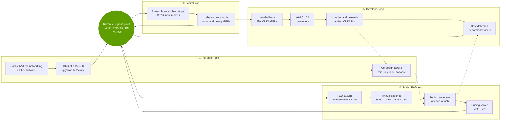
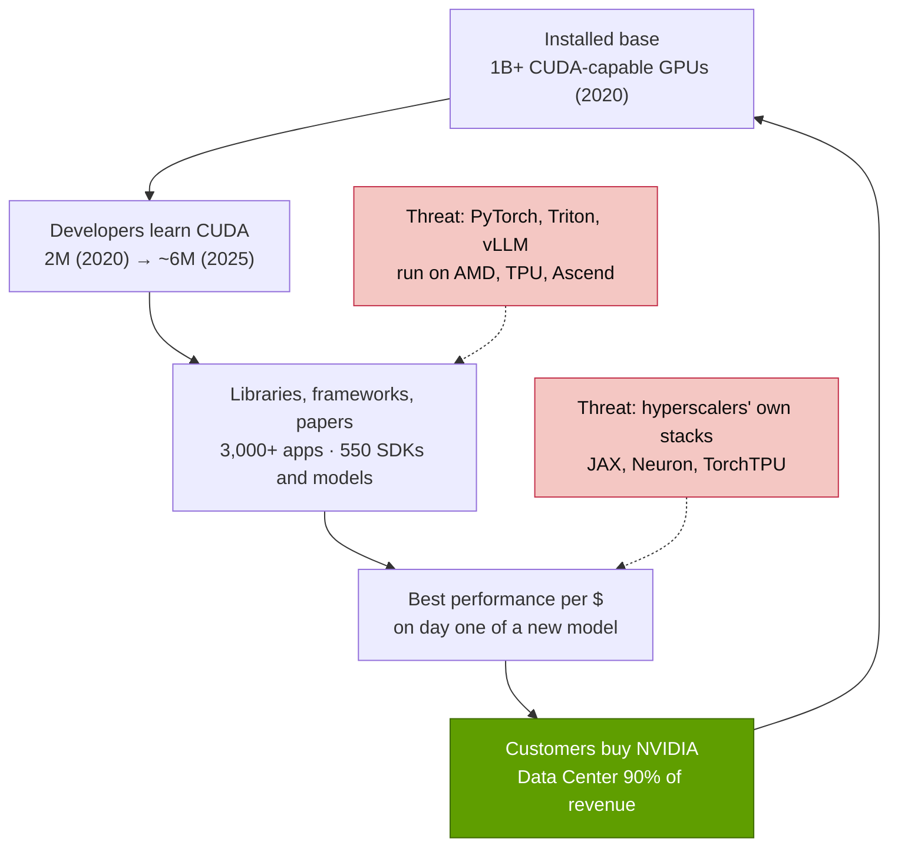
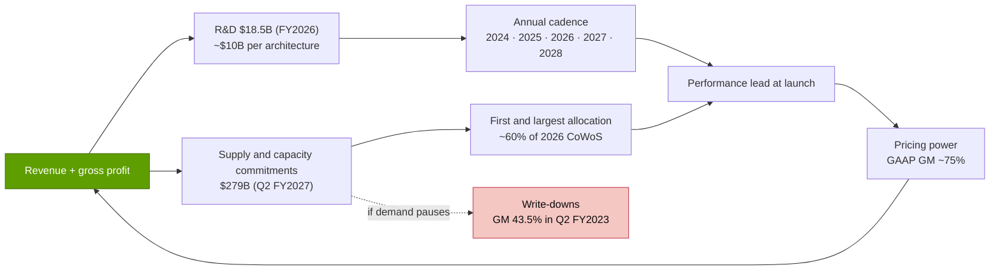
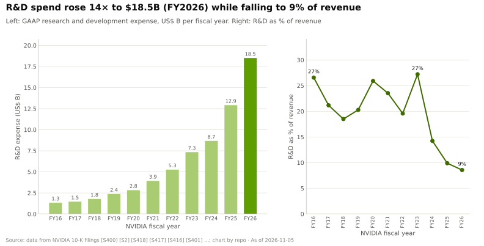
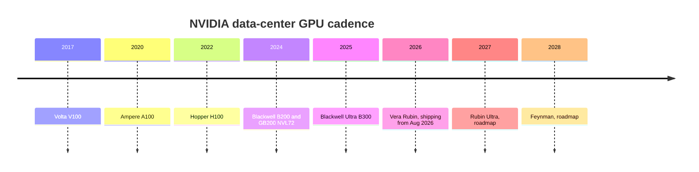
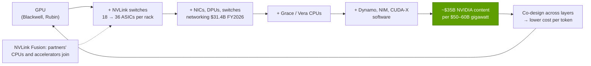
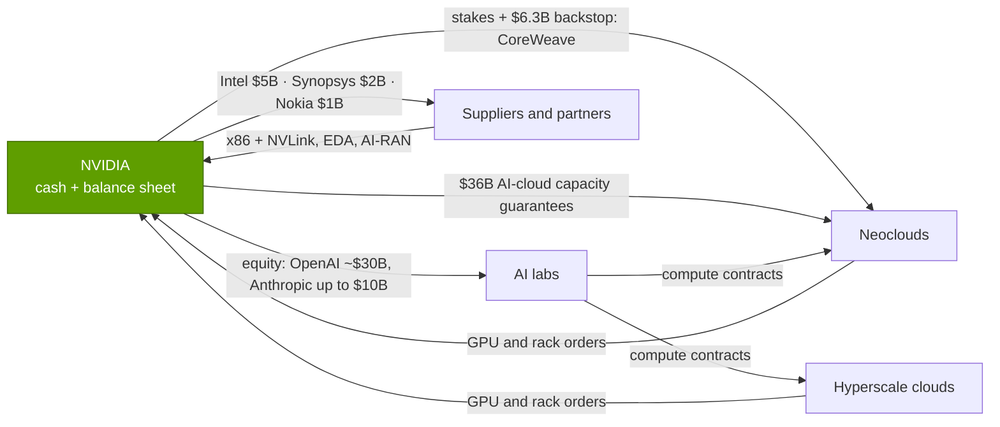
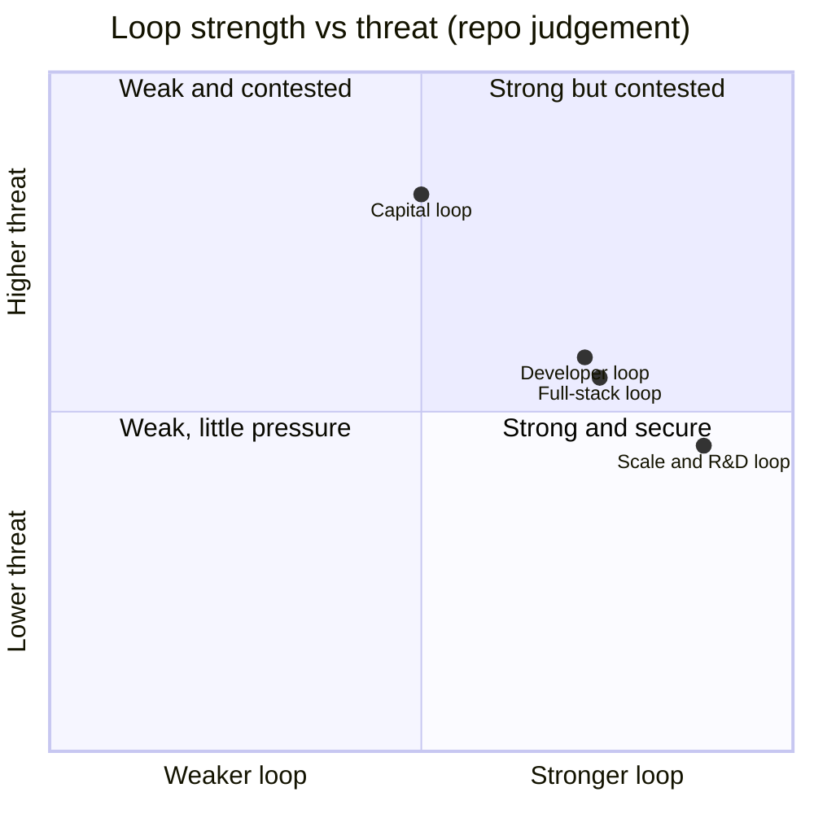

# 01 — The NVIDIA flywheel

Chapter 01 · Four reinforcing loops, how strong each one is, and where each could break · ~28 min read · Last verified: 2026-11-05

> [!NOTE]
> **How to read this chapter.** A [flywheel](glossary.md#flywheel) is a set of reinforcing loops: each
> turn makes the next turn easier. NVIDIA is usually described as having "a CUDA moat". The more
> useful view is **four loops that share one hub — revenue and gross profit** — and that is also
> where they can fail together. Each section explains one loop as a mechanism, quantifies it, and
> ends with how it could break. The [layer chapters](#how-the-loops-map-onto-the-stack) supply the depth.

## ⚡ The Executive Take

- **One hub, four loops.** Revenue reached $215.9B in FY2026, ~43× FY2016's $5.0B [[S1]](sources/bibliography.md#s1)[[S400]](sources/bibliography.md#s400), with
  Data Center at 90% of it [[S402]](sources/bibliography.md#s402); Q2 FY2027 revenue was $96.2B, +106% year on year, guided to
  $108B for Q3 [[S405]](sources/bibliography.md#s405). Every loop below deposits into that hub or draws on it.
- **① Developer loop — big, but no longer accelerating.** NVIDIA's count of CUDA developers tripled
  from 2M (2020) to ~6M (2025) [[S529]](sources/bibliography.md#s529)[[S536]](sources/bibliography.md#s536), then stayed at ~6M in March 2026 [[S528]](sources/bibliography.md#s528); the
  open-source serving stack that now carries most inference ([vLLM](glossary.md#vllm), [SGLang](glossary.md#sglang)) runs on AMD, TPU and
  Ascend as well [[S580]](sources/bibliography.md#s580)[[S582]](sources/bibliography.md#s582).
- **② Scale / R&D loop — the strongest today.** R&D rose ~14× to $18.5B in FY2026 while falling to
  ~9% of revenue [[S401]](sources/bibliography.md#s401)[[S400]](sources/bibliography.md#s400), and supply and capacity commitments reached **$279B** in Q2 FY2027
  [[S407]](sources/bibliography.md#s407) — about 5× TSMC's entire 2026 capex budget [[S35029]](sources/bibliography.md#s35029) — funding an annual cadence
  (Blackwell Ultra 2025, Rubin 2026, Rubin Ultra 2027, Feynman 2028) [[S33020]](sources/bibliography.md#s33020)[[S502]](sources/bibliography.md#s502).
- **③ Full-stack loop — share of wallet is rising.** Networking revenue grew from $8.6B (FY2024) to
  $31.4B (FY2026) [[S416]](sources/bibliography.md#s416)[[S402]](sources/bibliography.md#s402) and NVIDIA says it captures ~$35B of a $50–60B gigawatt AI factory
  [[S398]](sources/bibliography.md#s398).
- **④ Capital loop — the newest and most debated.** Since September 2025 NVIDIA has pledged ~$82B
  in equity stakes, licences and backstops (OpenAI ~$30B reported, Groq ~$20B reported, Anthropic up
  to $10B, CoreWeave $8.3B, Intel $5B) [[S480]](sources/bibliography.md#s480)[[S474]](sources/bibliography.md#s474)[[S469]](sources/bibliography.md#s469)[[S473]](sources/bibliography.md#s473)[[S472]](sources/bibliography.md#s472)[[S468]](sources/bibliography.md#s468) — the core of the
  [circular financing](glossary.md#circular-financing) critique [[S431]](sources/bibliography.md#s431)[[S449]](sources/bibliography.md#s449).
- **Pricing power is the output that funds everything:** GAAP gross margin ~75% in Q2 FY2027
  [[S405]](sources/bibliography.md#s405) versus 56% in FY2016 [[S400]](sources/bibliography.md#s400), on GPUs whose estimated build cost is ~20% of price
  [[S35020]](sources/bibliography.md#s35020).
- **The biggest risk is the coupling.** The loops share one hub, so a demand pause would hit all
  four at once: $279B of commitments [[S407]](sources/bibliography.md#s407), $36B of AI-cloud capacity guarantees [[S407]](sources/bibliography.md#s407) and four
  direct customers at 61% of revenue (Q3 FY2026) [[S412]](sources/bibliography.md#s412) would turn the wheel into a brake. The last
  downturn cut gross margin to 43.5% in a single quarter [[S433]](sources/bibliography.md#s433).

## 1. What the flywheel is — and why NVIDIA has four of them

**Analogy.** A flywheel is a heavy wheel that is hard to start and hard to stop. Each push adds a
little momentum; after enough pushes the wheel's own weight carries it. In business strategy the
"push" is an action whose result makes the next action cheaper or more effective. A single loop
can be copied; four loops that feed each other through a shared hub are much harder to copy because
a rival must start all of them at once.

The combined picture, with the latest number on each step:

The hub is real money. Revenue went from $5.0B in FY2016 to $215.9B in FY2026, almost all of the
increase from data centers:

> [!TIP]
> **Worked example — where one dollar of FY2026 revenue went.** Revenue $215.9B; GAAP gross margin
> 71.1% (after a $4.5B H20 export charge) → ~$153.5B gross profit [[S1]](sources/bibliography.md#s1)[[S402]](sources/bibliography.md#s402)[[S444]](sources/bibliography.md#s444). R&D took $18.5B,
> or **$0.09 per dollar** [[S401]](sources/bibliography.md#s401); operating income was $130.4B, **$0.60 per dollar**; net income
> $120.1B, **$0.56 per dollar** [[S1]](sources/bibliography.md#s1)[[S402]](sources/bibliography.md#s402). In the following six months NVIDIA pledged ~$82B to
> customers, partners and suppliers (§5) — roughly **two-thirds of a year's net income** recycled
> into the ecosystem, on top of ~$46B returned to shareholders in Q1–Q2 FY2027 [[S403]](sources/bibliography.md#s403)[[S405]](sources/bibliography.md#s405).
> That allocation is the flywheel made visible: R&D feeds loop ②, commitments feed loops ② and ④,
> and the stakes feed loop ④.

Which loops are accelerating? A simple test is to compare each loop's "engine metric" over the same
two years:

| Loop | Engine metric | Then | Now | Read-across |
|---|---|---|---|---|
| ① Developer | Registered CUDA developers | 2M (2020) [[S529]](sources/bibliography.md#s529) | ~6M (Mar 2026) [[S528]](sources/bibliography.md#s528) | Large, flattening |
| ② Scale / R&D | R&D expense | $1.33B (FY2016) [[S400]](sources/bibliography.md#s400) | $18.5B (FY2026) [[S401]](sources/bibliography.md#s401) | ~14×, lower intensity |
| ② Scale / R&D | Supply and capacity commitments | $4.79B (Q2 FY2022) [[S420]](sources/bibliography.md#s420) | $279B (Q2 FY2027) [[S407]](sources/bibliography.md#s407) | ~58× (line definitions differ across years [[S90092]](sources/bibliography.md#s90092)), now > a year of revenue |
| ③ Full stack | Networking revenue | $8.6B (FY2024) [[S416]](sources/bibliography.md#s416) | $31.4B (FY2026) [[S402]](sources/bibliography.md#s402) | ~3.7×, ~20% of data center |
| ④ Capital | Pledged stakes and backstops | ~$0.15B disclosed (2023) [[S481]](sources/bibliography.md#s481)[[S482]](sources/bibliography.md#s482) | ~$82B (Sep 2025–Feb 2026) [[S480]](sources/bibliography.md#s480)[[S474]](sources/bibliography.md#s474)[[S469]](sources/bibliography.md#s469) | New, and the most debated |

🔧 Under the hood: reinforcing loops in system-dynamics terms

In system-dynamics language each loop is a *reinforcing* (R) loop: an increase in one variable
causes, after a delay, a further increase in itself. Every real system also has *balancing* (B)
loops that cap growth — here, power and packaging supply, customer budgets, antitrust attention and
rivals' cost advantages. Two properties matter for an investor. First, **delays**: a developer
taught CUDA in 2018 pays off in 2025 purchases, so the developer loop responds slowly in both
directions. Second, **shared stocks**: all four loops draw on the same stock (cash and gross profit),
so a shock to that stock propagates through every loop simultaneously. That is why §6 treats
correlation, not any single loop, as the main risk.

## 2. Loop ① — the developer and software flywheel

**The mechanism.** An [installed base](glossary.md#installed-base) of GPUs that all run the same
software attracts developers; developers write libraries, models and papers that assume that
software; those libraries make the next GPU more useful per dollar than an alternative without
them; customers buy more of the same GPUs; the installed base grows. NVIDIA started the wheel in
2006–07 with [CUDA](glossary.md#cuda) — the first release shipped in June 2007 [[S525]](sources/bibliography.md#s525) — and kept it
compatible across every generation since.

The numbers NVIDIA itself publishes show both the scale and the slowdown. In 2020 it reported more
than 1 billion CUDA GPUs in the field, 39,000 new developer sign-ups and 438,000 CUDA downloads a
month [[S529]](sources/bibliography.md#s529). By early 2022 CUDA had been downloaded 33M times, 8M of them in 2021 alone [[S530]](sources/bibliography.md#s530);
by mid-2023 ~40M times, with >3,000 accelerated applications [[S533]](sources/bibliography.md#s533). NVIDIA listed 550 SDKs and AI
models in 2022 [[S532]](sources/bibliography.md#s532) and ~10,000 start-ups building on its platform [[S531]](sources/bibliography.md#s531).

> [!TIP]
> **Worked example — the switching cost a developer loop creates.** A lab that has tuned an inference
> service on NVIDIA's [TensorRT-LLM](glossary.md#tensorrt-llm), which runs only on NVIDIA GPUs [[S589]](sources/bibliography.md#s589), must re-validate kernels,
> quantization recipes and serving code to move. If 20 engineers spend 4 months on the port at a
> fully loaded $400K per engineer-year, that is ~$2.7M of labor (🔴 illustrative assumptions) —
> trivial against a $3M+ GB200 [NVL72](glossary.md#nvl72) rack [[S326]](sources/bibliography.md#s326) but meaningful for a startup, and *recurring*
> with every model generation. The loop's real lock-in is not the one-off port; it is that new
> models, kernels (FlashAttention-style attention, new number formats such as [NVFP4](glossary.md#nvfp4)) and papers tend to
> appear on CUDA first, so a non-NVIDIA buyer is always a few months behind.

**Why the loop is weakening at the edges.** The developer base that matters for AI increasingly
writes Python against frameworks, not CUDA directly — and the frameworks have gone multi-vendor:

| Framework / library (Nov 2026) | NVIDIA | AMD | Google TPU | Other accelerators | Source |
|---|---|---|---|---|---|
| PyTorch (training + eager) | 🟩 in-tree CUDA | 🟨 in-tree ROCm | 🟦 via TorchTPU (PyTorch/XLA deprecated) | 🟨 Intel XPU in-tree | [[S587]](sources/bibliography.md#s587)[[S595]](sources/bibliography.md#s595) |
| JAX | 🟩 supported | 🟨 AMD-maintained plugin | 🟩 native | 🟥 Intel experimental | [[S577]](sources/bibliography.md#s577) |
| Triton (kernel language) | 🟩 CC 8.0+ | 🟨 ROCm 6.2+ | — | 🟨 Intel out-of-tree backend | [[S578]](sources/bibliography.md#s578)[[S597]](sources/bibliography.md#s597) |
| vLLM (inference serving) | 🟩 in-tree | 🟨 in-tree ROCm | 🟨 plugin | 🟨 Gaudi, Ascend, Trainium plugins | [[S580]](sources/bibliography.md#s580)[[S581]](sources/bibliography.md#s581) |
| SGLang (inference serving) | 🟩 B200/GB300 | 🟨 MI300X–MI355X | 🟨 TorchTPU / SGL-JAX | 🟨 Ascend, Intel | [[S582]](sources/bibliography.md#s582) |
| TensorRT-LLM | 🟩 NVIDIA only | 🟥 none | 🟥 none | 🟥 none | [[S589]](sources/bibliography.md#s589) |
| ONNX Runtime | 🟩 CUDA, TensorRT | 🟨 MIGraphX | — | 🟨 OpenVINO, Qualcomm QNN | [[S585]](sources/bibliography.md#s585) |

🟩 first-class · 🟨 supported, usually maintained by the vendor or newer · 🟦 different approach · 🟥 none or experimental (repo judgement from the cited READMEs).

> [!WARNING]
> **Where loop ① could break.** The moat moves up a layer: if the frameworks developers actually
> touch ([PyTorch](glossary.md#pytorch), vLLM, SGLang, [Triton](glossary.md#triton)) are hardware-neutral, the switching cost shrinks to
> performance tuning — and [hyperscalers](glossary.md#hyperscaler) have the engineers to do that themselves. Google and Meta
> open-sourced TorchTPU in October 2026 [[S553]](sources/bibliography.md#s553); AMD now ships [ROCm](glossary.md#rocm) releases on a fast cadence
> [[S586]](sources/bibliography.md#s586). NVIDIA's own developer count, flat at ~6M between GTC 2025 and GTC 2026 [[S536]](sources/bibliography.md#s536)[[S528]](sources/bibliography.md#s528), is
> the metric to watch. Depth: [Layer 09 — CUDA](layers/09-cuda-and-system-software/index.md),
> [Layer 10 — CUDA-X libraries](layers/10-libraries-cuda-x/index.md) and
> [CS2 — CUDA, the 15-year bet](case-studies/CS2-cuda-the-15-year-bet.md).

🔧 Under the hood: what CUDA lock-in is actually made of

"CUDA" is shorthand for four layers, and they erode at different speeds:

1. **The programming model and compiler** (CUDA C++, the PTX virtual instruction set). PTX lets
   code written years ago run on new GPUs, which is why the installed base compounds. Rivals can
   imitate the model (AMD's HIP is deliberately CUDA-like), so this layer is the easiest to copy.
2. **The libraries** — cuBLAS (matrix math), cuDNN (neural-network kernels), [NCCL](glossary.md#nccl) (multi-GPU
   communication), TensorRT-LLM (inference). These hold years of per-generation tuning; a rival
   must match them kernel by kernel. NVIDIA listed 550 SDKs and models as early as 2022 [[S532]](sources/bibliography.md#s532).
3. **The tools** — profilers, debuggers and container images that make a cluster usable on day one.
4. **The habits** — the research and open-source default. New ideas (a new attention kernel, a new
   number format) tend to be written for CUDA first because that is what reviewers and users own.

Compiler-level abstraction (PyTorch's compiler, Triton, JAX/XLA) attacks layers 1–2 by generating
kernels automatically for several back ends [[S578]](sources/bibliography.md#s578)[[S577]](sources/bibliography.md#s577); that is why the developer loop is judged
"strong but contested" below. Depth in [Layer 09](layers/09-cuda-and-system-software/index.md).

## 3. Loop ② — the scale and R&D flywheel

**The mechanism.** Revenue funds R&D and, increasingly, **pre-commitments for supply**: wafers,
[HBM](glossary.md#hbm), CoWoS packaging and test capacity booked years ahead. That lets NVIDIA ship a new architecture
every year at volume, which keeps it ahead on performance at each launch, which supports pricing and
gross margin, which funds the next round. Each turn also raises the bar for rivals, who must match
both the R&D and the supply bookings.

**R&D: more dollars at lower intensity.** NVIDIA's R&D grew from $1.33B in FY2016 to $18.5B in
FY2026 (+43% in the last year alone) [[S400]](sources/bibliography.md#s400)[[S401]](sources/bibliography.md#s401), while falling from 27% to ~9% of revenue —
classic [operating leverage](glossary.md#operating-leverage). Jensen Huang put Blackwell's
development cost at ~$10B [[S35028]](sources/bibliography.md#s35028). For comparison, NVIDIA's calendar-2024 R&D of $12.9B already
exceeded AMD's and Broadcom's, and only Intel spent more [[S450]](sources/bibliography.md#s450)[[S451]](sources/bibliography.md#s451)[[S452]](sources/bibliography.md#s452).

**Cadence: from two years to one.** Until Blackwell, NVIDIA launched a data-center architecture
roughly every two years; since 2024 it has moved to an annual rhythm, with "Ultra" mid-cycle
refreshes:

Sources: V100 [[S126]](sources/bibliography.md#s126); A100 [[S127]](sources/bibliography.md#s127); H100 [[S33002]](sources/bibliography.md#s33002); Blackwell [[S396]](sources/bibliography.md#s396); Blackwell Ultra and roadmap [[S33020]](sources/bibliography.md#s33020); Rubin production shipments [[S500]](sources/bibliography.md#s500); Rubin Ultra and Feynman [[S502]](sources/bibliography.md#s502). 🟢 confirmed through 2026; 🟢 Rubin Ultra and Feynman announced, but 🟡 reports of a Kyber-rack slip to 2028 [[S507]](sources/bibliography.md#s507) (NVIDIA says its roadmap is intact [[S508]](sources/bibliography.md#s508)) and of a two-die Rubin Ultra [[S509]](sources/bibliography.md#s509).

**Supply pre-commitments: the least visible, most powerful lever.** NVIDIA's
[purchase obligations](glossary.md#purchase-obligations) — binding orders for wafers, memory,
packaging and capacity — grew from $4.79B in Q2 FY2022 [[S420]](sources/bibliography.md#s420) to $95.2B at FY2026 year-end [[S401]](sources/bibliography.md#s401),
$119B in Q1 FY2027 [[S404]](sources/bibliography.md#s404) and **$279B** in Q2 FY2027, mostly memory and manufacturing capacity for
current and future architectures [[S407]](sources/bibliography.md#s407). The 10-K's $95.2B and the 10-Q's supply and capacity commitments
are different line items, so the long series is indicative; the like-for-like step is $119B → $279B in one quarter [[S90092]](sources/bibliography.md#s90092).

> [!TIP]
> **Worked example — commitments as a moat.** $279B of commitments [[S407]](sources/bibliography.md#s407) is about **5×** TSMC's
> entire 2026 capital-spending budget of $52–56B [[S35029]](sources/bibliography.md#s35029), and press estimates give NVIDIA ~60% of
> TSMC's 2026 [CoWoS](glossary.md#cowos) allocation (~595K wafers vs ~150K for Broadcom and ~105K for AMD) (🟡) [[S379]](sources/bibliography.md#s379).
> The commitments are multi-year and include memory, so the comparison is about scale, not like for
> like. The mechanism is what matters: in a supply-constrained market, **whoever pre-pays for the
> scarce inputs decides who can ship**. A rival with a competitive design but no HBM or CoWoS
> allocation sells nothing that year. See [P5 — chip economics](primers/P5-chip-economics-101.md)
> and [Layer 03](layers/03-memory-packaging-supply-chain/index.md).

**Pricing power is the loop's output.** Gross margin climbed from 56.1% in FY2016 to 75.0% in
FY2025 [[S400]](sources/bibliography.md#s400)[[S416]](sources/bibliography.md#s416), held ~73–78% through the Blackwell ramp, and was ~75% in Q2 FY2027 [[S405]](sources/bibliography.md#s405).
Analyst estimates put the B200's build cost at ~$6,400 against a $30–40K price [[S35020]](sources/bibliography.md#s35020)[[S35026]](sources/bibliography.md#s35026).

> [!WARNING]
> **Where loop ② could break.** The same commitments that lock rivals out lock NVIDIA in. When demand
> paused in 2022, NVIDIA took charges for inventory and for obligations in excess of demand
> (~$348M in Q3 FY2023 alone) [[S421]](sources/bibliography.md#s421) and gross margin fell to 43.5% [[S433]](sources/bibliography.md#s433); the $4.5B H20 charge in
> Q1 FY2026 showed the same mechanism triggered by export policy [[S444]](sources/bibliography.md#s444). Today's commitments are ~30×
> the $9.2B outstanding in Q2 FY2023 [[S420]](sources/bibliography.md#s420)[[S407]](sources/bibliography.md#s407). Other break points: a slipped generation (the reported Kyber delay [[S507]](sources/bibliography.md#s507), Rubin's trimmed
> [HBM4](glossary.md#hbm4) bandwidth spec [[S103]](sources/bibliography.md#s103)[[S104]](sources/bibliography.md#s104)) or a rival matching the cadence — AMD has committed to an annual
> Instinct cadence (MI400 2026, MI500 2027) [[S545]](sources/bibliography.md#s545). Depth: [Layer 02](layers/02-gpu-silicon/roadmap.md),
> [17 — Roadmap](cross-cutting/17-roadmap-2025-2028.md).

## 4. Loop ③ — the full-stack and systems flywheel

**The mechanism.** Selling a whole rack — GPUs, CPUs, [NVLink](glossary.md#nvlink) switches, NICs, DPUs, reference
design and software — raises NVIDIA's [share of wallet](glossary.md#share-of-wallet) per customer
dollar. Owning every layer also lets NVIDIA optimize across them (a new number format in the GPU, a
switch that does the arithmetic of [all-reduce](glossary.md#all-reduce), a serving runtime that knows the topology), which
makes the system faster per dollar than a mix of best-of-breed parts, which sells the next rack.

The best single measure is networking. It grew from $8.6B in FY2024 to $31.4B in FY2026 [[S416]](sources/bibliography.md#s416)[[S402]](sources/bibliography.md#s402)
and reached $14.8B in Q1 FY2027 alone (+199% year on year) [[S409]](sources/bibliography.md#s409); in Q2 FY2027 it grew another 18%
sequentially, with [Spectrum-X](glossary.md#spectrum-x) Ethernet revenue up 2.6× year on year [[S408]](sources/bibliography.md#s408). That business came largely from the $6.9B Mellanox acquisition announced in 2019
[[S464]](sources/bibliography.md#s464) (see [CS1](case-studies/CS1-mellanox-the-best-deal.md)).

> [!TIP]
> **Worked example — share of wallet in a gigawatt.** NVIDIA's CEO put the cost of a 1 GW AI factory
> at ~$50–60B, of which ~$35B is NVIDIA content [[S398]](sources/bibliography.md#s398): **58–70% of the total**, against a GPU-only
> share that analysts put at ~51–65% of a rack's bill [[S332]](sources/bibliography.md#s332). Morgan Stanley's teardown shows why the
> rack bill nearly doubles from GB300 NVL72 (~$4.0M) to Vera Rubin NVL72 (~$7.8M): memory content
> jumps and NVLink switch ASICs double from 18 to 36, while the ODM's gross margin shrinks from 2.7% to
> 1.9% [[S332]](sources/bibliography.md#s332). The value accrues to the chip suppliers — NVIDIA and the memory makers — not to the
> assemblers. One year of networking revenue ($31.4B) is ~4.5× the Mellanox purchase price.

NVIDIA is now extending loop ③ to silicon it does not make. **[NVLink Fusion](glossary.md#nvlink-fusion)**
lets partners' CPUs and accelerators join an NVLink domain; launch partners included Qualcomm and
Fujitsu for custom CPUs and MediaTek, Marvell, Alchip and Astera Labs [[S517]](sources/bibliography.md#s517)[[S131]](sources/bibliography.md#s131), and AWS said
Trainium4 will integrate NVLink Fusion [[S518]](sources/bibliography.md#s518)[[S519]](sources/bibliography.md#s519). The Groq licence (§5) added an inference chip
that NVIDIA now sells as part of the Vera Rubin platform [[S307]](sources/bibliography.md#s307)[[S506]](sources/bibliography.md#s506).

> [!WARNING]
> **Where loop ③ could break.** The largest buyers build their own racks around their own chips:
> Google's TPU 8t/8i [[S550]](sources/bibliography.md#s550), AWS Trainium3 UltraServers [[S556]](sources/bibliography.md#s556), Microsoft Maia 200 [[S558]](sources/bibliography.md#s558) and Meta's
> MTIA roadmap [[S561]](sources/bibliography.md#s561). Open fabrics aim to commoditize NVIDIA's interconnect: [UALink](glossary.md#ualink) 1.0 and 2.0
> [[S573]](sources/bibliography.md#s573)[[S574]](sources/bibliography.md#s574), Ultra Ethernet 1.1 with [scale-up](glossary.md#scale-up) support [[S575]](sources/bibliography.md#s575) and the OCP [ESUN](glossary.md#esun) scale-up spec
> [[S576]](sources/bibliography.md#s576). And the biggest AI labs now dual-source: OpenAI with Broadcom (10 GW) [[S174]](sources/bibliography.md#s174) and AMD (up to
> 6 GW) [[S546]](sources/bibliography.md#s546); Anthropic with up to 1M Google TPUs [[S547]](sources/bibliography.md#s547). Depth: [Layer 05](layers/05-scale-up-nvlink-nvswitch/index.md),
> [Layer 06](layers/06-scale-out-scale-across-networking/index.md),
> [Layer 08](layers/08-systems-racks-ai-factories/index.md),
> [15 — Competitive landscape](cross-cutting/15-competitive-landscape/index.md).

🔧 Under the hood: three examples of cross-layer co-design

- **Number format × tensor core × software.** NVFP4 stores 4-bit values with an [FP8](glossary.md#fp8) scale for every
  16-value block plus a per-tensor scale [[S32017]](sources/bibliography.md#s32017); the GPU's tensor cores, the TensorRT-LLM kernels
  and the quantization recipes were designed together, so a customer gets the 4-bit speed-up
  without building the toolchain (see [P5 §8](primers/P5-chip-economics-101.md) for what that does
  to cost per FLOP).
- **Switch × collective library.** NVLink 5 gives each Blackwell GPU 1.8 TB/s and an NVL72 rack
  130 TB/s of scale-up bandwidth [[S34014]](sources/bibliography.md#s34014); NVIDIA's SHARP in-network reduction lets the switches do
  the arithmetic of an all-reduce, roughly halving the data that crosses the fabric [[S34024]](sources/bibliography.md#s34024). A
  buyer mixing a third-party switch with NVIDIA GPUs loses that.
- **Rack × serving runtime.** [Dynamo](glossary.md#dynamo) splits inference into [prefill](glossary.md#prefill) and [decode](glossary.md#decode) on different GPUs and
  routes requests by KV-cache location; NVIDIA claims up to 30× more requests for DeepSeek-R1 on
  GB200 NVL72 (vendor claim) [[S32015]](sources/bibliography.md#s32015), and it reached version 1.0 in March 2026 [[S520]](sources/bibliography.md#s520). The Groq 3
  LPX rack slots into the same platform as a dedicated decode engine [[S308]](sources/bibliography.md#s308).

Each example is a small advantage on its own; together they are why NVIDIA argues its system has
the lowest cost per token even at a ~75% gross margin (tested in
[14 — Training vs. inference economics](cross-cutting/14-training-vs-inference-economics.md)).

## 5. Loop ④ — the capital and ecosystem flywheel, and the "circular financing" critique

**The mechanism.** NVIDIA uses its cash to take stakes in, lend balance-sheet support to, or
guarantee capacity for the companies that buy and deploy its GPUs — AI labs, [neoclouds](glossary.md#neocloud)
(GPU-specialist clouds such as CoreWeave, Lambda, Nebius) — and the suppliers and platform partners
it depends on. Those companies use the money, or the credibility, to raise more capital and order
more NVIDIA systems; NVIDIA's revenue and the value of its stakes rise; the cycle repeats.

The pace changed in late 2025. In roughly six months NVIDIA announced:

- **AI labs:** a letter of intent to invest up to $100B in OpenAI as 10 GW of NVIDIA systems are
  deployed [[S467]](sources/bibliography.md#s467), reportedly replaced by a ~$30B investment in OpenAI's 2026 round (🟡) [[S480]](sources/bibliography.md#s480);
  up to $10B in Anthropic, alongside Microsoft's up to $5B, with Anthropic committing to up to 1 GW
  of NVIDIA systems [[S469]](sources/bibliography.md#s469); up to $2B in xAI and up to $1B in Poolside (🟡) [[S483]](sources/bibliography.md#s483).
- **Neoclouds and capacity:** a $6.3B agreement obliging NVIDIA to buy CoreWeave's unsold capacity
  through April 2032 [[S473]](sources/bibliography.md#s473) and a further $2B CoreWeave stake [[S472]](sources/bibliography.md#s472); a ~$1.5B GPU lease-back with
  Lambda (🟡) [[S483]](sources/bibliography.md#s483); and, by Q2 FY2027, **$36B of AI-cloud agreements** under which NVIDIA buys
  capacity partners cannot resell, plus $29B of multi-year cloud service commitments [[S407]](sources/bibliography.md#s407).
- **Suppliers, partners and technology:** $5B in Intel [[S468]](sources/bibliography.md#s468), $1B in Nokia [[S470]](sources/bibliography.md#s470), $2B in
  Synopsys [[S471]](sources/bibliography.md#s471), a ~$20B licence-and-team deal with Groq (reported) [[S474]](sources/bibliography.md#s474) and >$900M for
  Enfabrica's team and technology [[S475]](sources/bibliography.md#s475) — [acquihires](glossary.md#acquihire) structured to avoid
  merger review.

> [!TIP]
> **Worked example — how far does a dollar of NVIDIA equity travel?** Take Anthropic: NVIDIA
> commits up to $10B [[S469]](sources/bibliography.md#s469); Anthropic commits to up to 1 GW of NVIDIA systems [[S469]](sources/bibliography.md#s469); at NVIDIA's
> own ~$35B of content per gigawatt [[S398]](sources/bibliography.md#s398), that is up to **~$35B of potential NVIDIA revenue for
> $10B of equity — ~3.5×** (🔴 repo arithmetic; the 1 GW is a ceiling, and Anthropic also buys from
> Google and AWS [[S547]](sources/bibliography.md#s547)). The original OpenAI letter had the same shape at 10× the size: up to $100B
> invested progressively as each of 10 GW is deployed [[S467]](sources/bibliography.md#s467), against ~$350B of implied NVIDIA content
> (🔴). The bull reads this as cheap customer acquisition with equity upside; the bear reads it as
> NVIDIA financing a meaningful part of its own demand.

**The circular-financing critique, steelmanned.** (1) *Demand quality:* some revenue is bought by
companies whose ability to pay depends on NVIDIA's money or guarantees, so reported growth overstates
independent demand. (2) *Hidden leverage:* backstops and capacity guarantees ($6.3B CoreWeave; $36B
AI-cloud agreements) are contingent liabilities that crystallize exactly when demand weakens [[S473]](sources/bibliography.md#s473)[[S407]](sources/bibliography.md#s407);
Michael Burry called the $95B of purchase obligations "troubling" [[S431]](sources/bibliography.md#s431) before the broader 10-Q commitments line reached $279B (a different line item [[S90092]](sources/bibliography.md#s90092)),
and a secondary tally of the Q2 FY2027 10-Q counts $366B of total future commitments [[S430]](sources/bibliography.md#s430)[[S449]](sources/bibliography.md#s449).
(3) *Earnings quality:* Q1 FY2027 net income included ~$15.9B of other income, largely unrealized
gains on equity stakes such as Intel [[S403]](sources/bibliography.md#s403) — the stakes rise when NVIDIA's ecosystem news is good,
which flatters earnings in booms and reverses in busts. (4) *Concentration:* four direct customers,
mostly OEMs and ODMs building for hyperscalers, were 61% of Q3 FY2026 revenue [[S412]](sources/bibliography.md#s412).

> [!NOTE]
> **🐂 Bull view.** The pledges total ~$82B against $120B of FY2026 net income [[S1]](sources/bibliography.md#s1) and are spread
> across the whole ecosystem; most are equity in fast-growing companies, not loans. NVIDIA is
> seeding the customers, neoclouds and partners that diversify it *away* from four hyperscalers, at
> a time when the hyperscalers themselves plan ~$558B of 2026 capex (raised from ~$505B in their first guides) [[S12518]](sources/bibliography.md#s12518)[[S12519]](sources/bibliography.md#s12519) [[S460]](sources/bibliography.md#s460)[[S461]](sources/bibliography.md#s461)[[S462]](sources/bibliography.md#s462). A vendor with
> ~75% gross margins can afford to subsidize adoption the way platform companies always have.

> [!WARNING]
> **🐻 Bear view.** Loop ④ is the one loop that converts NVIDIA's *cyclical* risk into *balance-sheet*
> risk. In a downturn the investee labs and neoclouds cut orders, the capacity guarantees are called,
> the equity stakes are marked down, and the $279B of supply commitments come due — all at once. The
> 2022 bust, at a fraction of today's exposure, cut gross margin by ~22 points in one quarter, from
> 65.5% to 43.5% [[S432]](sources/bibliography.md#s432)[[S433]](sources/bibliography.md#s433). See [18 — Vulnerabilities and bear case](cross-cutting/18-vulnerabilities-and-bear-case.md)
> and [Layer 13 — Ecosystem, GTM and capital](layers/13-ecosystem-gtm-and-capital/index.md).

🔧 Under the hood: how stakes and backstops show up in NVIDIA's accounts

- **Equity stakes in listed companies** (Intel, Nokia, Synopsys, CoreWeave and others appear in
  NVIDIA's 13F filings [[S477]](sources/bibliography.md#s477)) are marked to market through "other income", outside gross margin
  and operating income. That is why Q1 FY2027 net income ($58.3B) exceeded operating income
  ($53.5B) [[S403]](sources/bibliography.md#s403).
- **Capacity backstops** are contingent purchase commitments: under the CoreWeave agreement NVIDIA
  must buy residual unsold capacity through April 2032 [[S473]](sources/bibliography.md#s473); under the AI-cloud agreements
  disclosed in Q2 FY2027 it buys committed capacity that partners cannot resell [[S407]](sources/bibliography.md#s407). They become
  expenses only if demand falls short — the scenario in which they hurt most.
- **Multi-year cloud service agreements** ($29B at Q2 FY2027 [[S407]](sources/bibliography.md#s407)) are NVIDIA renting capacity
  back, partly for its own research and DGX Cloud — revenue for the cloud, a cost for NVIDIA.
- **Letters of intent are not contracts.** NVIDIA's 10-Q warned there was no assurance the OpenAI
  letter would lead to definitive terms [[S412]](sources/bibliography.md#s412); it was reportedly superseded by a smaller equity
  investment [[S480]](sources/bibliography.md#s480).

## 6. How the loops interlock — and where each could break

The loops are not independent. Loop ② (cadence) refreshes the reason to stay in loop ① (new
features land on CUDA first); loop ③ (systems) multiplies the dollars each loop-① customer spends;
loop ④ (capital) recruits new customers into loop ① and pre-sells the supply booked in loop ②. That
coupling is the moat — a rival must replicate four loops, not one — and also the risk.

| Loop | Strength today | Main threat | Threat level | Leading indicator to watch |
|---|---|---|---|---|
| ① Developer / software | 🟩 ~6M developers, 1B+ GPUs, CUDA-first research [[S528]](sources/bibliography.md#s528)[[S529]](sources/bibliography.md#s529) | Framework abstraction (PyTorch, Triton, vLLM, TorchTPU) [[S580]](sources/bibliography.md#s580)[[S553]](sources/bibliography.md#s553) | 🟨 Rising | Developer count; share of vLLM/SGLang traffic on non-NVIDIA hardware |
| ② Scale / R&D | 🟩 $18.5B R&D, $279B commitments, annual cadence [[S401]](sources/bibliography.md#s401)[[S407]](sources/bibliography.md#s407) | Demand pause → write-downs; cadence slips; AMD matching cadence [[S421]](sources/bibliography.md#s421)[[S507]](sources/bibliography.md#s507)[[S545]](sources/bibliography.md#s545) | 🟨 Moderate, high impact | Purchase obligations ÷ revenue; inventory; gross margin |
| ③ Full stack / systems | 🟩 Networking $31.4B; ~$35B per GW [[S402]](sources/bibliography.md#s402)[[S398]](sources/bibliography.md#s398) | Custom ASIC racks; UALink, UEC, ESUN [[S550]](sources/bibliography.md#s550)[[S556]](sources/bibliography.md#s556)[[S573]](sources/bibliography.md#s573)[[S576]](sources/bibliography.md#s576) | 🟨 Rising | Networking share of DC revenue; NVLink Fusion adopters |
| ④ Capital / ecosystem | 🟨 ~$82B pledged; $36B capacity guarantees [[S407]](sources/bibliography.md#s407) | Circular-financing unwind; customer concentration 61% [[S412]](sources/bibliography.md#s412)[[S431]](sources/bibliography.md#s431) | 🟥 High | Backstops called; equity marks; investee order growth |

🟩 strong · 🟨 moderate · 🟥 weak or high threat (repo judgement, 🔴 speculative by definition).

> [!IMPORTANT]
> **The one thing to remember.** NVIDIA's advantage is not any single loop — each can be attacked —
> but the fact that all four run through one hub of revenue and ~75% gross margin. That makes the
> system self-funding in a boom and **correlated in a bust**: the loop that looks newest (capital)
> and the one that looks strongest (scale, via $279B of commitments) are the two that would amplify
> a downturn.

🔧 Under the hood: what would have to be true for each loop to stall

- **Loop ① stalls** if a new model architecture or training method appears first on non-CUDA
  hardware and gains share (for example, if the leading open-weight models were developed and tuned on
  TPUs or Trainium), or if inference shifts to compiled, hardware-neutral graphs where kernel tuning
  is automated. Indicator: framework release notes listing non-NVIDIA targets as tier one.
- **Loop ② stalls** if hyperscaler capex flattens (it was guided to ~$505B for 2026 across three
  companies [[S460]](sources/bibliography.md#s460)[[S461]](sources/bibliography.md#s461)[[S462]](sources/bibliography.md#s462), since raised to ~$558B [[S12518]](sources/bibliography.md#s12518)) while commitments are fixed, or if a generation slips by a year —
  customers then wait instead of buying the current part.
- **Loop ③ stalls** if Ethernet-based scale-up ([UEC](glossary.md#ultra-ethernet) 1.1, ESUN) reaches NVLink-class latency at lower
  cost, letting buyers mix GPUs and ASICs in one fabric; NVIDIA's counter is to open NVLink itself
  (NVLink Fusion).
- **Loop ④ stalls** when investee companies cannot raise follow-on capital; it reverses if NVIDIA
  must honor capacity guarantees in a falling rental market — H100 rental prices already fell from
  ~$8 to under ~$2 per [GPU-hour](glossary.md#gpu-hour) between 2023 and late 2024 [[S393]](sources/bibliography.md#s393).

## 7. What it would take to replicate the flywheel

A rival does not need to beat NVIDIA everywhere; it needs enough of each loop to make its own wheel
turn. The table sets out the entry ticket per loop, using NVIDIA's numbers as the benchmark.

| Loop | What a rival must build | NVIDIA's benchmark | Est. time / cost to replicate (🔴 repo judgement) | Closest challenger today |
|---|---|---|---|---|
| ① Developer | Compiler, tuned libraries, tools, and a research default | ~19 years of CUDA (June 2007 →) and ~6M developers [[S525]](sources/bibliography.md#s525)[[S528]](sources/bibliography.md#s528) | 5–10 years unless frameworks abstract it away; several $B a year of software engineering | Google (JAX/XLA native on TPU) [[S577]](sources/bibliography.md#s577); AMD ROCm [[S586]](sources/bibliography.md#s586) |
| ② Scale / R&D | Annual architecture cadence plus multi-year supply bookings | R&D $18.5B a year; ~$10B per architecture; $279B commitments [[S401]](sources/bibliography.md#s401)[[S35028]](sources/bibliography.md#s35028)[[S407]](sources/bibliography.md#s407) | Only possible with $20B+ of annual AI revenue to fund it | AMD (annual cadence, MI400 2026, MI500 2027) [[S545]](sources/bibliography.md#s545); Google TPU 8 [[S550]](sources/bibliography.md#s550) |
| ③ Full stack | Scale-up fabric, NICs and switches, rack design, serving software | Networking $31.4B in FY2026; Mellanox bought for $6.9B [[S402]](sources/bibliography.md#s402)[[S464]](sources/bibliography.md#s464) | 3–5 years; buy or partner for networking | AMD Helios with Pensando [[S538]](sources/bibliography.md#s538); Broadcom Tomahawk 6 plus custom XPUs [[S570]](sources/bibliography.md#s570)[[S174]](sources/bibliography.md#s174) |
| ④ Capital | A balance sheet able to seed customers and guarantee capacity | ~$82B pledged in six months (§5) | Only hyperscale-scale balance sheets | Microsoft and Amazon (stakes in Anthropic and OpenAI) [[S469]](sources/bibliography.md#s469)[[S480]](sources/bibliography.md#s480); Google (TPUs for Anthropic) [[S547]](sources/bibliography.md#s547) |

> [!TIP]
> **Worked example — the R&D gap in AMD terms.** AMD spent ~$6.5B on R&D in 2024 across CPUs, GPUs
> and everything else [[S450]](sources/bibliography.md#s450); NVIDIA spent $18.5B in FY2026 [[S401]](sources/bibliography.md#s401), ~2.8× as much. AMD's *total*
> revenue was $13.4B in Q3 2026 [[S542]](sources/bibliography.md#s542), so NVIDIA's annual R&D budget equals roughly 1.4 quarters of
> AMD's entire sales. AMD can still compete — it matched the annual cadence [[S545]](sources/bibliography.md#s545) and won OpenAI
> commitments of up to 6 GW [[S546]](sources/bibliography.md#s546) — but it does so by focusing its spend on fewer layers, which is
> exactly the trade-off any challenger, Qualcomm included, would face.

## How the loops map onto the stack

| Loop | Layers where it lives | Case studies |
|---|---|---|
| ① Developer / software | [09 CUDA](layers/09-cuda-and-system-software/index.md) · [10 CUDA-X](layers/10-libraries-cuda-x/index.md) · [11 Inference software](layers/11-inference-and-ai-software/index.md) | [CS2 CUDA](case-studies/CS2-cuda-the-15-year-bet.md) · [CS5 DeepSeek](case-studies/CS5-deepseek-moment-and-efficiency-shock.md) |
| ② Scale / R&D | [02 GPU silicon](layers/02-gpu-silicon/index.md) · [03 Memory, packaging, supply chain](layers/03-memory-packaging-supply-chain/index.md) · [04 CPU](layers/04-cpu-grace-vera/index.md) | [CS6 China export controls](case-studies/CS6-china-export-controls-h20-and-beyond.md) |
| ③ Full stack / systems | [05 Scale-up](layers/05-scale-up-nvlink-nvswitch/index.md) · [06 Networking](layers/06-scale-out-scale-across-networking/index.md) · [07 DPU](layers/07-dpu-supernic-storage-security/index.md) · [08 Systems](layers/08-systems-racks-ai-factories/index.md) · [12 Cloud services](layers/12-orchestration-and-cloud-services/index.md) | [CS1 Mellanox](case-studies/CS1-mellanox-the-best-deal.md) · [CS7 Gigawatt factories](case-studies/CS7-gigawatt-ai-factories-xai-stargate-etc.md) |
| ④ Capital / ecosystem | [13 Ecosystem, GTM and capital](layers/13-ecosystem-gtm-and-capital/index.md) | [CS4 AMD–OpenAI](case-studies/CS4-amd-openai-and-the-second-source.md) · [CS3 Google TPU](case-studies/CS3-google-tpu-the-credible-alternative.md) |
| All four (bear case) | [18 Vulnerabilities and bear case](cross-cutting/18-vulnerabilities-and-bear-case.md) · [16 How NVIDIA built it](cross-cutting/16-how-nvidia-built-it-timeline.md) · [17 Roadmap](cross-cutting/17-roadmap-2025-2028.md) | — |

## 🎯 Corp Dev Lens

1. **Which loop can a challenger enter without fighting all four?** The developer loop is weakest
   where frameworks are already multi-vendor (vLLM, SGLang, ONNX Runtime, llama.cpp all list Qualcomm
   or other non-NVIDIA backends [[S585]](sources/bibliography.md#s585)[[S579]](sources/bibliography.md#s579)[[S596]](sources/bibliography.md#s596)). Is inference serving the place where software
   lock-in is lowest and power efficiency matters most?
2. **Partner inside loop ③, or compete with it?** NVLink Fusion names Qualcomm among its custom-CPU
   partners [[S517]](sources/bibliography.md#s517)[[S131]](sources/bibliography.md#s131) while Qualcomm's AI200/AI250 racks compete for inference [[S569]](sources/bibliography.md#s569)[[S173]](sources/bibliography.md#s173). What
   does each path give up — and which NVIDIA-adjacent standards (NVLink Fusion vs UALink/ESUN) keep
   options open?
3. **Loop ④ has made NVIDIA a strategic investor in most of the buyers a datacenter entrant would
   court** (OpenAI, Anthropic, xAI, CoreWeave, Lambda, Nebius) [[S480]](sources/bibliography.md#s480)[[S469]](sources/bibliography.md#s469)[[S483]](sources/bibliography.md#s483)[[S473]](sources/bibliography.md#s473). Which
   large AI buyers are *not* financially tied to NVIDIA, and what would a credible second-source
   relationship with them look like (cf. AMD–OpenAI, up to 6 GW [[S546]](sources/bibliography.md#s546))?
4. **Supply is a competitive weapon.** With ~60% of 2026 CoWoS reportedly allocated to NVIDIA [[S379]](sources/bibliography.md#s379)
   and $279B of commitments [[S407]](sources/bibliography.md#s407), what memory and packaging capacity can an entrant actually secure
   for 2027–2028, and is a supply partnership (HBM maker, OSAT, foundry) worth more than a design
   acquisition?
5. **Watch the coupling indicators, not the headlines:** purchase obligations ÷ revenue, inventory,
   capacity guarantees called, and gross margin. A downturn that hits all four loops at once is the
   scenario in which NVIDIA's ecosystem partners — and assets — become available on better terms.

## 📚 Sources

<!-- Auto-generated from the [S…] citations on this page by `make build`. Edit sources/registry/*.csv, not this list. -->

- [**S1**](sources/bibliography.md#s1) NVIDIA Corporation via SEC EDGAR, *NVIDIA Announces Financial Results for Fourth Quarter and Fiscal 2026 (Form 8-K exhibit 99.1)*, 2026-02-25. [Link](https://www.sec.gov/Archives/edgar/data/1045810/000104581026000019/q4fy26pr.htm)
- [**S103**](sources/bibliography.md#s103) VideoCardz, *NVIDIA quietly cuts Vera Rubin specs, HBM4 bandwidth and NVLink 6 speeds now lower*, 2026-10. [Link](https://videocardz.com/newz/nvidia-quietly-cuts-vera-rubin-specs-hbm4-bandwidth-and-nvlink-6-speeds-now-lower)
- [**S104**](sources/bibliography.md#s104) Wccftech, *NVIDIA's Official Statement on Vera Rubin Spec Change*, 2026-10-29. [Link](https://wccftech.com/nvidia-official-statement-on-vera-rubin-spec-change/)
- [**S126**](sources/bibliography.md#s126) NVIDIA, *NVIDIA Tesla V100 GPU Architecture Whitepaper*, 2017-08. [Link](https://images.nvidia.com/content/volta-architecture/pdf/volta-architecture-whitepaper.pdf)
- [**S127**](sources/bibliography.md#s127) NVIDIA Technical Blog, *NVIDIA Ampere Architecture In-Depth*, 2020-05-14. [Link](https://developer.nvidia.com/blog/nvidia-ampere-architecture-in-depth/)
- [**S131**](sources/bibliography.md#s131) NVIDIA Newsroom, *NVIDIA NVLink Fusion: semi-custom AI infrastructure partner ecosystem (Computex 2025)*, 2025-05-19. [Link](https://nvidianews.nvidia.com/news/nvidia-nvlink-fusion-semi-custom-ai-infrastructure-partner-ecosystem)
- [**S173**](sources/bibliography.md#s173) Qualcomm, *Qualcomm Unveils AI200 and AI250 - Redefining Rack-Scale Data Center Inference*, 2025-10-27. [Link](https://www.qualcomm.com/news/releases/2025/10/qualcomm-unveils-ai200-and-ai250-redefining-rack-scale-data-cent)
- [**S174**](sources/bibliography.md#s174) OpenAI, *OpenAI and Broadcom announce strategic collaboration to deploy 10 gigawatts of OpenAI-designed AI accelerators*, 2025-10-13. [Link](https://openai.com/index/openai-and-broadcom-announce-strategic-collaboration/)
- [**S307**](sources/bibliography.md#s307) Exxact Corp, *NVIDIA GTC 2026 recap: era of tokens and inference*, 2026-03. [Link](https://www.exxactcorp.com/blog/news/nvidia-gtc-2026-recap-era-of-tokens-and-inference)
- [**S308**](sources/bibliography.md#s308) The Decoder, *GTC 2026: with Groq 3 LPX Nvidia adds dedicated inference hardware to its platform for the first time*, 2026-03. [Link](https://the-decoder.com/gtc-2026-with-groq-3-lpx-nvidia-adds-dedicated-inference-hardware-to-its-platform-for-the-first-time/)
- [**S326**](sources/bibliography.md#s326) TweakTown, *NVIDIA's new GB200 Superchip costs up to $70,000: full B200 NVL72 AI server costs $3 million*, 2024-05. [Link](https://www.tweaktown.com/news/98292/nvidias-new-gb200-superchip-costs-up-to-70-000-full-b200-nvl72-ai-server-3-million/index.html)
- [**S332**](sources/bibliography.md#s332) Tiger Brokers (iTiger), *Morgan Stanley's BOM analysis of NVIDIA's Rubin: GPU share declines; PCB, MLCC and ABF substrate values soar*, 2026-05-20. [Link](https://www.itiger.com/news/1188068712)
- [**S379**](sources/bibliography.md#s379) TrendForce News, *TSMC CoWoS capacity and customer allocation estimates (TrendForce / Morgan Stanley, as reported)*, 2025. [Link](https://www.trendforce.com/news/)
- [**S393**](sources/bibliography.md#s393) Latent Space (Eugene Cheah), *$2 H100s: how the GPU bubble burst*, 2024-10. [Link](https://www.latent.space/p/gpu-bubble)
- [**S396**](sources/bibliography.md#s396) NVIDIA Newsroom, *NVIDIA Blackwell platform arrives to power a new era of computing*, 2024-03-18. [Link](https://nvidianews.nvidia.com/news/nvidia-blackwell-platform-arrives-to-power-a-new-era-of-computing)
- [**S398**](sources/bibliography.md#s398) NVIDIA Investor Relations, *NVIDIA Q2 FY2026 earnings call (2025-08-27): AI factory economics commentary*, 2025-08-27. [Link](https://investor.nvidia.com/events-and-presentations/events-and-presentations/default.aspx)
- [**S400**](sources/bibliography.md#s400) U.S. Securities and Exchange Commission (EDGAR), *NVIDIA Corporation Form 10-K annual reports FY2001–FY2019 (EDGAR filing index)*, 2019-02-21. [Link](https://www.sec.gov/cgi-bin/browse-edgar?action=getcompany&CIK=0001045810&type=10-K&dateb=&owner=include&count=40)
- [**S401**](sources/bibliography.md#s401) NVIDIA Corporation via SEC EDGAR, *NVIDIA Corporation Form 10-K for fiscal year ended January 25, 2026*, 2026-02-25. [Link](https://www.sec.gov/Archives/edgar/data/1045810/000104581026000021/nvda-20260125.htm)
- [**S402**](sources/bibliography.md#s402) NVIDIA Corporation via SEC EDGAR (Colette Kress), *CFO Commentary on Fourth Quarter and Fiscal 2026 Results (Form 8-K exhibit 99.2)*, 2026-02-25. [Link](https://www.sec.gov/Archives/edgar/data/1045810/000104581026000019/q4fy26cfocommentary.htm)
- [**S403**](sources/bibliography.md#s403) NVIDIA Corporation via SEC EDGAR, *NVIDIA Announces Financial Results for First Quarter Fiscal 2027 (Form 8-K exhibit 99.1)*, 2026-05-20. [Link](https://www.sec.gov/Archives/edgar/data/0001045810/000104581026000051/q1fy27pr.htm)
- [**S404**](sources/bibliography.md#s404) NVIDIA Corporation via SEC EDGAR, *NVIDIA Corporation Form 10-Q for quarter ended April 26, 2026*, 2026-05-27. [Link](https://www.sec.gov/Archives/edgar/data/1045810/000104581026000052/nvda-20260426.htm)
- [**S405**](sources/bibliography.md#s405) NVIDIA Corporation via SEC EDGAR, *NVIDIA Announces Financial Results for Second Quarter Fiscal 2027 (Form 8-K exhibit 99.1)*, 2026-08-26. [Link](https://www.sec.gov/Archives/edgar/data/0001045810/000104581026000073/q2fy27pr.htm)
- [**S407**](sources/bibliography.md#s407) NVIDIA Corporation via SEC EDGAR, *NVIDIA Corporation Form 10-Q for quarter ended July 26, 2026*, 2026-08-28. [Link](https://www.sec.gov/Archives/edgar/data/1045810/000104581026000075/nvda-20260726.htm)
- [**S408**](sources/bibliography.md#s408) NVIDIA Corporation, *NVIDIA Corp. (NVDA) Q2 Fiscal 2027 earnings call transcript (26 August 2026)*, 2026-08-26. [Link](https://s201.q4cdn.com/141608511/files/content_files/TRANSCRIPT_-NVIDIA-Corp-NVDA-US-Q2-2027-Earnings-Call-26-August-2026-5_00-PM-ET.pdf)
- [**S409**](sources/bibliography.md#s409) NVIDIA Corporation, *NVIDIA Corp. (NVDA) Q1 Fiscal 2027 earnings call transcript (20 May 2026)*, 2026-05-20. [Link](https://s201.q4cdn.com/141608511/files/doc_financials/2027/q1/NVDA-Q1-2027-Earnings-Call-20-May-2026-5_00-PM-ET.pdf)
- [**S412**](sources/bibliography.md#s412) NVIDIA Corporation via SEC EDGAR, *NVIDIA Corporation Form 10-Q for quarter ended October 26, 2025*, 2025-11-19. [Link](https://www.sec.gov/Archives/edgar/data/1045810/000104581025000230/nvda-20251026.htm)
- [**S416**](sources/bibliography.md#s416) NVIDIA Corporation via SEC EDGAR, *NVIDIA Corporation Form 10-K for fiscal year ended January 26, 2025*, 2025-02-26. [Link](https://www.sec.gov/Archives/edgar/data/1045810/000104581025000023/nvda-20250126.htm)
- [**S420**](sources/bibliography.md#s420) NVIDIA Corporation (via CapEdge mirror of Form 8-K) (Colette Kress), *CFO Commentary on Second Quarter Fiscal 2023 Results*, 2022-08-24. [Link](https://capedge.com/filing/1045810/0001045810-22-000136/NVDA-8K/file/3)
- [**S421**](sources/bibliography.md#s421) NVIDIA Corporation (via CapEdge mirror of Form 8-K) (Colette Kress), *CFO Commentary on Third Quarter Fiscal 2023 Results*, 2022-11-16. [Link](https://capedge.com/filing/1045810/0001045810-22-000163/NVDA-8K/file/3)
- [**S430**](sources/bibliography.md#s430) FourWeekMBA, *Nvidia's 10-Q Lists $530B in Commitments and Guarantees*, 2026-08. [Link](https://fourweekmba.com/ai-nvidia-10-q-lists-530b-in-commitments-and-guarantees/)
- [**S431**](sources/bibliography.md#s431) Barchart, *Michael Burry called Nvidia's $95 billion in purchase obligations 'troubling' in February; six months later the filings show $279 billion*, 2026-09. [Link](https://www.barchart.com/story/news/4406785/michael-burry-called-nvidias-95-billion-in-purchase-obligations-troubling-in-february-six-months-later-the-filings-show-that-number-ballooned-to-279-billion)
- [**S432**](sources/bibliography.md#s432) NVIDIA Corporation, *NVIDIA Announces Financial Results for First Quarter Fiscal 2023 (press release with CFO commentary)*, 2022-05-25. [Link](https://nvidianews.nvidia.com/news/nvidia-announces-financial-results-for-first-quarter-fiscal-2023)
- [**S433**](sources/bibliography.md#s433) NVIDIA Corporation, *NVIDIA Announces Financial Results for Second Quarter Fiscal 2023 (press release with CFO commentary)*, 2022-08-24. [Link](https://nvidianews.nvidia.com/news/nvidia-announces-financial-results-for-second-quarter-fiscal-2023)
- [**S444**](sources/bibliography.md#s444) NVIDIA Corporation, *NVIDIA Announces Financial Results for First Quarter Fiscal 2026 (press release with CFO commentary)*, 2025-05-28. [Link](https://nvidianews.nvidia.com/news/nvidia-announces-financial-results-for-first-quarter-fiscal-2026)
- [**S449**](sources/bibliography.md#s449) Fortune, *Nvidia's massive future spending commitments 'make the company's risk profile more complex,' Saxo says*, 2026-08-28. [Link](https://fortune.com/2026/08/28/nvidia-cash-spending-commitments-risk-profile-more-complex-saxo/)
- [**S450**](sources/bibliography.md#s450) U.S. Securities and Exchange Commission (EDGAR), *Advanced Micro Devices Form 10-K / 10-Q filings (EDGAR index)*, 2025-02-05. [Link](https://www.sec.gov/cgi-bin/browse-edgar?action=getcompany&CIK=0000002488&type=10-&dateb=&owner=include&count=40)
- [**S451**](sources/bibliography.md#s451) U.S. Securities and Exchange Commission (EDGAR), *Broadcom Inc. Form 10-K / 8-K earnings filings (EDGAR index)*, 2025-12-11. [Link](https://www.sec.gov/cgi-bin/browse-edgar?action=getcompany&CIK=0001730168&type=8-K&dateb=&owner=include&count=40)
- [**S452**](sources/bibliography.md#s452) U.S. Securities and Exchange Commission (EDGAR), *Intel Corporation Form 10-K filings (EDGAR index)*, 2025-01-31. [Link](https://www.sec.gov/cgi-bin/browse-edgar?action=getcompany&CIK=0000050863&type=10-K&dateb=&owner=include&count=40)
- [**S460**](sources/bibliography.md#s460) Alphabet Investor Relations, *Alphabet Q4 and fiscal year 2025 results and 2026 capex outlook*, 2026-02. [Link](https://abc.xyz/investor/)
- [**S461**](sources/bibliography.md#s461) Amazon Investor Relations, *Amazon.com Q4 2025 results and 2026 capex commentary*, 2026-02. [Link](https://ir.aboutamazon.com/)
- [**S462**](sources/bibliography.md#s462) Meta Investor Relations, *Meta Q4 and full year 2025 results and 2026 capex outlook*, 2026-01. [Link](https://investor.atmeta.com/)
- [**S464**](sources/bibliography.md#s464) NVIDIA Newsroom, *NVIDIA to Acquire Mellanox for $6.9 Billion*, 2019-03-11. [Link](https://nvidianews.nvidia.com/news/nvidia-to-acquire-mellanox-for-6-9-billion)
- [**S467**](sources/bibliography.md#s467) NVIDIA Newsroom, *OpenAI and NVIDIA Announce Strategic Partnership to Deploy 10 Gigawatts of NVIDIA Systems*, 2025-09-22. [Link](https://nvidianews.nvidia.com/news/openai-and-nvidia-announce-strategic-partnership-to-deploy-10gw-of-nvidia-systems)
- [**S468**](sources/bibliography.md#s468) NVIDIA Newsroom, *NVIDIA and Intel to Develop AI Infrastructure and Personal Computing Products*, 2025-09-18. [Link](https://nvidianews.nvidia.com/news/nvidia-and-intel-to-develop-ai-infrastructure-and-personal-computing-products)
- [**S469**](sources/bibliography.md#s469) Microsoft Official Blog, *Microsoft, NVIDIA and Anthropic announce strategic partnerships*, 2025-11-18. [Link](https://blogs.microsoft.com/blog/2025/11/18/microsoft-nvidia-and-anthropic-announce-strategic-partnerships/)
- [**S470**](sources/bibliography.md#s470) NVIDIA Newsroom, *NVIDIA and Nokia partnership on AI-RAN; NVIDIA $1B equity investment in Nokia*, 2025-10-28. [Link](https://nvidianews.nvidia.com/)
- [**S471**](sources/bibliography.md#s471) NVIDIA Newsroom, *NVIDIA and Synopsys strategic partnership; NVIDIA $2B investment in Synopsys common stock*, 2025-12-01. [Link](https://nvidianews.nvidia.com/)
- [**S472**](sources/bibliography.md#s472) CoreWeave Newsroom, *CoreWeave and NVIDIA expand partnership; NVIDIA invests $2B in CoreWeave Class A stock*, 2026-01-26. [Link](https://www.coreweave.com/news)
- [**S473**](sources/bibliography.md#s473) U.S. Securities and Exchange Commission (EDGAR), *CoreWeave Inc. Form 8-K / S-1 filings (EDGAR index): NVIDIA capacity agreement and IPO participation*, 2025-09-15. [Link](https://www.sec.gov/cgi-bin/browse-edgar?action=getcompany&CIK=0001769628&type=8-K&dateb=&owner=include&count=40)
- [**S474**](sources/bibliography.md#s474) Groq Newsroom, *Groq and NVIDIA enter non-exclusive inference technology licensing agreement*, 2025-12-24. [Link](https://groq.com/newsroom)
- [**S475**](sources/bibliography.md#s475) CNBC, *Nvidia spends over $900 million on Enfabrica CEO, AI startup technology*, 2025-09-18. [Link](https://www.cnbc.com/technology/)
- [**S477**](sources/bibliography.md#s477) U.S. Securities and Exchange Commission (EDGAR), *NVIDIA Corporation Form 13F-HR holdings reports (EDGAR index)*, 2026-08-14. [Link](https://www.sec.gov/cgi-bin/browse-edgar?action=getcompany&CIK=0001045810&type=13F-HR&dateb=&owner=include&count=40)
- [**S480**](sources/bibliography.md#s480) Various (press), *Reporting on OpenAI's 2026 funding round with Amazon, NVIDIA and SoftBank (NVIDIA ~US$30B)*, 2026-02. [Link](https://openai.com/news/)
- [**S481**](sources/bibliography.md#s481) Various (company announcements; Reuters, Bloomberg, TechCrunch), *Reporting on NVIDIA participation in AI-lab and neocloud funding rounds 2023–2025 (Inflection, Cohere, Hugging Face, Databricks, Mistral, xAI, Perplexity, Crusoe, Lambda, Nebius, Nscale, Together AI, Poolside, Reflection AI, Thinking Machines, Cursor)*, 2025-11. [Link](https://techcrunch.com/)
- [**S482**](sources/bibliography.md#s482) Various (company announcements; Reuters, Bloomberg), *Reporting on NVIDIA participation in robotics, autonomy, photonics, storage and energy rounds (Figure AI, Wayve, Scale AI, Ayar Labs, Enfabrica, VAST Data, Sakana AI, TerraPower, Commonwealth Fusion Systems, Applied Digital, Recursion)*, 2025-09. [Link](https://www.reuters.com/technology/)
- [**S483**](sources/bibliography.md#s483) Various (Bloomberg, The Information, Reuters), *Reporting on NVIDIA commitments to xAI (up to $2B in ~$20B raise), Poolside (up to $1B), Lambda (~$1.5B GPU lease-back) and Wayve ($500M LOI)*, 2025-10. [Link](https://www.bloomberg.com/technology)
- [**S500**](sources/bibliography.md#s500) NVIDIA Corporation, *NVIDIA Q2 Fiscal 2027 Quarterly Presentation (CFO commentary deck)*, 2026-08-26. [Link](https://s201.q4cdn.com/141608511/files/doc_financials/2027/Q227/NVDA-F2Q27-Quarterly-Presentation-final-1.pdf)
- [**S502**](sources/bibliography.md#s502) Tom's Hardware, *Nvidia updates data center roadmap with Rosa CPU and stacked Feynman GPUs; optical NVLink; Groq LPUs with NVFP4 and NVLink also on deck*, 2026-03-17. [Link](https://www.tomshardware.com/pc-components/gpus/nvidia-updates-data-center-roadmap-with-rosa-cpu-and-stacked-feynman-gpus-optical-nvlink-groq-lpus-with-nvfp4-and-nvlink-also-on-deck)
- [**S506**](sources/bibliography.md#s506) SamMobile, *Samsung Foundry begins mass production of NVIDIA Groq 3 LPX chip*, 2026-08-25. [Link](https://www.sammobile.com/news/samsung-foundry-mass-production-nvidia-groq-3-lpx-chip/)
- [**S507**](sources/bibliography.md#s507) Tom's Hardware, *Nvidia's Kyber rack for Rubin Ultra slips to 2028*, 2026-07-06. [Link](https://www.tomshardware.com/pc-components/gpus/nvidias-kyber-rack-for-rubin-ultra-slips-to-2028)
- [**S508**](sources/bibliography.md#s508) Wccftech, *NVIDIA Quashes Rubin & Kyber Rack Delay Rumors, Says 'Chip Roadmap Is Intact'*, 2026-07. [Link](https://wccftech.com/nvidia-quashes-rubin-kyber-rack-delay-rumors-says-chip-roadmap-is-intact/)
- [**S509**](sources/bibliography.md#s509) TrendForce, *NVIDIA Rubin Ultra four-die single-package design not adopted amid advanced-packaging constraints*, 2026-04-01. [Link](https://www.trendforce.com/news/?p=55442)
- [**S517**](sources/bibliography.md#s517) Tom's Hardware, *Nvidia announces NVLink Fusion to allow custom CPUs and AI accelerators to work with its products*, 2025-05-19. [Link](https://www.tomshardware.com/pc-components/cpus/nvidia-announces-nvlink-fusion-to-allow-custom-cpus-and-ai-accelerators-to-work-with-its-products)
- [**S518**](sources/bibliography.md#s518) ServeTheHome, *NVIDIA NVLink Fusion tapped for future AWS Trainium4 deployments*, 2025-12-02. [Link](https://www.servethehome.com/nvidia-nvlink-fusion-tapped-for-future-aws-trainium4-deployments/)
- [**S519**](sources/bibliography.md#s519) South China Morning Post (Reuters) (Stephen Nellis; Greg Bensinger), *Amazon to use Nvidia tech in AI chips, roll out new servers (Reuters)*, 2025-12-02. [Link](https://www.scmp.com/tech/big-tech/article/3334985/amazon-use-nvidia-tech-ai-chips-roll-out-new-servers)
- [**S520**](sources/bibliography.md#s520) NVIDIA via ResearchPool, *NVIDIA Enters Production With Dynamo, the Broadly Adopted Inference Operating System for AI Factories (press release mirror)*, 2026-03-16. [Link](https://app.researchpool.com/company/nvda-us67066g1040-nvidia-corp-e9VqYYGjs8/press/nvidia-corporation-nvda-nvidia-enters-production-with-dynamo-the-broadly-adopted-inference-ope-DxMC1Gq48d)
- [**S525**](sources/bibliography.md#s525) NVIDIA Developer, *CUDA Toolkit Archive*, 2026. [Link](https://developer.nvidia.com/cuda-toolkit-archive)
- [**S528**](sources/bibliography.md#s528) NVIDIA Developer Forums, *20 Years of CUDA: Honoring the Architects of the Accelerated Age*, 2026-03. [Link](https://forums.developer.nvidia.com/t/20-years-of-cuda-honoring-the-architects-of-the-accelerated-age/364654)
- [**S529**](sources/bibliography.md#s529) NVIDIA Blog (Will Ramey), *2 Million Registered Developers, Countless Breakthroughs*, 2020. [Link](https://blogs.nvidia.com/blog/2-million-registered-developers-breakthroughs/)
- [**S530**](sources/bibliography.md#s530) NVIDIA press release via Stockhouse, *NVIDIA Introduces 60 Updates to CUDA-X Libraries, Opening New Science and Industries to Accelerated Computing*, 2022-03-22. [Link](https://stockhouse.com/news/press-releases/2022/03/22/nvidia-introduces-60-updates-to-cuda-x-libraries-opening-new-science-and)
- [**S531**](sources/bibliography.md#s531) TechRadar, *Nvidia GTC 2022 keynote: all the latest news, releases and more (live blog)*, 2022-03-22. [Link](https://www.techradar.com/news/live/nvidia-gtc-2022-keynote-all-the-latest-news-and-annoucnements)
- [**S532**](sources/bibliography.md#s532) NVIDIA, *NVIDIA GTC 2022 Fall Highlights*, 2022-09-20. [Link](https://images.nvidia.com/nvimages/gtc/pdf/NVIDIA_GTC2022_Fall_Highlights.pdf)
- [**S533**](sources/bibliography.md#s533) TechCrunch, *Jensen Huang at Nvidia's Computex 2023 keynote*, 2023-05-29. [Link](https://techcrunch.com/?p=2549988)
- [**S536**](sources/bibliography.md#s536) TechRadar, *Nvidia GTC 2025 — all the news and updates from Jensen Huang's keynote (live blog)*, 2025-03-18. [Link](https://www.techradar.com/pro/live/nvidia-gtc-2025-all-the-news-and-updates-from-jensen-huang-keynote-as-it-happens)
- [**S538**](sources/bibliography.md#s538) AMD Investor Relations, *AAI 2026: AMD Delivers Full-Stack Compute for the Agentic AI Era*, 2026-07-23. [Link](https://ir.amd.com/news-events/press-releases/detail/1294/aai-2026-amd-delivers-full-stack-compute-for-the-agentic-ai-era)
- [**S542**](sources/bibliography.md#s542) AMD via SEC EDGAR, *AMD Reports Third Quarter 2026 Financial Results (Form 8-K Exhibit 99.1)*, 2026-11-03. [Link](https://www.sec.gov/Archives/edgar/data/0000002488/000000248826000188/q32026991.htm)
- [**S545**](sources/bibliography.md#s545) Mashdigi, *AMD's data center GPUs are updated annually to compete with NVIDIA: MI400 in 2026, MI500 in 2027*, 2025-11-12. [Link](https://en.mashdigi.com/amds-data-center-gpus-are-updated-annually-to-compete-with-nvidia-the-instinct-mi400-series-will-debut-in-2026-and-the-mi500-is-expected-to-take-over-in-2027/)
- [**S546**](sources/bibliography.md#s546) TechWire Asia, *AMD Advancing AI 2026: Helios, OpenAI, Meta, Anthropic*, 2026-07. [Link](https://techwireasia.com/2026/07/amd-advancing-ai-2026-helios-openai-meta-anthropic/)
- [**S547**](sources/bibliography.md#s547) Google Cloud Blog, *Ironwood TPUs and new Axion-based VMs for your AI workloads*, 2025-11-06. [Link](https://cloud.google.com/blog/products/compute/ironwood-tpus-and-new-axion-based-vms-for-your-ai-workloads)
- [**S550**](sources/bibliography.md#s550) SiliconANGLE, *Google Cloud unveils eighth-generation TPUs (TPU 8t and TPU 8i)*, 2026-04-22. [Link](https://siliconangle.com/?p=740999)
- [**S553**](sources/bibliography.md#s553) Google Cloud Blog (Alex Barrett), *What's new in AI infrastructure and orchestration in October*, 2026-11. [Link](https://cloud.google.com/blog/topics/ai-infrastructure/whats-new-in-ai-infrastructure-this-month)
- [**S556**](sources/bibliography.md#s556) HPCwire / AIwire, *AWS Trainium3 UltraServers now available*, 2025-12-02. [Link](https://www.hpcwire.com/aiwire/2025/12/02/aws-trainium3-ultraservers-now-available/)
- [**S558**](sources/bibliography.md#s558) TechRadar, *Microsoft unveils Maia 200, its 'powerhouse' accelerator*, 2026-01-26. [Link](https://www.techradar.com/pro/microsoft-unveils-maia-200-its-powerhouse-accelerator-looking-to-unlock-the-power-of-large-scale-ai)
- [**S561**](sources/bibliography.md#s561) DatacenterDynamics, *Meta unveils next four generations of its MTIA chip*, 2026-03-11. [Link](https://www.datacenterdynamics.com/en/news/meta-unveils-next-four-generations-of-its-mtia-chip/)
- [**S569**](sources/bibliography.md#s569) HPCwire / AIwire, *Qualcomm debuts AI200 and AI250 chips as it moves into AI infrastructure*, 2025-10-27. [Link](https://www.hpcwire.com/aiwire/2025/10/27/qualcomm-debuts-ai200-and-ai250-chips-as-it-moves-into-ai-infrastructure/)
- [**S570**](sources/bibliography.md#s570) TechPowerUp, *Broadcom ships Tomahawk 6 switch chip series with 102.4 Tbps*, 2025-06-03. [Link](https://techpowerup.com/337615/broadcom-ships-tomahawk-6-switch-chip-series-with-102-4-tbps)
- [**S573**](sources/bibliography.md#s573) Business Wire, *UALink Consortium Releases the Ultra Accelerator Link 200G 1.0 Specification*, 2025-04-08. [Link](https://www.businesswire.com/news/home/20250408050548/en/UALink-Consortium-Releases-the-Ultra-Accelerator-Link-200G-1.0-Specification)
- [**S574**](sources/bibliography.md#s574) HPCwire, *UALink Consortium Publishes 4 Specifications Defining In-Network Compute, Chiplets, Manageability and 200G Performance*, 2026-04-07. [Link](https://www.hpcwire.com/off-the-wire/ualink-consortium-publishes-4-specifications-defining-in-network-compute-chiplets-manageability-and-200g-performance/)
- [**S575**](sources/bibliography.md#s575) Network World, *Ultra Ethernet 1.1 extends the specification to scale-up networks and adds programmable congestion control*, 2026-10. [Link](https://www.networkworld.com/article/4235340/ultra-ethernet-1-1-extends-the-specification-to-scale-up-networks-and-adds-programmable-congestion-control.html)
- [**S576**](sources/bibliography.md#s576) Converge Digest, *OCP releases ESUN 1.0 spec for Ethernet-based scale-up AI fabrics*, 2026-03. [Link](https://convergedigest.com/ocp-releases-esun-1-0-spec-for-ethernet-based-scale-up-ai-fabrics/)
- [**S577**](sources/bibliography.md#s577) JAX (GitHub: jax-ml/jax docs/installation.md), *JAX installation guide — supported platforms*, 2026-11. [Link](https://github.com/jax-ml/jax/blob/main/docs/installation.md)
- [**S578**](sources/bibliography.md#s578) OpenAI Triton (GitHub), *Triton (triton-lang/triton) README — supported hardware*, 2026-11. [Link](https://github.com/triton-lang/triton/blob/main/README.md)
- [**S579**](sources/bibliography.md#s579) ggml-org (GitHub), *llama.cpp README — supported backends*, 2026-11. [Link](https://github.com/ggml-org/llama.cpp/blob/master/README.md)
- [**S580**](sources/bibliography.md#s580) vLLM project (GitHub), *vLLM README and installation docs — supported hardware*, 2026-11. [Link](https://github.com/vllm-project/vllm/blob/main/docs/getting_started/installation/README.md)
- [**S581**](sources/bibliography.md#s581) vLLM project (GitHub), *vLLM hardware plugin repositories (tpu-inference/vLLM JAX, vllm-gaudi, vllm-ascend, vllm-neuron)*, 2026-11. [Link](https://github.com/vllm-project)
- [**S582**](sources/bibliography.md#s582) SGLang project (GitHub: sgl-project/sglang), *SGLang README — supported hardware*, 2026-11. [Link](https://github.com/sgl-project/sglang/blob/main/README.md)
- [**S585**](sources/bibliography.md#s585) Microsoft (GitHub: microsoft/onnxruntime gh-pages docs/execution-providers/index.md), *ONNX Runtime Execution Providers (summary table)*, 2026-11. [Link](https://github.com/microsoft/onnxruntime/blob/gh-pages/docs/execution-providers/index.md)
- [**S586**](sources/bibliography.md#s586) AMD (GitHub: ROCm/ROCm docs), *ROCm documentation sources: release history, AI-ecosystem compatibility matrix, consolidated changelog*, 2026-08-26. [Link](https://github.com/ROCm/ROCm/blob/develop/docs/release/versions.rst)
- [**S587**](sources/bibliography.md#s587) PyTorch (GitHub: pytorch/pytorch), *PyTorch README — building with CUDA, ROCm and Intel GPU support*, 2026-11. [Link](https://github.com/pytorch/pytorch/blob/main/README.md)
- [**S589**](sources/bibliography.md#s589) NVIDIA (GitHub: NVIDIA/TensorRT-LLM), *TensorRT-LLM README*, 2026-11. [Link](https://github.com/NVIDIA/TensorRT-LLM/blob/main/README.md)
- [**S595**](sources/bibliography.md#s595) PyTorch (GitHub: pytorch/xla), *PyTorch/XLA README (deprecation notice)*, 2026-11. [Link](https://github.com/pytorch/xla/blob/master/README.md)
- [**S596**](sources/bibliography.md#s596) Qualcomm (GitHub: quic), *Qualcomm Cloud AI SDK and Efficient Transformers repositories*, 2026-11. [Link](https://github.com/quic/cloud-ai-sdk)
- [**S597**](sources/bibliography.md#s597) Intel (GitHub: intel/intel-xpu-backend-for-triton), *Intel XPU backend for Triton*, 2026-11. [Link](https://github.com/intel/intel-xpu-backend-for-triton)
- [**S12518**](sources/bibliography.md#s12518) Datacentres.com, *Hyperscaler capex trends: over $700 billion for 2026*, 2026-08. [Link](https://www.datacentres.com/guides/hyperscaler-capex-trends)
- [**S12519**](sources/bibliography.md#s12519) Hargreaves Lansdown, *AI hyperscalers are expected to finish the year spending a whopping $828 billion on capex*, 2026-10. [Link](https://www.hl.co.uk/news/ai-hyperscalers-are-expected-to-finish-the-year-spending-a-whopping-828-billion-on-capex)
- [**S32015**](sources/bibliography.md#s32015) NVIDIA Newsroom, *NVIDIA Dynamo open-source inference framework announcement (GTC 2025)*, 2025-03-18. [Link](https://nvidianews.nvidia.com/news/nvidia-dynamo-open-source-library-accelerates-and-scales-ai-reasoning-models)
- [**S32017**](sources/bibliography.md#s32017) NVIDIA Technical Blog, *Introducing NVFP4 for Efficient and Accurate Low-Precision Inference*, 2025-06. [Link](https://developer.nvidia.com/blog/introducing-nvfp4-for-efficient-and-accurate-low-precision-inference/)
- [**S33002**](sources/bibliography.md#s33002) NVIDIA, *NVIDIA H100 Tensor Core GPU (product page and datasheet)*, 2022-03-22. [Link](https://www.nvidia.com/en-us/data-center/h100/)
- [**S33020**](sources/bibliography.md#s33020) NVIDIA (Jensen Huang), *NVIDIA GTC 2025 keynote (Jensen Huang)*, 2025-03-18. [Link](https://www.nvidia.com/gtc/keynote/)
- [**S34014**](sources/bibliography.md#s34014) NVIDIA, *NVIDIA NVLink and NVLink Switch*, 2025. [Link](https://www.nvidia.com/en-us/data-center/nvlink/)
- [**S34024**](sources/bibliography.md#s34024) NVIDIA Docs, *NVIDIA Scalable Hierarchical Aggregation and Reduction Protocol (SHARP) documentation*, 2024. [Link](https://docs.nvidia.com/networking/display/sharpv3)
- [**S35020**](sources/bibliography.md#s35020) Epoch AI, *NVIDIA's B200 costs around $6,400 to produce, with memory accounting for half*, 2025-12. [Link](https://epoch.ai/data-insights/b200-cost-breakdown)
- [**S35026**](sources/bibliography.md#s35026) Tom's Hardware, *Nvidia's Jensen Huang says Blackwell GPU to cost $30,000-$40,000, later clarifies that pricing will vary as they won't sell just the chip*, 2024-03-19. [Link](https://www.tomshardware.com/pc-components/gpus/nvidias-jensen-huang-says-blackwell-gpu-to-cost-dollar30000-dollar40000-later-clarifies-that-pricing-will-vary-as-they-wont-sell-just-the-chip)
- [**S35028**](sources/bibliography.md#s35028) TweakTown, *NVIDIA spent $10 billion on developing its next-generation Blackwell GPU*, 2024-03. [Link](https://www.tweaktown.com/news/96987/nvidia-spent-10-billion-on-developing-its-next-generation-blackwell-gpu/index.html)
- [**S35029**](sources/bibliography.md#s35029) Star Tribune (Associated Press), *Taiwan computer chip maker TSMC to expand investment as profit jumps 35%*, 2026-01-15. [Link](https://www.startribune.com/taiwan-computer-chip-maker-tsmcs-to-expand-investment-as-profit-jumps-35/601564518)
- [**S90092**](sources/bibliography.md#s90092) Nasdaq (Motley Fool), *Nvidia's supply commitments more than doubled to $279 billion: here's what it does to the stock*, 2026-09. [Link](https://www.nasdaq.com/articles/nvidias-supply-commitments-more-doubled-279-billion-heres-what-it-does-stock)
