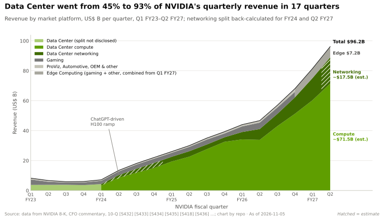

# Cheat sheet — every layer in one row

Synthesis · one visual page · ~6 min read · Last verified: 2026-11-05 · Verdicts explained in the [executive summary](00-executive-summary.md)

## ⚡ The Executive Take

- **Read across a row** for one layer's job, NVIDIA's products now → next, the metric that matters, where the
  advantage comes from, the strongest challenger, the trend, the [value pool](glossary.md#value-pool) and the corp-dev
  angle. Read down the "Moat · trend" column for the whole story.
- **Deepest moats:** libraries (4.5 of 5), then memory and supply, [scale-up](glossary.md#scale-up), systems and ecosystem (4.0 each). 🔴
  **Thinnest:** CPU and orchestration and cloud (2.0) [[S1500]](sources/bibliography.md#s1500).
- **The gap is narrowing in 6 of 12 layers** and widening only in supply, where commitments hit $279B [[S1500]](sources/bibliography.md#s1500)[[S407]](sources/bibliography.md#s407).
- **The money sits in four hardware layers:** GPUs, [NVLink](glossary.md#nvlink), networking (~$31.4B in FY2026) and racks (~$35B of
  NVIDIA content per gigawatt) [[S402]](sources/bibliography.md#s402)[[S398]](sources/bibliography.md#s398). The software layers are mostly free and defend that margin [[S1510]](sources/bibliography.md#s1510).
- **Strongest challengers by layer:** AMD on chips and racks, Google's TPU on systems and cost per token, Broadcom
  on Ethernet and custom ASICs, [hyperscalers](glossary.md#hyperscaler) on cloud [[S144]](sources/bibliography.md#s144)[[S90021]](sources/bibliography.md#s90021)[[S625]](sources/bibliography.md#s625)[[S274]](sources/bibliography.md#s274)[[S90026]](sources/bibliography.md#s90026).

## Every layer in one row

Moat = this repo's 1–5 [moat score](glossary.md#moat-score); arrow = [gap trend](glossary.md#gap-trend) (↗ widening ·
→ stable · ↘ narrowing). Both are 🔴 repo judgement, recorded in `data/x00_layer_verdicts.csv` [[S1500]](sources/bibliography.md#s1500).

| Layer | Job | NVIDIA now → next | Key metric | Source of advantage | Strongest challenger | Moat · trend | Value pool | Corp-dev angle |
|---|---|---|---|---|---|:---:|---|---|
| [**02 GPU silicon**](layers/02-gpu-silicon/index.md) | Turn power into matrix math | Blackwell Ultra → Rubin (shipping Aug 2026) → 🟢 Rubin Ultra (H2 2027) → 🟢 Feynman (2028) [[S500]](sources/bibliography.md#s500)[[S35018]](sources/bibliography.md#s35018)[[S109]](sources/bibliography.md#s109) | Rubin: 35 PFLOPS dense FP4; 288 GB HBM4 at 19.2 TB/s [[S33005]](sources/bibliography.md#s33005)[[S90006]](sources/bibliography.md#s90006) | Annual cadence, NVFP4, two-die packages; ~$10B per generation [[S35028]](sources/bibliography.md#s35028) | AMD MI455X: 432 GB, 20 PFLOPS FP8 on paper [[S144]](sources/bibliography.md#s144) | **3.0 ↘** | Profit engine: B200 ~$6.4K to build vs $30–40K price (Est.) [[S35020]](sources/bibliography.md#s35020)[[S35026]](sources/bibliography.md#s35026) | SRAM- or capacity-first inference as a wedge; Groq licence ~$20B 🟡 [[S90019]](sources/bibliography.md#s90019) |
| [**03 Memory & supply**](layers/03-memory-packaging-supply-chain/index.md) | Feed the tensor cores; secure HBM and packaging | HBM3E → HBM4 (Rubin) → 🟡 HBM4E with custom base dies (2027) [[S3007]](sources/bibliography.md#s3007) | $279B of commitments; ~60% of 2026 CoWoS (🟡 Est.) [[S407]](sources/bibliography.md#s407)[[S379]](sources/bibliography.md#s379) | Largest committed buyer, first onto each HBM generation | AMD's capacity-heavy HBM4 (432 vs 288 GB); HBM makers' pricing power [[S144]](sources/bibliography.md#s144) | **4.0 ↗** | Pass-through: HBM ~45% of a B200's build cost (Est.) [[S35020]](sources/bibliography.md#s35020) | HBM base-die and controller IP; supply partnerships vs design buys |
| [**04 CPU**](layers/04-cpu-grace-vera/index.md) | Host: feed GPUs, run serving and agent tools | Grace → Vera (88 custom cores, also standalone) → 🟡 Rosa (2028) [[S4000]](sources/bibliography.md#s4000)[[S90004]](sources/bibliography.md#s90004) | ~900 GB/s host link per GPU on Vera Rubin vs 128 GB/s on DGX H100 [[S128]](sources/bibliography.md#s128)[[S4019]](sources/bibliography.md#s4019)[[S100]](sources/bibliography.md#s100) | Coherent NVLink-C2C and rack co-design, not better cores | AMD EPYC Venice (256 cores) in Helios; hyperscaler Arm [[S4028]](sources/bibliography.md#s4028)[[S538]](sources/bibliography.md#s538) | **2.0 →** | Small: ~2% of a ~$7.8M Vera Rubin rack (Est.) [[S331]](sources/bibliography.md#s331) | Agentic CPU sockets as CPU:GPU ratios move toward 1:2–1:1 [[S4012]](sources/bibliography.md#s4012)[[S4013]](sources/bibliography.md#s4013) |
| [**05 Scale-up**](layers/05-scale-up-nvlink-nvswitch/index.md) | Make 72 GPUs act as one | GB300 NVL72 (130 TB/s) → Vera Rubin NVL72 (216 TB/s) → Kyber NVL144 (2027; 🟡 slip reported) [[S262]](sources/bibliography.md#s262)[[S200]](sources/bibliography.md#s200)[[S507]](sources/bibliography.md#s507) | 216 TB/s per rack, 7.5× the rack's scale-out bandwidth [[S200]](sources/bibliography.md#s200)[[S33004]](sources/bibliography.md#s33004) | Switch, SerDes, copper spine and NCCL changed together yearly [[S5000]](sources/bibliography.md#s5000) | AMD Helios: 260 TB/s over UALink-on-Ethernet; TPU pods of 9,216 chips [[S226]](sources/bibliography.md#s226)[[S232]](sources/bibliography.md#s232) | **4.0 ↘** | NVLink switch trays and spine in every rack; Fusion licences [[S131]](sources/bibliography.md#s131) | NVLink Fusion (13 partners 🟡) vs UALink/ESUN; UALink products 2027 [[S518]](sources/bibliography.md#s518)[[S90051]](sources/bibliography.md#s90051) |
| [**06 Scale-out**](layers/06-scale-out-scale-across-networking/index.md) | Join NVLink domains into one machine | ConnectX-8 800G, Spectrum-X → ConnectX-9 1.6T, CPO switches (2026) → 🟡 ConnectX-10 (2028) [[S264]](sources/bibliography.md#s264)[[S6019]](sources/bibliography.md#s6019)[[S90004]](sources/bibliography.md#s90004) | Networking ~$17.5B in Q2 FY2027 (Est.), ~20% of Data Center [[S408]](sources/bibliography.md#s408) | Mellanox ($6.9B) plus a NIC–switch–NCCL bundle [[S464]](sources/bibliography.md#s464) | Broadcom Tomahawk 6, ~12 months earlier; Ethernet ~⅔ of AI back-end 🟡 [[S274]](sources/bibliography.md#s274)[[S90054]](sources/bibliography.md#s90054) | **3.0 →** | ~$31.4B in FY2026; optics ~$6,000 per GPU [[S402]](sources/bibliography.md#s402)[[S6016]](sources/bibliography.md#s6016) | Optics, lasers and NIC IP as co-packaged optics move value [[S90049]](sources/bibliography.md#s90049) |
| [**07 DPU & SuperNIC**](layers/07-dpu-supernic-storage-security/index.md) | Move every byte in and out of each GPU, securely | ConnectX-8, BlueField-3 → ConnectX-9, BlueField-4 (2026) → 🟡 ConnectX-10, BlueField-5 (2028) [[S7001]](sources/bibliography.md#s7001)[[S90004]](sources/bibliography.md#s90004) | NIC per GPU: 400 → 800 → 1,600 Gb/s (GB200 → GB300 → Vera Rubin) [[S266]](sources/bibliography.md#s266)[[S264]](sources/bibliography.md#s264)[[S33004]](sources/bibliography.md#s33004) | Mellanox heritage co-designed with DOCA, NCCL and GPUDirect | Captive offload (AWS Nitro, Google Titanium); AMD Pensando 2.4 Tb/s per GPU [[S292]](sources/bibliography.md#s292)[[S228]](sources/bibliography.md#s228) | **3.0 ↘** | NICs + DPUs ~3–11% of an NVL72 rack (Est.); storage software to partners [[S1507]](sources/bibliography.md#s1507) | KV-cache storage tier (BlueField-4 STX) as a new socket [[S7511]](sources/bibliography.md#s7511) |
| [**08 Systems & racks**](layers/08-systems-racks-ai-factories/index.md) | Turn chips into a powered, cooled computer | GB300 NVL72 (~132 kW) → Vera Rubin NVL72 (~190–230 kW 🟡) → 🟢 Kyber (~600 kW, 2027) [[S337]](sources/bibliography.md#s337)[[S303]](sources/bibliography.md#s303)[[S305]](sources/bibliography.md#s305) | ~13× H200's tokens per MW on GB300 NVL72 at 50 tok/s/user (Est.) [[S621]](sources/bibliography.md#s621)[[S622]](sources/bibliography.md#s622) | One integrated rack a year, built by ODMs (Foxconn ~40%) [[S3014]](sources/bibliography.md#s3014) | AMD Helios: 31 TB HBM4, shipping from ~end Q3 2026 [[S90021]](sources/bibliography.md#s90021)[[S90020]](sources/bibliography.md#s90020) | **4.0 ↘** | ~$35B NVIDIA content per $50–60B GW; ODMs ~2–3% [[S398]](sources/bibliography.md#s398)[[S332]](sources/bibliography.md#s332) | Power, cooling and 800 V DC suppliers; AMD bought ZT ($4.9B) [[S90061]](sources/bibliography.md#s90061)[[S8527]](sources/bibliography.md#s8527) |
| [**09 CUDA**](layers/09-cuda-and-system-software/index.md) | Turn model math into fast kernels on day 0 | CUDA 13.x → cuTile Python, CuTe DSL [[S527]](sources/bibliography.md#s527)[[S9007]](sources/bibliography.md#s9007)[[S9030]](sources/bibliography.md#s9030) | Native in 12 of 12 major frameworks (36/36); ROCm 26, Qualcomm 4 [[S587]](sources/bibliography.md#s587)[[S586]](sources/bibliography.md#s586)[[S596]](sources/bibliography.md#s596) | Two decades of compounding; ~6M developers [[S528]](sources/bibliography.md#s528) | PyTorch/Triton/vLLM with ROCm; JAX/XLA on TPU [[S578]](sources/bibliography.md#s578)[[S580]](sources/bibliography.md#s580) | **3.5 ↘** | Free; earns through GPU margin and licences ($4,500 per GPU-year list) [[S11013]](sources/bibliography.md#s11013) | Portability assets: Qualcomm closed Modular (~$3.9B) [[S9511]](sources/bibliography.md#s9511) |
| [**10 Libraries**](layers/10-libraries-cuda-x/index.md) | Turn datasheet FLOPS into delivered speed | cuBLAS, cuDNN, CUTLASS, NCCL 2.32 → GPU-initiated NCCL, CuTe DSL [[S10038]](sources/bibliography.md#s10038)[[S10009]](sources/bibliography.md#s10009) | Software alone: B200 ~2,000 → 4,600 DeepSeek-R1 tok/s per GPU in 4 months [[S646]](sources/bibliography.md#s646) | Tuning on every GPU generation; breadth across 15 domains [[S1510]](sources/bibliography.md#s1510) | AMD ROCm (RCCL is built from NCCL's code) [[S10002]](sources/bibliography.md#s10002) | **4.5 →** | Free; pull-through to GPUs and AI Enterprise [[S1510]](sources/bibliography.md#s1510) | Which library families an inference-first platform needs on day one [[S1510]](sources/bibliography.md#s1510) |
| [**11 Inference software**](layers/11-inference-and-ai-software/index.md) | Most tokens per GPU at each latency tier | TensorRT-LLM, Dynamo 1.0 (Mar 2026) → Groq 3 LPX racks; 🟡 Hugging Face [[S90066]](sources/bibliography.md#s90066)[[S506]](sources/bibliography.md#s506)[[S11500]](sources/bibliography.md#s11500) | GB300 NVL72 ~6,261 tok/s per GPU at 50 tok/s/user, ~20× H200 [[S621]](sources/bibliography.md#s621) | Serving software co-designed with the rack; per-model tuning | Open engines (vLLM, SGLang); TPU ~18% cheaper per token on one model [[S580]](sources/bibliography.md#s580)[[S625]](sources/bibliography.md#s625) | **3.0 →** | Direct software ~$2B a year, under 1% of Data Center [[S11011]](sources/bibliography.md#s11011) | Model distribution: $12.9B Hugging Face faces EU and DOJ interest [[S11500]](sources/bibliography.md#s11500)[[S11027]](sources/bibliography.md#s11027)[[S11028]](sources/bibliography.md#s11028) |
| [**12 Orchestration & cloud**](layers/12-orchestration-and-cloud-services/index.md) | Turn racks into useful, paid GPU-hours | Run:ai, Mission Control, Slurm → DSX OS (2026); DGX Cloud Lepton [[S12513]](sources/bibliography.md#s12513)[[S598]](sources/bibliography.md#s598) | $5.00 vs $1.67 per useful GB300 GPU-hour at 30% vs 90% use (Est.) [[S332]](sources/bibliography.md#s332)[[S324]](sources/bibliography.md#s324) | Integration plus allocation and capital, not licences | Hyperscalers: own the customer, control plane and chips [[S90026]](sources/bibliography.md#s90026)[[S90035]](sources/bibliography.md#s90035)[[S90044]](sources/bibliography.md#s90044) | **2.0 →** | Rental margins sit with clouds; NVIDIA holds ~$65B of cloud commitments [[S407]](sources/bibliography.md#s407) | Route to scale: hyperscalers, neoclouds or sovereigns [[S90071]](sources/bibliography.md#s90071) |
| [**13 Ecosystem & capital**](layers/13-ecosystem-gtm-and-capital/index.md) | Convert technology into financed demand | Inception, GTC, sovereign deals, ~$99B of stakes → >$500B third-party financing platforms (Aug 2026) [[S90073]](sources/bibliography.md#s90073)[[S12528]](sources/bibliography.md#s12528) | Non-hyperscale (ACIE) ~$40.3B = 45% of Q2 FY2027 DC; sovereign >~$30B FY2026 [[S406]](sources/bibliography.md#s406)[[S90071]](sources/bibliography.md#s90071) | Installed-base ecosystem plus a balance sheet rivals cannot match | Hyperscaler + Broadcom ASIC coalition; AMD equity-for-gigawatts [[S2516]](sources/bibliography.md#s2516)[[S13506]](sources/bibliography.md#s13506) | **4.0 ↘** | Indirect: H1 FY2027 net equity gains $23.7B, largely mark-to-market [[S90072]](sources/bibliography.md#s90072) | Vendor-financing posture; sovereigns multi-source (HUMAIN: NVIDIA, AMD, Qualcomm) [[S13003]](sources/bibliography.md#s13003)[[S13517]](sources/bibliography.md#s13517)[[S90030]](sources/bibliography.md#s90030) |

## Four pictures

| | |
|---|---|
|  **🔴 Moat by layer:** deepest in libraries, narrowing in 6 of 12 layers [[S1500]](sources/bibliography.md#s1500) |  **🔴 Moat vs money:** the GPU earns, the free software defends [[S1500]](sources/bibliography.md#s1500) |
|  **Revenue mix:** Data Center went from 45% to 93% of quarterly revenue in 17 quarters [[S405]](sources/bibliography.md#s405) · [01 Flywheel](01-the-nvidia-flywheel.md) |  **🔴 Risk map:** custom ASICs (16) and the capex cycle (15) lead [[S18027]](sources/bibliography.md#s18027) · [18 Bear case](cross-cutting/18-vulnerabilities-and-bear-case.md) |

> [!TIP]
> **Worked example — reading one row: [scale-out](glossary.md#scale-out) networking.** The metric says networking earned ~$17.5B in Q2
> FY2027 (Est.), ~20% of Data Center revenue [[S408]](sources/bibliography.md#s408). The moat column says only 3.0 and stable, because Broadcom
> shipped a 102.4 Tb/s switch ~12 months before Spectrum-6 and Ethernet took ~⅔ of AI back-end switch sales
> [[S274]](sources/bibliography.md#s274)[[S6019]](sources/bibliography.md#s6019)[[S90054]](sources/bibliography.md#s90054). Both are true at once: buyers pay NVIDIA for the tuned [NIC](glossary.md#nic)–switch–[NCCL](glossary.md#nccl) bundle, not for
> silicon no one else has. **Conclusion:** a contested layer can still be a large value pool; the corp-dev question is
> which piece (optics, lasers, NIC IP) moves value next [[S90049]](sources/bibliography.md#s90049).

🔧 Under the hood: where each column comes from

- **Job, now → next, key metric, source of advantage, strongest challenger:** each layer's index page and its
  eight-question table (Q1, Q2/Q3, Q4, Q5, Q7), cited through the layer's own sources [[S1502]](sources/bibliography.md#s1502)[[S1513]](sources/bibliography.md#s1513).
- **Moat · trend:** this repo's synthesis, built from each layer's competition verdicts and chapter 15's
  rival-by-layer matrix. The method is in the [executive summary](00-executive-summary.md) [[S1500]](sources/bibliography.md#s1500)[[S15014]](sources/bibliography.md#s15014).
- **Value pool:** each layer's value-chain page (Q8). "Free" means NVIDIA monetises the layer through hardware margin
  rather than its own revenue line.
- **Corp-dev angle:** a question, not a recommendation, drawn from each layer's Corp Dev Lens. For Qualcomm-specific
  angles on public information, see [chapter 19](cross-cutting/19-implications-for-qualcomm.md).

## 🎯 Corp Dev Lens

1. **Arrows matter more than scores.** Six ↘ arrows mark where rivals are closing; each is a window for partnerships
   that the incumbent may not offer later [[S1500]](sources/bibliography.md#s1500).
2. **Money and moat diverge.** The four layers that earn (GPU, scale-up, networking, racks) are defended by layers that
   do not ([CUDA](glossary.md#cuda), libraries, supply). A challenger needs a plan for both.
3. **The thin layers are open sockets.** CPU and cloud orchestration score 2.0. NVIDIA co-opts rather than wins them
   ([NVLink Fusion](glossary.md#nvlink-fusion), open-sourced Run:ai), so a third party can still build position there [[S131]](sources/bibliography.md#s131)[[S12510]](sources/bibliography.md#s12510).
4. **Supply is the one widening gap.** No partnership question in this table matters if the [HBM](glossary.md#hbm) and [CoWoS](glossary.md#cowos) for 2027–2028
   are already allocated [[S407]](sources/bibliography.md#s407)[[S379]](sources/bibliography.md#s379).

## 📚 Sources

<!-- Auto-generated from the [S…] citations on this page by `make build`. Edit sources/registry/*.csv, not this list. -->

- [**S100**](sources/bibliography.md#s100) NVIDIA Technical Blog, *Inside the NVIDIA Vera Rubin Platform: Six New Chips, One AI Supercomputer*, 2026-01-05. [Link](https://developer.nvidia.com/blog/inside-the-nvidia-rubin-platform-six-new-chips-one-ai-supercomputer/)
- [**S109**](sources/bibliography.md#s109) NVIDIA Blog, *NVIDIA GTC 2026: Live Updates on What's Next in AI*, 2026-03-16. [Link](https://blogs.nvidia.com/blog/gtc-2026-news/)
- [**S128**](sources/bibliography.md#s128) NVIDIA, *NVIDIA GH200 Grace Hopper Superchip*, 2023-08. [Link](https://www.nvidia.com/en-us/data-center/grace-hopper-superchip/)
- [**S131**](sources/bibliography.md#s131) NVIDIA Newsroom, *NVIDIA NVLink Fusion: semi-custom AI infrastructure partner ecosystem (Computex 2025)*, 2025-05-19. [Link](https://nvidianews.nvidia.com/news/nvidia-nvlink-fusion-semi-custom-ai-infrastructure-partner-ecosystem)
- [**S144**](sources/bibliography.md#s144) AMD Newsroom, *AMD Unveils Vision for an Open AI Ecosystem, Detailing New Silicon, Software and Systems at Advancing AI 2025*, 2025-06-12. [Link](https://www.amd.com/en/newsroom/press-releases/2025-6-12-amd-unveils-vision-for-an-open-ai-ecosystem-detai.html)
- [**S200**](sources/bibliography.md#s200) NVIDIA, *NVIDIA NVLink and NVLink Switch (product page with NVLink and NVLink Switch specification tables)*, 2026-09. [Link](https://www.nvidia.com/en-us/data-center/nvlink/)
- [**S226**](sources/bibliography.md#s226) AMD, *AMD Helios Rackscale Solution (product page)*, 2026. [Link](https://www.amd.com/en/products/rackscale-solutions/helios.html)
- [**S228**](sources/bibliography.md#s228) Spheron, *AMD Helios rack-scale AI on GPU cloud: deploy MI455X inference with UALink and Ultra Ethernet (2026 guide)*, 2026. [Link](https://www.spheron.network/blog/amd-helios-rack-scale-mi455x-gpu-cloud/)
- [**S232**](sources/bibliography.md#s232) Google Cloud, *TPU7x (Ironwood) - Cloud TPU documentation*, 2025-11. [Link](https://docs.cloud.google.com/tpu/docs/tpu7x)
- [**S262**](sources/bibliography.md#s262) NVIDIA, *NVIDIA GB200 NVL72 (product page)*, 2024. [Link](https://www.nvidia.com/en-us/data-center/gb200-nvl72/)
- [**S264**](sources/bibliography.md#s264) NVIDIA Newsroom, *NVIDIA Announces New Switches Optimized for Trillion-Parameter GPU Computing and AI Infrastructure (Quantum-X800, Spectrum-X800, ConnectX-8)*, 2024-03-18. [Link](https://nvidianews.nvidia.com/news/networking-switches-gpu-computing-ai)
- [**S266**](sources/bibliography.md#s266) NVIDIA Newsroom, *NVIDIA Quantum-2 Takes Supercomputing to New Heights, Into the Cloud*, 2021-11-09. [Link](https://nvidianews.nvidia.com/news/nvidia-quantum-2-takes-supercomputing-to-new-heights-into-the-cloud)
- [**S274**](sources/bibliography.md#s274) Broadcom, *Broadcom ships Tomahawk 6: world's first 102.4 Tbps switch*, 2025-06-03. [Link](https://investors.broadcom.com/news-releases/news-release-details/broadcom-ships-tomahawk-6-worlds-first-1024-tbps-switch)
- [**S292**](sources/bibliography.md#s292) Amazon Web Services, *Elastic Fabric Adapter (EFA) and AWS Nitro System documentation*, 2025. [Link](https://aws.amazon.com/hpc/efa/)
- [**S303**](sources/bibliography.md#s303) Commercial Times (ctee.com.tw), *Vera Rubin NVL72 Max-Q / Max-P rack power (Commercial Times report)*, 2026-01-07. [Link](https://www.ctee.com.tw/news/20260107701081-430704)
- [**S305**](sources/bibliography.md#s305) DatacenterDynamics, *Nvidia's Rubin Ultra NVL576 rack expected to be 600kW, coming second half of 2027*, 2025-03-19. [Link](https://datacenterdynamics.com/en/news/nvidias-rubin-ultra-nvl576-rack-expected-to-be-600kw-coming-second-half-of-2027)
- [**S324**](sources/bibliography.md#s324) fal.ai, *NVIDIA GB200 price in 2026: what a GPU, a tray and an NVL72 rack cost*, 2026. [Link](https://fal.ai/learn/serverless/nvidia-gb200-price)
- [**S331**](sources/bibliography.md#s331) Wccftech, *NVIDIA's Vera Rubin rack hit with 435% memory price surge, pushing HBM4 & LPDDR5X bill to $2M of $7.8M total*, 2026-05. [Link](https://wccftech.com/nvidia-vera-rubin-rack-hit-with-memory-price-surge-pushing-hbm4-lpddr5x-bill-to-2m-of-7-8m-total/)
- [**S332**](sources/bibliography.md#s332) Tiger Brokers (iTiger), *Morgan Stanley's BOM analysis of NVIDIA's Rubin: GPU share declines; PCB, MLCC and ABF substrate values soar*, 2026-05-20. [Link](https://www.itiger.com/news/1188068712)
- [**S337**](sources/bibliography.md#s337) Spheron, *NVIDIA GB300 (rental and specifications)*, 2026. [Link](https://spheron.network/gpu-rental/gb300/)
- [**S379**](sources/bibliography.md#s379) TrendForce News, *TSMC CoWoS capacity and customer allocation estimates (TrendForce / Morgan Stanley, as reported)*, 2025. [Link](https://www.trendforce.com/news/)
- [**S398**](sources/bibliography.md#s398) NVIDIA Investor Relations, *NVIDIA Q2 FY2026 earnings call (2025-08-27): AI factory economics commentary*, 2025-08-27. [Link](https://investor.nvidia.com/events-and-presentations/events-and-presentations/default.aspx)
- [**S402**](sources/bibliography.md#s402) NVIDIA Corporation via SEC EDGAR (Colette Kress), *CFO Commentary on Fourth Quarter and Fiscal 2026 Results (Form 8-K exhibit 99.2)*, 2026-02-25. [Link](https://www.sec.gov/Archives/edgar/data/1045810/000104581026000019/q4fy26cfocommentary.htm)
- [**S405**](sources/bibliography.md#s405) NVIDIA Corporation via SEC EDGAR, *NVIDIA Announces Financial Results for Second Quarter Fiscal 2027 (Form 8-K exhibit 99.1)*, 2026-08-26. [Link](https://www.sec.gov/Archives/edgar/data/0001045810/000104581026000073/q2fy27pr.htm)
- [**S406**](sources/bibliography.md#s406) NVIDIA Corporation (Colette Kress), *CFO Commentary on Second Quarter Fiscal 2027 Results*, 2026-08-26. [Link](https://s201.q4cdn.com/141608511/files/doc_financials/2027/Q227/Q2FY27-CFO-Commentary.pdf)
- [**S407**](sources/bibliography.md#s407) NVIDIA Corporation via SEC EDGAR, *NVIDIA Corporation Form 10-Q for quarter ended July 26, 2026*, 2026-08-28. [Link](https://www.sec.gov/Archives/edgar/data/1045810/000104581026000075/nvda-20260726.htm)
- [**S408**](sources/bibliography.md#s408) NVIDIA Corporation, *NVIDIA Corp. (NVDA) Q2 Fiscal 2027 earnings call transcript (26 August 2026)*, 2026-08-26. [Link](https://s201.q4cdn.com/141608511/files/content_files/TRANSCRIPT_-NVIDIA-Corp-NVDA-US-Q2-2027-Earnings-Call-26-August-2026-5_00-PM-ET.pdf)
- [**S464**](sources/bibliography.md#s464) NVIDIA Newsroom, *NVIDIA to Acquire Mellanox for $6.9 Billion*, 2019-03-11. [Link](https://nvidianews.nvidia.com/news/nvidia-to-acquire-mellanox-for-6-9-billion)
- [**S500**](sources/bibliography.md#s500) NVIDIA Corporation, *NVIDIA Q2 Fiscal 2027 Quarterly Presentation (CFO commentary deck)*, 2026-08-26. [Link](https://s201.q4cdn.com/141608511/files/doc_financials/2027/Q227/NVDA-F2Q27-Quarterly-Presentation-final-1.pdf)
- [**S506**](sources/bibliography.md#s506) SamMobile, *Samsung Foundry begins mass production of NVIDIA Groq 3 LPX chip*, 2026-08-25. [Link](https://www.sammobile.com/news/samsung-foundry-mass-production-nvidia-groq-3-lpx-chip/)
- [**S507**](sources/bibliography.md#s507) Tom's Hardware, *Nvidia's Kyber rack for Rubin Ultra slips to 2028*, 2026-07-06. [Link](https://www.tomshardware.com/pc-components/gpus/nvidias-kyber-rack-for-rubin-ultra-slips-to-2028)
- [**S518**](sources/bibliography.md#s518) ServeTheHome, *NVIDIA NVLink Fusion tapped for future AWS Trainium4 deployments*, 2025-12-02. [Link](https://www.servethehome.com/nvidia-nvlink-fusion-tapped-for-future-aws-trainium4-deployments/)
- [**S527**](sources/bibliography.md#s527) NVIDIA Docs, *CUDA Toolkit 13.2 Release Notes*, 2026-03-05. [Link](https://docs.nvidia.com/cuda/archive/13.2.0/cuda-toolkit-release-notes/index.html)
- [**S528**](sources/bibliography.md#s528) NVIDIA Developer Forums, *20 Years of CUDA: Honoring the Architects of the Accelerated Age*, 2026-03. [Link](https://forums.developer.nvidia.com/t/20-years-of-cuda-honoring-the-architects-of-the-accelerated-age/364654)
- [**S538**](sources/bibliography.md#s538) AMD Investor Relations, *AAI 2026: AMD Delivers Full-Stack Compute for the Agentic AI Era*, 2026-07-23. [Link](https://ir.amd.com/news-events/press-releases/detail/1294/aai-2026-amd-delivers-full-stack-compute-for-the-agentic-ai-era)
- [**S578**](sources/bibliography.md#s578) OpenAI Triton (GitHub), *Triton (triton-lang/triton) README — supported hardware*, 2026-11. [Link](https://github.com/triton-lang/triton/blob/main/README.md)
- [**S580**](sources/bibliography.md#s580) vLLM project (GitHub), *vLLM README and installation docs — supported hardware*, 2026-11. [Link](https://github.com/vllm-project/vllm/blob/main/docs/getting_started/installation/README.md)
- [**S586**](sources/bibliography.md#s586) AMD (GitHub: ROCm/ROCm docs), *ROCm documentation sources: release history, AI-ecosystem compatibility matrix, consolidated changelog*, 2026-08-26. [Link](https://github.com/ROCm/ROCm/blob/develop/docs/release/versions.rst)
- [**S587**](sources/bibliography.md#s587) PyTorch (GitHub: pytorch/pytorch), *PyTorch README — building with CUDA, ROCm and Intel GPU support*, 2026-11. [Link](https://github.com/pytorch/pytorch/blob/main/README.md)
- [**S596**](sources/bibliography.md#s596) Qualcomm (GitHub: quic), *Qualcomm Cloud AI SDK and Efficient Transformers repositories*, 2026-11. [Link](https://github.com/quic/cloud-ai-sdk)
- [**S598**](sources/bibliography.md#s598) NVIDIA Newsroom, *NVIDIA Announces DGX Cloud Lepton to Connect Developers to NVIDIA's Global Compute Ecosystem*, 2025-05-18. [Link](https://nvidianews.nvidia.com/news/nvidia-announces-dgx-cloud-lepton-to-connect-developers-to-nvidias-global-compute-ecosystem)
- [**S621**](sources/bibliography.md#s621) SemiAnalysis (InferenceX-app repository), *InferenceX public API snapshot (benchmarks.json and benchmarks-history.json fixtures)*, 2026-10-17. [Link](https://github.com/SemiAnalysisAI/InferenceX-app/tree/main/packages/app/cypress/fixtures/api)
- [**S622**](sources/bibliography.md#s622) SemiAnalysis (InferenceX-app repository), *InferenceX hardware registry: TCO per GPU-hour by SKU (SemiAnalysis July 2026 pricing surveys and AI Cloud TCO Model)*, 2026-07. [Link](https://github.com/SemiAnalysisAI/InferenceX-app/blob/main/packages/constants/src/gpu-keys.ts)
- [**S625**](sources/bibliography.md#s625) SemiAnalysis, *TPU Inference Externalization Full Steam Ahead*, 2026-09-07. [Link](https://github.com/SemiAnalysisAI/InferenceX-app/blob/main/packages/app/content/blog/tpu-inferencex-full-steam.mdx)
- [**S646**](sources/bibliography.md#s646) NVIDIA TensorRT-LLM team, *Optimizing DeepSeek R1 Throughput on NVIDIA Blackwell GPUs: A Deep Dive for Developers (TensorRT-LLM tech blog 3)*, 2025-05-30. [Link](https://github.com/NVIDIA/TensorRT-LLM/blob/main/docs/source/blogs/tech_blog/blog03_Optimizing_DeepSeek_R1_Throughput_on_NVIDIA_Blackwell_GPUs.md)
- [**S1500**](sources/bibliography.md#s1500) nvidia_deep_dive_claude repository, *Repo analysis: synthesis verdicts by layer (moat score, gap trend, NVIDIA value capture) and thesis metrics*, 2026-11-05. [Link](https://github.com/FrankHuang94/nvidia_deep_dive_claude/blob/main/data/x00_layer_verdicts.csv)
- [**S1502**](sources/bibliography.md#s1502) nvidia_deep_dive_claude repository, *Repo layer page: Layer 02, GPU silicon (index Executive Take, eight-question table, competition verdicts)*, 2026-11-05. [Link](https://github.com/FrankHuang94/nvidia_deep_dive_claude/blob/main/layers/02-gpu-silicon/index.md)
- [**S1507**](sources/bibliography.md#s1507) nvidia_deep_dive_claude repository, *Repo layer page: Layer 07, DPU, SuperNIC, storage and security (index Executive Take, eight-question table, competition verdicts)*, 2026-11-05. [Link](https://github.com/FrankHuang94/nvidia_deep_dive_claude/blob/main/layers/07-dpu-supernic-storage-security/index.md)
- [**S1510**](sources/bibliography.md#s1510) nvidia_deep_dive_claude repository, *Repo layer page: Layer 10, libraries (CUDA-X) (index Executive Take, eight-question table, competition verdicts)*, 2026-11-05. [Link](https://github.com/FrankHuang94/nvidia_deep_dive_claude/blob/main/layers/10-libraries-cuda-x/index.md)
- [**S1513**](sources/bibliography.md#s1513) nvidia_deep_dive_claude repository, *Repo layer page: Layer 13, ecosystem, go-to-market and capital (index Executive Take, eight-question table, competition verdicts)*, 2026-11-05. [Link](https://github.com/FrankHuang94/nvidia_deep_dive_claude/blob/main/layers/13-ecosystem-gtm-and-capital/index.md)
- [**S2516**](sources/bibliography.md#s2516) Broadcom Inc. via SEC EDGAR, *Broadcom Inc. Announces Third Quarter Fiscal Year 2026 Financial Results (Form 8-K exhibit 99.1)*, 2026-09. [Link](https://www.sec.gov/Archives/edgar/data/0001730168/000173016826000076/avgo-08022026x8kxex99.htm)
- [**S3007**](sources/bibliography.md#s3007) Tom's Hardware, *Micron teams up with TSMC to deliver HBM4E, targeted for 2027*, 2025-09. [Link](https://www.tomshardware.com/micron-hands-tsmc-the-keys-to-hbm4e)
- [**S3014**](sources/bibliography.md#s3014) Focus Taiwan (CNA), *Foxconn expects AI server rack shipments to double in 2026*, 2026-03-16. [Link](https://focustaiwan.tw/business/202603160022)
- [**S4000**](sources/bibliography.md#s4000) NVIDIA Newsroom, *NVIDIA Launches Vera CPU, Purpose-Built for Agentic AI*, 2026-03-16. [Link](https://nvidianews.nvidia.com/news/nvidia-launches-vera-cpu-purpose-built-for-agentic-ai)
- [**S4012**](sources/bibliography.md#s4012) Tom's Hardware, *CPUs are cool again: Intel and AMD reporting spikes in CPU demand due to agentic AI*, 2026-05. [Link](https://www.tomshardware.com/pc-components/cpus/cpus-are-cool-again-intel-and-amd-reporting-spikes-in-cpu-demand-due-to-agentic-ai-shortages-lisa-su-says-business-exceeded-expectations-while-intel-is-looking-at-long-term-agreements-with-potential-customers)
- [**S4013**](sources/bibliography.md#s4013) TrendForce, *How agentic AI is reshaping the CPU-to-GPU ratio*, 2026-09-29. [Link](https://www.trendforce.com/insights/agentic-ai-cpu-gpu)
- [**S4019**](sources/bibliography.md#s4019) heise online, *Blackwell: Nvidia unveils its next generation of AI accelerators*, 2024-03-19. [Link](https://heise.de/en/news/Blackwell-Nvidia-unveils-its-next-generation-of-AI-accelerators-9782399.html)
- [**S4028**](sources/bibliography.md#s4028) Digital Citizen, *AMD EPYC Venice launches with up to 256 Zen 6 cores and strong agentic AI performance claims*, 2026-07-22. [Link](https://www.digitalcitizen.life/amd-epyc-venice-launches-with-up-to-256-zen-6-cores-and-strong-agentic-ai-performance-claims/)
- [**S5000**](sources/bibliography.md#s5000) SemiAnalysis, *Nvidia's Optical Boogeyman - NVL72, InfiniBand Scale Out, 800G & 1.6T Ramp*, 2024-03. [Link](https://newsletter.semianalysis.com/p/nvidias-optical-boogeyman-nvl72-infiniband)
- [**S6016**](sources/bibliography.md#s6016) optics.org, *NVIDIA reveals plan to scale AI factories with co-packaged optics*, 2025-03-19. [Link](https://www.optics.org/news/16/3/26)
- [**S6019**](sources/bibliography.md#s6019) Focus Taiwan (CNA), *Nvidia starts shipping TSMC-backed CPO switches (GTC Taipei / Computex 2026)*, 2026-06-03. [Link](https://focustaiwan.tw/business/202606030020)
- [**S7001**](sources/bibliography.md#s7001) NVIDIA, *NVIDIA BlueField-4 DPU datasheet*, 2026-05. [Link](https://dam-cdn.nvd.orangelogic.com/AssetLink/m8w7t64m2k40j51sx8xb4ok712b743ux.pdf)
- [**S7511**](sources/bibliography.md#s7511) NVIDIA Newsroom, *NVIDIA Launches BlueField-4 STX Storage Architecture With Broad Industry Adoption*, 2026-03-16. [Link](https://nvidianews.nvidia.com/news/nvidia-launches-bluefield-4-stx-storage-architecture-with-broad-industry-adoption)
- [**S8527**](sources/bibliography.md#s8527) AMD Investor Relations, *AMD completes acquisition of ZT Systems*, 2025-03-31. [Link](https://ir.amd.com/news-events/press-releases/detail/1240/amd-completes-acquisition-of-zt-systems)
- [**S9007**](sources/bibliography.md#s9007) NVIDIA (GitHub: NVIDIA/cutile-python), *cuTile Python README*, 2026-11. [Link](https://github.com/NVIDIA/cutile-python/blob/main/README.md)
- [**S9030**](sources/bibliography.md#s9030) NVIDIA (GitHub: NVIDIA/cutlass), *CUTLASS 4.8.1 README (CuTe DSL)*, 2026-10. [Link](https://github.com/NVIDIA/cutlass/blob/main/README.md)
- [**S9511**](sources/bibliography.md#s9511) Nasdaq (Qualcomm press release), *Qualcomm Completes Acquisition of Modular*, 2026-07-29. [Link](https://www.nasdaq.com/press-release/qualcomm-completes-acquisition-modular-2026-07-29)
- [**S10002**](sources/bibliography.md#s10002) AMD (GitHub: ROCm/rccl), *RCCL README and LICENSE (develop branch)*, 2026-11. [Link](https://github.com/ROCm/rccl/blob/develop/README.md)
- [**S10009**](sources/bibliography.md#s10009) NVIDIA (GitHub: NVIDIA/cutlass), *CUTLASS README (4.8.1)*, 2026-10. [Link](https://github.com/NVIDIA/cutlass/blob/main/README.md)
- [**S10038**](sources/bibliography.md#s10038) Python Package Index, *PyPI JSON release histories for NVIDIA library packages (nvidia-nccl-cu11/cu12/cu13, cudf-cu12, cudf-polars-cu12, cuml-cu12, cugraph-cu12, cuvs-cu12, warp-lang, cuquantum-python, cuda-quantum, cudaq, cuopt-cu12, nvidia-cutlass-dsl, earth2studio, nvmath-python, cuequivariance, nvidia-cudss-cu12, nvidia-modulus, nvidia-physicsnemo)*, 2026-11-05. [Link](https://pypi.org/)
- [**S11011**](sources/bibliography.md#s11011) MarketBeat, *NVIDIA Q2 Fiscal 2025 earnings call transcript (28 August 2024)*, 2024-08-28. [Link](https://www.marketbeat.com/earnings/transcripts/110080/)
- [**S11013**](sources/bibliography.md#s11013) NVIDIA (docs.api.nvidia.com), *NVIDIA NIM FAQ*, 2025. [Link](https://docs.api.nvidia.com/nim/docs/faq)
- [**S11027**](sources/bibliography.md#s11027) MLex, *Nvidia may seek EU review of Hugging Face deal amid filing uncertainty*, 2026-09-23. [Link](https://www.mlex.com/mlex/articles/2528556/nvidia-may-seek-eu-review-of-hugging-face-deal-amid-european-filing-uncertainty)
- [**S11028**](sources/bibliography.md#s11028) Stocktwits, *NVDA stock edges down on DOJ interest in $12.9 billion Hugging Face acquisition*, 2026-10-28. [Link](https://stocktwits.com/news-articles/markets/equity/nvda-stock-edges-down-on-doj-interest-in-12-9-billion-hugging-face-acquisition/cZU9MDeR9Go)
- [**S11500**](sources/bibliography.md#s11500) TechRadar Pro, *'The planets aligned': Nvidia confirms $12.9bn Hugging Face deal in potentially huge AI shake-up*, 2026-09-03. [Link](https://techradar.com/pro/the-planets-aligned-nvidia-confirms-usd12-9bn-hugging-face-deal-in-potentially-huge-ai-shake-up)
- [**S12510**](sources/bibliography.md#s12510) NVIDIA Technical Blog, *NVIDIA Run:ai is now open source as part of NVIDIA DSX AI Factory platform*, 2026-10. [Link](https://developer.nvidia.com/blog/nvidia-runai-is-now-open-source-as-part-of-nvidia-dsx-ai-factory-platform/)
- [**S12513**](sources/bibliography.md#s12513) NVIDIA Newsroom, *NVIDIA DSX Gives Infrastructure Builders the Playbook for AI Factories*, 2026-05-31. [Link](https://nvidianews.nvidia.com/news/dsx-infrastructure-ai-factory)
- [**S12528**](sources/bibliography.md#s12528) NVIDIA Newsroom, *NVIDIA Partners With Apollo, BlackRock, Blackstone, Brookfield, Goldman Sachs and KKR to Establish AI Compute Infrastructure Financing Platforms to Mobilize Over $500 Billion of Third-Party Capital*, 2026-08-10. [Link](https://nvidianews.nvidia.com/news/nvidia-partners-with-apollo-blackrock-blackstone-brookfield-goldman-sachs-and-kkr-to-establish-ai-compute-infrastructure-financing-platforms-to-mobilize-over-500-billion-of-third-party-capital)
- [**S13003**](sources/bibliography.md#s13003) Middle East AI News, *HUMAIN to deploy 600,000 NVIDIA GPUs across KSA, USA*, 2025-11-19. [Link](https://www.middleeastainews.com/p/humain-to-deploy-600000-nvidia-gpus)
- [**S13506**](sources/bibliography.md#s13506) Tom's Hardware, *OpenAI signs 6 GW AMD GPU deal*, 2025-10-06. [Link](https://www.tomshardware.com/pc-components/gpus/openai-signs-6gw-amd-gpu-deal)
- [**S13517**](sources/bibliography.md#s13517) Futuriom, *NVIDIA and AMD score AI hub deals in Saudi Arabia*, 2025-05. [Link](https://www.futuriom.com/articles/news/nvidia-amd-score-deals-for-the-saudi-ai-hub/2025/05)
- [**S15014**](sources/bibliography.md#s15014) nvidia_deep_dive_claude repository, *Repo analysis: Chapter 15A competitive-landscape calculations (gap-to-flagship ratios, implied AMD commitment value, hyperscaler wallet shares, breadth vs depth)*, 2026-11-05. [Link](https://github.com/FrankHuang94/nvidia_deep_dive_claude/blob/main/cross-cutting/15-competitive-landscape/index.md)
- [**S18027**](sources/bibliography.md#s18027) nvidia_deep_dive_claude repository, *Repo analysis: chapter 18 risk scores, financing ratios and valuation scenarios*, 2026-11-05. [Link](https://github.com/FrankHuang94/nvidia_deep_dive_claude/blob/main/cross-cutting/18-vulnerabilities-and-bear-case.md)
- [**S33004**](sources/bibliography.md#s33004) NVIDIA Newsroom, *NVIDIA Kicks Off the Next Generation of AI With Rubin — Six New Chips; One Incredible AI Supercomputer*, 2026-01-05. [Link](https://nvidianews.nvidia.com/news/rubin-platform-ai-supercomputer)
- [**S33005**](sources/bibliography.md#s33005) NVIDIA, *NVIDIA Vera Rubin NVL72 (product page and specifications)*, 2026. [Link](https://www.nvidia.com/en-us/data-center/vera-rubin-nvl72/)
- [**S35018**](sources/bibliography.md#s35018) Tom's Hardware, *Nvidia announces Rubin GPUs in 2026, Rubin Ultra in 2027, Feynman also added to roadmap*, 2025-03-18. [Link](https://www.tomshardware.com/pc-components/gpus/nvidia-announces-rubin-gpus-in-2026-rubin-ultra-in-2027-feynam-after)
- [**S35020**](sources/bibliography.md#s35020) Epoch AI, *NVIDIA's B200 costs around $6,400 to produce, with memory accounting for half*, 2025-12. [Link](https://epoch.ai/data-insights/b200-cost-breakdown)
- [**S35026**](sources/bibliography.md#s35026) Tom's Hardware, *Nvidia's Jensen Huang says Blackwell GPU to cost $30,000-$40,000, later clarifies that pricing will vary as they won't sell just the chip*, 2024-03-19. [Link](https://www.tomshardware.com/pc-components/gpus/nvidias-jensen-huang-says-blackwell-gpu-to-cost-dollar30000-dollar40000-later-clarifies-that-pricing-will-vary-as-they-wont-sell-just-the-chip)
- [**S35028**](sources/bibliography.md#s35028) TweakTown, *NVIDIA spent $10 billion on developing its next-generation Blackwell GPU*, 2024-03. [Link](https://www.tweaktown.com/news/96987/nvidia-spent-10-billion-on-developing-its-next-generation-blackwell-gpu/index.html)
- [**S90004**](sources/bibliography.md#s90004) TrendForce, *Key GTC takeaways: how Samsung, Micron, Intel and more power NVIDIA's Vera Rubin and Feynman*, 2026-03-17. [Link](https://www.trendforce.com/news/2026/03/17/news-key-gtc-takeaways-how-samsung-micron-intel-more-power-nvidias-vera-rubin-and-feynman/)
- [**S90006**](sources/bibliography.md#s90006) TweakTown, *Nvidia cuts Vera Rubin's memory bandwidth by up to 26% and AMD's Helios now leads in memory bandwidth*, 2026-10. [Link](https://www.tweaktown.com/news/114304/nvidia-cuts-vera-rubins-memory-bandwidth-by-up-to-26-percent-and-amds-helios-now-leads-in-memory-bandwidth/index.html)
- [**S90019**](sources/bibliography.md#s90019) TechSpot, *Nvidia's $20 billion Groq deal looks a lot like an acquisition*, 2025-12. [Link](https://www.techspot.com/news/110723-nvidia-20-billion-groq-deal-looks-lot-like.html)
- [**S90020**](sources/bibliography.md#s90020) Shacknews, *AMD Helios AI rack system on track for initial shipments in Q3 2026*, 2026. [Link](https://www.shacknews.com/article/150249/amd-helios-ai-system-shipping-q3-2026)
- [**S90021**](sources/bibliography.md#s90021) Igor's Lab, *AMD Helios in production: MI455X, EPYC Venice and OpenAI challenge Nvidia AI racks*, 2026. [Link](https://www.igorslab.de/en/amd-helios-in-production-mi455x-epyc-venice-openai-challenge-nvidia-ai-racks/)
- [**S90026**](sources/bibliography.md#s90026) Maginative, *Anthropic secures 1M Google TPUs while keeping Amazon as primary training partner*, 2025-10. [Link](https://www.maginative.com/anthropic-secures-1m-google-tpus-while-keeping-amazon-as-primary-training-partner)
- [**S90030**](sources/bibliography.md#s90030) Morningstar, *Qualcomm: Humain deal provides some AI upside*, 2025-10. [Link](https://www.morningstar.com/stocks/qualcomm-humain-deal-provides-some-ai-upside)
- [**S90035**](sources/bibliography.md#s90035) Business Today ME, *Trainium3 UltraServers now available*, 2025-12. [Link](https://businesstoday.me/tech-news/trainium3-ultraservers-now-available-enabling-customers-to-train-and-deploy-ai-models-fasterat-lower-cost/)
- [**S90044**](sources/bibliography.md#s90044) eWeek, *Microsoft introduces Maia 200, its most powerful AI chip yet*, 2026-01-27. [Link](https://www.eweek.com/news/microsoft-maia-200-ai-chip/)
- [**S90049**](sources/bibliography.md#s90049) Tom's Hardware, *Nvidia outlines plans for using light for communication between AI GPUs by 2026*, 2025-03. [Link](https://www.tomshardware.com/networking/nvidia-outlines-plans-for-using-light-for-communication-between-ai-gpus-by-2026-silicon-photonics-and-co-packaged-optics-may-become-mandatory-for-next-gen-ai-data-centers)
- [**S90051**](sources/bibliography.md#s90051) SDxCentral, *UALink Consortium takes another swing at Nvidia's NVLink supremacy with specification 2.0*, 2026-04. [Link](https://www.sdxcentral.com/news/ualink-consortium-takes-another-swing-at-nvidias-nvlink-supremacy-with-specification-20/)
- [**S90054**](sources/bibliography.md#s90054) Dell'Oro Group, *Ethernet extends lead in AI scale-out networks despite strong InfiniBand rebound*, 2026. [Link](https://www.delloro.com/news/ethernet-extends-lead-in-ai-scale-out-networks-despite-strong-infiniband-rebound/)
- [**S90061**](sources/bibliography.md#s90061) DatacenterDynamics, *NVIDIA prepares data center industry for 1MW racks and 800 volt DC power architectures*, 2025-10. [Link](https://www.datacenterdynamics.com/en/news/nvidia-prepares-data-center-industry-for-1mw-racks-and-800-volt-dc-power-architectures/)
- [**S90066**](sources/bibliography.md#s90066) HPCwire (NVIDIA press release), *NVIDIA enters production with Dynamo, the broadly adopted inference operating system for AI factories*, 2026-03-17. [Link](https://www.hpcwire.com/aiwire/tag/dynamo-1-0/)
- [**S90071**](sources/bibliography.md#s90071) Crypto Briefing, *Nvidia CFO emphasizes neutral partnership with AI customers as company diversifies beyond hyperscalers*, 2026. [Link](https://cryptobriefing.com/nvidia-cfo-neutral-ai-partnership/)
- [**S90072**](sources/bibliography.md#s90072) Unite.AI, *Nvidia's AI sector equity stakes grow, SEC filing shows*, 2026-08. [Link](https://unite.ai/nvidias-ai-sector-equity-stakes-grow-sec-filing-shows)
- [**S90073**](sources/bibliography.md#s90073) FourWeekMBA, *NVIDIA's $99 billion investment portfolio and the circular financing loop at the center of AI*, 2026-08. [Link](https://fourweekmba.com/ai-nvidia-99-billion-investment-portfolio-circular-financing-ai/)
