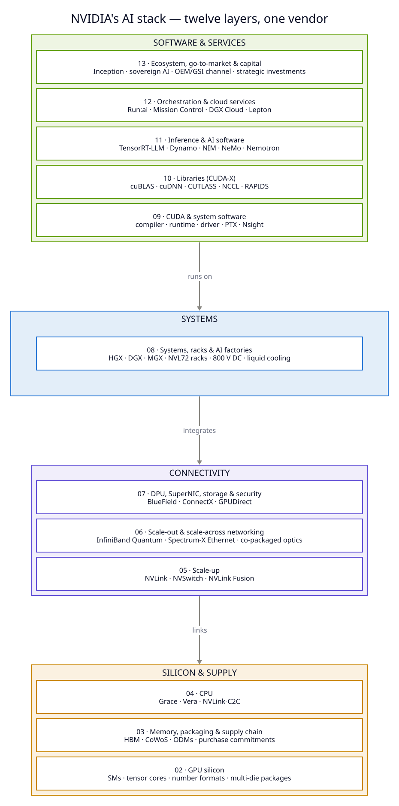
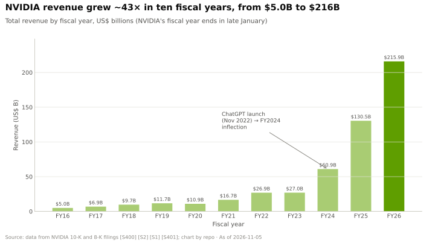
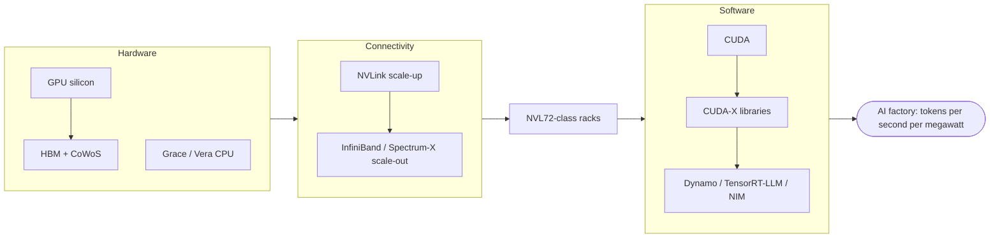

# NVIDIA Full-Stack Deep Dive

<sub>A visual research repository · Built for a corporate development reader · Last verified: 2026-11-05 · Status: under construction (see [PROGRESS.md](PROGRESS.md))</sub>

**Core question:** how and why has NVIDIA become indispensable in AI training and inference? This
repository answers it layer by layer: silicon, memory and packaging, CPUs, interconnects, networking,
systems, CUDA, libraries, inference software, cloud services, and the ecosystem and capital
strategy. For each layer it covers what the layer does, how it works, NVIDIA's products generation by
generation, why NVIDIA leads (or doesn't), how it built the position, where the layer is heading, and
where value pools for a corp dev team.

> [!NOTE]
> 🚧 **Work in progress.** Phase 0 (foundation) is complete. NVIDIA's revenue reached $215.9B in FY2026 [[S1]](sources/bibliography.md#s1), up from $10.9B in FY2020 [[S2]](sources/bibliography.md#s2). The thesis, reading paths and visual index
> are written in Phase 8, once the layer chapters exist. Chapter-by-chapter status is in [PROGRESS.md](PROGRESS.md).

## ⚡ At a glance







## 🗺️ Repository map

| Part | What it covers |
|---|---|
| [00 Executive summary](00-executive-summary.md) · [Cheat sheet](CHEATSHEET.md) · [01 The NVIDIA flywheel](01-the-nvidia-flywheel.md) | Synthesis |
| **Primers** · [P1 Training](primers/P1-how-ai-training-works.md) · [P2 Inference](primers/P2-how-ai-inference-works.md) · [P3 Four bottlenecks](primers/P3-the-four-bottlenecks.md) · [P4 Parallelism](primers/P4-parallelism-explained.md) · [P5 Chip economics](primers/P5-chip-economics-101.md) | Foundations for non-engineers |
| **Layers** · [02 GPU](layers/02-gpu-silicon/index.md) · [03 Memory & supply](layers/03-memory-packaging-supply-chain/index.md) · [04 CPU](layers/04-cpu-grace-vera/index.md) · [05 Scale-up](layers/05-scale-up-nvlink-nvswitch/index.md) · [06 Networking](layers/06-scale-out-scale-across-networking/index.md) · [07 DPU/SuperNIC](layers/07-dpu-supernic-storage-security/index.md) · [08 Systems](layers/08-systems-racks-ai-factories/index.md) · [09 CUDA](layers/09-cuda-and-system-software/index.md) · [10 Libraries](layers/10-libraries-cuda-x/index.md) · [11 Inference](layers/11-inference-and-ai-software/index.md) · [12 Cloud](layers/12-orchestration-and-cloud-services/index.md) · [13 Ecosystem & capital](layers/13-ecosystem-gtm-and-capital/index.md) | The stack, layer by layer |
| **Cross-cutting** · [14 Economics](cross-cutting/14-training-vs-inference-economics.md) · [15 Competition](cross-cutting/15-competitive-landscape/index.md) · [16 Timeline](cross-cutting/16-how-nvidia-built-it-timeline.md) · [17 Roadmap](cross-cutting/17-roadmap-2025-2028.md) · [18 Bear case](cross-cutting/18-vulnerabilities-and-bear-case.md) · [19 Qualcomm](cross-cutting/19-implications-for-qualcomm.md) | Themes across layers |
| **Case studies** · [CS1 Mellanox](case-studies/CS1-mellanox-the-best-deal.md) · [CS2 CUDA](case-studies/CS2-cuda-the-15-year-bet.md) · [CS3 TPU](case-studies/CS3-google-tpu-the-credible-alternative.md) · [CS4 AMD–OpenAI](case-studies/CS4-amd-openai-and-the-second-source.md) · [CS5 DeepSeek](case-studies/CS5-deepseek-moment-and-efficiency-shock.md) · [CS6 China](case-studies/CS6-china-export-controls-h20-and-beyond.md) · [CS7 Gigawatt factories](case-studies/CS7-gigawatt-ai-factories-xai-stargate-etc.md) | Decisions and lessons |
| [Glossary](glossary.md) · [Bibliography](sources/bibliography.md) · [Data dictionary](data/README.md) · [Chart catalog](assets/charts/CATALOG.md) | Reference |

## 🛠️ Build and validate

```bash
make setup      # Python + Node tooling
make charts     # regenerate every chart from data/*.csv
make diagrams   # render D2 / Graphviz / Mermaid sources in diagrams/src
make build      # bibliography, glossary, citation + link normalisation, PROGRESS stats
make validate   # citations, links, alt text, visual quotas, Mermaid render check
```

Conventions: [style guide](docs/STYLE_GUIDE.md) · [contributor brief](docs/AGENT_BRIEF.md) ·
[specification](docs/MASTER_PROMPT.md) · [QA log](QA_LOG.md).

> [!IMPORTANT]
> Public information only. Nothing here uses confidential Qualcomm or NVIDIA information. Every number
> carries a citation to [sources/bibliography.md](sources/bibliography.md); forward-looking claims carry
> 🟢 confirmed / 🟡 reported / 🔴 speculative tags.

## 📚 Sources

<!-- Auto-generated from the [S…] citations on this page by `make build`. Edit sources/registry/*.csv, not this list. -->

- [**S1**](sources/bibliography.md#s1) NVIDIA Corporation via SEC EDGAR, *NVIDIA Announces Financial Results for Fourth Quarter and Fiscal 2026 (Form 8-K exhibit 99.1)*, 2026-02-25. [Link](https://www.sec.gov/Archives/edgar/data/1045810/000104581026000019/q4fy26pr.htm)
- [**S2**](sources/bibliography.md#s2) U.S. Securities and Exchange Commission (EDGAR), *NVIDIA Corporation Form 10-K annual reports FY2020–FY2025 (filing index)*, 2025-02-26. [Link](https://www.sec.gov/cgi-bin/browse-edgar?action=getcompany&CIK=0001045810&type=10-K&dateb=&owner=include&count=40)
