# NVIDIA Full-Stack Deep Dive

**How and why NVIDIA became indispensable in AI training and inference, explained layer by layer for a corporate
development reader.**

<sub>A visual research repository · 12 stack layers, 5 primers, 6 cross-cutting chapters, 7 case studies · Public information only · **Last verified: 2026-11-05**</sub>

## ⚡ The Executive Take

The thesis in five bullets ([full argument](00-executive-summary.md)):

- **1 · It sells a system, not a chip.** The unit of sale is now the 72-GPU [NVL72](glossary.md#nvl72) rack, and NVIDIA
  puts its content in a 1 GW AI factory at ~$35B of a $50–60B budget [[S398]](sources/bibliography.md#s398). At 50 tokens/s per user a GB300 NVL72
  serves ~20× an H200's tokens per GPU, so a ~75%-margin vendor still sells the cheapest token at chat speed (Est.
  ~$0.16 per million) [[S621]](sources/bibliography.md#s621)[[S14000]](sources/bibliography.md#s14000)[[S405]](sources/bibliography.md#s405).
- **2 · Software compounds on hardware already sold.** [CUDA](glossary.md#cuda) is native in all 12 major AI
  frameworks this repo tracks [[S587]](sources/bibliography.md#s587)[[S580]](sources/bibliography.md#s580), new models run on it on day 0 [[S633]](sources/bibliography.md#s633), and software alone lifted a B200
  from ~2,000 to 4,600 DeepSeek-R1 tokens/s per GPU in four months [[S646]](sources/bibliography.md#s646).
- **3 · Scale buys supply and cadence.** $279B of supply and capacity commitments [[S407]](sources/bibliography.md#s407) and ~60% of TSMC's 2026
  [CoWoS](glossary.md#cowos) wafers (🟡 Est.) [[S379]](sources/bibliography.md#s379) fund a new GPU, NIC, switch, CPU and rack every year to 🟢
  Feynman in 2028 [[S35018]](sources/bibliography.md#s35018)[[S109]](sources/bibliography.md#s109).
- **4 · Capital and ecosystem make it the default counterparty.** ~$99B of equity stakes [[S90073]](sources/bibliography.md#s90073), sovereign AI
  above ~$30B in FY2026 [[S90071]](sources/bibliography.md#s90071) and non-hyperscale buyers at 45% of Data Center revenue [[S406]](sources/bibliography.md#s406) spread demand beyond
  the largest clouds. Critics call the loop [circular financing](glossary.md#circular-financing) [[S18007]](sources/bibliography.md#s18007).
- **5 · Indispensable today, contestable at the margin.** NVIDIA kept ~87% of AI data-center silicon revenue in 2025
  while the pool grew ~4.2× (Est.) [[S416]](sources/bibliography.md#s416)[[S1]](sources/bibliography.md#s1)[[S660]](sources/bibliography.md#s660)[[S661]](sources/bibliography.md#s661)[[S663]](sources/bibliography.md#s663). But AMD matches or beats Rubin on paper [[S144]](sources/bibliography.md#s144)[[S90093]](sources/bibliography.md#s90093), Anthropic has access to
  up to 1M Google TPUs [[S653]](sources/bibliography.md#s653), and Broadcom's AI revenue reached ~19% of NVIDIA's Data Center revenue [[S2516]](sources/bibliography.md#s2516). 🔴 Rivals
  cap NVIDIA's [pricing power](glossary.md#pricing-power) at the largest buyers before they dent its volume [[S15014]](sources/bibliography.md#s15014).

Latest quarter: Q2 FY2027 revenue $96.2B (+106% y/y) at a 75.0% gross margin, Q3 guided to $108B; 🟢 ~70% FY2028
growth framed as [supply-constrained](glossary.md#supply-constrained), with margin troughing at 71–72% in Q4 FY2027
[[S405]](sources/bibliography.md#s405)[[S3]](sources/bibliography.md#s3)[[S90085]](sources/bibliography.md#s90085)[[S90086]](sources/bibliography.md#s90086).

## 🍰 The stack in one picture


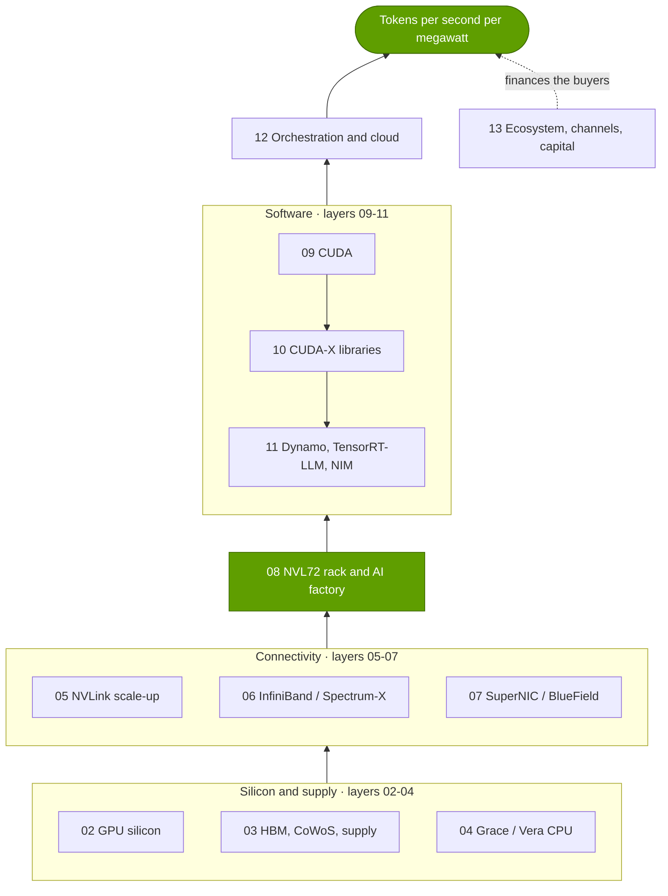

Every layer has its own folder with an index, deep-dive pages, competition, history, roadmap and value-chain pages.
The [cheat sheet](CHEATSHEET.md) puts every layer in one row; the [executive summary](00-executive-summary.md)
gives each a verdict.

## 🧭 Three reading paths

| Path | Time | Read, in this order | You will be able to |
|---|---|---|---|
| ⏱️ **30 minutes** | ~30 min | This README (5 min) → [00 Executive summary](00-executive-summary.md): Executive Take, thesis and moat sections (12 min) → [Cheat sheet](CHEATSHEET.md) (5 min) → [18 Bear case](cross-cutting/18-vulnerabilities-and-bear-case.md): Executive Take and risk heatmap (8 min) | State the thesis, the moat map and the bear case with numbers |
| 🕑 **2 hours** | ~2 h | The 30-minute path → primers [P2 Inference](primers/P2-how-ai-inference-works.md) and [P3 Four bottlenecks](primers/P3-the-four-bottlenecks.md) (30 min) → the twelve layer index pages, [02](layers/02-gpu-silicon/index.md) to [13](layers/13-ecosystem-gtm-and-capital/index.md) (45 min) → [14 Economics](cross-cutting/14-training-vs-inference-economics.md) (10 min) → [15 Competition](cross-cutting/15-competitive-landscape/index.md) (10 min) → [19 Implications for Qualcomm](cross-cutting/19-implications-for-qualcomm.md) (10 min) | Explain the mechanisms to engineers and test a competitor's claim |
| 📚 **Full** | ~15–20 h | README → [00](00-executive-summary.md) → [01 Flywheel](01-the-nvidia-flywheel.md) → primers [P1](primers/P1-how-ai-training-works.md)–[P5](primers/P5-chip-economics-101.md) → layers 02–13 (index first, then deep dives, then competition, history, roadmap and value chain) → [14](cross-cutting/14-training-vs-inference-economics.md) → [15](cross-cutting/15-competitive-landscape/index.md) and its competitor pages → [16](cross-cutting/16-how-nvidia-built-it-timeline.md) → [17](cross-cutting/17-roadmap-2025-2028.md) → [18](cross-cutting/18-vulnerabilities-and-bear-case.md) → case studies [CS1](case-studies/CS1-mellanox-the-best-deal.md)–[CS7](case-studies/CS7-gigawatt-ai-factories-xai-stargate-etc.md) → [19](cross-cutting/19-implications-for-qualcomm.md); keep the cheat sheet open | Diligence-grade depth on any layer, deal or competitor |

The full path is ~220,000 words, about 16 hours at 230 words a minute plus time for the charts [[S1501]](sources/bibliography.md#s1501).

## 🖼️ Visual index

Click a thumbnail for the full-size chart; the link under it goes to the page that discusses it. All 350+ charts
are listed in the [chart catalog](assets/charts/CATALOG.md).

| | | |
|---|---|---|
| <a href="assets/charts/00-annual-revenue-by-segment.svg"></a><br><sub>**Data Center went from 7% to 90% of revenue, FY2016–FY2026** [[S1]](sources/bibliography.md#s1)[[S402]](sources/bibliography.md#s402) · [00 Summary](00-executive-summary.md)</sub> | <a href="assets/charts/00-quarterly-revenue-and-guidance.svg">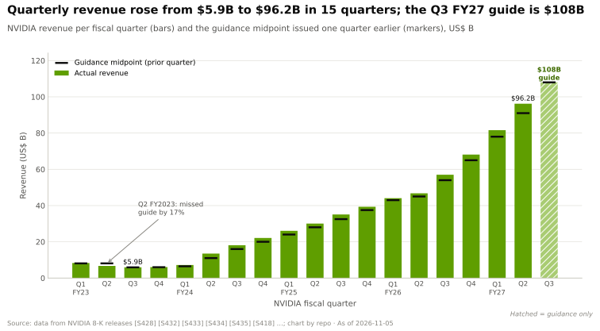</a><br><sub>**$96.2B in Q2 FY2027; Q3 guided to $108B** [[S405]](sources/bibliography.md#s405) · [00 Summary](00-executive-summary.md)</sub> | <a href="assets/charts/00-gross-margin-path-and-guide.svg">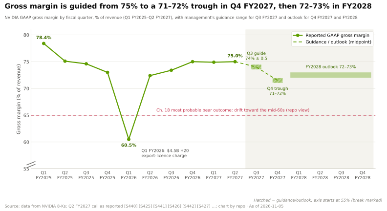</a><br><sub>**Margin guided from 75% to a 71–72% trough, then 72–73%** [[S90085]](sources/bibliography.md#s90085) · [00 Summary](00-executive-summary.md)</sub> |
| <a href="assets/charts/00-thesis-in-five-numbers.svg"></a><br><sub>**The thesis in five then-vs-now numbers** [[S621]](sources/bibliography.md#s621)[[S407]](sources/bibliography.md#s407) · [00 Summary](00-executive-summary.md)</sub> | <a href="assets/charts/00-moat-strength-by-layer.svg"></a><br><sub>**🔴 Moat deepest in libraries (4.5/5), narrowing in 6 of 12 layers** [[S1500]](sources/bibliography.md#s1500) · [Cheat sheet](CHEATSHEET.md)</sub> | <a href="assets/charts/15-layer-competitor-heatmap.svg"></a><br><sub>**Closest rival, Google TPU, is level or ahead in 5 of 12 layers** [[S15014]](sources/bibliography.md#s15014) · [15 Competition](cross-cutting/15-competitive-landscape/index.md)</sub> |
| <a href="assets/charts/02-flops-by-precision-log.svg">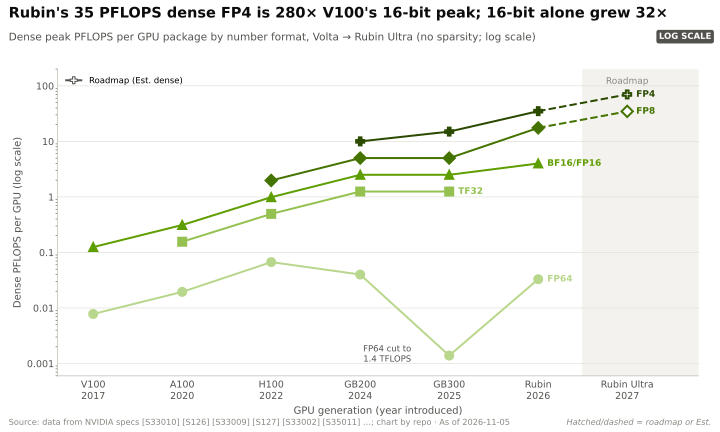</a><br><sub>**Rubin's 35 PFLOPS FP4 is ~280× V100's 16-bit peak** [[S33005]](sources/bibliography.md#s33005)[[S33010]](sources/bibliography.md#s33010) · [02 GPU](layers/02-gpu-silicon/index.md)</sub> | <a href="assets/charts/03-compute-vs-memory-bandwidth-growth.svg">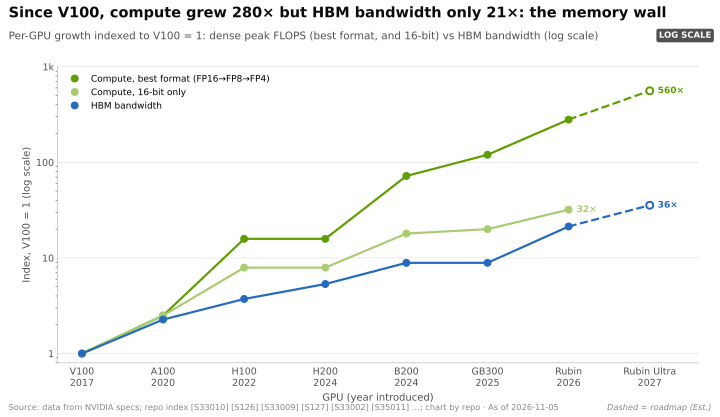</a><br><sub>**Compute up ~280× since V100, HBM bandwidth ~21×** [[S33010]](sources/bibliography.md#s33010)[[S33007]](sources/bibliography.md#s33007) · [03 Memory](layers/03-memory-packaging-supply-chain/index.md)</sub> | <a href="assets/charts/03-cowos-capacity-and-nvidia-share.svg">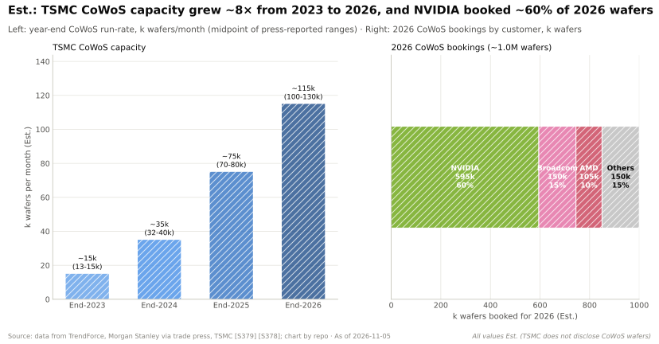</a><br><sub>**🟡 NVIDIA booked ~60% of 2026 CoWoS wafers (Est.)** [[S379]](sources/bibliography.md#s379) · [03 Memory](layers/03-memory-packaging-supply-chain/index.md)</sub> |
| <a href="assets/charts/05-nvlink-domain-bandwidth-by-system.svg">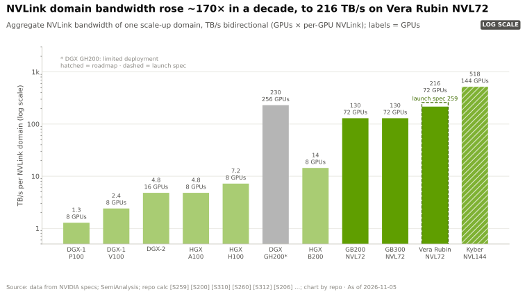</a><br><sub>**NVLink domain bandwidth ~170× in a decade, to 216 TB/s** [[S200]](sources/bibliography.md#s200) · [05 Scale-up](layers/05-scale-up-nvlink-nvswitch/index.md)</sub> | <a href="assets/charts/06-networking-revenue-and-share.svg">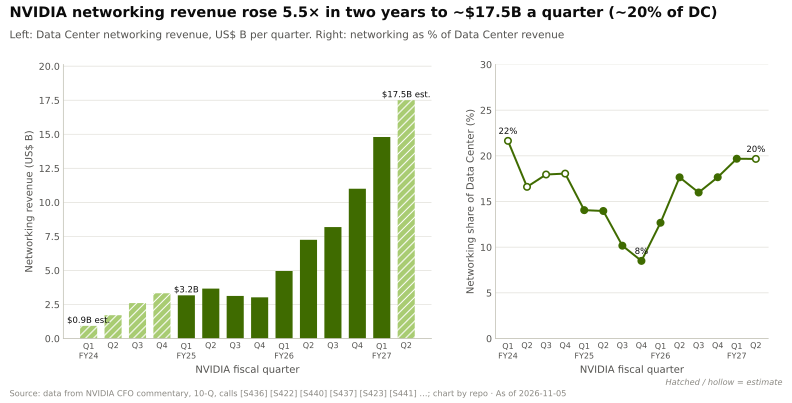</a><br><sub>**Networking ~5.5× in two years, to ~$17.5B a quarter (Est.)** [[S408]](sources/bibliography.md#s408) · [06 Networking](layers/06-scale-out-scale-across-networking/index.md)</sub> | <a href="assets/charts/06-ib-vs-ethernet-ai-backend-share.svg">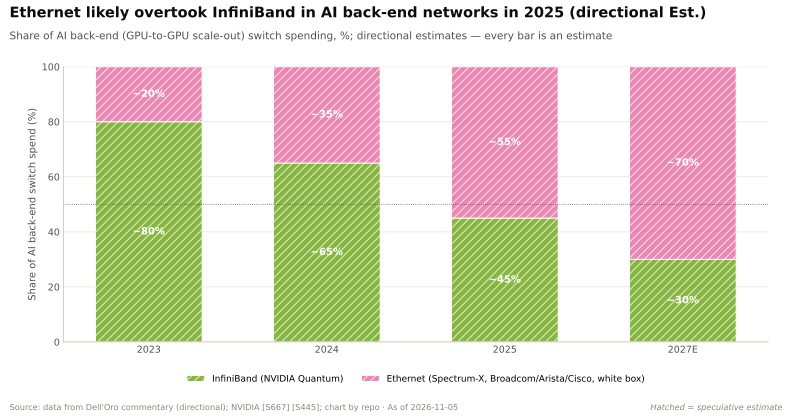</a><br><sub>**🟡 Ethernet passed InfiniBand in AI back-end switching** [[S90053]](sources/bibliography.md#s90053)[[S90054]](sources/bibliography.md#s90054) · [06 Networking](layers/06-scale-out-scale-across-networking/index.md)</sub> |
| <a href="assets/charts/08-kw-per-rack-by-generation.svg">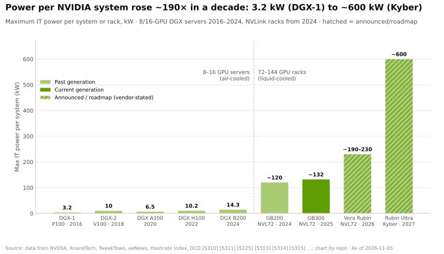</a><br><sub>**Power per system: 3.2 kW (DGX-1) to ~600 kW (Kyber)** [[S310]](sources/bibliography.md#s310)[[S305]](sources/bibliography.md#s305) · [08 Systems](layers/08-systems-racks-ai-factories/index.md)</sub> | <a href="assets/charts/08-tokens-per-mw-by-system.svg"></a><br><sub>**GB300 NVL72 serves ~13× H200's tokens per MW** [[S621]](sources/bibliography.md#s621)[[S622]](sources/bibliography.md#s622) · [08 Systems](layers/08-systems-racks-ai-factories/index.md)</sub> | <a href="assets/charts/14-tco-cost-per-million-tokens-ranges.svg"></a><br><sub>**~$0.16 per million tokens on GB300 at chat speed (Est.)** [[S14000]](sources/bibliography.md#s14000) · [14 Economics](cross-cutting/14-training-vs-inference-economics.md)</sub> |
| <a href="assets/charts/09-dsv4-day0-readiness.svg">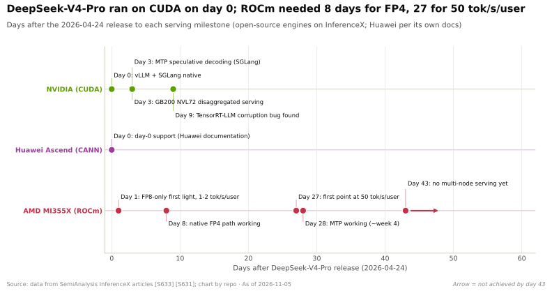</a><br><sub>**DeepSeek-V4 ran on CUDA on day 0; AMD needed 8–27 days** [[S633]](sources/bibliography.md#s633) · [09 CUDA](layers/09-cuda-and-system-software/index.md)</sub> | <a href="assets/charts/10-cuda-x-library-timeline.svg"></a><br><sub>**18 of 29 major CUDA-X libraries arrived since 2018** [[S525]](sources/bibliography.md#s525)[[S10035]](sources/bibliography.md#s10035) · [10 Libraries](layers/10-libraries-cuda-x/index.md)</sub> | <a href="assets/charts/11-throughput-vs-interactivity-pareto.svg">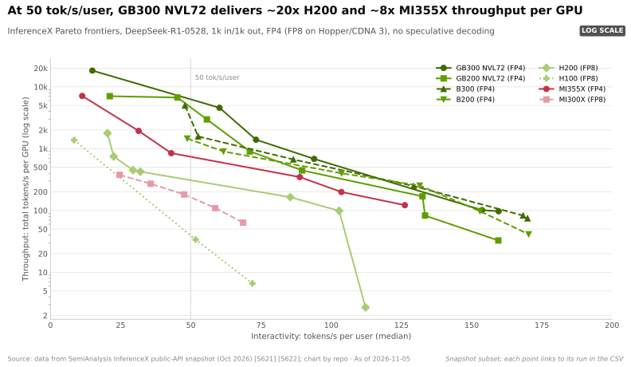</a><br><sub>**At 50 tok/s/user, GB300 NVL72 ~20× H200 per GPU** [[S621]](sources/bibliography.md#s621) · [11 Inference](layers/11-inference-and-ai-software/index.md)</sub> |
| <a href="assets/charts/12-cost-per-useful-gpu-hour.svg">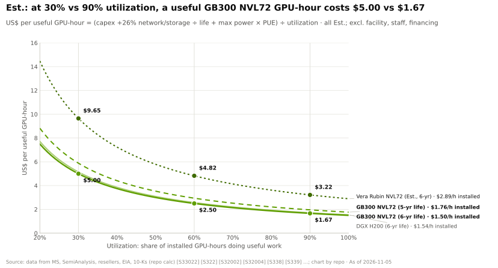</a><br><sub>**$5.00 vs $1.67 per useful GPU-hour at 30% vs 90% use (Est.)** [[S332]](sources/bibliography.md#s332)[[S324]](sources/bibliography.md#s324) · [12 Cloud](layers/12-orchestration-and-cloud-services/index.md)</sub> | <a href="assets/charts/13-dc-revenue-by-customer-type.svg">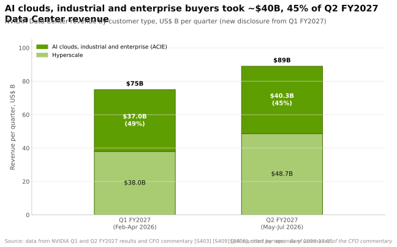</a><br><sub>**Non-hyperscale buyers: ~45% of Q2 FY2027 Data Center** [[S406]](sources/bibliography.md#s406) · [13 Ecosystem](layers/13-ecosystem-gtm-and-capital/index.md)</sub> | <a href="assets/charts/15-ai-accelerator-market-share.svg">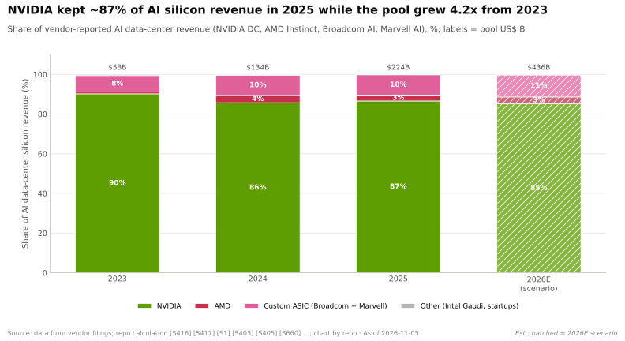</a><br><sub>**~87% of AI silicon revenue in 2025 as the pool grew ~4.2× (Est.)** [[S416]](sources/bibliography.md#s416)[[S660]](sources/bibliography.md#s660) · [15 Competition](cross-cutting/15-competitive-landscape/index.md)</sub> |
| <a href="assets/charts/16-revenue-by-era-log.svg"></a><br><sub>**Revenue ~1,365× since FY1999; 88% of the gain in three years** [[S16015]](sources/bibliography.md#s16015)[[S1]](sources/bibliography.md#s1) · [16 History](cross-cutting/16-how-nvidia-built-it-timeline.md)</sub> | <a href="assets/charts/17-roadmap-gantt-nvidia.svg">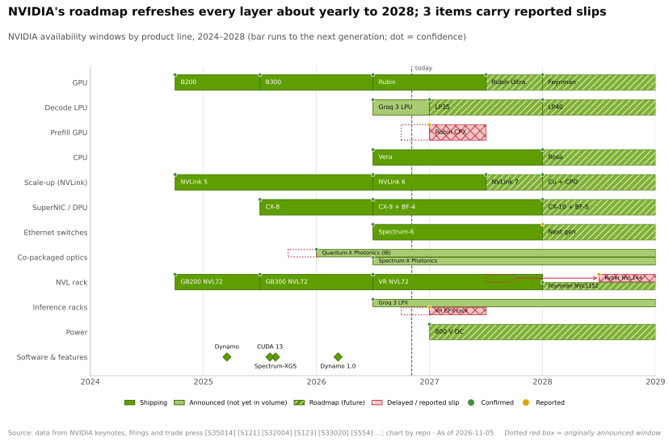</a><br><sub>**Every layer refreshed about yearly to 2028; 3 reported slips** [[S502]](sources/bibliography.md#s502)[[S507]](sources/bibliography.md#s507) · [17 Roadmap](cross-cutting/17-roadmap-2025-2028.md)</sub> | <a href="assets/charts/18-risk-heatmap.svg"></a><br><sub>**🔴 Custom ASICs (16) and the capex cycle (15) top the risk map** [[S18027]](sources/bibliography.md#s18027) · [18 Bear case](cross-cutting/18-vulnerabilities-and-bear-case.md)</sub> |

> [!TIP]
> **Worked example — how to read one number in this repository.** Take "~$0.16 per million tokens on GB300". The
> `~` and "Est." say it is an estimate. The token [[S14000]](sources/bibliography.md#s14000) resolves in the [bibliography](sources/bibliography.md)
> to chapter 14's transparent TCO model, whose every input sits in `data/x14_tco_scenarios.csv` with its own source.
> The chapter gives the range, P10–P90 $0.13–0.23, and tags modelled rivals 🔴 [[S14000]](sources/bibliography.md#s14000). **Conclusion:** before
> quoting any figure, check three things: the qualifier (~, Est.), the confidence tag (🟢 company-confirmed, 🟡
> credibly reported, 🔴 speculative or repo analysis) and the source behind the token.

## 🗺️ Repository map

| Part | Pages | What it answers |
|---|---|---|
| **Synthesis** | [00 Executive summary](00-executive-summary.md) · [Cheat sheet](CHEATSHEET.md) · [01 The NVIDIA flywheel](01-the-nvidia-flywheel.md) | The answer, the verdicts and the four reinforcing loops |
| **Primers** | [P1 Training](primers/P1-how-ai-training-works.md) · [P2 Inference](primers/P2-how-ai-inference-works.md) · [P3 Four bottlenecks](primers/P3-the-four-bottlenecks.md) · [P4 Parallelism](primers/P4-parallelism-explained.md) · [P5 Chip economics](primers/P5-chip-economics-101.md) | The engineering you need, from zero |
| **Hardware layers** | [02 GPU silicon](layers/02-gpu-silicon/index.md) · [03 Memory, packaging, supply chain](layers/03-memory-packaging-supply-chain/index.md) · [04 CPU (Grace, Vera)](layers/04-cpu-grace-vera/index.md) | Where the arithmetic happens and who controls supply |
| **Connectivity layers** | [05 Scale-up (NVLink)](layers/05-scale-up-nvlink-nvswitch/index.md) · [06 Scale-out and scale-across](layers/06-scale-out-scale-across-networking/index.md) · [07 DPU, SuperNIC, storage, security](layers/07-dpu-supernic-storage-security/index.md) | How thousands of GPUs act as one machine |
| **Systems layer** | [08 Systems, racks and AI factories](layers/08-systems-racks-ai-factories/index.md) | Why the rack, not the chip, is the product |
| **Software layers** | [09 CUDA](layers/09-cuda-and-system-software/index.md) · [10 Libraries (CUDA-X)](layers/10-libraries-cuda-x/index.md) · [11 Inference and AI software](layers/11-inference-and-ai-software/index.md) | The moat that is free to use |
| **Cloud and ecosystem layers** | [12 Orchestration and cloud](layers/12-orchestration-and-cloud-services/index.md) · [13 Ecosystem, go-to-market and capital](layers/13-ecosystem-gtm-and-capital/index.md) | How chips become paid GPU-hours and financed demand |
| **Cross-cutting** | [14 Training vs inference economics](cross-cutting/14-training-vs-inference-economics.md) · [15 Competitive landscape](cross-cutting/15-competitive-landscape/index.md) · [16 How NVIDIA built it](cross-cutting/16-how-nvidia-built-it-timeline.md) · [17 Roadmap 2025–2028](cross-cutting/17-roadmap-2025-2028.md) · [18 Vulnerabilities and bear case](cross-cutting/18-vulnerabilities-and-bear-case.md) · [19 Implications for Qualcomm](cross-cutting/19-implications-for-qualcomm.md) | Economics, rivals, history, roadmap, risks and implications |
| **Competitor pages** | [AMD](cross-cutting/15-competitive-landscape/amd.md) · [Google TPU](cross-cutting/15-competitive-landscape/google-tpu.md) · [AWS Trainium](cross-cutting/15-competitive-landscape/aws-trainium.md) · [Microsoft Maia](cross-cutting/15-competitive-landscape/microsoft-maia.md) · [Meta MTIA](cross-cutting/15-competitive-landscape/meta-mtia.md) · [ASIC houses](cross-cutting/15-competitive-landscape/custom-asic-houses.md) · [Intel](cross-cutting/15-competitive-landscape/intel.md) · [Qualcomm](cross-cutting/15-competitive-landscape/qualcomm.md) · [Start-ups](cross-cutting/15-competitive-landscape/inference-startups.md) · [China](cross-cutting/15-competitive-landscape/china.md) | One page per challenger strategy |
| **Case studies** | [CS1 Mellanox](case-studies/CS1-mellanox-the-best-deal.md) · [CS2 CUDA](case-studies/CS2-cuda-the-15-year-bet.md) · [CS3 Google TPU](case-studies/CS3-google-tpu-the-credible-alternative.md) · [CS4 AMD–OpenAI](case-studies/CS4-amd-openai-and-the-second-source.md) · [CS5 DeepSeek](case-studies/CS5-deepseek-moment-and-efficiency-shock.md) · [CS6 China](case-studies/CS6-china-export-controls-h20-and-beyond.md) · [CS7 Gigawatt factories](case-studies/CS7-gigawatt-ai-factories-xai-stargate-etc.md) | Decisions, outcomes and lessons for corp dev |
| **Reference** | [Glossary](glossary.md) · [Bibliography](sources/bibliography.md) · [Data dictionary](data/README.md) · [Chart catalog](assets/charts/CATALOG.md) · [TCO model](scripts/tco/README.md) · [Verification queue](docs/VERIFY_QUEUE.md) · [QA log](QA_LOG.md) · [Progress](PROGRESS.md) | Definitions, sources, data, charts and audit trail |

## 🔬 How this repository was built

| Item | Count at this build | Where it lives |
|---|---:|---|
| Words of analysis | ~213,000 in 31 primers, layers, chapters and case studies, plus ~8,000 in these synthesis pages | [PROGRESS.md](PROGRESS.md) |
| Registered sources | ~1,750, each with title, publisher, date, URL and access date | [Bibliography](sources/bibliography.md) |
| Data files | ~180 CSVs, ~5,000 rows, every row with a confidence level and source id | [Data dictionary](data/README.md) |
| Charts | ~360, generated from the CSVs, each with a takeaway title, alt text and source footer | [Chart catalog](assets/charts/CATALOG.md) |
| Rendered diagrams | 14 D2 and Graphviz diagrams (rack, tray, package and fabric anatomy, stack cakes) | `diagrams/src/` |
| Visuals counted in pages | ~1,080 charts, diagrams, Mermaid blocks and tables | [PROGRESS.md](PROGRESS.md) |
| Glossary terms | ~680, each linked on first use | [Glossary](glossary.md) |

<sub>Counts from `python3 scripts/validate/stats.py` and the registry, data and catalog files on 2026-11-05; they
move as chapters are edited [[S1501]](sources/bibliography.md#s1501).</sub>

The method was the same for every page. Facts were researched from primary sources first: NVIDIA and competitor
filings, earnings calls, product pages and technical blogs, MLCommons and InferenceX data. Credible analysts and
press came second. Each number carries a citation token such as [[S405]](sources/bibliography.md#s405) that resolves to the bibliography, and
forward-looking or disputed claims carry 🟢/🟡/🔴 tags. Every chart is rebuilt from `data/*.csv` by
`scripts/charts/`. Validators check that every Mermaid block renders, every link and image resolves, every image has
alt text, every citation is registered and each chapter meets its visual quota.

<details>
<summary>🔧 Under the hood: how a number travels from a source to a page</summary>

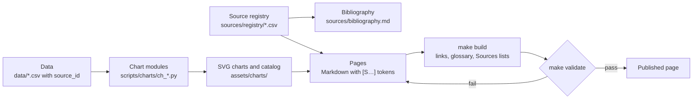

Each source gets one registry row with an id from its chapter's range (for example S1500–S1999 for these synthesis
pages). Data rows point to those ids in a `source_id` column and carry a `confidence` of confirmed, reported, estimate
or speculative. Chart modules read only from `data/` and stamp the source ids and the as-of date in each chart's
footer. Pages cite with bare tokens; `make build` turns them into links and regenerates each page's Sources list, so
a page cannot cite a source that is not registered. The verdict data behind the synthesis pages is in
`data/x00_layer_verdicts.csv` and its charts in `scripts/charts/ch_syn.py` [[S1500]](sources/bibliography.md#s1500).

</details>

> [!WARNING]
> **Limitations — read before quoting.**
> - **Research constraints.** The build environment blocked direct page fetches to most primary sources (sec.gov,
>   nvidia.com, amd.com and most analyst sites) and capped web searches. Many facts were therefore checked through
>   search extracts or secondary reproductions of filings. 746 data rows (26%) and 132 sources are flagged for
>   re-verification in [docs/VERIFY_QUEUE.md](docs/VERIFY_QUEUE.md).
> - **Judgement is labelled.** Moat scores, risk scores, TCO outputs and scenario arithmetic are the repo's own
>   analysis (🔴 or "Est."), not company data [[S1500]](sources/bibliography.md#s1500)[[S18027]](sources/bibliography.md#s18027)[[S14000]](sources/bibliography.md#s14000).
> - **Public information only.** Nothing here uses confidential NVIDIA, Qualcomm or customer information. Qualcomm
>   content relies on announcements and filings and is framed as questions, not recommendations.
> - **Point in time.** Data are as of 2026-11-05. Q3 FY2027 results (2026-11-17) and the GTC DC keynote
>   (2026-12-01) come after it [[S17005]](sources/bibliography.md#s17005)[[S90047]](sources/bibliography.md#s90047).

## 🛠️ Build and validate

```bash
make setup      # Python + Node tooling (see requirements.txt and package.json)
make charts     # regenerate every chart from data/*.csv and rewrite the chart catalog
make diagrams   # render D2 / Graphviz / Mermaid sources in diagrams/src to assets/diagrams
make tco        # rerun the chapter-14 TCO model (scripts/tco/)
make build      # bibliography, glossary, citation and link normalisation, PROGRESS stats
make validate   # citations, links, alt text, visual quotas and the Mermaid render check
```

Conventions: [style guide](docs/STYLE_GUIDE.md) · [contributor brief](docs/AGENT_BRIEF.md) ·
[specification](docs/MASTER_PROMPT.md) · [page templates](docs/TEMPLATES.md).

## 🎯 Corp Dev Lens

1. **Start with the moat map, not the spec sheet.** The [cheat sheet](CHEATSHEET.md) shows where NVIDIA's lead is
   deep, contested or thin, and whether it is widening, in one table; the gap is narrowing in 6 of 12 layers 🔴
   [[S1500]](sources/bibliography.md#s1500).
2. **Price challengers at NVIDIA's post-cut price.** NVIDIA could cut GB300 prices ~20% and keep a ~66% gross margin
   (🔴 chapter 14 estimate) [[S14000]](sources/bibliography.md#s14000). A second-source business case should survive that step.
3. **The value pools and the moats sit in different layers.** NVIDIA earns in GPUs, scale-up, networking and racks,
   and defends in software and supply. Each layer's value-chain page lists the private companies in it.
4. **For Qualcomm-specific questions** (partner, compete or complement, layer by layer, on public information
   only), go to [chapter 19](cross-cutting/19-implications-for-qualcomm.md).

## 📚 Sources

<!-- Auto-generated from the [S…] citations on this page by `make build`. Edit sources/registry/*.csv, not this list. -->

- [**S1**](sources/bibliography.md#s1) NVIDIA Corporation via SEC EDGAR, *NVIDIA Announces Financial Results for Fourth Quarter and Fiscal 2026 (Form 8-K exhibit 99.1)*, 2026-02-25. [Link](https://www.sec.gov/Archives/edgar/data/1045810/000104581026000019/q4fy26pr.htm)
- [**S3**](sources/bibliography.md#s3) StorageNewsletter, *NVIDIA Q2 Fiscal 2027 results coverage: revenue $96.2B*, 2026-08-27. [Link](https://www.storagenewsletter.com/2026/08/27/nvidia-fiscal-2q27-financial-results/)
- [**S109**](sources/bibliography.md#s109) NVIDIA Blog, *NVIDIA GTC 2026: Live Updates on What's Next in AI*, 2026-03-16. [Link](https://blogs.nvidia.com/blog/gtc-2026-news/)
- [**S144**](sources/bibliography.md#s144) AMD Newsroom, *AMD Unveils Vision for an Open AI Ecosystem, Detailing New Silicon, Software and Systems at Advancing AI 2025*, 2025-06-12. [Link](https://www.amd.com/en/newsroom/press-releases/2025-6-12-amd-unveils-vision-for-an-open-ai-ecosystem-detai.html)
- [**S200**](sources/bibliography.md#s200) NVIDIA, *NVIDIA NVLink and NVLink Switch (product page with NVLink and NVLink Switch specification tables)*, 2026-09. [Link](https://www.nvidia.com/en-us/data-center/nvlink/)
- [**S305**](sources/bibliography.md#s305) DatacenterDynamics, *Nvidia's Rubin Ultra NVL576 rack expected to be 600kW, coming second half of 2027*, 2025-03-19. [Link](https://datacenterdynamics.com/en/news/nvidias-rubin-ultra-nvl576-rack-expected-to-be-600kw-coming-second-half-of-2027)
- [**S310**](sources/bibliography.md#s310) AnandTech (Ryan Smith), *NVIDIA unveils the DGX-1 HPC server: 8 Teslas, 3U, Q2 2016*, 2016-04-05. [Link](https://www.anandtech.com/show/10229)
- [**S324**](sources/bibliography.md#s324) fal.ai, *NVIDIA GB200 price in 2026: what a GPU, a tray and an NVL72 rack cost*, 2026. [Link](https://fal.ai/learn/serverless/nvidia-gb200-price)
- [**S332**](sources/bibliography.md#s332) Tiger Brokers (iTiger), *Morgan Stanley's BOM analysis of NVIDIA's Rubin: GPU share declines; PCB, MLCC and ABF substrate values soar*, 2026-05-20. [Link](https://www.itiger.com/news/1188068712)
- [**S379**](sources/bibliography.md#s379) TrendForce News, *TSMC CoWoS capacity and customer allocation estimates (TrendForce / Morgan Stanley, as reported)*, 2025. [Link](https://www.trendforce.com/news/)
- [**S398**](sources/bibliography.md#s398) NVIDIA Investor Relations, *NVIDIA Q2 FY2026 earnings call (2025-08-27): AI factory economics commentary*, 2025-08-27. [Link](https://investor.nvidia.com/events-and-presentations/events-and-presentations/default.aspx)
- [**S402**](sources/bibliography.md#s402) NVIDIA Corporation via SEC EDGAR (Colette Kress), *CFO Commentary on Fourth Quarter and Fiscal 2026 Results (Form 8-K exhibit 99.2)*, 2026-02-25. [Link](https://www.sec.gov/Archives/edgar/data/1045810/000104581026000019/q4fy26cfocommentary.htm)
- [**S405**](sources/bibliography.md#s405) NVIDIA Corporation via SEC EDGAR, *NVIDIA Announces Financial Results for Second Quarter Fiscal 2027 (Form 8-K exhibit 99.1)*, 2026-08-26. [Link](https://www.sec.gov/Archives/edgar/data/0001045810/000104581026000073/q2fy27pr.htm)
- [**S406**](sources/bibliography.md#s406) NVIDIA Corporation (Colette Kress), *CFO Commentary on Second Quarter Fiscal 2027 Results*, 2026-08-26. [Link](https://s201.q4cdn.com/141608511/files/doc_financials/2027/Q227/Q2FY27-CFO-Commentary.pdf)
- [**S407**](sources/bibliography.md#s407) NVIDIA Corporation via SEC EDGAR, *NVIDIA Corporation Form 10-Q for quarter ended July 26, 2026*, 2026-08-28. [Link](https://www.sec.gov/Archives/edgar/data/1045810/000104581026000075/nvda-20260726.htm)
- [**S408**](sources/bibliography.md#s408) NVIDIA Corporation, *NVIDIA Corp. (NVDA) Q2 Fiscal 2027 earnings call transcript (26 August 2026)*, 2026-08-26. [Link](https://s201.q4cdn.com/141608511/files/content_files/TRANSCRIPT_-NVIDIA-Corp-NVDA-US-Q2-2027-Earnings-Call-26-August-2026-5_00-PM-ET.pdf)
- [**S416**](sources/bibliography.md#s416) NVIDIA Corporation via SEC EDGAR, *NVIDIA Corporation Form 10-K for fiscal year ended January 26, 2025*, 2025-02-26. [Link](https://www.sec.gov/Archives/edgar/data/1045810/000104581025000023/nvda-20250126.htm)
- [**S502**](sources/bibliography.md#s502) Tom's Hardware, *Nvidia updates data center roadmap with Rosa CPU and stacked Feynman GPUs; optical NVLink; Groq LPUs with NVFP4 and NVLink also on deck*, 2026-03-17. [Link](https://www.tomshardware.com/pc-components/gpus/nvidia-updates-data-center-roadmap-with-rosa-cpu-and-stacked-feynman-gpus-optical-nvlink-groq-lpus-with-nvfp4-and-nvlink-also-on-deck)
- [**S507**](sources/bibliography.md#s507) Tom's Hardware, *Nvidia's Kyber rack for Rubin Ultra slips to 2028*, 2026-07-06. [Link](https://www.tomshardware.com/pc-components/gpus/nvidias-kyber-rack-for-rubin-ultra-slips-to-2028)
- [**S525**](sources/bibliography.md#s525) NVIDIA Developer, *CUDA Toolkit Archive*, 2026. [Link](https://developer.nvidia.com/cuda-toolkit-archive)
- [**S580**](sources/bibliography.md#s580) vLLM project (GitHub), *vLLM README and installation docs — supported hardware*, 2026-11. [Link](https://github.com/vllm-project/vllm/blob/main/docs/getting_started/installation/README.md)
- [**S587**](sources/bibliography.md#s587) PyTorch (GitHub: pytorch/pytorch), *PyTorch README — building with CUDA, ROCm and Intel GPU support*, 2026-11. [Link](https://github.com/pytorch/pytorch/blob/main/README.md)
- [**S621**](sources/bibliography.md#s621) SemiAnalysis (InferenceX-app repository), *InferenceX public API snapshot (benchmarks.json and benchmarks-history.json fixtures)*, 2026-10-17. [Link](https://github.com/SemiAnalysisAI/InferenceX-app/tree/main/packages/app/cypress/fixtures/api)
- [**S622**](sources/bibliography.md#s622) SemiAnalysis (InferenceX-app repository), *InferenceX hardware registry: TCO per GPU-hour by SKU (SemiAnalysis July 2026 pricing surveys and AI Cloud TCO Model)*, 2026-07. [Link](https://github.com/SemiAnalysisAI/InferenceX-app/blob/main/packages/constants/src/gpu-keys.ts)
- [**S633**](sources/bibliography.md#s633) SemiAnalysis, *DeepSeekV4 1.6T Day 0 to Day 43 Performance Over Time — Huawei, GB300 NVL72, MI355X, B200*, 2026-06-09. [Link](https://github.com/SemiAnalysisAI/InferenceX-app/blob/main/packages/app/content/blog/deepseekv4-16t-day-0-to-day-43-performance.mdx)
- [**S646**](sources/bibliography.md#s646) NVIDIA TensorRT-LLM team, *Optimizing DeepSeek R1 Throughput on NVIDIA Blackwell GPUs: A Deep Dive for Developers (TensorRT-LLM tech blog 3)*, 2025-05-30. [Link](https://github.com/NVIDIA/TensorRT-LLM/blob/main/docs/source/blogs/tech_blog/blog03_Optimizing_DeepSeek_R1_Throughput_on_NVIDIA_Blackwell_GPUs.md)
- [**S653**](sources/bibliography.md#s653) Anthropic, *Expanding our use of Google Cloud TPUs and Services*, 2025-10-23. [Link](https://www.anthropic.com/news/expanding-our-use-of-google-cloud-tpus-and-services)
- [**S660**](sources/bibliography.md#s660) Broadcom Inc., *Broadcom Inc. Announces Fourth Quarter and Fiscal Year 2024 Financial Results*, 2024-12-12. [Link](https://investors.broadcom.com/financial-information/quarterly-results)
- [**S661**](sources/bibliography.md#s661) Broadcom Inc., *Broadcom Inc. Announces Fourth Quarter and Fiscal Year 2025 Financial Results*, 2025-12-11. [Link](https://investors.broadcom.com/financial-information/quarterly-results)
- [**S663**](sources/bibliography.md#s663) AMD, *AMD Reports Fourth Quarter and Full Year 2024 Financial Results*, 2025-02-04. [Link](https://ir.amd.com/news-events/press-releases)
- [**S1500**](sources/bibliography.md#s1500) nvidia_deep_dive_claude repository, *Repo analysis: synthesis verdicts by layer (moat score, gap trend, NVIDIA value capture) and thesis metrics*, 2026-11-05. [Link](https://github.com/FrankHuang94/nvidia_deep_dive_claude/blob/main/data/x00_layer_verdicts.csv)
- [**S1501**](sources/bibliography.md#s1501) nvidia_deep_dive_claude repository, *Repo statistics: words, visuals, sources, data files and charts (scripts/validate/stats.py and file counts, 2026-11-05)*, 2026-11-05. [Link](https://github.com/FrankHuang94/nvidia_deep_dive_claude/blob/main/PROGRESS.md)
- [**S2516**](sources/bibliography.md#s2516) Broadcom Inc. via SEC EDGAR, *Broadcom Inc. Announces Third Quarter Fiscal Year 2026 Financial Results (Form 8-K exhibit 99.1)*, 2026-09. [Link](https://www.sec.gov/Archives/edgar/data/0001730168/000173016826000076/avgo-08022026x8kxex99.htm)
- [**S10035**](sources/bibliography.md#s10035) NVIDIA (GitHub: NVIDIA-Omniverse/PhysX), *NVIDIA PhysX SDK README*, 2025. [Link](https://github.com/NVIDIA-Omniverse/PhysX/blob/main/README.md)
- [**S14000**](sources/bibliography.md#s14000) nvidia_deep_dive_claude repository, *Repo analysis: chapter 14 TCO model (scripts/tco/tco_model.py with data/x14_tco_scenarios.csv)*, 2026-11-05. [Link](https://github.com/FrankHuang94/nvidia_deep_dive_claude/blob/main/scripts/tco/README.md)
- [**S15014**](sources/bibliography.md#s15014) nvidia_deep_dive_claude repository, *Repo analysis: Chapter 15A competitive-landscape calculations (gap-to-flagship ratios, implied AMD commitment value, hyperscaler wallet shares, breadth vs depth)*, 2026-11-05. [Link](https://github.com/FrankHuang94/nvidia_deep_dive_claude/blob/main/cross-cutting/15-competitive-landscape/index.md)
- [**S16015**](sources/bibliography.md#s16015) NVIDIA Corporation via SEC EDGAR, *NVIDIA Corp Form 10-K405 for fiscal year 2001*, 2001-04. [Link](https://www.sec.gov/Archives/edgar/data/0001045810/000101287001500492/d10k405.txt)
- [**S17005**](sources/bibliography.md#s17005) NVIDIA Newsroom, *NVIDIA Sets Conference Call for Third-Quarter Financial Results*, 2026-10-28. [Link](https://nvidianews.nvidia.com/news/nvidia-sets-conference-call-for-third-quarter-financial-results-6928873)
- [**S18007**](sources/bibliography.md#s18007) tomtunguz.com (Tomasz Tunguz), *Circular financing: does Nvidia's $110B bet echo the telecom bubble?*, 2025-11. [Link](https://tomtunguz.com/nvidia_nortel_vendor_financing_comparison/)
- [**S18027**](sources/bibliography.md#s18027) nvidia_deep_dive_claude repository, *Repo analysis: chapter 18 risk scores, financing ratios and valuation scenarios*, 2026-11-05. [Link](https://github.com/FrankHuang94/nvidia_deep_dive_claude/blob/main/cross-cutting/18-vulnerabilities-and-bear-case.md)
- [**S33005**](sources/bibliography.md#s33005) NVIDIA, *NVIDIA Vera Rubin NVL72 (product page and specifications)*, 2026. [Link](https://www.nvidia.com/en-us/data-center/vera-rubin-nvl72/)
- [**S33007**](sources/bibliography.md#s33007) Dataconomy, *Nvidia Quietly Cuts Vera Rubin HBM4 And NVLink Bandwidth Specs*, 2026-11-02. [Link](https://dataconomy.com/2026/11/02/nvidia-quietly-cuts-vera-rubin-hbm4-and-nvlink-bandwidth/)
- [**S33010**](sources/bibliography.md#s33010) NVIDIA, *NVIDIA V100 Tensor Core GPU datasheet*, 2018. [Link](https://images.nvidia.com/content/technologies/volta/pdf/volta-v100-datasheet-update-us-1165301-r5.pdf)
- [**S35018**](sources/bibliography.md#s35018) Tom's Hardware, *Nvidia announces Rubin GPUs in 2026, Rubin Ultra in 2027, Feynman also added to roadmap*, 2025-03-18. [Link](https://www.tomshardware.com/pc-components/gpus/nvidia-announces-rubin-gpus-in-2026-rubin-ultra-in-2027-feynam-after)
- [**S90047**](sources/bibliography.md#s90047) NVIDIA, *NVIDIA GTC DC 2026 (November 30 – December 3, 2026)*, 2026. [Link](https://www.nvidia.com/en-us/gtc-dc/topics/ai-policy/)
- [**S90053**](sources/bibliography.md#s90053) Dell'Oro Group, *Ethernet more than doubles size of InfiniBand as the leading fabric for AI scale-out networks in 2025*, 2026. [Link](https://www.delloro.com/news/ethernet-more-than-doubles-size-of-infiniband-as-the-leading-fabric-for-ai-scale-out-networks-in-2025/)
- [**S90054**](sources/bibliography.md#s90054) Dell'Oro Group, *Ethernet extends lead in AI scale-out networks despite strong InfiniBand rebound*, 2026. [Link](https://www.delloro.com/news/ethernet-extends-lead-in-ai-scale-out-networks-despite-strong-infiniband-rebound/)
- [**S90071**](sources/bibliography.md#s90071) Crypto Briefing, *Nvidia CFO emphasizes neutral partnership with AI customers as company diversifies beyond hyperscalers*, 2026. [Link](https://cryptobriefing.com/nvidia-cfo-neutral-ai-partnership/)
- [**S90073**](sources/bibliography.md#s90073) FourWeekMBA, *NVIDIA's $99 billion investment portfolio and the circular financing loop at the center of AI*, 2026-08. [Link](https://fourweekmba.com/ai-nvidia-99-billion-investment-portfolio-circular-financing-ai/)
- [**S90085**](sources/bibliography.md#s90085) Shacknews, *NVIDIA (NVDA) expects gross margin decrease over next two quarters*, 2026-08-26. [Link](https://www.shacknews.com/article/150499/nvidia-nvda-gross-margin-decrease-fy27)
- [**S90086**](sources/bibliography.md#s90086) Implicator.ai, *Nvidia's 70 percent growth forecast and margin outlook*, 2026-08-27. [Link](https://www.implicator.ai/nvidia-70-percent-growth-forecast-margin-outlook.md)
- [**S90093**](sources/bibliography.md#s90093) Tom's Hardware, *AMD takes the wraps off its Instinct MI455X AI accelerator: CDNA 5 and Helios rack-scale architecture*, 2026. [Link](https://www.tomshardware.com/pc-components/gpus/amd-takes-the-wraps-off-its-instinct-mi455x-ai-accelerator-cdna-5-and-helios-rack-scale-architecture-combine-to-take-the-fight-to-nvidia-in-the-data-center)
