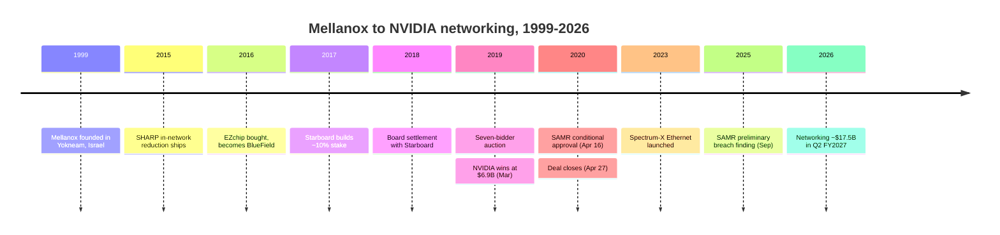
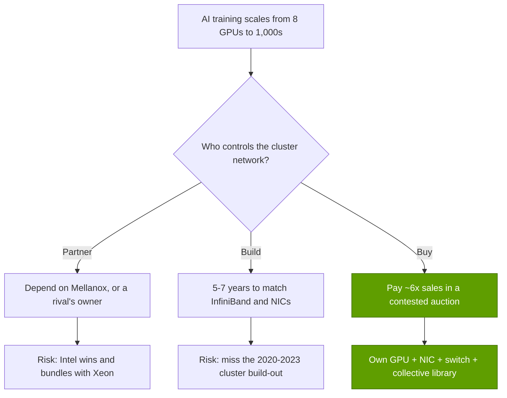
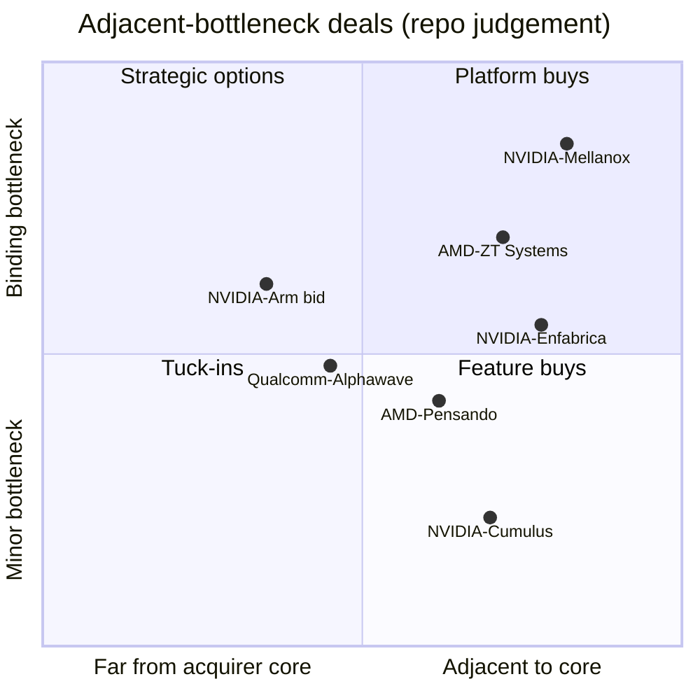

# CS1 · Mellanox: the best deal

Case study · ~14 min read · Last verified: 2026-11-05

## ⚡ The Executive Take

- **NVIDIA bought the bottleneck next door.** Mellanox, an Israeli maker of [InfiniBand](../glossary.md#infiniband) and Ethernet chips, earned $1.33B in 2019 at a 65.1% gross margin [[S21000]](../sources/bibliography.md#s21000). NVIDIA paid $6.9B in cash, $125 a share, announced 2019-03-11 [[S464]](../sources/bibliography.md#s464).
- **It won a contested auction.** An [activist investor](../glossary.md#activist-investor), Starboard, had forced the board's hand in 2018 [[S21006]](../sources/bibliography.md#s21006). Seven bidders followed, and Intel reportedly offered about $6B [[S6508]](../sources/bibliography.md#s6508)[[S6509]](../sources/bibliography.md#s6509).
- **China nearly held it up.** The deal closed on 2020-04-27, 413 days after announcement, once China's [SAMR](../glossary.md#samr) approved it with conditions on 2020-04-16 [[S21002]](../sources/bibliography.md#s21002)[[S21003]](../sources/bibliography.md#s21003)[[S21005]](../sources/bibliography.md#s21005).
- **The payoff dwarfs the price.** NVIDIA's networking line reached ~$31.4B in FY2026, ~24× Mellanox's 2019 revenue, and ~$17.5B in Q2 FY2027 alone [[S402]](../sources/bibliography.md#s402)[[S21008]](../sources/bibliography.md#s21008)[[S408]](../sources/bibliography.md#s408). The line now includes NVLink switches, which Mellanox never sold.
- **Even on harsh assumptions it paid back fast.** If only half of networking is credited to Mellanox at its own 65% margin, cumulative gross profit passed the price in FY2025 and reached ~$30B by mid-2026 (🔴 repo model) [[S21014]](../sources/bibliography.md#s21014).
- **The risks were real, and some remain.** The market moved from InfiniBand to Ethernet (~two-thirds of AI back-end switch sales in 1Q 2026) [[S90054]](../sources/bibliography.md#s90054). Over 5,000 staff in Israel are NVIDIA's largest R&D base outside the US [[S21011]](../sources/bibliography.md#s21011). SAMR found preliminary breaches of its 2020 conditions in September 2025 [[S9505]](../sources/bibliography.md#s9505).

## 1. Context

In 2019 Mellanox was a profitable niche supplier. It sold InfiniBand switches and adapters to supercomputers, and Ethernet adapters ([ConnectX](../glossary.md#connectx)) to cloud providers. InfiniBand is a network built for clusters: it delivers data with very low, predictable delay and lets one machine write straight into another's memory. Its switches could also do arithmetic inside the network ([SHARP](../glossary.md#sharp), from 2015) [[S273]](../sources/bibliography.md#s273)[[S6013]](../sources/bibliography.md#s6013). In 2016 it bought EZchip for ~$811M, which became the [BlueField](../glossary.md#bluefield) [DPU](../glossary.md#dpu) line [[S7507]](../sources/bibliography.md#s7507)[[S7509]](../sources/bibliography.md#s7509).

The shareholders were restless. Starboard Value built a stake of roughly 10.5–10.7% from November 2017 and nominated a full board slate in January 2018 [[S21007]](../sources/bibliography.md#s21007). The June 2018 settlement replaced three directors, two of them Starboard picks [[S21006]](../sources/bibliography.md#s21006). A sale process followed. Intel, Xilinx and Microsoft were all reported as suitors [[S6509]](../sources/bibliography.md#s6509).

For NVIDIA the logic was about where AI training was heading. Training was moving from one 8-GPU server to clusters of hundreds or thousands. A GPU that waits on the network sits idle, and the network was owned by someone else. NVIDIA already controlled the link inside the server ([NVLink](../glossary.md#nvlink)); the [scale-out](../glossary.md#scale-out) network between servers was the missing piece.

The bet was large for NVIDIA at the time. Its Data Center segment earned ~$2.98B in FY2020 [[S2]](../sources/bibliography.md#s2). The $6.9B price was therefore about 2.3 years of Data Center revenue, paid in cash, for a business that sold mostly to supercomputer and cloud buyers rather than to AI labs. An investor in March 2019 could reasonably ask why a GPU company needed a switch company at ~6× sales.

> [!TIP]
> **Worked example — what NVIDIA paid in multiples.** At announcement, the latest full year was 2018, with ~$1.09B of revenue [[S21000]](../sources/bibliography.md#s21000). $6.9B ÷ $1.09B ≈ **6.3× trailing sales** [[S464]](../sources/bibliography.md#s464). On 2019's $1.33B the multiple falls to 5.2×, and on 2019 gross profit of $866.5M it is ~8.0× [[S21000]](../sources/bibliography.md#s21000). For a 22%-growth, 65%-margin hardware company that was a full price, not a steal. The return came from what NVIDIA did with the asset, not from buying cheap.

## 2. The decision

NVIDIA chose to buy rather than build or partner. It raised its own bid from $115 a share in late February 2019 to $125 to win [[S6508]](../sources/bibliography.md#s6508)[[S464]](../sources/bibliography.md#s464).

| Deal term | Value | Source |
|---|---|---|
| Price | $6.9B equity, all cash, $125 per share (~$7.1B incl. assumed awards) | [[S464]](../sources/bibliography.md#s464) |
| Rival bids | Intel ~$6B; Microsoft and Xilinx also reported | [[S6509]](../sources/bibliography.md#s6509) |
| Announced → closed | 2019-03-11 → 2020-04-27 (413 days) | [[S464]](../sources/bibliography.md#s464)[[S21005]](../sources/bibliography.md#s21005) |
| Last approval | China SAMR, 2020-04-16, with [behavioural remedies](../glossary.md#behavioural-remedy) | [[S21002]](../sources/bibliography.md#s21002)[[S21003]](../sources/bibliography.md#s21003) |
| Target size | 2019 revenue $1.33B; gross margin 65.1% | [[S21000]](../sources/bibliography.md#s21000) |

The binding constraint was China. Mellanox filed with SAMR around April 2019 [[S21004]](../sources/bibliography.md#s21004). Approval came only after remedies offered on 2020-04-10: no bundling and no unreasonable conditions on sales in China [[S21003]](../sources/bibliography.md#s21003). US and EU clearances were already in hand; China's was the last [[S6510]](../sources/bibliography.md#s6510)[[S21003]](../sources/bibliography.md#s21003).

🔧 Under the hood: the conditions China attached, and why they came back

SAMR's conditions were behavioural, not structural. NVIDIA kept every asset but promised how it would sell them in China. Reported conditions covered bundling GPUs with Mellanox gear, continued supply and interoperability with third-party accelerators [[S21003]](../sources/bibliography.md#s21003)[[S21004]](../sources/bibliography.md#s21004). Rivals objected during the review [[S21013]](../sources/bibliography.md#s21013). Behavioural remedies leave a lever in the regulator's hands. In December 2024 SAMR opened a probe. On 2025-09-15 it issued a preliminary finding that NVIDIA had breached the 2020 conditions; penalties can run to 1–10% of prior-year China sales [[S9505]](../sources/bibliography.md#s9505). The deal's regulatory risk did not end at closing. See [CS6](CS6-china-export-controls-h20-and-beyond.md) for the wider China picture.

## 3. The outcome (with numbers)

NVIDIA does not publish a "Mellanox" line. It said Mellanox was ~10% of FY2021 revenue, about $1.7B for nine months of ownership [[S418]](../sources/bibliography.md#s418)[[S2]](../sources/bibliography.md#s2). NVIDIA did not disclose networking revenue for FY2022–FY2023. From FY2024 the data center networking line is visible: ~$8.6B (Est.), $13.0B and then ~$31.4B in FY2026 [[S416]](../sources/bibliography.md#s416)[[S402]](../sources/bibliography.md#s402). The first half of FY2027 alone brought ~$32.3B [[S21009]](../sources/bibliography.md#s21009).

![Bar chart of networking revenue. Mellanox alone earned $1.09B in 2018 and $1.33B in 2019. After the April 2020 close NVIDIA's networking line was about $1.67B in FY2021 (estimate: ~10% of revenue for ~9 months), was not disclosed for FY2022-FY2023, then reached about $8.6B in FY2024 (estimate), $13.0B in FY2025 and about $31.4B in FY2026, roughly 24 times Mellanox's 2019 revenue; the first half of FY2027 alone brought about $32.3B. The line now also includes NVLink switches, which Mellanox never sold.](../assets/charts/CS1-networking-before-after.svg)

One caveat matters most for any payback claim. The networking line includes NVLink switch trays for GB200 and GB300 racks [[S402]](../sources/bibliography.md#s402). That is NVIDIA's own scale-up technology, not Mellanox's. Calcalist estimates ~70% of NVIDIA's connectivity business relies on Mellanox and its Israeli centres [[S21009]](../sources/bibliography.md#s21009). The model below therefore credits Mellanox with 50%, 70% or 100% of the line.

> [!TIP]
> **Worked example — deal payback, three ways.** Start from networking revenue: FY2021 ~$1.67B [[S418]](../sources/bibliography.md#s418); FY2022–FY2023 set to a floor of $2.2B a year (not disclosed, 🔴); then $8.57B, $13.0B, $31.4B and $32.3B in H1 FY2027 [[S416]](../sources/bibliography.md#s416)[[S402]](../sources/bibliography.md#s402)[[S21009]](../sources/bibliography.md#s21009).
> - **Bear (50% heritage × 65.1% margin):** gross profit credited to the deal passes the $6.9B price in FY2025 and reaches ~$30B by July 2026, **4.3×** the price.
> - **Base (70% × 65.1%):** ~$42B, ~6×.
> - **Bull (100% × 75%):** passes the price in FY2024 and reaches ~$68B, ~10×.
>
> Compound the price at 9% a year and the bear case clears that hurdle in FY2026, roughly six years after closing (🔴 repo model) [[S21014]](../sources/bibliography.md#s21014). Gross profit is not cash flow: networking R&D and sales costs are excluded. Even so, the bear case credits ~$10B of gross profit in FY2026 alone, more than half of NVIDIA's entire FY2026 R&D budget of $18.5B [[S401]](../sources/bibliography.md#s401).

![Line chart of cumulative networking gross profit attributed to the Mellanox deal from FY2021 to the first half of FY2027 under three repo scenarios, against the $6.9B price and the price compounded at 9% a year. Bull (100% of networking at 75% gross margin) passes the price in FY2024 and reaches about $68B; base (70% at 65%) reaches about $42B; bear (50% at 65%) passes the price in FY2025, clears the compounded hurdle in FY2026 and reaches about $30B, 4.3 times the price. FY2022-FY2023 networking revenue is not disclosed and is set to a conservative floor of $2.2B a year; gross profit is not cash flow, since networking R&D and SG&A are excluded.](../assets/charts/CS1-payback-scenarios.svg)

| Deal-economics metric | Value | Basis |
|---|---|---|
| Price ÷ trailing revenue at announcement | ~6.3× (2018 revenue) | [[S464]](../sources/bibliography.md#s464)[[S21000]](../sources/bibliography.md#s21000) |
| Price ÷ Mellanox 2019 gross profit | ~8.0× | [[S21000]](../sources/bibliography.md#s21000) |
| Networking revenue, FY2026 vs Mellanox 2019 | ~$31.4B vs $1.33B, ~24× | [[S402]](../sources/bibliography.md#s402)[[S21000]](../sources/bibliography.md#s21000) |
| [Payback period](../glossary.md#payback-period), bear case (undiscounted / at 9%) | FY2025 / FY2026 | 🔴 [[S21014]](../sources/bibliography.md#s21014) |
| Price as share of one quarter's networking (Q2 FY2027) | ~39% of ~$17.5B | [[S408]](../sources/bibliography.md#s408) |

The product line shows how far the franchise moved in six years.

| | Mellanox at the deal (2019) | NVIDIA networking (2026) |
|---|---|---|
| Fastest NIC | ConnectX-6, 200 Gb/s [[S273]](../sources/bibliography.md#s273) | ConnectX-9, 1.6 Tb/s, one per Rubin GPU [[S33004]](../sources/bibliography.md#s33004) |
| InfiniBand switch | Quantum HDR, 200 Gb/s ports [[S273]](../sources/bibliography.md#s273) | Quantum-X800, 800 Gb/s ports; photonics versions [[S264]](../sources/bibliography.md#s264)[[S90048]](../sources/bibliography.md#s90048) |
| Ethernet | Spectrum switches for cloud and enterprise [[S273]](../sources/bibliography.md#s273) | Spectrum-X for AI clusters, 2.6× y/y [[S408]](../sources/bibliography.md#s408) |
| Main buyers | Supercomputers, cloud NIC sockets | Hyperscalers, AI labs, neoclouds (xAI, Meta, Oracle) [[S6000]](../sources/bibliography.md#s6000)[[S6009]](../sources/bibliography.md#s6009) |
| Annual revenue | $1.33B [[S21000]](../sources/bibliography.md#s21000) | ~$31.4B (FY2026), incl. NVLink switches [[S402]](../sources/bibliography.md#s402) |

The deal also changed what NVIDIA sells. Networking rides along with compute: about $0.24 of networking per $1 of compute in Q2 FY2027 (Est.) [[S408]](../sources/bibliography.md#s408)[[S405]](../sources/bibliography.md#s405).

## 4. Why it worked (or didn't)

**Mechanism 1: one vendor tunes the whole data path.** A training step ends with an all-reduce, in which every GPU swaps gradients with every other. The slowest packet sets the pace. NVIDIA now designs the GPU, the NIC, the switch and the collective library ([NCCL](../glossary.md#nccl)) together [[S10000]](../sources/bibliography.md#s10000). Features such as SHARP, which does part of the all-reduce maths inside the switch, need all four pieces to cooperate [[S6013]](../sources/bibliography.md#s6013). Think of a relay race where one coach trains every runner and also designs the baton hand-off.

**Mechanism 2: [attach rate](../glossary.md#attach-rate).** Reference designs put one ConnectX adapter beside every GPU, now at 1.6 Tb/s with Rubin [[S33004]](../sources/bibliography.md#s33004). A customer who buys the GPU tends to buy the adapter and often the switch.

**Mechanism 3: the Ethernet pivot.** Hyperscalers resisted InfiniBand. NVIDIA answered in May 2023 with [Spectrum-X](../glossary.md#spectrum-x), an Ethernet switch paired with a [SuperNIC](../glossary.md#supernic) [[S271]](../sources/bibliography.md#s271). It won xAI's Colossus and later Meta and Oracle [[S6000]](../sources/bibliography.md#s6000)[[S6009]](../sources/bibliography.md#s6009), and grew 2.6× y/y in Q2 FY2027 [[S408]](../sources/bibliography.md#s408). Without that pivot, Mellanox's InfiniBand franchise would have shrunk with its share. Details: [Spectrum-X Ethernet](../layers/06-scale-out-scale-across-networking/spectrum-x-ethernet.md) and [InfiniBand and SHARP](../layers/06-scale-out-scale-across-networking/infiniband-and-sharp.md).

**Mechanism 4: timing.** The deal closed in April 2020. GPT-3-era clusters, then the H100 build-out of 2023, needed exactly what Mellanox sold. Luck mattered as much as foresight.

**Counterfactual (🔴 analysis).** Had Intel won with its reported ~$6B [[S6509]](../sources/bibliography.md#s6509), NVIDIA's largest clusters would have run on a network owned by its CPU rival. NVIDIA would probably have stretched NVLink further and partnered with Broadcom for Ethernet. It would have kept the GPU franchise but lost both the networking revenue and the ability to co-design the whole cluster.

**What could have gone wrong, and still could:**

- **The protocol shift.** InfiniBand held ~80% of AI back-end switch sales two years before 2025; by 1Q 2026 Ethernet was about two-thirds [[S90053]](../sources/bibliography.md#s90053)[[S90054]](../sources/bibliography.md#s90054). NVIDIA kept its seat by building Ethernet. Broadcom shipped 102.4 Tb/s switches first and now sells an 800G AI NIC [[S274]](../sources/bibliography.md#s274)[[S280]](../sources/bibliography.md#s280).
- **Integration.** Spectrum-X arrived three years after closing [[S271]](../sources/bibliography.md#s271). A slower integration would have left the Ethernet market to Broadcom and Arista.
- **Concentration in Israel.** NVIDIA has over 5,000 employees in Israel, its largest development centre outside the US, and is building a campus for up to 10,000 [[S21011]](../sources/bibliography.md#s21011)[[S21012]](../sources/bibliography.md#s21012).
- **Regulatory tail.** The SAMR finding of September 2025 is unresolved in the sources found [[S9505]](../sources/bibliography.md#s9505).

> [!TIP]
> **Worked example — how much revenue sits on Israeli engineering.** Calcalist's estimate is that ~70% of connectivity depends on Mellanox and Israeli centres [[S21009]](../sources/bibliography.md#s21009). Applied to ~$31.4B of FY2026 networking [[S402]](../sources/bibliography.md#s402), that is ~$22B a year, ~10% of NVIDIA's $215.9B total revenue [[S1]](../sources/bibliography.md#s1). A disruption that delayed one switch or NIC generation by six months would put roughly $11B of revenue timing at risk (🔴 repo arithmetic).

> [!NOTE]
> **🐂 Bull view:** The deal turned NVIDIA from a chip vendor into a system vendor. Networking is now ~20% of Data Center revenue and drives co-designed products (NVLink Fusion, co-packaged optics) that rivals must match piece by piece [[S408]](../sources/bibliography.md#s408)[[S6511]](../sources/bibliography.md#s6511).

> [!WARNING]
> **🐻 Bear view:** The best returns may be behind it. Ethernet standards (Ultra Ethernet, ESUN) let buyers mix vendors, and Broadcom leads on switch bandwidth. If attach falls back toward FY2025's ~$0.09 per compute dollar, networking growth will trail GPU growth [[S90052]](../sources/bibliography.md#s90052)[[S274]](../sources/bibliography.md#s274)[[S443]](../sources/bibliography.md#s443).

## 5. Lessons for corp dev

**Lesson 1: buy the adjacent bottleneck before it is obvious.** Mellanox was not AI's bottleneck in 2019 by revenue; it became one as clusters grew. The chart below places comparable deals by adjacency and by how binding the bottleneck was (🔴 repo judgement).

**Lesson 2: regulatory risk is part of the price.** The same company won one deal and lost another within two years.

| | Mellanox (2019–20) | Arm (2020–22) |
|---|---|---|
| Price | $6.9B cash [[S464]](../sources/bibliography.md#s464) | $40B cash and stock [[S465]](../sources/bibliography.md#s465) |
| Relationship to rivals | Supplier to some rivals | Licensor to nearly all rivals |
| Outcome | Closed after 413 days with behavioural remedies [[S21002]](../sources/bibliography.md#s21002) | Terminated 2022-02-08 [[S466]](../sources/bibliography.md#s466) |
| Cost of failure | n/a; SAMR finding in 2025 [[S9505]](../sources/bibliography.md#s9505) | $1.36B prepayment written off [[S466]](../sources/bibliography.md#s466)[[S418]](../sources/bibliography.md#s418) |

> [!TIP]
> **Worked example — pricing regulatory risk.** Arm's write-off was $1.36B, ~3.4% of the $40B headline [[S466]](../sources/bibliography.md#s466)[[S465]](../sources/bibliography.md#s465). Mellanox's 13.5-month wait, at a 9% cost of capital, cost about $6.9B × 9% × 1.1 years ≈ $0.7B of time value (🔴). A buyer of a supplier to its rivals should assume a long review, behavioural conditions and enforcement years later, and price them in.

**Lesson 3: do not lose a strategic asset over the last increment.** NVIDIA's final raise, from $115 to $125 a share [[S6508]](../sources/bibliography.md#s6508)[[S464]](../sources/bibliography.md#s464), cost roughly $6.9B × 10/125 ≈ $0.55B. That is under 2% of one year of today's networking revenue [[S402]](../sources/bibliography.md#s402). In a contested auction for a bottleneck asset, the downside of overpaying is bounded; the downside of a rival owning it is not.

**Lesson 4: the asset was a team as much as products.** Every later networking move (Spectrum-X, co-packaged optics, the ~$900M Enfabrica team deal, $4B of laser stakes) was built on Mellanox engineers [[S271]](../sources/bibliography.md#s271)[[S475]](../sources/bibliography.md#s475)[[S6511]](../sources/bibliography.md#s6511). For the full layer story see [Layer 06 history](../layers/06-scale-out-scale-across-networking/history-and-how-built.md) and [NVIDIA's capital deployment](../layers/13-ecosystem-gtm-and-capital/history-and-how-built.md).

## 🎯 Corp Dev Lens

1. Mellanox was bought at ~6× sales when the AI case was not yet in its numbers. Which adjacent layer today (optics, SerDes, NIC firmware, power delivery) has the same profile: profitable, sub-scale and about to become binding?
2. The return depended on a pivot (InfiniBand → Ethernet) that the acquirer had to execute. How should a model value an asset whose best use requires a product the target does not yet make?
3. Behavioural remedies outlived closing by five years. For a deal involving a supplier to Chinese customers, what enforcement exposure should be priced, and for how long?
4. Qualcomm closed Alphawave (SerDes and connectivity IP) in December 2025 [[S4513]](../sources/bibliography.md#s4513). What would a Mellanox-style path look like from SerDes IP to a NIC or switch franchise, and is it a build, a partnership or a further acquisition?
5. NVIDIA's networking line now sells ~$0.24 per compute dollar [[S408]](../sources/bibliography.md#s408). If a challenger's accelerator wins a socket, which networking dollars follow it, and which stay with NVIDIA or Broadcom?

## 📚 Sources

<!-- Auto-generated from the [S…] citations on this page by `make build`. Edit sources/registry/*.csv, not this list. -->

- [**S1**](../sources/bibliography.md#s1) NVIDIA Corporation via SEC EDGAR, *NVIDIA Announces Financial Results for Fourth Quarter and Fiscal 2026 (Form 8-K exhibit 99.1)*, 2026-02-25. [Link](https://www.sec.gov/Archives/edgar/data/1045810/000104581026000019/q4fy26pr.htm)
- [**S2**](../sources/bibliography.md#s2) U.S. Securities and Exchange Commission (EDGAR), *NVIDIA Corporation Form 10-K annual reports FY2020–FY2025 (filing index)*, 2025-02-26. [Link](https://www.sec.gov/cgi-bin/browse-edgar?action=getcompany&CIK=0001045810&type=10-K&dateb=&owner=include&count=40)
- [**S264**](../sources/bibliography.md#s264) NVIDIA Newsroom, *NVIDIA Announces New Switches Optimized for Trillion-Parameter GPU Computing and AI Infrastructure (Quantum-X800, Spectrum-X800, ConnectX-8)*, 2024-03-18. [Link](https://nvidianews.nvidia.com/news/networking-switches-gpu-computing-ai)
- [**S271**](../sources/bibliography.md#s271) NVIDIA Newsroom, *NVIDIA Launches Accelerated Ethernet Platform for Hyperscale Generative AI (Spectrum-X)*, 2023-05-29. [Link](https://nvidianews.nvidia.com/news/nvidia-launches-accelerated-ethernet-platform-for-hyperscale-generative-ai)
- [**S273**](../sources/bibliography.md#s273) NVIDIA Docs, *NVIDIA Networking documentation hub (ConnectX adapter, Quantum and Spectrum switch product briefs and user manuals)*, 2025. [Link](https://docs.nvidia.com/networking/)
- [**S274**](../sources/bibliography.md#s274) Broadcom, *Broadcom ships Tomahawk 6: world's first 102.4 Tbps switch*, 2025-06-03. [Link](https://investors.broadcom.com/news-releases/news-release-details/broadcom-ships-tomahawk-6-worlds-first-1024-tbps-switch)
- [**S280**](../sources/bibliography.md#s280) Broadcom, *Broadcom introduces Thor Ultra, the industry's first 800G AI Ethernet NIC*, 2025-10-14. [Link](https://investors.broadcom.com/news-releases/news-release-details/broadcom-introduces-industrys-first-800g-ai-ethernet-nic)
- [**S401**](../sources/bibliography.md#s401) NVIDIA Corporation via SEC EDGAR, *NVIDIA Corporation Form 10-K for fiscal year ended January 25, 2026*, 2026-02-25. [Link](https://www.sec.gov/Archives/edgar/data/1045810/000104581026000021/nvda-20260125.htm)
- [**S402**](../sources/bibliography.md#s402) NVIDIA Corporation via SEC EDGAR (Colette Kress), *CFO Commentary on Fourth Quarter and Fiscal 2026 Results (Form 8-K exhibit 99.2)*, 2026-02-25. [Link](https://www.sec.gov/Archives/edgar/data/1045810/000104581026000019/q4fy26cfocommentary.htm)
- [**S405**](../sources/bibliography.md#s405) NVIDIA Corporation via SEC EDGAR, *NVIDIA Announces Financial Results for Second Quarter Fiscal 2027 (Form 8-K exhibit 99.1)*, 2026-08-26. [Link](https://www.sec.gov/Archives/edgar/data/0001045810/000104581026000073/q2fy27pr.htm)
- [**S408**](../sources/bibliography.md#s408) NVIDIA Corporation, *NVIDIA Corp. (NVDA) Q2 Fiscal 2027 earnings call transcript (26 August 2026)*, 2026-08-26. [Link](https://s201.q4cdn.com/141608511/files/content_files/TRANSCRIPT_-NVIDIA-Corp-NVDA-US-Q2-2027-Earnings-Call-26-August-2026-5_00-PM-ET.pdf)
- [**S416**](../sources/bibliography.md#s416) NVIDIA Corporation via SEC EDGAR, *NVIDIA Corporation Form 10-K for fiscal year ended January 26, 2025*, 2025-02-26. [Link](https://www.sec.gov/Archives/edgar/data/1045810/000104581025000023/nvda-20250126.htm)
- [**S418**](../sources/bibliography.md#s418) NVIDIA Corporation via SEC EDGAR, *NVIDIA Corporation Form 10-K for fiscal year ended January 29, 2023*, 2023-02-24. [Link](https://www.sec.gov/Archives/edgar/data/1045810/000104581023000017/nvda-20230129.htm)
- [**S443**](../sources/bibliography.md#s443) NVIDIA Corporation, *NVIDIA Announces Financial Results for Fourth Quarter and Fiscal 2025 (press release with CFO commentary)*, 2025-02-26. [Link](https://nvidianews.nvidia.com/news/nvidia-announces-financial-results-for-fourth-quarter-and-fiscal-2025)
- [**S464**](../sources/bibliography.md#s464) NVIDIA Newsroom, *NVIDIA to Acquire Mellanox for $6.9 Billion*, 2019-03-11. [Link](https://nvidianews.nvidia.com/news/nvidia-to-acquire-mellanox-for-6-9-billion)
- [**S465**](../sources/bibliography.md#s465) NVIDIA Newsroom, *NVIDIA to Acquire Arm for $40 Billion, Creating World's Premier Computing Company for the Age of AI*, 2020-09-13. [Link](https://nvidianews.nvidia.com/news/nvidia-to-acquire-arm-for-40-billion-creating-worlds-premier-computing-company-for-the-age-of-ai)
- [**S466**](../sources/bibliography.md#s466) NVIDIA Newsroom, *NVIDIA and SoftBank Group Announce Termination of NVIDIA's Acquisition of Arm Limited*, 2022-02-08. [Link](https://nvidianews.nvidia.com/news/nvidia-and-softbank-group-announce-termination-of-nvidias-acquisition-of-arm-limited)
- [**S475**](../sources/bibliography.md#s475) CNBC, *Nvidia spends over $900 million on Enfabrica CEO, AI startup technology*, 2025-09-18. [Link](https://www.cnbc.com/technology/)
- [**S4513**](../sources/bibliography.md#s4513) I-Connect007, *Qualcomm completes acquisition of Alphawave Semi*, 2025-12-18. [Link](https://iconnect007.com/article/148161/qualcomm-completes-acquisition-of-alphawave-semi/148158/ein)
- [**S6000**](../sources/bibliography.md#s6000) TechPowerUp (NVIDIA press release), *NVIDIA Ethernet Networking Accelerates World's Largest AI Supercomputer, Built by xAI*, 2024-10-29. [Link](https://techpowerup.com/328227/nvidia-ethernet-networking-accelerates-worlds-largest-ai-supercomputer-built-by-xai)
- [**S6009**](../sources/bibliography.md#s6009) NVIDIA Investor Relations, *NVIDIA Spectrum-X Ethernet Switches Speed Up Networks for Meta and Oracle*, 2025-10-13. [Link](https://investor.nvidia.com/news/press-release-details/2025/NVIDIA-Spectrum-X-Ethernet-Switches-Speed-Up-Networks-for-Meta-and-Oracle/default.aspx)
- [**S6013**](../sources/bibliography.md#s6013) HPCwire, *Accelerating HPC and AI workflows with Mellanox's Scalable Hierarchical Aggregation and Reduction Protocol (SHARP)*, 2019-05-06. [Link](https://www.hpcwire.com/2019/05/06/accelerating-hpc-and-ai-workflows-with-mellanoxs-scalable-hierarchical-aggregation-and-reduction-protocol-sharp/)
- [**S6508**](../sources/bibliography.md#s6508) Globes, *Seven companies took part in bidding war for Mellanox*, 2019-03. [Link](https://en.globes.co.il/en/article-seven-companies-took-part-in-bidding-war-for-mellanox-1001283325)
- [**S6509**](../sources/bibliography.md#s6509) Tom's Hardware, *Nvidia outbids Intel for Mellanox (Reuters via Calcalist)*, 2019-03. [Link](https://www.tomshardware.com/news/nvidia-intel-mellanox-acquisition-outbid,38778.html)
- [**S6510**](../sources/bibliography.md#s6510) Wikipedia, *Mellanox Technologies*, 2026. [Link](https://en.wikipedia.org/wiki/Mellanox_Technologies)
- [**S6511**](../sources/bibliography.md#s6511) SiliconANGLE, *Nvidia invests $4B in co-packaged optics suppliers Lumentum and Coherent*, 2026-03-02. [Link](https://siliconangle.com/2026/03/02/nvidia-invests-4b-co-packaged-optics-suppliers-lumentum-coherent/)
- [**S7507**](../sources/bibliography.md#s7507) Mellanox Technologies via SEC EDGAR, *Mellanox Technologies Form 8-K exhibit 99.1: Mellanox completes acquisition of EZchip*, 2016-02-23. [Link](https://www.sec.gov/Archives/edgar/data/0001356104/000110465916099040/a16-5002_1ex99d1.htm)
- [**S7509**](../sources/bibliography.md#s7509) HPCwire, *Mellanox spins EZchip acquisition into BlueField silicon*, 2016-06-01. [Link](https://www.hpcwire.com/2016/06/01/mellanox-spins-ezchip-acquisition-bluefield-silicon/)
- [**S9505**](../sources/bibliography.md#s9505) JURIST, *China finds Nvidia violated antimonopoly law in preliminary probe*, 2025-09-15. [Link](https://www.jurist.org/news/2025/09/china-finds-nvidia-violated-antimonopoly-law-in-preliminary-probe/)
- [**S10000**](../sources/bibliography.md#s10000) NVIDIA (GitHub: NVIDIA/nccl), *NCCL README and makefiles/version.mk (master)*, 2026-11. [Link](https://github.com/NVIDIA/nccl/blob/master/README.md)
- [**S21000**](../sources/bibliography.md#s21000) Mellanox Technologies via SEC EDGAR, *Mellanox Technologies Ltd. Form 10-K for fiscal year 2019*, 2020-02. [Link](https://www.sec.gov/Archives/edgar/data/1356104/000135610420000008/a2019123110-k.htm)
- [**S21002**](../sources/bibliography.md#s21002) NVIDIA Corporation via SEC EDGAR, *NVIDIA Form 8-K: Mellanox acquisition receives SAMR antitrust approval*, 2020-04-16. [Link](https://www.sec.gov/Archives/edgar/data/1045810/000104581020000048/mellanoxantitrustappro.htm)
- [**S21003**](../sources/bibliography.md#s21003) Akin Gump, *Nvidia/Mellanox: China's close scrutiny of semiconductor deals continues*, 2020-04. [Link](https://www.akingump.com/en/insights/alerts/nvidiamellanox-chinas-close-scrutiny-of-semiconductor-deals-continues)
- [**S21004**](../sources/bibliography.md#s21004) Caixin Global, *Beijing puts strings on approval for Nvidia's $6.9 billion deal for Israeli tech firm*, 2020-04-18. [Link](https://www.caixinglobal.com/2020-04-18/beijing-puts-strings-on-approval-for-nvidias-69-billion-deal-for-isreali-tech-firm-101544388.html)
- [**S21005**](../sources/bibliography.md#s21005) Techzine, *Nvidia closes acquisition of Mellanox for 6.9 billion dollars*, 2020-04-27. [Link](https://www.techzine.eu/news/infrastructure/46408/nvidia-closes-acquisition-of-mellanox-for-6-9-billion-dollars/)
- [**S21006**](../sources/bibliography.md#s21006) The Register, *Mellanox, Starboard declare peace (kind of)*, 2018-06-20. [Link](https://www.theregister.com/2018/06/20/mellanox_starboard_declare_peace_kind_of/)
- [**S21007**](../sources/bibliography.md#s21007) Fox Business (Dow Jones), *Starboard Value to launch proxy fight for entire board at Mellanox*, 2018-01. [Link](https://www.foxbusiness.com/features/starboard-value-to-launch-proxy-fight-for-entire-board-at-mellanox-2nd-update)
- [**S21008**](../sources/bibliography.md#s21008) SDxCentral, *Nvidia earnings soar as chip giant's networking segment continues to drive AI boom*, 2026-02. [Link](https://www.sdxcentral.com/news/nvidia-earnings-soar-as-chip-giants-networking-segment-continues-to-drive-ai-boom/)
- [**S21009**](../sources/bibliography.md#s21009) Calcalist (CTech), *Nvidia networking revenue and its Israeli operations (Calcalist analysis)*, 2026-09. [Link](https://www.calcalistech.com/ctechnews/article/8o2q1br2v)
- [**S21011**](../sources/bibliography.md#s21011) Ynet News, *Nvidia lands in Kiryat Tivon, turning pioneer hills into Israel's next tech battleground*, 2026. [Link](https://www.ynetnews.com/business/article/hks8pjwbwx)
- [**S21012**](../sources/bibliography.md#s21012) i24NEWS, *Nvidia announces new Israeli campus, plans for 10,000 employees*, 2025. [Link](https://www.i24news.tv/en/news/israel/economy/artc-nvidia-announces-new-israeli-campus-plans-for-10-000-employees)
- [**S21013**](../sources/bibliography.md#s21013) Bloomberg, *Nvidia's Mellanox deal won China OK in face of rival opposition*, 2020-04-27. [Link](https://www.bloomberg.com/news/articles/2020-04-27/nvidia-s-mellanox-deal-won-china-ok-in-face-of-rival-opposition)
- [**S21014**](../sources/bibliography.md#s21014) nvidia_deep_dive_claude repository, *Repo analysis: CS1 Mellanox deal economics (multiples, cumulative networking gross profit, payback scenarios)*, 2026-11-05. [Link](https://github.com/FrankHuang94/nvidia_deep_dive_claude/blob/main/case-studies/CS1-mellanox-the-best-deal.md)
- [**S33004**](../sources/bibliography.md#s33004) NVIDIA Newsroom, *NVIDIA Kicks Off the Next Generation of AI With Rubin — Six New Chips; One Incredible AI Supercomputer*, 2026-01-05. [Link](https://nvidianews.nvidia.com/news/rubin-platform-ai-supercomputer)
- [**S90048**](../sources/bibliography.md#s90048) Converge Digest, *NVIDIA debuts Spectrum-X and Quantum-X Photonics switches*, 2025-03-18. [Link](https://convergedigest.com/nvidia-debuts-spectrum-x-and-quantum-x-photonics-switches/)
- [**S90052**](../sources/bibliography.md#s90052) Synopsys, *Ethernet standards for scale-up AI: an overview of ESUN, SUE, and UALink*, 2025-11. [Link](https://www.synopsys.com/articles/ethernet-standards-scale-up-ai.html)
- [**S90053**](../sources/bibliography.md#s90053) Dell'Oro Group, *Ethernet more than doubles size of InfiniBand as the leading fabric for AI scale-out networks in 2025*, 2026. [Link](https://www.delloro.com/news/ethernet-more-than-doubles-size-of-infiniband-as-the-leading-fabric-for-ai-scale-out-networks-in-2025/)
- [**S90054**](../sources/bibliography.md#s90054) Dell'Oro Group, *Ethernet extends lead in AI scale-out networks despite strong InfiniBand rebound*, 2026. [Link](https://www.delloro.com/news/ethernet-extends-lead-in-ai-scale-out-networks-despite-strong-infiniband-rebound/)
