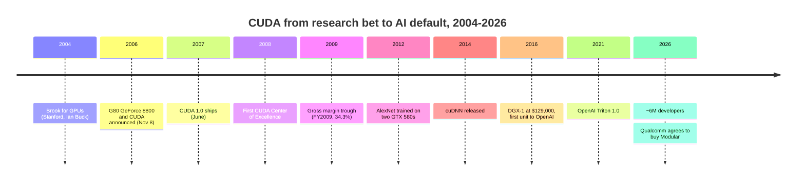

# CS2 · CUDA: the 15-year bet

Case study · ~15 min read · Last verified: 2026-11-05

## ⚡ The Executive Take

- **CUDA was a bet on a market that did not exist.** NVIDIA announced [CUDA](../glossary.md#cuda) with the G80 GPU on 2006-11-08 and shipped CUDA 1.0 in June 2007 [[S9528]](../sources/bibliography.md#s9528)[[S525]](../sources/bibliography.md#s525). It put the capability on every GeForce card, not only on premium compute boards.
- **The bet coincided with a margin collapse.** Gross margin fell from 45.6% in FY2008 to 34.3% in FY2009 and 35.4% in FY2010 [[S22000]](../sources/bibliography.md#s22000). A $196M packaging charge and the 2008 recession explain part of it [[S22000]](../sources/bibliography.md#s22000). Huang has recalled that CUDA raised costs ~50% when NVIDIA was a ~35%-margin company (🟡 reported) [[S22005]](../sources/bibliography.md#s22005)[[S22006]](../sources/bibliography.md#s22006).
- **NVIDIA kept spending through the trough.** R&D rose from 17% of revenue in FY2008 to 24–32% in FY2009–FY2015, while revenue stayed at $3.3–4.7B [[S22001]](../sources/bibliography.md#s22001)[[S22003]](../sources/bibliography.md#s22003).
- **The payoff came from outside NVIDIA's plan.** [AlexNet](../glossary.md#alexnet) trained on two GTX 580 gaming cards in 2012 [[S9530]](../sources/bibliography.md#s9530). NVIDIA followed with cuDNN (2014) and the DGX-1 (2016) [[S9531]](../sources/bibliography.md#s9531)[[S310]](../sources/bibliography.md#s310). Data Center revenue first exceeded total R&D in FY2018, and passed $10B a year only in FY2022, ~15 years after CUDA 1.0 [[S400]](../sources/bibliography.md#s400)[[S2]](../sources/bibliography.md#s2).
- **Today the ecosystem is the moat.** NVIDIA cites ~6M developers [[S528]](../sources/bibliography.md#s528); CUDA is the only stack native in all 12 major AI frameworks in the repo's matrix (36/36) [[S587]](../sources/bibliography.md#s587)[[S577]](../sources/bibliography.md#s577)[[S580]](../sources/bibliography.md#s580). Each developer now "carries" ~$32K of Data Center revenue a year, ~10× FY2021 (🔴 repo indicator) [[S22009]](../sources/bibliography.md#s22009).
- **The moat is eroding at the edges.** [PyTorch](../glossary.md#pytorch) compilers, [Triton](../glossary.md#triton), JAX/XLA and Modular's [Mojo](../glossary.md#mojo) let code target several vendors [[S9021]](../sources/bibliography.md#s9021)[[S578]](../sources/bibliography.md#s578)[[S9023]](../sources/bibliography.md#s9023). AMD's [ROCm](../glossary.md#rocm) lag on a new model fell to 26 days [[S633]](../sources/bibliography.md#s633). Qualcomm agreed in June 2026 to acquire Modular for $3.9B and closed the deal on 2026-07-29 [[S90057]](../sources/bibliography.md#s90057)[[S9511]](../sources/bibliography.md#s9511).

![Two-panel line chart, FY2007 to FY2026. Top: NVIDIA's GAAP gross margin was 42.4% in FY2007 and 45.6% in FY2008, the year CUDA 1.0 shipped, then fell to 34.3% in FY2009 (including a $196M packaging-defect charge and the recession) and 35.4% in FY2010, regained the FY2008 level only in FY2012 (51.4%), and reached 75.0% in FY2025. Bottom: R&D rose from 17% of revenue in FY2008 to 27% in FY2010 and a peak of 32% in FY2014, then fell to 9% in FY2026 as revenue outgrew spending. Milestones marked: CUDA 1.0 (FY2008), AlexNet (FY2013), cuDNN (FY2015), DGX-1 (FY2017).](../assets/charts/CS2-margin-and-rd-through-cuda-years.svg)

## 1. Context

In the mid-2000s, researchers who wanted GPU speed had to disguise maths as graphics. A matrix became a texture; a multiply became a colour blend. This was [GPGPU](../glossary.md#gpgpu) programming, and it was painful. At Stanford, Ian Buck's [Brook](../glossary.md#brook) language (2004) hid the trick behind C-like code [[S9532]](../sources/bibliography.md#s9532). Buck then joined NVIDIA to lead what became CUDA.

The hardware enabler was the G80, launched as the GeForce 8800 on 2006-11-08 [[S2503]](../sources/bibliography.md#s2503). It replaced fixed graphics stages with a [unified shader architecture](../glossary.md#unified-shader-architecture): one pool of identical programmable cores. CUDA added the pieces general code needs: a C compiler, a thread scheduler and on-chip shared memory that threads can use to cooperate [[S9528]](../sources/bibliography.md#s9528).

The commercial case was thin. NVIDIA was a graphics company with ~$4.1B of revenue in FY2008 [[S400]](../sources/bibliography.md#s400). The buyers of general-purpose GPU computing were a few hundred physicists, oil-and-gas modellers and financial quants. A vendor-neutral alternative, [OpenCL](../glossary.md#opencl), soon followed with backing from other chipmakers. The rational short-term move was to treat CUDA as a niche product for workstation and Tesla boards.

## 2. The decision

The choice was where to put CUDA. NVIDIA could have restricted it to Tesla compute boards and protected consumer margins. It chose every GeForce, which made CUDA cheap to try: any student with a gaming PC had a CUDA device. By 2020 NVIDIA counted more than 1 billion CUDA-capable GPUs [[S529]](../sources/bibliography.md#s529).

The second half of the decision was to seed demand. The first CUDA Center of Excellence, at the University of Illinois in 2008, received a $500,000 donation and a cluster worth ~$800,000; 41 universities were teaching CUDA by mid-2008 [[S9529]](../sources/bibliography.md#s9529). The decision also required patience: NVIDIA kept funding CUDA while investors questioned the strategy [[S22007]](../sources/bibliography.md#s22007).

> [!TIP]
> **Worked example — what the trough cost.** Gross profit fell from ~$1.87B in FY2008 ($4.10B × 45.6%) to ~$1.18B in FY2010 ($3.33B × 35.4%), a drop of ~$0.69B a year [[S400]](../sources/bibliography.md#s400)[[S22000]](../sources/bibliography.md#s22000)[[S22002]](../sources/bibliography.md#s22002). In the same two years R&D rose ~$217M, from $691.6M to ~$908.9M [[S22001]](../sources/bibliography.md#s22001)[[S22000]](../sources/bibliography.md#s22000). Not all of this was CUDA: FY2009 includes a $196M packaging-defect charge and the recession [[S22000]](../sources/bibliography.md#s22000). But if Huang's recollection of ~50% higher costs is even directionally right [[S22005]](../sources/bibliography.md#s22005), a large share of the margin gap was the price of putting a computer inside every graphics card.

🔧 Under the hood: why "CUDA on every GPU" stayed cheap to keep

CUDA code compiles to [PTX](../glossary.md#ptx), a virtual instruction set. The driver translates PTX to each new GPU's native code, so a kernel written for one generation still runs on the next. That is what let the installed base compound: every GeForce sold added to one software target instead of fragmenting it. NVIDIA prunes only slowly. CUDA 13 dropped Maxwell, Pascal and Volta, GPUs launched in 2014–2017 [[S90065]](../sources/bibliography.md#s90065). Since 2024 the licence has barred [translation layers](../glossary.md#translation-layer) that run CUDA output on rival chips, which raises legal risk for binary-compatible clones [[S9500]](../sources/bibliography.md#s9500).

## 3. The outcome (with numbers)

**The long payback.** The first big return came from people NVIDIA did not pay. AlexNet won ImageNet in 2012 after training for five to six days on two 3 GB GTX 580s [[S9530]](../sources/bibliography.md#s9530). NVIDIA then packaged deep-learning maths as a library: cuDNN (2014) gave frameworks tuned convolution kernels so they no longer had to write their own; Caffe was the first to integrate it [[S9531]](../sources/bibliography.md#s9531). That set the pattern for every later framework: call NVIDIA's library, inherit NVIDIA's performance. In April 2016 it launched the DGX-1 at $129,000 [[S310]](../sources/bibliography.md#s310) and hand-delivered the first unit to OpenAI that August [[S8522]](../sources/bibliography.md#s8522).

> [!TIP]
> **Worked example — why "15 years".** From FY2008 to FY2016 NVIDIA spent ~$9.5B on R&D across all products [[S22001]](../sources/bibliography.md#s22001)[[S22003]](../sources/bibliography.md#s22003)[[S400]](../sources/bibliography.md#s400). In FY2016 Data Center revenue was still only $0.34B [[S400]](../sources/bibliography.md#s400). It first exceeded total R&D in FY2018 ($1.93B vs $1.80B), about a decade after CUDA 1.0, and first passed $10B a year in FY2022 ($10.6B), about 14.5 years after it [[S400]](../sources/bibliography.md#s400)[[S2]](../sources/bibliography.md#s2). By FY2026 it was $193.7B, ~10× R&D of $18.5B [[S402]](../sources/bibliography.md#s402)[[S401]](../sources/bibliography.md#s401).

**The ecosystem today.** NVIDIA's [registered developer](../glossary.md#registered-developer) count tripled from 2M in 2020 to ~6M in 2025, and it still cited ~6M at GTC 2026 [[S529]](../sources/bibliography.md#s529)[[S528]](../sources/bibliography.md#s528). The plateau in the rounded figure is worth noting.

Revenue grew far faster than developers. Dividing Data Center revenue by the developer count gives a rough measure of how much spending rides on the ecosystem.

The platform also kept moving. CUDA shipped 13 major versions in 18 years, each tied to a hardware feature such as Tensor Cores (CUDA 9) [[S525]](../sources/bibliography.md#s525).

Breadth is the clearest outcome. In the repo's support matrix, CUDA is native in all 12 frameworks; AMD's ROCm scores 26 of 36, Google's TPU stack 14 and Qualcomm's Cloud AI stack 4 [[S586]](../sources/bibliography.md#s586)[[S580]](../sources/bibliography.md#s580)[[S577]](../sources/bibliography.md#s577)[[S596]](../sources/bibliography.md#s596).

| | 2007 (CUDA 1.0) | 2026 |
|---|---|---|
| Developers | A research community | ~6M registered [[S528]](../sources/bibliography.md#s528) |
| Releases | 1.0 | 13.x, minor releases roughly quarterly [[S523]](../sources/bibliography.md#s523) |
| Framework support | None | Native in 12 of 12 [[S586]](../sources/bibliography.md#s586) |
| NVIDIA gross margin | 45.6% (FY2008) [[S22000]](../sources/bibliography.md#s22000) | 75.0% (FY2025), 71.1% (FY2026, H20 charge) [[S416]](../sources/bibliography.md#s416)[[S402]](../sources/bibliography.md#s402) |
| Data Center revenue | Not reported | $193.7B (FY2026) [[S402]](../sources/bibliography.md#s402) |

> [!TIP]
> **Worked example — what the moat is worth in margin.** NVIDIA's gross margin was 45.6% in FY2008 and 71.1% in FY2026, even after a $4.5B H20 charge [[S22000]](../sources/bibliography.md#s22000)[[S402]](../sources/bibliography.md#s402). On FY2026 revenue of $215.9B [[S1]](../sources/bibliography.md#s1), each margin point is ~$2.2B of gross profit, so the 25.5-point gap is worth ~$55B a year. Not all of it is CUDA: scarcity, [HBM](../glossary.md#hbm) supply and rack-scale systems also support prices. But a buyer that could switch freely would push the margin toward that of [merchant silicon](../glossary.md#merchant-silicon) peers. Even a third of the gap credited to software lock-in is ~$18B a year (🔴 repo arithmetic).

## 4. Why it worked (or didn't)

1. **[Installed base](../glossary.md#installed-base) before demand.** Putting CUDA on consumer cards meant the AI researchers of 2012 already owned the hardware. No rival had that head start.
2. **Libraries turned a language into a platform.** cuDNN and later [CUDA-X](../glossary.md#cuda-x) meant framework authors called NVIDIA's tuned kernels [[S9531]](../sources/bibliography.md#s9531). Every new framework inherited NVIDIA's performance work for free.
3. **Co-design with each GPU generation.** New number formats and Tensor Core features shipped with CUDA support on launch day [[S525]](../sources/bibliography.md#s525). Rivals port them later, so NVIDIA renews its [day-0 support](../glossary.md#day-zero-support) lead with each model release.
4. **Compounding [switching costs](../glossary.md#switching-cost).** Porting one attention kernel to a new chip takes an estimated 1.8–5.5 engineer-years (🔴 repo estimate) [[S633]](../sources/bibliography.md#s633)[[S631]](../sources/bibliography.md#s631).

**What it cost NVIDIA beyond money.** Lock-in invites counter-moves. The 2024 licence clause against translation layers [[S9500]](../sources/bibliography.md#s9500) and the US Justice Department probe opened that year, which asks whether NVIDIA makes switching harder [[S9504]](../sources/bibliography.md#s9504)[[S9503]](../sources/bibliography.md#s9503), show the moat is now defended as well as built. Every [hyperscaler](../glossary.md#hyperscaler) that designs its own chip also funds software to escape CUDA.

**Counter-arguments and erosion.** The strongest bear case is that the moat moved up a layer, where NVIDIA does not own the code. Most developers now write PyTorch, not CUDA. PyTorch 2's compiler generates Triton kernels automatically [[S9021]](../sources/bibliography.md#s9021). Triton launched in 2021 as NVIDIA-only [[S22008]](../sources/bibliography.md#s22008) and now supports AMD GPUs [[S578]](../sources/bibliography.md#s578). Google serves frontier models on TPUs through JAX/XLA and, from October 2026, TorchTPU [[S595]](../sources/bibliography.md#s595)[[S553]](../sources/bibliography.md#s553). Modular claims the same Mojo kernels run unmodified on NVIDIA, AMD and Apple GPUs [[S9023]](../sources/bibliography.md#s9023). Qualcomm's $3.9B acquisition of Modular, announced in June 2026 and closed on 2026-07-29, puts a price on that portability thesis [[S90057]](../sources/bibliography.md#s90057)[[S4029]](../sources/bibliography.md#s4029)[[S9511]](../sources/bibliography.md#s9511). Its success is not yet demonstrated at scale.

| Route around CUDA | What it abstracts | Where CUDA stands (2026) | Source |
|---|---|---|---|
| PyTorch eager | Model code above the kernel layer | 🟩 Reference backend; others plug in | [[S587]](../sources/bibliography.md#s587) |
| torch.compile + Triton | Kernel generation | 🟨 Portable to AMD; best tuning still NVIDIA-first | [[S9021]](../sources/bibliography.md#s9021)[[S578]](../sources/bibliography.md#s578) |
| JAX/XLA, TorchTPU | Whole-graph compilation for TPUs | 🟦 Separate stack at Google and Anthropic scale | [[S595]](../sources/bibliography.md#s595)[[S553]](../sources/bibliography.md#s553) |
| Mojo/MAX (Modular) | Portable kernels and serving | 🟦 Early; vendor benchmarks only | [[S9022]](../sources/bibliography.md#s9022)[[S9023]](../sources/bibliography.md#s9023) |
| ROCm/HIP | CUDA-like API on AMD | 🟨 on top models (26-day lag); 🟥 on breadth (26/36) | [[S633]](../sources/bibliography.md#s633)[[S586]](../sources/bibliography.md#s586) |
| vLLM, SGLang plugins | Serving engine per vendor | 🟨 TPU, Ascend, Gaudi supported | [[S580]](../sources/bibliography.md#s580)[[S582]](../sources/bibliography.md#s582) |

> [!TIP]
> **Worked example — how fast the gap is closing.** AMD's platform arrived ~3,227 days after CUDA 1.0; [FP4](../glossary.md#fp4) support arrived 236 days after NVIDIA's; usable serving of DeepSeek-V4-Pro came 26 days after CUDA's day-0 recipes [[S525]](../sources/bibliography.md#s525)[[S586]](../sources/bibliography.md#s586)[[S633]](../sources/bibliography.md#s633). Each gap is roughly 10× shorter than the one before. If a frontier model's commercial value is concentrated in its first 3 months, a 26-day lag still costs a challenger ~30% of that window. At a 3-day lag it would cost ~3% (🔴 repo arithmetic).

> [!NOTE]
> **🐂 Bull view:** Abstraction layers still treat CUDA as the reference target [[S587]](../sources/bibliography.md#s587)[[S578]](../sources/bibliography.md#s578). The ~$32K of Data Center revenue per developer shows customers keep paying for the default path [[S22009]](../sources/bibliography.md#s22009).

> [!WARNING]
> **🐻 Bear view:** The developer count has been flat at ~6M since 2025 [[S528]](../sources/bibliography.md#s528). Hyperscalers, labs and a Qualcomm-owned Modular all fund portability, and US and Chinese regulators examine NVIDIA's conduct [[S9503]](../sources/bibliography.md#s9503)[[S9505]](../sources/bibliography.md#s9505). The moat may shift from "only CUDA works" to "CUDA works first".

## 5. Lessons for corp dev

**Patient platform investment pays only if someone else finds the use case.** NVIDIA did not predict deep learning; it made experimentation cheap and waited. The bet survived because NVIDIA's gaming business funded it. A smaller company could not easily have carried 24–32% R&D intensity for seven years (FY2009–FY2015) [[S22001]](../sources/bibliography.md#s22001)[[S22003]](../sources/bibliography.md#s22003).

> [!TIP]
> **Worked example — the option premium.** Had NVIDIA held R&D at FY2008's ~16.9% of revenue, it would have spent ~$4.6B in FY2009–FY2015 (16.9% × $27.4B of revenue). It actually spent ~$7.5B [[S22001]](../sources/bibliography.md#s22001)[[S22003]](../sources/bibliography.md#s22003)[[S400]](../sources/bibliography.md#s400). The ~$2.8B difference is a fair proxy for what NVIDIA paid to keep the platform alive, though it funded GPUs, mobile chips and software alike. Treated as an option premium, it bought a business that sold $193.7B in FY2026 [[S402]](../sources/bibliography.md#s402). Corp dev models rarely approve a premium whose exercise date is unknown, which is exactly why such positions are scarce.

**Valuing a developer ecosystem.** Developer counts are cumulative registrations, not active users. The table lists signals a diligence team can check from public data.

| Signal | CUDA today | What it tells you | Caveat |
|---|---|---|---|
| Registered developers | ~6M, flat since 2025 [[S528]](../sources/bibliography.md#s528) | Reach | Cumulative, self-reported |
| Framework coverage | 36/36 in the repo matrix [[S587]](../sources/bibliography.md#s587)[[S580]](../sources/bibliography.md#s580) | Breadth of the default path | Measures support, not speed |
| Day-0 model support | Same-day recipes for DeepSeek-V4 [[S633]](../sources/bibliography.md#s633) | Research gravity | One model at a time |
| Revenue per developer | ~$32K a year (🔴) [[S22009]](../sources/bibliography.md#s22009) | Spend riding on the ecosystem | Indicator, not causal |
| Rival's lag | 26 days on a new model [[S633]](../sources/bibliography.md#s633) | Speed of erosion | Varies by model and format |

> [!TIP]
> **Worked example — reading the Modular price.** Modular raised $380M and was valued at $1.6B in September 2025 [[S9510]](../sources/bibliography.md#s9510). Qualcomm agreed to pay ~$3.9B in June 2026 [[S90057]](../sources/bibliography.md#s90057): ~2.4× the last private mark and ~10× capital raised. At NVIDIA's ~$32K of Data Center revenue per developer (🔴) [[S22009]](../sources/bibliography.md#s22009), $3.9B equals one year of the revenue associated with ~120,000 CUDA developers, about 2% of NVIDIA's ~6M. The question for any buyer is how many developers, and how much hardware revenue, the asset can move.

**Build vs buy in software.** NVIDIA built CUDA over 20 years and bought around it (PGI compilers, Run:ai for ~$700M) [[S484]](../sources/bibliography.md#s484)[[S479]](../sources/bibliography.md#s479). Challengers are buying time: AMD bought Silo AI for $665M [[S9506]](../sources/bibliography.md#s9506). See [Layer 09 history](../layers/09-cuda-and-system-software/history-and-how-built.md) and [Layer 09 competition](../layers/09-cuda-and-system-software/competition.md) for the full layer view.

## 🎯 Corp Dev Lens

1. CUDA paid back only because a cash-generating gaming business carried it for a decade. What is the equivalent "carrier" business for a challenger's software platform, and how long can it fund losses?
2. Which metric should anchor a developer-ecosystem valuation: registered developers, framework coverage, day-0 model support or revenue per developer? Each points to a different price.
3. The moat is moving to compilers (Triton, [XLA](../glossary.md#xla), Mojo). Who owns those layers in 2028, and does owning one convert into hardware share, or only into portability that benefits every chip vendor?
4. Qualcomm's agreed acquisition of Modular is a public bet on portable AI software [[S90057]](../sources/bibliography.md#s90057). What integration milestones (framework upstreaming, day-0 support, third-party adoption) would show whether it changes switching costs?
5. NVIDIA seeded academia cheaply in 2008 [[S9529]](../sources/bibliography.md#s9529). Which channels are cheap to seed now: open-model labs, agent frameworks or AI-coding tools?

## 📚 Sources

<!-- Auto-generated from the [S…] citations on this page by `make build`. Edit sources/registry/*.csv, not this list. -->

- [**S1**](../sources/bibliography.md#s1) NVIDIA Corporation via SEC EDGAR, *NVIDIA Announces Financial Results for Fourth Quarter and Fiscal 2026 (Form 8-K exhibit 99.1)*, 2026-02-25. [Link](https://www.sec.gov/Archives/edgar/data/1045810/000104581026000019/q4fy26pr.htm)
- [**S2**](../sources/bibliography.md#s2) U.S. Securities and Exchange Commission (EDGAR), *NVIDIA Corporation Form 10-K annual reports FY2020–FY2025 (filing index)*, 2025-02-26. [Link](https://www.sec.gov/cgi-bin/browse-edgar?action=getcompany&CIK=0001045810&type=10-K&dateb=&owner=include&count=40)
- [**S310**](../sources/bibliography.md#s310) AnandTech (Ryan Smith), *NVIDIA unveils the DGX-1 HPC server: 8 Teslas, 3U, Q2 2016*, 2016-04-05. [Link](https://www.anandtech.com/show/10229)
- [**S400**](../sources/bibliography.md#s400) U.S. Securities and Exchange Commission (EDGAR), *NVIDIA Corporation Form 10-K annual reports FY2001–FY2019 (EDGAR filing index)*, 2019-02-21. [Link](https://www.sec.gov/cgi-bin/browse-edgar?action=getcompany&CIK=0001045810&type=10-K&dateb=&owner=include&count=40)
- [**S401**](../sources/bibliography.md#s401) NVIDIA Corporation via SEC EDGAR, *NVIDIA Corporation Form 10-K for fiscal year ended January 25, 2026*, 2026-02-25. [Link](https://www.sec.gov/Archives/edgar/data/1045810/000104581026000021/nvda-20260125.htm)
- [**S402**](../sources/bibliography.md#s402) NVIDIA Corporation via SEC EDGAR (Colette Kress), *CFO Commentary on Fourth Quarter and Fiscal 2026 Results (Form 8-K exhibit 99.2)*, 2026-02-25. [Link](https://www.sec.gov/Archives/edgar/data/1045810/000104581026000019/q4fy26cfocommentary.htm)
- [**S416**](../sources/bibliography.md#s416) NVIDIA Corporation via SEC EDGAR, *NVIDIA Corporation Form 10-K for fiscal year ended January 26, 2025*, 2025-02-26. [Link](https://www.sec.gov/Archives/edgar/data/1045810/000104581025000023/nvda-20250126.htm)
- [**S479**](../sources/bibliography.md#s479) Various (press), *Reporting on NVIDIA tuck-in acquisition prices (Run:ai, Deci, Shoreline, OctoAI, Gretel, Lepton, CentML) — The Information, Calcalist, Reuters, CNBC*, 2025-06. [Link](https://www.reuters.com/technology/)
- [**S484**](../sources/bibliography.md#s484) NVIDIA press releases as summarised in NVIDIA 10-K filings and contemporaneous press, *History of NVIDIA acquisitions 2000–2013 (3dfx assets, MediaQ, ULi, Hybrid Graphics, PortalPlayer, mental images, Ageia, Icera, The Portland Group)*, 2013-07. [Link](https://en.wikipedia.org/wiki/Nvidia)
- [**S523**](../sources/bibliography.md#s523) Python Package Index (NVIDIA), *nvidia-cuda-runtime (CUDA 13.x runtime wheels) release history*, 2026-11-04. [Link](https://pypi.org/project/nvidia-cuda-runtime/#history)
- [**S525**](../sources/bibliography.md#s525) NVIDIA Developer, *CUDA Toolkit Archive*, 2026. [Link](https://developer.nvidia.com/cuda-toolkit-archive)
- [**S528**](../sources/bibliography.md#s528) NVIDIA Developer Forums, *20 Years of CUDA: Honoring the Architects of the Accelerated Age*, 2026-03. [Link](https://forums.developer.nvidia.com/t/20-years-of-cuda-honoring-the-architects-of-the-accelerated-age/364654)
- [**S529**](../sources/bibliography.md#s529) NVIDIA Blog (Will Ramey), *2 Million Registered Developers, Countless Breakthroughs*, 2020. [Link](https://blogs.nvidia.com/blog/2-million-registered-developers-breakthroughs/)
- [**S553**](../sources/bibliography.md#s553) Google Cloud Blog (Alex Barrett), *What's new in AI infrastructure and orchestration in October*, 2026-11. [Link](https://cloud.google.com/blog/topics/ai-infrastructure/whats-new-in-ai-infrastructure-this-month)
- [**S577**](../sources/bibliography.md#s577) JAX (GitHub: jax-ml/jax docs/installation.md), *JAX installation guide — supported platforms*, 2026-11. [Link](https://github.com/jax-ml/jax/blob/main/docs/installation.md)
- [**S578**](../sources/bibliography.md#s578) OpenAI Triton (GitHub), *Triton (triton-lang/triton) README — supported hardware*, 2026-11. [Link](https://github.com/triton-lang/triton/blob/main/README.md)
- [**S580**](../sources/bibliography.md#s580) vLLM project (GitHub), *vLLM README and installation docs — supported hardware*, 2026-11. [Link](https://github.com/vllm-project/vllm/blob/main/docs/getting_started/installation/README.md)
- [**S582**](../sources/bibliography.md#s582) SGLang project (GitHub: sgl-project/sglang), *SGLang README — supported hardware*, 2026-11. [Link](https://github.com/sgl-project/sglang/blob/main/README.md)
- [**S586**](../sources/bibliography.md#s586) AMD (GitHub: ROCm/ROCm docs), *ROCm documentation sources: release history, AI-ecosystem compatibility matrix, consolidated changelog*, 2026-08-26. [Link](https://github.com/ROCm/ROCm/blob/develop/docs/release/versions.rst)
- [**S587**](../sources/bibliography.md#s587) PyTorch (GitHub: pytorch/pytorch), *PyTorch README — building with CUDA, ROCm and Intel GPU support*, 2026-11. [Link](https://github.com/pytorch/pytorch/blob/main/README.md)
- [**S595**](../sources/bibliography.md#s595) PyTorch (GitHub: pytorch/xla), *PyTorch/XLA README (deprecation notice)*, 2026-11. [Link](https://github.com/pytorch/xla/blob/master/README.md)
- [**S596**](../sources/bibliography.md#s596) Qualcomm (GitHub: quic), *Qualcomm Cloud AI SDK and Efficient Transformers repositories*, 2026-11. [Link](https://github.com/quic/cloud-ai-sdk)
- [**S631**](../sources/bibliography.md#s631) SemiAnalysis, *MI355X DeepSeek-V4-Pro on SGLang: 110.5x Throughput per GPU in 26 Days*, 2026-05-26. [Link](https://github.com/SemiAnalysisAI/InferenceX-app/blob/main/packages/app/content/blog/mi355x-deepseek-v4-pro-sglang-110x-in-26-days.mdx)
- [**S633**](../sources/bibliography.md#s633) SemiAnalysis, *DeepSeekV4 1.6T Day 0 to Day 43 Performance Over Time — Huawei, GB300 NVL72, MI355X, B200*, 2026-06-09. [Link](https://github.com/SemiAnalysisAI/InferenceX-app/blob/main/packages/app/content/blog/deepseekv4-16t-day-0-to-day-43-performance.mdx)
- [**S2503**](../sources/bibliography.md#s2503) TechSpot, *TechSpot's History of the GPU, Part 4: the coming of general-purpose GPUs*, 2013. [Link](https://www.techspot.com/article/659-history-of-the-gpu-part-4/)
- [**S4029**](../sources/bibliography.md#s4029) StorageReview, *Qualcomm unveils Dragonfly data center roadmap: C1000 CPU, AI300 accelerator*, 2026-06-24. [Link](https://www.storagereview.com/news/qualcomm-unveils-dragonfly-data-center-roadmap-c1000-cpu-ai300-accelerator-and-modular-acquisition)
- [**S8522**](../sources/bibliography.md#s8522) TOP500, *NVIDIA delivers DGX-1 'supercomputer in a box' to OpenAI*, 2016-08-15. [Link](https://top500.org/news/nvidia-delivers-dgx-1-supercomputer-in-a-box-to-openai/)
- [**S9021**](../sources/bibliography.md#s9021) ACM ASPLOS 2024 (PDF hosted by PyTorch) (Jason Ansel et al.), *PyTorch 2: Faster Machine Learning Through Dynamic Python Bytecode Transformation and Graph Compilation*, 2024-04. [Link](https://pytorch.org/assets/pytorch2-2.pdf)
- [**S9022**](../sources/bibliography.md#s9022) Modular, *Achieving state-of-the-art performance on AMD MI355 in just 14 days*, 2025-10-17. [Link](https://www.modular.com/blog/achieving-state-of-the-art-performance-on-amd-mi355----in-just-14-days)
- [**S9023**](../sources/bibliography.md#s9023) Modular, *Modular 25.6: unifying the latest GPUs from NVIDIA, AMD and Apple*, 2025-09. [Link](https://www.modular.com/blog/modular-25-6-unifying-the-latest-gpus-from-nvidia-amd-and-apple)
- [**S9500**](../sources/bibliography.md#s9500) Tom's Hardware, *Nvidia bans using translation layers for CUDA software to run on other chips; new restriction apparently targets ZLUDA and some Chinese GPU makers*, 2024-03-05. [Link](https://www.tomshardware.com/pc-components/gpus/nvidia-bans-using-translation-layers-for-cuda-software-to-run-on-other-chips-new-restriction-apparently-targets-zluda-and-some-chinese-gpu-makers)
- [**S9503**](../sources/bibliography.md#s9503) Business Standard (Bloomberg), *Nvidia gets subpoena from US Justice Dept as antitrust probe deepens*, 2024-09-04. [Link](https://www.business-standard.com/world-news/nvidia-gets-subpoena-from-us-justice-dept-as-antitrust-probe-deepens-124090400121_1.html)
- [**S9504**](../sources/bibliography.md#s9504) Business Standard, *US launches antitrust investigation into Nvidia over sales practices*, 2024-08-02. [Link](https://www.business-standard.com/world-news/us-launches-antitrust-investigation-into-nvidia-over-sales-practices-124080201689_1.html)
- [**S9505**](../sources/bibliography.md#s9505) JURIST, *China finds Nvidia violated antimonopoly law in preliminary probe*, 2025-09-15. [Link](https://www.jurist.org/news/2025/09/china-finds-nvidia-violated-antimonopoly-law-in-preliminary-probe/)
- [**S9506**](../sources/bibliography.md#s9506) Converge Digest, *AMD completes $665 million acquisition of Silo AI*, 2024-08. [Link](https://convergedigest.com/amd-completes-665-million-acquisition-of-silo-ai/?amp=1)
- [**S9510**](../sources/bibliography.md#s9510) SDxCentral, *Modular raises $250M for AI's unified compute layer at $1.6B valuation*, 2025-09-24. [Link](https://www.sdxcentral.com/news/modular-raises-250m-for-ais-unified-compute-layer-at-16b-valuation/)
- [**S9511**](../sources/bibliography.md#s9511) Nasdaq (Qualcomm press release), *Qualcomm Completes Acquisition of Modular*, 2026-07-29. [Link](https://www.nasdaq.com/press-release/qualcomm-completes-acquisition-modular-2026-07-29)
- [**S9528**](../sources/bibliography.md#s9528) Digital Engineering 24/7 (NVIDIA press release), *NVIDIA Unveils CUDA - The GPU Computing Revolution Begins*, 2006-11-08. [Link](https://www.digitalengineering247.com/article/nvidia-unveils-cuda)
- [**S9529**](../sources/bibliography.md#s9529) TechPowerUp, *NVIDIA appoints first CUDA Center of Excellence*, 2008-07-01. [Link](https://techpowerup.com/64493/nvidia-appoints-first-cuda-center-of-excellence)
- [**S9530**](../sources/bibliography.md#s9530) NeurIPS 2012 (Advances in Neural Information Processing Systems 25) (Alex Krizhevsky, Ilya Sutskever, Geoffrey E. Hinton), *ImageNet Classification with Deep Convolutional Neural Networks*, 2012-12. [Link](https://papers.nips.cc/paper/4824-imagenet-classification-with-deep-convolutional-neural-networks)
- [**S9531**](../sources/bibliography.md#s9531) arXiv:1410.0759 (Sharan Chetlur, Cliff Woolley, Philippe Vandermersch, Jonathan Cohen, John Tran, Bryan Catanzaro, Evan Shelhamer), *cuDNN: Efficient Primitives for Deep Learning*, 2014-10-03. [Link](https://arxiv.org/abs/1410.0759)
- [**S9532**](../sources/bibliography.md#s9532) Stanford Graphics Lab (SIGGRAPH 2004) (Ian Buck, Tim Foley, Daniel Horn, Jeremy Sugerman, Kayvon Fatahalian, Mike Houston, Pat Hanrahan), *Brook for GPUs: Stream Computing on Graphics Hardware*, 2004-08. [Link](https://graphics.stanford.edu/papers/brookgpu/)
- [**S22000**](../sources/bibliography.md#s22000) NVIDIA Corporation via SEC EDGAR, *NVIDIA Corporation Form 10-K for fiscal year 2010*, 2010-03. [Link](https://www.sec.gov/Archives/edgar/data/0001045810/000104581010000006/fy2010form10k.htm)
- [**S22001**](../sources/bibliography.md#s22001) NVIDIA Corporation via SEC EDGAR, *NVIDIA Corporation Form 10-K for fiscal year 2009*, 2009-03. [Link](https://www.sec.gov/Archives/edgar/data/0001045810/000104581009000013/fy2009form10k.htm)
- [**S22002**](../sources/bibliography.md#s22002) NVIDIA Corporation via SEC EDGAR, *NVIDIA Reports Financial Results for Fourth Quarter and Fiscal Year 2010 (Form 8-K exhibit 99.1)*, 2010-02-17. [Link](https://www.sec.gov/Archives/edgar/data/1045810/000104581010000002/q410pressrelease.htm)
- [**S22003**](../sources/bibliography.md#s22003) NVIDIA Corporation via SEC EDGAR, *NVIDIA Corporation Form 10-K for fiscal year 2013*, 2013-03. [Link](https://www.sec.gov/Archives/edgar/data/0001045810/000104581013000008/nvda-2013x10k.htm)
- [**S22005**](../sources/bibliography.md#s22005) Shortform (summary of Lex Fridman Podcast), *Lex Fridman Podcast #494 - Jensen Huang: NVIDIA, the $4 trillion company and the AI revolution (episode summary)*, 2026-03-23. [Link](https://www.shortform.com/podcast/episode/lex-fridman-podcast-2026-03-23-episode-summary-494-jensen-huang-nvidia-the-4-trillion-company-the-ai-revolution)
- [**S22006**](../sources/bibliography.md#s22006) Wccftech, *Nvidia CEO reveals how the company survived an existential threat after forcing CUDA on gaming GPUs*, 2026-03. [Link](https://wccftech.com/nvidia-ceo-reveals-how-the-company-survived-an-existential-threat-after-forcing-cuda-on-gaming-gpus/)
- [**S22007**](../sources/bibliography.md#s22007) The Motley Fool, *Time to sell Nvidia?*, 2009-02-11. [Link](https://www.fool.com/investing/general/2009/02/11/time-to-sell-nvidia.aspx)
- [**S22008**](../sources/bibliography.md#s22008) OpenAI (Philippe Tillet), *Introducing Triton: open-source GPU programming for neural networks*, 2021-07-28. [Link](https://openai.com/index/triton/)
- [**S22009**](../sources/bibliography.md#s22009) nvidia_deep_dive_claude repository, *Repo analysis: CS2 CUDA payback (gross-margin trough, R&D intensity, Data Center revenue per registered CUDA developer)*, 2026-11-05. [Link](https://github.com/FrankHuang94/nvidia_deep_dive_claude/blob/main/case-studies/CS2-cuda-the-15-year-bet.md)
- [**S90057**](../sources/bibliography.md#s90057) StorageReview, *Qualcomm unveils Dragonfly data center roadmap: C1000 CPU, AI300 accelerator and Modular acquisition*, 2026-06-24. [Link](https://www.storagereview.com/es/news/qualcomm-unveils-dragonfly-data-center-roadmap-c1000-cpu-ai300-accelerator-and-modular-acquisition)
- [**S90065**](../sources/bibliography.md#s90065) Spheron, *CUDA news today: NVIDIA toolkit, AMD ROCm and AI frameworks 2026*, 2026. [Link](https://www.spheron.network/blog/cuda-news-today-nvidia-toolkit-amd-rocm-ai-frameworks-2026/)
