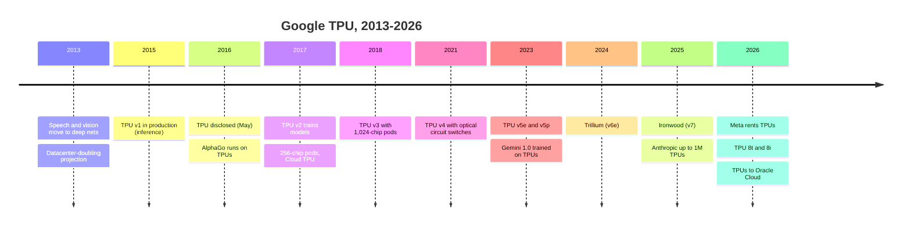
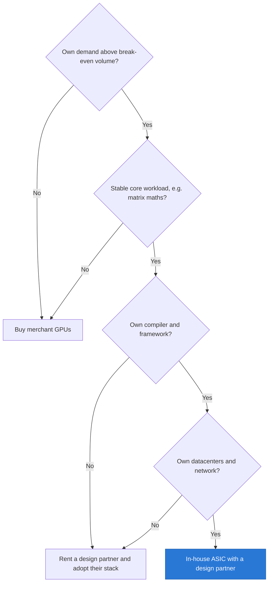

# CS3 · Google TPU: the credible alternative

Case study · ~15 min read · Last verified: 2026-11-05

## ⚡ The Executive Take

- **The TPU began as a defensive cost decision.** Google projected that three minutes of daily voice search per user on CPUs would have forced it to double its datacenters [[S23001]](../sources/bibliography.md#s23001). Its first [TPU](../glossary.md#tpu) ran in production from 2015, 15–30× faster and 30–80× more energy-efficient than the CPUs and GPUs of the day on Google's inference work [[S23001]](../sources/bibliography.md#s23001)[[S23002]](../sources/bibliography.md#s23002).
- **Google designs, partners build.** Google owns the architecture; Broadcom has been its long-standing [ASIC design partner](../glossary.md#asic-design-partner), with MediaTek reportedly added for the v7e and v8e variants (🟡) [[S23007]](../sources/bibliography.md#s23007)[[S23008]](../sources/bibliography.md#s23008).
- **Seven generations compounded.** Ironwood (v7, 2025) delivers 4,614 TFLOPS of dense [FP8](../glossary.md#fp8) and 192 GB of HBM3E per chip, in pods of 9,216 chips (42.5 EF) [[S151]](../sources/bibliography.md#s151)[[S650]](../sources/bibliography.md#s650). TPU 8t, announced in April 2026, reaches 12.6 PFLOPS FP4 in 9,600-chip pods (🟢 announced) [[S552]](../sources/bibliography.md#s552)[[S239]](../sources/bibliography.md#s239).
- **It is now sold outside Google.** Anthropic has access to up to 1M TPUs, well over 1 GW in 2026 [[S653]](../sources/bibliography.md#s653), and multiple GW more from 2027 [[S655]](../sources/bibliography.md#s655). Meta rents Ironwood capacity and has discussed buying TPUs for its own sites (🟡) [[S90025]](../sources/bibliography.md#s90025). Oracle will host TPUs from 2027 [[S552]](../sources/bibliography.md#s552).
- **The economics are the threat.** SemiAnalysis estimates an owned Ironwood costs ~$1.21 per chip-hour against ~$1.73 for a B200 and ~$2.31 for a GB300 (Est.) [[S622]](../sources/bibliography.md#s622). Per token the gap is smaller: ~18% below B200 on one FP8 workload (Est.) [[S625]](../sources/bibliography.md#s625).
- **The limits are real.** TPUs are rarely sold as merchant chips; the TPU stack scores 14 of 36 on framework support against CUDA's 36 [[S580]](../sources/bibliography.md#s580)[[S577]](../sources/bibliography.md#s577); and Google depends on Broadcom for silicon, packaging and supply.
- **For NVIDIA it caps pricing power, not volume.** A repo estimate suggests NVIDIA could cut prices enough to match the TPU's per-token cost and still keep a ~62% gross margin (🔴) [[S23010]](../sources/bibliography.md#s23010).

![Two-panel chart of Google TPU generations. Left, log scale: dense BF16 TFLOPS per chip rose from 45 (TPU v2, 2017) to 123 (v3, 2018), 275 (v4, 2021), 459 (v5p, 2023), 918 (v6e Trillium, 2024) and about 2,307 (v7 Ironwood, 2025; BF16 reported as half its 4,614 FP8), about 51 times in eight years; the cost-optimised v5e has 197. Right: maximum chips per pod grew from 256 (v2) to 1,024 (v3), 4,096 (v4), 8,960 (v5p) and 9,216 (Ironwood), with 9,600 announced for TPU 8t in 2026; the v5e and Trillium efficiency parts stay at 256-chip pods. TPU v1 (2015) was an INT8 inference card with 92 TOPS and no pod.](../assets/charts/CS3-tpu-generations.svg)

## 1. Context

By 2013 Google's speech and vision products were moving to deep neural networks. The models worked, but the compute bill did not. A projection that year showed that if people used voice search for three minutes a day, with the networks running on existing processors, Google would have had to double its datacenters [[S23002]](../sources/bibliography.md#s23002)[[S23001]](../sources/bibliography.md#s23001).

The answer was an [ASIC](../glossary.md#asic), a chip that does one job. The TPU v1 was an inference card built around a [systolic array](../glossary.md#systolic-array) of 65,536 8-bit multiply-accumulate units with a peak of 92 TOPS and 28 MiB of on-chip memory [[S23002]](../sources/bibliography.md#s23002). A systolic array works like a bucket brigade: numbers pass from one unit to its neighbour, so each value fetched from memory is reused hundreds of times. A GPU of 2015 spent much of its silicon and energy on flexibility the TPU did not need.

Google moved fast. TPUs were running applications in its datacenters within 22 days of first tested silicon, and served RankBrain search ranking, Street View and AlphaGo [[S23000]](../sources/bibliography.md#s23000). Google disclosed the chip only in May 2016, after more than a year in production [[S23000]](../sources/bibliography.md#s23000).

> [!TIP]
> **Worked example — what 30–80× performance per watt means.** Suppose an inference fleet needed 100 MW on 2015-era CPUs and GPUs. At 30–80× better TOPS/W [[S23001]](../sources/bibliography.md#s23001), the same work needs ~1.3–3.3 MW of TPUs. Even if the real-world gain were only a tenth of that, 10 MW would be saved: at ~$0.08/kWh that is ~$7M a year of electricity alone, before the avoided datacenter construction (🔴 repo arithmetic).

## 2. The decision

Google chose to build rather than buy NVIDIA GPUs for its core AI work, and to build with a design house rather than alone. The split of labour is typical of [captive silicon](../glossary.md#captive-silicon): Google's engineers define the architecture, compiler and system; a design partner turns that into manufacturable silicon, supplies high-speed SerDes and packaging know-how, and manages TSMC and memory supply. Broadcom has filled that role for most generations; MediaTek reportedly handles I/O for a v7 variant and has orders for v7e and v8e (🟡) [[S23007]](../sources/bibliography.md#s23007)[[S23008]](../sources/bibliography.md#s23008).

> [!TIP]
> **Worked example — when does an in-house ASIC pay off?** A leading-edge chip design costs ~$0.6–0.7B (IBS estimates for 3 nm and 2 nm; insiders call them high) [[S2501]](../sources/bibliography.md#s2501)[[S2500]](../sources/bibliography.md#s2500). Double it to $1.4B to cover software and systems (🔴). SemiAnalysis puts Ironwood ~18% below a B200 per token, and a B200 at ~$1.73 per hour [[S625]](../sources/bibliography.md#s625)[[S622]](../sources/bibliography.md#s622). The saving per B200-equivalent is ~0.18 × $1.73 × 8,760 h ≈ **$2,700 a year**. Break-even is ~$1.4B ÷ $2,700 ≈ 520,000 chip-years, or ~130,000 chips per generation over a four-year life (🔴 repo arithmetic) [[S23010]](../sources/bibliography.md#s23010). Anthropic's access to up to 1M TPUs alone clears that bar [[S653]](../sources/bibliography.md#s653). A buyer of 20,000 accelerators a year would not.

## 3. The outcome (with numbers)

| Generation | Year | Role | Peak per chip | Memory per chip | Max pod | Source |
|---|---|---|---|---|---|---|
| v1 | 2015 | Inference | 92 TOPS INT8 | 28 MiB on-chip | — | [[S23002]](../sources/bibliography.md#s23002) |
| v2 | 2017 | Training | 45 TFLOPS BF16 | HBM | 256 | [[S23003]](../sources/bibliography.md#s23003) |
| v3 | 2018 | Training | 123 TFLOPS BF16 | 32 GiB, 0.9 TB/s | 1,024 | [[S23004]](../sources/bibliography.md#s23004) |
| v4 | 2021 | Training | 275 TFLOPS BF16 | 32 GB, 1.2 TB/s | 4,096 | [[S146]](../sources/bibliography.md#s146)[[S147]](../sources/bibliography.md#s147) |
| v5e | 2023 | Efficiency | 197 TFLOPS BF16 | 16 GB, 0.82 TB/s | 256 | [[S148]](../sources/bibliography.md#s148) |
| v5p | 2023 | Training | 459 TFLOPS BF16 | 95 GB, 2.77 TB/s | 8,960 | [[S149]](../sources/bibliography.md#s149) |
| v6e Trillium | 2024 | Efficiency | 918 TFLOPS BF16 | 32 GB, 1.64 TB/s | 256 | [[S150]](../sources/bibliography.md#s150)[[S549]](../sources/bibliography.md#s549) |
| v7 Ironwood | 2025 | Inference-first | 4,614 TFLOPS FP8 | 192 GB HBM3E, 7.37 TB/s | 9,216 | [[S151]](../sources/bibliography.md#s151)[[S650]](../sources/bibliography.md#s650) |
| 8t | 2026 (🟢 announced) | Training | 12.6 PFLOPS FP4 | n/a | 9,600 | [[S552]](../sources/bibliography.md#s552)[[S239]](../sources/bibliography.md#s239) |
| 8i | 2026 (🟢 announced) | Inference | ~3× Ironwood SRAM | n/a | 1,152 (🟡) | [[S550]](../sources/bibliography.md#s550)[[S239]](../sources/bibliography.md#s239) |

Ironwood marked a shift in emphasis. Google called it its first TPU "for the age of inference" [[S151]](../sources/bibliography.md#s151). It claims 10× the peak of v5p, more than 4× Trillium per chip and 2× Trillium's performance per watt [[S547]](../sources/bibliography.md#s547)[[S650]](../sources/bibliography.md#s650). A full superpod holds 1.77 PB of HBM [[S650]](../sources/bibliography.md#s650). The 2026 generation splits the line into a training chip (8t) and an inference chip (8i) with more on-chip memory for the [KV cache](../glossary.md#kv-cache) [[S550]](../sources/bibliography.md#s550).

**Internal outcome.** Google's frontier models run on TPUs. The Gemini 1.0 report describes training on TPU v4 and v5e fleets with [JAX](../glossary.md#jax) [[S23005]](../sources/bibliography.md#s23005). Gemini 3 (November 2025) was reportedly trained on TPUs too (🟡) [[S23006]](../sources/bibliography.md#s23006). A week later, a report that Meta was in talks to use TPUs cut NVIDIA's shares by as much as 7.1% intraday [[S23009]](../sources/bibliography.md#s23009).

**External outcome.** For years TPUs were available only as Google Cloud rentals. That changed in 2025–26. Anthropic signed for up to 1M TPUs, tens of billions of dollars of capacity [[S653]](../sources/bibliography.md#s653). SemiAnalysis reports roughly 400,000 of those as purchases and 600,000 as rentals (🟡) [[S625]](../sources/bibliography.md#s625). Meta rents Ironwood and has discussed buying TPUs for its own datacenters (🟡) [[S90025]](../sources/bibliography.md#s90025); Google is reported to sell TPUs into customer sites [[S90027]](../sources/bibliography.md#s90027). Oracle will host TPUs from 2027 [[S552]](../sources/bibliography.md#s552).

The partner also benefited. Broadcom's AI revenue, which includes custom accelerators such as the TPU and AI Ethernet, grew from ~$3.8B in 2023 to ~$20.2B in fiscal 2025 (Est. from quarterly reports) [[S660]](../sources/bibliography.md#s660)[[S661]](../sources/bibliography.md#s661).

## 4. Why it worked (or didn't)

**[Vertical integration](../glossary.md#vertical-integration) is the mechanism.** Google owns every layer an AI system touches: the chip, the [ICI](../glossary.md#ici) links between chips, the [optical circuit switches](../glossary.md#optical-circuit-switch) that rewire pods, the datacenter, the [XLA](../glossary.md#xla) compiler, the JAX framework and the model [[S650]](../sources/bibliography.md#s650)[[S237]](../sources/bibliography.md#s237). Each layer can be designed for the others, and no supplier margin is paid between them except the design partner's.

**The topology is a deliberate trade.** TPU chips connect in a 3D [torus](../glossary.md#torus-topology): each chip talks directly to six neighbours, and traffic to distant chips hops through others [[S232]](../sources/bibliography.md#s232). That is cheap to scale to 9,216 chips. NVIDIA's NVL72 instead switches every GPU to every other at full speed, but only for 72 GPUs. The repo's model puts all-to-all bandwidth at ~900 GB/s per GPU inside NVL72 against ~200 GB/s per chip in a 64-chip TPU cube.

🔧 Under the hood: matrix units, ICI and optical switches

Each TPU generation scaled the same idea. TPU v2 had two 128 × 128 systolic matrix units; Ironwood has four 256 × 256 BF16 arrays and adds FP8 [[S2016]](../sources/bibliography.md#s2016). Bigger arrays reuse each fetched number more times, which saves memory bandwidth, but they waste more silicon on small or oddly shaped matrices. That is why the compiler matters: XLA reshapes and fuses whole model graphs so the arrays stay full.

Between chips, Ironwood uses six ICI links of 200 GB/s each (bidirectional), 1.2 TB/s per chip [[S232]](../sources/bibliography.md#s232). Sixty-four chips form a 4 × 4 × 4 cube, the rack-level building block. Cubes are joined through optical circuit switches: mirrors that steer light from one fibre to another without converting it to electrical signals. TPU v4 used 48 such switches to join 64 cubes into a 4,096-chip machine [[S237]](../sources/bibliography.md#s237). Because the optics can be re-pointed, Google can carve a pod into slices, route around a failed cube and reshape the torus for a given job. The same optical approach runs Google's Jupiter datacenter network [[S293]](../sources/bibliography.md#s293). No other vendor sells this combination; it exists only inside Google's own buildings.

![Log-log line chart of modeled all-to-all bandwidth per chip. A switched GB300-class NVL72 gives 900 GB/s per direction to every GPU up to 72 GPUs, then falls to the 800G NIC's ~100 GB/s (101 GB/s at 9,216 GPUs); an 8-GPU HGX node drops to ~100 GB/s beyond 8 GPUs; Vera Rubin NVL72 starts at 1,500 and settles near 200 with 1.6T NICs. A TPU Ironwood 3D torus (1.2 TB/s over six links) delivers about 200 GB/s in a 64-chip cube, falling with the cube root of chip count to about 38 at 9,216; TPU 8t doubles that. Torus links carry multi-hop traffic, which switched fabrics avoid.](../assets/charts/05-torus-vs-switched-all-to-all.svg)

| Dimension | TPU (Ironwood / 8t) vs NVIDIA (Rubin) | Source |
|---|---|---|
| Compute per chip | 🟥 4.6 PFLOPS FP8 vs 17.5 | [[S151]](../sources/bibliography.md#s151)[[S33004]](../sources/bibliography.md#s33004) |
| Memory bandwidth per chip | 🟥 7.37 TB/s vs 19.2 TB/s | [[S151]](../sources/bibliography.md#s151)[[S90006]](../sources/bibliography.md#s90006) |
| Scale-up domain | 🟦 9,216-chip torus vs 72-GPU switched NVL72 | [[S650]](../sources/bibliography.md#s650)[[S33004]](../sources/bibliography.md#s33004) |
| Cost per token (one workload) | 🟩 ~18% below B200 (Est.) | [[S625]](../sources/bibliography.md#s625) |
| Software outside Google | 🟥 14/36 framework support vs 36/36 | [[S580]](../sources/bibliography.md#s580)[[S577]](../sources/bibliography.md#s577)[[S595]](../sources/bibliography.md#s595) |
| Availability | 🟥 Cloud and selected direct deals vs merchant everywhere | [[S653]](../sources/bibliography.md#s653)[[S90027]](../sources/bibliography.md#s90027) |
| Public benchmarks | 🟥 Ironwood absent from MLPerf Inference 6.0 | [[S613]](../sources/bibliography.md#s613) |

**The limits.** First, availability: most buyers can only rent TPUs inside Google Cloud, and a model trained there is harder to move. Second, software outside Google: PyTorch on TPU went through PyTorch/XLA, now deprecated in favour of TorchTPU, open-sourced with Meta in October 2026 [[S595]](../sources/bibliography.md#s595)[[S553]](../sources/bibliography.md#s553). Third, Broadcom dependence: the design partner's margin sits inside TPU cost, and Broadcom also builds OpenAI's custom accelerator [[S174]](../sources/bibliography.md#s174). Fourth, transparency: without MLPerf results, buyers rely on Google's and analysts' figures [[S613]](../sources/bibliography.md#s613). Fifth, timing (🔴 analysis): Google kept the TPU largely internal for a decade. The external push came only in 2025–26, after CUDA had become the default for most buyers; an earlier merchant strategy might have built a larger outside ecosystem, at the cost of supplying rivals.

### What it means for NVIDIA's pricing power

Comparisons must be per unit of work, not per chip. The chip-hour gap is large; the per-token gap is smaller because chips differ in throughput.

> [!WARNING]
> **Read these numbers carefully.** The two panels use different models, precisions and interactivity targets, so they cannot be combined. The TPU comparison is FP8 only; NVIDIA's FP4 and rack-scale (GB300 NVL72) advantages are not in it. All figures are SemiAnalysis estimates from one benchmark harness, and software maturity changes them monthly [[S625]](../sources/bibliography.md#s625)[[S621]](../sources/bibliography.md#s621).

> [!TIP]
> **Worked example — how much would NVIDIA have to cut to match?** To match Ironwood's $0.181 per million tokens, a B200 owner's cost must fall from $0.222, an 18.5% cut [[S625]](../sources/bibliography.md#s625). Assume NVIDIA's invoice is ~55% of a buyer's all-in hourly cost (🔴: depreciation is the largest cost and NVIDIA sells most of the system). NVIDIA's price would then need to fall ~34% (18.5% ÷ 55%). At a 75% gross margin, unit cost is 25% of the old price; after a 34% cut, margin is (66 − 25) ÷ 66 ≈ **62%** (🔴 repo arithmetic) [[S23010]](../sources/bibliography.md#s23010). NVIDIA can win such a price war, but each large buyer with a credible TPU option can extract part of that ~13-point margin cushion.

> [!NOTE]
> **🐂 Bull view (for Google):** The TPU is the only alternative with a full stack, a decade of production, a frontier model trained on it and outside customers at gigawatt scale [[S653]](../sources/bibliography.md#s653)[[S23005]](../sources/bibliography.md#s23005).

> [!WARNING]
> **🐻 Bear view (for Google):** Per chip, Ironwood has about a quarter of Rubin's FP8 compute and ~40% of its memory bandwidth [[S151]](../sources/bibliography.md#s151)[[S33004]](../sources/bibliography.md#s33004)[[S90006]](../sources/bibliography.md#s90006). Outside Google, the software path is young, and merchant GPUs remain the default for most buyers.

## 5. Lessons for corp dev

**When an in-house ASIC pays off.** The TPU worked because Google met all four conditions in the flowchart: its own demand far above break-even, a stable core workload, its own compiler and framework, and its own datacenters. It also took a decade and seven generations. Few companies meet all four; that is why most custom-silicon programs stay small or rely on renting the partner's stack.

**The design partner captures durable value.** Broadcom collects revenue on every generation without owning the architecture or the model [[S661]](../sources/bibliography.md#s661). MediaTek's 2026 AI ASIC target of $2B shows the second-source role is also valuable (🟡) [[S2518]](../sources/bibliography.md#s2518). For a supplier, being the design house for several hyperscalers spreads risk across customers.

**Alternatives change prices before they change share.** NVIDIA still holds most AI accelerator revenue, yet Google's TPU, offered externally, gives the largest buyers a negotiating anchor. For more, see [competitive landscape](../cross-cutting/15-competitive-landscape/index.md), [Layer 05 competition](../layers/05-scale-up-nvlink-nvswitch/competition.md) and [Layer 02 competition](../layers/02-gpu-silicon/competition.md).

## 🎯 Corp Dev Lens

1. The break-even arithmetic implies ~130,000 chips per generation for a full in-house program (🔴). Which buyers clear that bar, and which would rather license a design or co-develop with a partner?
2. Design houses (Broadcom, MediaTek, Marvell, Alchip) capture value without owning the model or the cloud. What capabilities (SerDes, packaging, HBM supply) make a design house indispensable, and which are buildable or buyable?
3. Google now sells TPU capacity to rivals such as Anthropic and Meta [[S653]](../sources/bibliography.md#s653)[[S90025]](../sources/bibliography.md#s90025). Does a merchant TPU business change how hyperscalers value their own silicon programs, and their bargaining with NVIDIA?
4. Qualcomm's public AI200/AI250 and Dragonfly AI300 plans target inference cost [[S90028]](../sources/bibliography.md#s90028)[[S90056]](../sources/bibliography.md#s90056). What would it take, in framework support, public benchmarks and anchor customers, for a challenger's per-token cost claim to be believed the way the TPU's now is?
5. If TPU-class alternatives compress NVIDIA's margin at the largest buyers, where does the freed budget go: more compute, networking or software?

## 📚 Sources

<!-- Auto-generated from the [S…] citations on this page by `make build`. Edit sources/registry/*.csv, not this list. -->

- [**S146**](../sources/bibliography.md#s146) Google Cloud, *Cloud TPU v4 documentation*, 2021. [Link](https://cloud.google.com/tpu/docs/v4)
- [**S147**](../sources/bibliography.md#s147) ISCA 2023 (arXiv 2304.01433) (Norman P. Jouppi et al.), *TPU v4: An Optically Reconfigurable Supercomputer for Machine Learning with Hardware Support for Embeddings*, 2023-04-04. [Link](https://arxiv.org/abs/2304.01433)
- [**S148**](../sources/bibliography.md#s148) Google Cloud, *Cloud TPU v5e documentation*, 2023-08. [Link](https://cloud.google.com/tpu/docs/v5e)
- [**S149**](../sources/bibliography.md#s149) Google Cloud, *Cloud TPU v5p documentation*, 2023-12. [Link](https://cloud.google.com/tpu/docs/v5p)
- [**S150**](../sources/bibliography.md#s150) Google Cloud, *Cloud TPU v6e (Trillium) documentation*, 2024-12. [Link](https://cloud.google.com/tpu/docs/v6e)
- [**S151**](../sources/bibliography.md#s151) Google Blog (Amin Vahdat), *Ironwood: The first Google TPU for the age of inference*, 2025-04-09. [Link](https://blog.google/products/google-cloud/ironwood-tpu-age-of-inference/)
- [**S174**](../sources/bibliography.md#s174) OpenAI, *OpenAI and Broadcom announce strategic collaboration to deploy 10 gigawatts of OpenAI-designed AI accelerators*, 2025-10-13. [Link](https://openai.com/index/openai-and-broadcom-announce-strategic-collaboration/)
- [**S232**](../sources/bibliography.md#s232) Google Cloud, *TPU7x (Ironwood) - Cloud TPU documentation*, 2025-11. [Link](https://docs.cloud.google.com/tpu/docs/tpu7x)
- [**S237**](../sources/bibliography.md#s237) arXiv (Norman P. Jouppi et al.), *TPU v4: An Optically Reconfigurable Supercomputer for Machine Learning with Hardware Support for Embeddings (ISCA 2023)*, 2023-04. [Link](https://arxiv.org/abs/2304.01433)
- [**S239**](../sources/bibliography.md#s239) DatacenterDynamics, *Google unveils eighth-generation TPUs, two dedicated training and inference chips*, 2026-04-22. [Link](https://www.datacenterdynamics.com/en/news/google-unveils-eighth-generation-tpus-two-dedicated-training-and-inference-chips/)
- [**S293**](../sources/bibliography.md#s293) ACM SIGCOMM / Google (Leon Poutievski et al.), *Jupiter Evolving: Transforming Google's Datacenter Network via Optical Circuit Switches and Software-Defined Networking (SIGCOMM 2022)*, 2022-08. [Link](https://research.google/pubs/jupiter-evolving-transforming-googles-datacenter-network-via-optical-circuit-switches-and-software-defined-networking/)
- [**S547**](../sources/bibliography.md#s547) Google Cloud Blog, *Ironwood TPUs and new Axion-based VMs for your AI workloads*, 2025-11-06. [Link](https://cloud.google.com/blog/products/compute/ironwood-tpus-and-new-axion-based-vms-for-your-ai-workloads)
- [**S549**](../sources/bibliography.md#s549) Google Cloud Blog, *Trillium TPU is GA*, 2024-12-11. [Link](https://cloud.google.com/blog/products/compute/trillium-tpu-is-ga)
- [**S550**](../sources/bibliography.md#s550) SiliconANGLE, *Google Cloud unveils eighth-generation TPUs (TPU 8t and TPU 8i)*, 2026-04-22. [Link](https://siliconangle.com/?p=740999)
- [**S552**](../sources/bibliography.md#s552) Google Cloud Blog (Karan Batta), *Bringing Google TPUs to Oracle Cloud Infrastructure*, 2026-10-27. [Link](https://cloud.google.com/blog/products/infrastructure/bringing-google-tpus-to-oracle-cloud-infrastructure)
- [**S553**](../sources/bibliography.md#s553) Google Cloud Blog (Alex Barrett), *What's new in AI infrastructure and orchestration in October*, 2026-11. [Link](https://cloud.google.com/blog/topics/ai-infrastructure/whats-new-in-ai-infrastructure-this-month)
- [**S577**](../sources/bibliography.md#s577) JAX (GitHub: jax-ml/jax docs/installation.md), *JAX installation guide — supported platforms*, 2026-11. [Link](https://github.com/jax-ml/jax/blob/main/docs/installation.md)
- [**S580**](../sources/bibliography.md#s580) vLLM project (GitHub), *vLLM README and installation docs — supported hardware*, 2026-11. [Link](https://github.com/vllm-project/vllm/blob/main/docs/getting_started/installation/README.md)
- [**S595**](../sources/bibliography.md#s595) PyTorch (GitHub: pytorch/xla), *PyTorch/XLA README (deprecation notice)*, 2026-11. [Link](https://github.com/pytorch/xla/blob/master/README.md)
- [**S613**](../sources/bibliography.md#s613) NAND Research, *MLPerf Inference 6.0: Software Gains, Broadening Competition Shake Things Up*, 2026-04. [Link](https://nand-research.com/mlperf-inference-6-0-software-gains-broadening-competition-shake-things-up/)
- [**S621**](../sources/bibliography.md#s621) SemiAnalysis (InferenceX-app repository), *InferenceX public API snapshot (benchmarks.json and benchmarks-history.json fixtures)*, 2026-10-17. [Link](https://github.com/SemiAnalysisAI/InferenceX-app/tree/main/packages/app/cypress/fixtures/api)
- [**S622**](../sources/bibliography.md#s622) SemiAnalysis (InferenceX-app repository), *InferenceX hardware registry: TCO per GPU-hour by SKU (SemiAnalysis July 2026 pricing surveys and AI Cloud TCO Model)*, 2026-07. [Link](https://github.com/SemiAnalysisAI/InferenceX-app/blob/main/packages/constants/src/gpu-keys.ts)
- [**S625**](../sources/bibliography.md#s625) SemiAnalysis, *TPU Inference Externalization Full Steam Ahead*, 2026-09-07. [Link](https://github.com/SemiAnalysisAI/InferenceX-app/blob/main/packages/app/content/blog/tpu-inferencex-full-steam.mdx)
- [**S650**](../sources/bibliography.md#s650) Google Cloud Blog, *Inside the Ironwood TPU codesigned AI stack*, 2025-11-06. [Link](https://cloud.google.com/blog/products/compute/inside-the-ironwood-tpu-codesigned-ai-stack)
- [**S653**](../sources/bibliography.md#s653) Anthropic, *Expanding our use of Google Cloud TPUs and Services*, 2025-10-23. [Link](https://www.anthropic.com/news/expanding-our-use-of-google-cloud-tpus-and-services)
- [**S655**](../sources/bibliography.md#s655) Anthropic, *Anthropic expands partnership with Google and Broadcom for multiple gigawatts of next-generation compute*, 2026-04-06. [Link](https://www.anthropic.com/news/google-broadcom-partnership-compute)
- [**S660**](../sources/bibliography.md#s660) Broadcom Inc., *Broadcom Inc. Announces Fourth Quarter and Fiscal Year 2024 Financial Results*, 2024-12-12. [Link](https://investors.broadcom.com/financial-information/quarterly-results)
- [**S661**](../sources/bibliography.md#s661) Broadcom Inc., *Broadcom Inc. Announces Fourth Quarter and Fiscal Year 2025 Financial Results*, 2025-12-11. [Link](https://investors.broadcom.com/financial-information/quarterly-results)
- [**S2016**](../sources/bibliography.md#s2016) arXiv (2606.15870), *Google's Training Supercomputers from TPU v2 to Ironwood: Architectural Stability, Scale, Resilience, Power Efficiency, and Sustainability Across Five Generations*, 2026-06. [Link](https://arxiv.org/abs/2606.15870)
- [**S2500**](../sources/bibliography.md#s2500) Tom's Hardware, *Firm Estimates a 2nm Chip Now Costs $725 Million to Design*, 2023. [Link](https://www.tomshardware.com/news/firm-estimates-a-2nm-chip-now-costs-dollar725-million-to-design)
- [**S2501**](../sources/bibliography.md#s2501) Silicon Analysts, *Chip Design & NRE Cost by Node — Historical Time Series Data*, 2026. [Link](https://siliconanalysts.com/market-data/nre-design-cost)
- [**S2518**](../sources/bibliography.md#s2518) TrendForce, *MediaTek reportedly doubles 2026 AI ASIC revenue target to $2B*, 2026-04-30. [Link](https://www.trendforce.com/news/2026/04/30/news-MediaTek-reportedly-doubles-2026-ai-asic-revenue-target-to-2b-aims-10-15-market-share)
- [**S23000**](../sources/bibliography.md#s23000) Google Cloud Blog (Norm Jouppi), *Google supercharges machine learning tasks with TPU custom chip*, 2016-05-18. [Link](https://cloud.google.com/blog/products/gcp/google-supercharges-machine-learning-tasks-with-custom-chip)
- [**S23001**](../sources/bibliography.md#s23001) Google Cloud Blog (Norm Jouppi), *Quantifying the performance of the TPU, our first machine learning chip*, 2017-04-05. [Link](https://cloud.google.com/blog/products/gcp/quantifying-the-performance-of-the-tpu-our-first-machine-learning-chip)
- [**S23002**](../sources/bibliography.md#s23002) Google Research (Norman P. Jouppi et al.), *In-Datacenter Performance Analysis of a Tensor Processing Unit (ISCA 2017)*, 2017-06. [Link](https://research.google/pubs/pub46078/)
- [**S23003**](../sources/bibliography.md#s23003) Google (The Keyword), *Build and train machine learning models on our new Google Cloud TPUs*, 2017-05-17. [Link](https://blog.google/innovation-and-ai/infrastructure-and-cloud/google-cloud/google-cloud-offer-tpus-machine-learning/)
- [**S23004**](../sources/bibliography.md#s23004) Google Cloud, *TPU v3 - Cloud TPU documentation*, 2024. [Link](https://cloud.google.com/tpu/docs/v3)
- [**S23005**](../sources/bibliography.md#s23005) Google DeepMind (arXiv 2312.11805) (Gemini Team), *Gemini: A Family of Highly Capable Multimodal Models*, 2023-12. [Link](https://arxiv.org/abs/2312.11805)
- [**S23006**](../sources/bibliography.md#s23006) Fortune, *Google's Gemini 3 vs ChatGPT and the market reaction behind the Nvidia sell-off*, 2025-11-25. [Link](https://fortune.com/2025/11/25/google-gemini-3-versus-chatgpt-market-reaction-nvidia-selloff/)
- [**S23007**](../sources/bibliography.md#s23007) TechPowerUp, *Google teams up with MediaTek for next-generation TPU v7 design*, 2025-03-18. [Link](https://techpowerup.com/334245/google-teams-up-with-mediatek-for-next-generation-tpu-v7-design)
- [**S23008**](../sources/bibliography.md#s23008) TrendForce, *MediaTek reportedly secures Google v7e and v8e TPU orders*, 2025-12-15. [Link](https://www.trendforce.com/news/2025/12/15/news-mediatek-reportedly-secures-google-v7e-v8e-tpu-orders-requests-7-fold-cowos-increase-from-tsmc/)
- [**S23009**](../sources/bibliography.md#s23009) TMTPost (Chelsea Sun), *Nvidia shares slide on report that Meta is in talks to use Google TPUs*, 2025-11-26. [Link](https://en.tmtpost.com/post/7782052)
- [**S23010**](../sources/bibliography.md#s23010) nvidia_deep_dive_claude repository, *Repo analysis: CS3 TPU economics (break-even fleet for an in-house ASIC, per-token gap vs B200, implied GPU price cut)*, 2026-11-05. [Link](https://github.com/FrankHuang94/nvidia_deep_dive_claude/blob/main/case-studies/CS3-google-tpu-the-credible-alternative.md)
- [**S33004**](../sources/bibliography.md#s33004) NVIDIA Newsroom, *NVIDIA Kicks Off the Next Generation of AI With Rubin — Six New Chips; One Incredible AI Supercomputer*, 2026-01-05. [Link](https://nvidianews.nvidia.com/news/rubin-platform-ai-supercomputer)
- [**S90006**](../sources/bibliography.md#s90006) TweakTown, *Nvidia cuts Vera Rubin's memory bandwidth by up to 26% and AMD's Helios now leads in memory bandwidth*, 2026-10. [Link](https://www.tweaktown.com/news/114304/nvidia-cuts-vera-rubins-memory-bandwidth-by-up-to-26-percent-and-amds-helios-now-leads-in-memory-bandwidth/index.html)
- [**S90025**](../sources/bibliography.md#s90025) SiliconANGLE, *Google and Meta reportedly strike new multibillion-dollar AI chip deal*, 2026-02-26. [Link](https://siliconangle.com/2026/02/26/google-meta-reportedly-strike-new-multibillion-dollar-ai-chip-deal/)
- [**S90027**](../sources/bibliography.md#s90027) The Next Web, *Google is building a four-partner chip supply chain to challenge Nvidia in AI inference*, 2026. [Link](https://thenextweb.com/news/google-inference-chips-nvidia-challenge-supply-chain)
- [**S90028**](../sources/bibliography.md#s90028) TechRepublic, *Qualcomm unveils AI chips to rival Nvidia, AMD*, 2025-10-27. [Link](https://techrepublic.com/article/news-qualcomm-unveils-ai-chips-to-rival-nvidia-amd)
- [**S90056**](../sources/bibliography.md#s90056) HPCwire (Qualcomm press release), *Qualcomm unveils data center roadmap for the agentic AI era with new Dragonfly portfolio*, 2026-06-24. [Link](https://www.hpcwire.com/off-the-wire/qualcomm-unveils-data-center-roadmap-for-the-agentic-ai-era-with-new-dragonfly-portfolio/)
