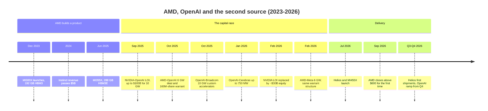
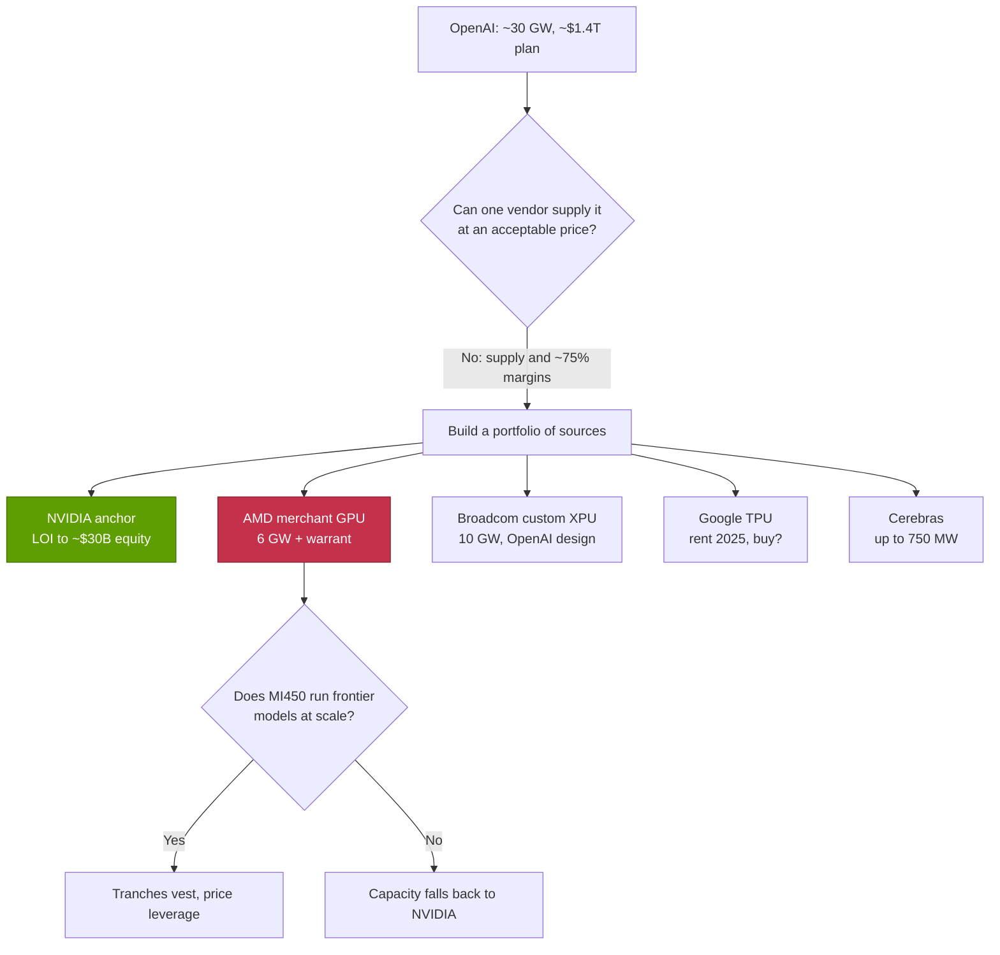
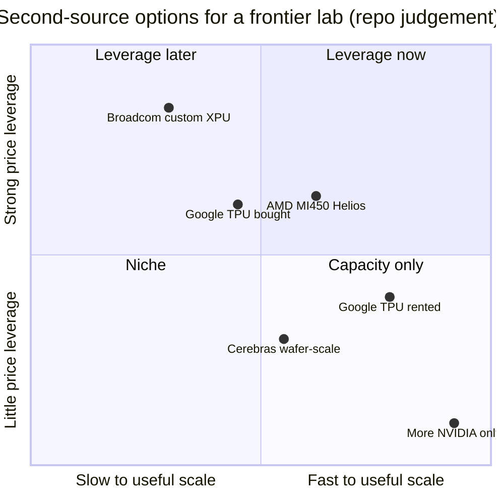

# CS4 · AMD, OpenAI and the second source

Case study · ~14 min read · Last verified: 2026-11-05

## ⚡ The Executive Take

- **The deal:** on 2025-10-06 OpenAI agreed to deploy up to 6 GW of AMD Instinct GPUs, starting with 1 GW of MI450 in H2 2026. AMD paid in its own stock: a [warrant](../glossary.md#warrant) for up to 160M AMD shares at $0.01, vesting as gigawatts are deployed and as AMD's share price rises [[S24000]](../sources/bibliography.md#s24000)[[S13506]](../sources/bibliography.md#s13506).
- **It was a reply to NVIDIA's capital:** two weeks earlier NVIDIA signed a [letter of intent](../glossary.md#letter-of-intent) to invest up to $100B as OpenAI deployed 10 GW of NVIDIA systems [[S467]](../sources/bibliography.md#s467). In February 2026 that LOI was shelved for a ~$30B straight equity stake with no deployment milestones 🟡 [[S90015]](../sources/bibliography.md#s90015)[[S90016]](../sources/bibliography.md#s90016).
- **The market priced it as accretive:** AMD closed up ~23.7 % on announcement day [[S24002]](../sources/bibliography.md#s24002), adding ~$63B of value on a $267B market cap (repo calc). At the pre-deal price the warrant was worth ~$26B, for ~9.9 % of AMD's shares [[S24001]](../sources/bibliography.md#s24001).
- **The discount is contingent and reflexive:** at the reported $600 final-tranche hurdle the fully vested warrant is worth ~$96B, about the same as OpenAI's estimated 6 GW AMD hardware bill (Est. ~$90B, 🔴 repo scenario). AMD first closed above $600 on 2026-09-21 [[S24005]](../sources/bibliography.md#s24005)[[S13507]](../sources/bibliography.md#s13507).
- **OpenAI built a portfolio, not a single second source:** 10 GW of custom accelerators with Broadcom [[S174]](../sources/bibliography.md#s174), up to 750 MW from Cerebras [[S11523]](../sources/bibliography.md#s11523), Google TPUs rented since 2025 and reportedly to be bought 🟡 [[S24007]](../sources/bibliography.md#s24007)[[S24008]](../sources/bibliography.md#s24008), with NVIDIA still the anchor.
- **What is proven (Nov 2026):** AMD's [Helios](../glossary.md#amd-helios) rack is in production with first shipments from ~end Q3 2026 [[S90020]](../sources/bibliography.md#s90020). AMD signed the same structure with Meta [[S24004]](../sources/bibliography.md#s24004). AMD Data Center revenue grew +97 % y/y in Q3 2026 [[S542]](../sources/bibliography.md#s542).
- **What is not:** OpenAI's large-scale MI450 deployment only starts in Q4 2026 🟢 [[S90021]](../sources/bibliography.md#s90021). No tranche has publicly vested [[S24005]](../sources/bibliography.md#s24005). NVIDIA's data-center revenue lead over AMD widened from 3.3× to 13× between early 2023 and mid-2026 (repo calc from filings) [[S450]](../sources/bibliography.md#s450)[[S543]](../sources/bibliography.md#s543)[[S405]](../sources/bibliography.md#s405).

![Line chart: the warrant for 160 million AMD shares at a $0.01 strike is worth about $26B at the pre-deal price of $164.67 (2025-10-03), $33B after the first day's ~24% jump, $96B at the reported $600 final-tranche hurdle and $98B at the $612.46 close of 2026-09-21. A shaded band shows a repo assumption of OpenAI's AMD hardware spend for 6 GW: $60B to $120B (base $90B). Above roughly $562 a share the fully vested warrant would be worth as much as the base-case hardware bill; vesting also needs all 6 GW deployed.](../assets/charts/CS4-warrant-value-vs-hardware-spend.svg)

## 1. Context

**AMD's Instinct ramp.** AMD entered the AI accelerator race late. The MI300X launched on 2023-12-06 with 192 GB of HBM3 at 5.3 TB/s, more memory than the H100 [[S141]](../sources/bibliography.md#s141). AMD's data-center GPU revenue went from a few hundred million dollars in Q4 2023 to more than $5B in 2024 [[S663]](../sources/bibliography.md#s663). The MI355X (June 2025) brought 288 GB of HBM3E at 8 TB/s and 10.1 PFLOPS of dense FP4 [[S143]](../sources/bibliography.md#s143). On MLPerf Inference v6.0 it matched a B200 per GPU on Llama 2 70B (12,935 vs 12,994 tokens/s) [[S602]](../sources/bibliography.md#s602). What AMD lacked was a rack-scale system like NVIDIA's [NVL72](../glossary.md#nvl72) and a mature software stack ([ROCm](../glossary.md#rocm) vs [CUDA](../glossary.md#cuda)). Most of all, it lacked a marquee customer willing to bet a frontier model on it.

**OpenAI's appetite.** By October 2025 OpenAI had committed to about 30 GW of compute costing ~$1.4T, against an expected ~$20B annual revenue run-rate at the end of 2025 [[S24006]](../sources/bibliography.md#s24006). A [gigawatt of compute](../glossary.md#gigawatt-of-compute) is now the unit these deals are sized in, because power and sites bind before chips do.

**NVIDIA's move first.** On 2025-09-22 NVIDIA and OpenAI announced an LOI: up to $100B of NVIDIA investment, paid progressively as each of 10 GW came online, with the first gigawatt on Vera Rubin in H2 2026 [[S467]](../sources/bibliography.md#s467). In February 2026 it was shelved for a ~$30B equity investment in OpenAI's funding round, with no deployment milestones 🟡 [[S90015]](../sources/bibliography.md#s90015)[[S90016]](../sources/bibliography.md#s90016)[[S90017]](../sources/bibliography.md#s90017).

> [!TIP]
> **Worked example — why 30 GW forces a second source.** NVIDIA's CEO put NVIDIA content at ~$35B per GW of AI factory (Aug 2025) [[S398]](../sources/bibliography.md#s398). 30 GW × $35B ≈ **$1.05T** of NVIDIA content, ~5× NVIDIA's entire FY2026 revenue of $215.9B [[S1]](../sources/bibliography.md#s1). No buyer commits that much to one supplier without an alternative to price against. A 5 % concession on that bill is worth ~$52B. 🔴 Repo arithmetic on vendor and press figures.

## 2. The decision

**The terms.** OpenAI committed to deploy up to 6 GW of AMD Instinct GPUs across several generations, starting with 1 GW of MI450 in H2 2026 [[S24000]](../sources/bibliography.md#s24000). In return AMD issued a warrant for up to 160M AMD shares at $0.01 each, with a five-year term [[S24003]](../sources/bibliography.md#s24003). That is ~9.9 % of AMD's ~1,623M pre-deal shares (repo calc from a $267.23B market cap at $164.67 [[S24001]](../sources/bibliography.md#s24001)). The first tranche vests with the first gigawatt. Later tranches need more gigawatts deployed, escalating AMD share-price targets (reportedly $600 for the final tranche), and OpenAI technical and commercial milestones [[S13507]](../sources/bibliography.md#s13507)[[S24003]](../sources/bibliography.md#s24003). AMD's CFO said the deal should bring "tens of billions of dollars" of revenue and be highly accretive to non-GAAP EPS [[S24000]](../sources/bibliography.md#s24000). Press estimates ran as high as $100B over several years [[S24010]](../sources/bibliography.md#s24010). Even NVIDIA's CEO called the structure "clever" [[S24011]](../sources/bibliography.md#s24011).

This is an [equity-for-capacity](../glossary.md#equity-for-capacity) structure, and it inverts NVIDIA's. NVIDIA *buys the customer's equity*: it hands OpenAI cash that, in critics' reading, returns as GPU orders ([circular financing](../glossary.md#circular-financing)). AMD *gives the customer its own equity*: OpenAI pays full price for chips but earns AMD shares if it deploys at scale and AMD's stock rises. Broadcom's 10 GW programme, announced a week later, has no disclosed vendor capital at all. OpenAI designs the chip and Broadcom co-develops and supplies the racks [[S174]](../sources/bibliography.md#s174).

| Deal (date) | Capacity | Vendor capital | Tied to deployment? | Status (Nov 2026) |
|---|---|---|---|---|
| NVIDIA LOI (2025-09-22) | 10 GW | Up to $100B, progressive | Yes, per GW | 🟡 Shelved Feb 2026 [[S90016]](../sources/bibliography.md#s90016) |
| NVIDIA equity (Feb 2026) | — | ~$30B in OpenAI's round | No | 🟡 Reported agreed [[S90015]](../sources/bibliography.md#s90015)[[S13526]](../sources/bibliography.md#s13526) |
| AMD warrant (2025-10-06) | 6 GW | 160M AMD shares at $0.01 | Yes, plus price hurdles | 🟢 Active; first GW H2 2026 [[S24000]](../sources/bibliography.md#s24000) |
| Broadcom (2025-10-13) | 10 GW | None disclosed | — | 🟢 Deploying H2 2026–2029 [[S174]](../sources/bibliography.md#s174) |
| Cerebras (2026-01-14) | Up to 750 MW | None (~$10B purchase) | — | 🟡 Reported [[S11523]](../sources/bibliography.md#s11523) |
| AMD warrant to Meta (2026-02-24) | 6 GW | 160M AMD shares at $0.01 | Yes, plus $600 hurdle | 🟢 First GW H2 2026 [[S24004]](../sources/bibliography.md#s24004) |

![Horizontal bar chart of vendor capital per gigawatt of compute a customer commits to: AMD's warrant for 160 million shares is worth about $16B per GW to OpenAI if AMD reaches the reported $600 share-price hurdle, or ~$5.3B per GW at an illustrative $200; NVIDIA's pledges were about $10B per GW for Anthropic (up to $10B, 1 GW) and for OpenAI's superseded letter of intent ($100B, 10 GW); AMD's up-to-$5B Anthropic stake ~$2.5B per GW (2 GW); NVIDIA's xAI stake ~$2B per GW, Poolside ~$0.5B and CoreWeave ~$0.47B; Broadcom's 10 GW OpenAI programme carries no disclosed vendor capital. NVIDIA's 2026 $30B OpenAI equity has no GW tie.](../assets/charts/13-capital-per-gigawatt.svg)

> [!TIP]
> **Worked example — value of the warrant to OpenAI vs the implied hardware discount.** Assumptions (🔴 all repo scenarios): OpenAI's AMD hardware spend is $15B per GW, anchored on press valuations of AMD's identical Meta deal ($60–100B+ for 6 GW) [[S24004]](../sources/bibliography.md#s24004)[[S24010]](../sources/bibliography.md#s24010). That makes 6 GW ≈ **$90B**. Warrant value if fully vested = 160M × share price.
>
> | AMD share price | Warrant value | As a discount on a $90B bill |
> |---|---|---|
> | $164.67 (pre-deal close) [[S24001]](../sources/bibliography.md#s24001) | $26B | 29 % |
> | $400 (illustrative) | $64B | 71 % |
> | $600 (final-tranche hurdle) [[S13507]](../sources/bibliography.md#s13507) | $96B | 107 % |
>
> Three corrections shrink the headline. (1) **Staging:** if tranches were equal per gigawatt (terms are not public), 1 GW earns ~27M shares. At $600 that is ~$16B against ~$15B of hardware. If OpenAI stops at 3 GW, the final high-price tranches never vest. (2) **Time value:** the last tranches vest years out, so discount them at OpenAI's cost of capital. (3) **Reflexivity:** much of the value comes from AMD's stock rising *because* of deals like this one. On day one the market added ~$63B (23.7 % × $267B), about 2.4× the warrant's ~$26B value then [[S24002]](../sources/bibliography.md#s24002)[[S24001]](../sources/bibliography.md#s24001). For AMD's owners the trade looked accretive. For OpenAI it is a free option on AMD's success, worth most exactly when AMD needs it least.

🔧 Under the hood: how a penny warrant behaves like a rebate, and what it does to AMD's accounts

A warrant struck at $0.01 is economically a contingent grant of shares: the strike is negligible, so value ≈ shares × price once vested. That makes it a **rebate paid in stock**, but with two twists. First, its size moves with AMD's share price, not with the hardware bill, so the effective discount can exceed 100 % (as above) or shrink to little. Second, the price hurdles protect AMD's existing owners: the most dilutive tranches vest only if they have already gained a lot.

Under US GAAP, equity instruments granted to a customer are generally treated as consideration payable to the customer. They are measured at fair value and recorded as a *reduction of revenue* as the related sales are recognised, not as an operating expense. Diligence questions follow: how much contra-revenue AMD books per gigawatt, how often the fair value is remeasured, and whether non-GAAP figures exclude it. How AMD actually books this should be read in its 10-K and 10-Q notes. 🟡 Not verified in this session.

[Dilution](../glossary.md#dilution) stacks. The OpenAI and Meta warrants together cover 320M shares [[S24003]](../sources/bibliography.md#s24003), ~20 % of the pre-deal share count (~17 % after exercise; repo calc).

## 3. The outcome (with numbers)

As of 2026-11-05, about 13 months after signing, the second source is **built but not yet proven at OpenAI's scale**.

| Item | Status | Source |
|---|---|---|
| Helios (72 × MI455X, EPYC Venice, Pensando NICs) launched 2026-07-23 | 🟢 Confirmed | [[S538]](../sources/bibliography.md#s538)[[S539]](../sources/bibliography.md#s539) |
| Helios in production; first shipments ~end Q3 2026 | 🟢/🟡 | [[S90020]](../sources/bibliography.md#s90020)[[S90021]](../sources/bibliography.md#s90021) |
| AMD Data Center revenue: Q1 2026 $5.8B (+57 %), Q2 $6.7B (+107 %), Q3 +97 % y/y | 🟢 Confirmed | [[S24009]](../sources/bibliography.md#s24009)[[S543]](../sources/bibliography.md#s543)[[S542]](../sources/bibliography.md#s542) |
| Same warrant structure signed with Meta (6 GW) | 🟢 Confirmed | [[S24004]](../sources/bibliography.md#s24004) |
| Anthropic: up to 2 GW of MI450-class Helios; AMD to invest up to $5B | 🟢/🟡 | [[S538]](../sources/bibliography.md#s538)[[S9538]](../sources/bibliography.md#s9538) |
| AMD share price passes the $600 hurdle (close $612.46, 2026-09-21; >$1T market value) | 🟡 Reported | [[S24005]](../sources/bibliography.md#s24005) |
| OpenAI large-scale MI450 deployment, Q4 2026 into 2027 | 🟡 Pending | [[S90021]](../sources/bibliography.md#s90021) |
| Any warrant tranche vested or exercised | 🔴 Not disclosed | [[S24005]](../sources/bibliography.md#s24005) |
| Azure as first major Helios deployment | 🟡 Reported | [[S90024]](../sources/bibliography.md#s90024) |
| OpenAI buying (not just renting) Google TPUs | 🔴 Single-source report | [[S24008]](../sources/bibliography.md#s24008) |

![Two-panel chart, calendar 2023-Q1 to 2026-Q3. Left: AMD's Data Center segment revenue rose from $1.3B to $8.6B a quarter (2026-Q3 is a repo estimate from AMD's +97% y/y), about 6.6 times, while NVIDIA's Data Center revenue rose from $4.3B to $89.0B (2026-Q2). Right: NVIDIA's data-center revenue was 3.3 times AMD's in 2023-Q1, 9.2 times in 2024-Q4 and 13.3 times in 2026-Q2: the second source has not yet narrowed the revenue gap. AMD's figure includes EPYC server CPUs, so its GPU-only gap is larger.](../assets/charts/CS4-amd-vs-nvidia-dc-revenue.svg)

The revenue gap is the sobering number. AMD's Data Center segment, which includes EPYC CPUs, grew ~6.6× from Q1 2023 to Q3 2026 [[S450]](../sources/bibliography.md#s450)[[S542]](../sources/bibliography.md#s542). NVIDIA's Data Center revenue grew ~21× from Q1 FY2024 to Q2 FY2027 [[S436]](../sources/bibliography.md#s436)[[S405]](../sources/bibliography.md#s405). AMD was ~3 % of AI data-center silicon revenue in 2025 (Est., repo calculation in `data/market_share.csv`) [[S663]](../sources/bibliography.md#s663)[[S416]](../sources/bibliography.md#s416). The OpenAI deal is a 2027 revenue event, not a 2026 one.

> [!TIP]
> **Worked example — what OpenAI's first gigawatt means for AMD.** At the base-case $15B per GW (🔴), the first gigawatt is ~$15B of revenue. AMD's Q3 2026 Data Center run-rate is ~$34B a year (Est. ~$8.5B × 4) [[S542]](../sources/bibliography.md#s542). So one customer's first gigawatt equals ~5 months of AMD's whole data-center business. That makes AMD's 2027 heavily exposed to OpenAI's deployment pace and financing. Six gigawatts at $15B = $90B, ~2.6 years of AMD's current Data Center run-rate.

## 4. Why it worked (or didn't)

**Why a buyer wants a second source.** There are two reasons: price and supply. NVIDIA earned a 75.0 % GAAP gross margin in Q2 FY2027 [[S3]](../sources/bibliography.md#s3). A credible alternative is the only lever a buyer has on that margin. Supply is the other: NVIDIA called its FY2028 outlook "supply-constrained" [[S90012]](../sources/bibliography.md#s90012). A lab that cannot get enough GPUs cannot ship products. Even if AMD never takes half the volume, a [second source](../glossary.md#second-source) that *could* absorb volume moves NVIDIA's pricing and allocation decisions. NVIDIA's own shift from a milestone LOI to ~$30B of straight equity, four months later, is consistent with that pressure 🔴 (inference).

> [!NOTE]
> **🐂 Bull view (AMD and the second source).** On paper Helios leads Vera Rubin NVL72 on memory: 31 TB vs 20.7 TB of HBM4 [[S90021]](../sources/bibliography.md#s90021)[[S102]](../sources/bibliography.md#s102). After NVIDIA's spec revision, it also leads on rack HBM bandwidth (~1,411 vs 1,400 TB/s) [[S90006]](../sources/bibliography.md#s90006). Scale-up per GPU is 3.6 vs 3.0 TB/s [[S5522]](../sources/bibliography.md#s5522)[[S90007]](../sources/bibliography.md#s90007). AMD's MI325X, MI355X and MI455X each arrived within about a quarter of an NVIDIA flagship, so the cadence gap has largely closed [[S142]](../sources/bibliography.md#s142)[[S143]](../sources/bibliography.md#s143)[[S539]](../sources/bibliography.md#s539). Three frontier buyers (OpenAI, Meta, Anthropic) have committed up to 14 GW [[S24000]](../sources/bibliography.md#s24000)[[S24004]](../sources/bibliography.md#s24004)[[S538]](../sources/bibliography.md#s538).

| Rack (2026) | AMD Helios | NVIDIA Vera Rubin NVL72 | Verdict for AMD |
|---|---|---|---|
| GPUs per scale-up domain | 72 MI455X | 72 Rubin | 🟨 Same size [[S344]](../sources/bibliography.md#s344)[[S102]](../sources/bibliography.md#s102) |
| HBM4 capacity | ~31 TB | 20.7 TB | 🟩 ~1.5× [[S90021]](../sources/bibliography.md#s90021)[[S102]](../sources/bibliography.md#s102) |
| HBM bandwidth (rack) | ~1,411 TB/s | 1,400 TB/s (revised) | 🟨 Parity after NVIDIA's cut [[S90006]](../sources/bibliography.md#s90006) |
| FP8 compute | 1.4 EF | ~1.26 EF dense | 🟩 On paper [[S90021]](../sources/bibliography.md#s90021)[[S33006]](../sources/bibliography.md#s33006) |
| Scale-up fabric | [UALink over Ethernet](../glossary.md#ualoe), 3.6 TB/s per GPU (~260 TB/s rack) | NVLink 6, 3.0 TB/s per GPU (revised) | 🟦 Open vs proprietary [[S226]](../sources/bibliography.md#s226)[[S5522]](../sources/bibliography.md#s5522)[[S90007]](../sources/bibliography.md#s90007) |
| Software maturity | ROCm 7.x | CUDA | 🟥 Behind (below) [[S90064]](../sources/bibliography.md#s90064)[[S633]](../sources/bibliography.md#s633) |
| Rack-scale track record | First generation | Third generation (GB200, GB300, VR) | 🟥 Behind [[S8527]](../sources/bibliography.md#s8527)[[S5501]](../sources/bibliography.md#s5501) |

**Why it may not work.** There are three risks, in order of weight:

1. **Software.** When DeepSeek-V4-Pro launched in April 2026, it ran on CUDA on day 0. On MI355X, FP4 worked on day 8 and 50 tokens/s per user on day 27. Multi-node serving still did not work at day 43 [[S633]](../sources/bibliography.md#s633)[[S631]](../sources/bibliography.md#s631). On an agentic GLM 5.3 test, NVIDIA was up to 5× cheaper per token at 150 tokens/s per user [[S636]](../sources/bibliography.md#s636). On a GLM-5 throughput test, MI355X was up to 29.6 % cheaper than a B200 [[S637]](../sources/bibliography.md#s637). AMD can win benchmarks it tunes for. A lab's real risk is the long tail of new models it has not tuned for.
2. **Rack-scale reliability.** Helios is AMD's first rack-scale system. It relies on design teams acquired with ZT Systems ($4.9B, closed 2025-03-31) [[S8527]](../sources/bibliography.md#s8527), whose factories were sold to Sanmina [[S5528]](../sources/bibliography.md#s5528). NVIDIA's own first NVL72 ramp suffered overheating reports and customer pushback [[S5501]](../sources/bibliography.md#s5501). A February 2026 report of an MI455X slip was denied by AMD [[S2521]](../sources/bibliography.md#s2521)[[S2524]](../sources/bibliography.md#s2524).
3. **NVIDIA's [annual cadence](../glossary.md#annual-cadence).** Vera Rubin started shipping in Q3 2026 with volume in Q4 [[S90009]](../sources/bibliography.md#s90009). Rubin Ultra (Kyber, 144 packages) follows in H2 2027 and Feynman in 2028 [[S90003]](../sources/bibliography.md#s90003)[[S90004]](../sources/bibliography.md#s90004). A second source has to hit a moving target every year, with ~13× less data-center revenue to fund it.

> [!TIP]
> **Worked example — the software tax on a second source.** A lab wants a new open model serving on 100,000 GPUs at launch. On CUDA, DeepSeek-V4-Pro ran on day 0. On MI355X it took 27 days to reach 50 tokens/s per user [[S633]](../sources/bibliography.md#s633). At an illustrative $2 per GPU-hour, 27 days of under-used capacity on 100,000 GPUs costs 100,000 × 24 × 27 × $2 ≈ **$130M**, before any lost revenue. Against a 6 GW programme (~$90B, 🔴 base case) that is small, so price leverage can outweigh the tax. Against a frontier lab's launch calendar it is large: one slow launch per quarter erodes the hardware discount. 🔴 Repo arithmetic.

> [!WARNING]
> **🐻 Bear view.** The warrant buys commitment, not competitiveness. If MI450 slips or under-delivers, OpenAI loses little: it buys fewer gigawatts and the high-hurdle tranches lapse. AMD has then diluted its owners for a customer that could walk. The structure also feeds the AI-capex loop. AMD's equity currency is worth more while AI sentiment is high, so a sector de-rating would cut both the warrant's value and AMD's ability to repeat the trick.

## 5. Lessons for corp dev

1. **Equity-for-capacity has two signs.** A vendor can buy the customer's equity (NVIDIA → OpenAI, Anthropic) or give its own (AMD → OpenAI, Meta). The first uses cash and adds balance-sheet risk. The second uses dilution and works only while the issuer's stock is a strong currency: AMD's rose from ~$165 to ~$612 over the deal's first year [[S24001]](../sources/bibliography.md#s24001)[[S24005]](../sources/bibliography.md#s24005). Price hurdles let the issuer pay most when its owners have gained most.
2. **Tie value to deployment, not signatures.** Both NVIDIA's original LOI and AMD's warrant paid per gigawatt deployed. That aligns incentives, but it also makes headline values (up to $100B; up to 160M shares) maximums, not expected values. Model the probability of each tranche.
3. **The binding constraint for a second source is software, then racks, then cadence.** AMD's chips match NVIDIA's on paper. Its gaps are day-0 model support and rack-scale field experience. Assets that close those gaps, such as portable compilers and runtimes or rack-integration teams (ZT Systems, $4.9B [[S8527]](../sources/bibliography.md#s8527)), may be worth more to a challenger than another chip.
4. **Customer concentration cuts both ways.** OpenAI, Meta and Anthropic together could absorb up to 14 GW of AMD's output [[S24000]](../sources/bibliography.md#s24000)[[S24004]](../sources/bibliography.md#s24004)[[S538]](../sources/bibliography.md#s538). That validates AMD. It also ties AMD's 2027–2028 revenue to three buyers' financing.

## 🎯 Corp Dev Lens

1. **Currency:** AMD's warrants worked because its stock was rising and worth ~$267B before the deal [[S24001]](../sources/bibliography.md#s24001). What equity-for-capacity terms could a smaller-cap challenger offer without unacceptable dilution? Would a revenue rebate, prepayment or co-investment in sites substitute?
2. **Second-source economics for buyers:** at ~$35B of NVIDIA content per GW [[S398]](../sources/bibliography.md#s398), how many points of NVIDIA price concession does a credible alternative earn? Who captures it: the buyer, or the challenger that never reaches volume?
3. **Software as the moat-breaker:** Qualcomm's $3.9B Modular acquisition (Mojo/MAX), closed on 2026-07-29, targets hardware-portable AI software [[S90057]](../sources/bibliography.md#s90057)[[S9511]](../sources/bibliography.md#s9511). How much would day-0 model support on non-NVIDIA hardware change a lab's willingness to commit gigawatts?
4. **Inference-first second sources:** Qualcomm's AI200/AI250 racks and HUMAIN's 200 MW plan are public 🟢/🔴 [[S90028]](../sources/bibliography.md#s90028)[[S90030]](../sources/bibliography.md#s90030). Is a power-constrained inference niche a more realistic second-source entry than frontier training, where AMD and Broadcom are already engaged?
5. **Structure risk:** for any partner offering equity-linked capacity, how are contra-revenue, remeasurement and non-GAAP treatment handled? What happens to the instrument if deployment stalls?

## 📚 Sources

<!-- Auto-generated from the [S…] citations on this page by `make build`. Edit sources/registry/*.csv, not this list. -->

- [**S1**](../sources/bibliography.md#s1) NVIDIA Corporation via SEC EDGAR, *NVIDIA Announces Financial Results for Fourth Quarter and Fiscal 2026 (Form 8-K exhibit 99.1)*, 2026-02-25. [Link](https://www.sec.gov/Archives/edgar/data/1045810/000104581026000019/q4fy26pr.htm)
- [**S3**](../sources/bibliography.md#s3) StorageNewsletter, *NVIDIA Q2 Fiscal 2027 results coverage: revenue $96.2B*, 2026-08-27. [Link](https://www.storagenewsletter.com/2026/08/27/nvidia-fiscal-2q27-financial-results/)
- [**S102**](../sources/bibliography.md#s102) NVIDIA, *NVIDIA DGX Vera Rubin NVL72*, 2026. [Link](https://www.nvidia.com/en-us/data-center/dgx-vera-rubin-nvl72/)
- [**S141**](../sources/bibliography.md#s141) AMD, *AMD Instinct MI300X Accelerator*, 2023-12-06. [Link](https://www.amd.com/en/products/accelerators/instinct/mi300/mi300x.html)
- [**S142**](../sources/bibliography.md#s142) AMD, *AMD Instinct MI325X Accelerator*, 2024-10-10. [Link](https://www.amd.com/en/products/accelerators/instinct/mi300/mi325x.html)
- [**S143**](../sources/bibliography.md#s143) AMD, *AMD Instinct MI350 Series (MI350X, MI355X)*, 2025-06-12. [Link](https://www.amd.com/en/products/accelerators/instinct/mi350.html)
- [**S174**](../sources/bibliography.md#s174) OpenAI, *OpenAI and Broadcom announce strategic collaboration to deploy 10 gigawatts of OpenAI-designed AI accelerators*, 2025-10-13. [Link](https://openai.com/index/openai-and-broadcom-announce-strategic-collaboration/)
- [**S226**](../sources/bibliography.md#s226) AMD, *AMD Helios Rackscale Solution (product page)*, 2026. [Link](https://www.amd.com/en/products/rackscale-solutions/helios.html)
- [**S344**](../sources/bibliography.md#s344) AMD, *AMD Helios rack-scale AI infrastructure (product page)*, 2026. [Link](https://www.amd.com/ja/products/rackscale-solutions/helios.html)
- [**S398**](../sources/bibliography.md#s398) NVIDIA Investor Relations, *NVIDIA Q2 FY2026 earnings call (2025-08-27): AI factory economics commentary*, 2025-08-27. [Link](https://investor.nvidia.com/events-and-presentations/events-and-presentations/default.aspx)
- [**S405**](../sources/bibliography.md#s405) NVIDIA Corporation via SEC EDGAR, *NVIDIA Announces Financial Results for Second Quarter Fiscal 2027 (Form 8-K exhibit 99.1)*, 2026-08-26. [Link](https://www.sec.gov/Archives/edgar/data/0001045810/000104581026000073/q2fy27pr.htm)
- [**S416**](../sources/bibliography.md#s416) NVIDIA Corporation via SEC EDGAR, *NVIDIA Corporation Form 10-K for fiscal year ended January 26, 2025*, 2025-02-26. [Link](https://www.sec.gov/Archives/edgar/data/1045810/000104581025000023/nvda-20250126.htm)
- [**S436**](../sources/bibliography.md#s436) NVIDIA Corporation, *NVIDIA Announces Financial Results for First Quarter Fiscal 2024 (press release with CFO commentary)*, 2023-05-24. [Link](https://nvidianews.nvidia.com/news/nvidia-announces-financial-results-for-first-quarter-fiscal-2024)
- [**S450**](../sources/bibliography.md#s450) U.S. Securities and Exchange Commission (EDGAR), *Advanced Micro Devices Form 10-K / 10-Q filings (EDGAR index)*, 2025-02-05. [Link](https://www.sec.gov/cgi-bin/browse-edgar?action=getcompany&CIK=0000002488&type=10-&dateb=&owner=include&count=40)
- [**S467**](../sources/bibliography.md#s467) NVIDIA Newsroom, *OpenAI and NVIDIA Announce Strategic Partnership to Deploy 10 Gigawatts of NVIDIA Systems*, 2025-09-22. [Link](https://nvidianews.nvidia.com/news/openai-and-nvidia-announce-strategic-partnership-to-deploy-10gw-of-nvidia-systems)
- [**S538**](../sources/bibliography.md#s538) AMD Investor Relations, *AAI 2026: AMD Delivers Full-Stack Compute for the Agentic AI Era*, 2026-07-23. [Link](https://ir.amd.com/news-events/press-releases/detail/1294/aai-2026-amd-delivers-full-stack-compute-for-the-agentic-ai-era)
- [**S539**](../sources/bibliography.md#s539) Phoronix (Michael Larabel), *AMD Launches Instinct MI455X, Helios AI Rack*, 2026-07-23. [Link](https://www.phoronix.com/news/AMD-Instinct-MI455X-Helios)
- [**S542**](../sources/bibliography.md#s542) AMD via SEC EDGAR, *AMD Reports Third Quarter 2026 Financial Results (Form 8-K Exhibit 99.1)*, 2026-11-03. [Link](https://www.sec.gov/Archives/edgar/data/0000002488/000000248826000188/q32026991.htm)
- [**S543**](../sources/bibliography.md#s543) AMD via SEC EDGAR, *AMD Q2 2026 earnings slides (Form 8-K)*, 2026-08-04. [Link](https://www.sec.gov/Archives/edgar/data/0000002488/000000248826000121/amdq22026earningsslidesf.htm)
- [**S602**](../sources/bibliography.md#s602) MLCommons, *MLPerf Inference v6.0 results (summary_results.json and per-submitter logs)*, 2026-04-01. [Link](https://github.com/mlcommons/inference_results_v6.0)
- [**S631**](../sources/bibliography.md#s631) SemiAnalysis, *MI355X DeepSeek-V4-Pro on SGLang: 110.5x Throughput per GPU in 26 Days*, 2026-05-26. [Link](https://github.com/SemiAnalysisAI/InferenceX-app/blob/main/packages/app/content/blog/mi355x-deepseek-v4-pro-sglang-110x-in-26-days.mdx)
- [**S633**](../sources/bibliography.md#s633) SemiAnalysis, *DeepSeekV4 1.6T Day 0 to Day 43 Performance Over Time — Huawei, GB300 NVL72, MI355X, B200*, 2026-06-09. [Link](https://github.com/SemiAnalysisAI/InferenceX-app/blob/main/packages/app/content/blog/deepseekv4-16t-day-0-to-day-43-performance.mdx)
- [**S636**](../sources/bibliography.md#s636) SemiAnalysis, *GLM 5.3 on AgentX: NVIDIA Is Up to 5x Cheaper per Token at 150 tok/s/user*, 2026-08-25. [Link](https://github.com/SemiAnalysisAI/InferenceX-app/blob/main/packages/app/content/blog/glm-5-3-agentx-nvidia-vs-amd-sglang-150-toks.mdx)
- [**S637**](../sources/bibliography.md#s637) SemiAnalysis, *AMD MI355X GLM-5 Inference: Up to 29.6% Lower Cost per Million Tokens than B200 on SGLang FP8*, 2026-05-25. [Link](https://github.com/SemiAnalysisAI/InferenceX-app/blob/main/packages/app/content/blog/mi355x-glm5-fp8-sglang-40-cheaper-than-b200.mdx)
- [**S663**](../sources/bibliography.md#s663) AMD, *AMD Reports Fourth Quarter and Full Year 2024 Financial Results*, 2025-02-04. [Link](https://ir.amd.com/news-events/press-releases)
- [**S2521**](../sources/bibliography.md#s2521) Tom's Hardware, *AMD denies report of MI455X delays as Nvidia VR200 systems are rumored to arrive early*, 2026-02. [Link](https://www.tomshardware.com/tech-industry/artificial-intelligence/amd-denies-report-of-mi455x-delays-as-nvidia-vr200-systems-are-rumored-to-arrive-early-company-says-helios-systems-on-target-for-2h-2026)
- [**S2524**](../sources/bibliography.md#s2524) The Next Platform, *AMD says Helios racks and MI400 series GPUs on track for 2H 2026*, 2026-02-23. [Link](https://www.nextplatform.com/2026/02/23/amd-says-helios-racks-and-mi400-series-gpus-on-track-for-2h-2026/)
- [**S5501**](../sources/bibliography.md#s5501) TechPowerUp, *NVIDIA's GB200 'Blackwell' racks face overheating issues*, 2025-01-14. [Link](https://techpowerup.com/331105/nvidias-gb200-blackwell-racks-face-overheating-issues)
- [**S5522**](../sources/bibliography.md#s5522) Remio, *AMD Helios unites 72 GPUs but NVIDIA sets the test*, 2026. [Link](https://www.remio.ai/post/amd-helios-unites-72-gpus-but-nvidia-sets-the-test)
- [**S5528**](../sources/bibliography.md#s5528) Sanmina, *Sanmina completes acquisition of ZT Systems data center infrastructure manufacturing business from AMD*, 2025-10-27. [Link](https://s201.q4cdn.com/209924174/files/doc_news/SANMINA-COMPLETES-ACQUISITION-OF-ZT-SYSTEMS-DATA-CENTER-INFRASTRUCTURE-MANUFACTURING-BUSINESS-FROM-AMD-2025.pdf)
- [**S8527**](../sources/bibliography.md#s8527) AMD Investor Relations, *AMD completes acquisition of ZT Systems*, 2025-03-31. [Link](https://ir.amd.com/news-events/press-releases/detail/1240/amd-completes-acquisition-of-zt-systems)
- [**S9511**](../sources/bibliography.md#s9511) Nasdaq (Qualcomm press release), *Qualcomm Completes Acquisition of Modular*, 2026-07-29. [Link](https://www.nasdaq.com/press-release/qualcomm-completes-acquisition-modular-2026-07-29)
- [**S9538**](../sources/bibliography.md#s9538) The Next Web, *AMD is investing $5 billion in Anthropic and deploying 2 gigawatts of Helios GPUs to run Claude*, 2026. [Link](https://thenextweb.com/news/amd-anthropic-5-billion-investment-2gw-helios-mi450)
- [**S11523**](../sources/bibliography.md#s11523) DatacenterDynamics, *OpenAI signs $10 billion deal with Cerebras with 750MW of big chip compute*, 2026-01-14. [Link](https://www.datacenterdynamics.com/en/news/openai-signs-10-billion-deal-with-cerebras-with-750mw-of-big-chip-compute/)
- [**S13506**](../sources/bibliography.md#s13506) Tom's Hardware, *OpenAI signs 6 GW AMD GPU deal*, 2025-10-06. [Link](https://www.tomshardware.com/pc-components/gpus/openai-signs-6gw-amd-gpu-deal)
- [**S13507**](../sources/bibliography.md#s13507) The Motley Fool, *AMD pays a high price for blockbuster OpenAI deal*, 2025-10-07. [Link](https://www.fool.com/investing/2025/10/07/amd-pays-a-high-price-for-blockbuster-openai-deal)
- [**S13526**](../sources/bibliography.md#s13526) Storyboard18, *Nvidia CEO Jensen Huang hints no further investments in OpenAI, Anthropic*, 2026. [Link](https://www.storyboard18.com/brand-makers/nvidia-ceo-jensen-huang-hints-no-further-investments-in-openai-anthropic-heres-why-91280.htm)
- [**S24000**](../sources/bibliography.md#s24000) AMD (press release PDF), *AMD and OpenAI Announce Strategic Partnership to Deploy 6 Gigawatts of AMD GPUs*, 2025-10-06. [Link](https://d1io3yog0oux5.cloudfront.net/_be34f20d01abfe28aeec9c2c12afe601/amd/news/2025-10-06_AMD_and_OpenAI_Announce_Strategic_Partnership_to_1260.pdf)
- [**S24001**](../sources/bibliography.md#s24001) MarketBeat, *AMD (NASDAQ:AMD) stock price history and chart*, 2025-10-03. [Link](https://www.marketbeat.com/stocks/nasdaq/amd/chart)
- [**S24002**](../sources/bibliography.md#s24002) Arabian Business, *AMD shares zoom 23.7% as OpenAI looks to take 10% stake in the company*, 2025-10-06. [Link](https://www.arabianbusiness.com/markets/equities/equity/amd-shares-zoom-23-7-as-openai-looks-to-take-10-stake-in-the-company)
- [**S24003**](../sources/bibliography.md#s24003) Crypto Briefing, *AMD has promised OpenAI and Meta up to 320 million shares at a penny each*, 2026. [Link](https://cryptobriefing.com/amd-openai-meta-penny-share-warrants/)
- [**S24004**](../sources/bibliography.md#s24004) The Register, *AMD copy-pastes 6 GW chips-for-stock deal in new Meta agreement*, 2026-02-24. [Link](https://www.theregister.com/2026/02/24/amd_copypastes_openai_6gw_chipsforstock/)
- [**S24005**](../sources/bibliography.md#s24005) Vested Finance, *OpenAI can buy 160 million shares of trillion-dollar AMD at just 1 cent each. How?*, 2026-09-24. [Link](https://vestedfinance.com/blog/us-stocks/openai-can-buy-160-million-shares-of-trillion-dollar-amd-at-just-1-cent-each-how/)
- [**S24006**](../sources/bibliography.md#s24006) StreetInsider (Reuters), *Altman touts trillion-dollar AI vision as OpenAI restructures to chase scale (Reuters)*, 2025-10-29. [Link](https://www.streetinsider.com/Reuters/Altman+touts+trillion-dollar+AI+vision+as+OpenAI+restructures+to+chase+scale/25515962.html)
- [**S24007**](../sources/bibliography.md#s24007) The Star (Reuters), *OpenAI says it has no plan to use Google's in-house chip (Reuters)*, 2025-07-01. [Link](https://www.thestar.com.my/tech/tech-news/2025/07/01/openai-says-it-has-no-plan-to-use-google039s-in-house-chip-)
- [**S24008**](../sources/bibliography.md#s24008) Decrypt, *OpenAI plans to buy Google's AI chips as it looks beyond Nvidia: report*, 2026-10-28. [Link](https://decrypt.co/382090/openai-plans-buy-google-ai-chips-looks-beyond-nvidia)
- [**S24009**](../sources/bibliography.md#s24009) HPCwire (AMD press release), *AMD Reports First Quarter 2026 Financial Results*, 2026-05-05. [Link](https://www.hpcwire.com/off-the-wire/amd-reports-1st-quarter-2026-financial-results/)
- [**S24010**](../sources/bibliography.md#s24010) ITPro, *OpenAI signs another chip deal, this time with AMD*, 2025-10-06. [Link](https://www.itpro.com/technology/artificial-intelligence/openai-signs-another-chip-deal-this-time-with-amd)
- [**S24011**](../sources/bibliography.md#s24011) Stocktwits, *AMD hits all-time high after Nvidia CEO Jensen Huang calls offering 10% stake to OpenAI 'clever'*, 2025-10-08. [Link](https://stocktwits.com/news-articles/markets/equity/amd-hits-all-time-high-after-nvidia-ceo-jensen-huang-calls-offering-10-percent-stake-to-open-ai-clever/ch6EpkDR30b)
- [**S33006**](../sources/bibliography.md#s33006) Tom's Hardware, *Nvidia launches Vera Rubin NVL72 AI supercomputer at CES*, 2026-01-05. [Link](https://www.tomshardware.com/pc-components/gpus/nvidia-launches-vera-rubin-nvl72-ai-supercomputer-at-ces-promises-up-to-5x-greater-inference-performance-and-10x-lower-cost-per-token-than-blackwell-coming-2h-2026)
- [**S90003**](../sources/bibliography.md#s90003) eWeek, *Everything Nvidia Just Announced at GTC 2026: 7 Chips, 5 Racks, 1 Giant Bet on Agentic AI*, 2026-03-17. [Link](https://www.eweek.com/news/nvidia-gtc-2026-ai-inference-vera-rubin-neuron/)
- [**S90004**](../sources/bibliography.md#s90004) TrendForce, *Key GTC takeaways: how Samsung, Micron, Intel and more power NVIDIA's Vera Rubin and Feynman*, 2026-03-17. [Link](https://www.trendforce.com/news/2026/03/17/news-key-gtc-takeaways-how-samsung-micron-intel-more-power-nvidias-vera-rubin-and-feynman/)
- [**S90006**](../sources/bibliography.md#s90006) TweakTown, *Nvidia cuts Vera Rubin's memory bandwidth by up to 26% and AMD's Helios now leads in memory bandwidth*, 2026-10. [Link](https://www.tweaktown.com/news/114304/nvidia-cuts-vera-rubins-memory-bandwidth-by-up-to-26-percent-and-amds-helios-now-leads-in-memory-bandwidth/index.html)
- [**S90007**](../sources/bibliography.md#s90007) TechRadar Pro, *Nvidia forced to dial back key bandwidth targets on Vera Rubin*, 2026-10. [Link](https://techradar.com/pro/nvidia-forced-to-dial-back-key-bandwidth-targets-on-vera-rubin-hardware-tweaks-will-affect-target-specifications-for-memory-and-interconnect-fabric)
- [**S90009**](../sources/bibliography.md#s90009) GamesBeat, *Nvidia Vera Rubin ramps into full production for fall launch*, 2026. [Link](https://gamesbeat.com/nvidia-vera-rubin-ramps-into-full-production-for-fall-launch-again/)
- [**S90012**](../sources/bibliography.md#s90012) Tomasz Tunguz (Tomasz Tunguz), *Nvidia Q2 FY27 earnings*, 2026-08. [Link](https://www.tomtunguz.com/nvidia-q2-fy27-earnings/index.md)
- [**S90015**](../sources/bibliography.md#s90015) DatacenterDynamics, *Nvidia plans $30bn investment in upcoming OpenAI funding round*, 2026-02. [Link](https://www.datacenterdynamics.com/en/news/nvidia-plans-30bn-investment-in-upcoming-openai-funding-round/)
- [**S90016**](../sources/bibliography.md#s90016) Storyboard18 (Financial Times), *Nvidia set for $30bn OpenAI deal as $100bn partnership shelved, report says (FT)*, 2026-02-20. [Link](https://www.storyboard18.com/digital/nvidia-set-for-30bn-openai-deal-as-100bn-partnership-shelved-report-says-90188.htm)
- [**S90017**](../sources/bibliography.md#s90017) ITdaily, *Nvidia won't invest $100 billion in OpenAI after all*, 2026-02. [Link](https://itdaily.com/news/innovation/nvidia-openai-30-billion/)
- [**S90020**](../sources/bibliography.md#s90020) Shacknews, *AMD Helios AI rack system on track for initial shipments in Q3 2026*, 2026. [Link](https://www.shacknews.com/article/150249/amd-helios-ai-system-shipping-q3-2026)
- [**S90021**](../sources/bibliography.md#s90021) Igor's Lab, *AMD Helios in production: MI455X, EPYC Venice and OpenAI challenge Nvidia AI racks*, 2026. [Link](https://www.igorslab.de/en/amd-helios-in-production-mi455x-epyc-venice-openai-challenge-nvidia-ai-racks/)
- [**S90024**](../sources/bibliography.md#s90024) Crypto Briefing, *AMD's Helios platform ships H2 2026 with Microsoft Azure as first major deployment*, 2026. [Link](https://cryptobriefing.com/amd-helios-platform-ships-h2-2026/)
- [**S90028**](../sources/bibliography.md#s90028) TechRepublic, *Qualcomm unveils AI chips to rival Nvidia, AMD*, 2025-10-27. [Link](https://techrepublic.com/article/news-qualcomm-unveils-ai-chips-to-rival-nvidia-amd)
- [**S90030**](../sources/bibliography.md#s90030) Morningstar, *Qualcomm: Humain deal provides some AI upside*, 2025-10. [Link](https://www.morningstar.com/stocks/qualcomm-humain-deal-provides-some-ai-upside)
- [**S90057**](../sources/bibliography.md#s90057) StorageReview, *Qualcomm unveils Dragonfly data center roadmap: C1000 CPU, AI300 accelerator and Modular acquisition*, 2026-06-24. [Link](https://www.storagereview.com/es/news/qualcomm-unveils-dragonfly-data-center-roadmap-c1000-cpu-ai300-accelerator-and-modular-acquisition)
- [**S90064**](../sources/bibliography.md#s90064) The Register, *ROCm 7: AMD tries to catch CUDA with performance-boosting software*, 2025-09-17. [Link](https://www.theregister.com/2025/09/17/amd_rocm_7_chases_nvidia_cuda/)
