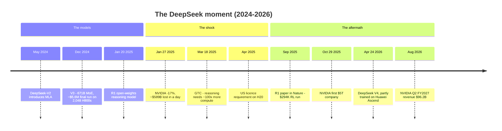
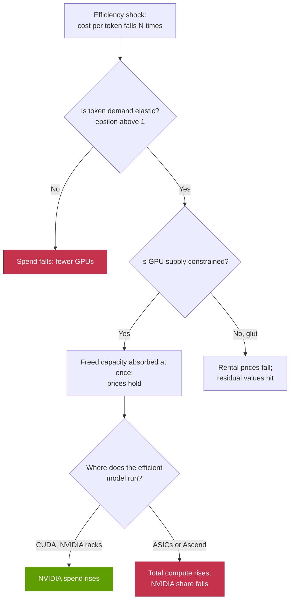

# CS5 · The DeepSeek moment and the efficiency shock

Case study · ~14 min read · Last verified: 2026-11-05

## ⚡ The Executive Take

- **The trigger:** DeepSeek-V3 (December 2024) reported a final training run of 2.788M H800 GPU-hours, ~$5.6M at $2 per GPU-hour, for a 671B-parameter [mixture-of-experts](../glossary.md#mixture-of-experts) model [[S34007]](../sources/bibliography.md#s34007). Its reasoning sibling R1 (2025-01-20) was released as open weights [[S25002]](../sources/bibliography.md#s25002) and topped the US App Store [[S25008]](../sources/bibliography.md#s25008).
- **The shock:** on 2025-01-27 NVIDIA fell ~17 % and lost ~$589B of market value, the largest one-day loss for any company on record [[S25000]](../sources/bibliography.md#s25000)[[S25001]](../sources/bibliography.md#s25001). The fear was simple: if frontier AI needs 10× less compute, GPU demand falls.
- **The headline was narrow:** the $5.6M covered only the last run. SemiAnalysis estimated DeepSeek's fleet at ~50,000 Hopper GPUs and ~$1.6B of server capex [[S25006]](../sources/bibliography.md#s25006)[[S31013]](../sources/bibliography.md#s31013).
- **NVIDIA's answer was the [Jevons paradox](../glossary.md#jevons-paradox):** cheaper intelligence means more use. NVIDIA said inference "requires significant numbers of NVIDIA GPUs" [[S25003]](../sources/bibliography.md#s25003). Its CEO said reasoning and agentic AI need ~100× more compute than expected a year earlier [[S25005]](../sources/bibliography.md#s25005).
- **The outcome so far favours NVIDIA:** Data Center revenue rose from $35.6B (Q4 FY2025) to $89.0B (Q2 FY2027), 2.5× [[S443]](../sources/bibliography.md#s443)[[S405]](../sources/bibliography.md#s405). NVIDIA became the first $5T company on 2025-10-29 [[S25010]](../sources/bibliography.md#s25010). Google's monthly tokens rose ~134× in 18 months [[S32018]](../sources/bibliography.md#s32018)[[S32020]](../sources/bibliography.md#s32020).
- **But the mechanism has limits:** spend rises only if the [price elasticity](../glossary.md#price-elasticity) of token demand exceeds 1. A 10× cheaper token needs ≥ 10× more tokens just to keep spend flat (🔴 repo model).
- **The export-control twist:** H800 limits pushed DeepSeek to efficiency. DeepSeek V4 (April 2026) was partly trained on Huawei Ascend, and DeepSeek cites compute constraints 🟢/🟡 [[S90079]](../sources/bibliography.md#s90079)[[S90080]](../sources/bibliography.md#s90080).

## 1. Context

**Who DeepSeek is.** DeepSeek is a Hangzhou AI lab that shares a GPU fleet with its parent, the quantitative hedge fund High-Flyer [[S25006]](../sources/bibliography.md#s25006). Its 2024 DeepSeek-V2 introduced [multi-head latent attention](../glossary.md#multi-head-latent-attention) (MLA). MLA compresses the per-token memory a model keeps during generation (the [KV cache](../glossary.md#kv-cache)) by 93.3 % and raised maximum generation throughput 5.76× [[S32026]](../sources/bibliography.md#s32026).

**What V3 claimed (2024-12-27).** V3 has 671B parameters, but only 37B are active per token. Each token is routed to 8 of 256 "expert" sub-networks plus one shared expert [[S34007]](../sources/bibliography.md#s34007). It was trained on 14.8T tokens on 2,048 [H800](../glossary.md#h800) GPUs in [FP8](../glossary.md#fp8), using hand-tuned [PTX](../glossary.md#ptx) (NVIDIA's low-level GPU assembly-like code) to squeeze communication. The final run used 2.788M GPU-hours, ~$5.576M at an assumed $2 rental price [[S34007]](../sources/bibliography.md#s34007). R1 then added large-scale [reinforcement learning](../glossary.md#reinforcement-learning) to produce a [reasoning model](../glossary.md#reasoning-model), released under an open licence with smaller [distilled](../glossary.md#distillation) versions [[S25002]](../sources/bibliography.md#s25002). Its API was priced ~90–95 % below OpenAI's o1 [[S25009]](../sources/bibliography.md#s25009).

> [!TIP]
> **Worked example — why mixture-of-experts cut the bill ~18×.** Training compute ≈ 6 × active parameters × tokens. V3: 6 × 37B × 14.8T ≈ **3.3 × 10²⁴ FLOPs** [[S34007]](../sources/bibliography.md#s34007). A dense 671B model on the same tokens needs 6 × 671B × 14.8T ≈ 6.0 × 10²⁵, **~18× more**. Spread over 2.788M GPU-hours, V3 sustained ~330 TFLOPS per GPU. That is ~17 % of a Hopper GPU's 1,979 TFLOPS dense FP8 peak, or ~33 % of its 989 TFLOPS BF16 peak [[S33002]](../sources/bibliography.md#s33002). These are respectable but not magical figures. The saving came mostly from architecture, not from beating NVIDIA's hardware. 🔴 Repo arithmetic.

## 2. The decision

Two groups made decisions in the week of 2025-01-27, and they bet in opposite directions.

**Investors sold.** The bear thesis ran as follows. If a frontier-class model costs ~$6M to train, labs need fewer GPUs, hyperscaler capex is overbuilt, and NVIDIA's pricing power erodes. NVIDIA's ~17 % drop was its biggest since March 2020; the S&P 500 fell 1.46 % [[S25000]](../sources/bibliography.md#s25000).

**NVIDIA and its biggest customers held course.** NVIDIA did not cut prices or guidance. Its statement called DeepSeek "an excellent AI advancement" and an example of [test-time compute](../glossary.md#test-time-compute) scaling. It said DeepSeek had used export-compliant hardware and that serving such models needs many GPUs [[S25003]](../sources/bibliography.md#s25003). A month later it guided the next quarter to $43B, up from $39.3B [[S443]](../sources/bibliography.md#s443). Microsoft's CEO posted "Jevons paradox strikes again" [[S25004]](../sources/bibliography.md#s25004). At GTC 2025 NVIDIA launched Dynamo, claiming up to 30× more DeepSeek-R1 requests on GB200 NVL72 (vendor claim) [[S32015]](../sources/bibliography.md#s32015).

> [!TIP]
> **Worked example — what the sell-off actually priced in.** A ~$589B loss on a ~17 % fall implies NVIDIA was worth ~$3.5T the day before ($589B ÷ 0.17; repo calc) [[S25000]](../sources/bibliography.md#s25000). Had the bear case been right, with frontier compute needs falling ~10×, the value of NVIDIA's future cash flows would have fallen far more than 17 %. So the market priced either a small chance of a large demand cut or a small permanent cut, not the collapse the headline implied. Six quarters later Data Center revenue was 2.5× higher [[S443]](../sources/bibliography.md#s443)[[S405]](../sources/bibliography.md#s405) and NVIDIA's value had passed $5T [[S25010]](../sources/bibliography.md#s25010). 🔴 Repo arithmetic.

| Claim in January 2025 | What the fuller record shows |
|---|---|
| "Frontier model for ~$6M" | Final run only; excludes research, ablations and the cluster [[S31013]](../sources/bibliography.md#s31013). Fleet ~50k Hopper GPUs, ~$1.6B capex (Est.) [[S25006]](../sources/bibliography.md#s25006) |
| "Reasoning RL is cheap" | R1's RL stage was ~$294K on 512 H800s, *on top of* the V3 base; DeepSeek also owned A100s [[S25007]](../sources/bibliography.md#s25007) |
| "Labs will need fewer GPUs" | Frontier labs reinvested savings in bigger runs and reasoning; Google's monthly tokens rose ~134× in 18 months [[S32018]](../sources/bibliography.md#s32018)[[S32020]](../sources/bibliography.md#s32020) |
| "Export controls failed" | H800s were legal when bought [[S25003]](../sources/bibliography.md#s25003)[[S25011]](../sources/bibliography.md#s25011); by 2026 DeepSeek cites compute limits and moved part of V4 training to Ascend [[S90079]](../sources/bibliography.md#s90079) |

## 3. The outcome (with numbers)

**NVIDIA's revenue did not dent.** Data Center revenue grew in each of the six reported quarters after the sell-off, to $89.0B in Q2 FY2027 [[S405]](../sources/bibliography.md#s405). Total revenue reached $96.2B, with $108B guided for Q3 FY2027 [[S3]](../sources/bibliography.md#s3). Hyperscaler 2026 capex guidance passed $700B combined 🟡 [[S12518]](../sources/bibliography.md#s12518)[[S12519]](../sources/bibliography.md#s12519). The stock recovered within months: on 2025-10-29 NVIDIA closed at $207.04, a $5.03T market value [[S25010]](../sources/bibliography.md#s25010).

**Token demand exploded.** Google's monthly tokens went from 9.7T (April 2024) to over 1.3 quadrillion (October 2025) [[S32018]](../sources/bibliography.md#s32018)[[S32020]](../sources/bibliography.md#s32020).

**Prices per token kept falling.** The cost of GPT-3.5-level output fell >280× from $20 per million tokens (Nov 2022) to $0.07 (Oct 2024) [[S11526]](../sources/bibliography.md#s11526). Epoch AI measures 9–900× per year declines at fixed capability [[S11525]](../sources/bibliography.md#s11525). NVIDIA's own software cut the estimated cost per million DeepSeek-R1 tokens on a GB300 NVL72 by 65 % in a year, without new hardware [[S603]](../sources/bibliography.md#s603)[[S622]](../sources/bibliography.md#s622). Frontier prices are the exception: GPT-5.5 launched in April 2026 at double its predecessor's price [[S11535]](../sources/bibliography.md#s11535). Buyers keep trading up to the best model.

![Log-scale line chart of estimated cost per million tokens on unchanged NVIDIA hardware as software improved, holding each GPU's owner TCO fixed (SemiAnalysis: GB300 $2.31, GB200 $1.86, B200 $1.73, H100 $1.17 per GPU-hour). GB300 NVL72 · DeepSeek-R1 (MLPerf Server): $0.221 to $0.077 (65% lower, Sep 2025 to Sep 2026); GB200 NVL72 · DeepSeek-R1 (MLPerf Server): $0.222 to $0.094 (58% lower, Sep 2025 to Sep 2026); H100 · Llama 2 70B (MLPerf Server): $0.126 to $0.084 (34% lower, Mar 2024 to Apr 2025); B200 · DeepSeek-R1 max throughput (TensorRT-LLM blog): $0.240 to $0.104 (57% lower, Feb 2025 to May 2025); B200 · DeepSeek-R1, SGLang conc 128 (InferenceX): $0.269 to $0.201 (25% lower, Dec 2025 to May 2026). The hardware bill did not change; throughput per GPU did, so cost per token fell.](../assets/charts/11-cost-per-m-tokens-software-releases.svg)

**DeepSeek V4 (2026-04-24)** came in two sizes: V4-Pro (~1.6T parameters) and V4-Flash (284B), both open weights. Part of Flash's training ran on Huawei Ascend, and Ascend SuperNodes were adapted for inference [[S90079]](../sources/bibliography.md#s90079). V4-Pro was priced ~$3.48 per million output tokens. DeepSeek said throughput would stay limited until Ascend 950 supernodes ship at scale in H2 2026 [[S90080]](../sources/bibliography.md#s90080). V4 still ran on CUDA on day 0, while AMD's MI355X needed weeks [[S633]](../sources/bibliography.md#s633).

> [!TIP]
> **Worked example — a 10× fall in cost per token, and the elasticity needed for spend to rise.** A buyer spends $1B a year on inference at $1.00 per million tokens: 1 quadrillion tokens. Efficiency cuts the price to $0.10. With constant-elasticity demand, tokens rise by 10^ε and spend changes by 10^(ε−1).
>
> | Elasticity ε | Tokens bought | Spend | Compute (GPU) spend if per-token compute fell 10× |
> |---|---|---|---|
> | 0.5 | 3.2 quadrillion | $0.32B | −68 % |
> | 1.0 | 10 quadrillion | $1.00B | flat |
> | 1.3 | 20 quadrillion | $2.0B | doubles |
> | 1.5 | 32 quadrillion | $3.2B | 3.2× |
>
> Google's 134× token growth in 18 months [[S32018]](../sources/bibliography.md#s32018)[[S32020]](../sources/bibliography.md#s32020) is far above the 10× needed for a 10× price cut to be spend-neutral. Measured against the steepest constant-quality price declines (Epoch's median ~50×/yr [[S11525]](../sources/bibliography.md#s11525)), the implied ε is below 1. The two fit together only because buyers moved up to costlier frontier and reasoning models. Spend per query rose even as each capability got cheaper. 🔴 Repo model; ignores demand-curve shifts.

## 4. Why it worked (or didn't)

**Why the efficiency shock raised demand.** The Jevons paradox dates from 1865: more efficient steam engines raised Britain's total coal use, because cheaper power found new uses [[S25012]](../sources/bibliography.md#s25012). In AI, four mechanisms did the work:

1. **Elastic demand.** Cheaper tokens unlocked uses that were uneconomic before, such as coding agents, long-document analysis and always-on assistants.
2. **The demand curve moved out.** Reasoning models "think" before answering. That can multiply generated tokens ~21× per answer, and an agentic task can use ~1,100× a chat reply (Est.) [[S32025]](../sources/bibliography.md#s32025)[[S32024]](../sources/bibliography.md#s32024). DeepSeek R1 itself popularised this pattern, which is why NVIDIA framed it as test-time scaling [[S25003]](../sources/bibliography.md#s25003).
3. **Supply was constrained.** NVIDIA still calls its FY2028 outlook supply-constrained [[S90012]](../sources/bibliography.md#s90012). In a sold-out market, efficiency frees capacity that is absorbed at once rather than idled.
4. **NVIDIA captured part of the efficiency.** Software alone lifted GB300 NVL72 DeepSeek-R1 throughput 2.9× in a year on MLPerf [[S601]](../sources/bibliography.md#s601)[[S603]](../sources/bibliography.md#s603). The cheaper tokens ran on NVIDIA racks.

**When efficiency shocks would lower demand.** The flowchart above shows the failure paths:

- **Inelastic or saturated demand:** if enterprise adoption stalls or ROI disappoints, ε < 1 and efficiency shrinks spend.
- **Capped workloads:** where a buyer serves a fixed job (an internal enterprise app, a set batch pipeline), efficiency simply means fewer GPUs for the same work.
- **Gluts:** once supply catches up, efficiency is deflationary. H100 rentals already fell from ~$8 per GPU-hour in 2023 to ~$2–3 on neoclouds and marketplaces [[S393]](../sources/bibliography.md#s393)[[S395]](../sources/bibliography.md#s395).
- **Leakage:** the efficient model may run elsewhere. DeepSeek's DeepEP and DeepGEMM libraries now ship Huawei Ascend versions [[S9009]](../sources/bibliography.md#s9009)[[S9010]](../sources/bibliography.md#s9010), and TileLang has an official Ascend 950 backend [[S9011]](../sources/bibliography.md#s9011).

> [!TIP]
> **Worked example — when Jevons fails: the planned build.** A cloud plans $10B of inference GPUs to meet its demand forecast. A new model architecture cuts GPU-hours per token 3×. If token demand grows only 2× (ε ≈ 0.63 against a 3× cheaper token), the cloud needs two-thirds of the planned GPUs: ~$6.7B, so purchases fall ~33 %. If demand grows 3×, purchases are flat; at 6×, they double. The efficiency gain alone does not decide the outcome. What decides it is demand growth relative to the gain. 🔴 Repo arithmetic.

**The export-control angle.** The H800 was NVIDIA's China version of Hopper, built to fit the October 2022 rules; it was itself restricted by the October 2023 rule [[S25011]](../sources/bibliography.md#s25011). [Export controls](../glossary.md#export-controls) shaped DeepSeek's engineering. DeepSeek measured only ~160 GB/s of NVLink and ~50 GB/s of InfiniBand per H800 [[S34007]](../sources/bibliography.md#s34007)[[S5005]](../sources/bibliography.md#s5005). So V3 avoided tensor parallelism and overlapped communication with compute (below). The [H20](../glossary.md#h20) that followed became subject to a licence requirement in April 2025, with a ~$4.5B charge [[S90081]](../sources/bibliography.md#s90081)[[S90082]](../sources/bibliography.md#s90082). H200 sales were later allowed with 25 % of revenue to the US government, but no H200 revenue had been recognised by mid-2026 [[S90081]](../sources/bibliography.md#s90081)[[S90032]](../sources/bibliography.md#s90032). Controls slowed DeepSeek's access to compute. They also pushed it to optimise harder and, by 2026, to port to Ascend: a slow leak in CUDA's [switching cost](../glossary.md#switching-cost). See [CS6](CS6-china-export-controls-h20-and-beyond.md).

> [!WARNING]
> **🐻 Bear view.** The Jevons rebound held while three things were true: buyers were capital-rich, supply was tight and the efficient models ran on CUDA. All three can reverse. Hyperscaler capex now leans on debt and partner capital, such as NVIDIA's reported >$500B programme with private-capital firms [[S90074]](../sources/bibliography.md#s90074). GPU supply is expanding fast as CoWoS capacity grows [[S90039]](../sources/bibliography.md#s90039). Chinese labs are building an Ascend toolchain [[S9009]](../sources/bibliography.md#s9009)[[S9011]](../sources/bibliography.md#s9011). A second efficiency shock arriving in a glut would test the thesis far harder than January 2025 did.

> [!NOTE]
> **🐂 Bull view.** Every efficiency gain since 2023 has been reinvested in larger models, longer reasoning and more users. NVIDIA's Data Center revenue rose 2.5× in the six quarters after the "DeepSeek moment" [[S443]](../sources/bibliography.md#s443)[[S405]](../sources/bibliography.md#s405). The cheapest tokens of 2026 were served on NVIDIA's newest racks.

🔧 Under the hood: MoE, MLA, FP8, DualPipe and PTX in V3

- **MoE routing:** 1 shared + 256 routed experts, 8 active per token, with each token limited to experts on at most 4 nodes. This caps cross-node traffic on the slow InfiniBand links [[S34007]](../sources/bibliography.md#s34007).
- **MLA:** stores a compressed latent of 576 values per layer per token instead of full keys and values. That shrinks the KV cache and makes long contexts and large batches cheaper to serve [[S32009]](../sources/bibliography.md#s32009)[[S32026]](../sources/bibliography.md#s32026).
- **FP8 training:** most matrix multiplies run in 8-bit floating point with fine-grained scaling and higher-precision accumulation. That roughly halves memory traffic versus BF16 [[S34007]](../sources/bibliography.md#s34007).
- **[DualPipe](../glossary.md#dualpipe) and parallelism:** pipeline-parallel 16 × expert-parallel 64 × ZeRO-1 data parallel, with no tensor parallelism. DualPipe overlaps one micro-batch's computation with another's all-to-all communication, so the slow network hides behind the math [[S34007]](../sources/bibliography.md#s34007).
- **PTX-level tuning:** custom PTX and dedicated streaming multiprocessors for communication. DeepSeek's later DeepEP library reached ~153–158 GB/s intranode and ~43–58 GB/s internode on H800 [[S5005]](../sources/bibliography.md#s5005). DeepGEMM reached up to 1,550 TFLOPS of FP8 on H800 [[S9010]](../sources/bibliography.md#s9010).
- **Serving:** production decode ran expert-parallel across 18 nodes (EP144), at ~14.8k output tokens/s per H800 node [[S5004]](../sources/bibliography.md#s5004).

None of these needed non-NVIDIA hardware. They were software and architecture choices, and NVIDIA's own teams later tuned the same DeepSeek models for Blackwell [[S645]](../sources/bibliography.md#s645)[[S646]](../sources/bibliography.md#s646).

## 5. Lessons for corp dev

How to stress-test an AI-infrastructure thesis against an efficiency shock:

| Step | Question | DeepSeek test |
|---|---|---|
| 1. Decompose | Revenue = tokens × compute per token × price per unit of compute. Which term does the shock hit? | Compute per token fell; tokens rose faster |
| 2. Elasticity | Is ε above 1 in *this* segment (coding agents vs consumer chat vs batch)? | Above 1 overall in 2025–26; unproven by segment |
| 3. Supply state | Constrained or glut? Efficiency is absorbed in the first, deflationary in the second | Constrained [[S90012]](../sources/bibliography.md#s90012) |
| 4. Capture | Who keeps the saving: lab, cloud, chip vendor or user? | Labs and users; NVIDIA via software |
| 5. Leakage | Does the efficient model still run best on your platform? | Yes on day 0 for V4; Ascend share growing [[S633]](../sources/bibliography.md#s633)[[S90079]](../sources/bibliography.md#s90079) |
| 6. Read the headline | Final-run cost vs fleet capex vs opex | $5.6M vs ~$1.6B fleet [[S34007]](../sources/bibliography.md#s34007)[[S25006]](../sources/bibliography.md#s25006) |

1. **Separate the headline from the cost base.** A "$6M model" sat on ~$1.6B of hardware (Est.) [[S25006]](../sources/bibliography.md#s25006). Diligence on any "10× cheaper" claim should ask what was excluded.
2. **Model elasticity explicitly.** A thesis that assumes ε > 1 everywhere is a bet, not a base case. Run a downside with ε < 1 in mature segments.
3. **Efficiency moves value across the stack.** Model labs and app builders gained margin. NVIDIA kept it by shipping software that made its own racks the cheapest place to run efficient models.
4. **Market reactions to efficiency news can be wrong in direction and right in risk.** The ~$589B drawdown reversed within months. The leakage risk it flagged (models optimised off CUDA) is still real.

## 🎯 Corp Dev Lens

1. **Thesis hygiene:** for any AI-hardware investment, what is the assumed price elasticity of token demand by segment? What happens to the plan if a 10× efficiency gain lands in a supply glut instead of a shortage?
2. **Who captures efficiency:** if algorithmic gains keep cutting compute per token, does value accrue to whoever makes models cheapest to *serve*? That could be inference-specific silicon, memory-rich designs or software layers. How should that shape build/buy/partner screens?
3. **Edge and distillation:** R1's distilled small models showed reasoning can be compressed [[S25002]](../sources/bibliography.md#s25002). Does that shift some inference to phones and PCs, where Qualcomm ships NPUs? Or does test-time compute keep the heaviest work in the datacenter? Treat this as an open question, not a forecast.
4. **Software portability as an option:** DeepSeek's libraries now target Ascend [[S9009]](../sources/bibliography.md#s9009)[[S9010]](../sources/bibliography.md#s9010). Which portable kernel and compiler projects (TileLang, Triton, Mojo) are the leading indicators that efficient open models will run well off CUDA?
5. **Signal vs noise:** how should a corp dev team distinguish a real cost-curve break from a misread headline in the first 48 hours, before the market's verdict settles?

## 📚 Sources

<!-- Auto-generated from the [S…] citations on this page by `make build`. Edit sources/registry/*.csv, not this list. -->

- [**S3**](../sources/bibliography.md#s3) StorageNewsletter, *NVIDIA Q2 Fiscal 2027 results coverage: revenue $96.2B*, 2026-08-27. [Link](https://www.storagenewsletter.com/2026/08/27/nvidia-fiscal-2q27-financial-results/)
- [**S393**](../sources/bibliography.md#s393) Latent Space (Eugene Cheah), *$2 H100s: how the GPU bubble burst*, 2024-10. [Link](https://www.latent.space/p/gpu-bubble)
- [**S395**](../sources/bibliography.md#s395) Lambda, *Lambda GPU cloud pricing*, 2025. [Link](https://lambda.ai/pricing)
- [**S405**](../sources/bibliography.md#s405) NVIDIA Corporation via SEC EDGAR, *NVIDIA Announces Financial Results for Second Quarter Fiscal 2027 (Form 8-K exhibit 99.1)*, 2026-08-26. [Link](https://www.sec.gov/Archives/edgar/data/0001045810/000104581026000073/q2fy27pr.htm)
- [**S443**](../sources/bibliography.md#s443) NVIDIA Corporation, *NVIDIA Announces Financial Results for Fourth Quarter and Fiscal 2025 (press release with CFO commentary)*, 2025-02-26. [Link](https://nvidianews.nvidia.com/news/nvidia-announces-financial-results-for-fourth-quarter-and-fiscal-2025)
- [**S601**](../sources/bibliography.md#s601) MLCommons, *MLPerf Inference v5.1 results (summary_results.json and per-submitter logs)*, 2025-09-09. [Link](https://github.com/mlcommons/inference_results_v5.1)
- [**S603**](../sources/bibliography.md#s603) MLCommons, *MLPerf Inference v6.1 results (summary.csv and per-submitter logs)*, 2026-09. [Link](https://github.com/mlcommons/inference_results_v6.1)
- [**S622**](../sources/bibliography.md#s622) SemiAnalysis (InferenceX-app repository), *InferenceX hardware registry: TCO per GPU-hour by SKU (SemiAnalysis July 2026 pricing surveys and AI Cloud TCO Model)*, 2026-07. [Link](https://github.com/SemiAnalysisAI/InferenceX-app/blob/main/packages/constants/src/gpu-keys.ts)
- [**S633**](../sources/bibliography.md#s633) SemiAnalysis, *DeepSeekV4 1.6T Day 0 to Day 43 Performance Over Time — Huawei, GB300 NVL72, MI355X, B200*, 2026-06-09. [Link](https://github.com/SemiAnalysisAI/InferenceX-app/blob/main/packages/app/content/blog/deepseekv4-16t-day-0-to-day-43-performance.mdx)
- [**S645**](../sources/bibliography.md#s645) NVIDIA TensorRT-LLM team, *Pushing Latency Boundaries: Optimizing DeepSeek-R1 Performance on NVIDIA B200 GPUs (TensorRT-LLM tech blog 1)*, 2025-05-16. [Link](https://github.com/NVIDIA/TensorRT-LLM/blob/main/docs/source/blogs/tech_blog/blog01_Pushing_Latency_Boundaries_Optimizing_DeepSeek-R1_Performance_on_NVIDIA_B200_GPUs.md)
- [**S646**](../sources/bibliography.md#s646) NVIDIA TensorRT-LLM team, *Optimizing DeepSeek R1 Throughput on NVIDIA Blackwell GPUs: A Deep Dive for Developers (TensorRT-LLM tech blog 3)*, 2025-05-30. [Link](https://github.com/NVIDIA/TensorRT-LLM/blob/main/docs/source/blogs/tech_blog/blog03_Optimizing_DeepSeek_R1_Throughput_on_NVIDIA_Blackwell_GPUs.md)
- [**S5004**](../sources/bibliography.md#s5004) DeepSeek-AI (GitHub open-infra-index) (DeepSeek-AI), *Day 6: One More Thing, DeepSeek-V3/R1 Inference System Overview*, 2025-03-01. [Link](https://github.com/deepseek-ai/open-infra-index/blob/main/202502OpenSourceWeek/day_6_one_more_thing_deepseekV3R1_inference_system_overview.md)
- [**S5005**](../sources/bibliography.md#s5005) DeepSeek-AI (GitHub) (DeepSeek-AI), *DeepEP: an efficient expert-parallel communication library (README v1.2.1)*, 2025. [Link](https://github.com/deepseek-ai/DeepEP/blob/v1.2.1/README.md)
- [**S9009**](../sources/bibliography.md#s9009) DeepSeek-AI (GitHub) (DeepSeek-AI), *DeepEP README (main branch: V2.5 and Ascend version)*, 2026-11. [Link](https://github.com/deepseek-ai/DeepEP/blob/main/README.md)
- [**S9010**](../sources/bibliography.md#s9010) DeepSeek-AI (GitHub) (DeepSeek-AI), *DeepGEMM README*, 2026-09-30. [Link](https://github.com/deepseek-ai/DeepGEMM/blob/main/README.md)
- [**S9011**](../sources/bibliography.md#s9011) tile-ai (GitHub), *TileLang README (news and backends)*, 2026-09-30. [Link](https://github.com/tile-ai/tilelang/blob/main/README.md)
- [**S11525**](../sources/bibliography.md#s11525) Epoch AI, *LLM inference prices have fallen rapidly but unequally across tasks*, 2025-03. [Link](https://epoch.ai/data-insights/llm-inference-price-trends)
- [**S11526**](../sources/bibliography.md#s11526) Stanford HAI, *The 2025 AI Index Report*, 2025-04. [Link](https://hai.stanford.edu/ai-index/2025-ai-index-report)
- [**S11535**](../sources/bibliography.md#s11535) Doolpa, *OpenAI launches GPT-5.5 with state-of-the-art agentic coding and doubles API prices (April 2026)*, 2026-04. [Link](https://doolpa.com/news/openai-gpt-5-5-launch-agentic-coding-pricing-april-2026)
- [**S12518**](../sources/bibliography.md#s12518) Datacentres.com, *Hyperscaler capex trends: over $700 billion for 2026*, 2026-08. [Link](https://www.datacentres.com/guides/hyperscaler-capex-trends)
- [**S12519**](../sources/bibliography.md#s12519) Hargreaves Lansdown, *AI hyperscalers are expected to finish the year spending a whopping $828 billion on capex*, 2026-10. [Link](https://www.hl.co.uk/news/ai-hyperscalers-are-expected-to-finish-the-year-spending-a-whopping-828-billion-on-capex)
- [**S25000**](../sources/bibliography.md#s25000) Bloomberg, *Nvidia's $589 Billion DeepSeek Rout Is Largest in Market History*, 2025-01-27. [Link](https://www.bloomberg.com/news/articles/2025-01-27/asml-sinks-as-china-ai-startup-triggers-panic-in-tech-stocks)
- [**S25001**](../sources/bibliography.md#s25001) Tom's Hardware, *Nvidia loses $589 billion in market cap - broad stock plunge triggered by DeepSeek AI release*, 2025-01-27. [Link](https://www.tomshardware.com/tech-industry/artificial-intelligence/nvidia-loses-usd589-billion-in-market-cap-broad-stock-plunge-triggered-by-deepseek-ai-release)
- [**S25002**](../sources/bibliography.md#s25002) DeepSeek-AI (arXiv 2501.12948) (DeepSeek-AI), *DeepSeek-R1: Incentivizing Reasoning Capability in LLMs via Reinforcement Learning*, 2025-01-22. [Link](https://arxiv.org/abs/2501.12948)
- [**S25003**](../sources/bibliography.md#s25003) TechRadar, *Nvidia calls DeepSeek an 'excellent AI advancement' and praises the Chinese AI app's ingenuity*, 2025-01-28. [Link](https://www.techradar.com/computing/artificial-intelligence/nvidia-calls-deepseek-an-excellent-ai-advancement-and-praises-the-chinese-ai-apps-ingenuity)
- [**S25004**](../sources/bibliography.md#s25004) Fortune, *Microsoft CEO Satya Nadella on DeepSeek optimism and the Jevons paradox*, 2025-01-27. [Link](https://fortune.com/2025/01/27/microsoft-ceo-satya-nadella-deepseek-optimism-jevons-paradox)
- [**S25005**](../sources/bibliography.md#s25005) Fortune, *Jensen Huang at GTC 2025 (AI Super Bowl) answers the DeepSeek debate*, 2025-03-19. [Link](https://fortune.com/2025/03/19/nvidia-jensen-gtc-super-bowl-ai-deepseek)
- [**S25006**](../sources/bibliography.md#s25006) Tom's Hardware, *DeepSeek might not be as disruptive as claimed: firm reportedly has 50,000 Nvidia GPUs and spent $1.6 billion on buildouts*, 2025-02. [Link](https://tomshardware.com/tech-industry/artificial-intelligence/deepseek-might-not-be-as-disruptive-as-claimed-firm-reportedly-has-50-000-nvidia-gpus-and-spent-usd1-6-billion-on-buildouts)
- [**S25007**](../sources/bibliography.md#s25007) CTV News (Reuters), *China's DeepSeek says its hit AI model cost just US$294,000 to train (Reuters)*, 2025-09-18. [Link](https://www.ctvnews.ca/business/article/chinas-deepseek-says-its-hit-ai-model-cost-just-us294000-to-train/)
- [**S25008**](../sources/bibliography.md#s25008) South China Morning Post, *Chinese AI disrupter DeepSeek claims top spot in US App Store, dethroning ChatGPT*, 2025-01-27. [Link](https://www.scmp.com/tech/tech-trends/article/3296406/chinese-ai-disrupter-deepseek-claims-top-spot-us-app-store-dethroning-chatgpt)
- [**S25009**](../sources/bibliography.md#s25009) TweakTown, *DeepSeek's new AI assistant app is the top free app on the Apple App Store, ahead of ChatGPT*, 2025-01-27. [Link](https://www.tweaktown.com/news/102809/deepseeks-new-ai-assistant-app-is-the-top-free-on-apple-store-ahead-of-chatgpt/index.html)
- [**S25010**](../sources/bibliography.md#s25010) Fox Business, *Nvidia becomes first company to hit $5 trillion market valuation as AI boom drives historic growth*, 2025-10-29. [Link](https://www.foxbusiness.com/markets/nvidia-becomes-first-company-hit-5-trillion-market-valuation-ai-boom-drives-historic-growth)
- [**S25011**](../sources/bibliography.md#s25011) Wccftech, *US Government restricts exports of NVIDIA's China-exclusive H800 and A800 AI GPUs to China*, 2023-10-17. [Link](https://wccftech.com/us-government-restricts-exports-nvidia-china-exclusive-h800-a800-ai-gpus-to-china/)
- [**S25012**](../sources/bibliography.md#s25012) NPR Planet Money, *AI, DeepSeek and the economics of the Jevons paradox (Planet Money)*, 2025-02-04. [Link](https://www.npr.org/sections/planet-money/2025/02/04/g-s1-46018/ai-deepseek-economics-jevons-paradox)
- [**S31013**](../sources/bibliography.md#s31013) Interconnects (Nathan Lambert), *DeepSeek V3 and the actual cost of training frontier AI models*, 2025-01. [Link](https://www.interconnects.ai/p/deepseek-v3-and-the-actual-cost-of)
- [**S32009**](../sources/bibliography.md#s32009) DeepSeek-AI via Hugging Face, *DeepSeek-V3 configuration (config.json)*, 2024-12-26. [Link](https://huggingface.co/deepseek-ai/DeepSeek-V3/blob/main/config.json)
- [**S32015**](../sources/bibliography.md#s32015) NVIDIA Newsroom, *NVIDIA Dynamo open-source inference framework announcement (GTC 2025)*, 2025-03-18. [Link](https://nvidianews.nvidia.com/news/nvidia-dynamo-open-source-library-accelerates-and-scales-ai-reasoning-models)
- [**S32018**](../sources/bibliography.md#s32018) Google (The Keyword) (Sundar Pichai), *Google I/O 2025 keynote remarks (Sundar Pichai)*, 2025-05-20. [Link](https://blog.google/technology/ai/io-2025-keynote/)
- [**S32020**](../sources/bibliography.md#s32020) Alphabet / Google (The Keyword) (Sundar Pichai), *Alphabet CEO remarks on token volume (October 2025)*, 2025-10. [Link](https://blog.google/inside-google/message-ceo/alphabet-earnings-q3-2025/)
- [**S32024**](../sources/bibliography.md#s32024) OpenAI, *Reasoning models guide (OpenAI API documentation)*, 2025. [Link](https://platform.openai.com/docs/guides/reasoning)
- [**S32025**](../sources/bibliography.md#s32025) nvidia_deep_dive_claude repository, *Repo analysis: inference token-budget scenarios and roofline serving model (Primer P2)*, 2026-11-05. [Link](https://github.com/FrankHuang94/nvidia_deep_dive_claude/blob/main/primers/P2-how-ai-inference-works.md)
- [**S32026**](../sources/bibliography.md#s32026) DeepSeek-AI (arXiv 2405.04434) (DeepSeek-AI), *DeepSeek-V2: A Strong, Economical, and Efficient Mixture-of-Experts Language Model*, 2024-05. [Link](https://arxiv.org/abs/2405.04434)
- [**S33002**](../sources/bibliography.md#s33002) NVIDIA, *NVIDIA H100 Tensor Core GPU (product page and datasheet)*, 2022-03-22. [Link](https://www.nvidia.com/en-us/data-center/h100/)
- [**S34007**](../sources/bibliography.md#s34007) arXiv:2412.19437 (DeepSeek-AI), *DeepSeek-V3 Technical Report*, 2024-12-27. [Link](https://arxiv.org/abs/2412.19437)
- [**S90012**](../sources/bibliography.md#s90012) Tomasz Tunguz (Tomasz Tunguz), *Nvidia Q2 FY27 earnings*, 2026-08. [Link](https://www.tomtunguz.com/nvidia-q2-fy27-earnings/index.md)
- [**S90032**](../sources/bibliography.md#s90032) Bloomberg Government, *Nvidia gets US license for small amount of H200 exports to China*, 2026-02. [Link](https://news.bgov.com/international-trade/nvidia-gets-us-license-for-small-amount-of-h200-exports-to-china)
- [**S90039**](../sources/bibliography.md#s90039) TrendForce, *Samsung, SK hynix reportedly tapped as NVIDIA Rubin HBM4 suppliers; shipments could start in March*, 2026-03-09. [Link](https://www.trendforce.com/news/2026/03/09/news-samsung-sk%E2%80%AFhynix-reportedly-tapped-as-nvidia-rubin-hbm4-suppliers-shipments-could-start-in-march/)
- [**S90074**](../sources/bibliography.md#s90074) Kavout, *Nvidia's AI dominance meets circular financing: a systemic risk underpriced?*, 2026. [Link](https://www.kavout.com/market-lens/nvidia-s-ai-dominance-meets-circular-financing-a-systemic-risk-underpriced)
- [**S90079**](../sources/bibliography.md#s90079) TechRepublic, *DeepSeek V4 AI model backed by Huawei*, 2026-04-24. [Link](https://www.techrepublic.com/article/news-apac-deepseek-v4-ai-model-huawei-ascend-chips-support/)
- [**S90080**](../sources/bibliography.md#s90080) Asia Financial, *China's DeepSeek says new V4 AI model can run on Huawei chips*, 2026-04. [Link](https://www.asiafinancial.com/chinas-deepseek-says-new-v4-ai-model-can-run-on-huawei-chips)
- [**S90081**](../sources/bibliography.md#s90081) NVIDIA Corporation via SEC EDGAR, *NVIDIA Form 10-K for fiscal year 2026 (ended January 25, 2026)*, 2026-02. [Link](https://www.sec.gov/Archives/edgar/data/1045810/000104581026000021/nvda-20260125.htm)
- [**S90082**](../sources/bibliography.md#s90082) Verdict, *Nvidia writedown on H20 chip*, 2025-04. [Link](https://www.verdict.co.uk/nvidia-writedown-h20-chip/)
