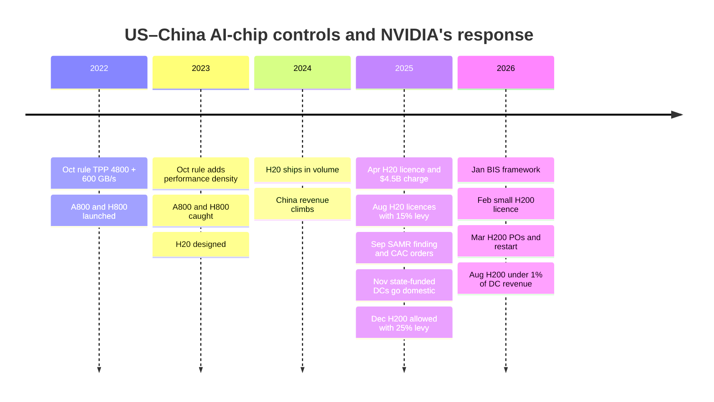
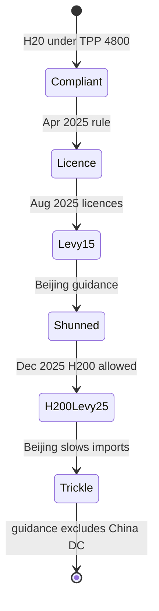
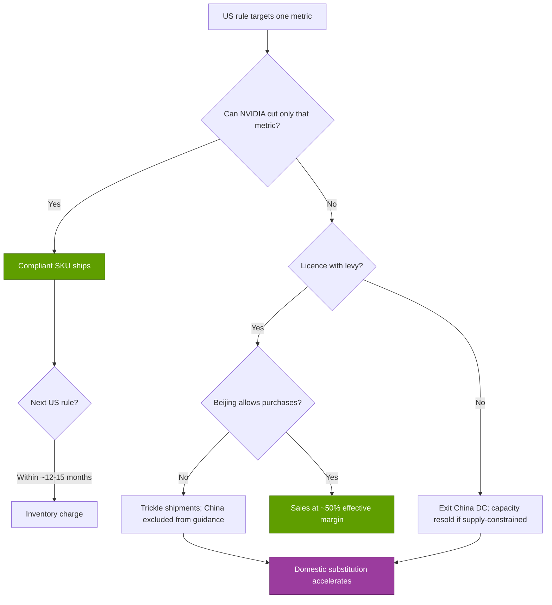

# CS6 · China export controls: H20 and beyond

Case study · ~14 min read · Last verified: 2026-11-05

## ⚡ The Executive Take

- **China used to be a quarter of NVIDIA.** China (including Hong Kong) was 26.4 % of revenue in FY2022 on the old billing basis [[S2]](../sources/bibliography.md#s2), and management has said China was 20–25 % of Data Center revenue before the controls [[S26008]](../sources/bibliography.md#s26008).
- **NVIDIA kept redesigning to the rule.** The October 2022 rule required a licence for chips above both 4,800 [TPP](../glossary.md#tpp) and 600 GB/s of chip-to-chip bandwidth; NVIDIA answered with A800/H800 (NVLink cut to 400 GB/s). The October 2023 rule closed that gap, so NVIDIA shipped the H20 at ~2,400 TPP, about 1/7 of an H200 [[S26002]](../sources/bibliography.md#s26002)[[S26001]](../sources/bibliography.md#s26001)[[S26003]](../sources/bibliography.md#s26003).
- **Compliant chips held the dollars for a while.** China revenue peaked at $25.0B in FY2025 on the customer-headquarters basis, even as its share fell [[S401]](../sources/bibliography.md#s401).
- **The April 2025 licence requirement cost $4.5B.** It hit the H20 "for the indefinite future" and forced a $4.5B inventory and purchase-obligation charge in Q1 FY2026. GAAP gross margin fell to 60.5 % [[S90081]](../sources/bibliography.md#s90081)[[S90082]](../sources/bibliography.md#s90082)[[S444]](../sources/bibliography.md#s444).
- **Licences came back with a levy, and Beijing said no.** H20 licences returned in August 2025 with 15 % of revenue to the US government, and H200 was allowed in December 2025 with 25 % [[S26004]](../sources/bibliography.md#s26004)[[S90032]](../sources/bibliography.md#s90032). Beijing then told buyers to avoid NVIDIA parts and steered state-funded data centers to domestic chips [[S26006]](../sources/bibliography.md#s26006)[[S26007]](../sources/bibliography.md#s26007). NVIDIA's filings show no H200 revenue recognised; press reports put Q2 FY2027 China H200 sales at < 1 % of Data Center revenue (🟡). Guidance still excludes China DC compute [[S90081]](../sources/bibliography.md#s90081)[[S26009]](../sources/bibliography.md#s26009)[[S405]](../sources/bibliography.md#s405).
- **The share collapsed but NVIDIA kept growing.** China fell to 9.1 % of FY2026 revenue and 5.6–8.2 % in FY2027 quarters while total revenue grew 65 % [[S401]](../sources/bibliography.md#s401)[[S90070]](../sources/bibliography.md#s90070)[[S90069]](../sources/bibliography.md#s90069)[[S1]](../sources/bibliography.md#s1). The lasting cost is that a domestic competitor now has a protected market. Huawei's Ascend roadmap and DeepSeek V4's Ascend support are the evidence [[S90042]](../sources/bibliography.md#s90042)[[S90079]](../sources/bibliography.md#s90079).

![Two-panel chart of China's share of NVIDIA revenue. Left, by fiscal year on the old billing basis: 23.9% FY2019, 25.0% FY2020, 23.3% FY2021, 26.4% FY2022, 21.4% FY2023, 16.9% FY2024, 13.1% FY2025; on the new customer-headquarters basis: 20.2% FY2024, 19.2% FY2025 ($25.0B, the dollar peak) and 9.1% FY2026 ($19.7B). Right, by quarter on the headquarters basis: 21.9% in Q1 FY2026, 8.6% in Q2 FY2026 after the H20 licence requirement, 5.6% in Q1 FY2027 and 8.2% in Q2 FY2027 (all platforms, including gaming).](../assets/charts/CS6-china-revenue-share.svg)

## 1. Context

**How big the stake was.** NVIDIA reports revenue by geography. Until Q3 FY2026 it assigned revenue by customer billing location. Since then it has used [customer headquarters](../glossary.md#revenue-by-customer-hq), and FY2024–FY2025 were recast [[S26013]](../sources/bibliography.md#s26013). On either basis China was one of NVIDIA's largest markets: $7.1B and 26.4 % in FY2022 [[S2]](../sources/bibliography.md#s2), then $25.0B in FY2025 on the headquarters basis [[S401]](../sources/bibliography.md#s401). That market included [hyperscalers](../glossary.md#hyperscaler) (Alibaba, Tencent, ByteDance, Baidu) building the same large-language-model fleets as their US peers.

**How the rules work.** US [export controls](../glossary.md#export-controls) on AI chips are written by the [BIS](../glossary.md#bis) in the Commerce Department. They do not name products. They set performance thresholds, and any chip above the line needs a licence to ship to China:

| Rule | What triggered a licence | NVIDIA's answer | Source |
|---|---|---|---|
| Oct 7, 2022 | TPP ≥ 4,800 **and** aggregate chip-to-chip bandwidth > 600 GB/s | A800 / H800: full compute, NVLink cut to 400 GB/s | [[S26002]](../sources/bibliography.md#s26002)[[S26001]](../sources/bibliography.md#s26001) |
| Oct 17, 2023 | Bandwidth test dropped; TPP ≥ 4,800, or TPP ≥ 1,600 with [performance density](../glossary.md#performance-density) ≥ 5.92 | H20: compute cut ~85 %, memory and NVLink kept | [[S26000]](../sources/bibliography.md#s26000)[[S26003]](../sources/bibliography.md#s26003) |
| Apr 2025 | H20 and parts with equivalent memory or interconnect bandwidth: licence "for the indefinite future" | $4.5B charge; no compliant data-center part left | [[S90081]](../sources/bibliography.md#s90081) |
| Dec 2025 – Jan 2026 | H200 licensable to approved buyers, 25 % of revenue to the US government | H200 production restarted (Mar 2026) | [[S90032]](../sources/bibliography.md#s90032)[[S90033]](../sources/bibliography.md#s90033) |

The mechanism matters. Each rule targeted one physical property. Each [compliant SKU](../glossary.md#compliant-sku) cut exactly that property and kept everything else. The 2022 rule measured links, so the A800 and H800 kept full compute. The 2023 rule measured compute, so the H20 kept 96 GB of [HBM](../glossary.md#hbm) at ~4.0 TB/s and 900 GB/s of [NVLink](../glossary.md#nvlink). That is more memory bandwidth than an H100 [[S26003]](../sources/bibliography.md#s26003). For [decode](../glossary.md#decode)-heavy inference, which is limited by memory bandwidth rather than compute, the H20 was a better product than its TPP suggests. That is why Chinese clouds bought it in volume.

🔧 Under the hood: how TPP and performance density are computed

**TPP** = 2 × (multiply-accumulate operations per second, in tera) × bit width of the operation, taking the highest-scoring precision. A MAC is two operations, so in practice TPP ≈ dense TFLOPS (or TOPS) × bits.

- H100 / H200: 1,979 dense [FP8](../glossary.md#fp8) TFLOPS × 8 = **15,832** ([BF16](../glossary.md#bf16) gives the same: 989 × 16) [[S33002]](../sources/bibliography.md#s33002).
- A100: 312 BF16 TFLOPS × 16 = **4,992**, just above the 4,800 line [[S33009]](../sources/bibliography.md#s33009).
- H20: ~296 FP8 TFLOPS × 8 = **~2,368** (reports round to ~2,400–2,500) [[S26003]](../sources/bibliography.md#s26003).
- Huawei Ascend 910C: 800 FP16 TFLOPS × 16 = **~12,800** on paper. Ascend 950PR: 1 [PFLOPS](../glossary.md#flops) FP8 × 8 = **~8,000** [[S163]](../sources/bibliography.md#s163).

**Performance density** = TPP ÷ die area in mm². The 2023 rule added it so a vendor could not escape the TPP line by spreading the same compute over more silicon. The H20 sits just under the 2,400-TPP tier, and on an ~814 mm² Hopper-class die its density is ~2,368 ÷ 814 ≈ 2.9. That is below both the 3.2 and 5.92 density triggers, so on the leaked specs it cleared every tier of the 2023 rule (repo calculation) [[S26000]](../sources/bibliography.md#s26000)[[S26002]](../sources/bibliography.md#s26002)[[S33002]](../sources/bibliography.md#s33002). Memory bandwidth was **not** a control parameter until the April 2025 action, which is exactly the gap the H20 exploited.

## 2. The decision

Two sets of decisions shaped the outcome: NVIDIA's product choices and the two governments' policy choices.

**NVIDIA's decision: design to the line, every time.** The alternative was to walk away from a quarter of revenue and leave Chinese developers to Huawei's software. NVIDIA chose to keep [CUDA](../glossary.md#cuda) developers in China on cut-down hardware. Each compliant part used the same die and software stack, so engineering cost was modest. The risk sat in inventory and purchase commitments, which NVIDIA makes months ahead of sales [[S414]](../sources/bibliography.md#s414).

**Washington's decision (April 2025): close the bandwidth loophole.** The H20 licence requirement landed mid-quarter. NVIDIA recorded a $4.5B charge for H20 inventory and purchase obligations. It could not ship $2.5B of Q1 FY2026 orders, and its Q2 outlook absorbed about $8.0B of lost H20 revenue [[S444]](../sources/bibliography.md#s444)[[S90082]](../sources/bibliography.md#s90082). GAAP gross margin fell to 60.5 %, or 71.3 % excluding the charge [[S444]](../sources/bibliography.md#s444).

**Washington's second decision (August–December 2025): sell, but take a cut.** Licences for some H20 shipments came with an unusual [export revenue share](../glossary.md#export-revenue-share). The president said NVIDIA would pay 15 % of H20 China revenue to the US government (AMD's MI308 got the same terms) [[S26004]](../sources/bibliography.md#s26004). In December 2025 the H200 was allowed to approved buyers with 25 % of revenue to the government. BIS published a licensing framework in January 2026, and NVIDIA received a licence for a small volume in February [[S90032]](../sources/bibliography.md#s90032)[[S90083]](../sources/bibliography.md#s90083).

**Beijing's decision: don't buy.** Chinese authorities discouraged H20 purchases, especially for government-related work, in August 2025 [[S26005]](../sources/bibliography.md#s26005). On 2025-09-15 the [SAMR](../glossary.md#samr) antitrust regulator issued a preliminary finding that NVIDIA had violated antimonopoly law over its Mellanox commitments [[S9505]](../sources/bibliography.md#s9505)[[S90081]](../sources/bibliography.md#s90081). Two days later the internet regulator told ByteDance and Alibaba to cancel orders for the RTX Pro 6000D [[S26006]](../sources/bibliography.md#s26006). In November, new state-funded data centers were told to use only domestic chips, and projects under 30 % complete were told to remove foreign ones [[S26007]](../sources/bibliography.md#s26007).

| Part | Launched for China | Cut vs. flagship | Status by late 2026 |
|---|---|---|---|
| A800 | 2022 | NVLink 600 → 400 GB/s | Caught by the Oct 2023 rule [[S26001]](../sources/bibliography.md#s26001) |
| H800 | 2023 | NVLink 900 → 400 GB/s; DeepSeek-V3 trained on 2,048 of them | Caught by the Oct 2023 rule [[S26001]](../sources/bibliography.md#s26001)[[S34007]](../sources/bibliography.md#s34007) |
| H20 | 2024 | Compute ~15 % of H100; 96 GB HBM3 kept | Licence (Apr 2025), 15 % levy (Aug 2025), shunned by Beijing [[S90081]](../sources/bibliography.md#s90081)[[S26004]](../sources/bibliography.md#s26004)[[S26005]](../sources/bibliography.md#s26005) |
| RTX Pro 6000D | 2025 | Workstation-class part | CAC ordered buyers to cancel orders (Sep 2025) [[S26006]](../sources/bibliography.md#s26006) |
| H200 | 2025–26 | Full Hopper; 141 GB HBM3E | 25 % levy; reported < 1 % of Q2 FY2027 DC revenue [[S90032]](../sources/bibliography.md#s90032)[[S26009]](../sources/bibliography.md#s26009) |

## 3. The outcome (with numbers)

**Revenue.** On the headquarters basis China fell from $25.0B (19.2 %) in FY2025 to $19.7B (9.1 %) in FY2026 [[S401]](../sources/bibliography.md#s401). It was $4.55B (5.6 %) in Q1 FY2027 [[S90070]](../sources/bibliography.md#s90070) and about $7.9B (8.2 %) in Q2 FY2027 [[S90069]](../sources/bibliography.md#s90069)[[S26014]](../sources/bibliography.md#s26014). That line covers every platform, including gaming and automotive. The data-center part is near zero: NVIDIA's guidance has excluded China DC compute since FY2026 [[S405]](../sources/bibliography.md#s405).

**H200 to date.** Beijing reportedly cleared a first batch of H200 imports during Huang's January 2026 visit, even as customs agents were reportedly told the chips were not permitted (🟡) [[S26011]](../sources/bibliography.md#s26011). NVIDIA's filings state that no H200 revenue has been recognised to date [[S90081]](../sources/bibliography.md#s90081). Press coverage of the Q2 FY2027 results instead describes H200 (Hopper) sales to Chinese buyers as < 1 % of Data Center revenue, held back by Chinese objections (🟡) [[S90011]](../sources/bibliography.md#s90011)[[S26009]](../sources/bibliography.md#s26009). A ~$400M provision for excess H200 inventory is also reported (🟡) [[S26010]](../sources/bibliography.md#s26010), and NVIDIA reportedly moved the H200 capacity meant for China to Vera Rubin (🟡) [[S26012]](../sources/bibliography.md#s26012). The filing and the press coverage conflict on whether any H200 revenue was recognised. Either way, Q2 FY2027 was a trickle, not a reopening.

**NVIDIA overall.** The loss barely showed in the totals. FY2026 revenue was $215.9B (+65 %) and Q2 FY2027 $96.2B (+106 % y/y) [[S1]](../sources/bibliography.md#s1)[[S405]](../sources/bibliography.md#s405). Non-US-headquartered customers fell to 22 % of revenue in Q1 FY2027 from 42 % a year earlier [[S90070]](../sources/bibliography.md#s90070). Gross margin recovered to ~75 % [[S90011]](../sources/bibliography.md#s90011).

**China's AI stack.** Huang said NVIDIA went "from 95 % market share to 0 %" in China. A Bernstein estimate cited alongside has NVIDIA's China AI-chip share falling from 66 % in 2024 to ~8 % [[S26008]](../sources/bibliography.md#s26008). Huawei announced the [Huawei Ascend](../glossary.md#huawei-ascend) 950PR (Q1 2026) and 950DT (Q4 2026), plus the Atlas 950 [SuperPoD](../glossary.md#superpod): 8,192 chips, 8 EF FP8 [[S90042]](../sources/bibliography.md#s90042)[[S341]](../sources/bibliography.md#s341). At Huawei Connect 2026 it pulled the Ascend 960DT forward to Q1 2027 and said the Atlas 950 SuperPoD was in large-scale commercial use (company claim) [[S567]](../sources/bibliography.md#s567). DeepSeek's V4 preview in April 2026 used Ascend for part of V4-Flash training and adapted Ascend SuperNodes for inference, while citing limits on high-end compute [[S90079]](../sources/bibliography.md#s90079)[[S90080]](../sources/bibliography.md#s90080). Huawei also open-sourced its [CANN](../glossary.md#cann) software stack [[S13521]](../sources/bibliography.md#s13521).

The domestic stack still costs more power for the same work. Huawei matches NVIDIA's rack throughput by using more chips and more watts:

> [!TIP]
> **Worked example — what China is worth to NVIDIA under each regime.** Take a China data-center market of **$17.5B a year**, the midpoint of $15–20B. FY2025 China revenue was $17.1B on the billing basis [[S416]](../sources/bibliography.md#s416), and the April 2025 action wiped ~$8.0B from one quarter's outlook [[S444]](../sources/bibliography.md#s444). Gross margin is **75 %** [[S90011]](../sources/bibliography.md#s90011).
> 1. **Unrestricted:** $17.5B × 75 % = **$13.1B** of gross profit a year.
> 2. **H200 deal:** the 25 % levy is on *revenue*, so it comes straight out of gross profit: $17.5B × (75 % − 25 %) = **$8.75B**. That is −$4.4B, and the effective margin is 50 %. The 15 % H20 arrangement gave $10.5B.
> 3. **Ban, capacity idle:** **$0**, a loss of $13.1B. This is roughly the April 2025 case: demand was there and the product could not ship.
> 4. **Ban, capacity resold:** in a [supply-constrained](../glossary.md#supply-constrained) year, the same wafers, HBM and [CoWoS](../glossary.md#cowos) go to US or sovereign buyers at the same margin. The short-run loss is **≈ $0**. NVIDIA's CFO calls the FY2028 outlook supply-constrained [[S90012]](../sources/bibliography.md#s90012).
>
> **Conclusion:** the levy costs NVIDIA a third of China's gross profit. Whether a ban costs anything depends on whether NVIDIA can sell everything else it makes. The lasting cost does not show up in this calculation: Huawei gets a protected home market in which to mature.

## 4. Why it worked (or didn't)

**What worked.**
- **Compliant SKUs bought time.** For about 2.5 years (FY2023–FY2025), redesigns kept China revenue growing in dollars while its share fell. The engineering cost was small because each part reused an existing die.
- **Diversification absorbed the shock.** Demand from US hyperscalers, sovereigns and [neoclouds](../glossary.md#neocloud) outgrew the lost market. Revenue still grew 65 % in the year China was closed off [[S1]](../sources/bibliography.md#s1).

**What didn't.**
- **Each compliant SKU lasted about a year.** The A800/H800 lasted ~12 months and the H20 ~15 months before a new rule caught them. Every redesign rebuilt inventory exposure. The result was the $4.5B H20 charge and a reported ~$400M H200 provision [[S90082]](../sources/bibliography.md#s90082)[[S26010]](../sources/bibliography.md#s26010).
- **The levy makes China NVIDIA's lowest-margin market.** At 25 %, China is worth a third less per dollar of revenue than any other buyer (worked example).
- **Beijing chose the outcome.** Once the US allowed sales, China's own regulators (SAMR, CAC, state-funding rules) blocked them [[S9505]](../sources/bibliography.md#s9505)[[S26006]](../sources/bibliography.md#s26006)[[S26007]](../sources/bibliography.md#s26007). Policy risk now comes from both sides.
- **The ecosystem lock-in eroded.** DeepSeek's kernels and frameworks now have Ascend paths, and CANN is open source [[S90079]](../sources/bibliography.md#s90079)[[S13521]](../sources/bibliography.md#s13521). The cost of switching away from CUDA in China fell in the years NVIDIA was absent.

> [!WARNING]
> **Myth vs. reality: "the controls kept China ~2 years behind."** The rules capped *chip* performance, not *system* performance. Huawei's CloudMatrix 384 links 384 Ascend 910C chips into one [scale-up](../glossary.md#scale-up) domain. It beats a GB200 [NVL72](../glossary.md#nvl72) on dense BF16 throughput (~300 vs ~180 PFLOPS) at ~3.9× the power [[S340]](../sources/bibliography.md#s340). Where adding power is easier than getting leading-edge lithography, buying watts substitutes for buying better chips. The controls raised the cost of AI compute in China, but did not set a hard limit on how much China could build. DeepSeek-V3 was trained on 2,048 export-compliant H800s [[S34007]](../sources/bibliography.md#s34007). The binding constraints are now volume (SMIC capacity, domestic HBM) and software maturity, not peak FLOPS per chip [[S164]](../sources/bibliography.md#s164)[[S3516]](../sources/bibliography.md#s3516).

> [!NOTE]
> **🐂 Bull view.** China is a call option, not a hole in the base case. Guidance already assumes zero China DC compute [[S405]](../sources/bibliography.md#s405). Any H200 volume, even at a 50 % effective margin, is upside, and the capacity it uses could be sold elsewhere anyway. Huawei's chips trail per watt and are supply-limited (SMIC 7 nm-class, in-house HBM) [[S164]](../sources/bibliography.md#s164)[[S163]](../sources/bibliography.md#s163)[[S340]](../sources/bibliography.md#s340).

> [!WARNING]
> **🐻 Bear view.** The controls created NVIDIA's best-funded competitor and handed it the world's second-largest AI market. Domestic purchase rules make the loss sticky even if Washington relents [[S26007]](../sources/bibliography.md#s26007). Huawei's annual Ascend cadence and DeepSeek's support show the substitute stack maturing [[S567]](../sources/bibliography.md#s567)[[S90079]](../sources/bibliography.md#s90079). A policy that can impose a 25 % levy on one market can be extended to others. Investors should price that risk in permanently.

## 5. Lessons for corp dev

1. **Treat geopolitical exposure as a portfolio factor, not a footnote.** Revenue by customer headquarters, not billing address, is the relevant exposure measure. NVIDIA's own recast moved FY2025 China from 13 % to 19 % [[S26013]](../sources/bibliography.md#s26013). Ask for both views in any diligence.
2. **Rules target metrics, so products should be designed with control margin.** A product that sits just below a TPP or bandwidth line will be caught by the next rule. What matters is how much performance survives when the next metric is added.
3. **Price policy risk as a permanent discount.** The H200 deal shows the state can take 25 % of revenue as a licence condition [[S90032]](../sources/bibliography.md#s90032). A probability-weighted value of China revenue (see the worked example) is more defensible than headline TAM.
4. **Expect the other side to retaliate.** SAMR used NVIDIA's own Mellanox merger conditions [[S9505]](../sources/bibliography.md#s9505). Past M&A approvals in China become leverage for Beijing later.
5. **Qualcomm-relevant context (public information only).** Qualcomm's FY2026 10-K shows China (including Hong Kong) at 42 % of revenue on a customer-headquarters basis ($18.1B), versus 46 % in FY2025 [[S13503]](../sources/bibliography.md#s13503). Its datacenter push leans on sovereign buyers whose orders depend on US export approvals, as HUMAIN's NVIDIA shipments did [[S13515]](../sources/bibliography.md#s13515)[[S90030]](../sources/bibliography.md#s90030). These facts frame questions, not conclusions (see the Lens below and [chapter 19](../cross-cutting/19-implications-for-qualcomm.md)).

🔧 Under the hood: haircutting China revenue in a valuation

A simple way to price policy risk is to probability-weight the policy regimes rather than apply a single discount rate. The probabilities below are **illustrative only (🔴 repo analysis)**. Take the $17.5B market from the worked example with a 20 % chance of unrestricted sales ($13.1B gross profit), 30 % of a 25 % levy ($8.75B) and 50 % of no access with idle capacity ($0). Expected gross profit is 0.2 × 13.1 + 0.3 × 8.75 + 0.5 × 0 ≈ **$5.3B**, about **60 % below** the unrestricted figure. Two refinements matter:

- **Correlation with the rest of the business.** If the capacity can be resold (supply-constrained case), the "no access" branch is worth close to the base case in the short run. The haircut then applies only to years when supply catches up with demand.
- **Terminal value.** Each year of absence lets domestic suppliers mature. The probability of regaining share falls over time even if policy relaxes, as Beijing's domestic-procurement rules show [[S26007]](../sources/bibliography.md#s26007). A declining terminal weight on China is more realistic than a constant one.

The same structure works for any asset with a large share of revenue in one politically exposed market: list the regimes, attach margins and probabilities, and value the expected gross profit.

Related: [CS5 · DeepSeek](CS5-deepseek-moment-and-efficiency-shock.md) · [Chapter 18 · Bear case](../cross-cutting/18-vulnerabilities-and-bear-case.md) · [Layer 13 · Capital and ecosystem](../layers/13-ecosystem-gtm-and-capital/index.md) · [Competitive landscape](../cross-cutting/15-competitive-landscape/index.md).

## 🎯 Corp Dev Lens

1. **Which of a target's products sit near a control metric (TPP, performance density, memory or interconnect bandwidth)?** How much performance would survive one more metric? This is a diligence question for any AI-silicon or interconnect asset.
2. **What is China revenue worth after a levy?** Run the regimes in the worked example (unrestricted, 15 %, 25 %, ban) with probabilities. Value China revenue on that expected gross profit, not on revenue multiples.
3. **For Qualcomm's own exposure (public data):** with ~42 % of FY2026 revenue from China-headquartered customers [[S13503]](../sources/bibliography.md#s13503), what would a licence-plus-levy regime mean if it were extended to AI-capable SoCs or inference accelerators? Which product lines have the most control margin?
4. **Is the supply-constraint hedge real for a challenger?** NVIDIA's China loss is cushioned because it can sell every wafer elsewhere. A smaller vendor without that backlog cannot resell capacity. Does a China-exposed AI-silicon target have demand outside China to absorb its supply?
5. **Who benefits from domestic substitution?** Huawei, Cambricon and China's HBM and packaging efforts (CXMT [HBM3E](../glossary.md#hbm3e)) [[S26007]](../sources/bibliography.md#s26007)[[S3516]](../sources/bibliography.md#s3516) are a protected market. Partnership or licensing options there are limited by the same controls. The practical question is which non-China markets those vendors could later export to.

## 📚 Sources

<!-- Auto-generated from the [S…] citations on this page by `make build`. Edit sources/registry/*.csv, not this list. -->

- [**S1**](../sources/bibliography.md#s1) NVIDIA Corporation via SEC EDGAR, *NVIDIA Announces Financial Results for Fourth Quarter and Fiscal 2026 (Form 8-K exhibit 99.1)*, 2026-02-25. [Link](https://www.sec.gov/Archives/edgar/data/1045810/000104581026000019/q4fy26pr.htm)
- [**S2**](../sources/bibliography.md#s2) U.S. Securities and Exchange Commission (EDGAR), *NVIDIA Corporation Form 10-K annual reports FY2020–FY2025 (filing index)*, 2025-02-26. [Link](https://www.sec.gov/cgi-bin/browse-edgar?action=getcompany&CIK=0001045810&type=10-K&dateb=&owner=include&count=40)
- [**S163**](../sources/bibliography.md#s163) Huawei (Eric Xu), *Huawei Connect 2025 keynote: Ascend roadmap and SuperPoD interconnect (Eric Xu)*, 2025-09-18. [Link](https://www.huawei.com/en/news/2025/9/hc-xu-keynote-speech)
- [**S164**](../sources/bibliography.md#s164) CSIS (Gregory C. Allen), *DeepSeek, Huawei, Export Controls, and the Future of the U.S.-China AI Race*, 2025-03-07. [Link](https://www.csis.org/analysis/deepseek-huawei-export-controls-and-future-us-china-ai-race)
- [**S340**](../sources/bibliography.md#s340) SemiAnalysis (Dylan Patel et al.), *Huawei AI CloudMatrix 384 - China's answer to Nvidia GB200 NVL72*, 2025-04-16. [Link](https://newsletter.semianalysis.com/p/huawei-ai-cloudmatrix-384-chinas-answer-to-nvidia-gb200-nvl72)
- [**S341**](../sources/bibliography.md#s341) Converge Digest, *Huawei unveils next-gen Ascend chips, SuperPoDs and UnifiedBus interconnect*, 2025-09-18. [Link](https://convergedigest.com/huawei-unveils-next-gen-ascend-chips-superpods-and-unifiedbus-interconnect/)
- [**S401**](../sources/bibliography.md#s401) NVIDIA Corporation via SEC EDGAR, *NVIDIA Corporation Form 10-K for fiscal year ended January 25, 2026*, 2026-02-25. [Link](https://www.sec.gov/Archives/edgar/data/1045810/000104581026000021/nvda-20260125.htm)
- [**S405**](../sources/bibliography.md#s405) NVIDIA Corporation via SEC EDGAR, *NVIDIA Announces Financial Results for Second Quarter Fiscal 2027 (Form 8-K exhibit 99.1)*, 2026-08-26. [Link](https://www.sec.gov/Archives/edgar/data/0001045810/000104581026000073/q2fy27pr.htm)
- [**S414**](../sources/bibliography.md#s414) NVIDIA Corporation via SEC EDGAR, *NVIDIA Corporation Form 10-Q for quarter ended April 27, 2025*, 2025-05-28. [Link](https://www.sec.gov/Archives/edgar/data/1045810/000104581025000116/nvda-20250427.htm)
- [**S416**](../sources/bibliography.md#s416) NVIDIA Corporation via SEC EDGAR, *NVIDIA Corporation Form 10-K for fiscal year ended January 26, 2025*, 2025-02-26. [Link](https://www.sec.gov/Archives/edgar/data/1045810/000104581025000023/nvda-20250126.htm)
- [**S444**](../sources/bibliography.md#s444) NVIDIA Corporation, *NVIDIA Announces Financial Results for First Quarter Fiscal 2026 (press release with CFO commentary)*, 2025-05-28. [Link](https://nvidianews.nvidia.com/news/nvidia-announces-financial-results-for-first-quarter-fiscal-2026)
- [**S567**](../sources/bibliography.md#s567) Huawei, *Huawei Connect 2026: Ascend 960 SuperNode*, 2026-09. [Link](https://www.huawei.com/br/news/2026/9/hc-ascend960-supernode)
- [**S3516**](../sources/bibliography.md#s3516) Korea JoongAng Daily, *China's CXMT begins HBM3E production as chip battle with Korean powerhouses widens*, 2026-08. [Link](https://www.koreajoongangdaily.com/business/chinas-cxmt-begins-hbm3e-production-as-chip-battle-with-korean-powerhouses-widens/12854260)
- [**S9505**](../sources/bibliography.md#s9505) JURIST, *China finds Nvidia violated antimonopoly law in preliminary probe*, 2025-09-15. [Link](https://www.jurist.org/news/2025/09/china-finds-nvidia-violated-antimonopoly-law-in-preliminary-probe/)
- [**S13503**](../sources/bibliography.md#s13503) Qualcomm via SEC EDGAR, *Qualcomm Form 10-K for fiscal year ended September 27, 2026*, 2026-11. [Link](https://www.sec.gov/Archives/edgar/data/0000804328/000080432826000128/qcom-20260927.htm)
- [**S13515**](../sources/bibliography.md#s13515) The Sun (Malaysia), *Saudi AI firm Humain signs major Nvidia chip deal after US approval*, 2025-11. [Link](https://thesun.my/news/world-news/saudi-ai-firm-humain-signs-major-nvidia-chip-deal-after-us-approval)
- [**S13521**](../sources/bibliography.md#s13521) Huawei, *Huawei announces open-sourcing of CANN and Ascend ecosystem investments (HUAWEI CONNECT 2025)*, 2025-09. [Link](https://www.huawei.com/br/news/2025/9/hc-shengten-opensource)
- [**S26000**](../sources/bibliography.md#s26000) U.S. Federal Register (Bureau of Industry and Security), *Implementation of Additional Export Controls: Certain Advanced Computing Items; Supercomputer and Semiconductor End Use (interim final rule, FR Doc 2023-22299)*, 2023-10. [Link](https://www.govinfo.gov/content/pkg/FR-2023-10-18/pdf/2023-22299.pdf)
- [**S26001**](../sources/bibliography.md#s26001) Tom's Hardware, *US Prohibits Exports of Nvidia's A800 and H800 to China, Blacklists Chinese GPU Developers*, 2023-10. [Link](https://www.tomshardware.com/news/us-prohibits-exports-of-nvidias-a800-and-h800-to-china-blacklists-chinese-gpu-developers)
- [**S26002**](../sources/bibliography.md#s26002) GPUSmith, *ECCN 3A090/4A090: TPP and performance density explained*, 2025. [Link](https://gpusmith.com/articles/en/eccn-3a090-4a090-tpp-performance-density-explained)
- [**S26003**](../sources/bibliography.md#s26003) SemiAnalysis (Dylan Patel et al.), *Nvidia's New China AI Chips Circumvent US Restrictions / H20 Faster Than H100 / Huawei Ascend 910B*, 2023-11. [Link](https://www.semianalysis.com/p/nvidias-new-china-ai-chips-circumvent)
- [**S26004**](../sources/bibliography.md#s26004) NPR, *Trump says Nvidia will hand the U.S. 15% of its H20 chip sales to China*, 2025-08-11. [Link](https://www.npr.org/2025/08/11/nx-s1-5498689/trump-nvidia-h20-chip-sales-china)
- [**S26005**](../sources/bibliography.md#s26005) Tom's Hardware, *Nvidia responds to claim China is urging local companies to avoid Nvidia H20*, 2025-08. [Link](https://www.tomshardware.com/pc-components/gpus/nvidia-responds-to-claim-china-is-urging-local-companies-to-avoid-nvidia-h20-report-claims-authorities-have-sent-notices-discouraging-use-especially-for-government-related-purposes)
- [**S26006**](../sources/bibliography.md#s26006) DatacenterDynamics, *China's internet regulator tells Chinese tech companies to stop buying Nvidia AI chips - report*, 2025-09-17. [Link](https://www.datacenterdynamics.com/en/news/chinas-internet-regulator-tells-chinese-tech-companies-to-stop-buying-nvidia-ai-chips-report/)
- [**S26007**](../sources/bibliography.md#s26007) Tom's Hardware, *China bans foreign AI chips from state-funded data centers*, 2025-11. [Link](https://www.tomshardware.com/tech-industry/semiconductors/china-bans-foreign-ai-chips-from-state-funded-data-centers)
- [**S26008**](../sources/bibliography.md#s26008) Tom's Hardware, *Jensen Huang says Nvidia China market share has fallen to zero*, 2025-10. [Link](https://www.tomshardware.com/tech-industry/jensen-huang-says-nvidia-china-market-share-has-fallen-to-zero)
- [**S26009**](../sources/bibliography.md#s26009) South China Morning Post, *China freeze on H200 chip sales clouds Nvidia's record earnings*, 2026-08. [Link](https://www.scmp.com/tech/article/3344663/china-freeze-h200-chip-sales-clouds-nvidias-record-earnings)
- [**S26010**](../sources/bibliography.md#s26010) Crypto Briefing, *Nvidia incurs $400M charge from excess H200 inventory as single customer drives 16% of revenue*, 2026-08. [Link](https://cryptobriefing.com/nvidia-400m-charge-h200-inventory/)
- [**S26011**](../sources/bibliography.md#s26011) MarketScreener, *China clears first Nvidia H200 AI chips for import - sources (Reuters)*, 2026-01. [Link](https://www.marketscreener.com/news/china-clears-first-nvidia-h200-ai-chips-for-import-sources-ce7e5bd9da81f527)
- [**S26012**](../sources/bibliography.md#s26012) DatacenterDynamics, *Nvidia reallocates China H200 manufacturing capacity for Vera Rubin chips - report*, 2026. [Link](https://www.datacenterdynamics.com/en/news/nvidia-reallocates-china-h200-manufacturing-capacity-for-vera-rubin-chips-report/)
- [**S26013**](../sources/bibliography.md#s26013) FourWeekMBA, *Nvidia's China Revenue: 19% Under Its New Count, Not 13%*, 2026. [Link](https://fourweekmba.com/ai-nvidias-china-revenue-19-under-its-new-count-not-13/)
- [**S26014**](../sources/bibliography.md#s26014) Crypto Briefing, *Nvidia proves reduced dependence on China amid global shifts*, 2026-08. [Link](https://cryptobriefing.com/nvidia-reduced-china-dependence-revenue/)
- [**S33002**](../sources/bibliography.md#s33002) NVIDIA, *NVIDIA H100 Tensor Core GPU (product page and datasheet)*, 2022-03-22. [Link](https://www.nvidia.com/en-us/data-center/h100/)
- [**S33009**](../sources/bibliography.md#s33009) NVIDIA, *NVIDIA A100 Tensor Core GPU datasheet*, 2021. [Link](https://www.nvidia.com/content/dam/en-zz/Solutions/Data-Center/a100/pdf/nvidia-a100-datasheet-us-nvidia-1758950-r4-web.pdf)
- [**S34007**](../sources/bibliography.md#s34007) arXiv:2412.19437 (DeepSeek-AI), *DeepSeek-V3 Technical Report*, 2024-12-27. [Link](https://arxiv.org/abs/2412.19437)
- [**S90011**](../sources/bibliography.md#s90011) Nasdaq (Zacks), *NVIDIA Q2 earnings beat on Blackwell Ultra and Data Center strength*, 2026-08-27. [Link](https://www.nasdaq.com/articles/nvidia-q2-earnings-beat-blackwell-ultra-data-center-strength)
- [**S90012**](../sources/bibliography.md#s90012) Tomasz Tunguz (Tomasz Tunguz), *Nvidia Q2 FY27 earnings*, 2026-08. [Link](https://www.tomtunguz.com/nvidia-q2-fy27-earnings/index.md)
- [**S90030**](../sources/bibliography.md#s90030) Morningstar, *Qualcomm: Humain deal provides some AI upside*, 2025-10. [Link](https://www.morningstar.com/stocks/qualcomm-humain-deal-provides-some-ai-upside)
- [**S90032**](../sources/bibliography.md#s90032) Bloomberg Government, *Nvidia gets US license for small amount of H200 exports to China*, 2026-02. [Link](https://news.bgov.com/international-trade/nvidia-gets-us-license-for-small-amount-of-h200-exports-to-china)
- [**S90033**](../sources/bibliography.md#s90033) Tom's Hardware, *Nvidia has received POs from Chinese customers*, 2026-03-17. [Link](https://tomshardware.com/tech-industry/nvidia-has-received-pos-from-chinese-customers)
- [**S90042**](../sources/bibliography.md#s90042) TrendForce, *Huawei unveils Ascend 950 with in-house HBM in 2026, touts SuperPoD to rival NVIDIA*, 2025-09-18. [Link](https://www.trendforce.com/news/2025/09/18/news-huawei-unveils-ascend-950-with-in-house-hbm-in-2026-touts-superpod-to-rival-nvidia/)
- [**S90069**](../sources/bibliography.md#s90069) NVIDIA Corporation via SEC EDGAR, *NVIDIA Form 10-Q for the quarter ended July 26, 2026 (Q2 FY2027)*, 2026-08. [Link](https://www.sec.gov/Archives/edgar/data/0001045810/000104581026000075/nvda-20260726.htm)
- [**S90070**](../sources/bibliography.md#s90070) NVIDIA Corporation via SEC EDGAR, *NVIDIA Form 10-Q for the quarter ended April 26, 2026 (Q1 FY2027)*, 2026-05. [Link](https://www.sec.gov/Archives/edgar/data/0001045810/000104581026000052/nvda-20260426.htm)
- [**S90079**](../sources/bibliography.md#s90079) TechRepublic, *DeepSeek V4 AI model backed by Huawei*, 2026-04-24. [Link](https://www.techrepublic.com/article/news-apac-deepseek-v4-ai-model-huawei-ascend-chips-support/)
- [**S90080**](../sources/bibliography.md#s90080) Asia Financial, *China's DeepSeek says new V4 AI model can run on Huawei chips*, 2026-04. [Link](https://www.asiafinancial.com/chinas-deepseek-says-new-v4-ai-model-can-run-on-huawei-chips)
- [**S90081**](../sources/bibliography.md#s90081) NVIDIA Corporation via SEC EDGAR, *NVIDIA Form 10-K for fiscal year 2026 (ended January 25, 2026)*, 2026-02. [Link](https://www.sec.gov/Archives/edgar/data/1045810/000104581026000021/nvda-20260125.htm)
- [**S90082**](../sources/bibliography.md#s90082) Verdict, *Nvidia writedown on H20 chip*, 2025-04. [Link](https://www.verdict.co.uk/nvidia-writedown-h20-chip/)
- [**S90083**](../sources/bibliography.md#s90083) Built In, *A guide to how America controls Nvidia chip exports to China*, 2026. [Link](https://builtin.com/articles/trump-lifts-ai-chip-ban-china)
