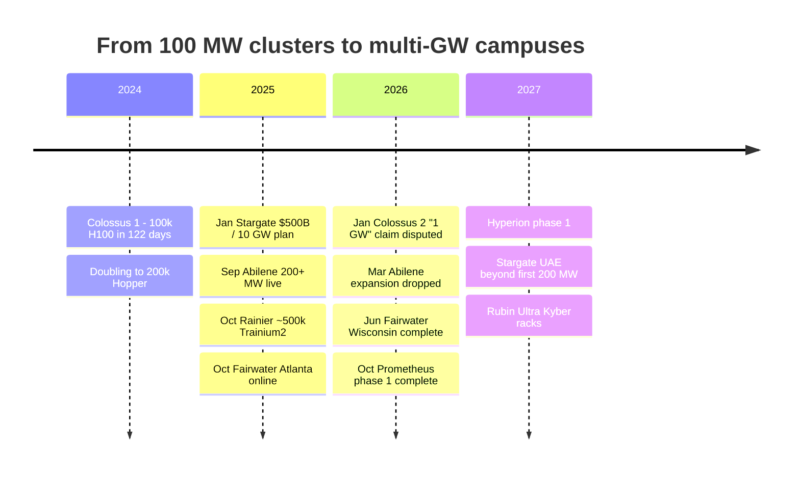
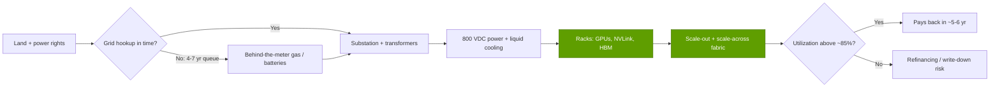
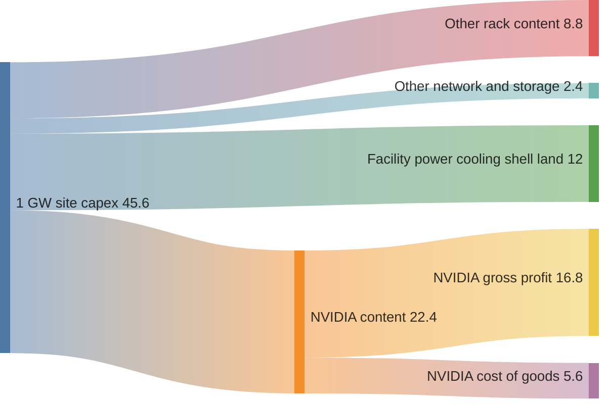

# CS7 · Gigawatt AI factories: xAI, Stargate and others

Case study · ~15 min read · Last verified: 2026-11-05

## ⚡ The Executive Take

- **The unit of AI infrastructure changed from a cluster to a power plant.** xAI's Colossus 1 put 100,000 H100s into service in 122 days in 2024, roughly 150 MW (Est. from the GPU count) [[S6000]](../sources/bibliography.md#s6000)[[S318]](../sources/bibliography.md#s318). By 2026 single sites draw 0.35–0.74 GW, and announced campuses run to 1–5 GW [[S90077]](../sources/bibliography.md#s90077)[[S27004]](../sources/bibliography.md#s27004)[[S27007]](../sources/bibliography.md#s27007).
- **Gigawatt claims need checking.** Musk called Colossus 2 the first gigawatt training cluster in January 2026. Satellite analysis found ~350 MW of cooling at the time (🔴 contested) [[S90076]](../sources/bibliography.md#s90076)[[S90077]](../sources/bibliography.md#s90077). Stargate Abilene had 200+ MW live in September 2025 of a planned 1.2 GW, and expansion beyond that was dropped in March 2026, which Oracle disputes [[S8013]](../sources/bibliography.md#s8013)[[S27001]](../sources/bibliography.md#s27001)[[S27002]](../sources/bibliography.md#s27002).
- **A gigawatt costs ~$30–60B.** NVIDIA's CEO puts it at $50–60B with ~$35B of NVIDIA content [[S398]](../sources/bibliography.md#s398). Bernstein says ~$35B and Barclays $32.5–42B [[S6025]](../sources/bibliography.md#s6025)[[S27012]](../sources/bibliography.md#s27012). The repo's bottom-up Vera Rubin site comes to **~$46B (Est.)**, of which ~$22B is NVIDIA content.
- **Power, not GPUs, sets the timeline.** A site can be built in 4–24 months, but new grid power takes 4–7 years [[S8009]](../sources/bibliography.md#s8009)[[S8010]](../sources/bibliography.md#s8010). ERCOT alone tracks ~410 GW of large loads seeking connection [[S8011]](../sources/bibliography.md#s8011). Builders respond with on-site gas, 800 VDC power and liquid cooling [[S8015]](../sources/bibliography.md#s8015)[[S90061]](../sources/bibliography.md#s90061).
- **Utilization decides the economics.** At 89 % utilization (Meta holds >11 % of Prometheus GPUs as spares) a Vera Rubin gigawatt breaks even at ~$4.8–5.4 per [GPU-hour](../glossary.md#gpu-hour). At 60 % it needs ~$7–8 (Est.) [[S27010]](../sources/bibliography.md#s27010).
- **Financing is where the risk sits.** Meta moved Hyperion into a ~$27–30B joint venture with Blue Owl [[S27008]](../sources/bibliography.md#s27008), Abilene's expansion reportedly failed on financing [[S27001]](../sources/bibliography.md#s27001), and NVIDIA's investments in its own customers fuel the circular-financing debate [[S90015]](../sources/bibliography.md#s90015)[[S12528]](../sources/bibliography.md#s12528).

![Horizontal bar chart of AI site power. xAI Colossus 1 about 150 MW (repo estimate for 100,000 H100s in 2024, ~300 MW planned at 200,000 GPUs); Stargate Abilene 200+ MW live in Sept 2025 of a 1.2 GW campus; Microsoft Fairwater Wisconsin about 737 MW of IT power (Epoch estimate, 2026); xAI Colossus 2 about 350 MW of cooling seen by satellite in Jan 2026 against a 1 GW claim and a ~2 GW plan; Meta Prometheus 1 GW planned with its first phase complete in Oct 2026; Meta Hyperion up to 5 GW; Stargate UAE 1 GW (first 200 MW in 2026); HUMAIN's NVIDIA build up to 500 MW.](../assets/charts/CS7-site-scale-mw.svg)

## 1. Context

**Why sites got so big.** Frontier training is a synchronous job. Thousands of GPUs exchange gradients every step, so they must sit on one low-latency fabric. The fastest way to train a bigger model was to build a bigger single site. The physics followed. An [NVL72](../glossary.md#nvl72) rack went from ~120 kW (GB200) to 190–230 kW (Vera Rubin), and the Kyber rack is reported at ~600 kW [[S336]](../sources/bibliography.md#s336)[[S302]](../sources/bibliography.md#s302)[[S90061]](../sources/bibliography.md#s90061). Rack count, cooling and substations scale together.

**What "a gigawatt" means.** Announcements mix three numbers: grid or contracted power, power at the meter, and [IT load](../glossary.md#it-load) (what the servers draw). The gap is [PUE](../glossary.md#pue). At a PUE of 1.15, a 1 GW meter feeds ~870 MW of IT. A "1 GW cluster" can therefore hold 10–20 % fewer GPUs than a headline implies. A satellite count of chillers measures something else again: cooling capacity [[S90077]](../sources/bibliography.md#s90077).

## 2. The decision

Each builder made the same bet, to secure power and silicon years ahead of demand. Each structured it differently.

| Builder · site | Silicon | Scale (best evidence → plan) | Distinctive choice | Sources |
|---|---|---|---|---|
| xAI · Colossus 1–2 (Memphis) | NVIDIA H100 → GB200/GB300 | ~150 MW (Est.) → 350 MW seen, 1 GW claimed, ~2 GW plan | Speed: retrofitted building, on-site gas turbines | [[S6000]](../sources/bibliography.md#s6000)[[S90076]](../sources/bibliography.md#s90076)[[S90077]](../sources/bibliography.md#s90077)[[S8015]](../sources/bibliography.md#s8015) |
| OpenAI / Oracle / Crusoe · Stargate Abilene | NVIDIA GB200/GB300 | 200+ MW (Sep 2025) → 1.2 GW | Developer-built, Oracle-leased; part of a ~7 GW, >$400B plan | [[S8013]](../sources/bibliography.md#s8013)[[S27000]](../sources/bibliography.md#s27000)[[S27003]](../sources/bibliography.md#s27003) |
| Meta · Prometheus (Ohio), Hyperion (Louisiana) | NVIDIA GB200/GB300 (Prometheus) | Phase 1 done Oct 2026 → 1 GW; Hyperion up to 5 GW | Off-balance-sheet [SPV financing](../glossary.md#spv-financing) for Hyperion | [[S27007]](../sources/bibliography.md#s27007)[[S27008]](../sources/bibliography.md#s27008)[[S27009]](../sources/bibliography.md#s27009) |
| Microsoft · Fairwater (Wisconsin, Atlanta) | NVIDIA GB200/GB300 | ~737 MW IT (Epoch Est.) in Wisconsin | Sites joined by an AI WAN into one "superfactory" | [[S27004]](../sources/bibliography.md#s27004)[[S27005]](../sources/bibliography.md#s27005)[[S27006]](../sources/bibliography.md#s27006) |
| Anthropic · multi-vendor | Trainium2, TPU, NVIDIA, AMD | ~500k Trainium2 (Rainier); > 1 GW TPU in 2026; up to 1 GW NVIDIA; 2 GW AMD | Spreads risk across four chip suppliers | [[S27011]](../sources/bibliography.md#s27011)[[S653]](../sources/bibliography.md#s653)[[S654]](../sources/bibliography.md#s654)[[S9538]](../sources/bibliography.md#s9538) |
| Sovereign · HUMAIN, Stargate UAE | NVIDIA GB300 → Vera Rubin (also AMD, Qualcomm at HUMAIN) | 84 MW firm phase → 500 MW; UAE 200 MW → 1 GW | State-backed demand tied to US export approvals | [[S13514]](../sources/bibliography.md#s13514)[[S13516]](../sources/bibliography.md#s13516)[[S13008]](../sources/bibliography.md#s13008)[[S90030]](../sources/bibliography.md#s90030) |

**xAI: speed as strategy.** Colossus 1 went from first rack to training in 19 days on a [Spectrum-X](../glossary.md#spectrum-x) Ethernet fabric [[S6000]](../sources/bibliography.md#s6000), then began doubling to 200,000 Hopper GPUs [[S6001]](../sources/bibliography.md#s6001). Colossus 2 targets ~550,000 GB200/GB300 GPUs, powered partly by on-site natural gas behind the meter [[S90076]](../sources/bibliography.md#s90076)[[S8015]](../sources/bibliography.md#s8015). NVIDIA is also an investor in xAI, reported at up to $2B [[S483]](../sources/bibliography.md#s483).

**OpenAI and partners: a portfolio of sites.** The January 2025 commitment was $500B and 10 GW. By September 2025 the partners had ~7 GW planned and > $400B committed over three years across Abilene, five new US sites and CoreWeave capacity [[S27000]](../sources/bibliography.md#s27000). Oracle's Zettascale10 design for Abilene targets up to 800,000 GPUs [[S6008]](../sources/bibliography.md#s6008). Epoch AI lists Abilene as operational, at ~509k H100-equivalents now and ~1.02M projected [[S27003]](../sources/bibliography.md#s27003).

**Meta: build it, but finance it off balance sheet.** Prometheus was promised for 2026, and its first phase was complete in October 2026. Meta is scaling it toward ~1M GPUs, with a mean time between interruptions ([MTBI](../glossary.md#mtbi)) of ~47,000 GPU-hours [[S27009]](../sources/bibliography.md#s27009). Hyperion's ~$27–30B financing gives Blue Owl the majority and Meta ~20 % [[S27008]](../sources/bibliography.md#s27008).

**Anthropic: the multi-vendor hedge.** Anthropic runs on Project Rainier (~500,000 Trainium2) [[S27011]](../sources/bibliography.md#s27011), up to 1M Google TPUs (> 1 GW in 2026) [[S653]](../sources/bibliography.md#s653), up to 1 GW of NVIDIA systems with a $30B Azure commitment [[S654]](../sources/bibliography.md#s654), and 2 GW of AMD Helios [[S9538]](../sources/bibliography.md#s9538). It is the clearest case of a gigawatt buyer that NVIDIA has not locked in.

![Stacked horizontal bar chart of announced compute programmes in gigawatts. OpenAI 26 GW: NVIDIA 10 (September 2025 letter of intent, since restructured), Broadcom custom accelerators 10 and AMD 6. Anthropic 4 GW: AMD Helios up to 2 (with an up-to-$5B AMD investment), NVIDIA up to 1 and Google TPUs over 1 GW in 2026 (a further multi-GW TPU expansion from 2027 is unquantified). HUMAIN: NVIDIA up to 0.5 GW, AMD 0.5 GW and Qualcomm 0.2 GW. xAI: about 1 GW on NVIDIA (company claim, contested). NVIDIA's share across these programmes is about 39%.](../assets/charts/13-gw-pipeline-by-supplier.svg)

## 3. The outcome (with numbers)

**What a gigawatt costs.** Huang put a 1 GW AI factory at $50–60B with ~$35B of NVIDIA content (August 2025) [[S398]](../sources/bibliography.md#s398). Others are lower. Bernstein estimates ~$35B: ~39 % GPUs, ~13 % networking, roughly a third electrical and mechanical plant [[S6025]](../sources/bibliography.md#s6025)[[S27013]](../sources/bibliography.md#s27013). Barclays estimates $32.5–42B [[S27012]](../sources/bibliography.md#s27012), and Bloomberg priced Abilene's gigawatt at ~$30B with $17B of chips (🟡) [[S27015]](../sources/bibliography.md#s27015). A later Bernstein note put Vera Rubin at the top of a $34.6–39.5B range [[S27016]](../sources/bibliography.md#s27016). The spread mostly reflects what each estimate counts as "chips" (memory, CPUs, switches) and whether land and power generation are included.

![Stacked horizontal bar chart of capital cost per gigawatt of AI data center. NVIDIA's CEO (Aug 2025): $50-60B with about $35B of NVIDIA content. Repo bottom-up for Vera Rubin NVL72 (estimate): about $46B (range $42-50B), of which NVIDIA about $22B, other IT about $11B and facility about $12B. Bernstein's 2026 note: up to $39.5B for Vera Rubin. Barclays: $32.5-42B. Bernstein (Oct 2025): about $35B, 39% GPUs, 13% networking and about one-third electrical and mechanical. Bloomberg on Abilene: about $30B including $17B of chips.](../assets/charts/CS7-cost-per-gw-estimates.svg)

> [!TIP]
> **Worked example — GPUs, racks, MW and capex for a 1 GW Vera Rubin site (Est.).**
> 1. **Meter to IT:** 1,000 MW ÷ [PUE](../glossary.md#pue) 1.15 = **~870 MW** of IT load.
> 2. **Power per rack:** a Vera Rubin NVL72 draws 190 kW (Max-Q) to 230 kW (Max-P) [[S302]](../sources/bibliography.md#s302). Add ~21 % for [scale-out](../glossary.md#scale-out) switches, storage and head nodes (GB200: 145 kW all-in vs 120 kW) [[S340]](../sources/bibliography.md#s340)[[S336]](../sources/bibliography.md#s336). That gives 230–278 kW per rack, ~254 kW at the midpoint.
> 3. **Racks and GPUs:** 870 MW ÷ 254 kW ≈ **3,420 racks**, × 72 = **~246,000 GPUs** (range 225k–272k).
> 4. **Capex:** racks × $7.8M (Morgan Stanley BOM) [[S330]](../sources/bibliography.md#s330)[[S332]](../sources/bibliography.md#s332) = **$26.7B**. Network and storage add ~26 % of rack spend [[S324]](../sources/bibliography.md#s324) = **$6.9B**. The facility (power gear, cooling, shell, land) is $11–13B [[S6025]](../sources/bibliography.md#s6025). Total **≈ $45.6B** (range $41.7–50.2B).
> 5. **Who gets paid:** NVIDIA's share is 62–72 % of a Vera Rubin rack (it resells the [HBM4](../glossary.md#hbm4)) plus 50–80 % of networking [[S332]](../sources/bibliography.md#s332)[[S324]](../sources/bibliography.md#s324). That is **~$22.4B (~49 %)**, and at a ~75 % gross margin ~$16.8B of NVIDIA gross profit per gigawatt.
>
> **Conclusion:** about half of a Vera Rubin gigawatt goes to NVIDIA, below the ~$35B Huang cited in the Blackwell era. HBM4 pushed memory to ~26 % of the rack BOM, so more of each dollar now passes to SK hynix, Samsung and Micron [[S330]](../sources/bibliography.md#s330). The facility (power gear, cooling, shell, land) takes about a quarter.

🔧 Under the hood: model assumptions and sensitivities

- **Rack price** is the swing factor. Bernstein's $9.1M per Vera Rubin rack (HBM4 at ~$53/GB) instead of $7.8M lifts rack capex by ~$4.4B. Morgan Stanley's $6.7M direct-SOCAMM case lowers it by ~$3.8B (before any knock-on to networking) [[S333]](../sources/bibliography.md#s333)[[S332]](../sources/bibliography.md#s332).
- **Max-Q vs Max-P:** running racks at 190 kW fits ~21 % more racks into the same 870 MW than at 230 kW. Capex rises with them, but tokens per MW improve. The repo's "high" case (272k GPUs) is the Max-Q case.
- **Facility cost** uses Bernstein's ~one-third electrical and mechanical share of ~$35B, about $11.6B, plus a margin for land and shell [[S6025]](../sources/bibliography.md#s6025). Behind-the-meter generation, as at Colossus 2, adds plant capex that this model leaves out [[S8015]](../sources/bibliography.md#s8015).
- **Break-even model:** capital charge = IT capex × CRF(r, 6 yr) + facility × CRF(r, 20 yr), where the [capital recovery factor](../glossary.md#capital-recovery-factor) is CRF = r / (1 − (1 + r)^−n). At r = 8 % that is $8.5B a year; at 12 %, $9.8B. Power at $0.081/kWh is ~$0.71B a year at full draw [[S389]](../sources/bibliography.md#s389)[[S382]](../sources/bibliography.md#s382). Staff, software, maintenance and taxes are excluded, so real break-evens are higher.
- **Inputs** live in `data/cs7_gw_build_inputs.csv`, and the formulas in `scripts/charts/ch_cs7.py`.

**Power and grid.** The bottleneck has moved from [CoWoS](../glossary.md#cowos) to electrons. Builds take 4–24 months, but grid power arrives in 4–7 years:

![Horizontal bar chart in months. Build milestones: xAI Colossus 1 first rack to training in 19 days (0.6 months) and facility plus 100,000-GPU cluster in 122 days (4 months); Stargate Abilene first two buildings, 200+ MW, about 15 months from construction start; the full 1.2 GW campus about 24 months (mid-2026 target, later estimates Q4 2026). Grid milestones: median interconnection request to operation for new US generation over 48 months (LBNL), and up to 84 months for a large data-center hookup in Dominion's Northern Virginia territory.](../assets/charts/08-build-vs-grid-timelines.svg)

Builders work around the grid in three ways. They generate their own power ([behind-the-meter](../glossary.md#behind-the-meter) gas at Colossus 2 [[S8015]](../sources/bibliography.md#s8015)). They spread one job across sites linked by a WAN ([scale-across](../glossary.md#scale-across), as Microsoft does between Fairwater sites [[S27006]](../sources/bibliography.md#s27006)). And they re-engineer power delivery: about 20 partners showed 800 VDC components at GTC DC 2025, and an 800 VDC row power center (up to 2 MW per row) is planned for 2027 [[S90061]](../sources/bibliography.md#s90061)[[S90063]](../sources/bibliography.md#s90063). See [Layer 08 · Systems, racks and AI factories](../layers/08-systems-racks-ai-factories/index.md) and its [power and cooling page](../layers/08-systems-racks-ai-factories/power-and-cooling.md) for the mechanisms.

**Delivered vs claimed.** By late 2026 the projects with independent evidence were Abilene (operational, Epoch), Fairwater Wisconsin (construction complete, ~737 MW IT by Epoch's estimate) and Prometheus phase 1 [[S27003]](../sources/bibliography.md#s27003)[[S27004]](../sources/bibliography.md#s27004)[[S27005]](../sources/bibliography.md#s27005)[[S27009]](../sources/bibliography.md#s27009). Colossus 2's gigawatt rests on the company's claim [[S90076]](../sources/bibliography.md#s90076). Hyperion and Stargate UAE are still under construction, with first phases due in 2027 and 2026 [[S27007]](../sources/bibliography.md#s27007)[[S13008]](../sources/bibliography.md#s13008).

## 4. Why it worked (or didn't)

**What worked.**
- **Speed compounds.** xAI showed that a retrofitted shell, on-site generation and a single-vendor stack can cut years to months [[S6000]](../sources/bibliography.md#s6000). Everyone else adopted parts of that playbook.
- **NVIDIA's full-stack offer suits gigawatt builds.** A builder buying racks, [NVLink](../glossary.md#nvlink), Spectrum-X or [InfiniBand](../glossary.md#infiniband), and reference designs (Omniverse DSX, 800 VDC) faces fewer integration risks. That is why most of the gigawatt pipeline is NVIDIA's (chart above).
- **Financing innovation.** Joint ventures (Hyperion), developer-lessor models (Crusoe/Oracle at Abilene) and NVIDIA's August 2026 platform to mobilise > $500B of third-party capital spread the capex [[S27008]](../sources/bibliography.md#s27008)[[S12528]](../sources/bibliography.md#s12528).

**What didn't, or isn't proven.**
- **Financing can fail mid-build.** Abilene's expansion beyond 1.2 GW reportedly died when financing talks failed (Oracle disputes the framing) [[S27001]](../sources/bibliography.md#s27001)[[S27002]](../sources/bibliography.md#s27002). CoreWeave carried ~$35B of debt and $640M of quarterly net interest at mid-2026 [[S12501]](../sources/bibliography.md#s12501).
- **Utilization is lower than nameplate.** Meta holds more than 11 % of Prometheus GPUs as spares or dead units, and early interruptions ran ~1,000 a day per 8,000 GPUs before a 99 % reduction [[S27010]](../sources/bibliography.md#s27010). A [hot spare](../glossary.md#hot-spare) earns nothing but keeps a training job alive.
- **Circularity.** NVIDIA has pledged equity to several gigawatt buyers (OpenAI, Anthropic, xAI, CoreWeave). It also backstops CoreWeave's unsold capacity with up to $6.3B [[S90015]](../sources/bibliography.md#s90015)[[S654]](../sources/bibliography.md#s654)[[S483]](../sources/bibliography.md#s483)[[S90067]](../sources/bibliography.md#s90067).

> [!TIP]
> **Worked example — the break-even rental price of a gigawatt.** Take the ~$45.6B, ~246k-GPU site above. At an 8–12 % cost of capital the annual capital charge is $8.5–9.8B, and power adds ~$0.7B. At **89 %** utilization (8 of 72 GPUs held as spares) the site needs **$4.8–5.4 per GPU-hour** to break even. At **60 %** it needs **$7.0–8.0**. Moving utilization from 89 % to 60 % raises the break-even ~46 %. Moving the cost of capital from 8 % to 12 % raises it only ~14 %. For comparison, a [neocloud](../glossary.md#neocloud) listed B200 at ~$4.99 per GPU-hour [[S395]](../sources/bibliography.md#s395). Huang's claim that a gigawatt "rents for $50B a year" [[S27014]](../sources/bibliography.md#s27014) implies ~$23 per GPU-hour at full use on this GPU count. That is credible only as token revenue on premium models, not as GPU rental (🔴 repo analysis).

> [!NOTE]
> **🐂 Bull view.** Demand is outrunning sites, not the reverse. The CFO calls FY2028 supply-constrained [[S90012]](../sources/bibliography.md#s90012), every gigawatt carries ~$22B of NVIDIA content (Est.), and power scarcity protects incumbents that already hold sites. Delays like Abilene's move revenue later rather than cancel it, and Oracle says its 4.5 GW of OpenAI leases are in place [[S27002]](../sources/bibliography.md#s27002).

> [!WARNING]
> **🐻 Bear view.** Gigawatt announcements are options, not orders. The OpenAI–NVIDIA 10 GW letter became a $30B equity stake with no deployment milestones [[S90015]](../sources/bibliography.md#s90015). Satellite data contradicted a flagship claim [[S90077]](../sources/bibliography.md#s90077). Utilization and financing, not chip supply, will set how many gigawatts get built. If token prices fall faster than costs, the $45B sites built in 2026–2027 risk write-downs well inside a 6-year depreciation life, and NVIDIA's customer equity stakes would fall with them.

## 5. Lessons for corp dev

**Where value accrues at gigawatt scale.** Following the ~$46B (Est.) Vera Rubin gigawatt dollar by dollar:

1. **Chips still take the most, but less per gigawatt.** NVIDIA's share of a Vera Rubin rack (62–72 %) is down from 72–84 % on a GB200 rack, because HBM4 and other content grew [[S326]](../sources/bibliography.md#s326)[[S330]](../sources/bibliography.md#s330)[[S332]](../sources/bibliography.md#s332). Across the whole site NVIDIA's share is ~49 % (Est.). Memory makers are the main beneficiaries.
2. **Power gear and cooling are the second value pool.** A quarter to a third of site capex goes to electrical and mechanical plant. Lead times on transformers, switchgear and on-site generation set the schedule [[S6025]](../sources/bibliography.md#s6025)[[S90061]](../sources/bibliography.md#s90061).
3. **Land with power rights is the scarcest asset.** A connected site skips a 4–7 year queue [[S8009]](../sources/bibliography.md#s8009)[[S8010]](../sources/bibliography.md#s8010), which is why developers (Crusoe, Aligned, neoclouds) attract large valuations [[S8521]](../sources/bibliography.md#s8521).
4. **Utilization software is undervalued.** Losing ten points of utilization (89 % → 79 %) raises the break-even ~12 %, about as much as four extra points of cost of capital (~14 %), and utilization moves far more than funding costs do (worked example). Scheduling, failure recovery and inference serving (layers 11–12) protect the economics of a gigawatt.

## 🎯 Corp Dev Lens

1. **Which value pool is under-owned?** At ~$12B per gigawatt for power, cooling and shell (Est.), the electrical chain from 800 VDC conversion to liquid-cooling distribution is a bigger pool than networking. Where could a semiconductor company add content: power conversion silicon, sensors, controllers?
2. **Power-efficient inference.** A challenger that delivers more tokens per megawatt can sell into power-capped sites where the meter, not the budget, is the binding constraint. Qualcomm's AI200/AI250 racks and its 200 MW HUMAIN plan are the public reference points [[S90028]](../sources/bibliography.md#s90028)[[S90030]](../sources/bibliography.md#s90030). Which proof points (tokens/MW, utilization, serviceability) would a gigawatt buyer require?
3. **How do you verify a gigawatt claim in diligence?** Ask for metered power, PUE, rack count and utilization, and cross-check with satellite or permit data, as was done with Colossus 2 [[S90077]](../sources/bibliography.md#s90077).
4. **Whose balance sheet carries the risk?** SPV financing (Hyperion), vendor backstops (CoreWeave) and vendor equity (NVIDIA → OpenAI, Anthropic, xAI) move risk around rather than remove it. When a partner proposes a capacity deal, who absorbs a utilization shortfall?
5. **Multi-vendor buyers are the opening.** Anthropic runs four silicon platforms, and HUMAIN bought NVIDIA, AMD and Qualcomm [[S653]](../sources/bibliography.md#s653)[[S9538]](../sources/bibliography.md#s9538)[[S13517]](../sources/bibliography.md#s13517)[[S90030]](../sources/bibliography.md#s90030). Gigawatt buyers want a second source for price and supply leverage. Being a credible second source is a realistic entry point for a challenger. Beating NVIDIA on training is not.

Related: [CS4 · AMD, OpenAI and the second source](CS4-amd-openai-and-the-second-source.md) · [Layer 13 · Capital deployment](../layers/13-ecosystem-gtm-and-capital/capital-deployment.md) · [Layer 08 · AI factories](../layers/08-systems-racks-ai-factories/ai-factories.md) · [Chapter 14 · Training vs inference economics](../cross-cutting/14-training-vs-inference-economics.md).

## 📚 Sources

<!-- Auto-generated from the [S…] citations on this page by `make build`. Edit sources/registry/*.csv, not this list. -->

- [**S302**](../sources/bibliography.md#s302) Hashrate Index, *NVIDIA Vera Rubin NVL72 specs breakdown*, 2026. [Link](https://hashrateindex.com/blog/nvidia-vera-rubin-nvl72-specs-breakdown/)
- [**S318**](../sources/bibliography.md#s318) NVIDIA (mirror hosted by MEGWARE), *NVIDIA DGX H100 datasheet*, 2023. [Link](https://www.MEGWARE.com/fileadmin/user_upload/LandingPage%20NVIDIA/nvidia-dgx-h100-datasheet.pdf)
- [**S324**](../sources/bibliography.md#s324) fal.ai, *NVIDIA GB200 price in 2026: what a GPU, a tray and an NVL72 rack cost*, 2026. [Link](https://fal.ai/learn/serverless/nvidia-gb200-price)
- [**S326**](../sources/bibliography.md#s326) TweakTown, *NVIDIA's new GB200 Superchip costs up to $70,000: full B200 NVL72 AI server costs $3 million*, 2024-05. [Link](https://www.tweaktown.com/news/98292/nvidias-new-gb200-superchip-costs-up-to-70-000-full-b200-nvl72-ai-server-3-million/index.html)
- [**S330**](../sources/bibliography.md#s330) PC Gamer, *A single Nvidia Vera Rubin rack is estimated to cost $7,803,148 with over $2 million of that figure spent on memory alone*, 2026-05. [Link](https://pcgamer.com/hardware/a-single-nvidia-vera-rubin-rack-is-estimated-to-cost-usd7-803-148-with-over-usd2-million-of-that-figure-spent-on-memory-alone)
- [**S332**](../sources/bibliography.md#s332) Tiger Brokers (iTiger), *Morgan Stanley's BOM analysis of NVIDIA's Rubin: GPU share declines; PCB, MLCC and ABF substrate values soar*, 2026-05-20. [Link](https://www.itiger.com/news/1188068712)
- [**S333**](../sources/bibliography.md#s333) Wccftech, *Bernstein warns NVIDIA's Vera Rubin racks will hit $9.1 million as HBM4 prices triple to $53 per gigabyte*, 2026-07. [Link](https://wccftech.com/bernstein-warns-nvidias-vera-rubin-racks-will-hit-9-1-million-as-hbm4-prices-triple-to-53-per-gigabyte/)
- [**S336**](../sources/bibliography.md#s336) eeNews Europe, *Nvidia offers 120kW liquid-cooled Blackwell rack as industry standard*, 2024-10. [Link](https://www.eenewseurope.com/en/nvidia-offers-120kw-liquid-cooled-blackwell-rack-as-industry-standard)
- [**S340**](../sources/bibliography.md#s340) SemiAnalysis (Dylan Patel et al.), *Huawei AI CloudMatrix 384 - China's answer to Nvidia GB200 NVL72*, 2025-04-16. [Link](https://newsletter.semianalysis.com/p/huawei-ai-cloudmatrix-384-chinas-answer-to-nvidia-gb200-nvl72)
- [**S382**](../sources/bibliography.md#s382) Microsoft via SEC EDGAR, *Microsoft Corporation Form 10-K filings (FY2021, FY2023) - property and equipment useful lives*, 2023-07-27. [Link](https://www.sec.gov/cgi-bin/browse-edgar?action=getcompany&CIK=0000789019&type=10-K&dateb=&owner=include&count=40)
- [**S389**](../sources/bibliography.md#s389) U.S. Energy Information Administration, *EIA Electric Power Monthly, Table 5.6.A: average price of electricity to ultimate customers by end-use sector*, 2025. [Link](https://www.eia.gov/electricity/monthly/epm_table_grapher.php?t=epmt_5_6_a)
- [**S395**](../sources/bibliography.md#s395) Lambda, *Lambda GPU cloud pricing*, 2025. [Link](https://lambda.ai/pricing)
- [**S398**](../sources/bibliography.md#s398) NVIDIA Investor Relations, *NVIDIA Q2 FY2026 earnings call (2025-08-27): AI factory economics commentary*, 2025-08-27. [Link](https://investor.nvidia.com/events-and-presentations/events-and-presentations/default.aspx)
- [**S483**](../sources/bibliography.md#s483) Various (Bloomberg, The Information, Reuters), *Reporting on NVIDIA commitments to xAI (up to $2B in ~$20B raise), Poolside (up to $1B), Lambda (~$1.5B GPU lease-back) and Wayve ($500M LOI)*, 2025-10. [Link](https://www.bloomberg.com/technology)
- [**S653**](../sources/bibliography.md#s653) Anthropic, *Expanding our use of Google Cloud TPUs and Services*, 2025-10-23. [Link](https://www.anthropic.com/news/expanding-our-use-of-google-cloud-tpus-and-services)
- [**S654**](../sources/bibliography.md#s654) Anthropic, *Microsoft, NVIDIA, and Anthropic announce strategic partnerships*, 2025-11-18. [Link](https://www.anthropic.com/news/microsoft-nvidia-anthropic-announce-strategic-partnerships)
- [**S6000**](../sources/bibliography.md#s6000) TechPowerUp (NVIDIA press release), *NVIDIA Ethernet Networking Accelerates World's Largest AI Supercomputer, Built by xAI*, 2024-10-29. [Link](https://techpowerup.com/328227/nvidia-ethernet-networking-accelerates-worlds-largest-ai-supercomputer-built-by-xai)
- [**S6001**](../sources/bibliography.md#s6001) DatacenterDynamics, *xAI to double Colossus compute capacity, reveals cluster uses Nvidia Spectrum-X Ethernet*, 2024-10. [Link](https://datacenterdynamics.com/en/news/xai-to-double-colossus-compute-capacity-reveals-cluster-uses-nvidia-spectrum-x-ethernet)
- [**S6008**](../sources/bibliography.md#s6008) Oracle, *Oracle Unveils Next-Generation Oracle Cloud Infrastructure Zettascale10 Cluster for AI*, 2025-10-14. [Link](https://www.oracle.com/news/announcement/ai-world-oracle-unveils-next-generation-oci-zettascale10-cluster-for-ai-2025-10-14/)
- [**S6025**](../sources/bibliography.md#s6025) Reuters (via Investing.com), *How much does a GW of data center capacity actually cost?*, 2025-10. [Link](https://ng.investing.com/news/stock-market-news/how-much-does-a-gw-of-data-center-capacity-actually-cost-2169144)
- [**S8009**](../sources/bibliography.md#s8009) Lawrence Berkeley National Laboratory, *Queued Up: 2025 Edition, Characteristics of Power Plants Seeking Transmission Interconnection As of the End of 2024*, 2025-12-15. [Link](https://emp.lbl.gov/sites/default/files/2025-12/Queued%20Up%202025%20Edition%20-%2012.15.2025.pdf)
- [**S8010**](../sources/bibliography.md#s8010) Bloomberg, *Data Centers Face Seven-Year Wait for Dominion Power Hookups*, 2024-08-29. [Link](https://www.bloomberg.com/news/articles/2024-08-29/data-centers-face-seven-year-wait-for-power-hookups-in-virginia)
- [**S8011**](../sources/bibliography.md#s8011) ERCOT, *ERCOT Large Load Update (April 2026 hearing)*, 2026-04-01. [Link](https://www.ercot.com/files/docs/2026/04/01/ERCOT_LargeLoad_Update_April2026_B-C_-Hearing.pdf)
- [**S8013**](../sources/bibliography.md#s8013) DatacenterDynamics, *Crusoe's Abilene data center officially live, serving Oracle and OpenAI's Stargate*, 2025-09. [Link](https://datacenterdynamics.com/en/news/crusoes-abilene-data-center-officially-live-serving-oracle-and-openais-stargate)
- [**S8015**](../sources/bibliography.md#s8015) Cleanview, *Behind-the-meter data centers: Colossus (xAI) report*, 2026-05. [Link](https://cleanview.co/reports/behind-the-meter-data-centers/full-report/colossus)
- [**S8521**](../sources/bibliography.md#s8521) DatacenterDynamics, *MGX, AIP and BlackRock's GIP complete $40bn acquisition of Aligned Data Centers*, 2026-07. [Link](https://www.datacenterdynamics.com/en/news/mgx-aip-and-blackrocks-gip-complete-40bn-acquisition-of-aligned-data-centers/)
- [**S9538**](../sources/bibliography.md#s9538) The Next Web, *AMD is investing $5 billion in Anthropic and deploying 2 gigawatts of Helios GPUs to run Claude*, 2026. [Link](https://thenextweb.com/news/amd-anthropic-5-billion-investment-2gw-helios-mi450)
- [**S12501**](../sources/bibliography.md#s12501) Runtime Wire, *CoreWeave reports $2.58 billion Q2 revenue with $35 billion in debt*, 2026-08. [Link](https://runtimewire.com/article/coreweave-q2-2026-revenue-debt-ai-cloud)
- [**S12528**](../sources/bibliography.md#s12528) NVIDIA Newsroom, *NVIDIA Partners With Apollo, BlackRock, Blackstone, Brookfield, Goldman Sachs and KKR to Establish AI Compute Infrastructure Financing Platforms to Mobilize Over $500 Billion of Third-Party Capital*, 2026-08-10. [Link](https://nvidianews.nvidia.com/news/nvidia-partners-with-apollo-blackrock-blackstone-brookfield-goldman-sachs-and-kkr-to-establish-ai-compute-infrastructure-financing-platforms-to-mobilize-over-500-billion-of-third-party-capital)
- [**S13008**](../sources/bibliography.md#s13008) Gulf News, *New update on Stargate UAE: first phase of 200MW to complete by 2026*, 2025-10. [Link](https://gulfnews.com/business/markets/stargate-uae-first-phase-of-200mw-to-complete-by-2026-1.500310364)
- [**S13514**](../sources/bibliography.md#s13514) The Daily Star, *Saudi AI firm Humain inks Nvidia deal (Reuters)*, 2025-05-13. [Link](https://www.thedailystar.net/business/global-economy/news/saudi-ai-firm-humain-inks-nvidia-deal-4039841)
- [**S13516**](../sources/bibliography.md#s13516) The National, *Saudi Arabia's Humain expands Nvidia deal with 84 MW AI computing plan*, 2026-10-22. [Link](https://www.thenationalnews.com/future/technology/2026/10/22/saudi-arabias-humain-expands-nvidia-deal-with-84mw-ai-computing-plan/)
- [**S13517**](../sources/bibliography.md#s13517) Futuriom, *NVIDIA and AMD score AI hub deals in Saudi Arabia*, 2025-05. [Link](https://www.futuriom.com/articles/news/nvidia-amd-score-deals-for-the-saudi-ai-hub/2025/05)
- [**S27000**](../sources/bibliography.md#s27000) OpenAI, *OpenAI, Oracle, and SoftBank expand Stargate with five new AI data center sites*, 2025-09-23. [Link](https://openai.com/index/five-new-stargate-sites/)
- [**S27001**](../sources/bibliography.md#s27001) Tom's Hardware, *Oracle and OpenAI scrap planned 600MW Abilene expansion*, 2026-03. [Link](https://www.tomshardware.com/tech-industry/oracle-and-openai-scrap-planned-600mw-abilene-expansion)
- [**S27002**](../sources/bibliography.md#s27002) Tom's Hardware, *Oracle hits back at Stargate data center cancellation reports — claims 4.5GW Oracle-OpenAI agreement still on track*, 2026-03. [Link](https://tomshardware.com/tech-industry/oracle-rebuts-incorrect-reporting-on-stargate-expansion)
- [**S27003**](../sources/bibliography.md#s27003) Epoch AI, *Satellite explorer: OpenAI/Oracle Stargate Abilene (Texas)*, 2026-07-28. [Link](https://epoch.ai/data/data-centers/satellite-explorer/OpenAIOracleStargateAbileneTexas/)
- [**S27004**](../sources/bibliography.md#s27004) Epoch AI, *AI data center directory: Microsoft Fairwater Wisconsin*, 2026-07-25. [Link](https://epoch.ai/data/ai-data-centers/directory/microsoft-fairwater-wisconsin)
- [**S27005**](../sources/bibliography.md#s27005) Microsoft Source, *Microsoft completes construction on first datacenter facility in Mount Pleasant, Wisconsin*, 2026-06-23. [Link](https://news.microsoft.com/source/2026/06/23/microsoft-completes-construction-on-first-datacenter-facility-in-mount-pleasant-wisconsin/)
- [**S27006**](../sources/bibliography.md#s27006) Microsoft Source, *From Wisconsin to Atlanta: Microsoft connects datacenters to build its first AI superfactory*, 2025-11-12. [Link](https://news.microsoft.com/source/features/ai/from-wisconsin-to-atlanta-microsoft-connects-datacenters-to-build-its-first-ai-superfactory/)
- [**S27007**](../sources/bibliography.md#s27007) The Register, *Meta reveals plan for several multi-gigawatt datacenter clusters*, 2025-07-15. [Link](https://www.theregister.com/2025/07/15/meta_datacenter_build_plan/)
- [**S27008**](../sources/bibliography.md#s27008) DatacenterDynamics, *Meta secures $30bn Blue Owl finance package for Louisiana data center - report*, 2025-10. [Link](https://www.datacenterdynamics.com/en/news/meta-secures-30bn-blue-owl-finance-package-for-louisiana-data-center-report/)
- [**S27009**](../sources/bibliography.md#s27009) The Next Web, *Meta details Prometheus, the Ohio supercluster heading for 1 million GPUs*, 2026-10. [Link](https://thenextweb.com/news/meta-prometheus-supercluster-1-million-gpus-muse)
- [**S27010**](../sources/bibliography.md#s27010) The Register, *Meta's Prometheus supercluster: more than 11 percent of GPUs dead or idle as hot spares*, 2026-10. [Link](https://www.theregister.com/a/5304269)
- [**S27011**](../sources/bibliography.md#s27011) About Amazon, *AWS activates Project Rainier: one of the world's largest AI compute clusters*, 2025-10. [Link](https://www.aboutamazon.com/news/aws/aws-project-rainier-ai-trainium-chips-compute-cluster)
- [**S27012**](../sources/bibliography.md#s27012) Benzinga, *Nvidia's 'Jensen math' of $50 billion revenue per GW gets a reality check: here's what Barclays analysts project*, 2025-09. [Link](https://benzinga.com/markets/equities/25/09/47935027/nvidias-jensen-math-of-50-billion-revenue-per-gw-gets-a-reality-check-heres-what-barclays-analysts-project-for-nvda)
- [**S27013**](../sources/bibliography.md#s27013) Tiger Brokers (iTiger), *Is the soaring cost of NVIDIA's AI data centers still a viable investment for tech giants?*, 2025. [Link](https://www.itiger.com/news/1113387068)
- [**S27014**](../sources/bibliography.md#s27014) 24/7 Wall St., *NVIDIA's CEO says a 1-gigawatt AI factory rents for $50 billion a year — as much as it costs to build*, 2026-09-24. [Link](https://247wallst.com/investing/2026/09/24/nvidias-ceo-says-a-1-gigawatt-ai-factory-rents-for-50-billion-a-year-as-much-as-it-costs-to-build/)
- [**S27015**](../sources/bibliography.md#s27015) AI Weekly, *Bloomberg pegs Abilene 1GW AI data center at $30B, $17B on chips*, 2025. [Link](https://aiweekly.co/alerts/bloomberg-pegs-abilene-1gw-ai-data-center-at-30b-17b-on-chips)
- [**S27016**](../sources/bibliography.md#s27016) Remio, *Bernstein: AI data center costs hit $39.5 billion per GW, but depreciation is the bigger issue*, 2026. [Link](https://www.remio.ai/post/bernstein-ai-data-center-costs-hit-39-5-billion-per-gw-but-depreciation-is-the-b)
- [**S90012**](../sources/bibliography.md#s90012) Tomasz Tunguz (Tomasz Tunguz), *Nvidia Q2 FY27 earnings*, 2026-08. [Link](https://www.tomtunguz.com/nvidia-q2-fy27-earnings/index.md)
- [**S90015**](../sources/bibliography.md#s90015) DatacenterDynamics, *Nvidia plans $30bn investment in upcoming OpenAI funding round*, 2026-02. [Link](https://www.datacenterdynamics.com/en/news/nvidia-plans-30bn-investment-in-upcoming-openai-funding-round/)
- [**S90028**](../sources/bibliography.md#s90028) TechRepublic, *Qualcomm unveils AI chips to rival Nvidia, AMD*, 2025-10-27. [Link](https://techrepublic.com/article/news-qualcomm-unveils-ai-chips-to-rival-nvidia-amd)
- [**S90030**](../sources/bibliography.md#s90030) Morningstar, *Qualcomm: Humain deal provides some AI upside*, 2025-10. [Link](https://www.morningstar.com/stocks/qualcomm-humain-deal-provides-some-ai-upside)
- [**S90061**](../sources/bibliography.md#s90061) DatacenterDynamics, *NVIDIA prepares data center industry for 1MW racks and 800 volt DC power architectures*, 2025-10. [Link](https://www.datacenterdynamics.com/en/news/nvidia-prepares-data-center-industry-for-1mw-racks-and-800-volt-dc-power-architectures/)
- [**S90063**](../sources/bibliography.md#s90063) Converge Digest, *The megawatt shift: NVIDIA's 800 VDC strategy*, 2026. [Link](https://convergedigest.com/the-megawatt-shift-nvidias-800-vdc-strategy/)
- [**S90067**](../sources/bibliography.md#s90067) DatacenterDynamics, *Nvidia to purchase unsold compute capacity from CoreWeave for $6.3bn*, 2025-09-16. [Link](https://www.datacenterdynamics.com/en/news/nvidia-to-purchase-unsold-compute-capacity-from-coreweave-for-63bn/)
- [**S90076**](../sources/bibliography.md#s90076) Introl, *xAI Colossus hits 2 GW: 555,000 GPUs, $18B, largest AI site*, 2026-01. [Link](https://introl.com/blog/xai-colossus-2-gigawatt-expansion-555k-gpus-january-2026)
- [**S90077**](../sources/bibliography.md#s90077) Tom's Hardware (via 3DTested mirror), *Elon Musk's xAI Colossus 2 is nowhere near 1 gigawatt capacity, satellite imagery suggests*, 2026-01. [Link](https://www.3dtested.com/tech-industry/artificial-intelligence/elon-musks-xai-colossus-2-is-nowhere-near-1-gigawatt-capacity-satellite-imagery-suggests-despite-claims-site-only-has-350-megawatts-of-cooling-capacity)
