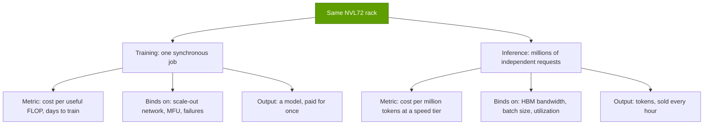
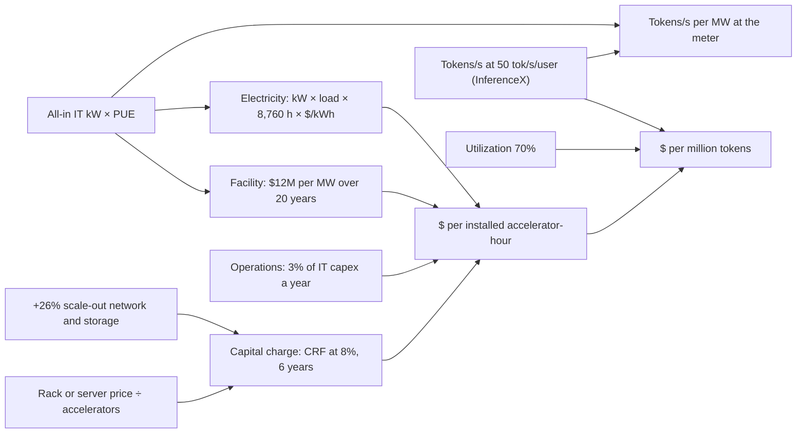
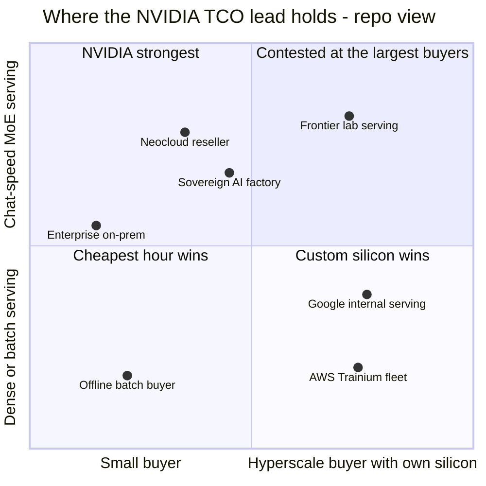
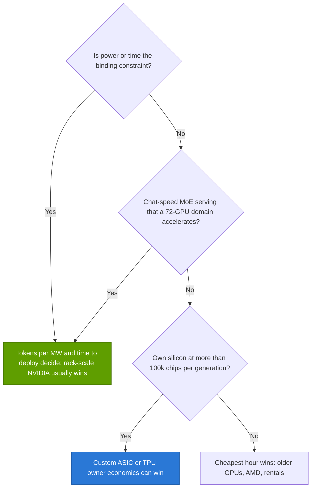

# 14 — Training vs. inference economics

Cross-cutting 14 · TCO model, cost per token and tokens per MW · ~35 min read · Last verified: 2026-11-05

## ⚡ The Executive Take

- **Training is a capital project; inference is a factory.** A training run buys a model once. Inference sells tokens every hour, at a speed tier, against a utilization rate. That makes inference the recurring and more contested bill: NVIDIA last put it at more than 40% of Data Center revenue (mid-2024) [[S11011]](../sources/bibliography.md#s11011) ([P1](../primers/P1-how-ai-training-works.md), [P2](../primers/P2-how-ai-inference-works.md)).
- **Owning a GB300 GPU costs ~$2.46 per installed hour, all-in (Est.).** That is a $3.99M rack [[S332]](../sources/bibliography.md#s332) plus network, facility, power and operations, financed at 8% over six years [[S14000]](../sources/bibliography.md#s14000). SemiAnalysis puts it at $2.31 [[S622]](../sources/bibliography.md#s622). Capital charges are ~70% of the cost; electricity is ~6%.
- **At chat speed, GB300 NVL72 makes the cheapest tokens of any shipping system:** ~$0.16 per million DeepSeek-R1 tokens at 50 tokens/s per user (Est., P10–P90 $0.13–0.23) [[S14000]](../sources/bibliography.md#s14000)[[S621]](../sources/bibliography.md#s621). That is ~3.4× below a TPU v7 and ~6× below an MI355X (🔴 TPU modelled). The reason is throughput: its 72-GPU NVLink domain serves ~4.5× a B200's tokens at that speed.
- **NVIDIA's ~75% gross margin [[S405]](../sources/bibliography.md#s405) is only ~24% of a GB300 token's cost** (~32% including the financing on it) (Est.) [[S14000]](../sources/bibliography.md#s14000). Tokens per MW differ up to ~30× across platforms, so throughput outweighs margin. At 50 tokens/s per user even a free MI355X, TPU v7 or Trainium3 makes dearer tokens than a paid-for GB300 (🔴 repo model).
- **The lead is conditional.** At 100 tokens/s per user GB300 (~$1.74/M) draws level with TPU v7 ($1.46–1.72) and Trainium3 ($1.77) (🔴 modelled). Speculative decoding alone moves measured costs 2–20× [[S621]](../sources/bibliography.md#s621)[[S624]](../sources/bibliography.md#s624). Matching Google's internal TPU cost there needs a ~20% GB300 price cut, which would leave NVIDIA a ~66% gross margin (🔴).
- **Training favours NVIDIA less than inference.** At equal efficiency, a 10²⁷-FLOP run costs ~$515M on GB300 vs ~$293M on TPU v7 (Est.) [[S14000]](../sources/bibliography.md#s14000)[[S31007]](../sources/bibliography.md#s31007). NVIDIA's training case is speed and delivered utilization: Vera Rubin finishes in ~26 days on 100,000 GPUs (🔴).
- **Bear view:** utilization, useful life and rental prices move cost per token more than chip prices do. H100 rentals fell ~75% from the 2023 peak before rebounding ~38% in 2026 [[S393]](../sources/bibliography.md#s393)[[S12516]](../sources/bibliography.md#s12516). Cutting GB300's life from six to four years lifts a useful hour from $3.51 to $4.49, close to its ~$5.00 rental price (Est.) [[S622]](../sources/bibliography.md#s622).

![Log-scale horizontal bar chart of estimated owner cost per million DeepSeek-R1 tokens at 50 tokens/s per user, base case with P10 to P90 range: Vera Rubin NVL72 $0.094 ($0.068–$0.13) modelled; Helios MI455X $0.129 ($0.086–$0.20) modelled; GB300 NVL72 $0.156 ($0.13–$0.23); TPU v7 (Google itself) $0.452 ($0.24–$0.53) modelled; TPU v7 (external owner) $0.532 ($0.29–$0.63) modelled; B200 HGX $0.583 ($0.47–$0.86); Trainium3 $0.615 ($0.41–$0.99) modelled; MI355X (8-GPU) $0.978 ($0.77–$1.41); Trainium2 $1.612 ($1.13–$2.35) modelled; H200 HGX $2.233 ($2.01–$3.61). Rack-scale NVIDIA systems lead at this operating point; at 100 tokens/s per user the TPU and Trainium3 estimates draw level with GB300.](../assets/charts/14-tco-cost-per-million-tokens-ranges.svg)

> [!IMPORTANT]
> **Every number from the model is an estimate (Est.).** Throughput is measured (SemiAnalysis InferenceX) only for H200, B200, GB300 and MI355X. Vera Rubin, AMD Helios, Google TPU v7 and AWS Trainium are **modelled** from anchors and multipliers and are tagged 🔴. Prices for AMD, Google and AWS systems are not public. Ranges, not points, are the honest output. The model, inputs and outputs are in [`scripts/tco/`](../scripts/tco/README.md).

## 1. Two businesses on one chip: why training and inference economics differ

Think of an oil company. Exploration is a capital project: you spend once, under time pressure, and the prize is a reservoir. Refining is a factory: the plant runs every hour and the margin is the price per barrel minus the cost per barrel. Training and inference use the same racks, but they are those two businesses.

**Training** is one huge, synchronous job ([P1](../primers/P1-how-ai-training-works.md)). Total work is fixed by the model and data, roughly 6 × parameters × tokens. Meta's Llama 3.1 405B needed 3.8 × 10²⁵ FLOPs [[S34006]](../sources/bibliography.md#s34006) and 30.84M H100 GPU-hours [[S31002]](../sources/bibliography.md#s31002). Epoch AI estimates Grok 4 at ~5 × 10²⁶ FLOPs, ~246M H100-equivalent hours (Est.) [[S31008]](../sources/bibliography.md#s31008). Frontier compute grows ~4–5× a year [[S31007]](../sources/bibliography.md#s31007). The buyer cares about cost per *useful* FLOP and days to finish. Useful FLOPs depend on [MFU](../glossary.md#mfu) (Llama 3 ran at 38–41%) and on surviving failures (419 unexpected interruptions in 54 days) [[S34006]](../sources/bibliography.md#s34006). The output is a model, paid for once.

**Inference** is millions of small, independent requests ([P2](../primers/P2-how-ai-inference-works.md)). Each has a compute-bound [prefill](../glossary.md#prefill) and a memory-bound [decode](../glossary.md#decode). A server trades speed per user ([interactivity](../glossary.md#interactivity)) against total throughput along a [Pareto frontier](../glossary.md#pareto-frontier). The buyer cares about [cost per million tokens](../glossary.md#cost-per-million-tokens) at a named [operating point](../glossary.md#operating-point), and about how many hours are sold ([utilization](../glossary.md#utilization)). The output is a stream of tokens, and demand compounds: Google's monthly tokens rose ~134× in 18 months [[S32018]](../sources/bibliography.md#s32018)[[S32020]](../sources/bibliography.md#s32020).

| Dimension | Training | Inference |
|---|---|---|
| Unit of value | A trained model (an asset) | A million tokens (a product) |
| Cost driver | FLOPs ÷ (peak × MFU × goodput) | Owner cost per hour ÷ tokens per hour |
| What binds | Scale-out network, reliability, MFU | HBM bandwidth, KV cache, batch, utilization |
| What the buyer optimises | Time to train and cost per useful FLOP | Cost per token at a latency tier; tokens per MW |
| How divisible | One job needs the whole cluster at once | Requests can go to any chip that is free |
| Who competes hardest | Few: needs mature software at 10,000+ chips | Many: TPU, Trainium, AMD, inference ASICs |

The last row is the commercial point. A training job that stalls on a weak network or a buggy collective library wastes the whole cluster, so buyers pay for the proven stack. Inference can be split across any hardware that serves the model at the right speed, so it is where challengers attack first ([layer 11](../layers/11-inference-and-ai-software/the-inference-shift.md)).

> [!TIP]
> **Worked example — a run is paid once, a fleet every year.** The model below prices a hypothetical 10²⁷-FLOP run at ~$515M on GB300 NVL72 (Est.) [[S14000]](../sources/bibliography.md#s14000). A 100 MW GB300 inference site (~41,000 GPUs) costs ~$0.88B a year to own and run, every year of its six-year life (Est.) [[S14000]](../sources/bibliography.md#s14000). One frontier run is roughly half of one year of a mid-sized inference site, and a tenth of its six-year cost. **Conclusion:** once models are deployed at scale, the recurring inference bill dwarfs the one-off training bill, and cost per token is where buyers push hardest.

🔧 Under the hood: why the operating point changes everything

Decode reads every active weight from HBM for each new token. A server amortises that read across a batch of users, so bigger batches mean more tokens per GPU but slower tokens per user. Mixture-of-experts models add a twist: their experts can be spread across many GPUs ([wide expert parallelism](../glossary.md#wide-ep)), which frees memory for bigger batches but needs fast all-to-all links. An [NVL72](../glossary.md#nvl72) rack does that inside one 72-GPU NVLink domain; an 8-GPU server cannot. That is why, at 50 tokens/s per user, GB200 NVL72 delivers ~3.3× B200's DeepSeek-R1 throughput on InferenceX data [[S621]](../sources/bibliography.md#s621), while at 100 tokens/s per user, when batches are small, the gap closes and even reverses. See [why domain size matters](../layers/05-scale-up-nvlink-nvswitch/why-domain-size-matters.md).

## 2. The cost stack: what an accelerator-hour costs its owner

The model asks one question per platform: what does one installed accelerator-hour cost its owner, all-in? This [owner TCO](../glossary.md#owner-tco) has seven lines. Four are capital: the accelerator system, the vendor's gross margin inside its price, the scale-out network and storage, and the [cost of capital](../glossary.md#wacc). Three are operating: [facility capex](../glossary.md#facility-capex) (shell, electrical plant, cooling), electricity and operations. Capital is turned into a level yearly charge with a [capital recovery factor](../glossary.md#capital-recovery-factor), the mortgage-style payment that repays the asset and its financing over its [useful life](../glossary.md#useful-life). Divide by hours to get $ per hour. Divide by tokens to get $ per million tokens. Divide tokens by facility megawatts to get [tokens per MW](../glossary.md#tokens-per-mw).

The global assumptions are below. Every one is a row in `data/x14_tco_scenarios.csv` with a source, a confidence tag and a low–high range used in the sensitivity analysis.

| Assumption | Base | Range tested | Basis |
|---|---|---|---|
| Utilization of installed hours | 70% | 40–90% | Alibaba lifted allocation from 68% to 93% [[S12015]](../sources/bibliography.md#s12015); Meta runs ~89% (11% hot spares) [[S27010]](../sources/bibliography.md#s27010) |
| Electricity | $0.081/kWh | $0.05–0.10 | US industrial average 2024 [[S389]](../sources/bibliography.md#s389); PPA offers [[S390]](../sources/bibliography.md#s390) |
| [PUE](../glossary.md#pue) | 1.15 | 1.09–1.40 | new liquid-cooled hall; Google fleet 1.09 [[S388]](../sources/bibliography.md#s388); industry ~1.54 [[S8007]](../sources/bibliography.md#s8007) |
| Cost of capital | 8% | 0–12% | hyperscaler vs leveraged neocloud (CoreWeave's interest burden) [[S12501]](../sources/bibliography.md#s12501) |
| IT useful life | 6 years | 4–7 | Microsoft, Alphabet, CoreWeave policy [[S382]](../sources/bibliography.md#s382)[[S383]](../sources/bibliography.md#s383)[[S386]](../sources/bibliography.md#s386) |
| Facility capex | $12M per MW | $6.6–13M | $11–13B per GW (CS7) [[S6025]](../sources/bibliography.md#s6025); Morgan Stanley's retracted 100 MW model [[S357]](../sources/bibliography.md#s357) |
| Network and storage | 0.26 × system price | 0.20–0.32 | SemiAnalysis GB200 all-in vs rack [[S324]](../sources/bibliography.md#s324); AMCompute [[S6026]](../sources/bibliography.md#s6026) |
| Operations | 3% of IT capex a year | 2–5% | repo assumption 🔴 [[S14000]](../sources/bibliography.md#s14000) |
| Reference workload | DeepSeek-R1-0528, 1k in / 1k out, 50 tokens/s per user | 35–100 | InferenceX frontier, no speculative decoding [[S621]](../sources/bibliography.md#s621) |

> [!TIP]
> **Worked example — building a GB300 GPU-hour.** Morgan Stanley puts a GB300 NVL72 rack at $3.99M [[S332]](../sources/bibliography.md#s332), or $55.4K per GPU. Add 26% for scale-out network and storage [[S324]](../sources/bibliography.md#s324): $69.8K. At 8% over six years the capital recovery factor is 0.216, so capital costs $15.1K a year, of which $11.6K is straight-line depreciation and $3.5K is financing. The GPU draws 2.12 kW all-in [[S622]](../sources/bibliography.md#s622), or 2.44 kW at the meter with PUE 1.15. Facility at $12M per MW is $29.3K per GPU, or $3.0K a year over 20 years. Electricity is 2.44 kW × 0.79 average load × 8,760 h × $0.081 = $1.4K. Operations add $2.1K. The total is **$21.5K a year, or $2.46 per installed hour** (Est.) [[S14000]](../sources/bibliography.md#s14000). SemiAnalysis's owner TCO is $2.31 [[S622]](../sources/bibliography.md#s622). **Conclusion:** layer 12's $1.50 per hour [floor](../layers/12-orchestration-and-cloud-services/the-utilization-problem.md) is depreciation plus power only. Financing (+$0.40), facility (+$0.34), operations (+$0.24) and a small power adjustment take it to $2.46.

At 70% utilization and 6,261 tokens/s per GPU [[S621]](../sources/bibliography.md#s621), a GB300 GPU produces ~138 billion tokens a year. $21.5K ÷ 138 billion = **$0.156 per million tokens**. The waterfall splits that into its seven lines. Two features stand out. Electricity is the smallest line at ~6%, so "cheap power" is a site-selection advantage, not a cost-per-token one. And NVIDIA's gross profit, the hatched bar, is ~24% of the cost.

The rack price itself is uncertain. Published GB300 estimates run from $3.99M to $5.0M, with media quotes up to $6.5M; Vera Rubin estimates run from $5.0M to $9.1M [[S332]](../sources/bibliography.md#s332)[[S328]](../sources/bibliography.md#s328)[[S327]](../sources/bibliography.md#s327)[[S333]](../sources/bibliography.md#s333). The model uses Morgan Stanley's bottom-up figures as the base, consistent with layers 08 and 12, and tests the rest.

🔧 Under the hood: formulas and what the model leaves out

Per accelerator and year: capital = (*C* + *N*) × CRF(*r*, life), where *C* is system capex, *N* = 0.26 *C* and CRF(*r*, *n*) = *r* ÷ (1 − (1 + *r*)⁻ⁿ). The model reports straight-line depreciation and the financing excess separately. "Vendor margin" is a *split* of the depreciation line (share of the system price that is the accelerator vendor's gross profit), not an extra cost. Facility = kW × PUE × $/MW × CRF(*r*, 20). Electricity = kW × PUE × [floor + (1 − floor) × utilization] × 8,760 × $/kWh, with a 30% idle floor (the same [load factor](../glossary.md#load-factor) rule as [CS7](../case-studies/CS7-gigawatt-ai-factories-xai-stargate-etc.md)). Operations = 3% of IT capex. Tokens are total (input + output) tokens; a 1k/1k workload is half output.

Left out: software licences beyond the operations allowance (NVIDIA AI Enterprise lists at $4,500 per GPU-year, which large buyers rarely pay [[S11013]](../sources/bibliography.md#s11013)), taxes and insurance, [residual value](../glossary.md#residual-value), volume discounts and equity-linked deals. A [Monte Carlo simulation](../glossary.md#monte-carlo-simulation) of 4,000 draws gives the P10–P90 ranges; it shows the width of the plausible band, not a calibrated probability.

## 3. Model results: cost per hour, cost per token and tokens per MW

The per-system inputs are the core of the comparison. Measured throughput comes from InferenceX at the reference point [[S621]](../sources/bibliography.md#s621). Where no measurement exists, the model scales a measured anchor, and the table says how.

| System | Capex per accelerator | All-in IT kW | Tokens/s per accelerator | Throughput basis | Confidence |
|---|---|---|---|---|---|
| H200 HGX | $39.9K (OEM list) [[S322]](../sources/bibliography.md#s322) | 1.37 [[S622]](../sources/bibliography.md#s622) | 308 | measured, FP8 [[S621]](../sources/bibliography.md#s621) | 🟡 |
| B200 HGX | $46.3K (reseller Est.) [[S320]](../sources/bibliography.md#s320) | 1.71 [[S622]](../sources/bibliography.md#s622) | 1,387 | measured, FP4 [[S621]](../sources/bibliography.md#s621) | 🟡 |
| GB300 NVL72 | $55.4K (Morgan Stanley) [[S332]](../sources/bibliography.md#s332) | 2.12 [[S622]](../sources/bibliography.md#s622) | 6,261 | measured, FP4 [[S621]](../sources/bibliography.md#s621) | 🟡 |
| Vera Rubin NVL72 | $108.3K (Morgan Stanley) [[S330]](../sources/bibliography.md#s330) | 3.30 [[S622]](../sources/bibliography.md#s622) | ~19,400 | GB300 × 3.1: ~2× tokens per MW [[S626]](../sources/bibliography.md#s626) | 🔴 |
| MI355X (8-GPU) | $37.5K (repo Est. from ~$25K ASP) [[S14001]](../sources/bibliography.md#s14001) | 2.09 [[S622]](../sources/bibliography.md#s622) | 738 | measured, FP4 [[S621]](../sources/bibliography.md#s621) | 🟡 |
| Helios (MI455X) | $72.9K (Futurum $5.0–5.5M rack) [[S14002]](../sources/bibliography.md#s14002) | ~3.8 (rack Est.) [[S346]](../sources/bibliography.md#s346) | ~10,700 | Vera Rubin × 0.55 (0.3–0.9) | 🔴 |
| TPU v7 Ironwood | $28.4K (calibrated) [[S622]](../sources/bibliography.md#s622) | 1.21 [[S622]](../sources/bibliography.md#s622) | ~960 | B200 × 0.95 (equal precision) [[S625]](../sources/bibliography.md#s625) × 0.73 (FP8 vs FP4) | 🔴 |
| Trainium2 | $12K (repo Est.) | ~0.75 (Est.) [[S14004]](../sources/bibliography.md#s14004) | ~150 | H200 × 0.60 (HBM bandwidth) × 0.8 | 🔴 |
| Trainium3 | $20K (repo Est.) | ~1.05 (Est.) [[S14005]](../sources/bibliography.md#s14005) | ~620 | H200 × 2.0 (1.0–3.4) [[S242]](../sources/bibliography.md#s242) | 🔴 |

Google and AWS publish no chip prices, and AWS publishes no Trainium wattage [[S14003]](../sources/bibliography.md#s14003). The TPU capex is therefore *calibrated*: solved so that the TPU's hourly cost relative to GB300 matches SemiAnalysis's owner-TCO ratio ($1.21 ÷ $2.31 for an external owner; $1.03 ÷ $2.31 for Google itself) [[S622]](../sources/bibliography.md#s622). Trainium prices are bottom-up guesses from Epoch AI's B200 cost build-up [[S35020]](../sources/bibliography.md#s35020) plus a design-partner margin and server share. Futurum's estimate puts Helios at $5.0–5.5M per rack; the same report's "$3.5–4M" for a Rubin rack conflicts with every BOM-based estimate, so the model keeps $7.8M for Rubin [[S14002]](../sources/bibliography.md#s14002)[[S330]](../sources/bibliography.md#s330)[[S333]](../sources/bibliography.md#s333).

![Stacked horizontal bars of estimated owner cost per installed accelerator-hour: Trainium2 $0.60, Trainium3 $0.95, TPU v7 (Google itself) $1.10, TPU v7 (external owner) $1.29, H200 HGX $1.73, MI355X (8-GPU) $1.82, B200 HGX $2.04, GB300 NVL72 $2.46, Helios MI455X $3.47, Vera Rubin NVL72 $4.61. SemiAnalysis's owner TCO figures are close for GB300 NVL72 ($2.31) and lower for H200 ($1.22) and MI355X ($1.50). Capital charges are most of every bar; TPU capex is calibrated to SemiAnalysis's TPU-to-GB300 ratio and Trainium capex is a repo estimate.](../assets/charts/14-tco-cost-per-accelerator-hour.svg)

Per hour, the ranking is roughly the price list: Trainium and TPU hours are cheapest, Rubin the dearest. The model lands within 6% of SemiAnalysis for GB300 but 20–40% above it for the 8-GPU servers, which suggests SemiAnalysis assumes lower server prices; treat the H200 and MI355X hours as upper bounds. Per token, the ranking reverses:

| System | $ per installed hour | $ per million tokens (P10–P90) | Tokens/s per MW at the meter | Vendor margin share of token cost |
|---|---|---|---|---|
| Vera Rubin NVL72 🔴 | $4.61 | $0.094 ($0.068–0.13) | 5.1M | 21% |
| Helios (MI455X) 🔴 | $3.47 | $0.13 ($0.086–0.20) | 2.4M | 16% |
| GB300 NVL72 | $2.46 | $0.16 ($0.13–0.23) | 2.6M | 24% |
| TPU v7 (Google itself) 🔴 | $1.10 | $0.45 ($0.24–0.53) | 0.73M | 8% |
| TPU v7 (external owner) 🔴 | $1.29 | $0.53 ($0.29–0.63) | 0.69M | 15% |
| B200 HGX | $2.04 | $0.58 ($0.47–0.86) | 0.71M | 24% |
| Trainium3 🔴 | $0.95 | $0.61 ($0.41–0.99) | 0.51M | 6% |
| MI355X (8-GPU) | $1.82 | $0.98 ($0.77–1.41) | 0.31M | 13% |
| Trainium2 🔴 | $0.60 | $1.61 ($1.13–2.35) | 0.17M | 6% |
| H200 HGX | $1.73 | $2.23 ($2.01–3.61) | 0.20M | 20% |

All values Est. [[S14000]](../sources/bibliography.md#s14000); operating point DeepSeek-R1 1k/1k at 50 tokens/s per user, no speculative decoding [[S621]](../sources/bibliography.md#s621).

![Log-scale horizontal bar chart of estimated tokens per second per megawatt at the utility meter: Vera Rubin NVL72 5.11 million (modelled); GB300 NVL72 2.57 million; Helios MI455X 2.45 million (modelled); TPU v7 (Google itself) 0.73 million (modelled); B200 HGX 0.71 million; TPU v7 (external owner) 0.69 million (modelled); Trainium3 0.51 million (modelled); MI355X (8-GPU) 0.31 million; H200 HGX 0.20 million; Trainium2 0.17 million (modelled). These are lower than chart 08-tokens-per-mw-by-system because this model counts PUE; rankings match.](../assets/charts/14-tco-tokens-per-mw-ranges.svg)

These tokens-per-MW figures are measured at the meter, so they are ~13% below [layer 08](../layers/08-systems-racks-ai-factories/ai-factories.md)'s chart, which divides by IT power; the ranking is the same. In the Monte Carlo, GB300 is cheaper per token than TPU v7, MI355X and Trainium3 in every draw at this operating point, and Helios is cheaper than GB300 in ~86% of draws (🔴, because Helios throughput is modelled) [[S14000]](../sources/bibliography.md#s14000).

> [!TIP]
> **Worked example — a cheaper hour, a dearer token.** An MI355X hour costs ~$1.82, 26% less than GB300's $2.46 (Est.) [[S14000]](../sources/bibliography.md#s14000). But at 50 tokens/s per user an MI355X serves 738 DeepSeek-R1 tokens/s and a GB300 serves 6,261 [[S621]](../sources/bibliography.md#s621), 8.5× more. Cost per token is (hourly cost ÷ tokens per hour): $1.82 ÷ 738 vs $2.46 ÷ 6,261, so the MI355X token costs **~6.3× more**. **Conclusion:** a 26% hourly discount cannot offset an 8.5× throughput gap; only throughput parity at the operating point that matters makes a cheaper accelerator cheaper.

![Eight small waterfall charts of estimated cost per million tokens: GB300 NVL72 $0.156 with vendor margin 24%; Vera Rubin NVL72 $0.094 with vendor margin 21%; Helios MI455X $0.129 with vendor margin 16%; MI355X (8-GPU) $0.978 with vendor margin 13%; TPU v7 (external owner) $0.532 with vendor margin 15%; Trainium3 $0.615 with vendor margin 6%; Trainium2 $1.612 with vendor margin 6%; H200 HGX $2.233 with vendor margin 20%. Vendor gross margin is a minority of every stack; totals differ mainly because tokens per accelerator differ, and Vera Rubin, Helios, TPU and Trainium throughput is modelled rather than measured.](../assets/charts/14-tco-cost-stack-waterfalls-by-system.svg)

> [!WARNING]
> **Myth vs reality: "custom silicon is cheaper because it has no NVIDIA margin."** The margin is real: in the base case it is ~24% of GB300's cost per token and ~6% of Trainium's (Est.) [[S14000]](../sources/bibliography.md#s14000). But the cost stacks above differ by up to ~24× in total, almost entirely because tokens per accelerator differ. Removing a 24% slice does not close a 3–6× throughput gap; matching throughput does.

🔧 Under the hood: how the modelled throughputs were built

- **Vera Rubin:** SemiAnalysis finds ~2× GB300's tokens per MW up to 100 tokens/s per user on DeepSeek-R1 [[S626]](../sources/bibliography.md#s626). With 3.30 vs 2.12 kW per GPU [[S622]](../sources/bibliography.md#s622), that is ~3.1× per GPU. Low case 2.3× (the HBM bandwidth ratio after Rubin's cut to 19.2 TB/s [[S90006]](../sources/bibliography.md#s90006)); high case 4.0×, toward NVIDIA's "up to 5×" claim [[S33006]](../sources/bibliography.md#s33006).
- **Helios:** on paper MI455X matches Rubin (19.6 vs 19.2 TB/s, 432 vs 288 GB HBM4) [[S144]](../sources/bibliography.md#s144). The low case assumes today's software gap persists: MI355X serves ~0.25× B300's throughput at equal 8 TB/s [[S621]](../sources/bibliography.md#s621). The high case takes AMD's claim of up to 30% more tokens per dollar than Vera Rubin at a ~33% lower rack price, ~0.87× [[S14002]](../sources/bibliography.md#s14002). Base 0.55×.
- **TPU v7:** SemiAnalysis measured Ironwood at 1.05× B200's tokens per chip at 20 tokens/s per user and ~0.86× (implied) at 100, both FP8 [[S625]](../sources/bibliography.md#s625). Ironwood has no FP4, so the model multiplies by 0.73 (the repo's FP8-to-NVFP4 decode ratio [[S2021]](../sources/bibliography.md#s2021)). An upside factor of up to 2× covers wide expert parallelism across a 9,216-chip pod.
- **Trainium:** no public tokens/s benchmark exists. Trainium2 = H200 × the HBM bandwidth ratio (2.9 vs 4.8 TB/s) [[S154]](../sources/bibliography.md#s154)[[S32002]](../sources/bibliography.md#s32002) × 0.8 for software. Trainium3 = H200 × 2.0, between bandwidth parity (1.0×) and AWS's claim of more than 5× Trainium2's tokens per MW (3.4×) [[S242]](../sources/bibliography.md#s242).

## 4. The operating point and the software decide the ranking

The reference point, 50 tokens/s per user, suits NVL72 well: large batches spread over 72 GPUs. Change it and the ranking moves. The InferenceX frontiers in the repo allow a direct look for the measured systems; the TPU line is modelled.

![Two-panel log-scale line chart of estimated cost per million tokens against tokens per second per user. Without speculative decoding GB300 NVL72 costs about $0.16 at 50 and $1.74 at 100 tokens/s per user, where the modelled TPU v7 is about $1.72, near parity; H200 and MI355X sit above both. With MTP speculative decoding measured costs fall several-fold: B200 about $0.09 at 50 and GB300 about $0.15 at 100 tokens/s per user. The operating point and the software configuration move cost per token as much as the hardware choice.](../assets/charts/14-tco-cost-vs-interactivity.svg)

| System | 35 tok/s/user | 50 | 75 | 100 |
|---|---|---|---|---|
| GB300 NVL72 | $0.10 | $0.16 | $0.75 | $1.74 |
| Vera Rubin NVL72 🔴 | $0.06 | $0.09 | $0.45 | $1.05 |
| TPU v7 (Google itself) 🔴 | — | $0.45 | $0.90 | $1.46 |
| TPU v7 (external owner) 🔴 | — | $0.53 | $1.06 | $1.72 |
| Trainium3 🔴 | $0.47 | $0.61 | $0.96 | $1.77 |
| MI355X (8-GPU) | $0.48 | $0.98 | $1.59 | $3.17 |

US$ per million tokens, Est. [[S14000]](../sources/bibliography.md#s14000)[[S621]](../sources/bibliography.md#s621); "—" = outside the measured frontier of the anchor system. Modelled systems keep their 50-token multipliers at other points.

Between 50 and 100 tokens/s per user, GB300's cost per token rises ~11× while B200's rises ~3×. NVL72's advantage comes from big batches spread across the rack; at high speed per user, batches shrink and that advantage fades. At 100 tokens/s per user, TPU v7 and Trainium3 sit at parity with GB300 within the model's error.

Software moves the curve as much as hardware. [Multi-token prediction](../glossary.md#multi-token-prediction), DeepSeek's built-in form of [speculative decoding](../glossary.md#speculative-decoding), drafts several tokens per step. SemiAnalysis found that it cut GB300's cost at 150 tokens/s per user from ~$2.35 to ~$0.11 per million tokens [[S624]](../sources/bibliography.md#s624). On the MTP frontiers, a B200 at 50 tokens/s per user costs ~$0.09 (Est.), *below* GB300 without MTP. A ranking without the software configuration is not a ranking.

> [!TIP]
> **Worked example — the same GB300, three prices.** At 50 tokens/s per user without MTP, GB300 costs ~$0.16 per million tokens. At 100, it costs ~$1.74, an 11× rise, because throughput falls from 6,261 to 562 tokens/s per GPU [[S621]](../sources/bibliography.md#s621). Switch on MTP at 100 and throughput recovers to ~6,340, so cost falls back to ~$0.15 (Est.) [[S14000]](../sources/bibliography.md#s14000). **Conclusion:** a vendor claim of "X× lower cost per token" is meaningless without the model, the speed per user and the serving configuration; ask for all three.

SemiAnalysis's direct TPU measurement makes the same point from the other side. On Qwen3.5 397B in FP8 at 100 tokens/s per user, Ironwood cost $0.181 per million tokens against $0.222 for B200 and $0.276 for B300, ~18% below B200 [[S625]](../sources/bibliography.md#s625). No GB300 NVL72 was in that test.

That chart assumes 100% utilization and SemiAnalysis's hourly costs, so its GB300 figure ($0.10) is below this model's $0.16 at 70% utilization; the ratios are similar.

## 5. Sensitivity: which assumptions matter

A [tornado chart](../glossary.md#tornado-chart) changes one input at a time between its low and high value and ranks the inputs by how far they move the answer.

![Tornado chart of GB300 NVL72's estimated cost per million tokens around a base of $0.156: Utilization (%) 40 to 90 gives $0.268 to $0.123; Tokens/s per GPU (× measured) 0.75 to 1.25 gives $0.208 to $0.125; Cost of capital (%) 0 to 12 gives $0.120 to $0.176; Depreciation life (years) 4 to 7 gives $0.199 to $0.144; Rack price (US$ M) 3.6 to 5 gives $0.144 to $0.187; Operations (% of IT capex/yr) 2 to 5 gives $0.151 to $0.166; Network & storage (× rack price) 0.2 to 0.32 gives $0.150 to $0.162; Facility capex (US$ M/MW) 6.6 to 13 gives $0.146 to $0.158; PUE 1.09 to 1.4 gives $0.154 to $0.163; Electricity (US$/kWh) 0.05 to 0.1 gives $0.152 to $0.158; Power per GPU (kW, all-in IT) 1.95 to 2.3 gives $0.153 to $0.159; Idle power floor (share) 0.2 to 0.4 gives $0.156 to $0.156. Electricity from $0.05 to $0.10 per kWh moves the result by under a cent per million.](../assets/charts/14-tco-gb300-tornado.svg)

Three findings. First, utilization matters most: 40% instead of 70% raises cost per token by ~72%. Second, throughput (software) is next: ±25% tokens/s moves the cost −20% to +33%. Third, the financial and physical inputs most people argue about, the rack price, electricity and PUE, move it least. Doubling the power price changes GB300's cost by under one cent per million tokens.

> [!TIP]
> **Worked example — an idle rack vs an expensive rack.** At 70% utilization GB300 costs ~$0.156 per million tokens. Dropping to 40% raises it to ~$0.268 (+72%). Paying $5.0M for the rack instead of $3.99M raises it only to ~$0.187 (+20%) (Est.) [[S14000]](../sources/bibliography.md#s14000). **Conclusion:** a buyer who negotiates 20% off the rack but runs it at 40% instead of 70% loses; scheduling, failure recovery and demand fill are worth more than price negotiation ([layer 12](../layers/12-orchestration-and-cloud-services/the-utilization-problem.md)).

The comparison that matters for competition is a ratio: how much more does a TPU token cost than a GB300 token?

![Tornado chart of the ratio of TPU v7 to GB300 NVL72 estimated cost per token, base 3.41: B200 anchor tokens/s (× measured) gives 4.55 to 2.73; GB300 tokens/s (× measured) gives 2.56 to 4.26; TPU pod topology bonus (×) gives 3.41 to 1.70; TPU FP8 vs Blackwell FP4 (×) gives 4.15 to 2.93; TPU capex (× calibrated) gives 2.88 to 3.94; GB300 rack price (US$ M) gives 3.70 to 2.84; TPU vs B200 at equal precision (×) gives 3.77 to 3.09; Facility capex (US$ M/MW) gives 3.39 to 3.41; Depreciation life (years) gives 3.39 to 3.42; Cost of capital (%) gives 3.40 to 3.42; Electricity (US$/kWh) gives 3.40 to 3.41; Utilization (%) gives 3.40 to 3.41. Financial inputs (cost of capital, life, power price, utilization, facility) move the ratio by less than 0.02; at 100 tokens/s per user the ratio is about 0.99, close to parity.](../assets/charts/14-tco-gb300-vs-tpu-ratio-tornado.svg)

Financial assumptions shift the ratio by less than 0.02 because they hit both platforms alike. Every bar that matters is a throughput assumption: how well each chip serves this model at this speed. No single input flips the ranking at 50 tokens/s per user, but moving the operating point to 100 does. That is the real diligence question for any accelerator: *measured tokens per second at the buyer's operating point*.

🔧 Under the hood: the sensitivity grid and ranking probabilities

`scripts/tco/outputs/x14_tco_sensitivity_grid.csv` re-runs every system for utilization 30–90%, electricity $0.05–0.15/kWh, life 3–7 years and cost of capital 0/8/12% (4,200 rows). `x14_tco_ranking_probability.csv` reports, across the Monte Carlo draws, how often one platform beats another per token. At 50 tokens/s per user: Vera Rubin beats Helios in ~91% of draws, Helios beats GB300 in ~86%, Trainium3 and B200 split ~50/50, and Trainium3 beats TPU v7 (external) in ~15% (all 🔴, because several throughputs are modelled) [[S14000]](../sources/bibliography.md#s14000).

## 6. The key insight: how a ~75% gross margin coexists with the lowest TCO

NVIDIA earned a 75.0% GAAP gross margin in Q2 FY2027 [[S405]](../sources/bibliography.md#s405). A naive reading says its customers overpay by three to four times the cost of the chips. The model shows why many still get the lowest cost per token. Five mechanisms do the work.

**1 · The margin is a minority of the token's cost.** A ~75% margin applies only to NVIDIA's content. In the GB300 rack, NVIDIA's gross profit on the GPUs is ~57% of the rack price (Est.) [[S332]](../sources/bibliography.md#s332)[[S35020]](../sources/bibliography.md#s35020). The rack is ~60% of the token's cost once network, facility, power, operations and financing are added. Net: ~24% of the token cost is NVIDIA gross profit (~32% with the financing on it). If NVIDIA halved its gross profit, GB300's cost per token would fall only ~18% (Est.) [[S14000]](../sources/bibliography.md#s14000).

**2 · Performance per watt and per rack.** The largest cost lines per token (capital, facility, power) all scale with accelerators or megawatts. Tokens per accelerator and per MW differ far more: GB300 serves ~2.6M tokens/s per MW against ~0.7M for TPU v7 and ~0.3M for MI355X at the reference point (Est.) [[S14000]](../sources/bibliography.md#s14000). A system that serves 3–8× more tokens on the same power and floor space can carry a fat margin and still win.

**3 · Software gains on installed hardware.** The installed base gets faster after purchase. MLPerf DeepSeek-R1 throughput on an unchanged GB300 NVL72 rose 2.9× in a year, cutting estimated cost per million tokens ~65% [[S601]](../sources/bibliography.md#s601)[[S603]](../sources/bibliography.md#s603). TensorRT-LLM lifted B200 from ~2,000 to 4,600 tokens/s per GPU in four months of 2025 [[S646]](../sources/bibliography.md#s646). AMD's gains are as steep but start later: MI355X went from 20 to 2,256 tokens/s per GPU on DeepSeek-V4-Pro in 26 days [[S631]](../sources/bibliography.md#s631). See [software gains on the same hardware](../layers/11-inference-and-ai-software/software-gains-on-same-hardware.md).

![Log-scale line chart of estimated cost per million tokens on unchanged NVIDIA hardware as software improved, holding each GPU's owner TCO fixed (SemiAnalysis: GB300 $2.31, GB200 $1.86, B200 $1.73, H100 $1.17 per GPU-hour). GB300 NVL72 · DeepSeek-R1 (MLPerf Server): $0.221 to $0.077 (65% lower, Sep 2025 to Sep 2026); GB200 NVL72 · DeepSeek-R1 (MLPerf Server): $0.222 to $0.094 (58% lower, Sep 2025 to Sep 2026); H100 · Llama 2 70B (MLPerf Server): $0.126 to $0.084 (34% lower, Mar 2024 to Apr 2025); B200 · DeepSeek-R1 max throughput (TensorRT-LLM blog): $0.240 to $0.104 (57% lower, Feb 2025 to May 2025); B200 · DeepSeek-R1, SGLang conc 128 (InferenceX): $0.269 to $0.201 (25% lower, Dec 2025 to May 2026). The hardware bill did not change; throughput per GPU did, so cost per token fell.](../assets/charts/11-cost-per-m-tokens-software-releases.svg)

**4 · Utilization and time to deploy.** Utilization is the biggest single lever (section 5), and a platform that runs day-0 models at full speed fills its hours sooner. Time to deploy matters too: a GB300 GPU costs ~$21.5K a year to own whether or not it is serving (Est.) [[S14000]](../sources/bibliography.md#s14000), so a rack that waits six months for software or supply burns ~$0.8M. AMD's Helios begins shipping around end-Q3 2026 with volume reported for Q2 2027 [[S90020]](../sources/bibliography.md#s90020)[[S624]](../sources/bibliography.md#s624); NVIDIA's racks ship in volume today.

**5 · Power-constrained sites and the opportunity cost of time.** When the scarce input is grid power, not money, the question becomes what a megawatt earns. New US generation waits more than four years in interconnection queues [[S8009]](../sources/bibliography.md#s8009). On a fixed site the annual cost barely depends on the platform, but the tokens do (worked example below). For a frontier lab, time is the other scarce input: a model released months earlier can be worth more than the whole compute bill (section 8).

> [!TIP]
> **Worked example — a 100 MW site, five platforms.** At the meter, 100 MW holds ~41,000 GB300 GPUs, ~72,000 TPU v7 chips or ~41,600 MI355X GPUs. Annual owner cost is similar: ~$0.88B, ~$0.81B and ~$0.66B. Annual tokens at 70% utilization differ: ~5.7, ~1.5 and ~0.7 quadrillion. Vera Rubin would yield ~11.3 quadrillion for ~$1.06B and Helios ~5.4 quadrillion for ~$0.70B (🔴 modelled) (all Est.) [[S14000]](../sources/bibliography.md#s14000). At an illustrative $0.50 per million tokens, the GB300 site earns ~$2.8B a year against $0.88B of cost, while the TPU and MI355X sites do not cover their costs. **Conclusion:** where power is the constraint, a buyer would pay far more per GPU for tokens per MW, which is exactly where NVIDIA's pricing power comes from.

The sharpest form of the argument is NVIDIA's own. Its CEO said in 2024 that its chips are so good that "even when the competitor's chips are free, it's not cheap enough" [[S14006]](../sources/bibliography.md#s14006). The model lets us test that as a [free-chip test](../glossary.md#free-chip-test): give a rival's accelerator system away, keep paying for network, facility, power and operations, and compare.

![Two-panel horizontal bar chart. At 50 tokens/s per user GB300 NVL72 costs about $0.156 per million tokens at full price, while rivals' costs with their accelerator systems given away are: MI355X (8-GPU) $0.480, Trainium2 $0.817, Trainium3 $0.297, TPU v7 (external owner) $0.242, TPU v7 (Google itself) $0.214, Helios MI455X $0.062; only Helios MI455X beat GB300 when free. At 100 tokens/s per user GB300 costs about $1.74 and every free version undercuts it except Trainium2 (TPU v7 external free $0.78). The 'free is not cheap enough' argument holds only where NVIDIA's rack-scale throughput lead is large.](../assets/charts/14-tco-free-chip-test.svg)

At 50 tokens/s per user the claim holds against every shipping rival in the model. At 100 tokens/s per user it fails against all of them except Trainium2. The claim is true where the 72-GPU domain's throughput lead is large and false where it is not.

| Buyer situation | NVIDIA rack-scale | AMD (MI355X / Helios) | Google TPU | AWS Trainium |
|---|---|---|---|---|
| Power-limited site, chat-speed MoE serving | 🟩 Leads: ~2.6M tokens/s per MW vs ≤0.7M (Est.) | 🟨 Helios near parity on paper (🔴); MI355X behind | 🟥 ~0.7M tokens/s per MW at this point (🔴) | 🟥 ~0.5M (🔴) |
| High-interactivity serving (≥100 tok/s/user) | 🟨 Parity; MTP and Rubin restore a lead | 🟨 Helios competitive (🔴) | 🟨 Parity or better for Google itself (🔴) | 🟨 Parity (🔴) |
| Frontier training run | 🟨 Fastest per chip with Rubin; not cheapest per FLOP | 🟨 Cheap FLOPs, less proven at scale | 🟩 Cheapest per FLOP at equal MFU (Est.) | 🟥 Slow per chip; long runs |
| Enterprise or sovereign buyer without a compiler team | 🟩 Day-0 software, broad support | 🟨 Improving fast | 🟦 Mostly rented inside Google Cloud | 🟦 Only inside AWS |
| Hyperscaler with its own silicon at volume | 🟨 Bargaining anchor | 🟨 Second source | 🟦 Owner economics, no merchant margin | 🟦 Owner economics |

Verdicts are repo analysis (🔴) on the model's estimates [[S14000]](../sources/bibliography.md#s14000).

🔧 Under the hood: the price-cut test

For every rival that beats GB300 per token at some operating point, the model solves for the GB300 price that would match it, assumes NVIDIA absorbs the whole cut, and recomputes NVIDIA's gross margin on its content (content = margin share ÷ 75%). Against Google's internal TPU at 100 tokens/s per user, GB300 needs a ~20% lower price, which would leave NVIDIA ~66% gross margin. Against Helios at 50 tokens/s per user (🔴), the cut is ~22% and the margin ~65% (Est.) [[S14000]](../sources/bibliography.md#s14000). This matches [CS3](../case-studies/CS3-google-tpu-the-credible-alternative.md)'s ~62% estimate for a B200-vs-TPU price war [[S23010]](../sources/bibliography.md#s23010). NVIDIA has room to win a price war; every large buyer with a credible alternative can extract part of that ~10-point cushion.

## 7. When it does not: custom silicon at hyperscale and TPU owner economics

The coexistence argument has limits, and they are commercially the most important part of this chapter.

**Owner economics.** Google pays no merchant GPU margin and no cloud markup on its own TPUs. SemiAnalysis estimates ~$1.03 per chip-hour for Google itself vs $1.21 for an external owner and $2.31 for a GB300 [[S622]](../sources/bibliography.md#s622). Where TPU throughput is close to Blackwell's, as on the measured Qwen3.5 workload (~18% cheaper than B200 [[S625]](../sources/bibliography.md#s625)) or at 100 tokens/s per user in this model, Google's tokens are cheaper. At ~1M chips for Anthropic alone [[S653]](../sources/bibliography.md#s653), the savings are measured in billions of dollars a year.

> [!TIP]
> **Worked example — what owner economics is worth at a gigawatt.** At 100 tokens/s per user, Google's internal TPU makes tokens for ~$1.46 per million vs ~$1.74 for GB300, 16% less (🔴 Est.) [[S14000]](../sources/bibliography.md#s14000). A 1 GW TPU fleet costs ~$7.3B a year to own and run in the model; the same tokens on GB300 would cost ~$8.7B. That is **~$1.4B a year** saved per gigawatt at that operating point. At 50 tokens/s per user the sign flips: the GB300 tokens are ~2.9× cheaper unless TPU pods gain from wide expert parallelism as NVL72 does. **Conclusion:** the TPU case is strongest for latency-sensitive serving of models tuned for TPUs, and weakest for batch-heavy serving of large MoE models.

**Custom ASICs at hyperscale.** The design-partner model ([captive silicon](../glossary.md#captive-silicon) built with an [ASIC design partner](../glossary.md#asic-design-partner)) puts a smaller margin inside the price: ~6% of Trainium's token cost in the model vs ~24% for GB300 (🔴). [CS3](../case-studies/CS3-google-tpu-the-credible-alternative.md) estimates that an in-house program breaks even at ~130,000 chips per generation (🔴) [[S23010]](../sources/bibliography.md#s23010). AWS runs ~500,000 Trainium2 chips for Anthropic in Project Rainier [[S27011]](../sources/bibliography.md#s27011). OpenAI's Broadcom-built inference chip reportedly delivers 13.4 PFLOPS MXFP4 on one die vs 17.5 per Rubin die 🟡 [[S628]](../sources/bibliography.md#s628). These buyers clear the bar and gain bargaining power even when their chips are slower.

**Workloads that do not need the rack.** Dense models, offline batch jobs and long-prompt, short-answer serving gain little from a 72-GPU NVLink domain. SemiAnalysis found MI355X beating B200 on vLLM cost per token for gpt-oss-120b below 225 tokens/s per user [[S623]](../sources/bibliography.md#s623), and AMD's ATOM serving engine on MI355X beating GB300 running vLLM on performance per dollar in part of an agentic benchmark [[S627]](../sources/bibliography.md#s627). Here the cheapest hour often wins, and a depreciated H100 at ~$2.35 per hour on a one-year contract [[S12516]](../sources/bibliography.md#s12516) is a hard competitor.

> [!NOTE]
> **🐂 Bull view (for custom silicon):** The largest buyers own the demand, the models and the data centres. Each NVIDIA generation leaves a few quarters in which a tuned ASIC serving one model family at one operating point beats the merchant GPU on cost per token. They only need to win their own workloads, not everyone's [[S625]](../sources/bibliography.md#s625)[[S653]](../sources/bibliography.md#s653).

> [!WARNING]
> **🐻 Bear view (for custom silicon):** The model's ranges are widest exactly for TPU and Trainium (P10–P90 spans ~2×), because nobody publishes their throughput on open benchmarks; Ironwood skipped MLPerf Inference 6.0 [[S613]](../sources/bibliography.md#s613). A chip that wins at one operating point loses at another, and a model change can strand it. See [layer 09's honest assessment](../layers/09-cuda-and-system-software/honest-assessment.md).

## 8. Training economics: what a frontier run costs on each platform

For training, the model converts FLOPs into accelerator-hours: FLOPs ÷ (dense FP8 peak × MFU × 90% [goodput](../glossary.md#goodput)) [[S34006]](../sources/bibliography.md#s34006). It then charges each hour at full power. The run is a hypothetical 10²⁷ FLOPs, about twice Epoch AI's Grok 4 estimate (🔴 scenario) [[S31007]](../sources/bibliography.md#s31007)[[S31008]](../sources/bibliography.md#s31008). MFU is 30% of FP8 peak for NVIDIA and Google, 28% for the new Rubin generation and 22–24% for AMD and AWS, all repo assumptions (🔴).

![Two-panel bar chart for a hypothetical 10 to the 27 FLOP training run. Estimated owner compute cost: Helios MI455X $249M, TPU v7 (Google itself) $250M, TPU v7 (external owner) $293M, Vera Rubin NVL72 $294M, B200 HGX $474M, MI355X (8-GPU) $475M, Trainium3 $497M, GB300 NVL72 $515M, Trainium2 $609M, H200 HGX $915M. Days on 100,000 accelerators: Helios MI455X 29, TPU v7 (Google itself) 93, TPU v7 (external owner) 93, Vera Rubin NVL72 26, B200 HGX 95, MI355X (8-GPU) 107, Trainium3 213, GB300 NVL72 86, Trainium2 412, H200 HGX 217. Per FLOP NVIDIA is not the cheapest; its training case rests on time to train and delivered utilization.](../assets/charts/14-tco-training-run-cost.svg)

The training picture is the inverse of inference. Per FLOP, GB300 is one of the dearer platforms. Its FP8 rate (5 PFLOPS) barely improved on B200's 4.5 [[S32004]](../sources/bibliography.md#s32004)[[S33003]](../sources/bibliography.md#s33003), while its rack costs more. TPU v7 delivers the same run for ~$293M, ~43% less (Est.) [[S14000]](../sources/bibliography.md#s14000). Helios looks cheapest at ~$249M, but AMD has not said whether its 20 PFLOPS FP8 figure is dense or sparse [[S144]](../sources/bibliography.md#s144); if sparse, its cost doubles.

> [!TIP]
> **Worked example — a 10²⁷-FLOP run on GB300.** Effective rate per GPU = 5.0 PFLOPS × 30% MFU × 90% goodput = 1.35 PFLOPS. 10²⁷ ÷ 1.35 × 10¹⁵ ÷ 3,600 = **~206M GPU-hours**. At ~$2.50 per hour at full power, the run costs ~$515M (P10–P90 $435–669M). On 100,000 GPUs it takes ~86 days and a ~244 MW site (Est.) [[S14000]](../sources/bibliography.md#s14000). Vera Rubin does it in ~26 days for ~$294M on ~380 MW (🔴). Per 100 MW of power, Rubin finishes in ~100 days, TPU v7 in ~129 and GB300 in ~209. **Conclusion:** NVIDIA's training case is not the price per FLOP; it is the [time to train](../glossary.md#time-to-train) and the confidence that the run reaches its MFU.

Why do frontier labs still train mostly on NVIDIA? First, delivered MFU at 10,000+ chips is the hard part: NCCL, the network and failure recovery decide whether 30% becomes 20% ([layer 10](../layers/10-libraries-cuda-x/nccl-the-hidden-glue.md)). Second, time has a price. For a lab whose next model could be worth billions in revenue, a run that finishes a month earlier is worth more than the hardware savings. Third, the same cluster serves inference afterwards, where section 6's advantages apply. The counter-evidence is real: Google trains Gemini on TPUs [[S23005]](../sources/bibliography.md#s23005), and Anthropic splits work across TPU, Trainium and NVIDIA GPUs [[S653]](../sources/bibliography.md#s653).

🔧 Under the hood: why equal MFU flatters the challengers

The 30% MFU for NVIDIA comes from Meta's 38–41% BF16 MFU on Llama 3 [[S34006]](../sources/bibliography.md#s34006), adjusted for FP8's doubled peak. Few public large-scale MFU figures exist for AMD or Trainium, so the model gives them 24% and a wide range (15–32%). Equal MFU assumes their collectives, compilers and failure handling scale as well, which the public evidence does not yet show. FP4 training (NVFP4) would roughly double NVIDIA's peak again, which the model does not credit. Treat the training chart as "what each platform could cost if it ran as well as NVIDIA does", not as a forecast.

## 9. What changes with depreciation-life assumptions

Most of an accelerator's cost is the capital charge, so the period over which it is spread matters. Hyperscalers stretched server lives from three or four years to five and a half or six between 2020 and 2025 [[S382]](../sources/bibliography.md#s382)[[S383]](../sources/bibliography.md#s383)[[S384]](../sources/bibliography.md#s384)[[S385]](../sources/bibliography.md#s385). Microsoft's 2022 extension alone was disclosed as a ~$3.7B benefit to FY2023 operating income [[S382]](../sources/bibliography.md#s382). Amazon became the first to reverse course, cutting part of its servers and networking back to five years in 2025, citing the pace of AI technology [[S385]](../sources/bibliography.md#s385). These dates come from filings entered from memory and are queued for re-verification.

The accounting [useful life](../glossary.md#useful-life) and the [economic life](../glossary.md#economic-life) are different things. Accounting life is a policy; economic life is how long the GPU earns more than its cash costs. NVIDIA's annual cadence shortens the economic life: it claims Vera Rubin cuts cost per token 10× vs Blackwell [[S33006]](../sources/bibliography.md#s33006) (vendor claim), and this model has Rubin ~40% cheaper per token than GB300 at the reference point (🔴). Every new generation lowers the price at which old hours can be sold.

| GB300 useful life | $ per installed hour | $ per useful hour (70%) | $ per million tokens |
|---|---|---|---|
| 3 years | $3.83 | $5.47 | $0.24 |
| 4 years | $3.14 | $4.49 | $0.20 |
| 5 years (Amazon, part) | $2.73 | $3.90 | $0.17 |
| 6 years (Microsoft, Alphabet, CoreWeave) | $2.46 | $3.51 | $0.16 |
| 7 years | $2.27 | $3.24 | $0.14 |

8% cost of capital; Est. [[S14000]](../sources/bibliography.md#s14000).

> [!TIP]
> **Worked example — what four years instead of six does to a GPU cloud.** SemiAnalysis's July 2026 survey puts GB300 rental at ~$5.00 per GPU-hour [[S622]](../sources/bibliography.md#s622). On a six-year life at 70% utilization the owner's cost per sold hour is ~$3.51, a ~30% margin before overheads. On four years it is ~$4.49, ~10%; on three years, ~$5.47, a loss (Est.) [[S14000]](../sources/bibliography.md#s14000). **Conclusion:** the depreciation policy is not an accounting detail for a neocloud. It decides whether GPU leasing earns its cost of capital, and it shows up in lender terms for [GPU-backed loans](../glossary.md#gpu-backed-loan).

For a hyperscaler that uses its own GPUs, the effect is the same in a different line: a shorter life lowers reported operating income now. A longer one defers the cost and raises the risk of a later write-down if the economic life proves shorter.

## 10. The bear view: GPU rental price deflation

The strongest bear argument does not need any rival to win. It needs NVIDIA to keep winning. Each generation cuts cost per token, so the market price of an older accelerator-hour falls toward the level where its tokens cost the same as the newest chip's: its [token-parity rent](../glossary.md#token-parity-rent). If that price falls faster than depreciation schedules assume, owners face losses and impairments, and the [circular financing](../glossary.md#circular-financing) built on GPU collateral weakens ([chapter 18](18-vulnerabilities-and-bear-case.md)).

The history is real. H100 rentals fell from ~$8 per hour in 2023 to under $2 on marketplaces by late 2024 [[S393]](../sources/bibliography.md#s393), and AWS cut its H100 list price ~44% in June 2025 [[S392]](../sources/bibliography.md#s392). These rental rows were also entered from memory and are queued for re-verification.

> [!TIP]
> **Worked example — what Vera Rubin does to a GB300 hour.** A GB300 GPU produces ~22.5M tokens per busy hour at the reference point [[S621]](../sources/bibliography.md#s621). If Vera Rubin makes tokens for ~$0.094 per million (🔴 Est.) [[S14000]](../sources/bibliography.md#s14000), buyers will pay at most ~22.5 × $0.094 ≈ **$2.12** for a GB300 hour once Rubin is plentiful. GB300's owner cost per sold hour is ~$3.51. The same arithmetic prices an H200 hour, on this workload, at under $0.20 against GB300. **Conclusion:** in a supply-unconstrained market, each NVIDIA generation devalues the last one faster than six-year depreciation assumes; the installed base keeps its value only while demand outruns supply.

So far demand has outrun supply. H100 one-year contracts bottomed at ~$1.70 in October 2025, then rose ~38% to ~$2.35 by March 2026 as inference demand grew [[S12516]](../sources/bibliography.md#s12516)[[S12517]](../sources/bibliography.md#s12517). Older GPUs earn on workloads where they are good enough: smaller dense models, fine-tuning and batch jobs. SemiAnalysis's owner TCO for an H100 is ~$1.17 per hour [[S622]](../sources/bibliography.md#s622), so a fully depreciated H100 renting at $2.35 is still profitable.

> [!NOTE]
> **🐂 Bull view:** Token demand is compounding faster than cost per token is falling (Google's tokens rose ~134× in 18 months [[S32018]](../sources/bibliography.md#s32018)[[S32020]](../sources/bibliography.md#s32020)), so every generation's capacity is absorbed. Software keeps lifting old GPUs' throughput [[S601]](../sources/bibliography.md#s601)[[S603]](../sources/bibliography.md#s603), and NVIDIA backstops part of its partners' unsold capacity, such as $6.3B at CoreWeave through 2032 [[S90067]](../sources/bibliography.md#s90067).

> [!WARNING]
> **🐻 Bear view:** Spend grows only if the [price elasticity](../glossary.md#price-elasticity) of token demand stays above one ([CS5](../case-studies/CS5-deepseek-moment-and-efficiency-shock.md)). If supply catches up, by gigawatt build-outs [[S398]](../sources/bibliography.md#s398) or by efficient models, rental prices fall to token-parity levels and six-year lives become write-downs. The same throughput lead that justifies NVIDIA's margin then destroys the residual value of its own installed base. Lenders, neoclouds and NVIDIA's backstops absorb that first.

## 🎯 Corp Dev Lens

1. **The winning metric is measured tokens per second per MW at a named operating point.** A cheaper accelerator-hour is not enough: the model shows a 26% hourly discount losing to an 8.5× throughput gap. For any inference challenger, including Qualcomm's AI200/AI250 and Dragonfly AI300 (public announcements only) [[S90028]](../sources/bibliography.md#s90028)[[S90060]](../sources/bibliography.md#s90060), which operating points and models (dense, long-prompt, batch, high-interactivity) are least favourable to NVL72, and what public evidence would make a cost-per-token claim credible?
2. **NVIDIA's margin is defensible but not untouchable.** A ~20% price cut matches the strongest owner-operator alternative and still leaves ~66% gross margin (🔴). Expect NVIDIA to defend with bundles, financing and roadmap timing rather than list-price cuts. Where does that leave room for a second source that sells on price?
3. **Power is the scarce input, so powered sites are strategic assets.** On a fixed 100 MW site, annual costs are similar across platforms while tokens differ up to ~15× among shipping systems (Est.). Partnerships with site owners, utilities and 800 VDC suppliers may be worth more than incremental chip performance ([layer 08](../layers/08-systems-racks-ai-factories/ai-factories.md)).
4. **Software is a cost-per-token lever as large as hardware.** MTP, wide expert parallelism and serving engines move cost 2–20× on unchanged hardware [[S624]](../sources/bibliography.md#s624)[[S631]](../sources/bibliography.md#s631). Control of, or influence over, the serving stack (Dynamo, vLLM, SGLang, or Qualcomm's Modular/Mojo [[S9511]](../sources/bibliography.md#s9511)) may be worth more per dollar than silicon features. What is the cheapest path to day-0 performance on new models?
5. **Residual-value risk sits in the financing chain.** Depreciation lives, utilization and token-parity rents determine whether GPU-backed loans, neocloud leases and vendor backstops hold. Any partnership or investment touching GPU capacity should be diligenced on its assumed life, utilization and rental curve, not on chip specs.

## 📚 Sources

<!-- Auto-generated from the [S…] citations on this page by `make build`. Edit sources/registry/*.csv, not this list. -->

- [**S144**](../sources/bibliography.md#s144) AMD Newsroom, *AMD Unveils Vision for an Open AI Ecosystem, Detailing New Silicon, Software and Systems at Advancing AI 2025*, 2025-06-12. [Link](https://www.amd.com/en/newsroom/press-releases/2025-6-12-amd-unveils-vision-for-an-open-ai-ecosystem-detai.html)
- [**S154**](../sources/bibliography.md#s154) AWS Neuron SDK docs, *AWS Neuron documentation: Trainium2 architecture*, 2024-12. [Link](https://awsdocs-neuron.readthedocs-hosted.com/en/latest/general/arch/neuron-hardware/trainium2.html)
- [**S242**](../sources/bibliography.md#s242) Amazon Web Services, *Amazon EC2 Trn3 instances (product page)*, 2025-12-02. [Link](https://aws.amazon.com/ec2/instance-types/trn3/)
- [**S320**](../sources/bibliography.md#s320) Hydra Host, *NVIDIA DGX B200 (configuration and pricing page)*, 2026. [Link](https://hydrahost.com/nvidia/dgx-b200)
- [**S322**](../sources/bibliography.md#s322) GPUPerHour, *NVIDIA GPU prices (H100/H200 and DGX/HGX system listings)*, 2026-09. [Link](https://gpuperhour.com/blog/nvidia-gpu-prices)
- [**S324**](../sources/bibliography.md#s324) fal.ai, *NVIDIA GB200 price in 2026: what a GPU, a tray and an NVL72 rack cost*, 2026. [Link](https://fal.ai/learn/serverless/nvidia-gb200-price)
- [**S327**](../sources/bibliography.md#s327) Wing VC, *How much does an NVIDIA NVL72 cost?*, 2026. [Link](https://www.wing.vc/content/how-much-does-an-nvidia-nvl72-cost)
- [**S328**](../sources/bibliography.md#s328) Data Gravity, *How much does an NVIDIA NVL72 cost?*, 2026. [Link](https://www.datagravity.dev/p/how-much-does-an-nvidia-nvl72-cost)
- [**S330**](../sources/bibliography.md#s330) PC Gamer, *A single Nvidia Vera Rubin rack is estimated to cost $7,803,148 with over $2 million of that figure spent on memory alone*, 2026-05. [Link](https://pcgamer.com/hardware/a-single-nvidia-vera-rubin-rack-is-estimated-to-cost-usd7-803-148-with-over-usd2-million-of-that-figure-spent-on-memory-alone)
- [**S332**](../sources/bibliography.md#s332) Tiger Brokers (iTiger), *Morgan Stanley's BOM analysis of NVIDIA's Rubin: GPU share declines; PCB, MLCC and ABF substrate values soar*, 2026-05-20. [Link](https://www.itiger.com/news/1188068712)
- [**S333**](../sources/bibliography.md#s333) Wccftech, *Bernstein warns NVIDIA's Vera Rubin racks will hit $9.1 million as HBM4 prices triple to $53 per gigabyte*, 2026-07. [Link](https://wccftech.com/bernstein-warns-nvidias-vera-rubin-racks-will-hit-9-1-million-as-hbm4-prices-triple-to-53-per-gigabyte/)
- [**S346**](../sources/bibliography.md#s346) Kad8, *AMD Helios AI rack: MI455X, Zen 6 EPYC and Pensando*, 2026. [Link](https://www.kad8.com/server/amd-helios-ai-rack-mi455x-zen-6-epyc-and-pensando/)
- [**S357**](../sources/bibliography.md#s357) Wccftech, *Morgan Stanley: NVIDIA GB200 NVL72 racks deliver a profit margin of 77.6% vs AMD MI355X while entailing nearly the same TCO (report later retracted)*, 2025-08. [Link](https://wccftech.com/morgan-stanley-nvidia-gb200-nvl72-racks-deliver-a-profit-margin-of-77-6-vs-64-for-amd-mi355x-while-entailing-nearly-the-same-tco/)
- [**S382**](../sources/bibliography.md#s382) Microsoft via SEC EDGAR, *Microsoft Corporation Form 10-K filings (FY2021, FY2023) - property and equipment useful lives*, 2023-07-27. [Link](https://www.sec.gov/cgi-bin/browse-edgar?action=getcompany&CIK=0000789019&type=10-K&dateb=&owner=include&count=40)
- [**S383**](../sources/bibliography.md#s383) Alphabet via SEC EDGAR, *Alphabet Inc. Form 10-K filings (FY2020, FY2022) - useful lives of servers and network equipment*, 2023-02-03. [Link](https://www.sec.gov/cgi-bin/browse-edgar?action=getcompany&CIK=0001652044&type=10-K&dateb=&owner=include&count=40)
- [**S384**](../sources/bibliography.md#s384) Meta via SEC EDGAR, *Meta Platforms Form 10-K filings (FY2022, FY2024) - useful lives of servers and network assets*, 2025-01-30. [Link](https://www.sec.gov/cgi-bin/browse-edgar?action=getcompany&CIK=0001326801&type=10-K&dateb=&owner=include&count=40)
- [**S385**](../sources/bibliography.md#s385) Amazon via SEC EDGAR, *Amazon.com Form 10-K filings (FY2019-FY2024) - useful lives of servers*, 2025-02-07. [Link](https://www.sec.gov/cgi-bin/browse-edgar?action=getcompany&CIK=0001018724&type=10-K&dateb=&owner=include&count=40)
- [**S386**](../sources/bibliography.md#s386) CoreWeave via SEC EDGAR, *CoreWeave Form S-1 registration statement (2025) - technology equipment useful life*, 2025-03-03. [Link](https://www.sec.gov/cgi-bin/browse-edgar?action=getcompany&company=coreweave&type=S-1&dateb=&owner=include&count=40)
- [**S388**](../sources/bibliography.md#s388) Google, *Google data centers: efficiency (fleet-wide PUE)*, 2025. [Link](https://datacenters.google/efficiency/)
- [**S389**](../sources/bibliography.md#s389) U.S. Energy Information Administration, *EIA Electric Power Monthly, Table 5.6.A: average price of electricity to ultimate customers by end-use sector*, 2025. [Link](https://www.eia.gov/electricity/monthly/epm_table_grapher.php?t=epmt_5_6_a)
- [**S390**](../sources/bibliography.md#s390) LevelTen Energy, *LevelTen Energy PPA Price Index (North America)*, 2025. [Link](https://www.leveltenenergy.com/ppa)
- [**S392**](../sources/bibliography.md#s392) AWS, *AWS announces up to 45% price reduction for Amazon EC2 NVIDIA GPU-accelerated instances (P4, P5)*, 2025-06. [Link](https://aws.amazon.com/about-aws/whats-new/2025/06/pricing-usage-model-ec2-instances-nvidia-gpus/)
- [**S393**](../sources/bibliography.md#s393) Latent Space (Eugene Cheah), *$2 H100s: how the GPU bubble burst*, 2024-10. [Link](https://www.latent.space/p/gpu-bubble)
- [**S398**](../sources/bibliography.md#s398) NVIDIA Investor Relations, *NVIDIA Q2 FY2026 earnings call (2025-08-27): AI factory economics commentary*, 2025-08-27. [Link](https://investor.nvidia.com/events-and-presentations/events-and-presentations/default.aspx)
- [**S405**](../sources/bibliography.md#s405) NVIDIA Corporation via SEC EDGAR, *NVIDIA Announces Financial Results for Second Quarter Fiscal 2027 (Form 8-K exhibit 99.1)*, 2026-08-26. [Link](https://www.sec.gov/Archives/edgar/data/0001045810/000104581026000073/q2fy27pr.htm)
- [**S601**](../sources/bibliography.md#s601) MLCommons, *MLPerf Inference v5.1 results (summary_results.json and per-submitter logs)*, 2025-09-09. [Link](https://github.com/mlcommons/inference_results_v5.1)
- [**S603**](../sources/bibliography.md#s603) MLCommons, *MLPerf Inference v6.1 results (summary.csv and per-submitter logs)*, 2026-09. [Link](https://github.com/mlcommons/inference_results_v6.1)
- [**S613**](../sources/bibliography.md#s613) NAND Research, *MLPerf Inference 6.0: Software Gains, Broadening Competition Shake Things Up*, 2026-04. [Link](https://nand-research.com/mlperf-inference-6-0-software-gains-broadening-competition-shake-things-up/)
- [**S621**](../sources/bibliography.md#s621) SemiAnalysis (InferenceX-app repository), *InferenceX public API snapshot (benchmarks.json and benchmarks-history.json fixtures)*, 2026-10-17. [Link](https://github.com/SemiAnalysisAI/InferenceX-app/tree/main/packages/app/cypress/fixtures/api)
- [**S622**](../sources/bibliography.md#s622) SemiAnalysis (InferenceX-app repository), *InferenceX hardware registry: TCO per GPU-hour by SKU (SemiAnalysis July 2026 pricing surveys and AI Cloud TCO Model)*, 2026-07. [Link](https://github.com/SemiAnalysisAI/InferenceX-app/blob/main/packages/constants/src/gpu-keys.ts)
- [**S623**](../sources/bibliography.md#s623) SemiAnalysis, *InferenceMAX: Open Source Inference Benchmarking*, 2025-10-09. [Link](https://github.com/SemiAnalysisAI/InferenceX-app/blob/main/packages/app/content/blog/inferencemax-open-source-inference-benchmarking.mdx)
- [**S624**](../sources/bibliography.md#s624) SemiAnalysis, *InferenceX v2: NVIDIA Blackwell Vs AMD vs Hopper - Formerly InferenceMAX*, 2026-02-16. [Link](https://github.com/SemiAnalysisAI/InferenceX-app/blob/main/packages/app/content/blog/inferencex-v2-nvidia-blackwell-vs-amd-vs-hopper.mdx)
- [**S625**](../sources/bibliography.md#s625) SemiAnalysis, *TPU Inference Externalization Full Steam Ahead*, 2026-09-07. [Link](https://github.com/SemiAnalysisAI/InferenceX-app/blob/main/packages/app/content/blog/tpu-inferencex-full-steam.mdx)
- [**S626**](../sources/bibliography.md#s626) SemiAnalysis, *Vera Rubin NVL72 vs GB200 NVL72? Inference TCO & Architecture Analysis*, 2026-07-23. [Link](https://github.com/SemiAnalysisAI/InferenceX-app/blob/main/packages/app/content/blog/vera-rubin-nvl72-vs-gb200-nvl72-inference.mdx)
- [**S627**](../sources/bibliography.md#s627) SemiAnalysis, *AgentX - InferenceXv3: Does the CUDA Moat Hold Up in Agentic Inferencing?*, 2026-08-24. [Link](https://github.com/SemiAnalysisAI/InferenceX-app/blob/main/packages/app/content/blog/agentx-inferencexv3-does-cuda-moat.mdx)
- [**S628**](../sources/bibliography.md#s628) SemiAnalysis, *OpenAI Jalapeño: Better Than Nvidia Blackwell*, 2026-08-25. [Link](https://github.com/SemiAnalysisAI/InferenceX-app/blob/main/packages/app/content/blog/openai-jalapeno-better-than-nvidia.mdx)
- [**S631**](../sources/bibliography.md#s631) SemiAnalysis, *MI355X DeepSeek-V4-Pro on SGLang: 110.5x Throughput per GPU in 26 Days*, 2026-05-26. [Link](https://github.com/SemiAnalysisAI/InferenceX-app/blob/main/packages/app/content/blog/mi355x-deepseek-v4-pro-sglang-110x-in-26-days.mdx)
- [**S646**](../sources/bibliography.md#s646) NVIDIA TensorRT-LLM team, *Optimizing DeepSeek R1 Throughput on NVIDIA Blackwell GPUs: A Deep Dive for Developers (TensorRT-LLM tech blog 3)*, 2025-05-30. [Link](https://github.com/NVIDIA/TensorRT-LLM/blob/main/docs/source/blogs/tech_blog/blog03_Optimizing_DeepSeek_R1_Throughput_on_NVIDIA_Blackwell_GPUs.md)
- [**S653**](../sources/bibliography.md#s653) Anthropic, *Expanding our use of Google Cloud TPUs and Services*, 2025-10-23. [Link](https://www.anthropic.com/news/expanding-our-use-of-google-cloud-tpus-and-services)
- [**S2021**](../sources/bibliography.md#s2021) nvidia_deep_dive_claude repository, *Repo analysis: Layer 02 GPU silicon models (memory-hierarchy estimates; multi-die silicon cost; decode throughput by precision)*, 2026-11-05. [Link](https://github.com/FrankHuang94/nvidia_deep_dive_claude/blob/main/layers/02-gpu-silicon/index.md)
- [**S6025**](../sources/bibliography.md#s6025) Reuters (via Investing.com), *How much does a GW of data center capacity actually cost?*, 2025-10. [Link](https://ng.investing.com/news/stock-market-news/how-much-does-a-gw-of-data-center-capacity-actually-cost-2169144)
- [**S6026**](../sources/bibliography.md#s6026) AMCompute (blog), *AI Cluster Cost Breakdown: CapEx (2026)*, 2026. [Link](https://www.amcompute.com/blog/ai-cluster-cost-breakdown-capex)
- [**S8007**](../sources/bibliography.md#s8007) Uptime Institute, *Uptime Institute Global Data Center Survey 2025*, 2025-07. [Link](https://intelligence.uptimeinstitute.com/resource/uptime-institute-global-data-center-survey-2025)
- [**S8009**](../sources/bibliography.md#s8009) Lawrence Berkeley National Laboratory, *Queued Up: 2025 Edition, Characteristics of Power Plants Seeking Transmission Interconnection As of the End of 2024*, 2025-12-15. [Link](https://emp.lbl.gov/sites/default/files/2025-12/Queued%20Up%202025%20Edition%20-%2012.15.2025.pdf)
- [**S9511**](../sources/bibliography.md#s9511) Nasdaq (Qualcomm press release), *Qualcomm Completes Acquisition of Modular*, 2026-07-29. [Link](https://www.nasdaq.com/press-release/qualcomm-completes-acquisition-modular-2026-07-29)
- [**S11011**](../sources/bibliography.md#s11011) MarketBeat, *NVIDIA Q2 Fiscal 2025 earnings call transcript (28 August 2024)*, 2024-08-28. [Link](https://www.marketbeat.com/earnings/transcripts/110080/)
- [**S11013**](../sources/bibliography.md#s11013) NVIDIA (docs.api.nvidia.com), *NVIDIA NIM FAQ*, 2025. [Link](https://docs.api.nvidia.com/nim/docs/faq)
- [**S12015**](../sources/bibliography.md#s12015) USENIX OSDI '26 (Li et al. (Alibaba / HKUST)), *Heterogeneity at Hyperscale: Characterization and Scheduling of Large Production AI Clusters at Alibaba*, 2026-07. [Link](https://www.usenix.org/conference/osdi26/presentation/li-suyi)
- [**S12501**](../sources/bibliography.md#s12501) Runtime Wire, *CoreWeave reports $2.58 billion Q2 revenue with $35 billion in debt*, 2026-08. [Link](https://runtimewire.com/article/coreweave-q2-2026-revenue-debt-ai-cloud)
- [**S12516**](../sources/bibliography.md#s12516) SemiAnalysis, *The Great GPU Shortage - Rental Capacity - Launching our H100 1 Year Rental Price Index*, 2026-03. [Link](https://newsletter.semianalysis.com/p/the-great-gpu-shortage-rental-capacity)
- [**S12517**](../sources/bibliography.md#s12517) Silicon Data, *H100 price spike (Silicon Data H100 rental index)*, 2026-01. [Link](https://www.silicondata.com/blog/h100-price-spike)
- [**S14000**](../sources/bibliography.md#s14000) nvidia_deep_dive_claude repository, *Repo analysis: chapter 14 TCO model (scripts/tco/tco_model.py with data/x14_tco_scenarios.csv)*, 2026-11-05. [Link](https://github.com/FrankHuang94/nvidia_deep_dive_claude/blob/main/scripts/tco/README.md)
- [**S14001**](../sources/bibliography.md#s14001) Wccftech, *AMD hikes the price of its Instinct MI350 AI accelerator by 70 percent*, 2025-07. [Link](https://wccftech.com/amd-hikes-the-price-of-its-instinct-mi350-ai-accelerator-by-70-percent/)
- [**S14002**](../sources/bibliography.md#s14002) Wccftech, *AMD is reportedly pricing its Helios rack 40% above NVIDIA's second-gen Rubin, confident that customers will pay the premium*, 2026-07. [Link](https://wccftech.com/amd-is-reportedly-pricing-its-helios-rack-40-above-nvidias-second-gen-rubin-confident-that-customers-will-pay-the-premium/)
- [**S14003**](../sources/bibliography.md#s14003) The Next Platform, *With Trainium4, AWS will crank up everything but the clocks*, 2025-12-03. [Link](https://www.nextplatform.com/2025/12/03/with-trainium4-aws-will-crank-up-everything-but-the-clocks/)
- [**S14004**](../sources/bibliography.md#s14004) EvoKernel Specs, *AWS Trainium 2 (hardware specification page)*, 2026. [Link](https://evokernel-specs.pages.dev/en/hardware/trainium-2/)
- [**S14005**](../sources/bibliography.md#s14005) Datacentre Magazine, *AWS Trainium3 cuts AI data centre power consumption by 40%*, 2025-12. [Link](https://datacentremagazine.com/news/trainium3-new-aws-chip-promises-4x-performance-boost)
- [**S14006**](../sources/bibliography.md#s14006) Tom's Hardware, *Jensen Huang says even free AI chips from his competitors can't beat Nvidia's GPUs*, 2024-03. [Link](https://www.tomshardware.com/pc-components/gpus/jensen-huang-says-even-free-ai-chips-from-his-competitors-cant-beat-nvidias-gpus)
- [**S23005**](../sources/bibliography.md#s23005) Google DeepMind (arXiv 2312.11805) (Gemini Team), *Gemini: A Family of Highly Capable Multimodal Models*, 2023-12. [Link](https://arxiv.org/abs/2312.11805)
- [**S23010**](../sources/bibliography.md#s23010) nvidia_deep_dive_claude repository, *Repo analysis: CS3 TPU economics (break-even fleet for an in-house ASIC, per-token gap vs B200, implied GPU price cut)*, 2026-11-05. [Link](https://github.com/FrankHuang94/nvidia_deep_dive_claude/blob/main/case-studies/CS3-google-tpu-the-credible-alternative.md)
- [**S27010**](../sources/bibliography.md#s27010) The Register, *Meta's Prometheus supercluster: more than 11 percent of GPUs dead or idle as hot spares*, 2026-10. [Link](https://www.theregister.com/a/5304269)
- [**S27011**](../sources/bibliography.md#s27011) About Amazon, *AWS activates Project Rainier: one of the world's largest AI compute clusters*, 2025-10. [Link](https://www.aboutamazon.com/news/aws/aws-project-rainier-ai-trainium-chips-compute-cluster)
- [**S31002**](../sources/bibliography.md#s31002) Meta (GitHub meta-llama/llama-models), *Llama 3.1 model card (MODEL_CARD.md)*, 2024-07-23. [Link](https://github.com/meta-llama/llama-models/blob/main/models/llama3_1/MODEL_CARD.md)
- [**S31007**](../sources/bibliography.md#s31007) Epoch AI (Sevilla, Roldán), *Training compute of frontier AI models grows by 4-5x per year*, 2024-05-28. [Link](https://epoch.ai/blog/training-compute-of-frontier-ai-models-grows-by-4-5x-per-year)
- [**S31008**](../sources/bibliography.md#s31008) Epoch AI, *Grok 4 training resources (data insight)*, 2025. [Link](https://epoch.ai/data-insights/grok-4-training-resources)
- [**S32002**](../sources/bibliography.md#s32002) NVIDIA, *NVIDIA H200 Tensor Core GPU (product page)*, 2023-11. [Link](https://www.nvidia.com/en-us/data-center/h200/)
- [**S32004**](../sources/bibliography.md#s32004) NVIDIA, *NVIDIA GB300 NVL72 / Blackwell Ultra (product page)*, 2025-03. [Link](https://www.nvidia.com/en-us/data-center/gb300-nvl72/)
- [**S32018**](../sources/bibliography.md#s32018) Google (The Keyword) (Sundar Pichai), *Google I/O 2025 keynote remarks (Sundar Pichai)*, 2025-05-20. [Link](https://blog.google/technology/ai/io-2025-keynote/)
- [**S32020**](../sources/bibliography.md#s32020) Alphabet / Google (The Keyword) (Sundar Pichai), *Alphabet CEO remarks on token volume (October 2025)*, 2025-10. [Link](https://blog.google/inside-google/message-ceo/alphabet-earnings-q3-2025/)
- [**S33003**](../sources/bibliography.md#s33003) Lenovo Press, *ThinkSystem NVIDIA B200 180GB 1000W GPU product guide*, 2025. [Link](https://lenovopress.lenovo.com/lp2226-thinksystem-nvidia-b200-180gb-1000w-gpu)
- [**S33006**](../sources/bibliography.md#s33006) Tom's Hardware, *Nvidia launches Vera Rubin NVL72 AI supercomputer at CES*, 2026-01-05. [Link](https://www.tomshardware.com/pc-components/gpus/nvidia-launches-vera-rubin-nvl72-ai-supercomputer-at-ces-promises-up-to-5x-greater-inference-performance-and-10x-lower-cost-per-token-than-blackwell-coming-2h-2026)
- [**S34006**](../sources/bibliography.md#s34006) arXiv:2407.21783 (Llama Team (AI @ Meta)), *The Llama 3 Herd of Models*, 2024-07-31. [Link](https://arxiv.org/abs/2407.21783)
- [**S35020**](../sources/bibliography.md#s35020) Epoch AI, *NVIDIA's B200 costs around $6,400 to produce, with memory accounting for half*, 2025-12. [Link](https://epoch.ai/data-insights/b200-cost-breakdown)
- [**S90006**](../sources/bibliography.md#s90006) TweakTown, *Nvidia cuts Vera Rubin's memory bandwidth by up to 26% and AMD's Helios now leads in memory bandwidth*, 2026-10. [Link](https://www.tweaktown.com/news/114304/nvidia-cuts-vera-rubins-memory-bandwidth-by-up-to-26-percent-and-amds-helios-now-leads-in-memory-bandwidth/index.html)
- [**S90020**](../sources/bibliography.md#s90020) Shacknews, *AMD Helios AI rack system on track for initial shipments in Q3 2026*, 2026. [Link](https://www.shacknews.com/article/150249/amd-helios-ai-system-shipping-q3-2026)
- [**S90028**](../sources/bibliography.md#s90028) TechRepublic, *Qualcomm unveils AI chips to rival Nvidia, AMD*, 2025-10-27. [Link](https://techrepublic.com/article/news-qualcomm-unveils-ai-chips-to-rival-nvidia-amd)
- [**S90060**](../sources/bibliography.md#s90060) Qualcomm, *Qualcomm Dragonfly AI300 (product page)*, 2026-06. [Link](https://www.qualcomm.com/data-center/products/qualcomm-dragonfly-ai300)
- [**S90067**](../sources/bibliography.md#s90067) DatacenterDynamics, *Nvidia to purchase unsold compute capacity from CoreWeave for $6.3bn*, 2025-09-16. [Link](https://www.datacenterdynamics.com/en/news/nvidia-to-purchase-unsold-compute-capacity-from-coreweave-for-63bn/)
