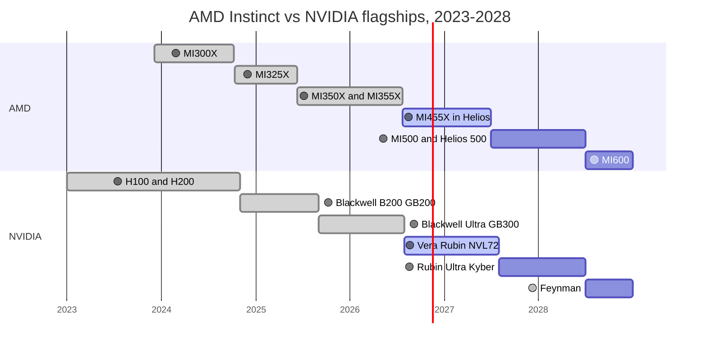
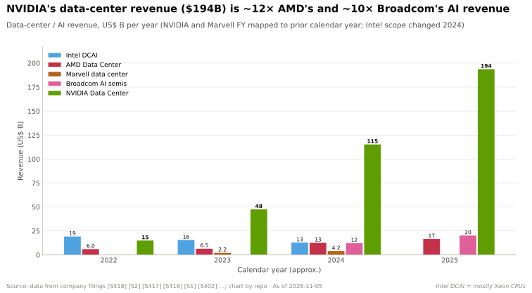

# AMD — the merchant challenger

Cross-cutting 15 · Competitive landscape · AMD Instinct, ROCm, Helios · ~16 min read · Last verified: 2026-11-05

## ⚡ The Executive Take

- **On paper AMD has caught up.** Every Instinct GPU since the MI300X has matched or beaten NVIDIA's same-year flagship on HBM capacity and dense FP8 (repo comparison) [[S15014]](../../sources/bibliography.md#s15014). The MI455X lists 432 GB of HBM4 at 19.6 TB/s and 20 PFLOPS FP8 (basis unstated) against Rubin's 288 GB, 19.2 TB/s and 17.5 PFLOPS [[S144]](../../sources/bibliography.md#s144)[[S33005]](../../sources/bibliography.md#s33005)[[S90006]](../../sources/bibliography.md#s90006).
- **AMD now sells a rack, not just a GPU.** [Helios](../../glossary.md#amd-helios) joins 72 MI455X with EPYC "Venice" CPUs and Pensando NICs: 2.9 EF FP4, 1.4 EF FP8 and 31 TB of HBM4. It is in production, with first shipments from ~end Q3 2026 (🟢/🟡) [[S90021]](../../sources/bibliography.md#s90021)[[S90020]](../../sources/bibliography.md#s90020). Its design team came with [ZT Systems](../../glossary.md#zt-systems) ($4.9B, closed March 2025) [[S8527]](../../sources/bibliography.md#s8527).
- **Frontier buyers committed up to 14 GW.** OpenAI (6 GW) and Meta (6 GW) were paid partly in AMD [warrants](../../glossary.md#warrant); Anthropic added up to 2 GW [[S24000]](../../sources/bibliography.md#s24000)[[S24004]](../../sources/bibliography.md#s24004)[[S9538]](../../sources/bibliography.md#s9538). At $10–20B of hardware per GW that is ~$140–280B over several years (Est.) [[S15014]](../../sources/bibliography.md#s15014).
- **Revenue is growing fast but the gap is wider.** Data Center revenue grew +107% y/y in Q2 2026 and +97% in Q3 [[S543]](../../sources/bibliography.md#s543)[[S542]](../../sources/bibliography.md#s542). Yet NVIDIA's data-center revenue went from 3.3× AMD's in early 2023 to ~13× in mid-2026 (repo calculation) [[S450]](../../sources/bibliography.md#s450)[[S405]](../../sources/bibliography.md#s405).
- **Software is the binding constraint.** [ROCm](../../glossary.md#rocm) went from 7.0 (September 2025) to 10.0 (August 2026) [[S586]](../../sources/bibliography.md#s586). Even so, DeepSeek-V4-Pro needed 27 days to serve usefully on MI355X against day 0 on CUDA [[S633]](../../sources/bibliography.md#s633).
- **Biggest weakness:** no field record at rack scale. NVIDIA is on its third NVL72 generation; Helios is AMD's first, and one analyst expected first production tokens on MI455X racks only in Q2 2027 (🟡) [[S624]](../../sources/bibliography.md#s624).

![Three grouped-bar panels comparing AMD Instinct GPUs with NVIDIA's same-year flagship. Dense FP8: MI300X 2.6 vs H100 2.0 PFLOPS (2023), MI325X 2.6 vs H200 2.0 (2024), MI355X 5.0 vs GB300 5.0 (2025), MI455X 20 vs Rubin 17.5 (2026, AMD basis unstated). HBM capacity: 192 vs 80 GB, 256 vs 141, 288 vs 288 and 432 vs 288. HBM bandwidth: 5.3 vs 3.35 TB/s, 6.0 vs 4.8, 8.0 vs 8.0 and 19.6 vs 19.2 after NVIDIA's 2026 Rubin revision. AMD's gap to NVIDIA is therefore not on the spec sheet but in software, racks and revenue.](../../assets/charts/15-amd-instinct-vs-nvidia-generations.svg)

## The Instinct roadmap: MI300X → MI355X → MI450 → MI500

AMD's data-center GPUs use the [CDNA](../../glossary.md#cdna) architecture and a [chiplet](../../glossary.md#chiplet) design. Compute dies (XCDs) sit on I/O dies, so AMD can mix process nodes and bins. The MI355X uses TSMC N3P compute dies on N6 I/O dies [[S2020]](../../sources/bibliography.md#s2020). The cadence is now annual [[S545]](../../sources/bibliography.md#s545), and the last three Instinct flagships each landed in the same quarter as an NVIDIA flagship (chart below) [[S142]](../../sources/bibliography.md#s142)[[S143]](../../sources/bibliography.md#s143)[[S539]](../../sources/bibliography.md#s539).

| GPU | Launch | HBM | Bandwidth | Dense FP8 | Dense FP4 | Scale-up | Status | Source |
|---|---|---|---|---|---|---|---|---|
| MI300X | Dec 2023 | 192 GB HBM3 | 5.3 TB/s | 2.6 PF | — | 8 GPUs, Infinity Fabric | 🟢 Shipping | [[S141]](../../sources/bibliography.md#s141) |
| MI325X | Oct 2024 | 256 GB HBM3E | 6.0 TB/s | 2.6 PF | — | 8 GPUs | 🟢 Shipping | [[S142]](../../sources/bibliography.md#s142) |
| MI355X | Jun 2025 | 288 GB HBM3E | 8.0 TB/s | 5.0 PF | 10.1 PF | 8 GPUs, 1,075 GB/s | 🟢 Shipping | [[S143]](../../sources/bibliography.md#s143)[[S229]](../../sources/bibliography.md#s229) |
| MI455X (MI450 series) | Jul 2026 | 432 GB HBM4 | 19.6 TB/s | 20 PF (basis unstated) | 40 PF | 72 GPUs, 3.6 TB/s each | 🟢 In production | [[S144]](../../sources/bibliography.md#s144)[[S538]](../../sources/bibliography.md#s538)[[S5522]](../../sources/bibliography.md#s5522) |
| MI500 (CDNA 6) | 2027 | HBM4E (reported) | n/a | n/a | n/a | Helios 500 rack | 🟢 Announced | [[S541]](../../sources/bibliography.md#s541)[[S538]](../../sources/bibliography.md#s538) |
| MI600 | 2028 | n/a | n/a | n/a | n/a | Helios 600 rack | 🟢 Announced | [[S538]](../../sources/bibliography.md#s538) |

The MI450 series includes the MI455X (Helios), MI440X (8-GPU servers) and MI430X (FP64 HPC) [[S544]](../../sources/bibliography.md#s544). Meta's first gigawatt is a custom MI450-based part [[S24004]](../../sources/bibliography.md#s24004). AMD markets the MI500 as up to 1,000× the MI300X's AI performance [[S544]](../../sources/bibliography.md#s544), a vendor claim mixing precision and system gains.

Sources: AMD launches [[S141]](../../sources/bibliography.md#s141)[[S142]](../../sources/bibliography.md#s142)[[S143]](../../sources/bibliography.md#s143)[[S538]](../../sources/bibliography.md#s538)[[S541]](../../sources/bibliography.md#s541); NVIDIA platforms [[S90009]](../../sources/bibliography.md#s90009)[[S90003]](../../sources/bibliography.md#s90003)[[S90004]](../../sources/bibliography.md#s90004). Bars show the period each part is the current flagship, not shipping volumes.

> [!TIP]
> **Worked example — what 432 GB buys.** A 405-billion-parameter model in [FP8](../../glossary.md#fp8) needs ~405 GB just for weights. One MI455X (432 GB) holds it with ~27 GB left for the [KV cache](../../glossary.md#kv-cache) [[S144]](../../sources/bibliography.md#s144). On Rubin (288 GB) the same model needs two GPUs (576 GB), leaving ~171 GB for KV cache [[S33005]](../../sources/bibliography.md#s33005). Per GPU, AMD fits ~1 model replica where NVIDIA fits ~0.5, but NVIDIA's pair has ~6× the spare memory for concurrent users. **Conclusion:** capacity lets AMD serve big models on fewer GPUs, a real edge in 8-GPU servers. Inside a 72-GPU [NVLink](../../glossary.md#nvlink) domain, where splitting a model across GPUs is cheap, the advantage shrinks.

🔧 Under the hood: why "basis unstated" matters for MI455X

AMD usually quotes sparsity as a separate 2× line; the MI355X figures above are dense [[S143]](../../sources/bibliography.md#s143). For the MI455X, AMD's June 2025 figures (40 PFLOPS FP4, 20 PFLOPS FP8) did not say dense or sparse [[S144]](../../sources/bibliography.md#s144). Rubin's 17.5 PFLOPS FP8 is dense, and its 50 PFLOPS NVFP4 "inference" figure relies on adaptive compression [[S100]](../../sources/bibliography.md#s100). If AMD's numbers were sparse, MI455X would have about half Rubin's dense FP8; the memory figures are unambiguous. AMD named Samsung its primary HBM4 supplier for the MI455X under a non-binding MOU [[S3511]](../../sources/bibliography.md#s3511).

## ROCm: closing the software gap one model at a time

ROCm is AMD's answer to [CUDA](../../glossary.md#cuda): compilers, the [HIP](../../glossary.md#hip) programming interface, math libraries, the [RCCL](../../glossary.md#rccl) collective library and framework plug-ins. It started nine years after CUDA. The release lag has since shrunk by roughly ten times per milestone: ~8.8 years for platform 1.0, ~8 months for FP4 support and ~26 days for usable DeepSeek-V4-Pro serving [[S586]](../../sources/bibliography.md#s586)[[S90064]](../../sources/bibliography.md#s90064)[[S633]](../../sources/bibliography.md#s633).

The remaining gap is breadth and day-zero support. ROCm scores 26 of 36 on this repo's framework index (CUDA: 36) [[S586]](../../sources/bibliography.md#s586)[[S580]](../../sources/bibliography.md#s580). AMD's [AITER](../../glossary.md#aiter) operator library is now the default attention backend for vLLM on AMD [[S10514]](../../sources/bibliography.md#s10514). ROCm.ai (July 2026) adds an AI assistant to install, tune and debug workloads [[S9518]](../../sources/bibliography.md#s9518). Anthropic's 2026 deal includes using Claude to speed up ROCm development [[S9538]](../../sources/bibliography.md#s9538).

> [!TIP]
> **Worked example — the cost of 27 days.** On day 27 after DeepSeek-V4-Pro's release, a B200 still delivered ~5× MI355X's tokens per GPU [[S631]](../../sources/bibliography.md#s631). SemiAnalysis puts owner cost at ~$1.73 per B200-hour and ~$1.50 per MI355X-hour [[S622]](../../sources/bibliography.md#s622). Cost per token on MI355X was therefore (1.50 ÷ 1) ÷ (1.73 ÷ 5) ≈ **4.3× the B200's** that day. Kernel work then cut MI355X's cost per token ~33× within weeks [[S631]](../../sources/bibliography.md#s631). **Conclusion:** AMD hardware is cost-competitive once tuned. A buyer pays the software tax for weeks after every new model, so AMD fits steady, high-volume workloads better than the newest frontier model.

## Helios and ZT Systems: AMD's first rack

Customers now buy racks. NVIDIA's [NVL72](../../glossary.md#nvl72) showed that 72 GPUs on one memory-semantic fabric beat 8-GPU boxes for [mixture-of-experts](../../glossary.md#mixture-of-experts) inference. Helios, a double-wide Open Rack design, joins 72 MI455X GPUs by [UALink over Ethernet](../../glossary.md#ualoe) through switch trays built on Broadcom's Tomahawk 6 [[S226]](../../sources/bibliography.md#s226)[[S5522]](../../sources/bibliography.md#s5522).

| Rack (2026) | AMD Helios | NVIDIA Vera Rubin NVL72 | Verdict for AMD |
|---|---|---|---|
| GPUs per scale-up domain | 72 MI455X | 72 Rubin | 🟨 Same size [[S344]](../../sources/bibliography.md#s344)[[S102]](../../sources/bibliography.md#s102) |
| HBM4 capacity | ~31 TB | 20.7 TB | 🟩 ~1.5× [[S90021]](../../sources/bibliography.md#s90021)[[S102]](../../sources/bibliography.md#s102) |
| HBM bandwidth | ~1,411 TB/s | 1,400 TB/s (revised) | 🟨 Parity after NVIDIA's cut [[S90006]](../../sources/bibliography.md#s90006) |
| Dense FP8 | 1.4 EF | ~1.26 EF | 🟩 On paper [[S90021]](../../sources/bibliography.md#s90021)[[S33005]](../../sources/bibliography.md#s33005) |
| Scale-up per GPU | 3.6 TB/s (open UALink-over-Ethernet) | 3.0 TB/s NVLink 6 (revised) | 🟦 Open vs proprietary [[S5522]](../../sources/bibliography.md#s5522)[[S90007]](../../sources/bibliography.md#s90007) |
| Scale-out per GPU | 2.4 Tb/s (Pensando Vulcano) | 1.6 Tb/s (ConnectX-9) | 🟩 [[S228]](../../sources/bibliography.md#s228)[[S7500]](../../sources/bibliography.md#s7500)[[S33004]](../../sources/bibliography.md#s33004) |
| Field record | First generation | Third NVL72 generation | 🟥 [[S8527]](../../sources/bibliography.md#s8527)[[S5501]](../../sources/bibliography.md#s5501) |

ZT Systems supplied the rack-design skills. AMD paid $4.9B, closed the deal on 2025-03-31 and kept the design and customer-enablement teams [[S8527]](../../sources/bibliography.md#s8527). It sold the factories to Sanmina for $2.25B in cash plus a $0.3B premium and up to $0.45B of earn-out [[S5527]](../../sources/bibliography.md#s5527)[[S5528]](../../sources/bibliography.md#s5528).

> [!TIP]
> **Worked example — what AMD paid for rack know-how.** Net cost = $4.9B − $2.25B − $0.3B = **$2.35B**, or $1.9B if the full earn-out is paid [[S5527]](../../sources/bibliography.md#s5527). That is ~7% of AMD's ~$34B annualized Data Center revenue (Q3 2026, Est.) [[S15014]](../../sources/bibliography.md#s15014). It underpins up to 14 GW of commitments, worth ~$140–280B over several years (Est.) [[S15014]](../../sources/bibliography.md#s15014). **Conclusion:** for a challenger, a proven rack-integration team is worth far more than its asset value, a pattern NVIDIA set with Mellanox ([CS1](../../case-studies/CS1-mellanox-the-best-deal.md)).

Timing is the open question. AMD says Helios is in production, shipping from ~end Q3 2026, with OpenAI's large-scale deployment from Q4 2026 [[S90020]](../../sources/bibliography.md#s90020)[[S90021]](../../sources/bibliography.md#s90021). AMD denied a February 2026 report of an MI455X slip [[S2521]](../../sources/bibliography.md#s2521)[[S2524]](../../sources/bibliography.md#s2524). SemiAnalysis expected first production tokens only in Q2 2027 (🟡) [[S624]](../../sources/bibliography.md#s624). The repo treats volume Helios as a 2027 event.

## The OpenAI and Meta warrant deals

AMD's commercial breakthrough was an [equity-for-capacity](../../glossary.md#equity-for-capacity) structure. OpenAI committed up to 6 GW of Instinct GPUs from H2 2026 and received a warrant for up to 160M AMD shares at $0.01, vesting with deployment and share-price hurdles up to a reported $600 [[S24000]](../../sources/bibliography.md#s24000)[[S13507]](../../sources/bibliography.md#s13507). Meta signed the same structure for another 6 GW in February 2026 [[S24004]](../../sources/bibliography.md#s24004). The two warrants cover 320M shares, ~20% of the pre-deal share count [[S24003]](../../sources/bibliography.md#s24003). AMD first closed above $600 on 2026-09-21 [[S24005]](../../sources/bibliography.md#s24005). The full analysis is in [CS4 · AMD, OpenAI and the second source](../../case-studies/CS4-amd-openai-and-the-second-source.md).

| Customer (date) | Capacity | Consideration | Status | Source |
|---|---|---|---|---|
| OpenAI (2025-10-06) | Up to 6 GW, MI450 from H2 2026 | Warrant, 160M shares | 🟢 Ramp from Q4 2026 | [[S24000]](../../sources/bibliography.md#s24000)[[S90021]](../../sources/bibliography.md#s90021) |
| Oracle (2025-10) | 50,000 MI450 | Purchase | 🟢 From 2026 | [[S90022]](../../sources/bibliography.md#s90022) |
| Meta (2026-02-24) | Up to 6 GW, custom MI450 first | Warrant, 160M shares | 🟢 First GW H2 2026 | [[S24004]](../../sources/bibliography.md#s24004) |
| Anthropic (2026) | Up to 2 GW of Helios | AMD invests up to $5B | 🟡 Reported | [[S9538]](../../sources/bibliography.md#s9538)[[S538]](../../sources/bibliography.md#s538) |
| Microsoft Azure | First major Helios deployment | — | 🟡 Reported | [[S90024]](../../sources/bibliography.md#s90024) |

> [!TIP]
> **Worked example — vendor capital per gigawatt.** At the $600 hurdle, OpenAI's fully vested warrant is worth 160M × $600 = $96B, or ~$16B per committed GW. NVIDIA's comparable pledges were ~$10B per GW (up to $100B for 10 GW to OpenAI, since replaced by ~$30B of equity; up to $10B for 1 GW to Anthropic) [[S24005]](../../sources/bibliography.md#s24005)[[S90015]](../../sources/bibliography.md#s90015)[[S90075]](../../sources/bibliography.md#s90075). **Conclusion:** AMD outbid NVIDIA on paper, but in its own stock and only if both deployment and share price deliver; the cost lands on AMD's existing owners as dilution.

![Horizontal bar chart of vendor capital per gigawatt of compute a customer commits to: AMD's warrant for 160 million shares is worth about $16B per GW to OpenAI if AMD reaches the reported $600 share-price hurdle, or ~$5.3B per GW at an illustrative $200; NVIDIA's pledges were about $10B per GW for Anthropic (up to $10B, 1 GW) and for OpenAI's superseded letter of intent ($100B, 10 GW); AMD's up-to-$5B Anthropic stake ~$2.5B per GW (2 GW); NVIDIA's xAI stake ~$2B per GW, Poolside ~$0.5B and CoreWeave ~$0.47B; Broadcom's 10 GW OpenAI programme carries no disclosed vendor capital. NVIDIA's 2026 $30B OpenAI equity has no GW tie.](../../assets/charts/13-capital-per-gigawatt.svg)

## Financials: growing fast, falling further behind in dollars

AMD's Data Center segment (including EPYC CPUs and Pensando NICs) grew from $6.5B in 2023 to $12.6B in 2024 and ~$16.7B in 2025 [[S450]](../../sources/bibliography.md#s450). In 2026 it reported $5.8B in Q1 (+57%), $6.7B in Q2 (+107%) and +97% in Q3 (~$8.55B, repo estimate from the growth rate) [[S24009]](../../sources/bibliography.md#s24009)[[S543]](../../sources/bibliography.md#s543)[[S542]](../../sources/bibliography.md#s542). AMD does not disclose Instinct revenue; it said data-center GPU revenue exceeded $5B in 2024 [[S663]](../../sources/bibliography.md#s663).

![Two-panel chart, calendar 2023-Q1 to 2026-Q3. Left: AMD's Data Center segment revenue rose from $1.3B to $8.6B a quarter (2026-Q3 is a repo estimate from AMD's +97% y/y), about 6.6 times, while NVIDIA's Data Center revenue rose from $4.3B to $89.0B (2026-Q2). Right: NVIDIA's data-center revenue was 3.3 times AMD's in 2023-Q1, 9.2 times in 2024-Q4 and 13.3 times in 2026-Q2: the second source has not yet narrowed the revenue gap. AMD's figure includes EPYC server CPUs, so its GPU-only gap is larger.](../../assets/charts/CS4-amd-vs-nvidia-dc-revenue.svg)

At its November 2025 Financial Analyst Day AMD targeted, over three to five years, data-center AI revenue growth above 80% a year, data-center growth above 60% and EPS above $20 [[S15012]](../../sources/bibliography.md#s15012).

> [!TIP]
> **Worked example — what an 80% CAGR implies.** Start from ~$6.7B of 2025 Instinct revenue (repo estimate) [[S450]](../../sources/bibliography.md#s450). At 80% a year it reaches 6.7 × 1.8³ ≈ **$39B in 2028** and 6.7 × 1.8⁵ ≈ **$127B in 2030** [[S15012]](../../sources/bibliography.md#s15012). NVIDIA's FY2026 Data Center revenue was ~$194B [[S1]](../../sources/bibliography.md#s1). **Conclusion:** even AMD's own target leaves it below NVIDIA's *current* scale until about 2030. The bet is that the AI pool keeps growing, so AMD can win share without NVIDIA shrinking.

## Strengths and weaknesses by layer

| Layer | Verdict vs NVIDIA | Reason |
|---|---|---|
| 02 GPU silicon | 🟨 Parity | MI355X matches B200 on MLPerf Llama 2 70B (12,935 vs 12,994 tokens/s) [[S602]](../../sources/bibliography.md#s602) |
| 03 Memory, packaging, supply | 🟥 Behind | Leads on HBM per GPU but holds a much smaller CoWoS and HBM allocation [[S379]](../../sources/bibliography.md#s379) |
| 04 CPU | 🟩 Leads | EPYC (Venice, up to 256 cores) is the most common x86 AI host [[S4028]](../../sources/bibliography.md#s4028) |
| 05 Scale-up | 🟥 Behind today (🟦 on paper) | 8-GPU Infinity Fabric until Helios; 3.6 vs 3.0 TB/s per GPU on paper [[S5522]](../../sources/bibliography.md#s5522)[[S90007]](../../sources/bibliography.md#s90007) |
| 06 Scale-out | 🟥 Behind | Pensando NICs, but no own switch silicon [[S7500]](../../sources/bibliography.md#s7500) |
| 07 DPU, SuperNIC, storage | 🟥 Behind | Salina DPU deployed far less than BlueField or Nitro [[S289]](../../sources/bibliography.md#s289) |
| 08 Systems and racks | 🟥 Behind | Helios is a first generation [[S8527]](../../sources/bibliography.md#s8527) |
| 09 System software | 🟥 Behind | ROCm 26/36 framework index; day-zero gaps [[S586]](../../sources/bibliography.md#s586)[[S633]](../../sources/bibliography.md#s633) |
| 10 Libraries | 🟥 Behind | RCCL trails NCCL by ~3 months; FP4 serving kernels lag [[S10509]](../../sources/bibliography.md#s10509)[[S624]](../../sources/bibliography.md#s624) |
| 11 Inference software | 🟥 Behind | Wins some perf/$ points (GLM-5 up to 29.6% cheaper than B200) but up to 5× costlier at 150 tokens/s per user [[S637]](../../sources/bibliography.md#s637)[[S636]](../../sources/bibliography.md#s636) |
| 12 Orchestration and cloud | 🟦 Different | No first-party cloud; sells via Oracle, Azure and neoclouds [[S90022]](../../sources/bibliography.md#s90022)[[S90024]](../../sources/bibliography.md#s90024) |
| 13 Ecosystem and capital | 🟥 Behind | Warrants won 12 GW, but ~$15.8B of cash vs NVIDIA's far larger base [[S13501]](../../sources/bibliography.md#s13501) |

Verdicts follow `data/competitor_matrix.csv` (repo analyst judgement, 🔴) [[S15014]](../../sources/bibliography.md#s15014). This page marks layer 05 as behind today and different on paper, a finer split than the matrix's single "behind".

> [!TIP]
> **Worked example — how much new-model traffic AMD can afford.** On a tuned benchmark MI355X delivers ~27% more tokens per dollar than GB300, i.e. ~0.73× its cost per token (Est.) [[S602]](../../sources/bibliography.md#s602)[[S622]](../../sources/bibliography.md#s622). In the first weeks of a new model it can be ~4.3× costlier (DeepSeek-V4 example above). If a share *x* of a fleet's tokens comes from such new models, AMD breaks even when 0.73 × (1 − *x*) + 4.3 × *x* = 1, so *x* ≈ **8%** (🔴 repo arithmetic). **Conclusion:** AMD wins on cost for steady, mature workloads and loses wherever more than ~8% of tokens come from just-released models, which is why day-zero software matters more than peak specs.

**Their best argument.** "Same specs, open fabric, second source." AMD offers a merchant GPU that matches or beats NVIDIA's on paper every year. Its rack runs over open Ethernet-based UALink rather than proprietary NVLink, and buyers get pricing leverage on NVIDIA's ~75% gross margin [[S405]](../../sources/bibliography.md#s405). Three frontier labs have bet gigawatts on it.

**How much the gap has closed.**

| Measure | Then | Now (Nov 2026) | Source |
|---|---|---|---|
| HBM per GPU vs NVIDIA flagship | 192 vs 80 GB (2023) | 432 vs 288 GB | [[S141]](../../sources/bibliography.md#s141)[[S144]](../../sources/bibliography.md#s144)[[S33005]](../../sources/bibliography.md#s33005) |
| Single-node fine-tuning, 8 GPUs | MI300X ~28–29 min (2025) vs ~5.6 for GB300 | MI355X 8.3 vs 5.6 min: 1.5× | [[S609]](../../sources/bibliography.md#s609) |
| Software lag on a new model | Years | 26 days (DeepSeek-V4-Pro) | [[S633]](../../sources/bibliography.md#s633) |
| Scale-up domain | 8 GPUs | 72 GPUs (Helios) | [[S226]](../../sources/bibliography.md#s226) |
| Share of AI silicon revenue | ~0.9% (2023, Est.) | ~3% (2025, Est.) | [[S15014]](../../sources/bibliography.md#s15014) |
| NVIDIA ÷ AMD data-center revenue | 3.3× (2023-Q1) | ~13× (2026-Q2) | [[S450]](../../sources/bibliography.md#s450)[[S405]](../../sources/bibliography.md#s405) |

The hardware gap has closed; the software gap has narrowed from years to weeks; the revenue gap has widened.

> [!NOTE]
> **🐂 Bull view (for AMD).** AMD is the only rival with a merchant GPU, a rack, a CPU and NICs, and it now ships them on NVIDIA's annual cadence. With 14 GW committed and HBM leadership, it needs only a few points of a ~$436B pool (2026E) to double its AI business: each point is ~$4.4B (Est.) [[S15014]](../../sources/bibliography.md#s15014). Its FAD target of >80% a year would take Instinct past ~$100B by 2030 (repo arithmetic) [[S15012]](../../sources/bibliography.md#s15012).

> [!WARNING]
> **🐻 Bear view (for AMD).** Specs are not deployments. Helios is unproven at scale, ROCm still loses weeks on every new model, and the revenue gap to NVIDIA widened to ~13× [[S633]](../../sources/bibliography.md#s633)[[S405]](../../sources/bibliography.md#s405). The warrant deals tie 2027–28 revenue to two customers' financing and dilute owners by up to ~20% [[S24003]](../../sources/bibliography.md#s24003). If MI450 underdelivers, OpenAI and Meta can simply deploy fewer gigawatts.

## 🎯 Corp Dev Lens

1. **Rack integration as an asset class.** AMD paid ~$2B net for ZT's design teams [[S5527]](../../sources/bibliography.md#s5527). Which other rack-scale, liquid-cooling or power-delivery teams could a challenger buy, and what are they worth relative to the gigawatt commitments they unlock?
2. **Open scale-up as a wedge.** Helios rides UALink over Ethernet on Broadcom switches [[S5522]](../../sources/bibliography.md#s5522). Does an open scale-up ecosystem create room for third-party CPUs, NICs or accelerators that NVLink Fusion does not?
3. **Equity-for-capacity is reflexive.** AMD's warrants worked because its stock rose from ~$165 to ~$612 [[S24001]](../../sources/bibliography.md#s24001)[[S24005]](../../sources/bibliography.md#s24005). What structures (prepayments, rebates, site co-investment) would let a smaller-cap challenger offer similar terms?
4. **Day-zero software is the scarce input.** ROCm's lag fell to 26 days [[S633]](../../sources/bibliography.md#s633). What would it take, in people, tooling or acquisitions, to make it zero, and who else (Modular, Triton, PyTorch compilers) could supply that for any non-NVIDIA chip?
5. **Customer concentration.** OpenAI and Meta together could absorb up to 12 GW of AMD output [[S24000]](../../sources/bibliography.md#s24000)[[S24004]](../../sources/bibliography.md#s24004). How should a partner price AMD's 2027–28 execution risk against that concentration?

## 📚 Sources

<!-- Auto-generated from the [S…] citations on this page by `make build`. Edit sources/registry/*.csv, not this list. -->

- [**S1**](../../sources/bibliography.md#s1) NVIDIA Corporation via SEC EDGAR, *NVIDIA Announces Financial Results for Fourth Quarter and Fiscal 2026 (Form 8-K exhibit 99.1)*, 2026-02-25. [Link](https://www.sec.gov/Archives/edgar/data/1045810/000104581026000019/q4fy26pr.htm)
- [**S100**](../../sources/bibliography.md#s100) NVIDIA Technical Blog, *Inside the NVIDIA Vera Rubin Platform: Six New Chips, One AI Supercomputer*, 2026-01-05. [Link](https://developer.nvidia.com/blog/inside-the-nvidia-rubin-platform-six-new-chips-one-ai-supercomputer/)
- [**S102**](../../sources/bibliography.md#s102) NVIDIA, *NVIDIA DGX Vera Rubin NVL72*, 2026. [Link](https://www.nvidia.com/en-us/data-center/dgx-vera-rubin-nvl72/)
- [**S141**](../../sources/bibliography.md#s141) AMD, *AMD Instinct MI300X Accelerator*, 2023-12-06. [Link](https://www.amd.com/en/products/accelerators/instinct/mi300/mi300x.html)
- [**S142**](../../sources/bibliography.md#s142) AMD, *AMD Instinct MI325X Accelerator*, 2024-10-10. [Link](https://www.amd.com/en/products/accelerators/instinct/mi300/mi325x.html)
- [**S143**](../../sources/bibliography.md#s143) AMD, *AMD Instinct MI350 Series (MI350X, MI355X)*, 2025-06-12. [Link](https://www.amd.com/en/products/accelerators/instinct/mi350.html)
- [**S144**](../../sources/bibliography.md#s144) AMD Newsroom, *AMD Unveils Vision for an Open AI Ecosystem, Detailing New Silicon, Software and Systems at Advancing AI 2025*, 2025-06-12. [Link](https://www.amd.com/en/newsroom/press-releases/2025-6-12-amd-unveils-vision-for-an-open-ai-ecosystem-detai.html)
- [**S226**](../../sources/bibliography.md#s226) AMD, *AMD Helios Rackscale Solution (product page)*, 2026. [Link](https://www.amd.com/en/products/rackscale-solutions/helios.html)
- [**S228**](../../sources/bibliography.md#s228) Spheron, *AMD Helios rack-scale AI on GPU cloud: deploy MI455X inference with UALink and Ultra Ethernet (2026 guide)*, 2026. [Link](https://www.spheron.network/blog/amd-helios-rack-scale-mi455x-gpu-cloud/)
- [**S229**](../../sources/bibliography.md#s229) AMD, *AMD Instinct MI355X (product page)*, 2025-06-12. [Link](https://www.amd.com/en/products/accelerators/instinct/mi350/mi355x.html)
- [**S289**](../../sources/bibliography.md#s289) AMD, *AMD Advancing AI 2024: Pensando Pollara 400 AI NIC and Salina DPU*, 2024-10-10. [Link](https://www.amd.com/en/newsroom.html)
- [**S344**](../../sources/bibliography.md#s344) AMD, *AMD Helios rack-scale AI infrastructure (product page)*, 2026. [Link](https://www.amd.com/ja/products/rackscale-solutions/helios.html)
- [**S379**](../../sources/bibliography.md#s379) TrendForce News, *TSMC CoWoS capacity and customer allocation estimates (TrendForce / Morgan Stanley, as reported)*, 2025. [Link](https://www.trendforce.com/news/)
- [**S405**](../../sources/bibliography.md#s405) NVIDIA Corporation via SEC EDGAR, *NVIDIA Announces Financial Results for Second Quarter Fiscal 2027 (Form 8-K exhibit 99.1)*, 2026-08-26. [Link](https://www.sec.gov/Archives/edgar/data/0001045810/000104581026000073/q2fy27pr.htm)
- [**S450**](../../sources/bibliography.md#s450) U.S. Securities and Exchange Commission (EDGAR), *Advanced Micro Devices Form 10-K / 10-Q filings (EDGAR index)*, 2025-02-05. [Link](https://www.sec.gov/cgi-bin/browse-edgar?action=getcompany&CIK=0000002488&type=10-&dateb=&owner=include&count=40)
- [**S538**](../../sources/bibliography.md#s538) AMD Investor Relations, *AAI 2026: AMD Delivers Full-Stack Compute for the Agentic AI Era*, 2026-07-23. [Link](https://ir.amd.com/news-events/press-releases/detail/1294/aai-2026-amd-delivers-full-stack-compute-for-the-agentic-ai-era)
- [**S539**](../../sources/bibliography.md#s539) Phoronix (Michael Larabel), *AMD Launches Instinct MI455X, Helios AI Rack*, 2026-07-23. [Link](https://www.phoronix.com/news/AMD-Instinct-MI455X-Helios)
- [**S541**](../../sources/bibliography.md#s541) PC Games Hardware, *CDNA 6 und CDNA Next: AMD kündigt Instinct MI500 für 2027 und MI600 für 2028 an*, 2026-07. [Link](https://www.pcgameshardware.de/Grafikkarten-Grafikkarte-97980/News/AMD-Instinct-MI500-MI600-Roadmap-CDNA-6-CDNA-Next-1549244/)
- [**S542**](../../sources/bibliography.md#s542) AMD via SEC EDGAR, *AMD Reports Third Quarter 2026 Financial Results (Form 8-K Exhibit 99.1)*, 2026-11-03. [Link](https://www.sec.gov/Archives/edgar/data/0000002488/000000248826000188/q32026991.htm)
- [**S543**](../../sources/bibliography.md#s543) AMD via SEC EDGAR, *AMD Q2 2026 earnings slides (Form 8-K)*, 2026-08-04. [Link](https://www.sec.gov/Archives/edgar/data/0000002488/000000248826000121/amdq22026earningsslidesf.htm)
- [**S544**](../../sources/bibliography.md#s544) DatacenterDynamics, *AMD unveils full MI400 product lineup, claims MI500 chips will deliver 1000x increase in AI performance*, 2026-01. [Link](https://www.datacenterdynamics.com/en/news/amd-unveils-full-mi400-product-lineup-claims-mi500-chips-will-deliver-1000x-increase-in-ai-performance/)
- [**S545**](../../sources/bibliography.md#s545) Mashdigi, *AMD's data center GPUs are updated annually to compete with NVIDIA: MI400 in 2026, MI500 in 2027*, 2025-11-12. [Link](https://en.mashdigi.com/amds-data-center-gpus-are-updated-annually-to-compete-with-nvidia-the-instinct-mi400-series-will-debut-in-2026-and-the-mi500-is-expected-to-take-over-in-2027/)
- [**S580**](../../sources/bibliography.md#s580) vLLM project (GitHub), *vLLM README and installation docs — supported hardware*, 2026-11. [Link](https://github.com/vllm-project/vllm/blob/main/docs/getting_started/installation/README.md)
- [**S586**](../../sources/bibliography.md#s586) AMD (GitHub: ROCm/ROCm docs), *ROCm documentation sources: release history, AI-ecosystem compatibility matrix, consolidated changelog*, 2026-08-26. [Link](https://github.com/ROCm/ROCm/blob/develop/docs/release/versions.rst)
- [**S602**](../../sources/bibliography.md#s602) MLCommons, *MLPerf Inference v6.0 results (summary_results.json and per-submitter logs)*, 2026-04-01. [Link](https://github.com/mlcommons/inference_results_v6.0)
- [**S609**](../../sources/bibliography.md#s609) MLCommons, *MLPerf Training v6.0 results (per-submitter logs and system descriptions)*, 2026-06. [Link](https://github.com/mlcommons/training_results_v6.0)
- [**S622**](../../sources/bibliography.md#s622) SemiAnalysis (InferenceX-app repository), *InferenceX hardware registry: TCO per GPU-hour by SKU (SemiAnalysis July 2026 pricing surveys and AI Cloud TCO Model)*, 2026-07. [Link](https://github.com/SemiAnalysisAI/InferenceX-app/blob/main/packages/constants/src/gpu-keys.ts)
- [**S624**](../../sources/bibliography.md#s624) SemiAnalysis, *InferenceX v2: NVIDIA Blackwell Vs AMD vs Hopper - Formerly InferenceMAX*, 2026-02-16. [Link](https://github.com/SemiAnalysisAI/InferenceX-app/blob/main/packages/app/content/blog/inferencex-v2-nvidia-blackwell-vs-amd-vs-hopper.mdx)
- [**S631**](../../sources/bibliography.md#s631) SemiAnalysis, *MI355X DeepSeek-V4-Pro on SGLang: 110.5x Throughput per GPU in 26 Days*, 2026-05-26. [Link](https://github.com/SemiAnalysisAI/InferenceX-app/blob/main/packages/app/content/blog/mi355x-deepseek-v4-pro-sglang-110x-in-26-days.mdx)
- [**S633**](../../sources/bibliography.md#s633) SemiAnalysis, *DeepSeekV4 1.6T Day 0 to Day 43 Performance Over Time — Huawei, GB300 NVL72, MI355X, B200*, 2026-06-09. [Link](https://github.com/SemiAnalysisAI/InferenceX-app/blob/main/packages/app/content/blog/deepseekv4-16t-day-0-to-day-43-performance.mdx)
- [**S636**](../../sources/bibliography.md#s636) SemiAnalysis, *GLM 5.3 on AgentX: NVIDIA Is Up to 5x Cheaper per Token at 150 tok/s/user*, 2026-08-25. [Link](https://github.com/SemiAnalysisAI/InferenceX-app/blob/main/packages/app/content/blog/glm-5-3-agentx-nvidia-vs-amd-sglang-150-toks.mdx)
- [**S637**](../../sources/bibliography.md#s637) SemiAnalysis, *AMD MI355X GLM-5 Inference: Up to 29.6% Lower Cost per Million Tokens than B200 on SGLang FP8*, 2026-05-25. [Link](https://github.com/SemiAnalysisAI/InferenceX-app/blob/main/packages/app/content/blog/mi355x-glm5-fp8-sglang-40-cheaper-than-b200.mdx)
- [**S663**](../../sources/bibliography.md#s663) AMD, *AMD Reports Fourth Quarter and Full Year 2024 Financial Results*, 2025-02-04. [Link](https://ir.amd.com/news-events/press-releases)
- [**S2020**](../../sources/bibliography.md#s2020) AMD ROCm documentation, *AMD Instinct MI350 Series microarchitecture*, 2025. [Link](https://rocm.docs.amd.com/en/develop/reference/gpu-arch/mi350.html)
- [**S2521**](../../sources/bibliography.md#s2521) Tom's Hardware, *AMD denies report of MI455X delays as Nvidia VR200 systems are rumored to arrive early*, 2026-02. [Link](https://www.tomshardware.com/tech-industry/artificial-intelligence/amd-denies-report-of-mi455x-delays-as-nvidia-vr200-systems-are-rumored-to-arrive-early-company-says-helios-systems-on-target-for-2h-2026)
- [**S2524**](../../sources/bibliography.md#s2524) The Next Platform, *AMD says Helios racks and MI400 series GPUs on track for 2H 2026*, 2026-02-23. [Link](https://www.nextplatform.com/2026/02/23/amd-says-helios-racks-and-mi400-series-gpus-on-track-for-2h-2026/)
- [**S3511**](../../sources/bibliography.md#s3511) ITPro, *AMD and Samsung forge closer ties on AI memory, potential foundry deal*, 2026-03. [Link](https://itpro.com/hardware/amd-and-samsung-forge-closer-ties-on-ai-memory-potential-foundry-deal)
- [**S4028**](../../sources/bibliography.md#s4028) Digital Citizen, *AMD EPYC Venice launches with up to 256 Zen 6 cores and strong agentic AI performance claims*, 2026-07-22. [Link](https://www.digitalcitizen.life/amd-epyc-venice-launches-with-up-to-256-zen-6-cores-and-strong-agentic-ai-performance-claims/)
- [**S5501**](../../sources/bibliography.md#s5501) TechPowerUp, *NVIDIA's GB200 'Blackwell' racks face overheating issues*, 2025-01-14. [Link](https://techpowerup.com/331105/nvidias-gb200-blackwell-racks-face-overheating-issues)
- [**S5522**](../../sources/bibliography.md#s5522) Remio, *AMD Helios unites 72 GPUs but NVIDIA sets the test*, 2026. [Link](https://www.remio.ai/post/amd-helios-unites-72-gpus-but-nvidia-sets-the-test)
- [**S5527**](../../sources/bibliography.md#s5527) Evertiq, *AMD completes sale of ZT Systems manufacturing unit to Sanmina*, 2025-10-27. [Link](https://evertiq.com/design/2025-10-27-amd-completes-sale-of-zt-systems-manufacturing-unit-to-sanmina)
- [**S5528**](../../sources/bibliography.md#s5528) Sanmina, *Sanmina completes acquisition of ZT Systems data center infrastructure manufacturing business from AMD*, 2025-10-27. [Link](https://s201.q4cdn.com/209924174/files/doc_news/SANMINA-COMPLETES-ACQUISITION-OF-ZT-SYSTEMS-DATA-CENTER-INFRASTRUCTURE-MANUFACTURING-BUSINESS-FROM-AMD-2025.pdf)
- [**S7500**](../../sources/bibliography.md#s7500) AMD, *AMD Pensando Vulcano 800 AI NIC: Built to Scale-Out and Across*, 2026. [Link](https://www.amd.com/en/blogs/2026/amd-pensando-vulcano-800-ai-nic-scale-out-and-across.html)
- [**S8527**](../../sources/bibliography.md#s8527) AMD Investor Relations, *AMD completes acquisition of ZT Systems*, 2025-03-31. [Link](https://ir.amd.com/news-events/press-releases/detail/1240/amd-completes-acquisition-of-zt-systems)
- [**S9518**](../../sources/bibliography.md#s9518) StorageNewsletter, *AMD AAI 2026: AMD ROCm.ai accelerates AI development across AMD platforms*, 2026-07-27. [Link](https://storagenewsletter.com/2026/07/27/amd-aai-2026-amd-rocm-ai-accelerates-ai-development-across-amd-platforms)
- [**S9538**](../../sources/bibliography.md#s9538) The Next Web, *AMD is investing $5 billion in Anthropic and deploying 2 gigawatts of Helios GPUs to run Claude*, 2026. [Link](https://thenextweb.com/news/amd-anthropic-5-billion-investment-2gw-helios-mi450)
- [**S10509**](../../sources/bibliography.md#s10509) GitHub (ROCm/rccl), *RCCL CHANGELOG*, 2026. [Link](https://github.com/ROCm/rccl/blob/develop/CHANGELOG.md)
- [**S10514**](../../sources/bibliography.md#s10514) GitHub (ROCm/aiter), *AITER README*, 2026-04. [Link](https://github.com/ROCm/aiter)
- [**S13501**](../../sources/bibliography.md#s13501) Advanced Micro Devices via SEC EDGAR, *AMD Q3 2026 earnings slides (Form 8-K exhibit)*, 2026-11. [Link](https://www.sec.gov/Archives/edgar/data/0000002488/000000248826000188/amdq32026earningsslidesf.htm)
- [**S13507**](../../sources/bibliography.md#s13507) The Motley Fool, *AMD pays a high price for blockbuster OpenAI deal*, 2025-10-07. [Link](https://www.fool.com/investing/2025/10/07/amd-pays-a-high-price-for-blockbuster-openai-deal)
- [**S15012**](../../sources/bibliography.md#s15012) AMD Newsroom, *AMD unveils strategy to lead the $1 trillion compute market and accelerate next phase of growth (Financial Analyst Day)*, 2025-11-11. [Link](https://www.amd.com/en/newsroom/press-releases/2025-11-11-amd-unveils-strategy-to-lead-the-1-trillion-compu.html)
- [**S15014**](../../sources/bibliography.md#s15014) nvidia_deep_dive_claude repository, *Repo analysis: Chapter 15A competitive-landscape calculations (gap-to-flagship ratios, implied AMD commitment value, hyperscaler wallet shares, breadth vs depth)*, 2026-11-05. [Link](https://github.com/FrankHuang94/nvidia_deep_dive_claude/blob/main/cross-cutting/15-competitive-landscape/index.md)
- [**S24000**](../../sources/bibliography.md#s24000) AMD (press release PDF), *AMD and OpenAI Announce Strategic Partnership to Deploy 6 Gigawatts of AMD GPUs*, 2025-10-06. [Link](https://d1io3yog0oux5.cloudfront.net/_be34f20d01abfe28aeec9c2c12afe601/amd/news/2025-10-06_AMD_and_OpenAI_Announce_Strategic_Partnership_to_1260.pdf)
- [**S24001**](../../sources/bibliography.md#s24001) MarketBeat, *AMD (NASDAQ:AMD) stock price history and chart*, 2025-10-03. [Link](https://www.marketbeat.com/stocks/nasdaq/amd/chart)
- [**S24003**](../../sources/bibliography.md#s24003) Crypto Briefing, *AMD has promised OpenAI and Meta up to 320 million shares at a penny each*, 2026. [Link](https://cryptobriefing.com/amd-openai-meta-penny-share-warrants/)
- [**S24004**](../../sources/bibliography.md#s24004) The Register, *AMD copy-pastes 6 GW chips-for-stock deal in new Meta agreement*, 2026-02-24. [Link](https://www.theregister.com/2026/02/24/amd_copypastes_openai_6gw_chipsforstock/)
- [**S24005**](../../sources/bibliography.md#s24005) Vested Finance, *OpenAI can buy 160 million shares of trillion-dollar AMD at just 1 cent each. How?*, 2026-09-24. [Link](https://vestedfinance.com/blog/us-stocks/openai-can-buy-160-million-shares-of-trillion-dollar-amd-at-just-1-cent-each-how/)
- [**S24009**](../../sources/bibliography.md#s24009) HPCwire (AMD press release), *AMD Reports First Quarter 2026 Financial Results*, 2026-05-05. [Link](https://www.hpcwire.com/off-the-wire/amd-reports-1st-quarter-2026-financial-results/)
- [**S33004**](../../sources/bibliography.md#s33004) NVIDIA Newsroom, *NVIDIA Kicks Off the Next Generation of AI With Rubin — Six New Chips; One Incredible AI Supercomputer*, 2026-01-05. [Link](https://nvidianews.nvidia.com/news/rubin-platform-ai-supercomputer)
- [**S33005**](../../sources/bibliography.md#s33005) NVIDIA, *NVIDIA Vera Rubin NVL72 (product page and specifications)*, 2026. [Link](https://www.nvidia.com/en-us/data-center/vera-rubin-nvl72/)
- [**S90003**](../../sources/bibliography.md#s90003) eWeek, *Everything Nvidia Just Announced at GTC 2026: 7 Chips, 5 Racks, 1 Giant Bet on Agentic AI*, 2026-03-17. [Link](https://www.eweek.com/news/nvidia-gtc-2026-ai-inference-vera-rubin-neuron/)
- [**S90004**](../../sources/bibliography.md#s90004) TrendForce, *Key GTC takeaways: how Samsung, Micron, Intel and more power NVIDIA's Vera Rubin and Feynman*, 2026-03-17. [Link](https://www.trendforce.com/news/2026/03/17/news-key-gtc-takeaways-how-samsung-micron-intel-more-power-nvidias-vera-rubin-and-feynman/)
- [**S90006**](../../sources/bibliography.md#s90006) TweakTown, *Nvidia cuts Vera Rubin's memory bandwidth by up to 26% and AMD's Helios now leads in memory bandwidth*, 2026-10. [Link](https://www.tweaktown.com/news/114304/nvidia-cuts-vera-rubins-memory-bandwidth-by-up-to-26-percent-and-amds-helios-now-leads-in-memory-bandwidth/index.html)
- [**S90007**](../../sources/bibliography.md#s90007) TechRadar Pro, *Nvidia forced to dial back key bandwidth targets on Vera Rubin*, 2026-10. [Link](https://techradar.com/pro/nvidia-forced-to-dial-back-key-bandwidth-targets-on-vera-rubin-hardware-tweaks-will-affect-target-specifications-for-memory-and-interconnect-fabric)
- [**S90009**](../../sources/bibliography.md#s90009) GamesBeat, *Nvidia Vera Rubin ramps into full production for fall launch*, 2026. [Link](https://gamesbeat.com/nvidia-vera-rubin-ramps-into-full-production-for-fall-launch-again/)
- [**S90015**](../../sources/bibliography.md#s90015) DatacenterDynamics, *Nvidia plans $30bn investment in upcoming OpenAI funding round*, 2026-02. [Link](https://www.datacenterdynamics.com/en/news/nvidia-plans-30bn-investment-in-upcoming-openai-funding-round/)
- [**S90020**](../../sources/bibliography.md#s90020) Shacknews, *AMD Helios AI rack system on track for initial shipments in Q3 2026*, 2026. [Link](https://www.shacknews.com/article/150249/amd-helios-ai-system-shipping-q3-2026)
- [**S90021**](../../sources/bibliography.md#s90021) Igor's Lab, *AMD Helios in production: MI455X, EPYC Venice and OpenAI challenge Nvidia AI racks*, 2026. [Link](https://www.igorslab.de/en/amd-helios-in-production-mi455x-epyc-venice-openai-challenge-nvidia-ai-racks/)
- [**S90022**](../../sources/bibliography.md#s90022) Tom's Hardware, *AMD and Oracle partner to deploy 50,000 MI450 Instinct GPUs*, 2025-10. [Link](https://www.tomshardware.com/tech-industry/artificial-intelligence/amd-and-oracle-partner-to-deploy-50-000-mi450-instinct-gpus-in-new-ai-superclusters-deployment-of-expansion-set-for-2026-powered-by-amds-helios-rack)
- [**S90024**](../../sources/bibliography.md#s90024) Crypto Briefing, *AMD's Helios platform ships H2 2026 with Microsoft Azure as first major deployment*, 2026. [Link](https://cryptobriefing.com/amd-helios-platform-ships-h2-2026/)
- [**S90064**](../../sources/bibliography.md#s90064) The Register, *ROCm 7: AMD tries to catch CUDA with performance-boosting software*, 2025-09-17. [Link](https://www.theregister.com/2025/09/17/amd_rocm_7_chases_nvidia_cuda/)
- [**S90075**](../../sources/bibliography.md#s90075) Windows Central, *NVIDIA joins Microsoft's push on Claude — piling billions into Anthropic's future*, 2025-11-18. [Link](https://www.windowscentral.com/microsoft/nvidia-joins-microsofts-push-on-claude-piling-billions-into-anthropics-future)
