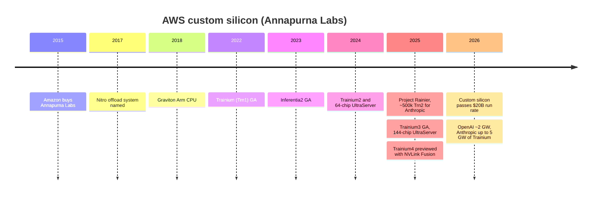

# AWS Trainium — cost inside the largest cloud

Cross-cutting 15 · Competitive landscape · Trainium1–4, Neuron SDK, UltraServers, Project Rainier, Annapurna Labs · ~14 min read · Last verified: 2026-11-05

## ⚡ The Executive Take

- **Four generations in four years.** [Trainium](../../glossary.md#trainium) went from 0.19 [PFLOPS](../../glossary.md#flops) of dense [FP8](../../glossary.md#fp8) per chip (Trn1, 2022) to 2.52 PFLOPS (Trn3, GA December 2025), ~13× [[S152]](../../sources/bibliography.md#s152)[[S353]](../../sources/bibliography.md#s353). AWS says Trainium4 will bring at least 3× Trn3's FP8, 6× its [FP4](../../glossary.md#fp4) and 4× its memory bandwidth, with no launch date given [[S90034]](../../sources/bibliography.md#s90034).
- **AWS matches NVIDIA's rack, not its chip.** A Trn3 [UltraServer](../../glossary.md#ultraserver) joins 144 chips for ~362 PFLOPS FP8 and 20.7 TB of [HBM3E](../../glossary.md#hbm3e) [[S353]](../../sources/bibliography.md#s353), about the same as a GB300 [NVL72](../../glossary.md#nvl72) rack, but with twice the chips (repo comparison) [[S15014]](../../sources/bibliography.md#s15014).
- **Trainium4 will plug into NVIDIA's fabric.** AWS chose [NVLink Fusion](../../glossary.md#nvlink-fusion) and NVIDIA's MGX rack design for Trainium4, the only [hyperscaler](../../glossary.md#hyperscaler) accelerator on the program so far [[S518]](../../sources/bibliography.md#s518)[[S90034]](../../sources/bibliography.md#s90034).
- **Two anchor tenants.** Project Rainier put ~500,000 Trainium2 chips to work for Anthropic in 2025 [[S27011]](../../sources/bibliography.md#s27011). Anthropic has since committed up to 5 GW of Trainium and OpenAI ~2 GW from 2027; AWS cites >$225B of Trainium revenue commitments [[S15000]](../../sources/bibliography.md#s15000)[[S15001]](../../sources/bibliography.md#s15001).
- **It is already a large business.** Amazon's custom silicon (Graviton, Trainium, Nitro) passed a $20B annual revenue run rate in Q1 2026; Amazon's CEO put it at ~$50B if sold as a standalone business [[S15000]](../../sources/bibliography.md#s15000).
- **Weakness:** software and transparency. The Neuron SDK scores 7 of 36 on this repo's framework index [[S594]](../../sources/bibliography.md#s594), Trainium has no MLPerf results, and it is sold only as AWS capacity. AWS also signed a ~$38B deal to give OpenAI NVIDIA GB200/GB300 capacity [[S15013]](../../sources/bibliography.md#s15013).

![Three bar panels of AWS Trainium generations. Dense FP8 per chip: Trn1 0.19 PFLOPS (2022), Trn2 1.3 (2024), Trn3 2.52 (2025), about 13 times in three years, and an estimated ~7.6 for Trainium4 from AWS's claim of at least 3 times Trn3. HBM bandwidth: 0.82, 2.9 and 4.9 TB/s, with Trainium4 estimated at ~19.6 TB/s from AWS's 4 times claim. Scale-up domain: 16 chips per Trn1 instance, 64 per Trn2 UltraServer and 144 per Trn3 UltraServer; Trainium4 is to adopt NVIDIA NVLink Fusion, so its domain is not yet defined.](../../assets/charts/15-trainium-generations.svg)

## From Annapurna Labs to Trainium4

AWS's chips come from [Annapurna Labs](../../glossary.md#annapurna-labs), an Israeli start-up Amazon bought in 2015 for a reported ~$350–370M [[S4540]](../../sources/bibliography.md#s4540). Annapurna first built the Nitro offload cards, then the [Graviton](../../glossary.md#graviton) Arm CPU (2018), the Inferentia inference chip and Trainium [[S4541]](../../sources/bibliography.md#s4541)[[S7533]](../../sources/bibliography.md#s7533). Graviton5 (2026) has 192 cores [[S4526]](../../sources/bibliography.md#s4526). External design partners help with physical design; TrendForce reports Alchip has Trainium3 orders, with mass production from Q2 2026 [[S2517]](../../sources/bibliography.md#s2517).

Sources: [[S4540]](../../sources/bibliography.md#s4540)[[S7533]](../../sources/bibliography.md#s7533)[[S4541]](../../sources/bibliography.md#s4541)[[S152]](../../sources/bibliography.md#s152)[[S153]](../../sources/bibliography.md#s153)[[S352]](../../sources/bibliography.md#s352)[[S27011]](../../sources/bibliography.md#s27011)[[S353]](../../sources/bibliography.md#s353)[[S90034]](../../sources/bibliography.md#s90034)[[S15000]](../../sources/bibliography.md#s15000).

| Generation | GA | Dense FP8 per chip | HBM per chip | Scale-up domain | Source |
|---|---|---|---|---|---|
| Trainium (Trn1) | Oct 2022 | 0.19 PF | 32 GB, 0.82 TB/s | 16 chips per instance | [[S152]](../../sources/bibliography.md#s152) |
| Trainium2 | Dec 2024 | 1.3 PF | 96 GB, 2.9 TB/s | 64-chip UltraServer, 3D torus | [[S154]](../../sources/bibliography.md#s154)[[S352]](../../sources/bibliography.md#s352)[[S245]](../../sources/bibliography.md#s245) |
| Trainium3 (3 nm) | Dec 2025 | 2.52 PF | 144 GB HBM3E, 4.9 TB/s | 144-chip UltraServer, NeuronSwitch | [[S353]](../../sources/bibliography.md#s353)[[S242]](../../sources/bibliography.md#s242) |
| Trainium4 | Not dated | ≥3× Trn3 (≥ ~7.6 PF, Est.) | 2× capacity, 4× bandwidth (Est. ~288 GB, ~19.6 TB/s) | NVLink Fusion, MGX racks | [[S90034]](../../sources/bibliography.md#s90034)[[S518]](../../sources/bibliography.md#s518) |

> [!TIP]
> **Worked example — same rack, twice the chips.** A Trn3 UltraServer delivers 144 × 2.52 ≈ **362 PFLOPS** of dense FP8 and 144 × 144 GB ≈ **20.7 TB** of HBM3E [[S353]](../../sources/bibliography.md#s353). A GB300 NVL72 rack delivers 72 × 5.0 = **360 PFLOPS** and 72 × 288 GB = **20.7 TB** [[S32004]](../../sources/bibliography.md#s32004)[[S123]](../../sources/bibliography.md#s123). Aggregate [HBM](../../glossary.md#hbm) bandwidth even favours AWS: 706 vs 576 TB/s. **Conclusion:** AWS needs twice as many chips (and links between them) for the same rack. The bet is that each Trn3 costs AWS well under half of what it would pay for a GB300, since there is no merchant margin to pay.

🔧 Under the hood: NeuronLink, NeuronSwitch and the move to NVLink

Trainium2 UltraServers joined 64 chips in a 4 × 4 × 4 torus across two racks: ~1 TB/s per chip inside an instance and 256 GB/s between instances [[S244]](../../sources/bibliography.md#s244)[[S245]](../../sources/bibliography.md#s245). Trainium3 added NeuronSwitch-v1, an all-to-all switched fabric with NeuronLink-v4 at ~2 TB/s per chip (one analyst cites up to 2.5 TB/s) [[S242]](../../sources/bibliography.md#s242)[[S247]](../../sources/bibliography.md#s247). That moved AWS toward NVIDIA's switched NVL72 design and away from Google's torus. Trainium4's switch to [NVLink](../../glossary.md#nvlink) Fusion goes further: it adopts NVIDIA's NVLink 6 protocol and MGX rack instead of extending AWS's own [[S518]](../../sources/bibliography.md#s518). NVLink Fusion systems reportedly must include some NVIDIA silicon, such as an NVIDIA CPU or NVLink switch (🟡) [[S5020]](../../sources/bibliography.md#s5020).

The second chart shows a related trade-off: a Trainium3 gets ~16 host CPU threads, against 88 per GPU in Vera Rubin, because AWS hangs many accelerators off each host, while NVIDIA sizes Vera for [agentic](../../glossary.md#agentic-ai) work that leans on the CPU (see [Layer 04](../../layers/04-cpu-grace-vera/index.md)) [[S4021]](../../sources/bibliography.md#s4021)[[S354]](../../sources/bibliography.md#s354).

## Neuron SDK: the software gap

The [Neuron SDK](../../glossary.md#neuron-sdk) compiles [PyTorch](../../glossary.md#pytorch) and JAX graphs for Trainium [[S9014]](../../sources/bibliography.md#s9014). Custom kernels are written in [NKI](../../glossary.md#nki), a Python kernel language, and AWS ships pre-built NKI kernels [[S9014]](../../sources/bibliography.md#s9014)[[S10539]](../../sources/bibliography.md#s10539). In 2026 AWS added TorchNeuron, a native PyTorch backend with eager mode and torch.compile [[S9525]](../../sources/bibliography.md#s9525), and NeuronX Distributed for large-model parallelism [[S594]](../../sources/bibliography.md#s594).

> [!TIP]
> **Worked example — why 7 of 36 still works for AWS.** On this repo's framework index Neuron scores 7 of 36 against [CUDA](../../glossary.md#cuda)'s 36 [[S594]](../../sources/bibliography.md#s594)[[S580]](../../sources/bibliography.md#s580). An enterprise with a dozen tools would face many porting projects. Anthropic runs a handful of model families at enormous scale, with engineers co-developing Trainium [[S656]](../../sources/bibliography.md#s656). If porting costs ~$100M a year of engineering (🔴 illustrative) and Anthropic's Trainium fleet runs ~$10B a year, a 10% cost advantage pays for it ten times over. **Conclusion:** Trainium's software only has to be good enough for a few giant tenants, which is why it can trail on breadth yet win gigawatts.

## Project Rainier, Anthropic and OpenAI: the demand side

AWS activated Project Rainier in October 2025: nearly 500,000 Trainium2 chips in Indiana, built for Anthropic [[S27011]](../../sources/bibliography.md#s27011). Amazon had invested $8B in Anthropic, which named AWS its primary training partner [[S656]](../../sources/bibliography.md#s656). In April 2026 Amazon disclosed that Anthropic will secure up to 5 GW of current and future Trainium generations and that OpenAI will consume ~2 GW of Trainium from 2027 [[S15000]](../../sources/bibliography.md#s15000). AWS cites more than $225B of Trainium revenue commitments [[S15001]](../../sources/bibliography.md#s15001).

![Stacked horizontal bar chart of announced compute programmes in gigawatts. OpenAI 26 GW: NVIDIA 10 (September 2025 letter of intent, since restructured), Broadcom custom accelerators 10 and AMD 6. Anthropic 4 GW: AMD Helios up to 2 (with an up-to-$5B AMD investment), NVIDIA up to 1 and Google TPUs over 1 GW in 2026 (a further multi-GW TPU expansion from 2027 is unquantified). HUMAIN: NVIDIA up to 0.5 GW, AMD 0.5 GW and Qualcomm 0.2 GW. xAI: about 1 GW on NVIDIA (company claim, contested). NVIDIA's share across these programmes is about 39%.](../../assets/charts/13-gw-pipeline-by-supplier.svg)

AWS hedges both ways. In November 2025 it signed a seven-year, ~$38B agreement to host NVIDIA GB200 and GB300 capacity for OpenAI [[S15013]](../../sources/bibliography.md#s15013). It bought an estimated 196,000 Hopper GPUs in 2024 [[S12014]](../../sources/bibliography.md#s12014). Its 2026 capex guide is ~$220B [[S12519]](../../sources/bibliography.md#s12519).

> [!TIP]
> **Worked example — what $225B over 7 GW implies.** $225B ÷ (5 + 2) GW ≈ **~$32B of Trainium revenue commitments per GW** [[S15000]](../../sources/bibliography.md#s15000)[[S15001]](../../sources/bibliography.md#s15001). NVIDIA's CEO put NVIDIA's content in a 1 GW AI factory at ~$35B [[S398]](../../sources/bibliography.md#s398). The figures are not like for like (multi-year cloud revenue vs hardware sales, and "up to" maximums), but they are the same order of magnitude. **Conclusion:** each Trainium gigawatt is roughly a gigawatt of NVIDIA content that went elsewhere; at full build-out Trainium's commitments equal about a year of NVIDIA's FY2026 data-center revenue (~$194B) [[S1]](../../sources/bibliography.md#s1).

## Economics vs NVIDIA inside AWS

AWS prices Trainium below comparable GPU instances but publishes no per-token benchmark; Trainium is absent from MLPerf and InferenceX [[S620]](../../sources/bibliography.md#s620). The clearest public signal is Amazon's own framing of its silicon business.

![Horizontal bar chart. The four largest hyperscalers guide about $728B of 2026 capex (Amazon ~$220B, Alphabet ~$200B, Microsoft ~$170B, Meta ~$138B, midpoints). Against that, NVIDIA's hyperscale Data Center revenue annualizes to about $173B (first half of FY2027 times two), roughly 24% of the capex; Broadcom's AI semiconductor revenue annualizes to about $67B (Q3 FY2026 times four, including networking and non-hyperscaler customers); Amazon's own custom-silicon business passed a $20B run rate; AMD's whole Data Center segment annualizes to about $34B. Most capex goes to buildings, power, networking and memory, not accelerators.](../../assets/charts/15-hyperscaler-capex-vs-silicon-2026.svg)

> [!TIP]
> **Worked example — reading Jassy's "$20B vs $50B".** Amazon says its custom-chip business runs at >$20B a year, and would be ~$50B a year if sold as a standalone business [[S15000]](../../sources/bibliography.md#s15000). The ratio, 20 ÷ 50 = **0.4**, suggests AWS values its chips internally at ~40% of a merchant-equivalent price: the other ~60% is roughly the margin a merchant vendor would charge (🔴 repo interpretation of a hypothetical). NVIDIA's ~75% gross margin implies its cost is ~25% of its price [[S405]](../../sources/bibliography.md#s405). **Conclusion:** in-house silicon recovers most, but not all, of the merchant margin, because AWS pays design partners, TSMC and HBM suppliers at market prices.

🔧 Under the hood: why AWS still needs NVIDIA

Many AWS customers want CUDA, and frontier labs train new architectures on NVIDIA first. Hence the dual track: AWS sells NVIDIA capacity (including the OpenAI deal [[S15013]](../../sources/bibliography.md#s15013)) while steering its own large tenants to Trainium. With NVLink Fusion on Trainium4 [[S518]](../../sources/bibliography.md#s518), AWS gets NVIDIA's mature fabric and racks while keeping its own compute die; NVIDIA keeps a share of every rack.

## Verdict by layer

| Layer | Verdict vs NVIDIA | Reason |
|---|---|---|
| 02 Accelerator silicon | 🟥 Behind | Trn3 2.52 PFLOPS FP8 and 144 GB per chip, ~half a GB300 [[S353]](../../sources/bibliography.md#s353) |
| 03 Memory, packaging, supply | 🟥 Behind | Design partners compete for CoWoS behind NVIDIA and Google [[S2517]](../../sources/bibliography.md#s2517) |
| 04 CPU | 🟨 Parity | Graviton5 (192 cores) is a mature Arm server CPU [[S4526]](../../sources/bibliography.md#s4526) |
| 05 Scale-up | 🟥 Behind | 144-chip NeuronSwitch domain; Trainium4 moves to NVLink Fusion [[S242]](../../sources/bibliography.md#s242)[[S518]](../../sources/bibliography.md#s518) |
| 06 Scale-out | 🟦 Different | EFA on in-house Ethernet fabrics, not sold externally [[S352]](../../sources/bibliography.md#s352) |
| 07 DPU and offload | 🟦 Different | Nitro, mature and ubiquitous inside AWS [[S7533]](../../sources/bibliography.md#s7533) |
| 08 Systems and racks | 🟥 Behind | UltraServers at Rainier scale, but only inside AWS [[S27011]](../../sources/bibliography.md#s27011) |
| 09 System software | 🟥 Behind | Neuron 7/36 on the framework index [[S594]](../../sources/bibliography.md#s594) |
| 10 Libraries | 🟥 Behind | NKI library is narrow and young [[S10539]](../../sources/bibliography.md#s10539) |
| 11 Inference software | 🟥 Behind | Serves Claude at scale; no MLPerf or InferenceX results [[S620]](../../sources/bibliography.md#s620) |
| 12 Orchestration and cloud | 🟩 Leads | AWS is the largest cloud; Trainium sold only as a service [[S15000]](../../sources/bibliography.md#s15000) |
| 13 Ecosystem and capital | 🟥 Behind | Two anchor tenants, little external pull [[S656]](../../sources/bibliography.md#s656)[[S15000]](../../sources/bibliography.md#s15000) |

Repo analyst judgement from `data/competitor_matrix.csv` (🔴) [[S15014]](../../sources/bibliography.md#s15014).

> [!TIP]
> **Worked example — Trainium4 on paper vs Rubin.** Applying AWS's multipliers to Trainium3 gives ≥ ~7.6 PFLOPS of FP8 and ~19.6 TB/s of HBM bandwidth per chip (Est.) [[S90034]](../../sources/bibliography.md#s90034)[[S353]](../../sources/bibliography.md#s353). Rubin lists 17.5 PFLOPS and 19.2 TB/s [[S33005]](../../sources/bibliography.md#s33005)[[S90006]](../../sources/bibliography.md#s90006). **Conclusion:** Trainium4 would match today's Rubin on memory bandwidth (~102%) at ~43% of its compute, the profile of an inference-first chip, but it would face Rubin Ultra, not Rubin, if it ships in 2027.

**Their best argument.** "Good enough, cheaper, already in your cloud." AWS can price Trainium below NVIDIA instances because it captures the merchant margin, and its two largest AI tenants have committed gigawatts. It does not need to beat NVIDIA per chip; it needs the cost per token of its own racks to be lower.

**How much the gap has closed.**

| Measure | Then | Now (Nov 2026) | Source |
|---|---|---|---|
| Dense FP8 per chip vs NVIDIA flagship | 10% (Trn1 vs H100, 2022) | 50% (Trn3 vs GB300, 2025) | [[S15014]](../../sources/bibliography.md#s15014) |
| Memory bandwidth vs NVIDIA flagship | 24% (Trn1) | 61% (Trn3) | [[S15014]](../../sources/bibliography.md#s15014) |
| Scale-up domain | 16 chips | 144 chips (NVL72: 72) | [[S152]](../../sources/bibliography.md#s152)[[S353]](../../sources/bibliography.md#s353) |
| Committed demand | Internal and small tenants | Anthropic up to 5 GW, OpenAI ~2 GW, >$225B | [[S15000]](../../sources/bibliography.md#s15000)[[S15001]](../../sources/bibliography.md#s15001) |
| Independent benchmarks | None | None | [[S613]](../../sources/bibliography.md#s613)[[S620]](../../sources/bibliography.md#s620) |

> [!NOTE]
> **🐂 Bull view (for AWS).** Trainium has the largest committed external demand of any hyperscaler chip and the economics of owning the whole cloud. Trainium4's 4× bandwidth jump would put it near Rubin's 19.2 TB/s on paper, and NVLink Fusion removes AWS's weakest layer, [scale-up](../../glossary.md#scale-up) [[S90034]](../../sources/bibliography.md#s90034)[[S518]](../../sources/bibliography.md#s518).

> [!WARNING]
> **🐻 Bear view (for AWS).** Adopting NVLink Fusion is an admission that AWS's own fabric was not enough, and it hands NVIDIA a toll on every Trainium4 rack. Trainium has no audited benchmarks. Its demand rests on two labs that also buy NVIDIA, AMD and TPUs, and its software scores 7 of 36 [[S594]](../../sources/bibliography.md#s594).

## 🎯 Corp Dev Lens

1. **NVLink Fusion as a business model.** AWS chose to plug Trainium4 into NVIDIA's fabric rather than build or adopt [UALink](../../glossary.md#ualink) [[S518]](../../sources/bibliography.md#s518). What does that signal about the cost and time of building a competitive scale-up fabric, and who else might follow?
2. **The anchor-tenant model.** Trainium's software only has to serve a few giant tenants. Could a merchant challenger replicate that by pairing with one lab, and what equity or capacity terms would that take (compare AMD's warrants)?
3. **Design-partner exposure.** Alchip and Marvell reportedly build Trainium generations [[S2517]](../../sources/bibliography.md#s2517). How concentrated is each design house's revenue on one hyperscaler, and how durable is that position across generations?
4. **Custom silicon as a reported segment.** Amazon now discusses its chip business like a product line ($20B run rate) [[S15000]](../../sources/bibliography.md#s15000). If AWS sells Trainium outside AWS, as Google now does with TPUs, how would that change the merchant accelerator market?

## 📚 Sources

<!-- Auto-generated from the [S…] citations on this page by `make build`. Edit sources/registry/*.csv, not this list. -->

- [**S1**](../../sources/bibliography.md#s1) NVIDIA Corporation via SEC EDGAR, *NVIDIA Announces Financial Results for Fourth Quarter and Fiscal 2026 (Form 8-K exhibit 99.1)*, 2026-02-25. [Link](https://www.sec.gov/Archives/edgar/data/1045810/000104581026000019/q4fy26pr.htm)
- [**S123**](../../sources/bibliography.md#s123) Glenn K. Lockwood (blog) (Glenn K. Lockwood), *HGX B300 specifications compilation (B300 per-GPU figures)*, 2025. [Link](https://glennklockwood.com/garden/processors/B300)
- [**S152**](../../sources/bibliography.md#s152) AWS Neuron SDK docs, *AWS Neuron documentation: Trainium (Trn1) architecture*, 2022. [Link](https://awsdocs-neuron.readthedocs-hosted.com/en/latest/general/arch/neuron-hardware/trainium.html)
- [**S153**](../../sources/bibliography.md#s153) AWS Neuron SDK docs, *AWS Neuron documentation: Inferentia2 architecture*, 2023. [Link](https://awsdocs-neuron.readthedocs-hosted.com/en/latest/general/arch/neuron-hardware/inferentia2.html)
- [**S154**](../../sources/bibliography.md#s154) AWS Neuron SDK docs, *AWS Neuron documentation: Trainium2 architecture*, 2024-12. [Link](https://awsdocs-neuron.readthedocs-hosted.com/en/latest/general/arch/neuron-hardware/trainium2.html)
- [**S242**](../../sources/bibliography.md#s242) Amazon Web Services, *Amazon EC2 Trn3 instances (product page)*, 2025-12-02. [Link](https://aws.amazon.com/ec2/instance-types/trn3/)
- [**S244**](../../sources/bibliography.md#s244) Amazon Web Services, *Trainium2 architecture (AWS Neuron documentation)*, 2024-12. [Link](https://awsdocs-neuron.readthedocs-hosted.com/en/latest/general/arch/neuron-hardware/trn2-arch.html)
- [**S245**](../../sources/bibliography.md#s245) SemiAnalysis, *Amazon's AI self-sufficiency: Trainium2 architecture and networking*, 2024-12. [Link](https://newsletter.semianalysis.com/p/amazons-ai-self-sufficiency-trainium2-architecture-networking)
- [**S247**](../../sources/bibliography.md#s247) NAND Research, *Research Note: AWS releases Trainium3, teases Trainium4*, 2025-12. [Link](https://nand-research.com/research-note-aws-releases-trainium3-teases-trainium4/)
- [**S352**](../../sources/bibliography.md#s352) AWS News Blog, *Amazon EC2 Trn2 instances and Trn2 UltraServers for AI/ML training and inference are now available*, 2024-12-03. [Link](https://aws.amazon.com/blogs/aws/amazon-ec2-trn2-instances-and-trn2-ultraservers-for-aiml-training-and-inference-is-now-available)
- [**S353**](../../sources/bibliography.md#s353) AWS, *Announcing Amazon EC2 Trn3 UltraServers for faster, lower-cost generative AI training*, 2025-12-02. [Link](https://aws.amazon.com/about-aws/whats-new/2025/12/amazon-ec2-trn3-ultraservers/)
- [**S354**](../../sources/bibliography.md#s354) AWS, *Trn3 architecture (AWS Neuron documentation)*, 2026. [Link](https://awsdocs-neuron.readthedocs-hosted.com/en/v2.28.0/_sources/about-neuron/arch/neuron-hardware/trn3-arch.rst)
- [**S398**](../../sources/bibliography.md#s398) NVIDIA Investor Relations, *NVIDIA Q2 FY2026 earnings call (2025-08-27): AI factory economics commentary*, 2025-08-27. [Link](https://investor.nvidia.com/events-and-presentations/events-and-presentations/default.aspx)
- [**S405**](../../sources/bibliography.md#s405) NVIDIA Corporation via SEC EDGAR, *NVIDIA Announces Financial Results for Second Quarter Fiscal 2027 (Form 8-K exhibit 99.1)*, 2026-08-26. [Link](https://www.sec.gov/Archives/edgar/data/0001045810/000104581026000073/q2fy27pr.htm)
- [**S518**](../../sources/bibliography.md#s518) ServeTheHome, *NVIDIA NVLink Fusion tapped for future AWS Trainium4 deployments*, 2025-12-02. [Link](https://www.servethehome.com/nvidia-nvlink-fusion-tapped-for-future-aws-trainium4-deployments/)
- [**S580**](../../sources/bibliography.md#s580) vLLM project (GitHub), *vLLM README and installation docs — supported hardware*, 2026-11. [Link](https://github.com/vllm-project/vllm/blob/main/docs/getting_started/installation/README.md)
- [**S594**](../../sources/bibliography.md#s594) AWS (GitHub: aws-neuron/neuronx-distributed), *NeuronX Distributed (NxD) README*, 2026-11. [Link](https://github.com/aws-neuron/neuronx-distributed)
- [**S613**](../../sources/bibliography.md#s613) NAND Research, *MLPerf Inference 6.0: Software Gains, Broadening Competition Shake Things Up*, 2026-04. [Link](https://nand-research.com/mlperf-inference-6-0-software-gains-broadening-competition-shake-things-up/)
- [**S620**](../../sources/bibliography.md#s620) SemiAnalysis, *SemiAnalysis InferenceX (formerly InferenceMAX) open-source benchmark repository*, 2026-11. [Link](https://github.com/SemiAnalysisAI/InferenceX)
- [**S656**](../../sources/bibliography.md#s656) Anthropic, *Powering the next generation of AI development with AWS (expanded Amazon partnership and Trainium)*, 2024-11-22. [Link](https://www.anthropic.com/news/anthropic-amazon-trainium)
- [**S2517**](../../sources/bibliography.md#s2517) TrendForce, *CSPs accelerate ASIC push in 2H26, challenging NVIDIA as MediaTek, GUC, Alchip benefit*, 2026-03-20. [Link](https://www.trendforce.com/news/2026/03/20/news-csps-accelerate-asic-push-in-2h26-challenging-nvidia-as-mediatek-guc-alchip-benefit/)
- [**S4021**](../../sources/bibliography.md#s4021) Amazon Web Services (GitHub), *Trn2 architecture (AWS Neuron SDK documentation source)*, 2026. [Link](https://github.com/aws-neuron/aws-neuron-sdk/blob/master/about-neuron/arch/neuron-hardware/trn2-arch.rst)
- [**S4526**](../../sources/bibliography.md#s4526) Amazon Web Services, *Amazon EC2 M9g and M9gd instances powered by AWS Graviton5 are now available*, 2026-06-10. [Link](https://aws.amazon.com/about-aws/whats-new/2026/06/ec2-m9g-m9gd-instances-graviton5-processors-available)
- [**S4540**](../../sources/bibliography.md#s4540) Global Venturing, *Arm exits Annapurna Labs in $370m acquisition*, 2015-01-23. [Link](https://globalventuring.com/blog/2015/01/23/arm-exits-annapurna-labs-in-370m-acquisition/)
- [**S4541**](../../sources/bibliography.md#s4541) The Register, *Amazon AWS puts custom Arm server chip (Graviton) into the cloud: A1 instances*, 2018-11-27. [Link](https://www.theregister.com/2018/11/27/amazon_aws_a1/)
- [**S5020**](../../sources/bibliography.md#s5020) PC Watch (Impress), *Computex 2025: NVIDIA NVLink Fusion report*, 2025-05. [Link](https://pc.watch.impress.co.jp/docs/news/event/2015077.html)
- [**S7533**](../../sources/bibliography.md#s7533) hidekazu-konishi.com (Hidekazu Konishi), *AWS custom silicon history and timeline: Nitro System, Graviton, Inferentia, Trainium*, 2025. [Link](https://hidekazu-konishi.com/entry/aws_history_and_timeline_aws_silicon.html)
- [**S9014**](../../sources/bibliography.md#s9014) AWS (GitHub: aws-neuron/nki-samples), *Neuron Kernel Interface (NKI) samples README*, 2026-11. [Link](https://github.com/aws-neuron/nki-samples/blob/main/README.md)
- [**S9525**](../../sources/bibliography.md#s9525) AWS Neuron SDK docs, *AWS Neuron documentation: PyTorch on Neuron (TorchNeuron) and NKI*, 2026. [Link](https://awsdocs-neuron.readthedocs-hosted.com/en/latest/_sources/torch/index.rst)
- [**S10539**](../../sources/bibliography.md#s10539) AWS Neuron Documentation, *About the NKI Library*, 2026. [Link](https://awsdocs-neuron.readthedocs-hosted.com/en/latest/nki/library/about/index.html)
- [**S12014**](../../sources/bibliography.md#s12014) DatacenterDynamics, *Microsoft bought twice as many Nvidia Hopper GPUs as other big tech companies - report*, 2024-12. [Link](https://www.datacenterdynamics.com/en/news/microsoft-bought-twice-as-many-nvidia-hopper-gpus-as-other-big-tech-companies-report)
- [**S12519**](../../sources/bibliography.md#s12519) Hargreaves Lansdown, *AI hyperscalers are expected to finish the year spending a whopping $828 billion on capex*, 2026-10. [Link](https://www.hl.co.uk/news/ai-hyperscalers-are-expected-to-finish-the-year-spending-a-whopping-828-billion-on-capex)
- [**S15000**](../../sources/bibliography.md#s15000) About Amazon (Andy Jassy), *Amazon CEO Andy Jassy on Amazon's chips business (Q1 2026 earnings)*, 2026-04-29. [Link](https://www.aboutamazon.com/news/company-news/amazon-ceo-andy-jassy-amazon-chips-business-q1-2026-earnings)
- [**S15001**](../../sources/bibliography.md#s15001) Nasdaq, *Andy Jassy says Amazon's chip business already has $225 billion in commitments*, 2026-05. [Link](https://www.nasdaq.com/articles/andy-jassy-says-amazons-chip-business-already-has-225-billion-commitments)
- [**S15013**](../../sources/bibliography.md#s15013) Built In, *OpenAI enters $38B partnership with AWS to scale compute capacity*, 2025-11-04. [Link](https://builtin.com/articles/openai-38b-aws-partnership-20251104)
- [**S15014**](../../sources/bibliography.md#s15014) nvidia_deep_dive_claude repository, *Repo analysis: Chapter 15A competitive-landscape calculations (gap-to-flagship ratios, implied AMD commitment value, hyperscaler wallet shares, breadth vs depth)*, 2026-11-05. [Link](https://github.com/FrankHuang94/nvidia_deep_dive_claude/blob/main/cross-cutting/15-competitive-landscape/index.md)
- [**S27011**](../../sources/bibliography.md#s27011) About Amazon, *AWS activates Project Rainier: one of the world's largest AI compute clusters*, 2025-10. [Link](https://www.aboutamazon.com/news/aws/aws-project-rainier-ai-trainium-chips-compute-cluster)
- [**S32004**](../../sources/bibliography.md#s32004) NVIDIA, *NVIDIA GB300 NVL72 / Blackwell Ultra (product page)*, 2025-03. [Link](https://www.nvidia.com/en-us/data-center/gb300-nvl72/)
- [**S33005**](../../sources/bibliography.md#s33005) NVIDIA, *NVIDIA Vera Rubin NVL72 (product page and specifications)*, 2026. [Link](https://www.nvidia.com/en-us/data-center/vera-rubin-nvl72/)
- [**S90006**](../../sources/bibliography.md#s90006) TweakTown, *Nvidia cuts Vera Rubin's memory bandwidth by up to 26% and AMD's Helios now leads in memory bandwidth*, 2026-10. [Link](https://www.tweaktown.com/news/114304/nvidia-cuts-vera-rubins-memory-bandwidth-by-up-to-26-percent-and-amds-helios-now-leads-in-memory-bandwidth/index.html)
- [**S90034**](../../sources/bibliography.md#s90034) NAND Research, *AWS releases Trainium3, teases Trainium4*, 2025-12. [Link](https://nand-research.com/research-note-aws-releases-trainium3-teases-trainium4/4/)
