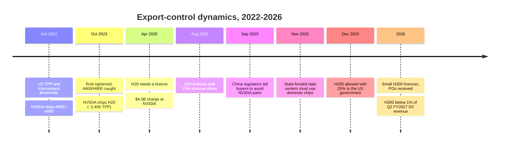

# China: Huawei Ascend, Cambricon and a protected domestic market

Cross-cutting 15 · Competitive landscape · ~16 min read · Last verified: 2026-11-05

## ⚡ The Executive Take

- **China is now a separate market for NVIDIA.** China fell from 26.4% of NVIDIA's revenue in FY2022 to 9.1% in FY2026
  and 5.6–8.2% in FY2027 quarters; guidance excludes China data-center compute, and H200 sales under the 25%-levy licence
  were reported below 1% of Q2 FY2027 data-center revenue 🟡 [[S2]](../../sources/bibliography.md#s2)[[S401]](../../sources/bibliography.md#s401)[[S90070]](../../sources/bibliography.md#s90070)[[S90069]](../../sources/bibliography.md#s90069)[[S90032]](../../sources/bibliography.md#s90032)[[S26009]](../../sources/bibliography.md#s26009).
- **Huawei is the main beneficiary.** It expects ~$12B of AI-chip revenue in 2026, up ~60% from ~$7.5B in 2025, and
  targets ~750k Ascend 950PR chips this year 🟡 [[S15527]](../../sources/bibliography.md#s15527).
- **Per chip, Huawei still trails.** Ascend 950 lists 1 [PFLOPS](../../glossary.md#flops) [FP8](../../glossary.md#fp8), ~3.4× the H20 that China could buy, but about half a
  licensed H200; even the 2028 Ascend 970 (4 PFLOPS) trails 2026's Rubin (17.5) ~4.4× [[S163]](../../sources/bibliography.md#s163)[[S26003]](../../sources/bibliography.md#s26003)[[S90006]](../../sources/bibliography.md#s90006).
- **It answers with scale and power.** CloudMatrix 384 delivers ~300 PF of dense [BF16](../../glossary.md#bf16) vs ~180 PF for a GB200 [NVL72](../../glossary.md#nvl72), at
  559 kW vs 145 kW (Est., SemiAnalysis) [[S340]](../../sources/bibliography.md#s340); the 8,192-chip Atlas 950 SuperPoD (8 EF FP8) is due Q4 2026 and Huawei
  says it is in large-scale commercial use; independent confirmation is missing 🔴 [[S341]](../../sources/bibliography.md#s341)[[S567]](../../sources/bibliography.md#s567)[[S90042]](../../sources/bibliography.md#s90042).
- **Supply is the binding constraint.** SMIC's 7 nm-class capacity is estimated at ~45–60k wafers a month (SemiAnalysis),
  output at under 20k (Nikkei), and domestic [HBM](../../glossary.md#hbm) (CXMT [HBM3E](../../glossary.md#hbm3e)) is only at small scale, with a ramp targeted for 2027
  [[S15528]](../../sources/bibliography.md#s15528)[[S15529]](../../sources/bibliography.md#s15529)[[S3516]](../../sources/bibliography.md#s3516).
- **A listed domestic field is growing fast.** In H1 2026 Cambricon's revenue rose 108% to 6.0B yuan, Moore Threads' 147%
  to 1.7B yuan and Hygon's 67% to 9.1B yuan (CPUs included); Biren, MetaX and Moore Threads listed in 2025–26 and
  Baidu's Kunlunxin is preparing an IPO [[S15522]](../../sources/bibliography.md#s15522)[[S15523]](../../sources/bibliography.md#s15523)[[S15525]](../../sources/bibliography.md#s15525)[[S15541]](../../sources/bibliography.md#s15541)[[S15540]](../../sources/bibliography.md#s15540)[[S15537]](../../sources/bibliography.md#s15537).
- **Software is forming around Ascend:** DeepSeek V4 (April 2026) used Ascend for part of V4-Flash training and adapted
  Ascend SuperNodes for inference [[S90079]](../../sources/bibliography.md#s90079)[[S90080]](../../sources/bibliography.md#s90080); Huawei open-sourced [CANN](../../glossary.md#cann) in August 2025 [[S10537]](../../sources/bibliography.md#s10537).

![Three-panel bar chart comparing Huawei Ascend chips with the NVIDIA parts China can or could buy. Dense compute: H20 296 TFLOPS FP8, H200 1979, Ascend 910B 320 FP16, 910C 800 FP16, 950PR and 950DT 1000 FP8, 960 2000, 970 4000 (2028) and Rubin 17500. Memory bandwidth: H20 4.0 TB/s, H200 4.8, 910C 3.2, 950PR 1.6, 950DT 4.0, 960 9.6, 970 14.4, Rubin 19.2. Capacity: H20 96 GB, H200 141, 950PR 128, 950DT 144, 960 and 970 288, Rubin 288. Huawei's roadmap closes the capacity gap by 2027 but not the compute or bandwidth gap.](../../assets/charts/15-ascend-vs-nvidia-china-parts.svg)

## Why China is a separate market

Two governments built the wall. Washington set [TPP](../../glossary.md#tpp) thresholds that capped what NVIDIA may sell, and
Beijing steered buyers to domestic chips once the capped parts arrived. The full history, with NVIDIA's revenue
consequences, is in [CS6 · China export controls](../../case-studies/CS6-china-export-controls-h20-and-beyond.md).

> [!TIP]
> **Worked example — a Chinese buyer's choice in 2026.** The licensed H200 has 1,979 TFLOPS of dense FP8 and 4.8 TB/s of
> HBM3E [[S32002]](../../sources/bibliography.md#s32002); an Ascend 950PR has ~1,000 TFLOPS of FP8 (dense vs sparse not stated) and 1.6 TB/s [[S163]](../../sources/bibliography.md#s163). Per chip the
> H200 is ~2× on compute and ~3× on bandwidth. But the H200 carries a 25% revenue share to the US government [[S90032]](../../sources/bibliography.md#s90032),
> state-funded projects must use domestic chips [[S26007]](../../sources/bibliography.md#s26007), and supply can be cut again by either side. For a buyer who
> values continuity over peak speed, two Ascend chips per H200 can be the rational choice, and Huawei's SuperPoDs make
> "more chips" an architecture rather than a penalty.

![Two-panel chart of China's share of NVIDIA revenue. Left, by fiscal year on the old billing basis: 23.9% FY2019, 25.0% FY2020, 23.3% FY2021, 26.4% FY2022, 21.4% FY2023, 16.9% FY2024, 13.1% FY2025; on the new customer-headquarters basis: 20.2% FY2024, 19.2% FY2025 ($25.0B, the dollar peak) and 9.1% FY2026 ($19.7B). Right, by quarter on the headquarters basis: 21.9% in Q1 FY2026, 8.6% in Q2 FY2026 after the H20 licence requirement, 5.6% in Q1 FY2027 and 8.2% in Q2 FY2027 (all platforms, including gaming).](../../assets/charts/CS6-china-revenue-share.svg)

## Huawei Ascend: chips, SuperPoDs and brute-force scale

Huawei's strategy accepts a weaker chip and compensates at the system level: more chips, a larger
[scale-up](../../glossary.md#scale-up) domain over optics ([UnifiedBus](../../glossary.md#unifiedbus)), and more power. It runs the
whole stack: [NPU](../../glossary.md#npu), Kunpeng CPUs, in-house HBM, switches, CANN software and Huawei Cloud [[S163]](../../sources/bibliography.md#s163)[[S4031]](../../sources/bibliography.md#s4031).

| System or chip | Timing | Scale | Compute | Memory | Interconnect | Status | Sources |
|---|---|---|---|---|---|---|---|
| Ascend 910B | 2023 | chip | ~320 TFLOPS FP16 | 64 GB HBM2e, 1.6 TB/s | HCCS, 8 per node | shipping | [[S164]](../../sources/bibliography.md#s164) |
| Ascend 910C | 2025 | chip (2 dies) | ~800 TFLOPS FP16 | 128 GB, 3.2 TB/s | UB (CloudMatrix) | shipping | [[S163]](../../sources/bibliography.md#s163)[[S164]](../../sources/bibliography.md#s164) |
| CloudMatrix 384 | Apr 2025 | 384 × 910C | ~300 PF BF16 | 49.2 TB HBM | optical UB | shipping | [[S340]](../../sources/bibliography.md#s340)[[S248]](../../sources/bibliography.md#s248) |
| Ascend 950PR | Q1 2026 | chip | 1 PF FP8, 2 PF FP4 | 128 GB HiBL 1.0, 1.6 TB/s | UB, 2 TB/s | mass production reported 🟡 | [[S163]](../../sources/bibliography.md#s163)[[S15527]](../../sources/bibliography.md#s15527) |
| Ascend 950DT | Q4 2026 | chip | 1 PF FP8 | 144 GB HiZQ 2.0, 4.0 TB/s | UB, 2 TB/s | announced | [[S163]](../../sources/bibliography.md#s163)[[S90042]](../../sources/bibliography.md#s90042) |
| Atlas 950 SuperPoD | Q4 2026 | 8,192 × 950DT | 8 EF FP8 / 16 EF FP4 | — | all-optical UB 2.0 | 🔴 shipments unconfirmed | [[S341]](../../sources/bibliography.md#s341)[[S250]](../../sources/bibliography.md#s250)[[S567]](../../sources/bibliography.md#s567) |
| Ascend 960 / 960DT | Q4 2027 → Q1 2027 | chip | 2 PF FP8 | 288 GB, 9.6 TB/s | UB, 2.2 TB/s | pulled in by 3 quarters 🟡 | [[S163]](../../sources/bibliography.md#s163)[[S567]](../../sources/bibliography.md#s567) |
| Atlas 960 SuperPoD | Q4 2027 | 15,488 chips | 30 EF FP8 / 60 EF FP4 | 4,460 TB | UB | roadmap | [[S342]](../../sources/bibliography.md#s342) |
| Ascend 970 | Q4 2028 | chip | 4 PF FP8 | 288 GB, 14.4 TB/s | UB, 4 TB/s | roadmap | [[S163]](../../sources/bibliography.md#s163) |
| *NVIDIA Vera Rubin NVL72 (ref.)* | 2026 | 72 packages | 3.6 EF NVFP4 (inference) | 288 GB HBM4 per GPU | NVLink 6 | ramping | [[S90003]](../../sources/bibliography.md#s90003)[[S90006]](../../sources/bibliography.md#s90006) |

> [!TIP]
> **Worked example — what brute force costs.** SemiAnalysis put CloudMatrix 384 at ~300 PF of dense BF16 vs ~180 PF for
> a GB200 NVL72, 1.7× the compute, but at 559 kW vs ~145 kW, 3.9× the power [[S340]](../../sources/bibliography.md#s340). Per kilowatt that is ~0.54 PF vs
> ~1.24 PF, so Huawei needs ~2.3× the energy for each unit of compute. At an illustrative $0.08 per kWh (🔴), the extra
> ~414 kW running all year costs ~$0.29M per system per year: material, but small next to hardware cost. Power is
> Huawei's cheapest input; leading-edge wafers and HBM are its scarcest.

🔧 Under the hood: making 7 nm-class chips without EUV

SMIC cannot buy EUV scanners, so it prints 7 nm-class layers with deep-ultraviolet tools exposed several times per layer
([DUV multi-patterning](../../glossary.md#duv-multipatterning)). Each extra exposure adds steps, cycle time and defect risk, so yields
on large AI dies trail TSMC's [[S15531]](../../sources/bibliography.md#s15531). The Ascend 950PR is reported on SMIC's N+3 process [[S15531]](../../sources/bibliography.md#s15531), and Morgan Stanley
cut its estimate of SMIC's Huawei AI revenue sharply on yields [[S15530]](../../sources/bibliography.md#s15530). Huawei's in-house HBM (HiBL 1.0, HiZQ 2.0)
replaces stacks it can no longer import [[S163]](../../sources/bibliography.md#s163); China's CXMT began small-scale HBM3E production in 2026 [[S3516]](../../sources/bibliography.md#s3516). Huawei,
SMIC and several GPU designers are on the US [Entity List](../../glossary.md#entity-list), which blocks US tools and IP; the
October 2023 rule also added Chinese GPU developers [[S26001]](../../sources/bibliography.md#s26001).

## Supply: SMIC capacity and domestic HBM

![Dot-and-line chart of estimates for China's 7 nm-class wafer capacity. SemiAnalysis (conservative): SMIC 7 nm-and-below capacity about 45k wafers a month at end-2025, 60k in 2026 and 80k in 2027, and Huawei's Ascend needing at most about 20k. Nikkei via TrendForce: output of fewer than 20k wafers a month in early 2026 with a government goal of about 100k within one to two years (hollow). Morgan Stanley: about 18k AI-chip wafers a month at best by 2027 because of low yields. Fab capacity is not the only constraint: HBM supply binds first.](../../assets/charts/15-china-advanced-node-capacity.svg)

> [!TIP]
> **Worked example — dies per wafer under constraint.** Huawei reportedly aimed for up to ~1.6M Ascend dies in 2026
> [[S15532]](../../sources/bibliography.md#s15532). SemiAnalysis says Ascend needs at most ~20k wafers a month [[S15528]](../../sources/bibliography.md#s15528), i.e. ≤240k wafers a year. 1.6M dies ÷
> 240k wafers ≈ 7 good dies per wafer at that ceiling (🔴 repo arithmetic): plausible for a large die at modest yield, and
> it shows why wafers alone do not cap Ascend. HBM does: each 950DT needs 144 GB of HBM [[S163]](../../sources/bibliography.md#s163), and domestic HBM3E is
> still at small scale [[S3516]](../../sources/bibliography.md#s3516). For comparison, SMIC held 5.4% of global foundry revenue in 2Q26 vs TSMC's 72.5% [[S35035]](../../sources/bibliography.md#s35035).

## The rest of the field: Cambricon, Hygon, Moore Threads, MetaX, Biren, T-Head, Kunlunxin

| Company | What it sells | 2026 data point | Capital markets | Sources |
|---|---|---|---|---|
| Cambricon | Siyuan (MLU) training and inference accelerators | H1 revenue 6.0B yuan (+108%), net profit 2.3B yuan; inventory 8.25B yuan | STAR-listed | [[S15522]](../../sources/bibliography.md#s15522)[[S15521]](../../sources/bibliography.md#s15521)[[S165]](../../sources/bibliography.md#s165) |
| Hygon | x86-licensed CPUs and DCU accelerators | H1 revenue 9.1B yuan (+67%) | STAR-listed; Sugon merger dropped Dec 2025 | [[S15525]](../../sources/bibliography.md#s15525)[[S15526]](../../sources/bibliography.md#s15526) |
| Moore Threads | GPUs (graphics + AI) | H1 revenue 1.7B yuan (+147%) | STAR IPO Dec 2025 (~$1.1B raised) | [[S15523]](../../sources/bibliography.md#s15523)[[S15539]](../../sources/bibliography.md#s15539) |
| MetaX | GPUs for AI and HPC | H1 profit; revenue reports conflict | STAR IPO Dec 2025 (~4.2B yuan raised) | [[S15524]](../../sources/bibliography.md#s15524)[[S15540]](../../sources/bibliography.md#s15540) |
| Biren | GPUs for AI | — | Hong Kong listing 2026-01-02 | [[S15541]](../../sources/bibliography.md#s15541) |
| Alibaba T-Head | PPU / Zhenwu 810E (96 GB HBM2e, 400 W) | >560k units shipped (company, reported); 16,384 at China Unicom Xining | captive, spin-off reported | [[S15533]](../../sources/bibliography.md#s15533)[[S15534]](../../sources/bibliography.md#s15534)[[S15535]](../../sources/bibliography.md#s15535) |
| Baidu Kunlunxin | Kunlun AI chips | valued ~21B yuan (Dec 2025); IPO targets reported $14.7B–$50B 🟡 | HK + STAR process from May 2026 | [[S15536]](../../sources/bibliography.md#s15536)[[S15537]](../../sources/bibliography.md#s15537)[[S15538]](../../sources/bibliography.md#s15538) |

> [!TIP]
> **Worked example — how much of NVIDIA's old China business Huawei alone replaces.** NVIDIA's China revenue peaked at
> $25.0B in FY2025 (customer-headquarters basis, all platforms) [[S401]](../../sources/bibliography.md#s401). Huawei's expected ~$12B of 2026 AI-chip revenue
> [[S15527]](../../sources/bibliography.md#s15527) is ~48% of that peak, before Cambricon, Hygon and the GPU start-ups (~18B yuan, roughly $2.5B, in H1 2026 at
> ~7.1 yuan per dollar, 🔴 FX assumption) [[S15522]](../../sources/bibliography.md#s15522)[[S15525]](../../sources/bibliography.md#s15525)[[S15523]](../../sources/bibliography.md#s15523). The domestic field is on track to fill most of the gap
> within two years of the H20 licence requirement.

## DeepSeek V4 on Ascend and the software question

DeepSeek's V4 preview (2026-04-24) shipped as V4-Pro (~1.6T parameters) and V4-Flash (284B) with open weights; Huawei
Ascend was used for part of V4-Flash training and Ascend SuperNodes were adapted for inference [[S90079]](../../sources/bibliography.md#s90079). V4-Pro was
priced at ~$3.48 per million output tokens, and DeepSeek said throughput would stay limited until 950PR SuperNodes ship at
scale in H2 2026 [[S90080]](../../sources/bibliography.md#s90080). SemiAnalysis tracked V4 serving on Huawei hardware against GB300 NVL72 from day 0 [[S633]](../../sources/bibliography.md#s633)
([CS5 · the DeepSeek moment](../../case-studies/CS5-deepseek-moment-and-efficiency-shock.md)).

The software stack is thinner but open: CANN was open-sourced in August 2025 [[S10537]](../../sources/bibliography.md#s10537); Huawei says external developers
are 61% of the CANN community (company claim) [[S13523]](../../sources/bibliography.md#s13523); [PyTorch](../../glossary.md#pytorch) (torch_npu), [vLLM](../../glossary.md#vllm) (vllm-ascend) and llama.cpp support
Ascend [[S592]](../../sources/bibliography.md#s592)[[S581]](../../sources/bibliography.md#s581)[[S579]](../../sources/bibliography.md#s579).

> [!TIP]
> **Worked example — price vs cost of serving V4.** DeepSeek priced V4-Pro at ~$3.48 per million output tokens [[S90080]](../../sources/bibliography.md#s90080).
> In its day-0 to day-43 tracking of V4, SemiAnalysis measured a GB300 NVL72 running [SGLang](../../glossary.md#sglang) at ~$0.156 per million
> output tokens at 50 tokens/s per user [[S633]](../../sources/bibliography.md#s633). List price is ~22× that serving cost, so a Chinese provider can absorb a large hardware
> efficiency gap on Ascend and still serve V4 profitably. The constraint DeepSeek cites is capacity, not unit cost
> [[S90080]](../../sources/bibliography.md#s90080).

## Verdict by layer: Huawei vs NVIDIA

| Layer | Verdict | Why |
|---|---|---|
| 02 Accelerator silicon | 🟥 Behind | 950: 1 PF FP8 vs Rubin 17.5 [[S163]](../../sources/bibliography.md#s163)[[S90006]](../../sources/bibliography.md#s90006) |
| 03 Memory, packaging, supply | 🟥 Behind | SMIC DUV process; in-house HBM at low volume [[S15528]](../../sources/bibliography.md#s15528)[[S3516]](../../sources/bibliography.md#s3516) |
| 04 CPU | 🟥 Behind | Kunpeng 950 (192 cores, 2026) without NVLink-C2C-class coupling [[S4031]](../../sources/bibliography.md#s4031) |
| 05 Scale-up fabric | 🟦 Different | 384- to 8,192-chip optical UB domains vs 72-package NVLink [[S340]](../../sources/bibliography.md#s340)[[S341]](../../sources/bibliography.md#s341) |
| 06 Scale-out networking | 🟨 Parity | In-house switching and optics inside China [[S341]](../../sources/bibliography.md#s341) |
| 08 Systems & racks | 🟦 Different | SuperPoDs trade power for scale [[S340]](../../sources/bibliography.md#s340) |
| 09–11 Software | 🟥 Behind | CANN/MindSpore open but thinner; V4 runs on Ascend [[S10537]](../../sources/bibliography.md#s10537)[[S90079]](../../sources/bibliography.md#s90079) |
| 12–13 Cloud & ecosystem | 🟦 Different | Huawei Cloud plus a protected home market [[S26007]](../../sources/bibliography.md#s26007) |

## Their best argument, and how much the gap has closed

**Best argument:** in China, Huawei does not need to beat Rubin. It needs to be available, supported by policy and good
enough at system level, and on all three it is ahead of NVIDIA, whose best permitted part carries a 25% levy and whose
buyers are told to avoid it [[S90032]](../../sources/bibliography.md#s90032)[[S26006]](../../sources/bibliography.md#s26006)[[S26007]](../../sources/bibliography.md#s26007).

**How much the gap has closed:** in China's market, most of the way (Huawei's 2026 expectation is about half NVIDIA's
FY2025 China peak) [[S15527]](../../sources/bibliography.md#s15527)[[S401]](../../sources/bibliography.md#s401). Outside China, hardly at all: Huawei's chips are not sold in volume abroad, and the
per-chip gap to Rubin is ~17× on FP8 [[S163]](../../sources/bibliography.md#s163)[[S90006]](../../sources/bibliography.md#s90006). The repo's matrix scores Huawei 2.7 of 5 vs NVIDIA's 4.7
([index](index.md)).

> [!NOTE]
> **🐂 Bull view (for NVIDIA).** China fell to under a tenth of revenue while total revenue grew 65% in FY2026 [[S401]](../../sources/bibliography.md#s401)[[S1]](../../sources/bibliography.md#s1);
> the capacity freed by China went to other buyers in a supply-constrained market (see CS6 scenarios). Huawei's
> constraints (wafers, HBM, yields) keep it inside China [[S15528]](../../sources/bibliography.md#s15528)[[S15530]](../../sources/bibliography.md#s15530).

> [!WARNING]
> **🐻 Bear view (for NVIDIA).** Export controls created a funded, protected rival with a full stack, frontier models
> tuned to its hardware (DeepSeek V4) and five listed peers raising capital; if SMIC reaches its ~100k-wafer goal and
> domestic HBM ramps in 2027, the same SuperPoDs become exportable to markets NVIDIA serves [[S15529]](../../sources/bibliography.md#s15529)[[S3516]](../../sources/bibliography.md#s3516)[[S90079]](../../sources/bibliography.md#s90079).

## 🎯 Corp Dev Lens

1. China's domestic AI-chip revenue (Huawei ~$12B expected, listed peers ~$2.5B in H1) is now a market NVIDIA cannot
   address. Which non-China markets could Huawei or Cambricon export to first, and on what timeline?
2. Huawei proves that a weaker chip plus a large optical scale-up domain can compete at system level. How should
   competitors value scale-up fabrics and optics relative to per-chip FLOPS?
3. Partnerships with Chinese AI-chip companies are constrained by the same controls (Entity List). Which collaborations,
   if any, remain possible for non-US firms, and how quickly do the rules change?
4. Listed Chinese AI-chip valuations (Moore Threads, MetaX) imply investors expect domestic substitution to persist.
   What policy change (an H200-class licence without levy, or Beijing easing its guidance) would test that?
5. HBM is China's binding constraint. How fast can CXMT scale HBM3E, and would domestic HBM create a new non-Korean,
   non-US supplier for the rest of the world?

## 📚 Sources

<!-- Auto-generated from the [S…] citations on this page by `make build`. Edit sources/registry/*.csv, not this list. -->

- [**S1**](../../sources/bibliography.md#s1) NVIDIA Corporation via SEC EDGAR, *NVIDIA Announces Financial Results for Fourth Quarter and Fiscal 2026 (Form 8-K exhibit 99.1)*, 2026-02-25. [Link](https://www.sec.gov/Archives/edgar/data/1045810/000104581026000019/q4fy26pr.htm)
- [**S2**](../../sources/bibliography.md#s2) U.S. Securities and Exchange Commission (EDGAR), *NVIDIA Corporation Form 10-K annual reports FY2020–FY2025 (filing index)*, 2025-02-26. [Link](https://www.sec.gov/cgi-bin/browse-edgar?action=getcompany&CIK=0001045810&type=10-K&dateb=&owner=include&count=40)
- [**S163**](../../sources/bibliography.md#s163) Huawei (Eric Xu), *Huawei Connect 2025 keynote: Ascend roadmap and SuperPoD interconnect (Eric Xu)*, 2025-09-18. [Link](https://www.huawei.com/en/news/2025/9/hc-xu-keynote-speech)
- [**S164**](../../sources/bibliography.md#s164) CSIS (Gregory C. Allen), *DeepSeek, Huawei, Export Controls, and the Future of the U.S.-China AI Race*, 2025-03-07. [Link](https://www.csis.org/analysis/deepseek-huawei-export-controls-and-future-us-china-ai-race)
- [**S165**](../../sources/bibliography.md#s165) Cambricon, *Cambricon Technologies (corporate site; Siyuan/MLU product line)*, 2025. [Link](https://www.cambricon.com/)
- [**S248**](../../sources/bibliography.md#s248) arXiv (Huawei) (Huawei Cloud et al.), *Serving Large Language Models on Huawei CloudMatrix384*, 2025-06. [Link](https://arxiv.org/abs/2506.12708)
- [**S250**](../../sources/bibliography.md#s250) LightCounting, *July 2026 Atlas 950 SuperPoD: achieves all-optical interconnection with superior cost and power efficiency*, 2026-07. [Link](https://www.lightcounting.com/research-note/july-2026-atlas-950-superpod-achieves-all-optical-interconnection-with-superior-cost-and-power-efficiency-450)
- [**S340**](../../sources/bibliography.md#s340) SemiAnalysis (Dylan Patel et al.), *Huawei AI CloudMatrix 384 - China's answer to Nvidia GB200 NVL72*, 2025-04-16. [Link](https://newsletter.semianalysis.com/p/huawei-ai-cloudmatrix-384-chinas-answer-to-nvidia-gb200-nvl72)
- [**S341**](../../sources/bibliography.md#s341) Converge Digest, *Huawei unveils next-gen Ascend chips, SuperPoDs and UnifiedBus interconnect*, 2025-09-18. [Link](https://convergedigest.com/huawei-unveils-next-gen-ascend-chips-superpods-and-unifiedbus-interconnect/)
- [**S342**](../../sources/bibliography.md#s342) Mobile World Live, *Huawei Atlas 950/960 SuperPoD announcement coverage*, 2025-09. [Link](https://www.mobileworldlive.com/?p=444645)
- [**S401**](../../sources/bibliography.md#s401) NVIDIA Corporation via SEC EDGAR, *NVIDIA Corporation Form 10-K for fiscal year ended January 25, 2026*, 2026-02-25. [Link](https://www.sec.gov/Archives/edgar/data/1045810/000104581026000021/nvda-20260125.htm)
- [**S567**](../../sources/bibliography.md#s567) Huawei, *Huawei Connect 2026: Ascend 960 SuperNode*, 2026-09. [Link](https://www.huawei.com/br/news/2026/9/hc-ascend960-supernode)
- [**S579**](../../sources/bibliography.md#s579) ggml-org (GitHub), *llama.cpp README — supported backends*, 2026-11. [Link](https://github.com/ggml-org/llama.cpp/blob/master/README.md)
- [**S581**](../../sources/bibliography.md#s581) vLLM project (GitHub), *vLLM hardware plugin repositories (tpu-inference/vLLM JAX, vllm-gaudi, vllm-ascend, vllm-neuron)*, 2026-11. [Link](https://github.com/vllm-project)
- [**S592**](../../sources/bibliography.md#s592) Huawei Ascend (GitHub: Ascend org), *Huawei Ascend open-source adapters: torch_npu, MindSpeed, triton-ascend*, 2026-11. [Link](https://github.com/Ascend/pytorch)
- [**S633**](../../sources/bibliography.md#s633) SemiAnalysis, *DeepSeekV4 1.6T Day 0 to Day 43 Performance Over Time — Huawei, GB300 NVL72, MI355X, B200*, 2026-06-09. [Link](https://github.com/SemiAnalysisAI/InferenceX-app/blob/main/packages/app/content/blog/deepseekv4-16t-day-0-to-day-43-performance.mdx)
- [**S3516**](../../sources/bibliography.md#s3516) Korea JoongAng Daily, *China's CXMT begins HBM3E production as chip battle with Korean powerhouses widens*, 2026-08. [Link](https://www.koreajoongangdaily.com/business/chinas-cxmt-begins-hbm3e-production-as-chip-battle-with-korean-powerhouses-widens/12854260)
- [**S4031**](../../sources/bibliography.md#s4031) Wccftech, *Huawei next-gen Kunpeng chips: 950 series up to 192 cores, 960 series over 256 cores*, 2025-09. [Link](https://wccftech.com/huawei-next-gen-kungpeng-chips-950-series-up-to-192-cores-q4-2026-960-series-over-256-cores-q1-2028/)
- [**S10537**](../../sources/bibliography.md#s10537) TrendForce, *Huawei Open-Sources CANN Toolkit for Ascend AI GPUs, Taking Aim at NVIDIA's CUDA*, 2025-08-07. [Link](https://www.trendforce.com/news/2025/08/07/news-huawei-open-sources-cann-toolkit-for-ascend-ai-gpus-taking-aim-at-nvidias-cuda/)
- [**S13523**](../../sources/bibliography.md#s13523) Emerce (Industry Wire), *Huawei industry release on the Ascend/CANN open-source community (Dutch)*, 2026-09-23. [Link](https://www.emerce.nl/?p=7100764)
- [**S15521**](../../sources/bibliography.md#s15521) Caixin Global, *Tech brief, March 13: Cambricon annual results*, 2026-03-13. [Link](https://www.caixinglobal.com/2026-03-13/tech-brief-march-13-china-plans-to-accelerate-ai-legislation-102422473.html)
- [**S15522**](../../sources/bibliography.md#s15522) Yicai Global, *Cambricon slides even as Chinese AI chipmaker's first-half earnings double*, 2026-08. [Link](https://www2.yicaiglobal.com/news/chinese-ai-chipmaker-cambricon-sinks-despite-profit-revenue-doubling-in-first-half)
- [**S15523**](../../sources/bibliography.md#s15523) Shanghai Stock Exchange (Global Times), *China's 'Nvidia alternative' Moore Threads posts 147.42% growth in H1 revenue (Global Times)*, 2026-08-11. [Link](https://english.sse.com.cn/news/newsrelease/voice/c/c_20260811_10828576.shtml)
- [**S15524**](../../sources/bibliography.md#s15524) South China Morning Post, *MetaX swings to profit as Chinese AI chipmakers report diverging first-half results*, 2026-08. [Link](https://scmp.com/tech/big-tech/article/3365812/metax-swings-profit-chinese-ai-chipmakers-report-diverging-first-half-results)
- [**S15525**](../../sources/bibliography.md#s15525) Quartr, *Hygon Information Technology (688041) Q2 2026 earnings summary*, 2026-08. [Link](https://quartr.com/events/hygon-information-technology-688041-q2-2026_FgT7HZSd)
- [**S15526**](../../sources/bibliography.md#s15526) The Register, *Chinese tech giants Hygon and Sugon call off merger*, 2025-12-11. [Link](https://www.theregister.com/2025/12/11/hygon_sugon_merger_cancelled/)
- [**S15527**](../../sources/bibliography.md#s15527) Tom's Hardware, *Huawei expects $12 billion in AI chip revenue this year as Nvidia's China market share hits zero*, 2026. [Link](https://www.tomshardware.com/tech-industry/huawei-expects-12-billion-in-ai-chip-revenue-this-year-as-nvidias-china-market-share-hits-zero)
- [**S15528**](../../sources/bibliography.md#s15528) SemiAnalysis (Dylan Patel et al.), *Huawei Ascend production ramp*, 2025-09. [Link](https://newsletter.semianalysis.com/p/huawei-ascend-production-ramp)
- [**S15529**](../../sources/bibliography.md#s15529) TrendForce, *China reportedly aims to boost 7nm/5nm output fivefold*, 2026-02-25. [Link](https://www.trendforce.com/news/2026/02/25/news-china-reportedly-aims-to-boost-7nm-5nm-output-fivefold)
- [**S15530**](../../sources/bibliography.md#s15530) Wccftech, *Morgan Stanley cuts SMIC's Huawei AI GPU revenue estimate by more than 50% on yields*, 2025. [Link](https://wccftech.com/morgan-stanley-guts-smics-huawei-ai-gpu-revenue-by-more-than-50-due-to-abysmal-yields)
- [**S15531**](../../sources/bibliography.md#s15531) Tom's Hardware, *China's chip champions ramp up production of AI accelerators at domestic fabs, but HBM and fab capacity are towering bottlenecks*, 2025. [Link](https://www.tomshardware.com/tech-industry/artificial-intelligence/chinas-chip-champions-ramp-up-production-of-ai-accelerators-at-domestic-fabs-but-hbm-and-fab-production-capacity-are-towering-bottlenecks)
- [**S15532**](../../sources/bibliography.md#s15532) Invezz (Bloomberg), *Huawei to double AI chip output in 2026, targeting 1.6 million dies*, 2025-09-29. [Link](https://invezz.com/news/2025/09/29/huawei-to-double-ai-chip-output-in-2026-targeting-1-6-million-dies/)
- [**S15533**](../../sources/bibliography.md#s15533) Tom's Hardware, *Alibaba's AI chip goes head-to-head with Nvidia H20 in state-backed benchmark demo*, 2025-09. [Link](https://www.tomshardware.com/pc-components/gpus/alibaba-ai-chip-goes-head-to-head-with-nvidia-h20)
- [**S15534**](../../sources/bibliography.md#s15534) Caixin Global, *Tech brief, Jan. 30: Alibaba unveils new AI chip to rival Nvidia's China offerings*, 2026-01-30. [Link](https://www.caixinglobal.com/2026-01-30/tech-brief-jan-30-alibaba-unveils-new-ai-chip-to-rival-nvidias-china-offerings-102409538.html)
- [**S15535**](../../sources/bibliography.md#s15535) Geopolitechs, *Zhenwu AI chip and Alibaba's three-pillar AI stack: chips, cloud and models*, 2026. [Link](https://www.geopolitechs.org/p/zhenwu-ai-chip-and-alibabas-three)
- [**S15536**](../../sources/bibliography.md#s15536) MarketScreener (Reuters), *Baidu's Kunlunxin valued at close to $3 billion, eyes Hong Kong IPO - sources (Reuters)*, 2025-12. [Link](https://www.marketscreener.com/news/baidu-s-kunlunxin-valued-at-close-to-3-billion-eyes-hong-kong-ipo-sources-say-ce7d51dcd88bf423)
- [**S15537**](../../sources/bibliography.md#s15537) TrendForce, *Baidu chip unit Kunlunxin reportedly launches STAR Market IPO process; HK listing valuation seen near HK$100B*, 2026-05-08. [Link](https://www.trendforce.com/news/2026/05/08/news-baidu-chip-unit-kunlunxin-reportedly-launches-star-market-ipo-process-hk-listing-valuation-seen-near-hk100b/)
- [**S15538**](../../sources/bibliography.md#s15538) The Next Web, *Baidu's chip unit Kunlunxin is targeting a $50 billion Hong Kong IPO*, 2026-06. [Link](https://thenextweb.com/news/baidu-kunlunxin-ipo-50-billion-investors-buy-chips)
- [**S15539**](../../sources/bibliography.md#s15539) NewsBytes, *China's AI chipmaker Moore Threads smashes IPO records on STAR Market*, 2025-12. [Link](https://www.newsbytesapp.com/news/business/chinas-ai-chipmaker-moore-threads-smashes-ipo-records-on-star-market/tldr)
- [**S15540**](../../sources/bibliography.md#s15540) Tiger Brokers (Dow Jones Newswires), *Chinese AI chip startup MetaX leaps in trading debut (Dow Jones)*, 2025-12. [Link](https://www.itiger.com/news/2592964275)
- [**S15541**](../../sources/bibliography.md#s15541) Tom's Hardware, *Biren kicks off Hong Kong IPO*, 2025-12. [Link](https://www.tomshardware.com/tech-industry/biren-kicks-off-hong-kong-ipo)
- [**S26001**](../../sources/bibliography.md#s26001) Tom's Hardware, *US Prohibits Exports of Nvidia's A800 and H800 to China, Blacklists Chinese GPU Developers*, 2023-10. [Link](https://www.tomshardware.com/news/us-prohibits-exports-of-nvidias-a800-and-h800-to-china-blacklists-chinese-gpu-developers)
- [**S26003**](../../sources/bibliography.md#s26003) SemiAnalysis (Dylan Patel et al.), *Nvidia's New China AI Chips Circumvent US Restrictions / H20 Faster Than H100 / Huawei Ascend 910B*, 2023-11. [Link](https://www.semianalysis.com/p/nvidias-new-china-ai-chips-circumvent)
- [**S26006**](../../sources/bibliography.md#s26006) DatacenterDynamics, *China's internet regulator tells Chinese tech companies to stop buying Nvidia AI chips - report*, 2025-09-17. [Link](https://www.datacenterdynamics.com/en/news/chinas-internet-regulator-tells-chinese-tech-companies-to-stop-buying-nvidia-ai-chips-report/)
- [**S26007**](../../sources/bibliography.md#s26007) Tom's Hardware, *China bans foreign AI chips from state-funded data centers*, 2025-11. [Link](https://www.tomshardware.com/tech-industry/semiconductors/china-bans-foreign-ai-chips-from-state-funded-data-centers)
- [**S26009**](../../sources/bibliography.md#s26009) South China Morning Post, *China freeze on H200 chip sales clouds Nvidia's record earnings*, 2026-08. [Link](https://www.scmp.com/tech/article/3344663/china-freeze-h200-chip-sales-clouds-nvidias-record-earnings)
- [**S32002**](../../sources/bibliography.md#s32002) NVIDIA, *NVIDIA H200 Tensor Core GPU (product page)*, 2023-11. [Link](https://www.nvidia.com/en-us/data-center/h200/)
- [**S35035**](../../sources/bibliography.md#s35035) TrendForce, *TrendForce: global top-10 foundry revenue and ranking 2Q26*, 2026-09-09. [Link](https://www.trendforce.com/presscenter/news/20260909-13225.html)
- [**S90003**](../../sources/bibliography.md#s90003) eWeek, *Everything Nvidia Just Announced at GTC 2026: 7 Chips, 5 Racks, 1 Giant Bet on Agentic AI*, 2026-03-17. [Link](https://www.eweek.com/news/nvidia-gtc-2026-ai-inference-vera-rubin-neuron/)
- [**S90006**](../../sources/bibliography.md#s90006) TweakTown, *Nvidia cuts Vera Rubin's memory bandwidth by up to 26% and AMD's Helios now leads in memory bandwidth*, 2026-10. [Link](https://www.tweaktown.com/news/114304/nvidia-cuts-vera-rubins-memory-bandwidth-by-up-to-26-percent-and-amds-helios-now-leads-in-memory-bandwidth/index.html)
- [**S90032**](../../sources/bibliography.md#s90032) Bloomberg Government, *Nvidia gets US license for small amount of H200 exports to China*, 2026-02. [Link](https://news.bgov.com/international-trade/nvidia-gets-us-license-for-small-amount-of-h200-exports-to-china)
- [**S90042**](../../sources/bibliography.md#s90042) TrendForce, *Huawei unveils Ascend 950 with in-house HBM in 2026, touts SuperPoD to rival NVIDIA*, 2025-09-18. [Link](https://www.trendforce.com/news/2025/09/18/news-huawei-unveils-ascend-950-with-in-house-hbm-in-2026-touts-superpod-to-rival-nvidia/)
- [**S90069**](../../sources/bibliography.md#s90069) NVIDIA Corporation via SEC EDGAR, *NVIDIA Form 10-Q for the quarter ended July 26, 2026 (Q2 FY2027)*, 2026-08. [Link](https://www.sec.gov/Archives/edgar/data/0001045810/000104581026000075/nvda-20260726.htm)
- [**S90070**](../../sources/bibliography.md#s90070) NVIDIA Corporation via SEC EDGAR, *NVIDIA Form 10-Q for the quarter ended April 26, 2026 (Q1 FY2027)*, 2026-05. [Link](https://www.sec.gov/Archives/edgar/data/0001045810/000104581026000052/nvda-20260426.htm)
- [**S90079**](../../sources/bibliography.md#s90079) TechRepublic, *DeepSeek V4 AI model backed by Huawei*, 2026-04-24. [Link](https://www.techrepublic.com/article/news-apac-deepseek-v4-ai-model-huawei-ascend-chips-support/)
- [**S90080**](../../sources/bibliography.md#s90080) Asia Financial, *China's DeepSeek says new V4 AI model can run on Huawei chips*, 2026-04. [Link](https://www.asiafinancial.com/chinas-deepseek-says-new-v4-ai-model-can-run-on-huawei-chips)
