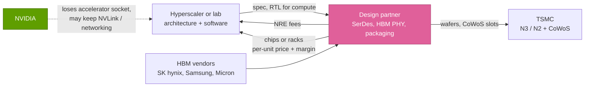

# Custom-ASIC houses: Broadcom, Marvell, Alchip, GUC and MediaTek

Cross-cutting 15 · Competitive landscape · ~16 min read · Last verified: 2026-11-05

## ⚡ The Executive Take

- **Broadcom is now the largest seller of AI silicon after NVIDIA.** Its AI semiconductor revenue reached $16.7B in the
  quarter to 2026-08-02 (+221% y/y), about 19% of NVIDIA's $89.0B data-center quarter [[S2516]](../../sources/bibliography.md#s2516)[[S405]](../../sources/bibliography.md#s405). Management put FY2026
  at ~$58B, up from $20.2B in FY2025 [[S15501]](../../sources/bibliography.md#s15501)[[S661]](../../sources/bibliography.md#s661).
- **The forward claim is bigger still.** Broadcom says it has secured supply to reach ~$115B of AI revenue in FY2027 and
  has "line of sight" to ~$230B in FY2028 (🟡 management targets, not contracted revenue) [[S15501]](../../sources/bibliography.md#s15501).
- **The customer list is the frontier.** Google's TPU, Meta's MTIA, OpenAI's 10 GW program (H2 2026–2029) and Anthropic
  ($10B, then a further $11B of TPU-based racks) all run through Broadcom [[S15552]](../../sources/bibliography.md#s15552)[[S174]](../../sources/bibliography.md#s174)[[S15500]](../../sources/bibliography.md#s15500). Anthropic is expected to
  become its largest [XPU](../../glossary.md#xpu) customer in 2027 🟡 [[S15501]](../../sources/bibliography.md#s15501).
- **Marvell is the distant second.** Data-center revenue was $2.17B in its Q2 FY2027 quarter (+46%), roughly a seventh of
  Broadcom's AI run-rate [[S15504]](../../sources/bibliography.md#s15504). NVIDIA reportedly put $2B into Marvell in March 2026 to tie it to
  [NVLink Fusion](../../glossary.md#nvlink-fusion) 🟡 [[S90037]](../../sources/bibliography.md#s90037).
- **A Taiwanese second tier is growing around TSMC.** Alchip (AWS Trainium3 at 3 nm), GUC and MediaTek (a $2B 2026
  AI-ASIC target; Google TPU work reported) each sit near $1–2B a year [[S2517]](../../sources/bibliography.md#s2517)[[S15506]](../../sources/bibliography.md#s15506)[[S15508]](../../sources/bibliography.md#s15508)[[S2518]](../../sources/bibliography.md#s2518)[[S23008]](../../sources/bibliography.md#s23008).
- **The economics only work at hyperscale.** A repo model puts break-even at ~87k GPU-equivalents of capacity per program,
  and ~237k if the chip delivers half a GPU's useful work (🔴 Est.) [[S2501]](../../sources/bibliography.md#s2501)[[S35026]](../../sources/bibliography.md#s35026).
- **What it means for NVIDIA:** custom silicon held ~10% of AI accelerator *revenue* in 2025 at design-partner prices (Est.) [[S416]](../../sources/bibliography.md#s416)[[S661]](../../sources/bibliography.md#s661), but
  TrendForce expects ASIC-based servers to be 27.8% of 2026 AI server *shipments* [[S2517]](../../sources/bibliography.md#s2517). The dollar share understates the
  unit shift, and the largest buyers are the ones moving.

## How the custom-ASIC business works

A [hyperscaler](../../glossary.md#hyperscaler) that wants its own accelerator rarely builds the whole chip. Its architects decide what the compute engine
looks like (matrix units, number formats, on-chip memory) because that is where its workload knowledge lives. An
[ASIC design partner](../../glossary.md#asic-design-partner) supplies everything else: high-speed [SerDes](../../glossary.md#serdes)
for chip-to-chip links, the [HBM](../../glossary.md#hbm) interface, packaging, physical design and a place in TSMC's queue. The
analogy is a building: the owner's architect draws the floor plan, the general contractor pours foundations, wires it and
gets the permits.

The partner gets paid twice. First, [NRE](../../glossary.md#nre) (non-recurring engineering) fees during design. Second, and far
larger, a per-unit price on every chip shipped, which carries the partner's margin on silicon, HBM and packaging it
procures. Two contract styles exist. In a [turnkey ASIC](../../glossary.md#turnkey-asic) the partner sells finished chips; in a
[customer-owned tooling](../../glossary.md#customer-owned-tooling) (COT) model the customer buys services or IP and contracts the
foundry itself, which squeezes the partner's per-unit take. Broadcom's Anthropic deal is the turnkey extreme: the CEO
called it a full system sale, with Broadcom responsible for the rack [[S15500]](../../sources/bibliography.md#s15500).

The time profile matters for deal analysis. OpenAI announced its Broadcom program in October 2025 with deployments from
H2 2026 through 2029 [[S174]](../../sources/bibliography.md#s174); its first chip, codenamed Jalapeño, reportedly shipped in Broadcom's Q3 FY2026 quarter 🟡
[[S15552]](../../sources/bibliography.md#s15552). A program therefore spans roughly 3–5 years from architecture to last volume shipment (🔴 repo analysis), and
buyers now run overlapping generations: Meta has four MTIA generations planned through 2027 on a ~6-month cadence [[S561]](../../sources/bibliography.md#s561).

> [!TIP]
> **Worked example — what Broadcom's quarter says about volume.** Broadcom booked $16.7B of AI revenue in Q3 FY2026 and
> said XPUs were 73% of it, so ~$12.2B of custom accelerators in one quarter (repo arithmetic) [[S2516]](../../sources/bibliography.md#s2516)[[S15501]](../../sources/bibliography.md#s15501). If an
> XPU sells for ~$10–15K (🔴 assumption, below a merchant GPU's $30–40K [[S35026]](../../sources/bibliography.md#s35026)), that is ~0.8–1.2M chips a quarter.
> For scale, Anthropic alone plans to use up to 1M TPUs [[S653]](../../sources/bibliography.md#s653). Custom silicon is a volume business on a lower price
> per unit, which is why revenue share understates unit share.

🔧 Under the hood: why SerDes and packaging are the partner's moat

A 2026 accelerator moves terabytes per second off-chip: Jalapeño is reported at 15.4 TB/s of [HBM4](../../glossary.md#hbm4) bandwidth [[S628]](../../sources/bibliography.md#s628), and
[scale-up](../../glossary.md#scale-up) links run 200G-class lanes. Designing [SerDes](../../glossary.md#serdes) that run at 200 Gb/s per lane within power
budgets, and HBM PHYs that pass memory-vendor qualification, takes years of silicon iterations. Broadcom also sells the
switches (Tomahawk) those links plug into, so it can co-design both ends; the repo scores Broadcom as leading NVIDIA in
[scale-out](../../glossary.md#scale-out) Ethernet switching [[S274]](../../sources/bibliography.md#s274). Packaging adds a supply moat: TrendForce-type estimates put Broadcom at ~150k of
~1,000k 2026 [CoWoS](../../glossary.md#cowos) wafers, second only to NVIDIA's ~595k (Est.) [[S379]](../../sources/bibliography.md#s379). A hyperscaler can hire compute architects; it is
much harder to hire a decade of SerDes test chips and a CoWoS allocation.

## Who designs what

The table maps public customer–partner pairings. Several are reported rather than confirmed; partners rarely name
customers.

| Customer program | Primary design partner | Other partners (reported) | Status | Sources |
|---|---|---|---|---|
| Google TPU (Ironwood, TPU 8) | Broadcom | MediaTek on v7e/v8e variants 🟡 | Shipping; Anthropic buys, Meta rents | [[S15552]](../../sources/bibliography.md#s15552)[[S23008]](../../sources/bibliography.md#s23008)[[S90025]](../../sources/bibliography.md#s90025) |
| Meta MTIA | Broadcom | — | Shipping; 4 generations through 2027 | [[S15551]](../../sources/bibliography.md#s15551)[[S561]](../../sources/bibliography.md#s561) |
| OpenAI "Jalapeño" (10 GW) | Broadcom (chip + Ethernet racks) | — | First shipments Q3 FY2026 🟡 | [[S174]](../../sources/bibliography.md#s174)[[S15552]](../../sources/bibliography.md#s15552) |
| Anthropic (TPU racks) | Broadcom (system sale) | Google (TPU design) | $10B + $11B orders | [[S15500]](../../sources/bibliography.md#s15500)[[S655]](../../sources/bibliography.md#s655) |
| AWS Trainium | In-house (Annapurna) | Marvell (earlier gens), Alchip (Trainium3) 🟡 | Trn3 mass production from Q2 2026 | [[S2517]](../../sources/bibliography.md#s2517)[[S90034]](../../sources/bibliography.md#s90034) |
| Microsoft Maia | In-house | Marvell 🟡; access to OpenAI's Broadcom-built chip IP | Maia 200 deployed; Maia 300 in 2027 | [[S15008]](../../sources/bibliography.md#s15008)[[S662]](../../sources/bibliography.md#s662)[[S90044]](../../sources/bibliography.md#s90044)[[S90046]](../../sources/bibliography.md#s90046) |
| AWS custom inference silicon + 1.6T optics | Qualcomm | — | Multi-generation; revenue from fiscal Q1 2027 🟢 | [[S15510]](../../sources/bibliography.md#s15510)[[S15509]](../../sources/bibliography.md#s15509) |

The [AWS Trainium](aws-trainium.md),
[Google TPU](google-tpu.md),
[Microsoft Maia](microsoft-maia.md) and
[Meta MTIA](meta-mtia.md) pages cover the customers' side of each program.

## Broadcom: the scale player

Broadcom's case rests on three numbers. Revenue: ~$58B of AI semiconductors in FY2026, after a Q3 of $29.6B total revenue
(+86%) of which $16.7B was AI [[S15501]](../../sources/bibliography.md#s15501)[[S15502]](../../sources/bibliography.md#s15502). Concentration of the
frontier: Google, Meta, OpenAI and Anthropic are all named customers, out of six XPU customers in total [[S15551]](../../sources/bibliography.md#s15551)[[S15552]](../../sources/bibliography.md#s15552).
Backlog: Tan says the FY2027 doubling to ~$115B has secured supply, and expects OpenAI to deploy more than 5 GW of
Jalapeño and its successor 🟡 [[S15501]](../../sources/bibliography.md#s15501).

The ratio in that chart is the cleanest single gauge of custom silicon against NVIDIA. It sat at 11–14% for two years
and jumped to 19% in calendar Q3 2026 [[S2516]](../../sources/bibliography.md#s2516)[[S405]](../../sources/bibliography.md#s405). An earlier repo scenario of ~$45B for Broadcom's FY2026 proved too low: guidance plus the reported
quarters now sum to ~$57B, which the chart below uses, and Broadcom's CEO cited ~$58B [[S2516]](../../sources/bibliography.md#s2516)[[S15501]](../../sources/bibliography.md#s15501)
([GPU silicon competition](../../layers/02-gpu-silicon/competition.md)).

> [!TIP]
> **Worked example — reading the FY2027 target against NVIDIA.** Broadcom's ~$115B FY2027 goal is ~59% of NVIDIA's
> FY2026 data-center revenue of $193.7B [[S15501]](../../sources/bibliography.md#s15501)[[S1]](../../sources/bibliography.md#s1). But NVIDIA booked $164.2B of data-center revenue in just the first
> half of FY2027 [[S403]](../../sources/bibliography.md#s403)[[S405]](../../sources/bibliography.md#s405), an annualised ~$330B. Against that pace, Broadcom's target is ~35%. The direction is clear;
> the "custom overtakes merchant" story is not yet in the numbers.

## Marvell, Alchip, GUC and MediaTek: the second tier

![Horizontal log-scale bar chart of custom-silicon revenue scale: Broadcom about $58B of AI semiconductor revenue in FY2026 (custom XPUs about 73% of it); Marvell about $8.7B data-center revenue annualised from its Q2 FY2027 quarter; MediaTek a $2B AI-ASIC revenue target for 2026; GUC about $1.07B total 2025 revenue (NT$34.1B converted); Alchip $0.99B total 2025 revenue; and Qualcomm at least $1B of FY2027 custom-silicon revenue from two hyperscalers (target). Broadcom is roughly seven times Marvell and almost 60 times Alchip.](../../assets/charts/15-asic-house-revenue-scale.svg)

**Marvell** sells custom XPUs, optical DSPs and switches. Revenue was $2.739B in its Q2 FY2027 quarter (+37%), with
data center ~79% of it; it expects custom revenue to more than double in FY2028 and reportedly guides ~$12B for FY2027
[[S15504]](../../sources/bibliography.md#s15504)[[S15505]](../../sources/bibliography.md#s15505). Its weakness is concentration: AWS appears to dual-source Trainium, and Alchip won Trainium3 at 3 nm
[[S2517]](../../sources/bibliography.md#s2517). NVIDIA's reported $2B stake (March 2026) makes Marvell the most NVIDIA-aligned house: it is an NVLink Fusion
design partner, so a Marvell-built XPU can sit inside an NVIDIA rack [[S90037]](../../sources/bibliography.md#s90037)[[S131]](../../sources/bibliography.md#s131). Marvell also bought Celestial AI
(photonic memory fabric) for $3.25B upfront in February 2026 [[S2513]](../../sources/bibliography.md#s2513).

**Alchip and GUC** are Taiwanese design-service houses tied to TSMC's ecosystem. Alchip's 2025 revenue fell to ~$992M
from ~$1.6B as 5 nm programs faded; Trainium3 mass production from Q2 2026 is its rebound [[S15506]](../../sources/bibliography.md#s15506)[[S15507]](../../sources/bibliography.md#s15507)[[S2517]](../../sources/bibliography.md#s2517). GUC,
a TSMC affiliate, reported NT$34.1B (~$1.07B) for 2025 [[S15508]](../../sources/bibliography.md#s15508). Their model is closer to COT: lower margin per chip,
less customer lock-in.

**MediaTek** brings a mobile-SoC company's skills (power efficiency, SerDes, high-volume execution). It raised its 2026
AI-ASIC target from $1B to $2B and reportedly won Google TPU v7e/v8e work, possibly the [I/O die](../../glossary.md#io-die)
rather than the compute die 🟡 [[S15503]](../../sources/bibliography.md#s15503)[[S2518]](../../sources/bibliography.md#s2518)[[S23008]](../../sources/bibliography.md#s23008). It is also an [NVLink](../../glossary.md#nvlink) Fusion launch partner [[S90031]](../../sources/bibliography.md#s90031).

> [!TIP]
> **Worked example — the gap inside the custom pool.** Broadcom's ~$58B FY2026 AI revenue is ~6.7× Marvell's annualised
> $8.7B data-center run-rate and ~59× Alchip's 2025 revenue [[S15501]](../../sources/bibliography.md#s15501)[[S15504]](../../sources/bibliography.md#s15504)[[S15506]](../../sources/bibliography.md#s15506). Even if MediaTek's Google work
> grows tenfold from its $2B target, it would still be a third of Broadcom's FY2026. Custom silicon is not a fragmented
> market; it is Broadcom plus a tail.

## Why hyperscalers use them, and what it costs

The motive is margin. NVIDIA's company gross margin was 75.0% in Q2 FY2027 [[S405]](../../sources/bibliography.md#s405); Epoch AI estimates a B200 costs
~$6.4K to build against a $30–40K price [[S35020]](../../sources/bibliography.md#s35020)[[S35026]](../../sources/bibliography.md#s35026). A buyer deploying hundreds of thousands of accelerators can pay
a partner's margin and its own engineering bill and still come out ahead, if the chip does enough useful work.

![Line chart of a repo break-even model. Buying merchant GPUs costs $35K each, so cost rises in a straight line from zero. A custom ASIC starts with $1.19B of fixed cost (a ~$0.59B 3 nm design and a ~$0.6B software and systems team) and costs $15K per chip. If each chip does 70% of a GPU's useful work, the lines cross at about 87k GPU-equivalents; at 50% the crossover moves to about 237k; at 90% it falls to about 65k. Only buyers deploying hundreds of thousands of accelerators clear the bar comfortably.](../../assets/charts/15-asic-breakeven-volume.svg)

> [!TIP]
> **Worked example — the break-even.** Fixed cost: ~$0.59B for a 3 nm design [[S2501]](../../sources/bibliography.md#s2501) plus ~$0.6B for a 500-engineer
> software and systems team over three years at ~$0.4M per engineer-year (🔴 assumption) [[S10535]](../../sources/bibliography.md#s10535): ~$1.19B. Unit cost:
> $15K per custom chip (🔴) vs $35K per GPU [[S35026]](../../sources/bibliography.md#s35026). At 70% of a GPU's throughput, a custom chip costs $15K ÷ 0.7 ≈
> $21.4K per GPU-equivalent, saving ~$13.6K each. $1.19B ÷ $13.6K ≈ 87k GPU-equivalents. A 1 GW program runs to
> hundreds of thousands of accelerators, so the frontier labs clear the bar; a 20k-GPU enterprise does not.

The model leaves out what makes the decision hard in practice: software. Google's TPU is economic because [XLA](../../glossary.md#xla) and JAX
already exist; SemiAnalysis measured Ironwood ~18% cheaper per token than B200 on one workload, mostly from cheaper
chip-hours rather than faster silicon [[S625]](../../sources/bibliography.md#s625). A new XPU without that stack can take years to reach its paper throughput
(see [CUDA competition](../../layers/09-cuda-and-system-software/competition.md)).

## Verdict by layer: Broadcom-class custom silicon vs NVIDIA

| Layer | Verdict | Why |
|---|---|---|
| 02 Accelerator silicon | 🟦 Different | Customer-defined XPUs; Jalapeño ~13.4 PFLOPS MXFP4 per die (SemiAnalysis) [[S628]](../../sources/bibliography.md#s628) |
| 03 Memory, packaging, supply | 🟥 Behind | ~150k vs NVIDIA's ~595k 2026 CoWoS wafers (Est.) [[S379]](../../sources/bibliography.md#s379) |
| 04 CPU | 🟥 Behind | No CPU; customers bring Arm or x86 hosts |
| 05 Scale-up fabric | 🟥 Behind | Ethernet scale-up (SUE, ESUN) trails NVLink in deployed domains [[S90052]](../../sources/bibliography.md#s90052)[[S576]](../../sources/bibliography.md#s576) |
| 06 Scale-out networking | 🟩 Leads | Tomahawk 6 first to 102.4 Tb/s; Ethernet ~two-thirds of AI back-end switching [[S274]](../../sources/bibliography.md#s274)[[S90054]](../../sources/bibliography.md#s90054) |
| 08 Systems & racks | 🟦 Different | Racks only for select customers (OpenAI, Anthropic) [[S174]](../../sources/bibliography.md#s174)[[S15500]](../../sources/bibliography.md#s15500) |
| 09–11 Software | 🟦 Different | Customer-owned stacks (JAX/XLA, PyTorch backends) |
| 13 Ecosystem & capital | 🟥 Behind | Six XPU customers vs NVIDIA's broad channel; no vendor financing disclosed [[S15551]](../../sources/bibliography.md#s15551) |

The repo-wide scores are in the [competitive landscape index](index.md).

## Their best argument, and how much the gap has closed

**The best argument:** the four largest AI spenders have already decided to own part of their silicon, and Broadcom
captures that decision at a fraction of NVIDIA's gross margin to the buyer. Every GW that goes custom is a GW NVIDIA does
not sell, and the GW pipelines show it: of OpenAI's 26 announced GW, 10 are Broadcom custom accelerators, beside 10 for NVIDIA (a since-restructured letter of intent) and 6 for AMD [[S174]](../../sources/bibliography.md#s174)[[S90016]](../../sources/bibliography.md#s90016)[[S13506]](../../sources/bibliography.md#s13506).

![Stacked horizontal bar chart of announced compute programmes in gigawatts. OpenAI 26 GW: NVIDIA 10 (September 2025 letter of intent, since restructured), Broadcom custom accelerators 10 and AMD 6. Anthropic 4 GW: AMD Helios up to 2 (with an up-to-$5B AMD investment), NVIDIA up to 1 and Google TPUs over 1 GW in 2026 (a further multi-GW TPU expansion from 2027 is unquantified). HUMAIN: NVIDIA up to 0.5 GW, AMD 0.5 GW and Qualcomm 0.2 GW. xAI: about 1 GW on NVIDIA (company claim, contested). NVIDIA's share across these programmes is about 39%.](../../assets/charts/13-gw-pipeline-by-supplier.svg)

**How much the gap has closed:** on revenue, from ~8% of the AI silicon pool in 2023 to ~11% in the repo's 2026
estimate (likely low given Broadcom's run-rate) [[S660]](../../sources/bibliography.md#s660)[[S661]](../../sources/bibliography.md#s661); on Broadcom vs NVIDIA data center, from ~12% to ~19% of a
quarter [[S2516]](../../sources/bibliography.md#s2516)[[S405]](../../sources/bibliography.md#s405); on units, much further (27.8% of 2026 AI servers) [[S2517]](../../sources/bibliography.md#s2517).

> [!NOTE]
> **🐂 Bull view (for NVIDIA).** Custom programs keep NVIDIA in the rack: Trainium4 will use NVLink Fusion and MGX, and
> Marvell, MediaTek and Alchip are Fusion partners, so NVIDIA sells switches and CPUs even when it loses the accelerator
> [[S518]](../../sources/bibliography.md#s518)[[S90031]](../../sources/bibliography.md#s90031). NVIDIA's own data-center revenue grew faster in dollars than Broadcom's whole AI line in H1 FY2027
> [[S403]](../../sources/bibliography.md#s403)[[S405]](../../sources/bibliography.md#s405).

> [!WARNING]
> **🐻 Bear view (for NVIDIA).** Broadcom's FY2027 target alone is ~$115B [[S15501]](../../sources/bibliography.md#s15501), and its biggest customers are labs
> NVIDIA also counts on. If Anthropic, OpenAI, Google and Meta route even half their 2027–28 growth to custom silicon,
> NVIDIA's hyperscale segment (~$49B a quarter) faces a volume ceiling well before demand peaks [[S90011]](../../sources/bibliography.md#s90011).

## What it means for NVIDIA's share

NVIDIA's defence is threefold: annual cadence (a custom chip designed in 2024 meets Rubin in 2026), rack-scale systems
the partners only sell to a few customers, and co-option through NVLink Fusion ([NVLink Fusion](../../layers/05-scale-up-nvlink-nvswitch/nvlink-fusion.md)).
The risk is concentrated: the buyers able to clear the break-even above are exactly NVIDIA's largest direct customers,
three of which were 16%, 15% and 13% of H1 FY2027 revenue [[S90069]](../../sources/bibliography.md#s90069).

> [!TIP]
> **Worked example — what a shift at the top three would mean.** Three direct customers were 16%, 15% and 13% of H1
> FY2027 revenue, 44% together [[S90069]](../../sources/bibliography.md#s90069). If those three moved ten percentage points of their NVIDIA spend to custom
> silicon, NVIDIA would lose ~4.4% of revenue (🔴 repo arithmetic) — less than one quarter's sequential growth in Q2
> FY2027 (+18% q/q) [[S405]](../../sources/bibliography.md#s405). The threat is to the growth rate and to pricing power, not to the revenue base in 2026.

## 🎯 Corp Dev Lens

1. Broadcom's moat is SerDes, packaging allocation and system integration, not compute architecture. Which of those can
   a new entrant buy (IP licences, OSAT capacity, acquisitions such as Alphawave) and which take a decade to build?
2. The second tier (Alchip, GUC, MediaTek) wins on cost and TSMC proximity but loses lock-in. What would a design-service
   asset be worth to a buyer that already has SerDes and packaging know-how, and which anchor customers remain
   uncommitted after Broadcom's six?
3. NVIDIA's $2B Marvell stake and Fusion licences turn rivals into suppliers. Is "custom accelerator inside an NVIDIA
   rack" a durable middle ground, or a transition state before [UALink](../../glossary.md#ualink)/ESUN racks mature in 2027?
4. Revenue share (~11%) and unit share (~28%) tell different stories. Which metric should a corp dev model use to size
   the custom pool, and how sensitive is it to XPU pricing?
5. The break-even favours buyers at hundreds of thousands of units. Is there a market for "custom-lite" (shared base die,
   customer-specific chiplets) that lowers the bar for tier-2 clouds and sovereign buyers?

## 📚 Sources

<!-- Auto-generated from the [S…] citations on this page by `make build`. Edit sources/registry/*.csv, not this list. -->

- [**S1**](../../sources/bibliography.md#s1) NVIDIA Corporation via SEC EDGAR, *NVIDIA Announces Financial Results for Fourth Quarter and Fiscal 2026 (Form 8-K exhibit 99.1)*, 2026-02-25. [Link](https://www.sec.gov/Archives/edgar/data/1045810/000104581026000019/q4fy26pr.htm)
- [**S131**](../../sources/bibliography.md#s131) NVIDIA Newsroom, *NVIDIA NVLink Fusion: semi-custom AI infrastructure partner ecosystem (Computex 2025)*, 2025-05-19. [Link](https://nvidianews.nvidia.com/news/nvidia-nvlink-fusion-semi-custom-ai-infrastructure-partner-ecosystem)
- [**S174**](../../sources/bibliography.md#s174) OpenAI, *OpenAI and Broadcom announce strategic collaboration to deploy 10 gigawatts of OpenAI-designed AI accelerators*, 2025-10-13. [Link](https://openai.com/index/openai-and-broadcom-announce-strategic-collaboration/)
- [**S274**](../../sources/bibliography.md#s274) Broadcom, *Broadcom ships Tomahawk 6: world's first 102.4 Tbps switch*, 2025-06-03. [Link](https://investors.broadcom.com/news-releases/news-release-details/broadcom-ships-tomahawk-6-worlds-first-1024-tbps-switch)
- [**S379**](../../sources/bibliography.md#s379) TrendForce News, *TSMC CoWoS capacity and customer allocation estimates (TrendForce / Morgan Stanley, as reported)*, 2025. [Link](https://www.trendforce.com/news/)
- [**S403**](../../sources/bibliography.md#s403) NVIDIA Corporation via SEC EDGAR, *NVIDIA Announces Financial Results for First Quarter Fiscal 2027 (Form 8-K exhibit 99.1)*, 2026-05-20. [Link](https://www.sec.gov/Archives/edgar/data/0001045810/000104581026000051/q1fy27pr.htm)
- [**S405**](../../sources/bibliography.md#s405) NVIDIA Corporation via SEC EDGAR, *NVIDIA Announces Financial Results for Second Quarter Fiscal 2027 (Form 8-K exhibit 99.1)*, 2026-08-26. [Link](https://www.sec.gov/Archives/edgar/data/0001045810/000104581026000073/q2fy27pr.htm)
- [**S416**](../../sources/bibliography.md#s416) NVIDIA Corporation via SEC EDGAR, *NVIDIA Corporation Form 10-K for fiscal year ended January 26, 2025*, 2025-02-26. [Link](https://www.sec.gov/Archives/edgar/data/1045810/000104581025000023/nvda-20250126.htm)
- [**S518**](../../sources/bibliography.md#s518) ServeTheHome, *NVIDIA NVLink Fusion tapped for future AWS Trainium4 deployments*, 2025-12-02. [Link](https://www.servethehome.com/nvidia-nvlink-fusion-tapped-for-future-aws-trainium4-deployments/)
- [**S561**](../../sources/bibliography.md#s561) DatacenterDynamics, *Meta unveils next four generations of its MTIA chip*, 2026-03-11. [Link](https://www.datacenterdynamics.com/en/news/meta-unveils-next-four-generations-of-its-mtia-chip/)
- [**S576**](../../sources/bibliography.md#s576) Converge Digest, *OCP releases ESUN 1.0 spec for Ethernet-based scale-up AI fabrics*, 2026-03. [Link](https://convergedigest.com/ocp-releases-esun-1-0-spec-for-ethernet-based-scale-up-ai-fabrics/)
- [**S625**](../../sources/bibliography.md#s625) SemiAnalysis, *TPU Inference Externalization Full Steam Ahead*, 2026-09-07. [Link](https://github.com/SemiAnalysisAI/InferenceX-app/blob/main/packages/app/content/blog/tpu-inferencex-full-steam.mdx)
- [**S628**](../../sources/bibliography.md#s628) SemiAnalysis, *OpenAI Jalapeño: Better Than Nvidia Blackwell*, 2026-08-25. [Link](https://github.com/SemiAnalysisAI/InferenceX-app/blob/main/packages/app/content/blog/openai-jalapeno-better-than-nvidia.mdx)
- [**S653**](../../sources/bibliography.md#s653) Anthropic, *Expanding our use of Google Cloud TPUs and Services*, 2025-10-23. [Link](https://www.anthropic.com/news/expanding-our-use-of-google-cloud-tpus-and-services)
- [**S655**](../../sources/bibliography.md#s655) Anthropic, *Anthropic expands partnership with Google and Broadcom for multiple gigawatts of next-generation compute*, 2026-04-06. [Link](https://www.anthropic.com/news/google-broadcom-partnership-compute)
- [**S660**](../../sources/bibliography.md#s660) Broadcom Inc., *Broadcom Inc. Announces Fourth Quarter and Fiscal Year 2024 Financial Results*, 2024-12-12. [Link](https://investors.broadcom.com/financial-information/quarterly-results)
- [**S661**](../../sources/bibliography.md#s661) Broadcom Inc., *Broadcom Inc. Announces Fourth Quarter and Fiscal Year 2025 Financial Results*, 2025-12-11. [Link](https://investors.broadcom.com/financial-information/quarterly-results)
- [**S662**](../../sources/bibliography.md#s662) Marvell Technology, *Marvell Technology fourth quarter and fiscal 2025 results and AI revenue commentary*, 2025-03-04. [Link](https://investor.marvell.com/news-events/press-releases)
- [**S2501**](../../sources/bibliography.md#s2501) Silicon Analysts, *Chip Design & NRE Cost by Node — Historical Time Series Data*, 2026. [Link](https://siliconanalysts.com/market-data/nre-design-cost)
- [**S2513**](../../sources/bibliography.md#s2513) Business Wire (Marvell), *Marvell Completes Acquisition of Celestial AI*, 2026-02-02. [Link](https://www.businesswire.com/news/home/20260201331090/en/marvell-completes-acquisition-of-celestial-ai)
- [**S2516**](../../sources/bibliography.md#s2516) Broadcom Inc. via SEC EDGAR, *Broadcom Inc. Announces Third Quarter Fiscal Year 2026 Financial Results (Form 8-K exhibit 99.1)*, 2026-09. [Link](https://www.sec.gov/Archives/edgar/data/0001730168/000173016826000076/avgo-08022026x8kxex99.htm)
- [**S2517**](../../sources/bibliography.md#s2517) TrendForce, *CSPs accelerate ASIC push in 2H26, challenging NVIDIA as MediaTek, GUC, Alchip benefit*, 2026-03-20. [Link](https://www.trendforce.com/news/2026/03/20/news-csps-accelerate-asic-push-in-2h26-challenging-nvidia-as-mediatek-guc-alchip-benefit/)
- [**S2518**](../../sources/bibliography.md#s2518) TrendForce, *MediaTek reportedly doubles 2026 AI ASIC revenue target to $2B*, 2026-04-30. [Link](https://www.trendforce.com/news/2026/04/30/news-MediaTek-reportedly-doubles-2026-ai-asic-revenue-target-to-2b-aims-10-15-market-share)
- [**S10535**](../../sources/bibliography.md#s10535) SemiAnalysis, *AMD 2.0 – New Sense of Urgency / MI450X Chance to Beat Nvidia / Nvidia's New Moat*, 2025-04. [Link](https://newsletter.semianalysis.com/p/amd-2-0-new-sense-of-urgency-mi450x-chance-to-beat-nvidia-nvidias-new-moat)
- [**S13506**](../../sources/bibliography.md#s13506) Tom's Hardware, *OpenAI signs 6 GW AMD GPU deal*, 2025-10-06. [Link](https://www.tomshardware.com/pc-components/gpus/openai-signs-6gw-amd-gpu-deal)
- [**S15008**](../../sources/bibliography.md#s15008) DatacenterDynamics, *Microsoft says it has access to the IP of OpenAI's custom AI chips*, 2025-11. [Link](https://www.datacenterdynamics.com/en/news/microsoft-says-it-has-access-to-the-ip-of-openais-custom-ai-chips/)
- [**S15500**](../../sources/bibliography.md#s15500) DatacenterDynamics, *Broadcom bulges with Anthropic AI orders*, 2025-12. [Link](https://www.datacenterdynamics.com/en/news/broadcom-bulges-with-anthropic-ai-orders/)
- [**S15501**](../../sources/bibliography.md#s15501) DatacenterDynamics, *Broadcom slams AI silicon-fuelled Q3, promises double-double on the way*, 2026-09-03. [Link](https://www.datacenterdynamics.com/en/news/broadcom-slams-ai-silicon-fueled-q3-promises-double-double-on-the-way/)
- [**S15502**](../../sources/bibliography.md#s15502) ChannelWeb (CRN UK), *Broadcom Q3 results: CEO Tan forecasts surging AI infrastructure buildout*, 2026-09. [Link](https://www.channelweb.co.uk/news-network/2026/broadcom-q3-results-ceo-tan-forecasts-surging-ai-infrastructure-buildout)
- [**S15503**](../../sources/bibliography.md#s15503) TrendForce, *MediaTek forecasts $1B in ASIC sales for 2026; custom AI chips set for 20% revenue share in 2027*, 2026-02-05. [Link](https://www.trendforce.com/news/2026/02/05/news-mediatek-forecasts-1b-in-asic-sales-for-2026-custom-ai-chips-set-for-20-revenue-share-in-2027/)
- [**S15504**](../../sources/bibliography.md#s15504) Futurum Group, *Marvell Q2 FY 2027: connectivity and custom silicon fuel AI growth*, 2026-08. [Link](https://futurumgroup.com/insights/marvell-q2-fy-2027-connectivity-and-custom-silicon-fuel-ai-growth/)
- [**S15505**](../../sources/bibliography.md#s15505) Zacks, *MRVL Q2 earnings beat on data center strength, outlook raised*, 2026-08. [Link](https://www.zacks.com/stock/news/2981826/mrvl-q2-earnings-beat-on-data-center-strength-outlook-raised)
- [**S15506**](../../sources/bibliography.md#s15506) Alchip Technologies (syndicated press release), *Alchip Technologies reports Q4 and 2025 FY financial results*, 2026-02. [Link](https://lifestyle.kbew98country.com/story/121222/alchip-technologies-reports-q4-and-2025-fy-financial-results/)
- [**S15507**](../../sources/bibliography.md#s15507) S&P Global Market Intelligence, *Alchip faces sharp 2025 decline; analysts forecast strong 2026 recovery*, 2026-02. [Link](https://www.spglobal.com/market-intelligence/en/news-insights/research/2026/02/aichip-faces-sharp-2025-decline-analysts-forecast-strong-2026-recovery)
- [**S15508**](../../sources/bibliography.md#s15508) DIGITIMES Asia, *Alchip, Faraday and GUC 2026 revenue outlook*, 2026-02-02. [Link](https://apps.digitimes.com/news/a20260202PD232/alchip-faraday-guc-2026-revenue.html)
- [**S15509**](../../sources/bibliography.md#s15509) Mobile World Live, *Qualcomm lands custom AI chip deal with Amazon*, 2026-09. [Link](https://www.mobileworldlive.com/ai-cloud/qualcomm-lands-custom-ai-chip-deal-with-amazon/)
- [**S15510**](../../sources/bibliography.md#s15510) Manufacturing Dive, *Qualcomm makes custom chips for Amazon in $4B partnership*, 2026-09. [Link](https://www.manufacturingdive.com/news/qualcomm-custom-chips-amazon-4b-partnership/829914/)
- [**S15551**](../../sources/bibliography.md#s15551) The Register, *Broadcom Q1 2026: custom accelerator business across five, then six, customers*, 2026-03-05. [Link](https://theregister.com/2026/03/05/broadcom_q1_2026/)
- [**S15552**](../../sources/bibliography.md#s15552) Channel Insider, *Broadcom AI chip revenue jumps 221% as custom silicon challenges Nvidia*, 2026-09. [Link](https://www.channelinsider.com/ai/news-broadcom-ai-chip-revenue-custom-silicon-nvidia/)
- [**S23008**](../../sources/bibliography.md#s23008) TrendForce, *MediaTek reportedly secures Google v7e and v8e TPU orders*, 2025-12-15. [Link](https://www.trendforce.com/news/2025/12/15/news-mediatek-reportedly-secures-google-v7e-v8e-tpu-orders-requests-7-fold-cowos-increase-from-tsmc/)
- [**S35020**](../../sources/bibliography.md#s35020) Epoch AI, *NVIDIA's B200 costs around $6,400 to produce, with memory accounting for half*, 2025-12. [Link](https://epoch.ai/data-insights/b200-cost-breakdown)
- [**S35026**](../../sources/bibliography.md#s35026) Tom's Hardware, *Nvidia's Jensen Huang says Blackwell GPU to cost $30,000-$40,000, later clarifies that pricing will vary as they won't sell just the chip*, 2024-03-19. [Link](https://www.tomshardware.com/pc-components/gpus/nvidias-jensen-huang-says-blackwell-gpu-to-cost-dollar30000-dollar40000-later-clarifies-that-pricing-will-vary-as-they-wont-sell-just-the-chip)
- [**S90011**](../../sources/bibliography.md#s90011) Nasdaq (Zacks), *NVIDIA Q2 earnings beat on Blackwell Ultra and Data Center strength*, 2026-08-27. [Link](https://www.nasdaq.com/articles/nvidia-q2-earnings-beat-blackwell-ultra-data-center-strength)
- [**S90016**](../../sources/bibliography.md#s90016) Storyboard18 (Financial Times), *Nvidia set for $30bn OpenAI deal as $100bn partnership shelved, report says (FT)*, 2026-02-20. [Link](https://www.storyboard18.com/digital/nvidia-set-for-30bn-openai-deal-as-100bn-partnership-shelved-report-says-90188.htm)
- [**S90025**](../../sources/bibliography.md#s90025) SiliconANGLE, *Google and Meta reportedly strike new multibillion-dollar AI chip deal*, 2026-02-26. [Link](https://siliconangle.com/2026/02/26/google-meta-reportedly-strike-new-multibillion-dollar-ai-chip-deal/)
- [**S90031**](../../sources/bibliography.md#s90031) ServeTheHome, *NVIDIA announces NVLink Fusion bringing NVLink to third-party CPUs and accelerators*, 2025-05-19. [Link](https://www.servethehome.com/nvidia-announces-nvlink-fusion-bringing-nvlink-to-third-party-cpus-and-accelerators/nvlink-fusion-partners/)
- [**S90034**](../../sources/bibliography.md#s90034) NAND Research, *AWS releases Trainium3, teases Trainium4*, 2025-12. [Link](https://nand-research.com/research-note-aws-releases-trainium3-teases-trainium4/4/)
- [**S90037**](../../sources/bibliography.md#s90037) Converge Digest, *NVIDIA invests $2B in Marvell to extend NVLink Fusion AI ecosystem*, 2026-03. [Link](https://convergedigest.com/nvidia-invests-2b-in-marvell-to-extend-nvlink-fusion-ai-ecosystem/)
- [**S90044**](../../sources/bibliography.md#s90044) eWeek, *Microsoft introduces Maia 200, its most powerful AI chip yet*, 2026-01-27. [Link](https://www.eweek.com/news/microsoft-maia-200-ai-chip/)
- [**S90046**](../../sources/bibliography.md#s90046) IT Brief UK, *Microsoft unveils Maia 300 for 2027 AI deployments*, 2026-10. [Link](https://itbrief.co.uk/story/microsoft-unveils-maia-300-for-2027-ai-deployments)
- [**S90052**](../../sources/bibliography.md#s90052) Synopsys, *Ethernet standards for scale-up AI: an overview of ESUN, SUE, and UALink*, 2025-11. [Link](https://www.synopsys.com/articles/ethernet-standards-scale-up-ai.html)
- [**S90054**](../../sources/bibliography.md#s90054) Dell'Oro Group, *Ethernet extends lead in AI scale-out networks despite strong InfiniBand rebound*, 2026. [Link](https://www.delloro.com/news/ethernet-extends-lead-in-ai-scale-out-networks-despite-strong-infiniband-rebound/)
- [**S90069**](../../sources/bibliography.md#s90069) NVIDIA Corporation via SEC EDGAR, *NVIDIA Form 10-Q for the quarter ended July 26, 2026 (Q2 FY2027)*, 2026-08. [Link](https://www.sec.gov/Archives/edgar/data/0001045810/000104581026000075/nvda-20260726.htm)
