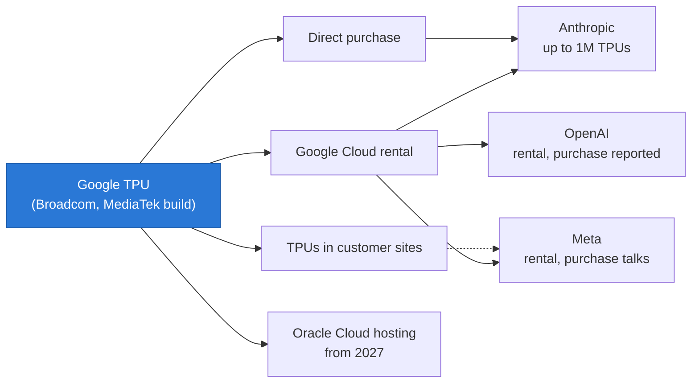

# Google TPU — the credible alternative, now for sale

Cross-cutting 15 · Competitive landscape · TPU v1 to TPU 8t/8i, ICI and optical switches, JAX/XLA, external sales · ~15 min read · Last verified: 2026-11-05

## ⚡ The Executive Take

- **Ten years, eight generations.** The first [TPU](../../glossary.md#tpu) ran Google's inference in 2015 at 15–30× the speed of contemporary CPUs and GPUs [[S23001]](../../sources/bibliography.md#s23001). [Ironwood](../../glossary.md#ironwood) (v7, GA November 2025) offers 4,614 TFLOPS of dense FP8 and 192 GB of HBM3E per chip in pods of 9,216 chips [[S151]](../../sources/bibliography.md#s151)[[S547]](../../sources/bibliography.md#s547).
- **2026 split the line in two.** TPU 8t (training) claims 12.6 PFLOPS of FP4 in 9,600-chip pods; TPU 8i (inference) pairs 10.1 PFLOPS with 288 GB of HBM and 384 MB of on-chip SRAM (🟢 announced; memory figures 🟡 press) [[S552]](../../sources/bibliography.md#s552)[[S239]](../../sources/bibliography.md#s239)[[S15010]](../../sources/bibliography.md#s15010).
- **Scale-up is Google's signature.** [ICI](../../glossary.md#ici) links in a 3D [torus](../../glossary.md#torus-topology), re-wired by [optical circuit switches](../../glossary.md#optical-circuit-switch), make a pod 128× larger than an NVL72 rack, though with less bandwidth per chip [[S232]](../../sources/bibliography.md#s232)[[S237]](../../sources/bibliography.md#s237).
- **TPUs are now sold outside Google.** Anthropic has access to up to 1M TPUs (>1 GW in 2026) [[S653]](../../sources/bibliography.md#s653); Meta rents Ironwood and has discussed buying TPUs for its own sites (🟡) [[S90025]](../../sources/bibliography.md#s90025); Oracle will host TPUs from 2027 [[S552]](../../sources/bibliography.md#s552).
- **The economics are the threat.** SemiAnalysis estimates an owned Ironwood chip-hour at ~$1.21 against ~$1.73 for a B200 and ~$2.31 for a GB300, and ~18% lower cost per token than B200 on one FP8 workload (Est.) [[S622]](../../sources/bibliography.md#s622)[[S625]](../../sources/bibliography.md#s625).
- **Weakness:** outside Google the software is young (14 of 36 on this repo's framework index vs CUDA's 36) and TPUs are absent from MLPerf since v5.0 [[S580]](../../sources/bibliography.md#s580)[[S613]](../../sources/bibliography.md#s613). Rubin's HBM4 also reopened the hardware gap: TPU 8i has ~45% of Rubin's memory bandwidth [[S15014]](../../sources/bibliography.md#s15014).

## Generations: from inference card to two-chip family

Google designs the architecture, compiler and system; Broadcom has been the long-standing [ASIC design partner](../../glossary.md#asic-design-partner), and MediaTek has been added for some variants (🟡) [[S23007]](../../sources/bibliography.md#s23007)[[S23008]](../../sources/bibliography.md#s23008). Press deep dives report Broadcom designed the 8t die and MediaTek the 8i [[S15010]](../../sources/bibliography.md#s15010).

| Generation | Year | Role | Peak per chip | HBM per chip | Max pod | Source |
|---|---|---|---|---|---|---|
| v1 | 2015 | Inference | 92 TOPS INT8 | 28 MiB on-chip + DDR3 | — | [[S23002]](../../sources/bibliography.md#s23002) |
| v4 | 2021 | Training | 275 TFLOPS BF16 | 32 GB, 1.2 TB/s | 4,096 | [[S146]](../../sources/bibliography.md#s146)[[S237]](../../sources/bibliography.md#s237) |
| v5p | 2023 | Training | 459 TFLOPS BF16 | 95 GB, 2.77 TB/s | 8,960 | [[S149]](../../sources/bibliography.md#s149) |
| v6e Trillium | 2024 | Efficiency | 918 TFLOPS BF16 | 32 GB, 1.64 TB/s | 256 | [[S150]](../../sources/bibliography.md#s150) |
| v7 Ironwood | 2025 | Inference-first | 4,614 TFLOPS FP8 | 192 GB, 7.37 TB/s | 9,216 | [[S151]](../../sources/bibliography.md#s151)[[S650]](../../sources/bibliography.md#s650) |
| 8t | 2026 (🟢 announced) | Training | 12.6 PFLOPS FP4 | 216 GB, ~6.5 TB/s (🟡) | 9,600 | [[S552]](../../sources/bibliography.md#s552)[[S15010]](../../sources/bibliography.md#s15010) |
| 8i | 2026 (🟢 preview) | Inference | 10.1 PFLOPS FP4 | 288 GB, ~8.6 TB/s (🟡) | 1,152 (🟡) | [[S15011]](../../sources/bibliography.md#s15011)[[S239]](../../sources/bibliography.md#s239) |

![Two-panel chart of Google TPU generations. Left, log scale: dense BF16 TFLOPS per chip rose from 45 (TPU v2, 2017) to 123 (v3, 2018), 275 (v4, 2021), 459 (v5p, 2023), 918 (v6e Trillium, 2024) and about 2,307 (v7 Ironwood, 2025; BF16 reported as half its 4,614 FP8), about 51 times in eight years; the cost-optimised v5e has 197. Right: maximum chips per pod grew from 256 (v2) to 1,024 (v3), 4,096 (v4), 8,960 (v5p) and 9,216 (Ironwood), with 9,600 announced for TPU 8t in 2026; the v5e and Trillium efficiency parts stay at 256-chip pods. TPU v1 (2015) was an INT8 inference card with 92 TOPS and no pod.](../../assets/charts/CS3-tpu-generations.svg)

The split mirrors NVIDIA's own direction: Vera Rubin for general work beside the Groq 3 LPX inference rack [[S90003]](../../sources/bibliography.md#s90003). Training wants raw FLOPS and the widest possible fabric; inference wants memory capacity and on-chip SRAM for the [KV cache](../../glossary.md#kv-cache). The 8t trades ~11.5% less bandwidth than Ironwood for 12.5% more capacity and lower cost, reportedly to improve yield [[S15010]](../../sources/bibliography.md#s15010).

> [!TIP]
> **Worked example — how big is one TPU 8t pod?** 9,600 chips × 12.6 PFLOPS = **~121 EF of FP4** [[S239]](../../sources/bibliography.md#s239)[[S550]](../../sources/bibliography.md#s550). A Vera Rubin NVL72 rack lists 2.52 EF of NVFP4 for training [[S102]](../../sources/bibliography.md#s102). One 8t pod equals ~48 NVL72 racks of peak training compute, in one scale-up domain instead of 48 racks joined by a network. **Conclusion:** Google competes on domain size, NVIDIA on per-chip speed and all-to-all bandwidth.

🔧 Under the hood: systolic arrays and why the compiler matters

A TPU's matrix units are [systolic arrays](../../glossary.md#systolic-array): grids of multiply-accumulate cells that pass operands to their neighbours, so each number fetched from memory is reused hundreds of times. Ironwood has four 256 × 256 arrays and adds native FP8 [[S2016]](../../sources/bibliography.md#s2016). Bigger arrays save bandwidth but idle on small or oddly shaped matrices, so the [XLA](../../glossary.md#xla) compiler fuses and reshapes whole graphs to keep them full. TPU performance therefore depends more on compiler maturity than a GPU's does.

The design partner shares in the upside: Broadcom's AI revenue, which includes TPUs and AI Ethernet, reached $16.7B in its Q3 FY2026 [[S2516]](../../sources/bibliography.md#s2516), and Anthropic's next multi-gigawatt TPU tranche from 2027 was announced jointly with Broadcom [[S655]](../../sources/bibliography.md#s655). The full history and economics are in [CS3 · Google TPU: the credible alternative](../../case-studies/CS3-google-tpu-the-credible-alternative.md); the design houses are covered in custom-ASIC houses.

## ICI and optical switches: why pods hold 9,216 chips

Each Ironwood chip has six ICI links of 200 GB/s (1.2 TB/s total), one to each neighbour in a 3D torus [[S232]](../../sources/bibliography.md#s232). Sixty-four chips form a 4 × 4 × 4 cube in a rack; cubes are joined through optical circuit switches, mirrors that steer light between fibres without converting it to electrical signals. TPU v4 used 48 of them to join 64 cubes into a 4,096-chip machine [[S237]](../../sources/bibliography.md#s237). Re-pointing the optics lets Google carve slices and route around failed cubes. The same idea runs its Jupiter datacenter network [[S293]](../../sources/bibliography.md#s293).

![Log-log line chart of modeled all-to-all bandwidth per chip. A switched GB300-class NVL72 gives 900 GB/s per direction to every GPU up to 72 GPUs, then falls to the 800G NIC's ~100 GB/s (101 GB/s at 9,216 GPUs); an 8-GPU HGX node drops to ~100 GB/s beyond 8 GPUs; Vera Rubin NVL72 starts at 1,500 and settles near 200 with 1.6T NICs. A TPU Ironwood 3D torus (1.2 TB/s over six links) delivers about 200 GB/s in a 64-chip cube, falling with the cube root of chip count to about 38 at 9,216; TPU 8t doubles that. Torus links carry multi-hop traffic, which switched fabrics avoid.](../../assets/charts/05-torus-vs-switched-all-to-all.svg)

> [!TIP]
> **Worked example — torus vs switch for a mixture-of-experts layer.** In a [mixture-of-experts](../../glossary.md#mixture-of-experts) model every token is sent to a few experts on other chips: an [all-to-all](../../glossary.md#all-to-all). Inside NVL72 each GPU reaches every other at ~900 GB/s; in a 64-chip TPU cube, multi-hop routing leaves ~200 GB/s per chip (repo model) [[S232]](../../sources/bibliography.md#s232). For an expert group of 64 chips, NVIDIA moves the same traffic ~4.5× faster. Beyond 72 GPUs NVIDIA falls back to ~100 GB/s per GPU over 800G NICs, while the torus still gives ~100–200 GB/s up to ~500 chips. **Conclusion:** NVL72 wins inside the rack; the TPU pod wins for jobs that must spread a tightly coupled step across hundreds of chips.

## JAX, XLA and the PyTorch bridge

Inside Google, models are written in [JAX](../../glossary.md#jax) and compiled by XLA; Gemini 1.0 was trained this way on TPU v4 and v5e fleets [[S23005]](../../sources/bibliography.md#s23005), and Gemini 3 reportedly on TPUs too (🟡) [[S23006]](../../sources/bibliography.md#s23006). Outside Google most developers use PyTorch, and that path has been weak. PyTorch/XLA is now deprecated in favour of [TorchTPU](../../glossary.md#torchtpu), open-sourced with Meta in October 2026 [[S595]](../../sources/bibliography.md#s595)[[S553]](../../sources/bibliography.md#s553). vLLM's TPU backend has moved to a JAX implementation, with PyTorch-native TPU serving in a separate plug-in [[S581]](../../sources/bibliography.md#s581).

> [!TIP]
> **Worked example — what 14 of 36 means for a buyer.** The repo's framework index checks 12 major frameworks and serving engines for native, plug-in or no support [[S580]](../../sources/bibliography.md#s580)[[S577]](../../sources/bibliography.md#s577). TPU scores 14 of 36; CUDA 36. A lab that trains in JAX and serves with Google's own stack touches perhaps three of those twelve, so the gap barely matters. An enterprise using PyTorch, vLLM, SGLang and TensorRT-style tooling touches eight or more, and every unsupported one is a porting project. **Conclusion:** TPUs suit a handful of sophisticated buyers (Anthropic, Meta, Google itself); for the long tail, software is still the barrier.

## External availability: from cloud rental to merchant chip

For a decade TPUs were available only as Google Cloud rentals. In 2025–26 Google opened several channels at once.

Anthropic [[S653]](../../sources/bibliography.md#s653)[[S625]](../../sources/bibliography.md#s625); Meta (🟡) [[S90025]](../../sources/bibliography.md#s90025); customer-site sales [[S90027]](../../sources/bibliography.md#s90027); Oracle [[S552]](../../sources/bibliography.md#s552); OpenAI purchase talks (🔴 single source) [[S24008]](../../sources/bibliography.md#s24008).

| Customer | What | Status | Source |
|---|---|---|---|
| Anthropic | Up to 1M TPUs, >1 GW in 2026, "tens of billions of dollars"; ~400k bought and ~600k rented (Est.) | 🟢 / 🟡 split | [[S653]](../../sources/bibliography.md#s653)[[S625]](../../sources/bibliography.md#s625) |
| Anthropic | Multiple GW of next-generation TPU capacity from 2027, with Broadcom | 🟢 | [[S655]](../../sources/bibliography.md#s655) |
| Meta | Multibillion-dollar Ironwood rental; talks to buy TPUs for its own datacenters | 🟡 | [[S90025]](../../sources/bibliography.md#s90025) |
| Oracle (OCI) | Hosts TPU capacity from 2027 | 🟢 | [[S552]](../../sources/bibliography.md#s552) |
| OpenAI | Renting since 2025; plans to buy reported | 🔴 single source | [[S24008]](../../sources/bibliography.md#s24008) |

The market noticed. A November 2025 report that Meta was in talks to use TPUs cut NVIDIA's shares by as much as 7.1% intraday [[S23009]](../../sources/bibliography.md#s23009).

> [!TIP]
> **Worked example — what Anthropic's TPUs save.** One million Ironwood-class chips at ~$1.21 per chip-hour cost ~1,000,000 × $1.21 × 8,760 ≈ **$10.6B a year** to own and run (Est.) [[S622]](../../sources/bibliography.md#s622). If TPUs are ~18% cheaper per token than B200s [[S625]](../../sources/bibliography.md#s625), the same tokens on B200s would cost ~$10.6B ÷ 0.82 ≈ $12.9B: a saving of **~$2.3B a year**. **Conclusion:** the saving is real but it is a per-token discount of ~18%, not the ~45% suggested by chip-hour prices, because a B200 does more work per hour. That gap is the price lever buyers now hold over NVIDIA.

## Verdict by layer

| Layer | Verdict vs NVIDIA | Reason |
|---|---|---|
| 02 Accelerator silicon | 🟨 Parity | Ironwood ~4.6 PFLOPS FP8 per chip, comparable to B200/B300 dense FP8; TPU 8t 12.6 PFLOPS FP4 [[S151]](../../sources/bibliography.md#s151)[[S552]](../../sources/bibliography.md#s552) |
| 03 Memory, packaging, supply | 🟥 Behind | Second-largest CoWoS user via Broadcom, behind NVIDIA; multi-GW orders stretch supply [[S379]](../../sources/bibliography.md#s379)[[S655]](../../sources/bibliography.md#s655) |
| 04 CPU | 🟨 Parity | Axion Arm CPU, but no coherent CPU-TPU link like NVLink-C2C [[S547]](../../sources/bibliography.md#s547) |
| 05 Scale-up | 🟦 Different | 9,216-chip torus vs 72-GPU switched domain [[S232]](../../sources/bibliography.md#s232)[[S650]](../../sources/bibliography.md#s650) |
| 06 Scale-out | 🟦 Different | Jupiter optical network, in-house only [[S293]](../../sources/bibliography.md#s293) |
| 07 DPU and offload | 🟦 Different | Titanium offload, internal [[S547]](../../sources/bibliography.md#s547) |
| 08 Systems and racks | 🟨 Parity | Liquid-cooled cubes to 9,216-chip superpods with 1.77 PB HBM [[S650]](../../sources/bibliography.md#s650) |
| 09 System software | 🟥 Behind | JAX/XLA mature inside Google; TorchTPU only months old [[S553]](../../sources/bibliography.md#s553)[[S595]](../../sources/bibliography.md#s595) |
| 10 Libraries | 🟥 Behind | XLA, Pallas and MaxText cover LLMs; long tail thinner than CUDA-X [[S650]](../../sources/bibliography.md#s650) |
| 11 Inference software | 🟩 Leads | ~18% cheaper per token than B200 on Qwen3.5 FP8 (Est.) [[S625]](../../sources/bibliography.md#s625) |
| 12 Orchestration and cloud | 🟩 Leads | Google Cloud distribution; TPUs on OCI from 2027 [[S552]](../../sources/bibliography.md#s552) |
| 13 Ecosystem and capital | 🟥 Behind | Anthropic and Meta wins, but a fraction of NVIDIA's partner base [[S653]](../../sources/bibliography.md#s653)[[S90025]](../../sources/bibliography.md#s90025) |

Repo analyst judgement from `data/competitor_matrix.csv` (🔴) [[S15014]](../../sources/bibliography.md#s15014).

> [!TIP]
> **Worked example — what matching the TPU would cost NVIDIA.** To match Ironwood's ~18% lower cost per token, a B200 owner's cost must fall 18.5% [[S625]](../../sources/bibliography.md#s625). If NVIDIA's invoice is ~55% of that owner cost (🔴), NVIDIA's price must fall ~34%. At a 75% gross margin, unit cost is 25% of the old price, so the new margin is (66 − 25) ÷ 66 ≈ **62%** (🔴 repo arithmetic, from CS3) [[S23010]](../../sources/bibliography.md#s23010). **Conclusion:** NVIDIA can win a price war with the TPU, but each buyer with a TPU quote can claim part of a ~13-point margin cushion.

**Their best argument.** "The cheapest tokens at the largest scale, proven on frontier models." The TPU is the only alternative with a full stack, a decade in production, frontier models trained on it and outside customers at gigawatt scale [[S653]](../../sources/bibliography.md#s653)[[S23005]](../../sources/bibliography.md#s23005).

**How much the gap has closed.**

| Measure | Then | Now (Nov 2026) | Source |
|---|---|---|---|
| Memory bandwidth vs NVIDIA flagship | 59% (v4 vs A100, 2021) | 92% (Ironwood vs GB300, 2025) → ~45% (8i vs Rubin, 2026) | [[S15014]](../../sources/bibliography.md#s15014) |
| HBM capacity vs NVIDIA flagship | 40% (v4 vs A100) | 100% (8i 288 GB vs Rubin 288 GB) | [[S15010]](../../sources/bibliography.md#s15010)[[S33005]](../../sources/bibliography.md#s33005) |
| Owner cost per chip-hour vs GB300 | n/a | ~52% ($1.21 vs $2.31, Est.) | [[S622]](../../sources/bibliography.md#s622) |
| External customers | Google Cloud renters only | Anthropic, Meta, Oracle, OpenAI (reported) | [[S653]](../../sources/bibliography.md#s653)[[S90025]](../../sources/bibliography.md#s90025)[[S552]](../../sources/bibliography.md#s552)[[S24008]](../../sources/bibliography.md#s24008) |
| Framework support index | n/a | 14 of 36 vs CUDA's 36 | [[S580]](../../sources/bibliography.md#s580) |

> [!NOTE]
> **🐂 Bull view (for Google).** The TPU combines the lowest measured cost per token, the largest scale-up domain and two of the most demanding customers in AI. Google sells it through its own cloud, customer sites and now Oracle, so a single gigawatt deal no longer needs a Google Cloud contract [[S552]](../../sources/bibliography.md#s552)[[S90027]](../../sources/bibliography.md#s90027).

> [!WARNING]
> **🐻 Bear view (for Google).** Per chip, Ironwood has about a quarter of Rubin's dense FP8 and TPU 8i ~45% of its memory bandwidth [[S151]](../../sources/bibliography.md#s151)[[S15014]](../../sources/bibliography.md#s15014). The PyTorch path is months old, MLPerf results stopped after v5.0, and Broadcom's margin sits inside every chip. Selling TPUs to rivals such as Meta also arms Google's competitors in AI.

## 🎯 Corp Dev Lens

1. **Merchant TPU economics.** If Google sells TPUs into customer sites [[S90027]](../../sources/bibliography.md#s90027), it becomes a merchant vendor with Broadcom and MediaTek as contract designers. How does that change the bargaining power of the design houses and of HBM and CoWoS suppliers?
2. **Price, not share.** The per-token saving is ~18% on one workload [[S625]](../../sources/bibliography.md#s625). How many points of NVIDIA price concession does a credible TPU quote earn a gigawatt-scale buyer, and who captures it?
3. **The PyTorch bridge.** TorchTPU (with Meta) and vLLM's JAX backend are the on-ramps for outsiders [[S553]](../../sources/bibliography.md#s553)[[S581]](../../sources/bibliography.md#s581). Are portable-compiler and serving-runtime assets (open source or acquirable) the key enablers for any non-NVIDIA accelerator?
4. **Inference-specific silicon.** TPU 8i's 384 MB SRAM and 288 GB HBM target KV-cache-heavy serving [[S15011]](../../sources/bibliography.md#s15011). Does the 8t/8i split validate a market for inference-only accelerators, and at what memory-to-compute ratio?

## 📚 Sources

<!-- Auto-generated from the [S…] citations on this page by `make build`. Edit sources/registry/*.csv, not this list. -->

- [**S102**](../../sources/bibliography.md#s102) NVIDIA, *NVIDIA DGX Vera Rubin NVL72*, 2026. [Link](https://www.nvidia.com/en-us/data-center/dgx-vera-rubin-nvl72/)
- [**S146**](../../sources/bibliography.md#s146) Google Cloud, *Cloud TPU v4 documentation*, 2021. [Link](https://cloud.google.com/tpu/docs/v4)
- [**S149**](../../sources/bibliography.md#s149) Google Cloud, *Cloud TPU v5p documentation*, 2023-12. [Link](https://cloud.google.com/tpu/docs/v5p)
- [**S150**](../../sources/bibliography.md#s150) Google Cloud, *Cloud TPU v6e (Trillium) documentation*, 2024-12. [Link](https://cloud.google.com/tpu/docs/v6e)
- [**S151**](../../sources/bibliography.md#s151) Google Blog (Amin Vahdat), *Ironwood: The first Google TPU for the age of inference*, 2025-04-09. [Link](https://blog.google/products/google-cloud/ironwood-tpu-age-of-inference/)
- [**S232**](../../sources/bibliography.md#s232) Google Cloud, *TPU7x (Ironwood) - Cloud TPU documentation*, 2025-11. [Link](https://docs.cloud.google.com/tpu/docs/tpu7x)
- [**S237**](../../sources/bibliography.md#s237) arXiv (Norman P. Jouppi et al.), *TPU v4: An Optically Reconfigurable Supercomputer for Machine Learning with Hardware Support for Embeddings (ISCA 2023)*, 2023-04. [Link](https://arxiv.org/abs/2304.01433)
- [**S239**](../../sources/bibliography.md#s239) DatacenterDynamics, *Google unveils eighth-generation TPUs, two dedicated training and inference chips*, 2026-04-22. [Link](https://www.datacenterdynamics.com/en/news/google-unveils-eighth-generation-tpus-two-dedicated-training-and-inference-chips/)
- [**S293**](../../sources/bibliography.md#s293) ACM SIGCOMM / Google (Leon Poutievski et al.), *Jupiter Evolving: Transforming Google's Datacenter Network via Optical Circuit Switches and Software-Defined Networking (SIGCOMM 2022)*, 2022-08. [Link](https://research.google/pubs/jupiter-evolving-transforming-googles-datacenter-network-via-optical-circuit-switches-and-software-defined-networking/)
- [**S379**](../../sources/bibliography.md#s379) TrendForce News, *TSMC CoWoS capacity and customer allocation estimates (TrendForce / Morgan Stanley, as reported)*, 2025. [Link](https://www.trendforce.com/news/)
- [**S547**](../../sources/bibliography.md#s547) Google Cloud Blog, *Ironwood TPUs and new Axion-based VMs for your AI workloads*, 2025-11-06. [Link](https://cloud.google.com/blog/products/compute/ironwood-tpus-and-new-axion-based-vms-for-your-ai-workloads)
- [**S550**](../../sources/bibliography.md#s550) SiliconANGLE, *Google Cloud unveils eighth-generation TPUs (TPU 8t and TPU 8i)*, 2026-04-22. [Link](https://siliconangle.com/?p=740999)
- [**S552**](../../sources/bibliography.md#s552) Google Cloud Blog (Karan Batta), *Bringing Google TPUs to Oracle Cloud Infrastructure*, 2026-10-27. [Link](https://cloud.google.com/blog/products/infrastructure/bringing-google-tpus-to-oracle-cloud-infrastructure)
- [**S553**](../../sources/bibliography.md#s553) Google Cloud Blog (Alex Barrett), *What's new in AI infrastructure and orchestration in October*, 2026-11. [Link](https://cloud.google.com/blog/topics/ai-infrastructure/whats-new-in-ai-infrastructure-this-month)
- [**S577**](../../sources/bibliography.md#s577) JAX (GitHub: jax-ml/jax docs/installation.md), *JAX installation guide — supported platforms*, 2026-11. [Link](https://github.com/jax-ml/jax/blob/main/docs/installation.md)
- [**S580**](../../sources/bibliography.md#s580) vLLM project (GitHub), *vLLM README and installation docs — supported hardware*, 2026-11. [Link](https://github.com/vllm-project/vllm/blob/main/docs/getting_started/installation/README.md)
- [**S581**](../../sources/bibliography.md#s581) vLLM project (GitHub), *vLLM hardware plugin repositories (tpu-inference/vLLM JAX, vllm-gaudi, vllm-ascend, vllm-neuron)*, 2026-11. [Link](https://github.com/vllm-project)
- [**S595**](../../sources/bibliography.md#s595) PyTorch (GitHub: pytorch/xla), *PyTorch/XLA README (deprecation notice)*, 2026-11. [Link](https://github.com/pytorch/xla/blob/master/README.md)
- [**S613**](../../sources/bibliography.md#s613) NAND Research, *MLPerf Inference 6.0: Software Gains, Broadening Competition Shake Things Up*, 2026-04. [Link](https://nand-research.com/mlperf-inference-6-0-software-gains-broadening-competition-shake-things-up/)
- [**S622**](../../sources/bibliography.md#s622) SemiAnalysis (InferenceX-app repository), *InferenceX hardware registry: TCO per GPU-hour by SKU (SemiAnalysis July 2026 pricing surveys and AI Cloud TCO Model)*, 2026-07. [Link](https://github.com/SemiAnalysisAI/InferenceX-app/blob/main/packages/constants/src/gpu-keys.ts)
- [**S625**](../../sources/bibliography.md#s625) SemiAnalysis, *TPU Inference Externalization Full Steam Ahead*, 2026-09-07. [Link](https://github.com/SemiAnalysisAI/InferenceX-app/blob/main/packages/app/content/blog/tpu-inferencex-full-steam.mdx)
- [**S650**](../../sources/bibliography.md#s650) Google Cloud Blog, *Inside the Ironwood TPU codesigned AI stack*, 2025-11-06. [Link](https://cloud.google.com/blog/products/compute/inside-the-ironwood-tpu-codesigned-ai-stack)
- [**S653**](../../sources/bibliography.md#s653) Anthropic, *Expanding our use of Google Cloud TPUs and Services*, 2025-10-23. [Link](https://www.anthropic.com/news/expanding-our-use-of-google-cloud-tpus-and-services)
- [**S655**](../../sources/bibliography.md#s655) Anthropic, *Anthropic expands partnership with Google and Broadcom for multiple gigawatts of next-generation compute*, 2026-04-06. [Link](https://www.anthropic.com/news/google-broadcom-partnership-compute)
- [**S2016**](../../sources/bibliography.md#s2016) arXiv (2606.15870), *Google's Training Supercomputers from TPU v2 to Ironwood: Architectural Stability, Scale, Resilience, Power Efficiency, and Sustainability Across Five Generations*, 2026-06. [Link](https://arxiv.org/abs/2606.15870)
- [**S2516**](../../sources/bibliography.md#s2516) Broadcom Inc. via SEC EDGAR, *Broadcom Inc. Announces Third Quarter Fiscal Year 2026 Financial Results (Form 8-K exhibit 99.1)*, 2026-09. [Link](https://www.sec.gov/Archives/edgar/data/0001730168/000173016826000076/avgo-08022026x8kxex99.htm)
- [**S15010**](../../sources/bibliography.md#s15010) StorageReview, *Google announces TPU 8t (Sunfish) and TPU 8i (Zebrafish)*, 2026-04. [Link](https://www.storagereview.com/news/google-announces-tpu-8t-sunfish-and-tpu-8i-zebrafish)
- [**S15011**](../../sources/bibliography.md#s15011) Tom's Hardware, *Google splits its TPU into two chips for the first time with training and inference variants*, 2026-04. [Link](https://www.tomshardware.com/tech-industry/semiconductors/google-splits-its-tpu-into-two-chips-for-the-first-time-with-training-and-inference-variants)
- [**S15014**](../../sources/bibliography.md#s15014) nvidia_deep_dive_claude repository, *Repo analysis: Chapter 15A competitive-landscape calculations (gap-to-flagship ratios, implied AMD commitment value, hyperscaler wallet shares, breadth vs depth)*, 2026-11-05. [Link](https://github.com/FrankHuang94/nvidia_deep_dive_claude/blob/main/cross-cutting/15-competitive-landscape/index.md)
- [**S23001**](../../sources/bibliography.md#s23001) Google Cloud Blog (Norm Jouppi), *Quantifying the performance of the TPU, our first machine learning chip*, 2017-04-05. [Link](https://cloud.google.com/blog/products/gcp/quantifying-the-performance-of-the-tpu-our-first-machine-learning-chip)
- [**S23002**](../../sources/bibliography.md#s23002) Google Research (Norman P. Jouppi et al.), *In-Datacenter Performance Analysis of a Tensor Processing Unit (ISCA 2017)*, 2017-06. [Link](https://research.google/pubs/pub46078/)
- [**S23005**](../../sources/bibliography.md#s23005) Google DeepMind (arXiv 2312.11805) (Gemini Team), *Gemini: A Family of Highly Capable Multimodal Models*, 2023-12. [Link](https://arxiv.org/abs/2312.11805)
- [**S23006**](../../sources/bibliography.md#s23006) Fortune, *Google's Gemini 3 vs ChatGPT and the market reaction behind the Nvidia sell-off*, 2025-11-25. [Link](https://fortune.com/2025/11/25/google-gemini-3-versus-chatgpt-market-reaction-nvidia-selloff/)
- [**S23007**](../../sources/bibliography.md#s23007) TechPowerUp, *Google teams up with MediaTek for next-generation TPU v7 design*, 2025-03-18. [Link](https://techpowerup.com/334245/google-teams-up-with-mediatek-for-next-generation-tpu-v7-design)
- [**S23008**](../../sources/bibliography.md#s23008) TrendForce, *MediaTek reportedly secures Google v7e and v8e TPU orders*, 2025-12-15. [Link](https://www.trendforce.com/news/2025/12/15/news-mediatek-reportedly-secures-google-v7e-v8e-tpu-orders-requests-7-fold-cowos-increase-from-tsmc/)
- [**S23009**](../../sources/bibliography.md#s23009) TMTPost (Chelsea Sun), *Nvidia shares slide on report that Meta is in talks to use Google TPUs*, 2025-11-26. [Link](https://en.tmtpost.com/post/7782052)
- [**S23010**](../../sources/bibliography.md#s23010) nvidia_deep_dive_claude repository, *Repo analysis: CS3 TPU economics (break-even fleet for an in-house ASIC, per-token gap vs B200, implied GPU price cut)*, 2026-11-05. [Link](https://github.com/FrankHuang94/nvidia_deep_dive_claude/blob/main/case-studies/CS3-google-tpu-the-credible-alternative.md)
- [**S24008**](../../sources/bibliography.md#s24008) Decrypt, *OpenAI plans to buy Google's AI chips as it looks beyond Nvidia: report*, 2026-10-28. [Link](https://decrypt.co/382090/openai-plans-buy-google-ai-chips-looks-beyond-nvidia)
- [**S33005**](../../sources/bibliography.md#s33005) NVIDIA, *NVIDIA Vera Rubin NVL72 (product page and specifications)*, 2026. [Link](https://www.nvidia.com/en-us/data-center/vera-rubin-nvl72/)
- [**S90003**](../../sources/bibliography.md#s90003) eWeek, *Everything Nvidia Just Announced at GTC 2026: 7 Chips, 5 Racks, 1 Giant Bet on Agentic AI*, 2026-03-17. [Link](https://www.eweek.com/news/nvidia-gtc-2026-ai-inference-vera-rubin-neuron/)
- [**S90025**](../../sources/bibliography.md#s90025) SiliconANGLE, *Google and Meta reportedly strike new multibillion-dollar AI chip deal*, 2026-02-26. [Link](https://siliconangle.com/2026/02/26/google-meta-reportedly-strike-new-multibillion-dollar-ai-chip-deal/)
- [**S90027**](../../sources/bibliography.md#s90027) The Next Web, *Google is building a four-partner chip supply chain to challenge Nvidia in AI inference*, 2026. [Link](https://thenextweb.com/news/google-inference-chips-nvidia-challenge-supply-chain)
