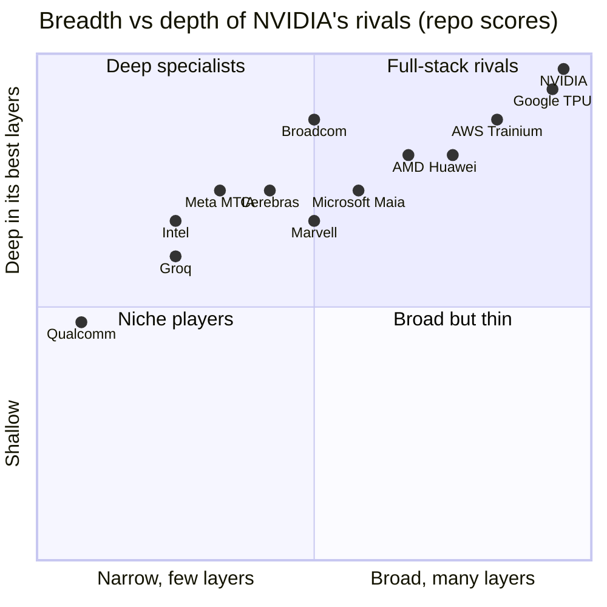
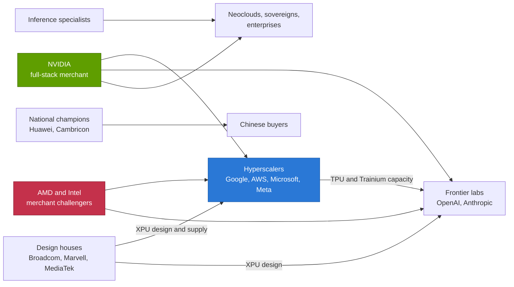

# 15 — Competitive landscape

Cross-cutting 15 · Who competes with NVIDIA, in which layers, and how hard · ~22 min read · Last verified: 2026-11-05

## ⚡ The Executive Take

- **Share has barely moved while the pool quadrupled.** NVIDIA took ~87% of AI data-center silicon revenue in 2025 against ~90% in 2023, while the pool grew from ~$53B to ~$224B (Est., repo calculation) [[S416]](../../sources/bibliography.md#s416)[[S1]](../../sources/bibliography.md#s1)[[S660]](../../sources/bibliography.md#s660)[[S661]](../../sources/bibliography.md#s661)[[S663]](../../sources/bibliography.md#s663). Custom [ASICs](../../glossary.md#asic) are ~10% of revenue but TrendForce puts ASIC-based servers at ~27.8% of 2026 AI server units [[S2517]](../../sources/bibliography.md#s2517).
- **No rival matches the stack.** The closest, Google's [TPU](../../glossary.md#tpu), is level or ahead in 5 of NVIDIA's 12 layers; 60% of all rival-by-layer cells score "behind" in this repo's matrix [[S15014]](../../sources/bibliography.md#s15014).
- **The chip gap has closed at AMD.** MI455X lists 432 GB of [HBM4](../../glossary.md#hbm4), 23.3 TB/s and 20 [PFLOPS](../../glossary.md#flops) FP8 against Rubin's 288 GB, 19.2 TB/s and 17.5 PFLOPS [[S144]](../../sources/bibliography.md#s144)[[S90093]](../../sources/bibliography.md#s90093)[[S33005]](../../sources/bibliography.md#s33005)[[S90006]](../../sources/bibliography.md#s90006). On MLPerf Llama 2 70B the MI355X matched a B200 per GPU (12,935 vs 12,994 tokens/s) [[S602]](../../sources/bibliography.md#s602).
- **[Hyperscaler](../../glossary.md#hyperscaler) chips trail per chip but win on cost.** An owned Ironwood chip-hour costs ~$1.21 against ~$2.31 for a GB300 (Est., SemiAnalysis) [[S622]](../../sources/bibliography.md#s622). Yet Rubin's HBM4 reopened the hardware gap: 2026 hyperscaler chips carry 32–45% of its memory bandwidth (repo calculation) [[S15014]](../../sources/bibliography.md#s15014).
- **The biggest buyers now run portfolios.** OpenAI: 6 GW of AMD, 10 GW of Broadcom-built accelerators and ~2 GW of Trainium from 2027 [[S24000]](../../sources/bibliography.md#s24000)[[S174]](../../sources/bibliography.md#s174)[[S15000]](../../sources/bibliography.md#s15000). Anthropic: up to 1M TPUs and up to 5 GW of Trainium [[S653]](../../sources/bibliography.md#s653)[[S15000]](../../sources/bibliography.md#s15000). Meta: 6 GW of AMD plus rented TPUs [[S24004]](../../sources/bibliography.md#s24004)[[S90025]](../../sources/bibliography.md#s90025).
- **Revenue still says NVIDIA.** Its ~$194B of FY2026 data-center revenue is ~12× AMD's Data Center segment and ~10× Broadcom's AI revenue [[S1]](../../sources/bibliography.md#s1)[[S450]](../../sources/bibliography.md#s450)[[S451]](../../sources/bibliography.md#s451). Broadcom is the fastest climber: $16.7B of AI revenue in its Q3 FY2026, +221% y/y [[S2516]](../../sources/bibliography.md#s2516).
- 🔴 **Repo verdict:** NVIDIA's lead is now a platform-and-cadence lead, not a chip lead. Rivals cap its pricing power at the largest buyers well before they dent its volume.

## Market share: merchant GPUs vs custom ASICs

Two kinds of seller compete. [Merchant silicon](../../glossary.md#merchant-silicon) vendors (NVIDIA, AMD, Intel and start-ups) sell chips and systems to anyone. Custom ASICs are designed for one buyer, usually with an [ASIC design partner](../../glossary.md#asic-design-partner) such as Broadcom or Marvell, and never sold on the open market. Shares are hard to measure: a custom chip's "price" is the design partner's revenue, not what the buyer would have paid NVIDIA.

| Year | Pool (US$ B, Est.) | NVIDIA | AMD | Custom ASIC (Broadcom + Marvell) | Other |
|---|---|---|---|---|---|
| 2023 | ~53 | 90.2% | 0.9% | 8.3% | 0.6% |
| 2024 | ~134 | 85.7% | 3.7% | 10.2% | 0.4% |
| 2025 | ~224 | 86.6% | 3.0% | 10.2% | 0.2% |
| 2026E | ~448 | 82.8% | 3.3% | 13.6% | 0.2% |

Repo calculation in `data/market_share.csv` from company filings [[S416]](../../sources/bibliography.md#s416)[[S417]](../../sources/bibliography.md#s417)[[S1]](../../sources/bibliography.md#s1)[[S660]](../../sources/bibliography.md#s660)[[S661]](../../sources/bibliography.md#s661)[[S662]](../../sources/bibliography.md#s662)[[S663]](../../sources/bibliography.md#s663); China domestic (Huawei Ascend) excluded; 2026E is 🔴 speculative.

> [!TIP]
> **Worked example — why ASICs are ~14% of dollars but ~28% of units.** TrendForce puts ASIC-based servers at ~27.8% of 2026 AI server shipments and GPU-based servers at ~69.7% [[S2517]](../../sources/bibliography.md#s2517)[[S666]](../../sources/bibliography.md#s666). The revenue split is ~14% vs ~86% (Est., after updating Broadcom's FY2026 to ~$57B) [[S15014]](../../sources/bibliography.md#s15014). Revenue per unit, ASIC relative to GPU, is therefore (14 ÷ 27.8) ÷ (86 ÷ 69.7) ≈ 0.50 ÷ 1.23 ≈ **0.41**. A custom-ASIC server earns its suppliers roughly 40 % of what a GPU server earns NVIDIA and its partners. **Conclusion:** unit share overstates the threat to NVIDIA's revenue, but it measures the threat to its *volume* and pricing power. (Scopes differ: servers vs silicon; 🔴 repo arithmetic.)

The design partners are where custom-ASIC dollars show up. Broadcom's AI revenue, which includes AI Ethernet as well as custom [XPUs](../../glossary.md#xpu), rose from ~$3.8B in 2023 to ~$20.2B in fiscal 2025 [[S660]](../../sources/bibliography.md#s660)[[S661]](../../sources/bibliography.md#s661), then to $16.7B in a single quarter (Q3 FY2026), with $21.7B guided for Q4 [[S2516]](../../sources/bibliography.md#s2516). The chart now uses ~$57B for Broadcom's FY2026 — the sum of reported and guided quarters [[S2516]](../../sources/bibliography.md#s2516).

**The hyperscaler wallet.** Shares of a vendor pool hide how much buyers spend overall. The Big-4 hyperscalers guide ~$728B of 2026 capex (midpoints) [[S12518]](../../sources/bibliography.md#s12518)[[S12519]](../../sources/bibliography.md#s12519). NVIDIA's hyperscale Data Center revenue annualizes to ~$173B, about a quarter of that [[S403]](../../sources/bibliography.md#s403)[[S406]](../../sources/bibliography.md#s406). Most capex goes to buildings, power, networking and memory.

![Horizontal bar chart. The four largest hyperscalers guide about $728B of 2026 capex (Amazon ~$220B, Alphabet ~$200B, Microsoft ~$170B, Meta ~$138B, midpoints). Against that, NVIDIA's hyperscale Data Center revenue annualizes to about $173B (first half of FY2027 times two), roughly 24% of the capex; Broadcom's AI semiconductor revenue annualizes to about $67B (Q3 FY2026 times four, including networking and non-hyperscaler customers); Amazon's own custom-silicon business passed a $20B run rate; AMD's whole Data Center segment annualizes to about $34B. Most capex goes to buildings, power, networking and memory, not accelerators.](../../assets/charts/15-hyperscaler-capex-vs-silicon-2026.svg)

🔧 Under the hood: what the share numbers include and leave out

- **NVIDIA** is measured by Data Center revenue, which includes networking (~$31B in FY2026), CPUs and systems, so it overstates "GPU" share [[S402]](../../sources/bibliography.md#s402).
- **Custom ASICs** are counted at Broadcom and Marvell AI revenue, which includes AI Ethernet and non-hyperscaler customers such as OpenAI but excludes hyperscalers' own design costs.
- **AMD** is an Instinct estimate (AMD does not disclose it); its Data Center segment also contains EPYC CPUs [[S663]](../../sources/bibliography.md#s663)[[S450]](../../sources/bibliography.md#s450).
- **China** is excluded: Huawei's Ascend revenue is not public, and NVIDIA's China data-center sales are near zero after export controls [[S90011]](../../sources/bibliography.md#s90011).
- No public source gives "accelerator cost to the buyer", the better denominator, so treat every share figure as ±3 points.

## Where each rival competes: layers, breadth and depth

The heatmap at the top scores 12 rivals in each of NVIDIA's 12 stack layers (02 silicon to 13 ecosystem and capital). Each cell has a 🟩🟨🟥🟦 verdict and sourced reason in `data/competitor_matrix.csv`. [Stack breadth](../../glossary.md#stack-breadth) counts the layers where a rival scores at least 3 of 5. Depth is the average of its three best layer scores.

x = layers scored ≥ 3 of 5, divided by 12; y = average of the three best layer scores, divided by 5. NVIDIA and Google TPU both score 12 layers and 5.0; they are nudged apart for legibility. Repo analyst judgement (🔴) [[S15014]](../../sources/bibliography.md#s15014).

Three patterns stand out.

1. **Only vertically integrated hyperscalers are broad.** Google and AWS score on 10–12 layers because they own cloud, network, CPU and chip, but that breadth exists only inside their own buildings.
2. **AMD is the only broad merchant.** It covers 8 layers and leads in one (the EPYC host CPU), but trails in software, racks and [scale-up](../../glossary.md#scale-up).
3. **Most rivals are point solutions.** Seven of 12 cover six layers or fewer. Broadcom is the deepest: it leads in Ethernet switching while selling silicon *to* hyperscalers.

> [!TIP]
> **Worked example — reading Google's 5 of 12.** Google's TPU stack is 🟩 in inference cost and cloud distribution, 🟨 in silicon, CPU and racks, 🟦 in scale-up, [scale-out](../../glossary.md#scale-out) and offload (in-house designs not sold), and 🟥 in memory supply, system software, libraries and ecosystem [[S15014]](../../sources/bibliography.md#s15014). So 5 of 12 cells are 🟩 or 🟨. Weight each layer equally and Google's average is 4.0 against NVIDIA's 4.7. The 0.7-point gap sits almost entirely in software and in selling to outsiders. **Conclusion:** Google could close most of the gap by opening its stack, and the 2025–26 moves (TPUs for Anthropic, Meta and Oracle) are a step in that direction.

The radars tell the same story on nine capability axes: every rival trails on software, most on rack-scale systems, and the leads are scattered (AMD on memory, Google on scale-up size and cost, Broadcom on Ethernet switching).

## Strategy archetypes

Competitors attack NVIDIA in five ways, each with its own economic engine and failure mode.

| Archetype | Who | Engine | Best case against NVIDIA | Typical failure mode |
|---|---|---|---|---|
| [Full-stack merchant](../../glossary.md#full-stack-merchant) | NVIDIA; AMD (building); Intel (re-entering) | Sell chips, racks and software to everyone | A second source at equal specs and lower price ([AMD](amd.md)) | Software and rack maturity lag; ~13× less data-center revenue to fund cadence [[S405]](../../sources/bibliography.md#s405)[[S450]](../../sources/bibliography.md#s450) |
| Hyperscaler in-house ([captive silicon](../../glossary.md#captive-silicon)) | Google TPU, AWS Trainium, Microsoft Maia, Meta MTIA | Remove the merchant margin on own workloads | ~18% lower cost per token on one TPU workload [[S625]](../../sources/bibliography.md#s625) | Needs ~130,000 chips per generation to pay off (🔴) [[S23010]](../../sources/bibliography.md#s23010); stays internal |
| Design-services houses | Broadcom, Marvell, MediaTek, Alchip, GUC | Charge for design, SerDes, packaging and supply | Turn every large buyer into a potential XPU customer ([custom-ASIC houses](custom-asic-houses.md)) | Concentrated on a few customers; dependent on TSMC and HBM allocation |
| Inference specialists | Cerebras, SambaNova, Etched, d-Matrix, Tenstorrent; Qualcomm AI200/AI250 | Re-architect memory for token speed or cost | Win latency or cost niches as inference grows ([inference start-ups](inference-startups.md), [Qualcomm](qualcomm.md)) | Narrow software; Groq's technology was licensed by NVIDIA for ~$20B (🟡) [[S90018]](../../sources/bibliography.md#s90018) |
| [National champions](../../glossary.md#national-champion) | Huawei Ascend, Cambricon | Protected home market behind export controls | Own China's market as NVIDIA is excluded ([China](china.md)) | Process-node and HBM limits; SuperPoD shipments unconfirmed (🔴) [[S90042]](../../sources/bibliography.md#s90042) |

The 2025–26 shift: hyperscalers became *suppliers* to the frontier labs. Google rents and sells TPUs to Anthropic and Meta [[S653]](../../sources/bibliography.md#s653)[[S90025]](../../sources/bibliography.md#s90025); AWS supplies Trainium to Anthropic and OpenAI [[S15000]](../../sources/bibliography.md#s15000). The same companies remain NVIDIA's largest customers.

> [!TIP]
> **Worked example — the in-house break-even.** A leading-edge chip program costs ~$0.6–0.7B to design; double it for software and systems to ~$1.4B (🔴) [[S2500]](../../sources/bibliography.md#s2500)[[S2501]](../../sources/bibliography.md#s2501). If the in-house chip saves ~18% of a B200's ~$1.73 owner cost per hour, it saves ~$2,700 per chip-year [[S625]](../../sources/bibliography.md#s625)[[S622]](../../sources/bibliography.md#s622). Break-even is ~520,000 chip-years, ~130,000 chips per generation over four years (🔴 repo arithmetic, from [CS3](../../case-studies/CS3-google-tpu-the-credible-alternative.md)) [[S23010]](../../sources/bibliography.md#s23010). **Conclusion:** only the four hyperscalers and two or three frontier labs clear that bar. Everyone else buys merchant silicon or rents someone else's ASIC.

## How much has the gap closed?

The chart below compares each challenger's newest chip with the NVIDIA flagship shipping in the same year (the [same-year flagship](../../glossary.md#same-year-flagship)) on memory bandwidth and dense [FP8](../../glossary.md#fp8). Bandwidth matters most for inference, where every generated token re-reads the model weights from [HBM](../../glossary.md#hbm).

![Two line panels of challenger chips as a percentage of NVIDIA's same-year flagship. Memory bandwidth: AMD at 158% (MI300X vs H100, 2023), 125%, 100% and 121% (MI455X vs Rubin, 2026); Google TPU rose from 59% (v4, 2021) to 92% (Ironwood vs GB300, 2025) before falling to about 45% (TPU 8i vs Rubin, 2026); AWS Trainium 24%, 60% and 61% (2022-2025); Microsoft Maia 38% (2024) and 36% (2026); Meta MTIA 4% (v2, 2024) and 32% (MTIA 300, 2026). Dense FP8: AMD 101-132%; Ironwood 92%; Trainium 10%, 66% and 50%; Maia 200 29%; MTIA 300 7%. Rubin's HBM4 jump re-opened a gap that custom chips had almost closed in 2025.](../../assets/charts/15-challenger-gap-to-nvidia.svg)

| Challenger | 2023–24 position (% of NVIDIA bandwidth) | 2025 | 2026 | Direction |
|---|---|---|---|---|
| AMD Instinct | 158% (MI300X vs H100) | 100% (MI355X vs GB300) | 121% (MI455X vs Rubin) | 🟩 Back in the lead |
| Google TPU | 83% (v5p vs H100) | 92% (Ironwood vs GB300) | ~45% (TPU 8i vs Rubin) | 🟥 Reopened by HBM4 |
| AWS Trainium | 60% (Trn2 vs H200) | 61% (Trn3 vs GB300) | — (Trn4 not yet dated) | 🟥 Behind, stable |
| Microsoft Maia | 38% (Maia 100 vs H200) | — | 36% (Maia 200 vs Rubin) | 🟥 Behind, stable |
| Meta MTIA | 4% (v2 vs H200) | — | 32% (MTIA 300 vs Rubin) | 🟥 Closing fast from a low base |

Repo calculation from vendor peak specifications [[S141]](../../sources/bibliography.md#s141)[[S143]](../../sources/bibliography.md#s143)[[S144]](../../sources/bibliography.md#s144)[[S90093]](../../sources/bibliography.md#s90093)[[S151]](../../sources/bibliography.md#s151)[[S154]](../../sources/bibliography.md#s154)[[S155]](../../sources/bibliography.md#s155)[[S157]](../../sources/bibliography.md#s157)[[S158]](../../sources/bibliography.md#s158)[[S15010]](../../sources/bibliography.md#s15010)[[S15002]](../../sources/bibliography.md#s15002)[[S33005]](../../sources/bibliography.md#s33005)[[S90006]](../../sources/bibliography.md#s90006)[[S15014]](../../sources/bibliography.md#s15014).

> [!TIP]
> **Worked example — what "45% of Rubin's bandwidth" costs at [decode](../../glossary.md#decode).** A decode step on a 70B-parameter FP8 model re-reads ~70 GB of weights. At 19.2 TB/s a Rubin GPU can do that ~274 times a second; at 8.6 TB/s a TPU 8i ~123 times [[S90006]](../../sources/bibliography.md#s90006)[[S15010]](../../sources/bibliography.md#s15010). That caps single-stream speed at ~274 vs ~123 tokens/s before batching. To match Rubin's tokens per second, a TPU fleet needs ~2.2× the chips, so each TPU chip-hour must cost less than ~45% of a Rubin chip-hour. SemiAnalysis puts an owned Ironwood chip-hour ($1.21) at ~34% of a Vera Rubin one ($3.61) (Est.) [[S622]](../../sources/bibliography.md#s622); if TPU 8i costs about what Ironwood does, it clears the bar. **Conclusion:** the cost advantage can survive the bandwidth gap, narrowly; it rests on price, not on silicon.

The scatter below adds compute and memory capacity for every accelerator with public numbers. Rubin and MI455X sit alone in the top right; shipping custom ASICs cluster at roughly a GB300's level.

## MLPerf evidence: what independent benchmarks show

[MLPerf](../../glossary.md#mlperf) is the only audited, cross-vendor benchmark. It has two big limits: vendors choose whether to submit, and the hyperscaler ASICs mostly do not. Google submitted TPUs only in Inference v5.0 and Training up to v5.0; Trainium, Maia and MTIA have no closed-division results [[S601]](../../sources/bibliography.md#s601)[[S602]](../../sources/bibliography.md#s602)[[S603]](../../sources/bibliography.md#s603)[[S613]](../../sources/bibliography.md#s613).

On single-node inference AMD has closed the gap: MI355X matches a B200 on Llama 2 70B and beats a B300 on gpt-oss-120b, a mixture-of-experts model that rewards memory bandwidth [[S602]](../../sources/bibliography.md#s602)[[S603]](../../sources/bibliography.md#s603). NVIDIA's lead reappears at rack scale. GB300 [NVL72](../../glossary.md#nvl72) leads both charts, and at an interactive 50 tokens/s per user SemiAnalysis's InferenceX measures ~6,261 tokens/s per GPU for GB300 NVL72 against ~738 for MI355X [[S621]](../../sources/bibliography.md#s621)[[S622]](../../sources/bibliography.md#s622).

> [!TIP]
> **Worked example — tokens per dollar on the MLPerf result.** MI355X delivers 12,935 tokens/s and GB300 15,651 on Llama 2 70B Offline [[S602]](../../sources/bibliography.md#s602). At SemiAnalysis's owner costs of ~$1.50 and ~$2.31 per [GPU-hour](../../glossary.md#gpu-hour) [[S622]](../../sources/bibliography.md#s622), that is ~8,600 vs ~6,800 tokens/s per dollar-hour: **AMD ~27% ahead** on this test (Est.). At 50 tokens/s per user on DeepSeek-R1 the ranking flips: 6,261 ÷ 2.31 ≈ 2,710 vs 738 ÷ 1.50 ≈ 490, **GB300 NVL72 ~5.5× ahead** [[S621]](../../sources/bibliography.md#s621)[[S622]](../../sources/bibliography.md#s622). **Conclusion:** which vendor "wins" depends on the workload's interactivity target. Batch and offline jobs favour cheap memory-rich GPUs; interactive reasoning favours NVIDIA's rack-scale [NVLink](../../glossary.md#nvlink) domain.

Training tells a starker story. On 8-GPU fine-tuning the MI355X (8.3 minutes) sits between B200 (7.9) and GB200 (9.6) [[S609]](../../sources/bibliography.md#s609). But no non-NVIDIA accelerator has submitted the Llama 3.1 405B pre-training benchmark, where NVIDIA systems scaled to 8,192 GPUs [[S607]](../../sources/bibliography.md#s607)[[S609]](../../sources/bibliography.md#s609).

🔧 Under the hood: how to read MLPerf without being misled

- **Closed vs open division.** Closed requires the reference model and accuracy target; open allows changes (quantization, pruning). Compare only closed results.
- **Offline vs server.** Offline measures raw throughput with all queries available at once; server adds a latency bound per query. Interactive products care about the second, and NVIDIA's rack-scale advantage grows there.
- **Per-accelerator normalisation** hides system cost: an NVL72 rack includes 36 Grace CPUs and NVLink switch trays that an 8-GPU AMD node lacks.
- **Absence is information.** Since TPUs left MLPerf after v5.0, buyers rely on Google's and analysts' figures [[S613]](../../sources/bibliography.md#s613).

## The ten competitor pages

| Page | Archetype | Their best argument | Threat to NVIDIA (🔴 repo view) |
|---|---|---|---|
| [AMD](amd.md) | Full-stack merchant (challenger) | Specs at or above Rubin, an open rack, 14 GW of commitments [[S144]](../../sources/bibliography.md#s144)[[S24000]](../../sources/bibliography.md#s24000)[[S24004]](../../sources/bibliography.md#s24004) | 🟥 High at frontier labs; medium elsewhere |
| [Google TPU](google-tpu.md) | Hyperscaler in-house, now sold outside | Lowest measured cost per token; 9,216-chip pods [[S625]](../../sources/bibliography.md#s625)[[S151]](../../sources/bibliography.md#s151) | 🟥 High on price; low on merchant volume |
| [AWS Trainium](aws-trainium.md) | Hyperscaler in-house | >$225B of Trainium commitments; Anthropic and OpenAI as anchors [[S15000]](../../sources/bibliography.md#s15000) | 🟨 Medium; capped by software |
| [Microsoft Maia](microsoft-maia.md) | Hyperscaler in-house | ~30% better performance per dollar on Copilot inference (vendor claim) [[S15007]](../../sources/bibliography.md#s15007) | 🟨 Medium from 2027 |
| [Meta MTIA](meta-mtia.md) | Hyperscaler in-house | Four generations in two years; owns PyTorch [[S15003]](../../sources/bibliography.md#s15003)[[S9028]](../../sources/bibliography.md#s9028) | 🟨 Low-to-medium; Meta is also a top NVIDIA buyer |
| [Custom-ASIC houses](custom-asic-houses.md) | Design services | Broadcom AI revenue $16.7B in one quarter [[S2516]](../../sources/bibliography.md#s2516) | 🟥 High: they arm every hyperscaler |
| [Intel](intel.md) | Merchant (re-entering) | x86 incumbency; NVIDIA's own $5B stake and NVLink x86 CPUs [[S4009]](../../sources/bibliography.md#s4009) | 🟩 Low as an accelerator rival |
| [Qualcomm](qualcomm.md) | Inference specialist | 768 GB LPDDR per card for low-cost inference (public info) [[S90028]](../../sources/bibliography.md#s90028) | 🟩 Low today; no 2026 shipment confirmed (🔴) |
| [Inference start-ups](inference-startups.md) | Inference specialists | SRAM and wafer-scale designs for speed; OpenAI–Cerebras up to 750 MW [[S11523]](../../sources/bibliography.md#s11523) | 🟨 Niche; NVIDIA absorbed Groq's technology [[S90018]](../../sources/bibliography.md#s90018) |
| [China](china.md) | National champions | Protected market; 8,192-chip Atlas 950 SuperPoD planned [[S90042]](../../sources/bibliography.md#s90042) | 🟥 High in China, low elsewhere |

## Overall verdict

NVIDIA in November 2026 is **wide but no longer unchallenged in any single layer**. AMD is at parity or ahead on paper (it leads on HBM capacity and bandwidth) [[S144]](../../sources/bibliography.md#s144)[[S90093]](../../sources/bibliography.md#s90093) and close in single-node benchmarks; Google's TPU is cheaper per token on the workloads measured; Broadcom-based Ethernet won the back-end fabric vote [[S90053]](../../sources/bibliography.md#s90053). What no rival has is the combination: a merchant product, sold everywhere, refreshed every year, with day-zero software for every new model. That combination is why share has stayed near 85–90% while prices held a ~75% gross margin [[S405]](../../sources/bibliography.md#s405).

Competition therefore bites first on **price**, then on **share of the largest buyers**, and only last on volume. The [CS3](../../case-studies/CS3-google-tpu-the-credible-alternative.md) arithmetic suggests NVIDIA could match the TPU's cost per token and still keep ~62% gross margin (🔴) [[S23010]](../../sources/bibliography.md#s23010). Meanwhile the long tail of [neoclouds](../../glossary.md#neocloud), sovereigns and enterprises, ~45% of Data Center revenue in Q2 FY2027 [[S406]](../../sources/bibliography.md#s406), has few realistic alternatives.

> [!TIP]
> **Worked example — share vs margin.** One point of the ~$436B 2026E pool is worth ~$4.4B [[S15014]](../../sources/bibliography.md#s15014). Losing five points of share *and* five points of gross margin on a ~$371B data-center year (FY2027E) [[S403]](../../sources/bibliography.md#s403)[[S405]](../../sources/bibliography.md#s405), would cost NVIDIA ~$22B of revenue and ~$17B of gross profit on what remains (🔴 repo arithmetic). **Conclusion:** margin pressure on the 80%-plus NVIDIA keeps matters as much as lost share.

> [!NOTE]
> **🐂 Bull view.** Rivals have matched NVIDIA's *specs* for three years, yet its share fell only ~3 points while the pool quadrupled [[S15014]](../../sources/bibliography.md#s15014). Every challenger trails on software and racks, the two things that take longest to copy, and NVIDIA ships a new platform every year (Rubin 2026, Rubin Ultra 2027, Feynman 2028) [[S90003]](../../sources/bibliography.md#s90003)[[S90004]](../../sources/bibliography.md#s90004). Hyperscalers keep buying: Meta committed to "millions" of Blackwell and Rubin GPUs even while building MTIA [[S4006]](../../sources/bibliography.md#s4006).

> [!WARNING]
> **🐻 Bear view.** The four largest buyers all have their own chips, and two of them now sell those chips to NVIDIA's other big customers. Custom-ASIC unit share is heading to ~28% in 2026 and ~40% by 2030 per TrendForce [[S2517]](../../sources/bibliography.md#s2517). Once a model family runs well on TPU or Trainium, the switching cost falls for the next one. A merchant rival (AMD) already out-specs Rubin on memory, and its equity-for-capacity deals put 14 GW of frontier demand on a non-NVIDIA roadmap [[S24000]](../../sources/bibliography.md#s24000)[[S24004]](../../sources/bibliography.md#s24004)[[S9538]](../../sources/bibliography.md#s9538).

| Signpost to watch (2027) | Bullish for NVIDIA if… | Bearish if… |
|---|---|---|
| OpenAI's first AMD gigawatt (MI450) | Ramp slips or runs mostly inference overflow | Frontier training runs on Helios at scale |
| TPU sales outside Google Cloud | Stays limited to Anthropic and Meta | Oracle and others resell TPUs broadly [[S552]](../../sources/bibliography.md#s552) |
| Hyperscaler MLPerf participation | ASICs stay absent | Trainium or Maia publish audited wins |
| Broadcom AI revenue | Growth slows below NVIDIA's | Passes ~25% of NVIDIA Data Center revenue |
| NVIDIA gross margin | Holds ~75% | Drifts toward the low 60s at hyperscalers |

## 🎯 Corp Dev Lens

1. **Where is share actually moving?** Revenue share says NVIDIA is ~87%; unit share says ASICs approach ~28%. Which metric should a challenger's business case use, and which buyers (frontier labs, hyperscalers, sovereigns) are truly contestable for a new merchant entrant?
2. **Design-services value pool.** Broadcom's AI revenue is growing faster than NVIDIA's [[S2516]](../../sources/bibliography.md#s2516). Which capabilities make a design house indispensable ([SerDes](../../glossary.md#serdes), packaging, HBM supply, rack integration), and which could a new entrant build, buy or partner for?
3. **Software is the common gap.** Every radar shows the software axis behind. Qualcomm's public acquisition of Modular (~$3.9B, Mojo/MAX) targets hardware-portable AI software [[S90057]](../../sources/bibliography.md#s90057). What evidence (day-zero model support, MLPerf submissions) would show such a stack is closing the gap for any challenger?
4. **Inference is where the archetypes collide.** TPU, Trainium, Maia and MTIA all now prioritise inference, as do the start-ups and Qualcomm's public AI200/AI250 plans [[S90028]](../../sources/bibliography.md#s90028). Is there room for a merchant inference specialist once hyperscalers rent their own ASICs to outsiders?
5. **Partnering with NVIDIA vs competing.** AWS put [NVLink Fusion](../../glossary.md#nvlink-fusion) on Trainium4; Intel builds NVLink [x86](../../glossary.md#x86) CPUs [[S90034]](../../sources/bibliography.md#s90034)[[S4009]](../../sources/bibliography.md#s4009). When does it pay to plug into NVIDIA's fabric rather than fight it?

## 📚 Sources

<!-- Auto-generated from the [S…] citations on this page by `make build`. Edit sources/registry/*.csv, not this list. -->

- [**S1**](../../sources/bibliography.md#s1) NVIDIA Corporation via SEC EDGAR, *NVIDIA Announces Financial Results for Fourth Quarter and Fiscal 2026 (Form 8-K exhibit 99.1)*, 2026-02-25. [Link](https://www.sec.gov/Archives/edgar/data/1045810/000104581026000019/q4fy26pr.htm)
- [**S141**](../../sources/bibliography.md#s141) AMD, *AMD Instinct MI300X Accelerator*, 2023-12-06. [Link](https://www.amd.com/en/products/accelerators/instinct/mi300/mi300x.html)
- [**S143**](../../sources/bibliography.md#s143) AMD, *AMD Instinct MI350 Series (MI350X, MI355X)*, 2025-06-12. [Link](https://www.amd.com/en/products/accelerators/instinct/mi350.html)
- [**S144**](../../sources/bibliography.md#s144) AMD Newsroom, *AMD Unveils Vision for an Open AI Ecosystem, Detailing New Silicon, Software and Systems at Advancing AI 2025*, 2025-06-12. [Link](https://www.amd.com/en/newsroom/press-releases/2025-6-12-amd-unveils-vision-for-an-open-ai-ecosystem-detai.html)
- [**S151**](../../sources/bibliography.md#s151) Google Blog (Amin Vahdat), *Ironwood: The first Google TPU for the age of inference*, 2025-04-09. [Link](https://blog.google/products/google-cloud/ironwood-tpu-age-of-inference/)
- [**S154**](../../sources/bibliography.md#s154) AWS Neuron SDK docs, *AWS Neuron documentation: Trainium2 architecture*, 2024-12. [Link](https://awsdocs-neuron.readthedocs-hosted.com/en/latest/general/arch/neuron-hardware/trainium2.html)
- [**S155**](../../sources/bibliography.md#s155) Amazon Web Services, *AWS Trainium (product page: Trn2, Trn3)*, 2025-12. [Link](https://aws.amazon.com/ai/machine-learning/trainium/)
- [**S157**](../../sources/bibliography.md#s157) Microsoft Tech Community, *Inside Maia 100: Revolutionizing AI Workloads with Microsoft's Custom AI Accelerator*, 2024-08-27. [Link](https://techcommunity.microsoft.com/blog/azureinfrastructureblog/inside-maia-100-revolutionizing-ai-workloads-with-microsofts-custom-ai-accelerator/4229118)
- [**S158**](../../sources/bibliography.md#s158) Microsoft, *Maia 200: Microsoft's AI accelerator built for inference*, 2026-01. [Link](https://blogs.microsoft.com/blog/2026/01/26/maia-200-the-ai-accelerator-built-for-inference/)
- [**S174**](../../sources/bibliography.md#s174) OpenAI, *OpenAI and Broadcom announce strategic collaboration to deploy 10 gigawatts of OpenAI-designed AI accelerators*, 2025-10-13. [Link](https://openai.com/index/openai-and-broadcom-announce-strategic-collaboration/)
- [**S402**](../../sources/bibliography.md#s402) NVIDIA Corporation via SEC EDGAR (Colette Kress), *CFO Commentary on Fourth Quarter and Fiscal 2026 Results (Form 8-K exhibit 99.2)*, 2026-02-25. [Link](https://www.sec.gov/Archives/edgar/data/1045810/000104581026000019/q4fy26cfocommentary.htm)
- [**S403**](../../sources/bibliography.md#s403) NVIDIA Corporation via SEC EDGAR, *NVIDIA Announces Financial Results for First Quarter Fiscal 2027 (Form 8-K exhibit 99.1)*, 2026-05-20. [Link](https://www.sec.gov/Archives/edgar/data/0001045810/000104581026000051/q1fy27pr.htm)
- [**S405**](../../sources/bibliography.md#s405) NVIDIA Corporation via SEC EDGAR, *NVIDIA Announces Financial Results for Second Quarter Fiscal 2027 (Form 8-K exhibit 99.1)*, 2026-08-26. [Link](https://www.sec.gov/Archives/edgar/data/0001045810/000104581026000073/q2fy27pr.htm)
- [**S406**](../../sources/bibliography.md#s406) NVIDIA Corporation (Colette Kress), *CFO Commentary on Second Quarter Fiscal 2027 Results*, 2026-08-26. [Link](https://s201.q4cdn.com/141608511/files/doc_financials/2027/Q227/Q2FY27-CFO-Commentary.pdf)
- [**S416**](../../sources/bibliography.md#s416) NVIDIA Corporation via SEC EDGAR, *NVIDIA Corporation Form 10-K for fiscal year ended January 26, 2025*, 2025-02-26. [Link](https://www.sec.gov/Archives/edgar/data/1045810/000104581025000023/nvda-20250126.htm)
- [**S417**](../../sources/bibliography.md#s417) NVIDIA Corporation via SEC EDGAR, *NVIDIA Corporation Form 10-K for fiscal year ended January 28, 2024*, 2024-02-21. [Link](https://www.sec.gov/Archives/edgar/data/1045810/000104581024000029/nvda-20240128.htm)
- [**S450**](../../sources/bibliography.md#s450) U.S. Securities and Exchange Commission (EDGAR), *Advanced Micro Devices Form 10-K / 10-Q filings (EDGAR index)*, 2025-02-05. [Link](https://www.sec.gov/cgi-bin/browse-edgar?action=getcompany&CIK=0000002488&type=10-&dateb=&owner=include&count=40)
- [**S451**](../../sources/bibliography.md#s451) U.S. Securities and Exchange Commission (EDGAR), *Broadcom Inc. Form 10-K / 8-K earnings filings (EDGAR index)*, 2025-12-11. [Link](https://www.sec.gov/cgi-bin/browse-edgar?action=getcompany&CIK=0001730168&type=8-K&dateb=&owner=include&count=40)
- [**S552**](../../sources/bibliography.md#s552) Google Cloud Blog (Karan Batta), *Bringing Google TPUs to Oracle Cloud Infrastructure*, 2026-10-27. [Link](https://cloud.google.com/blog/products/infrastructure/bringing-google-tpus-to-oracle-cloud-infrastructure)
- [**S601**](../../sources/bibliography.md#s601) MLCommons, *MLPerf Inference v5.1 results (summary_results.json and per-submitter logs)*, 2025-09-09. [Link](https://github.com/mlcommons/inference_results_v5.1)
- [**S602**](../../sources/bibliography.md#s602) MLCommons, *MLPerf Inference v6.0 results (summary_results.json and per-submitter logs)*, 2026-04-01. [Link](https://github.com/mlcommons/inference_results_v6.0)
- [**S603**](../../sources/bibliography.md#s603) MLCommons, *MLPerf Inference v6.1 results (summary.csv and per-submitter logs)*, 2026-09. [Link](https://github.com/mlcommons/inference_results_v6.1)
- [**S607**](../../sources/bibliography.md#s607) MLCommons, *MLPerf Training v5.0 results (per-submitter logs and system descriptions)*, 2025-06-04. [Link](https://github.com/mlcommons/training_results_v5.0)
- [**S609**](../../sources/bibliography.md#s609) MLCommons, *MLPerf Training v6.0 results (per-submitter logs and system descriptions)*, 2026-06. [Link](https://github.com/mlcommons/training_results_v6.0)
- [**S613**](../../sources/bibliography.md#s613) NAND Research, *MLPerf Inference 6.0: Software Gains, Broadening Competition Shake Things Up*, 2026-04. [Link](https://nand-research.com/mlperf-inference-6-0-software-gains-broadening-competition-shake-things-up/)
- [**S621**](../../sources/bibliography.md#s621) SemiAnalysis (InferenceX-app repository), *InferenceX public API snapshot (benchmarks.json and benchmarks-history.json fixtures)*, 2026-10-17. [Link](https://github.com/SemiAnalysisAI/InferenceX-app/tree/main/packages/app/cypress/fixtures/api)
- [**S622**](../../sources/bibliography.md#s622) SemiAnalysis (InferenceX-app repository), *InferenceX hardware registry: TCO per GPU-hour by SKU (SemiAnalysis July 2026 pricing surveys and AI Cloud TCO Model)*, 2026-07. [Link](https://github.com/SemiAnalysisAI/InferenceX-app/blob/main/packages/constants/src/gpu-keys.ts)
- [**S625**](../../sources/bibliography.md#s625) SemiAnalysis, *TPU Inference Externalization Full Steam Ahead*, 2026-09-07. [Link](https://github.com/SemiAnalysisAI/InferenceX-app/blob/main/packages/app/content/blog/tpu-inferencex-full-steam.mdx)
- [**S653**](../../sources/bibliography.md#s653) Anthropic, *Expanding our use of Google Cloud TPUs and Services*, 2025-10-23. [Link](https://www.anthropic.com/news/expanding-our-use-of-google-cloud-tpus-and-services)
- [**S660**](../../sources/bibliography.md#s660) Broadcom Inc., *Broadcom Inc. Announces Fourth Quarter and Fiscal Year 2024 Financial Results*, 2024-12-12. [Link](https://investors.broadcom.com/financial-information/quarterly-results)
- [**S661**](../../sources/bibliography.md#s661) Broadcom Inc., *Broadcom Inc. Announces Fourth Quarter and Fiscal Year 2025 Financial Results*, 2025-12-11. [Link](https://investors.broadcom.com/financial-information/quarterly-results)
- [**S662**](../../sources/bibliography.md#s662) Marvell Technology, *Marvell Technology fourth quarter and fiscal 2025 results and AI revenue commentary*, 2025-03-04. [Link](https://investor.marvell.com/news-events/press-releases)
- [**S663**](../../sources/bibliography.md#s663) AMD, *AMD Reports Fourth Quarter and Full Year 2024 Financial Results*, 2025-02-04. [Link](https://ir.amd.com/news-events/press-releases)
- [**S666**](../../sources/bibliography.md#s666) TrendForce, *TrendForce AI server shipment forecasts (GPU-based vs ASIC-based share)*, 2025-10. [Link](https://www.trendforce.com/presscenter/news)
- [**S2500**](../../sources/bibliography.md#s2500) Tom's Hardware, *Firm Estimates a 2nm Chip Now Costs $725 Million to Design*, 2023. [Link](https://www.tomshardware.com/news/firm-estimates-a-2nm-chip-now-costs-dollar725-million-to-design)
- [**S2501**](../../sources/bibliography.md#s2501) Silicon Analysts, *Chip Design & NRE Cost by Node — Historical Time Series Data*, 2026. [Link](https://siliconanalysts.com/market-data/nre-design-cost)
- [**S2516**](../../sources/bibliography.md#s2516) Broadcom Inc. via SEC EDGAR, *Broadcom Inc. Announces Third Quarter Fiscal Year 2026 Financial Results (Form 8-K exhibit 99.1)*, 2026-09. [Link](https://www.sec.gov/Archives/edgar/data/0001730168/000173016826000076/avgo-08022026x8kxex99.htm)
- [**S2517**](../../sources/bibliography.md#s2517) TrendForce, *CSPs accelerate ASIC push in 2H26, challenging NVIDIA as MediaTek, GUC, Alchip benefit*, 2026-03-20. [Link](https://www.trendforce.com/news/2026/03/20/news-csps-accelerate-asic-push-in-2h26-challenging-nvidia-as-mediatek-guc-alchip-benefit/)
- [**S4006**](../../sources/bibliography.md#s4006) SiliconANGLE, *Meta agrees to buy millions of AI chips from Nvidia, raising doubts about its in-house hardware*, 2026-02-17. [Link](https://siliconangle.com/2026/02/17/meta-agrees-buy-millions-ai-chips-nvidia-raising-doubts-house-hardware/)
- [**S4009**](../../sources/bibliography.md#s4009) SDxCentral, *Intel gets hands on Nvidia's $5B investment*, 2025-12. [Link](https://www.sdxcentral.com/news/intel-gets-hands-on-nvidias-5b-investment/)
- [**S9028**](../../sources/bibliography.md#s9028) StorageReview, *Meta's MTIA roadmap: four chip generations in two years put GenAI inference first*, 2026-03. [Link](https://www.storagereview.com/news/metas-mtia-roadmap-four-chip-generations-in-two-years-put-genai-inference-first)
- [**S9538**](../../sources/bibliography.md#s9538) The Next Web, *AMD is investing $5 billion in Anthropic and deploying 2 gigawatts of Helios GPUs to run Claude*, 2026. [Link](https://thenextweb.com/news/amd-anthropic-5-billion-investment-2gw-helios-mi450)
- [**S11523**](../../sources/bibliography.md#s11523) DatacenterDynamics, *OpenAI signs $10 billion deal with Cerebras with 750MW of big chip compute*, 2026-01-14. [Link](https://www.datacenterdynamics.com/en/news/openai-signs-10-billion-deal-with-cerebras-with-750mw-of-big-chip-compute/)
- [**S12518**](../../sources/bibliography.md#s12518) Datacentres.com, *Hyperscaler capex trends: over $700 billion for 2026*, 2026-08. [Link](https://www.datacentres.com/guides/hyperscaler-capex-trends)
- [**S12519**](../../sources/bibliography.md#s12519) Hargreaves Lansdown, *AI hyperscalers are expected to finish the year spending a whopping $828 billion on capex*, 2026-10. [Link](https://www.hl.co.uk/news/ai-hyperscalers-are-expected-to-finish-the-year-spending-a-whopping-828-billion-on-capex)
- [**S15000**](../../sources/bibliography.md#s15000) About Amazon (Andy Jassy), *Amazon CEO Andy Jassy on Amazon's chips business (Q1 2026 earnings)*, 2026-04-29. [Link](https://www.aboutamazon.com/news/company-news/amazon-ceo-andy-jassy-amazon-chips-business-q1-2026-earnings)
- [**S15002**](../../sources/bibliography.md#s15002) Tom's Hardware, *Meta's MTIA chip lineup joins hyperscaler push to replace Nvidia at inference*, 2026-03. [Link](https://www.tomshardware.com/tech-industry/semiconductors/metas-mtia-chip-lineup-joins-hyperscaler-push-to-replace-nvidia-at-inference)
- [**S15003**](../../sources/bibliography.md#s15003) Meta AI Blog, *Meta MTIA: scaling AI chips for billions of users*, 2026-03-11. [Link](https://ai.meta.com/blog/meta-mtia-scale-ai-chips-for-billions/)
- [**S15007**](../../sources/bibliography.md#s15007) Network World, *Microsoft launches its second-generation AI inference chip Maia 200*, 2026-01-26. [Link](https://www.networkworld.com/article/4122439/microsoft-launches-its-second-generation-ai-inference-chip-maia-200.html)
- [**S15010**](../../sources/bibliography.md#s15010) StorageReview, *Google announces TPU 8t (Sunfish) and TPU 8i (Zebrafish)*, 2026-04. [Link](https://www.storagereview.com/news/google-announces-tpu-8t-sunfish-and-tpu-8i-zebrafish)
- [**S15014**](../../sources/bibliography.md#s15014) nvidia_deep_dive_claude repository, *Repo analysis: Chapter 15A competitive-landscape calculations (gap-to-flagship ratios, implied AMD commitment value, hyperscaler wallet shares, breadth vs depth)*, 2026-11-05. [Link](https://github.com/FrankHuang94/nvidia_deep_dive_claude/blob/main/cross-cutting/15-competitive-landscape/index.md)
- [**S23010**](../../sources/bibliography.md#s23010) nvidia_deep_dive_claude repository, *Repo analysis: CS3 TPU economics (break-even fleet for an in-house ASIC, per-token gap vs B200, implied GPU price cut)*, 2026-11-05. [Link](https://github.com/FrankHuang94/nvidia_deep_dive_claude/blob/main/case-studies/CS3-google-tpu-the-credible-alternative.md)
- [**S24000**](../../sources/bibliography.md#s24000) AMD (press release PDF), *AMD and OpenAI Announce Strategic Partnership to Deploy 6 Gigawatts of AMD GPUs*, 2025-10-06. [Link](https://d1io3yog0oux5.cloudfront.net/_be34f20d01abfe28aeec9c2c12afe601/amd/news/2025-10-06_AMD_and_OpenAI_Announce_Strategic_Partnership_to_1260.pdf)
- [**S24004**](../../sources/bibliography.md#s24004) The Register, *AMD copy-pastes 6 GW chips-for-stock deal in new Meta agreement*, 2026-02-24. [Link](https://www.theregister.com/2026/02/24/amd_copypastes_openai_6gw_chipsforstock/)
- [**S33005**](../../sources/bibliography.md#s33005) NVIDIA, *NVIDIA Vera Rubin NVL72 (product page and specifications)*, 2026. [Link](https://www.nvidia.com/en-us/data-center/vera-rubin-nvl72/)
- [**S90003**](../../sources/bibliography.md#s90003) eWeek, *Everything Nvidia Just Announced at GTC 2026: 7 Chips, 5 Racks, 1 Giant Bet on Agentic AI*, 2026-03-17. [Link](https://www.eweek.com/news/nvidia-gtc-2026-ai-inference-vera-rubin-neuron/)
- [**S90004**](../../sources/bibliography.md#s90004) TrendForce, *Key GTC takeaways: how Samsung, Micron, Intel and more power NVIDIA's Vera Rubin and Feynman*, 2026-03-17. [Link](https://www.trendforce.com/news/2026/03/17/news-key-gtc-takeaways-how-samsung-micron-intel-more-power-nvidias-vera-rubin-and-feynman/)
- [**S90006**](../../sources/bibliography.md#s90006) TweakTown, *Nvidia cuts Vera Rubin's memory bandwidth by up to 26% and AMD's Helios now leads in memory bandwidth*, 2026-10. [Link](https://www.tweaktown.com/news/114304/nvidia-cuts-vera-rubins-memory-bandwidth-by-up-to-26-percent-and-amds-helios-now-leads-in-memory-bandwidth/index.html)
- [**S90011**](../../sources/bibliography.md#s90011) Nasdaq (Zacks), *NVIDIA Q2 earnings beat on Blackwell Ultra and Data Center strength*, 2026-08-27. [Link](https://www.nasdaq.com/articles/nvidia-q2-earnings-beat-blackwell-ultra-data-center-strength)
- [**S90018**](../../sources/bibliography.md#s90018) Constellation Research, *Nvidia's Groq deal: acquisition, acquihire or creative licensing deal?*, 2025-12. [Link](https://www.constellationr.com/insights/news/nvidias-groq-deal-acquisition-acquihire-or-creative-licensing-deal)
- [**S90025**](../../sources/bibliography.md#s90025) SiliconANGLE, *Google and Meta reportedly strike new multibillion-dollar AI chip deal*, 2026-02-26. [Link](https://siliconangle.com/2026/02/26/google-meta-reportedly-strike-new-multibillion-dollar-ai-chip-deal/)
- [**S90028**](../../sources/bibliography.md#s90028) TechRepublic, *Qualcomm unveils AI chips to rival Nvidia, AMD*, 2025-10-27. [Link](https://techrepublic.com/article/news-qualcomm-unveils-ai-chips-to-rival-nvidia-amd)
- [**S90034**](../../sources/bibliography.md#s90034) NAND Research, *AWS releases Trainium3, teases Trainium4*, 2025-12. [Link](https://nand-research.com/research-note-aws-releases-trainium3-teases-trainium4/4/)
- [**S90042**](../../sources/bibliography.md#s90042) TrendForce, *Huawei unveils Ascend 950 with in-house HBM in 2026, touts SuperPoD to rival NVIDIA*, 2025-09-18. [Link](https://www.trendforce.com/news/2025/09/18/news-huawei-unveils-ascend-950-with-in-house-hbm-in-2026-touts-superpod-to-rival-nvidia/)
- [**S90053**](../../sources/bibliography.md#s90053) Dell'Oro Group, *Ethernet more than doubles size of InfiniBand as the leading fabric for AI scale-out networks in 2025*, 2026. [Link](https://www.delloro.com/news/ethernet-more-than-doubles-size-of-infiniband-as-the-leading-fabric-for-ai-scale-out-networks-in-2025/)
- [**S90057**](../../sources/bibliography.md#s90057) StorageReview, *Qualcomm unveils Dragonfly data center roadmap: C1000 CPU, AI300 accelerator and Modular acquisition*, 2026-06-24. [Link](https://www.storagereview.com/es/news/qualcomm-unveils-dragonfly-data-center-roadmap-c1000-cpu-ai300-accelerator-and-modular-acquisition)
- [**S90093**](../../sources/bibliography.md#s90093) Tom's Hardware, *AMD takes the wraps off its Instinct MI455X AI accelerator: CDNA 5 and Helios rack-scale architecture*, 2026. [Link](https://www.tomshardware.com/pc-components/gpus/amd-takes-the-wraps-off-its-instinct-mi455x-ai-accelerator-cdna-5-and-helios-rack-scale-architecture-combine-to-take-the-fight-to-nvidia-in-the-data-center)
