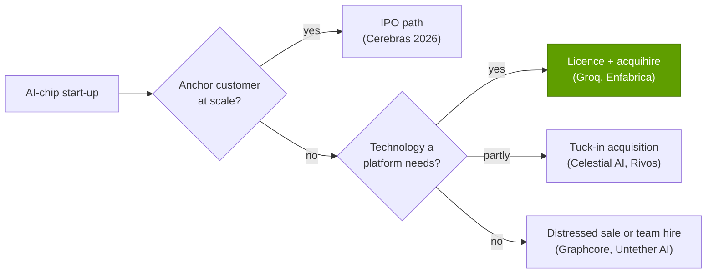
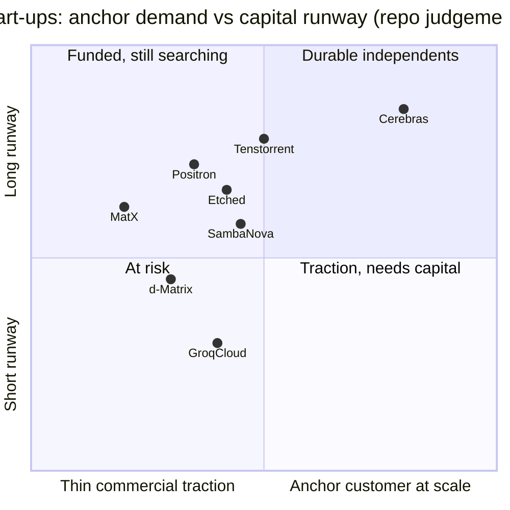

# Inference start-ups: Cerebras, Groq, SambaNova, Tenstorrent, d-Matrix, Etched and others

Cross-cutting 15 · Competitive landscape · ~15 min read · Last verified: 2026-11-05

## ⚡ The Executive Take

- **Capital is back, at higher marks.** Cerebras listed on Nasdaq in May 2026, raising $5.55B at ~$40B (up to ~$56B
  fully diluted) [[S2504]](../../sources/bibliography.md#s2504)[[S2505]](../../sources/bibliography.md#s2505); Tenstorrent raised $1.5B at $6.2B (October 2026), Etched reached $10.3B and Positron
  $5B [[S15516]](../../sources/bibliography.md#s15516)[[S2507]](../../sources/bibliography.md#s2507)[[S11521]](../../sources/bibliography.md#s11521).
- **The largest exit was a licence, not an acquisition.** NVIDIA paid a reported ~$20B for a non-exclusive licence of
  Groq's technology plus its founder and team; Groq keeps running GroqCloud [[S90018]](../../sources/bibliography.md#s90018)[[S90019]](../../sources/bibliography.md#s90019). The design now ships inside
  NVIDIA's roadmap as the Groq 3 LPX rack (256 [LPUs](../../glossary.md#lpu)) 🟢 [[S90003]](../../sources/bibliography.md#s90003)[[S114]](../../sources/bibliography.md#s114).
- **Valuations run far ahead of revenue.** Cerebras booked $180.1M of GAAP revenue in Q2 2026 (+74%) and guided
  ~$880–890M for the year; ~$40B at IPO is ~45× that guidance [[S15514]](../../sources/bibliography.md#s15514)[[S2505]](../../sources/bibliography.md#s2505).
- **Speed is the wedge.** Decode is memory-bound, so chips that keep weights in [SRAM](../../glossary.md#sram) or on a whole
  wafer serve more tokens per second per user; OpenAI agreed to buy up to 750 MW of Cerebras capacity through 2028
  (>$10B reported) [[S11523]](../../sources/bibliography.md#s11523)[[S634]](../../sources/bibliography.md#s634).
- **Outcomes have polarised.** Graphcore sold to SoftBank for ~$0.6B against a $2.77B 2020 valuation [[S15519]](../../sources/bibliography.md#s15519);
  SambaNova talked at ~$1.6B including debt with Intel, then reportedly raised at ~$11B (conflicting reports) 🟡
  [[S2512]](../../sources/bibliography.md#s2512)[[S15518]](../../sources/bibliography.md#s15518).
- **Survival odds favour an anchor customer or a niche NVIDIA does not serve.** NVIDIA's Groq deal shows it will buy a
  niche that threatens it, which caps the upside for the next SRAM entrant (🔴 repo analysis).

![Log-scale timeline of AI-chip start-up valuation marks. Cerebras $8.1B (Sep 2025), ~$23B (Feb 2026) and ~$40B at its May 2026 IPO; Groq $6.9B (Sep 2025) then a ~$20B NVIDIA licence-and-team deal (Dec 2025); Etched >$5B (Jan 2026) then $10.3B (Jul 2026); Tenstorrent ~$2.7B (Dec 2024) then $6.2B (Oct 2026); Positron ~$1B (Feb 2026) then $5B (Sep 2026); SambaNova $5B (2021), a ~$1.6B Intel offer including debt (Dec 2025, stalled) and a reported ~$11B Series F (Jul 2026, conflicting reports); d-Matrix $2B (Nov 2025); Lightmatter $4.4B (Oct 2024); Graphcore $2.77B (2020) sold to SoftBank for ~$0.6B (2024); Celestial AI acquired by Marvell for $3.25B upfront (Feb 2026).](../../assets/charts/15-startup-valuation-marks.svg)

## The technical bets, explained

Generating a token ([decode](../../glossary.md#decode)) re-reads every model weight once. The speed for one user is roughly
memory bandwidth divided by the bytes of weights. GPUs keep weights in [HBM](../../glossary.md#hbm): large (288 GB on Rubin) but
"only" 19.2 TB/s [[S90006]](../../sources/bibliography.md#s90006). The start-ups attack that ratio from different directions.

| Company | Bet | Memory per chip / system | Bandwidth | Status (2026) | Latest mark | Sources |
|---|---|---|---|---|---|---|
| Cerebras | [Wafer-scale](../../glossary.md#wafer-scale) engine | 44 GB on-wafer SRAM | ~21 PB/s | Public (CBRS); cloud + systems | ~$40B IPO | [[S166]](../../sources/bibliography.md#s166)[[S2505]](../../sources/bibliography.md#s2505) |
| Groq | SRAM [LPU](../../glossary.md#lpu), compiler-scheduled | 230 MB (v1); 500 MB (Groq 3, NVIDIA) | 80 / 150 TB/s | Licensed to NVIDIA; GroqCloud continues | ~$20B deal | [[S167]](../../sources/bibliography.md#s167)[[S114]](../../sources/bibliography.md#s114)[[S90019]](../../sources/bibliography.md#s90019) |
| SambaNova | [Dataflow](../../glossary.md#dataflow-architecture) RDU, three memory tiers | 520 MB SRAM + 64 GB HBM + up to 1.5 TB DDR | n/d | Raised from Vista and Intel (Feb 2026) | ~$11B reported 🟡 | [[S168]](../../sources/bibliography.md#s168)[[S15517]](../../sources/bibliography.md#s15517)[[S15518]](../../sources/bibliography.md#s15518) |
| Tenstorrent | RISC-V + Tensix cores, Ethernet scale-out, open software | 32 GB GDDR6 | 0.512 TB/s | Series E | $6.2B | [[S169]](../../sources/bibliography.md#s169)[[S15516]](../../sources/bibliography.md#s15516) |
| d-Matrix | Digital [compute-in-memory](../../glossary.md#compute-in-memory) | 2 GB SRAM + 256 GB LPDDR5 | 150 TB/s (SRAM) | Shipping Corsair | $2.0B | [[S170]](../../sources/bibliography.md#s170)[[S2511]](../../sources/bibliography.md#s2511) |
| Etched | [Model-specific ASIC](../../glossary.md#model-specific-asic) (transformers only) | 144 GB HBM3E | n/d | ~$1B pre-orders reported | $10.3B | [[S171]](../../sources/bibliography.md#s171)[[S2507]](../../sources/bibliography.md#s2507) |
| MatX | LLM-specific accelerator | n/d | n/d | Shipments planned 2027 | undisclosed ($500M raise) | [[S2508]](../../sources/bibliography.md#s2508) |
| Positron | Memory-first inference | n/d | n/d | Series C | $5B | [[S11521]](../../sources/bibliography.md#s11521) |
| Lightmatter | Photonic interconnect | — | — | NVLink Fusion link reported 🟡 | $4.4B (2024) | [[S2510]](../../sources/bibliography.md#s2510)[[S5022]](../../sources/bibliography.md#s5022) |

![Heatmap of eight inference challengers on five dimensions. Open-source serving (vLLM, SGLang, llm-d) is at parity on speed, cost and maturity and leads on model coverage and hardware breadth (seven hardware families). Google TPU leads on throughput per dollar (~18% below B200 per token); Cerebras and Groq lead on tokens per second per user thanks to on-chip SRAM but trail on cost; AMD is at parity on cost and model coverage but behind on interactivity and software; 6 of 7 hardware challengers are behind on software maturity; AWS, Microsoft and Qualcomm lack public benchmarks and are mostly 'different approach' or 'behind'.](../../assets/charts/11-inference-challenger-heatmap.svg)

> [!TIP]
> **Worked example — why SRAM is fast and expensive.** A 70B-parameter model in FP8 is ~70 GB. One Rubin GPU holds it
> and can stream it ~274 times a second (19.2 TB/s ÷ 70 GB) [[S90006]](../../sources/bibliography.md#s90006). A Groq 3 LPU holds 0.5 GB, so the weights alone
> need ~140 chips, more than half of a 256-LPU LPX rack; each chip re-reads its slice ~300,000 times a second (150 TB/s ÷
> 0.5 GB) [[S114]](../../sources/bibliography.md#s114). Cerebras's 44 GB wafer needs two wafers for the FP8 weights [[S166]](../../sources/bibliography.md#s166). The speed per user is real; the
> chip count per model is the cost. That is why the repo scores SRAM chips as leading on interactivity and behind on cost
> ([inference competition](../../layers/11-inference-and-ai-software/competition.md)).

🔧 Under the hood: what each bet gives up

- **Wafer-scale (Cerebras):** one 46,225 mm² piece of silicon with 900,000 cores avoids chip-to-chip links entirely
  [[S166]](../../sources/bibliography.md#s166), but needs custom packaging, ~23 kW per system and redundancy to tolerate defects. Models larger than on-wafer
  SRAM stream weights from external MemoryX.
- **Compiler-scheduled SRAM (Groq):** every operation is placed in time at compile time, so latency is deterministic, but
  any model change means recompiling across hundreds of chips [[S167]](../../sources/bibliography.md#s167).
- **Dataflow with tiers (SambaNova):** SRAM for hot tensors, HBM for weights, DDR for capacity [[S168]](../../sources/bibliography.md#s168); flexibility costs
  compiler complexity.
- **Compute-in-memory (d-Matrix):** arithmetic sits next to SRAM arrays to cut data movement; 4-bit block formats raise
  peak throughput but need model quantisation [[S170]](../../sources/bibliography.md#s170).
- **Model-specific (Etched):** hard-wiring the transformer removes general-purpose overhead; a shift in model
  architecture (state-space or hybrid models) could strand the chip [[S171]](../../sources/bibliography.md#s171).

## Company by company

**Cerebras** is the only independent that has reached public markets. Beyond the IPO, its anchor is OpenAI: up to 750 MW
of inference capacity as a cloud service, in tranches through 2028 [[S11523]](../../sources/bibliography.md#s11523)[[S11524]](../../sources/bibliography.md#s11524). Q2 2026 core cloud revenue grew 287%
to $127.7M, and the company reports ~600 MW of contracted data-center capacity [[S15514]](../../sources/bibliography.md#s15514)[[S15515]](../../sources/bibliography.md#s15515). Concentration and
margins are the watch items: the company's core gross margin was ~41% in Q2 🟡 [[S15514]](../../sources/bibliography.md#s15514).

**Groq** shows how NVIDIA neutralises a niche. The December 2025 deal licensed the LPU non-exclusively and moved founder
Jonathan Ross, president Sunny Madra and team to NVIDIA; Groq continues under CEO Simon Edwards [[S90018]](../../sources/bibliography.md#s90018)[[S474]](../../sources/bibliography.md#s474). NVIDIA's
GTC 2026 roadmap put a 256-LPU Groq 3 LPX rack beside Vera Rubin, and Feynman (2028) is reported with an LP40 LPU 🟡
[[S90003]](../../sources/bibliography.md#s90003)[[S90004]](../../sources/bibliography.md#s90004). Former Groq employees have sued the board over the deal [[S118]](../../sources/bibliography.md#s118).

**SambaNova** illustrates how volatile marks are: $5B in 2021, ~$1.6B including debt in stalled Intel talks (Dec 2025),
then a Vista-led ~$350M round with Intel participating (Feb 2026) and a reported ~$1B Series F at ~$11B (July 2026) that
another outlet puts far lower 🟡 [[S2512]](../../sources/bibliography.md#s2512)[[S15517]](../../sources/bibliography.md#s15517)[[S15518]](../../sources/bibliography.md#s15518). Intel's CEO chairs its board [[S2512]](../../sources/bibliography.md#s2512).

**Tenstorrent** sells open: RISC-V CPUs and Tensix AI cores, Ethernet between chips, and an Apache-2.0 software stack
(tt-metal) [[S169]](../../sources/bibliography.md#s169)[[S9535]](../../sources/bibliography.md#s9535). Its October 2026 Series E ($1.5B at $6.2B) funds volume manufacturing and Galaxy systems
[[S15516]](../../sources/bibliography.md#s15516). IP licensing gives it revenue that pure chip start-ups lack.

**d-Matrix, Etched, MatX and Positron** are pre-scale. d-Matrix ships the Corsair card (2 GB SRAM at 150 TB/s plus 256 GB
LPDDR5) [[S170]](../../sources/bibliography.md#s170). Etched reports ~$1B of Sohu pre-orders but no verified shipments [[S2507]](../../sources/bibliography.md#s2507)[[S171]](../../sources/bibliography.md#s171). MatX raised $500M and
plans shipments in 2027 [[S2508]](../../sources/bibliography.md#s2508). Positron's mark rose from ~$1B to $5B within 2026 [[S11520]](../../sources/bibliography.md#s11520)[[S11521]](../../sources/bibliography.md#s11521).

**Photonics** has split in two: Lightmatter ($4.4B, 2024) sells optical interconnect and is reported joining NVLink
Fusion 🟡 [[S2510]](../../sources/bibliography.md#s2510)[[S5022]](../../sources/bibliography.md#s5022); Celestial AI's photonic memory fabric went to Marvell for $3.25B upfront [[S2513]](../../sources/bibliography.md#s2513).

> [!TIP]
> **Worked example — how big is Cerebras's OpenAI contract relative to Cerebras?** OpenAI may buy up to 750 MW of
> capacity through 2028, reported at more than $10B [[S11523]](../../sources/bibliography.md#s11523). Spread over roughly three years that is ~$3.3B a year,
> about 3.8× Cerebras's ~$885M 2026 revenue guidance [[S15514]](../../sources/bibliography.md#s15514). At ~23 kW per CS-3 system [[S166]](../../sources/bibliography.md#s166), 750 MW of IT load would
> be ~32,600 systems, each one a full wafer (🔴 upper bound; facility power is not all IT load). One customer could
> therefore set Cerebras's revenue, its TSMC wafer needs and its concentration risk for years.

## Funding versus revenue

> [!TIP]
> **Worked example — what the market pays per dollar of Cerebras revenue.** IPO value ~$40B ÷ 2026 revenue guidance of
> ~$885M (midpoint) ≈ 45× sales [[S2505]](../../sources/bibliography.md#s2505)[[S15514]](../../sources/bibliography.md#s15514). NVIDIA's FY2026 revenue was $215.9B [[S1]](../../sources/bibliography.md#s1); at a ~$5.76T market value
> (2026-10-05) that is ~27× trailing sales [[S18005]](../../sources/bibliography.md#s18005). Investors price Cerebras as if its revenue grows
> severalfold, which depends on OpenAI's 750 MW tranches arriving on time [[S11523]](../../sources/bibliography.md#s11523). Groq's ~$20B deal was ~2.9× its $6.9B
> round three months earlier [[S90019]](../../sources/bibliography.md#s90019): the strategic buyer, not the venture market, set the top price.

![Log-scale horizontal bar chart of inference start-up valuations. Inference clouds: Fireworks AI ~$15,000M (talks, May 2026), Together AI $8,300M (Jul 2026), Baseten $5,000M (Jan 2026), Modal ~$2,500M (talks). Serving software: Hugging Face $12,930M (NVIDIA acquisition announced Sep 2026, pending), Modular $3,900M (acquired by Qualcomm, 2026), Inferact (vLLM) $800M and RadixArk (SGLang) $400M seed valuations. Silicon: Cerebras ~$40,000M at its May 2026 IPO, Etched $10,300M, Groq $6,900M before its ~$20B NVIDIA licence, Positron $5,000M, Tenstorrent ~$2,700M, d-Matrix $2,000M, SambaNova ~$1,600M (Intel offer talks); MatX and FuriosaAI valuations undisclosed.](../../assets/charts/11-inference-startup-valuations.svg)

The chart above makes a second point: inference *clouds* (Fireworks, Together, Baseten) now price like chip start-ups,
because they capture token revenue without silicon risk [[S11514]](../../sources/bibliography.md#s11514)[[S11516]](../../sources/bibliography.md#s11516). A chip start-up's alternative to selling chips
is to run its own cloud, which Cerebras and Groq both do.

## Exits to date

| Year | Company | Exit | Value | What the buyer got | Sources |
|---|---|---|---|---|---|
| 2019 | Habana Labs | Acquired by Intel | ~$2B | Gaudi line (later missed targets) | [[S2514]](../../sources/bibliography.md#s2514)[[S668]](../../sources/bibliography.md#s668) |
| 2024 | Graphcore | Acquired by SoftBank | ~$0.6B reported | IPU team; below ~$700M raised | [[S15519]](../../sources/bibliography.md#s15519)[[S15520]](../../sources/bibliography.md#s15520) |
| 2025 | Enfabrica | NVIDIA acquihire + licence | >$0.9B | CEO, team, memory-fabric tech | [[S475]](../../sources/bibliography.md#s475) |
| 2025 | Untether AI | Team hired by AMD | undisclosed | Engineers, not the company | [[S9507]](../../sources/bibliography.md#s9507) |
| 2025 | Rivos | Acquired by Meta | undisclosed | RISC-V CPU/accelerator team | [[S4518]](../../sources/bibliography.md#s4518) |
| 2025 | Groq | NVIDIA licence + team | ~$20B reported | LPU technology and founders | [[S90018]](../../sources/bibliography.md#s90018)[[S90019]](../../sources/bibliography.md#s90019) |
| 2026 | Celestial AI | Acquired by Marvell | $3.25B upfront + earn-outs | Photonic memory fabric | [[S2513]](../../sources/bibliography.md#s2513) |
| 2026 | Cerebras | Nasdaq IPO | $5.55B raised | Public currency | [[S2504]](../../sources/bibliography.md#s2504)[[S2505]](../../sources/bibliography.md#s2505) |

> [!WARNING]
> **Myth vs reality: "NVIDIA buys every threat."** NVIDIA's two largest moves here were a non-exclusive licence (Groq)
> and an acquihire with a licence (Enfabrica) [[S90018]](../../sources/bibliography.md#s90018)[[S475]](../../sources/bibliography.md#s475); neither required a merger review of the whole company.
> Most exits went to other buyers (Intel, SoftBank, Marvell, Meta, AMD). The structure, not the frequency, is what is
> new, and it is contested in court [[S118]](../../sources/bibliography.md#s118).

> [!TIP]
> **Worked example — return on capital in the exits.** Graphcore raised ~$700M and sold for ~$600M, ~0.86× capital and
> ~22% of its 2020 valuation of $2.77B [[S15519]](../../sources/bibliography.md#s15519). Celestial AI's $3.25B upfront from Marvell excludes earn-outs [[S2513]](../../sources/bibliography.md#s2513).
> Groq's reported ~$20B was ~2.9× its round three months earlier [[S90019]](../../sources/bibliography.md#s90019). The spread between best and worst outcome is
> more than 30× in value, driven less by chip specs than by whether a platform owner needed the team quickly.

## Survival odds

Placement is 🔴 repo judgement from public funding and customer disclosures above. The independents most likely to last
have either a lab or hyperscaler buying at gigawatt-scale (Cerebras–OpenAI) or a business that does not depend on beating
NVIDIA on tokens per dollar (Tenstorrent's IP licensing). GroqCloud's runway is the least clear after its founders left.

## Verdict by layer: start-ups (as a group) vs NVIDIA

| Layer | Verdict | Why |
|---|---|---|
| 02 Accelerator silicon | 🟦 Different | SRAM, wafer-scale, dataflow and model-specific designs [[S166]](../../sources/bibliography.md#s166)[[S168]](../../sources/bibliography.md#s168)[[S171]](../../sources/bibliography.md#s171) |
| 03 Memory & supply | 🟦 Different | Most avoid HBM/CoWoS; capacity per chip is the trade [[S167]](../../sources/bibliography.md#s167)[[S170]](../../sources/bibliography.md#s170) |
| 05–06 Scale-up / scale-out | 🟥 Behind | Proprietary or Ethernet links; no NVLink-class domains (Groq's LPX is now NVIDIA's) [[S114]](../../sources/bibliography.md#s114) |
| 08 Systems & racks | 🟥 Behind | CS-3 systems and small clusters; few rack-scale deployments [[S166]](../../sources/bibliography.md#s166) |
| 09–10 Software & libraries | 🟥 Behind | Vendor compilers; curated model lists [[S634]](../../sources/bibliography.md#s634) |
| 11 Inference serving | 🟩 Leads (speed) | Tokens per second per user beyond GPU nodes (Cerebras, Groq) [[S634]](../../sources/bibliography.md#s634) |
| 12 Cloud | 🟦 Different | API clouds (Cerebras, GroqCloud) rather than hardware sales [[S11523]](../../sources/bibliography.md#s11523) |
| 13 Ecosystem & capital | 🟥 Behind | Customer concentration; ~$40B is the largest independent value [[S2505]](../../sources/bibliography.md#s2505) |

## Their best argument, and how much the gap has closed

**Best argument:** inference is becoming the larger workload, and users pay for speed in agents and coding tools; on
that axis SRAM and wafer-scale designs beat GPU nodes today [[S634]](../../sources/bibliography.md#s634). OpenAI's 750 MW Cerebras deal is proof that a
frontier lab will pay for it [[S11523]](../../sources/bibliography.md#s11523).

**How much the gap has closed:** on interactivity, fully; on cost per token and software breadth, little; on scale,
Cerebras's ~600 MW contracted is meaningful but a fraction of NVIDIA's shipments [[S15515]](../../sources/bibliography.md#s15515). The repo's matrix scores
Cerebras 2.8 and Groq 2.2 of 5 vs NVIDIA's 4.7 ([index](index.md)).

> [!NOTE]
> **🐂 Bull view (for NVIDIA).** NVIDIA bought the best SRAM design and shipped it as LPX within a year; Rubin NVL72 plus
> LPX covers both batch and ultra-low-latency tiers, leaving start-ups a shrinking niche [[S90003]](../../sources/bibliography.md#s90003)[[S114]](../../sources/bibliography.md#s114).

> [!WARNING]
> **🐻 Bear view (for NVIDIA).** The start-ups are better funded than at any time since 2021, a public Cerebras can raise
> equity at will, and open serving engines (vLLM, SGLang) run on seven hardware families, so switching costs for
> inference keep falling [[S2504]](../../sources/bibliography.md#s2504)[[S15516]](../../sources/bibliography.md#s15516)[[S580]](../../sources/bibliography.md#s580).

## 🎯 Corp Dev Lens

1. Groq sold at ~2.9× its last round as a licence plus team [[S90019]](../../sources/bibliography.md#s90019); Graphcore sold below capital raised [[S15519]](../../sources/bibliography.md#s15519). What
   separated them: a working cloud with paying users, a technology a platform needed, or timing?
2. Marks rose 2–5× in 2026 while revenue stays small (Cerebras ~45× 2026 sales). How should a strategic acquirer weigh
   a start-up's design against the option of licensing it or hiring its team, as NVIDIA did?
3. Which bets remain independent of NVIDIA's roadmap? Wafer-scale and compute-in-memory are not on it; SRAM decode now
   is (LPX) [[S90003]](../../sources/bibliography.md#s90003).
4. Tenstorrent licenses RISC-V and AI IP while selling chips [[S169]](../../sources/bibliography.md#s169)[[S15516]](../../sources/bibliography.md#s15516). Is IP licensing a more defensible business
   than chips for an inference start-up, and who are the natural licensees?
5. Licence-plus-acquihire deals avoid full merger review but invite employee litigation [[S118]](../../sources/bibliography.md#s118). How would regulators and
   courts treat the next one, and does that change deal structure choices?

## 📚 Sources

<!-- Auto-generated from the [S…] citations on this page by `make build`. Edit sources/registry/*.csv, not this list. -->

- [**S1**](../../sources/bibliography.md#s1) NVIDIA Corporation via SEC EDGAR, *NVIDIA Announces Financial Results for Fourth Quarter and Fiscal 2026 (Form 8-K exhibit 99.1)*, 2026-02-25. [Link](https://www.sec.gov/Archives/edgar/data/1045810/000104581026000019/q4fy26pr.htm)
- [**S114**](../../sources/bibliography.md#s114) StorageReview, *NVIDIA Groq 3 LPX: Everything we know*, 2026-03. [Link](https://www.storagereview.com/news/nvidia-groq-3-lpx-everything-we-know)
- [**S118**](../../sources/bibliography.md#s118) Tom's Hardware, *Former Groq engineers sue board over $20 billion Nvidia deal*, 2026. [Link](https://www.tomshardware.com/tech-industry/semiconductors/former-groq-engineers-sue-board-over-usd20-billion-nvidia-deal-saying-it-handed-nvidia-the-lpu-and-the-team-that-built-it-plaintiffs-allege-the-board-kept-billions-from-other-shareholders)
- [**S166**](../../sources/bibliography.md#s166) Cerebras, *Cerebras Systems Unveils World's Fastest AI Chip with 4 Trillion Transistors (WSE-3)*, 2024-03-13. [Link](https://www.cerebras.ai/press-release/cerebras-announces-third-generation-wafer-scale-engine)
- [**S167**](../../sources/bibliography.md#s167) ISCA 2022 (ACM) (Dennis Abts et al.), *A Software-defined Tensor Streaming Multiprocessor for Large-scale Machine Learning (Groq)*, 2022-06. [Link](https://dl.acm.org/doi/10.1145/3470496.3527405)
- [**S168**](../../sources/bibliography.md#s168) arXiv 2405.07518 (Raghu Prabhakar et al.), *SambaNova SN40L: Scaling the AI Memory Wall with Dataflow and Composition of Experts*, 2024-05-13. [Link](https://arxiv.org/abs/2405.07518)
- [**S169**](../../sources/bibliography.md#s169) Tenstorrent, *Tenstorrent Blackhole*, 2025. [Link](https://tenstorrent.com/hardware/blackhole)
- [**S170**](../../sources/bibliography.md#s170) d-Matrix, *d-Matrix Corsair inference platform*, 2024-11-19. [Link](https://www.d-matrix.ai/product/)
- [**S171**](../../sources/bibliography.md#s171) Etched, *Etched is Making the Biggest Bet in AI (Sohu announcement)*, 2024-06-25. [Link](https://www.etched.com/announcing-etched)
- [**S474**](../../sources/bibliography.md#s474) Groq Newsroom, *Groq and NVIDIA enter non-exclusive inference technology licensing agreement*, 2025-12-24. [Link](https://groq.com/newsroom)
- [**S475**](../../sources/bibliography.md#s475) CNBC, *Nvidia spends over $900 million on Enfabrica CEO, AI startup technology*, 2025-09-18. [Link](https://www.cnbc.com/technology/)
- [**S580**](../../sources/bibliography.md#s580) vLLM project (GitHub), *vLLM README and installation docs — supported hardware*, 2026-11. [Link](https://github.com/vllm-project/vllm/blob/main/docs/getting_started/installation/README.md)
- [**S634**](../../sources/bibliography.md#s634) SemiAnalysis, *Ultra-High Interactivity on NVIDIA GPUs? TileRT on InferenceX*, 2026-08-10. [Link](https://github.com/SemiAnalysisAI/InferenceX-app/blob/main/packages/app/content/blog/ultra-high-interactivity-on-nvidia.mdx)
- [**S668**](../../sources/bibliography.md#s668) Reuters (as reported), *Intel says it will not hit $500 million Gaudi 3 revenue target for 2024*, 2024-10-31. [Link](https://www.reuters.com/technology/)
- [**S2504**](../../sources/bibliography.md#s2504) TechCrunch, *Cerebras raises $5.5B kicking off 2026's IPO season with a bang*, 2026-05-14. [Link](https://techcrunch.com/2026/05/14/cerebras-raises-5-5b-kicking-off-2026s-ipo-season-with-a-bang)
- [**S2505**](../../sources/bibliography.md#s2505) Dealroom, *Cerebras raises $5.55B in biggest US IPO of 2026*, 2026-05. [Link](https://dealroom.co/news/128936-cerebras-raises-5-55b-in-biggest-us-ipo-of-2026/)
- [**S2507**](../../sources/bibliography.md#s2507) AI Weekly, *Etched closes $300M Series C at $10.3B led by Sequoia, books ~$1B in pre-orders for Sohu*, 2026-07. [Link](https://aiweekly.co/alerts/etched-closes-300m-series-c-at-103b-led-by-sequoia-books-1b-in-pre-orders-for)
- [**S2508**](../../sources/bibliography.md#s2508) AI2.Work, *MatX raises $500M to build AI chips*, 2026-02-24. [Link](https://ai2.work/blog/matx-raises-500m-to-build-ai-chips-that-beat-nvidia-by-10x)
- [**S2510**](../../sources/bibliography.md#s2510) Bloomberg, *Photonic Computing Startup Lightmatter Reaches $4.4 Billion Valuation*, 2024-10-16. [Link](https://www.bloomberg.com/news/articles/2024-10-16/photonic-computing-startup-lightmatter-reaches-4-4-billion-valuation)
- [**S2511**](../../sources/bibliography.md#s2511) Converge Digest, *d-Matrix raises $275 million to accelerate the age of AI inference*, 2025-11-12. [Link](https://convergedigest.com/d-matrix-raises-275-million-to-accelerate-the-age-of-ai-inference/)
- [**S2512**](../../sources/bibliography.md#s2512) Verdict, *Intel pursues SambaNova acquisition amid AI expansion plans*, 2025-12. [Link](https://www.verdict.co.uk/intel-sambanova-acquisition/)
- [**S2513**](../../sources/bibliography.md#s2513) Business Wire (Marvell), *Marvell Completes Acquisition of Celestial AI*, 2026-02-02. [Link](https://www.businesswire.com/news/home/20260201331090/en/marvell-completes-acquisition-of-celestial-ai)
- [**S2514**](../../sources/bibliography.md#s2514) bit-tech, *Intel acquires AI chipmaker, Habana Labs*, 2019-12-16. [Link](https://www.bit-tech.net/news/tech/cpus/intel-acquires-ai-chipmaker-habana-labs/1/)
- [**S4518**](../../sources/bibliography.md#s4518) DatacenterDynamics, *Meta acquires RISC-V chip startup Rivos (report)*, 2025-10. [Link](https://www.datacenterdynamics.com/en/news/meta-acquires-risc-v-chip-startup-rivos-report/)
- [**S5022**](../../sources/bibliography.md#s5022) Independent tracker (vercel.app), *Co-packaged optics joins NVLink Fusion: Ayar Labs and Lightmatter (June 2026)*, 2026-06-08. [Link](https://site-one-liart-13.vercel.app/en/infra-ip/co-packaged-optics-nvlink-fusion-ayar-labs-lightmatter-june-2026)
- [**S9507**](../../sources/bibliography.md#s9507) DatacenterDynamics, *AMD extends acquisition run: brings software optimization firm Brium and staff from recently shuttered Untether AI into the fold*, 2025-06. [Link](https://www.datacenterdynamics.com/en/news/amd-extends-acquisition-run-brings-software-optimization-firm-brium-and-staff-from-recently-shuttered-untether-ai-into-the-fold/)
- [**S9535**](../../sources/bibliography.md#s9535) Tenstorrent (GitHub), *tt-metal README and Apache-2.0 licence (TT-NN / TT-Metalium)*, 2026-11. [Link](https://github.com/tenstorrent/tt-metal)
- [**S11514**](../../sources/bibliography.md#s11514) Bloomberg Government (Bloomberg), *Fireworks AI in talks for funding at $15 billion valuation*, 2026-05. [Link](https://news.bgov.com/private-equity/fireworks-ai-in-talks-for-funding-at-15-billion-valuation)
- [**S11516**](../../sources/bibliography.md#s11516) DatacenterDynamics, *Together AI raises $800m in Series C funding round*, 2026-07. [Link](https://www.datacenterdynamics.com/en/news/together-ai-raises-800m-in-series-c-funding-round/)
- [**S11520**](../../sources/bibliography.md#s11520) eWeek, *Positron secures $230M AI funding for $1B valuation*, 2026-02-04. [Link](https://www.eweek.com/news/positron-230m-ai-funding/)
- [**S11521**](../../sources/bibliography.md#s11521) Latham & Watkins, *Latham & Watkins advises Positron AI on Series C*, 2026-09. [Link](https://www.lw.com/en/news/2026/09/latham-watkins-advises-positron-ai-on-series-c)
- [**S11523**](../../sources/bibliography.md#s11523) DatacenterDynamics, *OpenAI signs $10 billion deal with Cerebras with 750MW of big chip compute*, 2026-01-14. [Link](https://www.datacenterdynamics.com/en/news/openai-signs-10-billion-deal-with-cerebras-with-750mw-of-big-chip-compute/)
- [**S11524**](../../sources/bibliography.md#s11524) TechCrunch, *OpenAI signs deal reportedly worth $10 billion for compute from Cerebras*, 2026-01-14. [Link](https://techcrunch.com/2026/01/14/openai-signs-deal-reportedly-worth-10-billion-for-compute-from-cerebras/)
- [**S15514**](../../sources/bibliography.md#s15514) Cerebras Systems via SEC EDGAR, *Cerebras Systems announces second quarter 2026 financial results (Form 8-K)*, 2026-08-12. [Link](https://www.sec.gov/Archives/edgar/data/0002021728/000162828026056186/cbrsannouncesfinancialresu.htm)
- [**S15515**](../../sources/bibliography.md#s15515) The Energy Mag, *Cerebras Systems reports $180 million Q2 2026 revenue, 600 MW of contracted data center capacity*, 2026-08. [Link](https://theenergymag.com/news/market-news/cerebras-systems-reports-180-million-q2-2026-revenue-following-ipo)
- [**S15516**](../../sources/bibliography.md#s15516) DatacenterDynamics, *AI chip start-up Tenstorrent raises $1.5bn at $6.2bn valuation*, 2026-10-19. [Link](https://datacenterdynamics.com/en/news/ai-chip-startup-tenstorrent-raises-15bn-at-62bn-valuation)
- [**S15517**](../../sources/bibliography.md#s15517) The Star (Reuters), *Vista Equity Partners and Intel to lead investment in AI chip startup SambaNova, sources say (Reuters)*, 2026-02-07. [Link](https://www.thestar.com.my/tech/tech-news/2026/02/07/vista-equity-partners-and-intel-to-lead-investment-in-ai-chip-startup-sambanova)
- [**S15518**](../../sources/bibliography.md#s15518) Cadena 3, *SambaNova capta 1.000 millones y alcanza una valoracion de 11.000 millones*, 2026-07. [Link](https://www.cadena3.com/noticia/tecnologia/sambanova-capta-1000-millones-y-alcanza-una-valoracion-de-11000-millones_570907)
- [**S15519**](../../sources/bibliography.md#s15519) insideHPC, *SoftBank acquires AI chip company Graphcore*, 2024-07-12. [Link](https://insidehpc.com/2024/07/softbank-acquires-ai-chip-company-graphcore)
- [**S15520**](../../sources/bibliography.md#s15520) AI News, *SoftBank acquires British AI chipmaker Graphcore*, 2024-07. [Link](https://www.artificialintelligence-news.com/news/softbank-acquires-british-ai-chipmaker-graphcore/)
- [**S18005**](../../sources/bibliography.md#s18005) Crowdfund Insider, *Nvidia ($NVDA) nears $6T market cap as company stock hits ATH*, 2026-10. [Link](https://www.crowdfundinsider.com/?p=316268)
- [**S90003**](../../sources/bibliography.md#s90003) eWeek, *Everything Nvidia Just Announced at GTC 2026: 7 Chips, 5 Racks, 1 Giant Bet on Agentic AI*, 2026-03-17. [Link](https://www.eweek.com/news/nvidia-gtc-2026-ai-inference-vera-rubin-neuron/)
- [**S90004**](../../sources/bibliography.md#s90004) TrendForce, *Key GTC takeaways: how Samsung, Micron, Intel and more power NVIDIA's Vera Rubin and Feynman*, 2026-03-17. [Link](https://www.trendforce.com/news/2026/03/17/news-key-gtc-takeaways-how-samsung-micron-intel-more-power-nvidias-vera-rubin-and-feynman/)
- [**S90006**](../../sources/bibliography.md#s90006) TweakTown, *Nvidia cuts Vera Rubin's memory bandwidth by up to 26% and AMD's Helios now leads in memory bandwidth*, 2026-10. [Link](https://www.tweaktown.com/news/114304/nvidia-cuts-vera-rubins-memory-bandwidth-by-up-to-26-percent-and-amds-helios-now-leads-in-memory-bandwidth/index.html)
- [**S90018**](../../sources/bibliography.md#s90018) Constellation Research, *Nvidia's Groq deal: acquisition, acquihire or creative licensing deal?*, 2025-12. [Link](https://www.constellationr.com/insights/news/nvidias-groq-deal-acquisition-acquihire-or-creative-licensing-deal)
- [**S90019**](../../sources/bibliography.md#s90019) TechSpot, *Nvidia's $20 billion Groq deal looks a lot like an acquisition*, 2025-12. [Link](https://www.techspot.com/news/110723-nvidia-20-billion-groq-deal-looks-lot-like.html)
