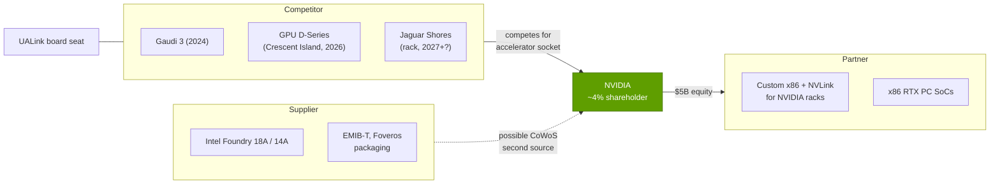
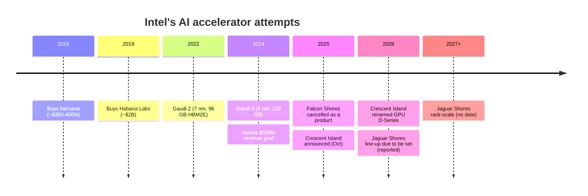

# Intel: competitor, supplier and partner at once

Cross-cutting 15 · Competitive landscape · ~13 min read · Last verified: 2026-11-05

## ⚡ The Executive Take

- **As an accelerator rival, Intel has not landed a punch.** It bought Nervana (2016) and Habana (~$2B, 2019) [[S2514]](../../sources/bibliography.md#s2514),
  missed its $500M Gaudi revenue goal for 2024 [[S668]](../../sources/bibliography.md#s668) and cancelled Falcon Shores as a product in January 2025
  [[S15546]](../../sources/bibliography.md#s15546)[[S564]](../../sources/bibliography.md#s564).
- **The reset is an inference GPU first, a rack later.** Crescent Island (Xe3P, 160 GB of [LPDDR5X](../../glossary.md#lpddr5x),
  air-cooled) samples in H2 2026 and was renamed GPU D-Series at OCP 2026; rack-scale Jaguar Shores (SK hynix [HBM4](../../glossary.md#hbm4),
  silicon photonics) has no confirmed date and is unlikely before 2027 🟡 [[S162]](../../sources/bibliography.md#s162)[[S15543]](../../sources/bibliography.md#s15543)[[S15544]](../../sources/bibliography.md#s15544)[[S15545]](../../sources/bibliography.md#s15545).
- **Its data-center business is a CPU business, and it is growing again.** The Data Center and AI segment booked ~$7.3B in
  Q3 2026 (+78% y/y), about 8% of NVIDIA's latest data-center quarter [[S15543]](../../sources/bibliography.md#s15543)[[S405]](../../sources/bibliography.md#s405). Intel still ships 54.9% of server
  CPU units, but AMD holds ~46% of [x86](../../glossary.md#x86) server revenue [[S4503]](../../sources/bibliography.md#s4503)[[S4505]](../../sources/bibliography.md#s4505).
- **NVIDIA owns ~4% of it.** NVIDIA's $5B purchase (~214.7M shares at $23.28) closed on 2025-12-26 and funds custom x86
  CPUs that attach over [NVLink](../../glossary.md#nvlink), plus x86 RTX PC chips; no data-center product date is public 🔴 [[S4009]](../../sources/bibliography.md#s4009)[[S15547]](../../sources/bibliography.md#s15547)[[S130]](../../sources/bibliography.md#s130).
- **The supplier angle is packaging.** Intel's [EMIB](../../glossary.md#emib)-T is the main non-TSMC route for large AI packages;
  Google and Amazon are reported in talks 🟡, and estimates put EMIB-T at ~15–20k CoWoS-equivalent wafers a month in 2027
  against TSMC's ~130k CoWoS at end-2026 (Est.) [[S3532]](../../sources/bibliography.md#s3532)[[S3002]](../../sources/bibliography.md#s3002).
- **Intel sits on both sides of the [scale-up](../../glossary.md#scale-up) war:** a [UALink](../../glossary.md#ualink) board member and an NVLink-attached x86
  partner [[S573]](../../sources/bibliography.md#s573)[[S130]](../../sources/bibliography.md#s130). The US government (9.9%), SoftBank ($2B) and NVIDIA are now shareholders [[S15550]](../../sources/bibliography.md#s15550)[[S15547]](../../sources/bibliography.md#s15547).
- **Repo verdict 🔴:** low threat as an accelerator vendor; rising relevance as NVIDIA's x86 partner and as the only
  Western second source for advanced packaging.

## Three roles in one company

Intel touches NVIDIA's stack in three ways at once, and each role pulls in a different direction.

The rest of this page takes the roles in turn. CPU detail lives in
[CPU competition](../../layers/04-cpu-grace-vera/competition.md); packaging detail in
[CoWoS and advanced packaging](../../layers/03-memory-packaging-supply-chain/cowos-and-advanced-packaging.md).

## Intel as competitor: Gaudi's outcome and the GPU reset

On paper, Gaudi 3 was competitive with the GPU it launched against. It offered 1,835 TFLOPS of dense [BF16](../../glossary.md#bf16)/FP8 and 128 GB
of HBM2e at 3.7 TB/s in a 900 W module [[S161]](../../sources/bibliography.md#s161), against H100's 80 GB at 3.35 TB/s [[S33002]](../../sources/bibliography.md#s33002). It did not sell. The reasons
are the ones this repo keeps finding: software (most models arrive CUDA-first), scale-up (Gaudi used 24 × 200 GbE ports,
21 of them for an 8-chip all-to-all, so there was no rack-scale domain) [[S296]](../../sources/bibliography.md#s296), and roadmap credibility (Gaudi, then
Falcon Shores, then Jaguar Shores) [[S2515]](../../sources/bibliography.md#s2515).

| Accelerator | Year | Memory | Bandwidth | Dense FP8 | Scale-up | Status | Sources |
|---|---|---|---|---|---|---|---|
| Intel Gaudi 2 | 2022 | 96 GB HBM2E | 2.45 TB/s | 865 TFLOPS | 24 × 100 GbE, 8 chips | shipping | [[S161]](../../sources/bibliography.md#s161) |
| Intel Gaudi 3 | 2024 | 128 GB HBM2e | 3.7 TB/s | 1,835 TFLOPS | 24 × 200 GbE, 8 chips | shipping | [[S161]](../../sources/bibliography.md#s161)[[S296]](../../sources/bibliography.md#s296) |
| Intel GPU D-Series (Crescent Island) | 2026 | 160 GB LPDDR5X | not disclosed | not disclosed | not disclosed | sampling H2 2026 | [[S162]](../../sources/bibliography.md#s162)[[S15543]](../../sources/bibliography.md#s15543) |
| Intel Jaguar Shores | 2027+ | HBM4 (SK hynix) | not disclosed | not disclosed | rack-scale, photonics | 🟡 no date | [[S15544]](../../sources/bibliography.md#s15544)[[S564]](../../sources/bibliography.md#s564) |
| NVIDIA H100 | 2022 | 80 GB HBM3 | 3.35 TB/s | 1,979 TFLOPS | NVLink 4, 8 GPUs | shipping | [[S33002]](../../sources/bibliography.md#s33002) |
| NVIDIA Rubin | 2026 | 288 GB HBM4 | 19.2 TB/s | 17,500 TFLOPS | NVLink 6, 72 packages | ramping | [[S90006]](../../sources/bibliography.md#s90006)[[S90009]](../../sources/bibliography.md#s90009) |

> [!TIP]
> **Worked example — why good specs did not become revenue.** Gaudi 3 matched an H100 on dense [FP8](../../glossary.md#fp8) and beat it on memory
> (128 vs 80 GB) [[S161]](../../sources/bibliography.md#s161)[[S33002]](../../sources/bibliography.md#s33002), yet Gaudi revenue stayed below $500M in 2024 [[S668]](../../sources/bibliography.md#s668) while NVIDIA's FY2025 data-center
> revenue was $115.2B [[S416]](../../sources/bibliography.md#s416). Take one 8-chip Gaudi 3 node: its scale-up domain is 8 chips, while a GB200 [NVL72](../../glossary.md#nvl72) joins 72
> GPUs in one NVLink domain. For mixture-of-experts models that spread experts over dozens of chips, the node boundary,
> not the chip, sets throughput ([why domain size matters](../../layers/05-scale-up-nvlink-nvswitch/why-domain-size-matters.md)).
> Specs got Intel into evaluations; the system and software gap kept it out of deployments.

The 2026 plan narrows the target. Crescent Island is an air-cooled inference card with 160 GB of LPDDR5X [[S162]](../../sources/bibliography.md#s162): the same
capacity-over-bandwidth trade Qualcomm makes with 768 GB of [LPDDR](../../glossary.md#lpddr) per AI200 card ([Qualcomm](qualcomm.md)).
It aims at enterprise inference servers where liquid cooling and [HBM](../../glossary.md#hbm) costs are barriers, not at frontier training.

🔧 Under the hood: what "rack-scale with silicon photonics" implies for Jaguar Shores

Intel describes Jaguar Shores as a rack-scale design with optical interconnect and HBM4 from SK hynix; the stack count
and process are unconfirmed (TrendForce images suggest 18A) [[S15544]](../../sources/bibliography.md#s15544)[[S564]](../../sources/bibliography.md#s564). Rack scale means Intel must deliver what
NVIDIA's NVL72 and AMD's Helios already ship: a switched scale-up fabric, liquid-cooled trays, power shelves and a
software stack that treats 72+ chips as one. Optical links trade copper's reach limit (about a rack) for laser power and
cost. Intel's UALink membership [[S573]](../../sources/bibliography.md#s573) suggests the scale-up protocol, but UALink products are expected only from 2027
[[S90051]](../../sources/bibliography.md#s90051). A 2027 Jaguar Shores would meet Rubin Ultra (H2 2027) [[S90003]](../../sources/bibliography.md#s90003).

![Two-panel chart. Left: radar of Intel versus NVIDIA on nine capability axes, averaging 2.3 versus 4.7 of 5 (Compute 2 vs 5; Memory 2 vs 4; Scale-up 2 vs 5; Scale-out 2 vs 5; Software 2 vs 5; Racks 1 vs 5; Supply 3 vs 5; Cost/TCO 4 vs 3; Merchant 3 vs 5). Right: Intel's score in each of NVIDIA's 12 stack layers with its verdict: behind 10, different 1, parity 1. Intel's only parity layer is the CPU (Xeon as AI host) and its packaging (EMIB, Foveros) is scored as a different approach; accelerators, scale-up, racks and software are behind.](../../assets/charts/15-intel-capability-profile.svg)

## Intel as partner: Xeon hosts and the NVLink x86 deal

Every NVIDIA GPU needs a host CPU. Inside NVIDIA's own GB-class racks that host is Grace or Vera; in the much larger
x86 server world it is Xeon or EPYC. The September 2025 agreement makes Intel a supplier of custom x86 CPUs that NVIDIA
integrates into its platforms over NVLink, alongside x86 PC SoCs with RTX chiplets [[S130]](../../sources/bibliography.md#s130)[[S468]](../../sources/bibliography.md#s468). Intel is also listed
among [NVLink Fusion](../../glossary.md#nvlink-fusion)'s CPU partners [[S90031]](../../sources/bibliography.md#s90031).

> [!TIP]
> **Worked example — why NVLink matters to an x86 host.** A [PCIe](../../glossary.md#pcie) Gen6 x16 host link carries ~256 GB/s; Vera's
> [NVLink-C2C](../../glossary.md#nvlink-c2c) carries 1.8 TB/s, about 7× more [[S100]](../../sources/bibliography.md#s100)[[S144]](../../sources/bibliography.md#s144). For inference that spills the
> [KV cache](../../glossary.md#kv-cache) to CPU memory, the host link sets how fast context reloads. An NVLink-attached Xeon would
> give x86-only enterprises NVIDIA's coherent CPU–GPU path without switching to Arm, which is why the deal protects
> NVIDIA's rack, not Intel's accelerator.

The partner role has a cost for Intel's own CPU franchise. AMD reached 34.5% of x86 server units in Q2 2026 and ~46% by
revenue [[S4505]](../../sources/bibliography.md#s4505)[[S4503]](../../sources/bibliography.md#s4503), and in NVIDIA-designed racks the CPU socket goes to Grace or Vera.

## Intel as supplier: 18A and EMIB as a CoWoS alternative

TSMC's [CoWoS](../../glossary.md#cowos) places all dies on one large silicon interposer, like paving a whole courtyard so every
path is smooth. Intel's [EMIB](../../glossary.md#emib) embeds small silicon bridges in the organic substrate only where two dies
meet, like laying a footbridge only where paths cross. Less silicon means larger packages at lower cost; EMIB-T adds
[through-silicon vias](../../glossary.md#through-silicon-via) so HBM stacks get power and signal through the bridge [[S15548]](../../sources/bibliography.md#s15548).
[Foveros](../../glossary.md#foveros) stacks dies vertically. Intel pitches EMIB-T as a way to move a design off CoWoS with
minimal redesign, so TSMC could still make the compute dies [[S15548]](../../sources/bibliography.md#s15548).

> [!TIP]
> **Worked example — how big a second source is EMIB-T?** Institutional estimates put EMIB-T at ~15–20k
> CoWoS-equivalent wafers a month in 2027 and ~40–45k in 2028, against TSMC CoWoS of ~130k at end-2026 heading to ~260k
> by end-2028 (Est.) [[S3002]](../../sources/bibliography.md#s3002). At the 2027 midpoint, 17.5k ÷ 130k ≈ 13% of TSMC's end-2026 base. That is enough to rescue
> an [ASIC](../../glossary.md#asic) program stuck behind NVIDIA's ~60% CoWoS allocation [[S379]](../../sources/bibliography.md#s379), not enough to change NVIDIA's own supply position.

Customers are the open question. Google and Amazon are reported in packaging talks; Intel's CEO said customers are
willing to help prepay substrate suppliers 🟡 [[S3532]](../../sources/bibliography.md#s3532). DIGITIMES lists NVIDIA among reported order sources (unconfirmed
🔴) and expects EMIB customer revenue from H2 2026 [[S15549]](../../sources/bibliography.md#s15549). On wafers, Intel 18A is in production (Clearwater Forest
Xeon, 288 E-cores) [[S4525]](../../sources/bibliography.md#s4525); for 14A it reports two prospective customers with decisions due H2 2026 to early 2027
[[S13531]](../../sources/bibliography.md#s13531). Intel Foundry revenue was ~$6.7B in Q3 2026, mostly from Intel itself [[S15543]](../../sources/bibliography.md#s15543).

## Verdict by layer: Intel vs NVIDIA

| Layer | Verdict | Why |
|---|---|---|
| 02 Accelerator silicon | 🟥 Behind | Gaudi 3 (1.8 PFLOPS FP8) missed targets; D-Series is inference-only [[S161]](../../sources/bibliography.md#s161)[[S668]](../../sources/bibliography.md#s668) |
| 03 Memory, packaging, supply | 🟦 Different | Own fabs and EMIB/Foveros: a possible CoWoS second source [[S3002]](../../sources/bibliography.md#s3002) |
| 04 CPU | 🟨 Parity | Xeon remains a leading AI host; NVLink x86 deal [[S468]](../../sources/bibliography.md#s468)[[S4503]](../../sources/bibliography.md#s4503) |
| 05 Scale-up fabric | 🟥 Behind | 8-chip Ethernet nodes today; UALink products 2027 [[S296]](../../sources/bibliography.md#s296)[[S90051]](../../sources/bibliography.md#s90051) |
| 06–07 Networking, DPU | 🟥 Behind | NICs and IPUs; no AI switch franchise [[S452]](../../sources/bibliography.md#s452) |
| 08 Systems & racks | 🟥 Behind | No rack-scale AI system shipping [[S162]](../../sources/bibliography.md#s162) |
| 09–11 Software | 🟥 Behind | oneAPI, OpenVINO and vLLM-Gaudi exist, adoption thin [[S10540]](../../sources/bibliography.md#s10540)[[S581]](../../sources/bibliography.md#s581) |
| 13 Ecosystem & capital | 🟥 Behind | Turnaround mode; government, SoftBank and NVIDIA stakes [[S15550]](../../sources/bibliography.md#s15550)[[S15547]](../../sources/bibliography.md#s15547) |

Where this page differs from the layer pages: none on verdicts. The layer-04 page scores Xeon at parity as a host; this
page agrees, and adds that the NVLink deal makes Intel's host role partly dependent on NVIDIA.

## Their best argument, and how much the gap has closed

**Intel's best argument:** it is the only Western company that owns leading-edge logic fabs, advanced packaging and the
x86 installed base. If CoWoS stays the bottleneck and governments want US-made AI silicon, Intel is the default second
source, and NVIDIA has paid $5B to keep it close [[S15547]](../../sources/bibliography.md#s15547)[[S15550]](../../sources/bibliography.md#s15550).

**How much the gap has closed:** as an accelerator vendor, not at all; Intel's MLPerf presence in 2026 is Arc Pro
workstation cards [[S602]](../../sources/bibliography.md#s602). As a CPU vendor, its data-center segment is growing again (+78% y/y) [[S15543]](../../sources/bibliography.md#s15543). As a packaging
supplier, it is pre-revenue with named-but-unconfirmed customers [[S15549]](../../sources/bibliography.md#s15549).

> [!NOTE]
> **🐂 Bull view (for NVIDIA).** Intel is now more partner than rival: NVIDIA holds ~4% of it, x86 hosts will attach over
> NVLink, and EMIB-T could add packaging supply NVIDIA does not have to fund [[S15547]](../../sources/bibliography.md#s15547)[[S130]](../../sources/bibliography.md#s130)[[S3002]](../../sources/bibliography.md#s3002).

> [!WARNING]
> **🐻 Bear view (for NVIDIA).** A healthy Intel Foundry plus EMIB-T relieves the CoWoS bottleneck that has kept custom
> ASICs behind NVIDIA in TSMC's queue [[S379]](../../sources/bibliography.md#s379)[[S3002]](../../sources/bibliography.md#s3002); and Intel sits on the UALink board [[S573]](../../sources/bibliography.md#s573), so a 2027 Jaguar Shores
> plus UALink would add a merchant rack outside NVLink.

## 🎯 Corp Dev Lens

1. NVIDIA's $5B buys a partner, not control (no special governance rights) [[S15547]](../../sources/bibliography.md#s15547). What does a minority stake buy in
   roadmap influence, and would a comparable stake in a CPU or packaging supplier be available to others?
2. EMIB-T's value depends on customers moving designs off CoWoS. Which accelerator programs (custom ASICs, inference
   cards, sovereign projects) gain most from a non-TSMC package, and on what time-to-qualify?
3. Crescent Island and Qualcomm's AI200 make the same LPDDR capacity bet. Does the enterprise-inference segment support
   two or more LPDDR-based merchant vendors, and what software reach does each need?
4. Intel chairs (through its CEO) and invests in SambaNova and nearly bought it [[S2512]](../../sources/bibliography.md#s2512)[[S15517]](../../sources/bibliography.md#s15517). Is Intel likelier to
   buy AI capability than build it, and which targets fit its packaging-plus-x86 position?
5. With the US government at 9.9% [[S15550]](../../sources/bibliography.md#s15550), how would regulators view a foreign or strategic acquirer for any Intel unit
   that touches AI or advanced packaging?

## 📚 Sources

<!-- Auto-generated from the [S…] citations on this page by `make build`. Edit sources/registry/*.csv, not this list. -->

- [**S100**](../../sources/bibliography.md#s100) NVIDIA Technical Blog, *Inside the NVIDIA Vera Rubin Platform: Six New Chips, One AI Supercomputer*, 2026-01-05. [Link](https://developer.nvidia.com/blog/inside-the-nvidia-rubin-platform-six-new-chips-one-ai-supercomputer/)
- [**S130**](../../sources/bibliography.md#s130) NVIDIA Newsroom, *NVIDIA and Intel to Develop AI Infrastructure and Personal Computing Products*, 2025-09-18. [Link](https://nvidianews.nvidia.com/news/nvidia-and-intel-to-develop-ai-infrastructure-and-personal-computing-products)
- [**S144**](../../sources/bibliography.md#s144) AMD Newsroom, *AMD Unveils Vision for an Open AI Ecosystem, Detailing New Silicon, Software and Systems at Advancing AI 2025*, 2025-06-12. [Link](https://www.amd.com/en/newsroom/press-releases/2025-6-12-amd-unveils-vision-for-an-open-ai-ecosystem-detai.html)
- [**S161**](../../sources/bibliography.md#s161) Intel, *Intel Gaudi AI accelerators (Gaudi 2, Gaudi 3)*, 2024-04-09. [Link](https://www.intel.com/content/www/us/en/products/details/processors/ai-accelerators/gaudi.html)
- [**S162**](../../sources/bibliography.md#s162) Intel Newsroom, *Intel to Expand AI Accelerator Portfolio with New GPU (Crescent Island)*, 2025-10-14. [Link](https://newsroom.intel.com/artificial-intelligence/intel-to-expand-ai-accelerator-portfolio-with-new-gpu)
- [**S296**](../../sources/bibliography.md#s296) Intel, *Intel Gaudi 3 AI Accelerator white paper*, 2024-04. [Link](https://www.intel.com/content/www/us/en/content-details/817486/intel-gaudi-3-ai-accelerator-white-paper.html)
- [**S379**](../../sources/bibliography.md#s379) TrendForce News, *TSMC CoWoS capacity and customer allocation estimates (TrendForce / Morgan Stanley, as reported)*, 2025. [Link](https://www.trendforce.com/news/)
- [**S405**](../../sources/bibliography.md#s405) NVIDIA Corporation via SEC EDGAR, *NVIDIA Announces Financial Results for Second Quarter Fiscal 2027 (Form 8-K exhibit 99.1)*, 2026-08-26. [Link](https://www.sec.gov/Archives/edgar/data/0001045810/000104581026000073/q2fy27pr.htm)
- [**S416**](../../sources/bibliography.md#s416) NVIDIA Corporation via SEC EDGAR, *NVIDIA Corporation Form 10-K for fiscal year ended January 26, 2025*, 2025-02-26. [Link](https://www.sec.gov/Archives/edgar/data/1045810/000104581025000023/nvda-20250126.htm)
- [**S452**](../../sources/bibliography.md#s452) U.S. Securities and Exchange Commission (EDGAR), *Intel Corporation Form 10-K filings (EDGAR index)*, 2025-01-31. [Link](https://www.sec.gov/cgi-bin/browse-edgar?action=getcompany&CIK=0000050863&type=10-K&dateb=&owner=include&count=40)
- [**S468**](../../sources/bibliography.md#s468) NVIDIA Newsroom, *NVIDIA and Intel to Develop AI Infrastructure and Personal Computing Products*, 2025-09-18. [Link](https://nvidianews.nvidia.com/news/nvidia-and-intel-to-develop-ai-infrastructure-and-personal-computing-products)
- [**S564**](../../sources/bibliography.md#s564) Tom's Hardware, *Intel's roadmaps examined — 14A, Nova Lake, Diamond Rapids & AI accelerator push*, 2026. [Link](https://www.tomshardware.com/tech-industry/semiconductors/intel-chip-roadmap-2026-2028)
- [**S573**](../../sources/bibliography.md#s573) Business Wire, *UALink Consortium Releases the Ultra Accelerator Link 200G 1.0 Specification*, 2025-04-08. [Link](https://www.businesswire.com/news/home/20250408050548/en/UALink-Consortium-Releases-the-Ultra-Accelerator-Link-200G-1.0-Specification)
- [**S581**](../../sources/bibliography.md#s581) vLLM project (GitHub), *vLLM hardware plugin repositories (tpu-inference/vLLM JAX, vllm-gaudi, vllm-ascend, vllm-neuron)*, 2026-11. [Link](https://github.com/vllm-project)
- [**S602**](../../sources/bibliography.md#s602) MLCommons, *MLPerf Inference v6.0 results (summary_results.json and per-submitter logs)*, 2026-04-01. [Link](https://github.com/mlcommons/inference_results_v6.0)
- [**S668**](../../sources/bibliography.md#s668) Reuters (as reported), *Intel says it will not hit $500 million Gaudi 3 revenue target for 2024*, 2024-10-31. [Link](https://www.reuters.com/technology/)
- [**S2512**](../../sources/bibliography.md#s2512) Verdict, *Intel pursues SambaNova acquisition amid AI expansion plans*, 2025-12. [Link](https://www.verdict.co.uk/intel-sambanova-acquisition/)
- [**S2514**](../../sources/bibliography.md#s2514) bit-tech, *Intel acquires AI chipmaker, Habana Labs*, 2019-12-16. [Link](https://www.bit-tech.net/news/tech/cpus/intel-acquires-ai-chipmaker-habana-labs/1/)
- [**S2515**](../../sources/bibliography.md#s2515) Ynetnews, *How Intel wrecked a $2B purchase of Israeli startup and fell behind in the AI race*, 2025. [Link](https://www.ynetnews.com/business/article/sjgqydwf1l)
- [**S3002**](../../sources/bibliography.md#s3002) TrendForce, *TSMC reportedly targets 22% 2nm, 16% 3nm capacity boost by mid-2027; CoWoS to double by 2028*, 2026-09-14. [Link](https://www.trendforce.com/news/2026/09/14/news-tsmc-reportedly-targets-22-2nm-16-3nm-capacity-boost-by-mid-2027-cowos-to-double-by-2028/)
- [**S3532**](../../sources/bibliography.md#s3532) Tom's Hardware, *Intel reportedly in talks with Google and Amazon over advanced packaging*, 2026. [Link](https://www.tomshardware.com/tech-industry/semiconductors/intel-reportedly-in-talks-with-google-and-amazon-over-advanced-packaging)
- [**S4009**](../../sources/bibliography.md#s4009) SDxCentral, *Intel gets hands on Nvidia's $5B investment*, 2025-12. [Link](https://www.sdxcentral.com/news/intel-gets-hands-on-nvidias-5b-investment/)
- [**S4503**](../../sources/bibliography.md#s4503) Analytics Insight, *AMD server CPU revenue share hits record 46.2% as Intel faces pressure*, 2026-05. [Link](https://www.analyticsinsight.net/news/amd-server-cpu-revenue-share-hits-record-462-as-intel-faces-pressure)
- [**S4505**](../../sources/bibliography.md#s4505) CloudNews.tech, *AMD pushes Intel to its lowest x86 share in 31 years and closes in on servers*, 2026-08. [Link](https://cloudnews.tech/amd-leads-intel-to-its-lowest-x86-market-share-in-31-years-and-closes-in-on-servers/)
- [**S4525**](../../sources/bibliography.md#s4525) TechSpot, *Intel launches Xeon 6+ Clearwater Forest with 288 E-cores on 18A, teases Diamond Rapids for 2027*, 2026-06. [Link](https://www.techspot.com/community/topics/intel-launches-xeon-6-clearwater-forest-with-288-e-cores-on-18a-node-teases-diamond-rapids-for-2027.297679/)
- [**S10540**](../../sources/bibliography.md#s10540) Intel, *Intel oneAPI Toolkit Release Notes (2026)*, 2026. [Link](https://www.intel.com/content/www/us/en/developer/articles/release-notes/oneapi-toolkit/2026.html)
- [**S13531**](../../sources/bibliography.md#s13531) Tom's Hardware, *Intel says it has two prospective customers for 14A and expects commitments in the second half of 2026*, 2026. [Link](https://www.tomshardware.com/tech-industry/semiconductors/intel-says-it-has-two-prospective-customers-for-14a-expects-to-hear-about-commitments-in-second-half-of-2026)
- [**S15517**](../../sources/bibliography.md#s15517) The Star (Reuters), *Vista Equity Partners and Intel to lead investment in AI chip startup SambaNova, sources say (Reuters)*, 2026-02-07. [Link](https://www.thestar.com.my/tech/tech-news/2026/02/07/vista-equity-partners-and-intel-to-lead-investment-in-ai-chip-startup-sambanova)
- [**S15543**](../../sources/bibliography.md#s15543) CloudNews.tech, *Intel posts 21% revenue growth on data center demand, seeks more capacity for Xeon*, 2026-10. [Link](https://cloudnews.tech/intel-posts-21-revenue-growth-on-data-center-demand-seeks-more-capacity-for-xeon/)
- [**S15544**](../../sources/bibliography.md#s15544) Tom's Hardware, *Intel jumps to HBM4 with Jaguar Shores, 2nd-gen MRDIMMs with Diamond Rapids*, 2025-07. [Link](https://www.tomshardware.com/tech-industry/artificial-intelligence/intel-jumps-to-hbm4-with-jaguar-shores-2nd-gen-mrdimms-with-diamond-rapids-sk-hynix)
- [**S15545**](../../sources/bibliography.md#s15545) Wccftech, *Intel's Jaguar Shores rack-scale AI lineup expected to be finalized in H1 2026*, 2025-10. [Link](https://wccftech.com/intels-jaguar-shores-rack-scale-ai-lineup-expected-to-be-finalized-in-h1-2026/)
- [**S15546**](../../sources/bibliography.md#s15546) TweakTown, *Intel kills off Falcon Shores AI chip, moves to rack-scale solution with Jaguar Shores*, 2025-01-31. [Link](https://www.tweaktown.com/news/102912/intel-kills-off-falcon-shores-ai-chip-moves-to-rack-scale-solution-with-jaguar/index.html)
- [**S15547**](../../sources/bibliography.md#s15547) eeNews Europe, *Nvidia-Intel stake finalised with $5 billion share purchase*, 2025-12-30. [Link](https://www.eenewseurope.com/en/nvidia-intel-stake-finalised-with-5-billion-share-purchase)
- [**S15548**](../../sources/bibliography.md#s15548) Tom's Hardware, *Intel's EMIB-T heads for fab rollout this year*, 2026. [Link](https://www.tomshardware.com/tech-industry/semiconductors/intels-emib-t-heads-for-fab-rollout-this-year)
- [**S15549**](../../sources/bibliography.md#s15549) DIGITIMES Asia, *Intel EMIB packaging customers and revenue timing*, 2026-05-05. [Link](https://apps.digitimes.com/news/a20260505PD217.html)
- [**S15550**](../../sources/bibliography.md#s15550) Converge Digest, *U.S. takes 9.9% stake in Intel with $8.9B equity investment*, 2025-08. [Link](https://convergedigest.com/u-s-takes-9-9-stake-in-intel-with-8-9b-equity-investment/)
- [**S33002**](../../sources/bibliography.md#s33002) NVIDIA, *NVIDIA H100 Tensor Core GPU (product page and datasheet)*, 2022-03-22. [Link](https://www.nvidia.com/en-us/data-center/h100/)
- [**S90003**](../../sources/bibliography.md#s90003) eWeek, *Everything Nvidia Just Announced at GTC 2026: 7 Chips, 5 Racks, 1 Giant Bet on Agentic AI*, 2026-03-17. [Link](https://www.eweek.com/news/nvidia-gtc-2026-ai-inference-vera-rubin-neuron/)
- [**S90006**](../../sources/bibliography.md#s90006) TweakTown, *Nvidia cuts Vera Rubin's memory bandwidth by up to 26% and AMD's Helios now leads in memory bandwidth*, 2026-10. [Link](https://www.tweaktown.com/news/114304/nvidia-cuts-vera-rubins-memory-bandwidth-by-up-to-26-percent-and-amds-helios-now-leads-in-memory-bandwidth/index.html)
- [**S90009**](../../sources/bibliography.md#s90009) GamesBeat, *Nvidia Vera Rubin ramps into full production for fall launch*, 2026. [Link](https://gamesbeat.com/nvidia-vera-rubin-ramps-into-full-production-for-fall-launch-again/)
- [**S90031**](../../sources/bibliography.md#s90031) ServeTheHome, *NVIDIA announces NVLink Fusion bringing NVLink to third-party CPUs and accelerators*, 2025-05-19. [Link](https://www.servethehome.com/nvidia-announces-nvlink-fusion-bringing-nvlink-to-third-party-cpus-and-accelerators/nvlink-fusion-partners/)
- [**S90051**](../../sources/bibliography.md#s90051) SDxCentral, *UALink Consortium takes another swing at Nvidia's NVLink supremacy with specification 2.0*, 2026-04. [Link](https://www.sdxcentral.com/news/ualink-consortium-takes-another-swing-at-nvidias-nvlink-supremacy-with-specification-20/)
