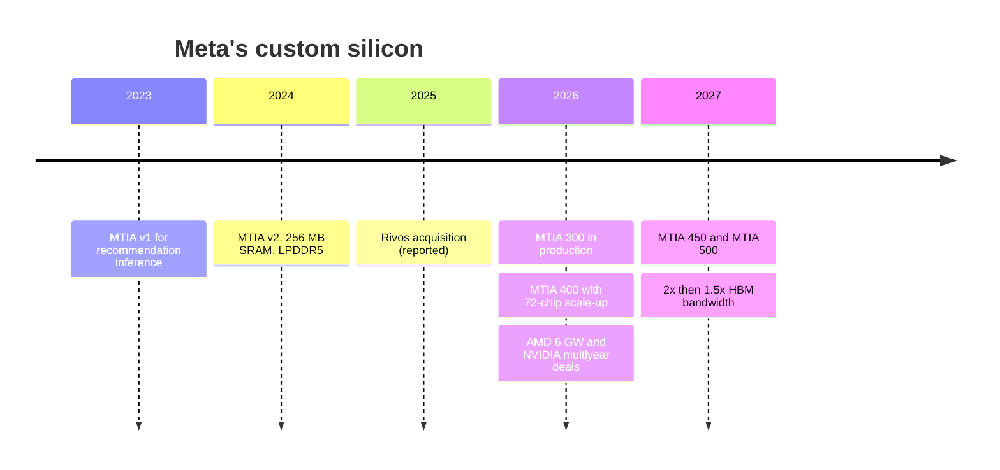
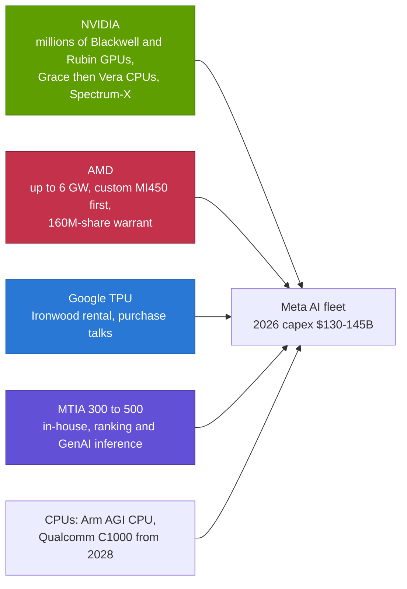

# Meta MTIA — the in-house hedge of NVIDIA's biggest self-builder

Cross-cutting 15 · Competitive landscape · MTIA v1 to MTIA 500, Rivos, Meta's AMD, TPU and NVIDIA deals · ~13 min read · Last verified: 2026-11-05

## ⚡ The Executive Take

- **MTIA began as a recommendation chip.** [MTIA](../../glossary.md#mtia) v1 (2023) and v2 (2024) were small, low-power chips with LPDDR5 memory, built to rank ads and feeds: v2 delivered 177 TFLOPS BF16 at 90 W with 128 GB at ~0.2 TB/s [[S159]](../../sources/bibliography.md#s159)[[S160]](../../sources/bibliography.md#s160).
- **2026 turned it into an HBM-class inference line.** Meta announced four generations on a ~six-month cadence: MTIA 300 (in production), 400, 450 and 500 (2027). MTIA 500 lists up to 27.6 TB/s of HBM and 10 PFLOPS FP8 (🟢 announced; 🟡 press spec tables) [[S15003]](../../sources/bibliography.md#s15003)[[S15002]](../../sources/bibliography.md#s15002)[[S561]](../../sources/bibliography.md#s561).
- **Meta is buying silicon talent.** It acquired RISC-V start-up Rivos (October 2025, terms undisclosed, ~$2B value reported) to speed up MTIA (🟡) [[S15004]](../../sources/bibliography.md#s15004)[[S4518]](../../sources/bibliography.md#s4518).
- **Meta is also a top buyer of everyone else.** In 2026 it committed to "millions" of NVIDIA Blackwell and Rubin GPUs plus Grace CPUs [[S4006]](../../sources/bibliography.md#s4006), up to 6 GW of AMD Instinct with a 160M-share warrant [[S24004]](../../sources/bibliography.md#s24004), and a multibillion-dollar rental of Google TPUs (🟡) [[S90025]](../../sources/bibliography.md#s90025). Its 2026 capex guide is $130–145B [[S12518]](../../sources/bibliography.md#s12518).
- **It owns the software layer others lack.** Meta created [PyTorch](../../glossary.md#pytorch); MTIA's compiler is built on TorchInductor, Triton and MLIR, and Meta co-developed TorchTPU with Google [[S9028]](../../sources/bibliography.md#s9028)[[S553]](../../sources/bibliography.md#s553).
- **Weakness:** MTIA is internal only and still small next to Meta's GPU fleet; MTIA 300 has ~32% of Rubin's memory bandwidth and ~7% of its dense FP8 (repo calculation) [[S15014]](../../sources/bibliography.md#s15014).

![Two bar panels of Meta MTIA generations. Memory bandwidth per chip on a log scale: MTIA v1 0.18 TB/s and v2 0.20 TB/s of LPDDR5 (2023-24), then HBM: MTIA 300 6.1 TB/s (in production 2026), MTIA 400 9.2, MTIA 450 18.4 and MTIA 500 27.6 (2027), about 135 times v2 and above Rubin's 19.2 TB/s on paper. Dense 8-bit compute: 0.10 and 0.35 POPS INT8 for v1 and v2, then 1.2, 6, 7 and 10 PFLOPS FP8, against Rubin's 17.5. Meta pivoted MTIA from small recommendation chips to HBM-class generative-AI inference parts on a six-month cadence.](../../assets/charts/15-mtia-generations.svg)

## MTIA generations: from ranking to generative AI

| Generation | Year | Memory | Bandwidth | Dense 8-bit compute | Power | Status | Source |
|---|---|---|---|---|---|---|---|
| MTIA v1 | 2023 | 128 GB LPDDR5 | 0.18 TB/s | 102 TOPS INT8 | 25 W | 🟢 Shipped | [[S159]](../../sources/bibliography.md#s159) |
| MTIA v2 | 2024 | 128 GB LPDDR5 + 256 MB SRAM | 0.20 TB/s | 354 TOPS INT8 | 90 W | 🟢 Shipped | [[S160]](../../sources/bibliography.md#s160) |
| MTIA 300 | 2026 | 216 GB HBM | 6.1 TB/s | ~1.2 PFLOPS FP8 | 800 W | 🟢 In production | [[S15002]](../../sources/bibliography.md#s15002)[[S561]](../../sources/bibliography.md#s561) |
| MTIA 400 | 2026 | 288 GB HBM | 9.2 TB/s | 6 PFLOPS FP8 (12 MX4) | 1,200 W | 🟡 In lab testing at announcement | [[S15002]](../../sources/bibliography.md#s15002)[[S562]](../../sources/bibliography.md#s562) |
| MTIA 450 | 2027 | 288 GB HBM | 18.4 TB/s | 7 PFLOPS FP8 (21 MX4) | 1,400 W | 🟡 Roadmap | [[S15002]](../../sources/bibliography.md#s15002)[[S15003]](../../sources/bibliography.md#s15003) |
| MTIA 500 | 2027 | 384–512 GB HBM | 27.6 TB/s | 10 PFLOPS FP8 (30 MX4) | 1,700 W | 🟡 Roadmap | [[S15002]](../../sources/bibliography.md#s15002)[[S15003]](../../sources/bibliography.md#s15003) |

Sources: [[S159]](../../sources/bibliography.md#s159)[[S160]](../../sources/bibliography.md#s160)[[S4518]](../../sources/bibliography.md#s4518)[[S561]](../../sources/bibliography.md#s561)[[S562]](../../sources/bibliography.md#s562)[[S24004]](../../sources/bibliography.md#s24004)[[S4006]](../../sources/bibliography.md#s4006)[[S15003]](../../sources/bibliography.md#s15003).

Why the pivot? [Recommendation models](../../glossary.md#recommendation-model) look up a few rows in huge embedding tables per query, so they need *capacity*, which cheap LPDDR provides. LLMs re-read all their weights for every token, so they need *bandwidth*, which only HBM provides.

> [!TIP]
> **Worked example — why MTIA v2 could not serve an LLM.** A 70B-parameter model in FP8 is ~70 GB of weights, re-read on every decode step. At MTIA v2's 0.2 TB/s that caps a chip at ~3 tokens/s for a single stream; at MTIA 400's 9.2 TB/s, ~131 tokens/s; at MTIA 500's 27.6 TB/s, ~394 [[S160]](../../sources/bibliography.md#s160)[[S15002]](../../sources/bibliography.md#s15002). **Conclusion:** the jump to HBM is what turns MTIA from a ranking accelerator into a generative-AI inference chip. On paper MTIA 500's bandwidth (27.6 TB/s) exceeds Rubin's 19.2 TB/s, though it arrives a year later [[S90006]](../../sources/bibliography.md#s90006).

🔧 Under the hood: a six-month cadence and a shared rack

Meta says MTIA 400, 450 and 500 share one chassis and rack design, so each new chip drops into existing infrastructure [[S561]](../../sources/bibliography.md#s561). That is how Meta can ship roughly every six months, twice NVIDIA's annual cadence: the rack, power and cooling stay fixed while the chip changes. MTIA 400 introduces a 72-accelerator scale-up domain, the same size as NVL72 [[S562]](../../sources/bibliography.md#s562). Meta's figures imply bandwidth per watt of ~16 GB/s per W for MTIA 500 (27.6 TB/s at 1,700 W) against ~8 GB/s per W for Rubin (19.2 TB/s at a reported 2.3 kW) [[S15002]](../../sources/bibliography.md#s15002)[[S106]](../../sources/bibliography.md#s106). The software stack is PyTorch-native, eager and graph mode through torch.compile and torch.export, with compilers built on TorchInductor, Triton, MLIR and LLVM [[S9028]](../../sources/bibliography.md#s9028).

## Meta's silicon strategy: build some, buy most

Meta runs the largest AI fleet outside the public clouds. Its 2026 capex is guided at $130–145B, including finance leases [[S12518]](../../sources/bibliography.md#s12518). It is building Prometheus (Ohio, 1 GW+ in 2026, heading toward ~1M GPUs) and Hyperion (Louisiana, scaling to 5 GW) [[S27007]](../../sources/bibliography.md#s27007)[[S27009]](../../sources/bibliography.md#s27009). MTIA is a hedge inside that build-out, not a replacement for it.

Sources: [[S4006]](../../sources/bibliography.md#s4006)[[S6009]](../../sources/bibliography.md#s6009)[[S24004]](../../sources/bibliography.md#s24004)[[S90025]](../../sources/bibliography.md#s90025)[[S15003]](../../sources/bibliography.md#s15003)[[S4510]](../../sources/bibliography.md#s4510)[[S90058]](../../sources/bibliography.md#s90058)[[S12518]](../../sources/bibliography.md#s12518).

| Supplier | What Meta committed | Status | Source |
|---|---|---|---|
| NVIDIA | Multiyear: millions of Blackwell and Rubin GPUs; standalone Grace CPUs at scale, Vera to follow; Spectrum-X Ethernet | 🟢 | [[S4006]](../../sources/bibliography.md#s4006)[[S4519]](../../sources/bibliography.md#s4519)[[S6009]](../../sources/bibliography.md#s6009) |
| AMD | Up to 6 GW of Instinct, custom MI450-based part first; warrant for up to 160M shares | 🟢 | [[S24004]](../../sources/bibliography.md#s24004) |
| Google | Multibillion-dollar Ironwood rental; talks to buy TPUs for its own sites | 🟡 | [[S90025]](../../sources/bibliography.md#s90025) |
| CoreWeave | $14.2B of capacity through 2031 | 🟢 | [[S12527]](../../sources/bibliography.md#s12527) |
| Arm | First customer for Arm's own AGI CPU | 🟢 | [[S4510]](../../sources/bibliography.md#s4510) |
| Qualcomm (public information) | First named customer for the Dragonfly C1000 server CPU, production from H2 2028 | 🟢 | [[S90058]](../../sources/bibliography.md#s90058) |

> [!TIP]
> **Worked example — the scale of Meta's NVIDIA commitment.** Morgan Stanley estimates a Vera Rubin NVL72 rack at ~$7.8M, ~$108K per GPU (Est.) [[S330]](../../sources/bibliography.md#s330). One million Rubin-class GPUs, the low end of "millions" [[S4006]](../../sources/bibliography.md#s4006), would be ~$108B of systems, about 80% of Meta's 2026 capex midpoint ($137.5B) [[S12518]](../../sources/bibliography.md#s12518). AMD's 6 GW at $10–15B per GW adds ~$60–90B over several years (Est.) [[S24004]](../../sources/bibliography.md#s24004). **Conclusion:** MTIA's output is small next to these merchant commitments. Its main jobs are to cut the cost of Meta's own ranking and inference traffic and to give Meta a credible fallback when it negotiates with NVIDIA and AMD.

## Verdict by layer

| Layer | Verdict vs NVIDIA | Reason |
|---|---|---|
| 02 Accelerator silicon | 🟦 Different (this page: 🟥 for GenAI) | Matrix scores MTIA v2 as a ranking chip; MTIA 300 has ~7% of Rubin's dense FP8 [[S160]](../../sources/bibliography.md#s160)[[S15014]](../../sources/bibliography.md#s15014) |
| 03 Memory, packaging, supply | 🟥 Behind | Small volumes; HBM only from MTIA 300 [[S561]](../../sources/bibliography.md#s561) |
| 04 CPU | 🟥 Behind | No CPU program; buys Grace, Arm AGI and (from 2028) Qualcomm CPUs [[S4006]](../../sources/bibliography.md#s4006)[[S4510]](../../sources/bibliography.md#s4510)[[S90058]](../../sources/bibliography.md#s90058) |
| 05 Scale-up | 🟥 Behind | 72-chip domain only from MTIA 400 [[S562]](../../sources/bibliography.md#s562) |
| 06 Scale-out | 🟦 Different | Very large in-house RoCE Ethernet clusters [[S34022]](../../sources/bibliography.md#s34022) |
| 07 DPU and NICs | 🟥 Behind | Custom FBNIC front-end NIC with Marvell; back-end NICs bought [[S7525]](../../sources/bibliography.md#s7525) |
| 08 Systems and racks | 🟦 Different | OCP rack designs; deploys GB200/GB300 racks too [[S4006]](../../sources/bibliography.md#s4006) |
| 09 System software | 🟦 Different | Owns PyTorch; MTIA is PyTorch-native [[S9028]](../../sources/bibliography.md#s9028) |
| 10 Libraries | 🟥 Behind | Few MTIA-specific libraries [[S9028]](../../sources/bibliography.md#s9028) |
| 11 Inference software | 🟦 Different | Serves Meta's ranking inference; LLMs mostly on GPUs [[S15003]](../../sources/bibliography.md#s15003) |
| 12 Orchestration and cloud | 🟦 Different | Internal only |
| 13 Ecosystem and capital | 🟥 Behind | Meta's leverage is as a buyer, not a seller [[S24004]](../../sources/bibliography.md#s24004)[[S90025]](../../sources/bibliography.md#s90025) |

Repo analyst judgement from `data/competitor_matrix.csv` (🔴) [[S15014]](../../sources/bibliography.md#s15014). **Disagreement noted:** the matrix scores MTIA v2 for silicon and scale-up; with MTIA 400–500 announced, this page treats silicon as 🟥 behind for generative AI and records MTIA 400's 72-chip domain, while keeping the matrix's 🟥 for scale-up.

> [!TIP]
> **Worked example — fast cadence vs a moving target.** By end-2027 Meta plans four MTIA generations; NVIDIA will have shipped two (Rubin, then Rubin Ultra) [[S561]](../../sources/bibliography.md#s561)[[S90003]](../../sources/bibliography.md#s90003). MTIA 500's 10 PFLOPS FP8 and 27.6 TB/s compare with Rubin Ultra's estimated ~34.7 PFLOPS and ~32 TB/s per package (Est.) [[S15002]](../../sources/bibliography.md#s15002)[[S35018]](../../sources/bibliography.md#s35018): ~29% of the compute and ~86% of the bandwidth. **Conclusion:** speed of iteration closes the memory gap faster than the compute gap, which suits inference rather than training.

**Their best argument.** "We own the framework and the workload." Meta controls PyTorch and its own ranking and generative-AI services, so MTIA needs no outside developers, and a six-month cadence lets it ship a new chip into the same rack twice a year [[S9028]](../../sources/bibliography.md#s9028)[[S561]](../../sources/bibliography.md#s561).

**How much the gap has closed.**

| Measure | Then | Now (Nov 2026) | Source |
|---|---|---|---|
| Memory bandwidth vs NVIDIA flagship | 4% (MTIA v2 vs H200, 2024) | 32% (MTIA 300 vs Rubin); MTIA 500 claims 27.6 TB/s for 2027 | [[S15014]](../../sources/bibliography.md#s15014)[[S15002]](../../sources/bibliography.md#s15002) |
| Dense 8-bit compute vs NVIDIA flagship | ~18% (v2 INT8 vs H200 FP8) | ~7% (MTIA 300); 57% on paper for MTIA 500 vs Rubin | [[S15014]](../../sources/bibliography.md#s15014) |
| Memory type | LPDDR5 | HBM | [[S160]](../../sources/bibliography.md#s160)[[S561]](../../sources/bibliography.md#s561) |
| Scale-up domain | None | 72 chips (MTIA 400) | [[S562]](../../sources/bibliography.md#s562) |
| Cadence | ~1 chip a year | ~2 chips a year | [[S561]](../../sources/bibliography.md#s561) |

> [!NOTE]
> **🐂 Bull view (for Meta).** MTIA 500's paper specs approach Rubin on bandwidth and capacity within two years of MTIA v2. A PyTorch-native stack, a fixed rack and the Rivos team could make Meta self-sufficient for inference, its largest AI workload [[S15002]](../../sources/bibliography.md#s15002)[[S9028]](../../sources/bibliography.md#s9028)[[S15004]](../../sources/bibliography.md#s15004).

> [!WARNING]
> **🐻 Bear view (for Meta).** Meta keeps signing record deals with NVIDIA and AMD and renting TPUs: the clearest sign MTIA cannot yet carry frontier work [[S4006]](../../sources/bibliography.md#s4006)[[S24004]](../../sources/bibliography.md#s24004)[[S90025]](../../sources/bibliography.md#s90025). Its newest chips are paper specs, Rivos integration is unconfirmed, and a six-month cadence multiplies execution risk.

## 🎯 Corp Dev Lens

1. **Buyer as kingmaker.** Meta is a first customer for AMD's custom MI450, Arm's AGI CPU and Qualcomm's public C1000 roadmap [[S24004]](../../sources/bibliography.md#s24004)[[S4510]](../../sources/bibliography.md#s4510)[[S90058]](../../sources/bibliography.md#s90058). How should a supplier weigh a marquee Meta win against Meta's demonstrated willingness to multi-source and build in-house?
2. **Acqui-hiring silicon teams.** Rivos (reported ~$2B) bought Meta a full-stack chip team [[S15004]](../../sources/bibliography.md#s15004). Which independent design teams remain, and what does Meta's move imply for their valuations?
3. **Fixed rack, fast chips.** Meta's shared chassis for MTIA 400–500 [[S561]](../../sources/bibliography.md#s561) decouples chip cadence from datacenter design. Is rack-level standardisation (OCP, MGX, Open Rack Wide) the real enabler for custom silicon, and who supplies it?
4. **Recommendation vs generative inference.** MTIA's roots are in ranking. Are recommendation and ranking models an underserved accelerator market for merchant vendors, given that hyperscalers serve their own?

## 📚 Sources

<!-- Auto-generated from the [S…] citations on this page by `make build`. Edit sources/registry/*.csv, not this list. -->

- [**S106**](../../sources/bibliography.md#s106) SemiAnalysis, *Vera Rubin - Extreme Co-Design: An Evolution*, 2026. [Link](https://newsletter.semianalysis.com/p/vera-rubin-extreme-co-design-an-evolution)
- [**S159**](../../sources/bibliography.md#s159) Meta AI Blog, *MTIA v1: Meta's first-generation AI inference accelerator*, 2023-05-18. [Link](https://ai.meta.com/blog/meta-training-inference-accelerator-AI-MTIA/)
- [**S160**](../../sources/bibliography.md#s160) Meta AI Blog, *Our next-generation Meta Training and Inference Accelerator*, 2024-04-10. [Link](https://ai.meta.com/blog/next-generation-meta-training-inference-accelerator-AI-MTIA/)
- [**S330**](../../sources/bibliography.md#s330) PC Gamer, *A single Nvidia Vera Rubin rack is estimated to cost $7,803,148 with over $2 million of that figure spent on memory alone*, 2026-05. [Link](https://pcgamer.com/hardware/a-single-nvidia-vera-rubin-rack-is-estimated-to-cost-usd7-803-148-with-over-usd2-million-of-that-figure-spent-on-memory-alone)
- [**S553**](../../sources/bibliography.md#s553) Google Cloud Blog (Alex Barrett), *What's new in AI infrastructure and orchestration in October*, 2026-11. [Link](https://cloud.google.com/blog/topics/ai-infrastructure/whats-new-in-ai-infrastructure-this-month)
- [**S561**](../../sources/bibliography.md#s561) DatacenterDynamics, *Meta unveils next four generations of its MTIA chip*, 2026-03-11. [Link](https://www.datacenterdynamics.com/en/news/meta-unveils-next-four-generations-of-its-mtia-chip/)
- [**S562**](../../sources/bibliography.md#s562) ServeTheHome, *Meta MTIA 400 at Hot Chips 2026*, 2026-08. [Link](https://www.servethehome.com/?p=104026)
- [**S4006**](../../sources/bibliography.md#s4006) SiliconANGLE, *Meta agrees to buy millions of AI chips from Nvidia, raising doubts about its in-house hardware*, 2026-02-17. [Link](https://siliconangle.com/2026/02/17/meta-agrees-buy-millions-ai-chips-nvidia-raising-doubts-house-hardware/)
- [**S4510**](../../sources/bibliography.md#s4510) TechCrunch, *Arm is releasing its first in-house chip in its 35-year history*, 2026-03-24. [Link](https://techcrunch.com/2026/03/24/arm-is-releasing-its-first-in-house-chip-in-its-35-year-history/)
- [**S4518**](../../sources/bibliography.md#s4518) DatacenterDynamics, *Meta acquires RISC-V chip startup Rivos (report)*, 2025-10. [Link](https://www.datacenterdynamics.com/en/news/meta-acquires-risc-v-chip-startup-rivos-report/)
- [**S4519**](../../sources/bibliography.md#s4519) The Register, *GPU who? Meta to deploy Nvidia CPUs at large scale*, 2026-02-17. [Link](https://www.theregister.com/2026/02/17/meta_nvidia_cpu/)
- [**S6009**](../../sources/bibliography.md#s6009) NVIDIA Investor Relations, *NVIDIA Spectrum-X Ethernet Switches Speed Up Networks for Meta and Oracle*, 2025-10-13. [Link](https://investor.nvidia.com/news/press-release-details/2025/NVIDIA-Spectrum-X-Ethernet-Switches-Speed-Up-Networks-for-Meta-and-Oracle/default.aspx)
- [**S7525**](../../sources/bibliography.md#s7525) Marvell, *Marvell delivers custom Ethernet network interface controller solution at OCP*, 2024-10. [Link](https://www.marvell.com/company/newsroom/marvell-delivers-custom-ethernet-network-interface-controller-solution-at-ocp.html)
- [**S9028**](../../sources/bibliography.md#s9028) StorageReview, *Meta's MTIA roadmap: four chip generations in two years put GenAI inference first*, 2026-03. [Link](https://www.storagereview.com/news/metas-mtia-roadmap-four-chip-generations-in-two-years-put-genai-inference-first)
- [**S12518**](../../sources/bibliography.md#s12518) Datacentres.com, *Hyperscaler capex trends: over $700 billion for 2026*, 2026-08. [Link](https://www.datacentres.com/guides/hyperscaler-capex-trends)
- [**S12527**](../../sources/bibliography.md#s12527) TechRepublic, *Meta inks $14.2B AI infrastructure deal with CoreWeave*, 2025-09-30. [Link](https://www.techrepublic.com/article/news-coreweave-meta-deal/)
- [**S15002**](../../sources/bibliography.md#s15002) Tom's Hardware, *Meta's MTIA chip lineup joins hyperscaler push to replace Nvidia at inference*, 2026-03. [Link](https://www.tomshardware.com/tech-industry/semiconductors/metas-mtia-chip-lineup-joins-hyperscaler-push-to-replace-nvidia-at-inference)
- [**S15003**](../../sources/bibliography.md#s15003) Meta AI Blog, *Meta MTIA: scaling AI chips for billions of users*, 2026-03-11. [Link](https://ai.meta.com/blog/meta-mtia-scale-ai-chips-for-billions/)
- [**S15004**](../../sources/bibliography.md#s15004) TechCentral.ie, *Meta acquires chip developer Rivos to strengthen its position in AI*, 2025-10. [Link](https://www.techcentral.ie/meta-acquires-chip-developer-rivos-to-strengthen-its-position-in-ai/)
- [**S15014**](../../sources/bibliography.md#s15014) nvidia_deep_dive_claude repository, *Repo analysis: Chapter 15A competitive-landscape calculations (gap-to-flagship ratios, implied AMD commitment value, hyperscaler wallet shares, breadth vs depth)*, 2026-11-05. [Link](https://github.com/FrankHuang94/nvidia_deep_dive_claude/blob/main/cross-cutting/15-competitive-landscape/index.md)
- [**S24004**](../../sources/bibliography.md#s24004) The Register, *AMD copy-pastes 6 GW chips-for-stock deal in new Meta agreement*, 2026-02-24. [Link](https://www.theregister.com/2026/02/24/amd_copypastes_openai_6gw_chipsforstock/)
- [**S27007**](../../sources/bibliography.md#s27007) The Register, *Meta reveals plan for several multi-gigawatt datacenter clusters*, 2025-07-15. [Link](https://www.theregister.com/2025/07/15/meta_datacenter_build_plan/)
- [**S27009**](../../sources/bibliography.md#s27009) The Next Web, *Meta details Prometheus, the Ohio supercluster heading for 1 million GPUs*, 2026-10. [Link](https://thenextweb.com/news/meta-prometheus-supercluster-1-million-gpus-muse)
- [**S34022**](../../sources/bibliography.md#s34022) ACM SIGCOMM 2024 (Adithya Gangidi, Rui Miao, Shengbao Zheng et al. (Meta)), *RDMA over Ethernet for Distributed AI Training at Meta Scale*, 2024-08. [Link](https://doi.org/10.1145/3651890.3672233)
- [**S35018**](../../sources/bibliography.md#s35018) Tom's Hardware, *Nvidia announces Rubin GPUs in 2026, Rubin Ultra in 2027, Feynman also added to roadmap*, 2025-03-18. [Link](https://www.tomshardware.com/pc-components/gpus/nvidia-announces-rubin-gpus-in-2026-rubin-ultra-in-2027-feynam-after)
- [**S90003**](../../sources/bibliography.md#s90003) eWeek, *Everything Nvidia Just Announced at GTC 2026: 7 Chips, 5 Racks, 1 Giant Bet on Agentic AI*, 2026-03-17. [Link](https://www.eweek.com/news/nvidia-gtc-2026-ai-inference-vera-rubin-neuron/)
- [**S90006**](../../sources/bibliography.md#s90006) TweakTown, *Nvidia cuts Vera Rubin's memory bandwidth by up to 26% and AMD's Helios now leads in memory bandwidth*, 2026-10. [Link](https://www.tweaktown.com/news/114304/nvidia-cuts-vera-rubins-memory-bandwidth-by-up-to-26-percent-and-amds-helios-now-leads-in-memory-bandwidth/index.html)
- [**S90025**](../../sources/bibliography.md#s90025) SiliconANGLE, *Google and Meta reportedly strike new multibillion-dollar AI chip deal*, 2026-02-26. [Link](https://siliconangle.com/2026/02/26/google-meta-reportedly-strike-new-multibillion-dollar-ai-chip-deal/)
- [**S90058**](../../sources/bibliography.md#s90058) Constellation Research, *Qualcomm outlines new CPU, AI accelerator roadmap, inks deal with Meta*, 2026-06-24. [Link](https://www.constellationr.com/insights/news/qualcomm-outlines-new-cpu-ai-accelerator-roadmap-inks-deal-meta)
