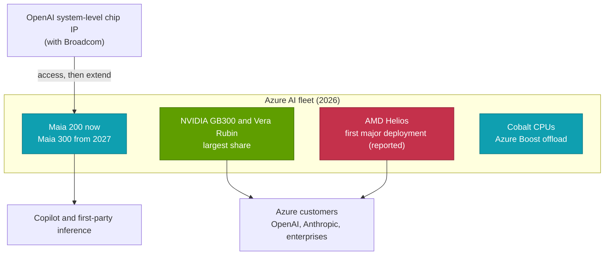

# Microsoft Maia — an inference engine for Copilot

Cross-cutting 15 · Competitive landscape · Maia 100/200/300, Cobalt CPUs, the OpenAI relationship · ~13 min read · Last verified: 2026-11-05

## ⚡ The Executive Take

- **Late start, fast follow.** [Maia](../../glossary.md#maia) 100 (announced 2023, detailed 2024) saw only limited internal use [[S157]](../../sources/bibliography.md#s157). Maia 200, announced in January 2026, is deployed in the US, Europe and Australia and runs Microsoft 365 Copilot [[S158]](../../sources/bibliography.md#s158)[[S90044]](../../sources/bibliography.md#s90044).
- **An inference-only design.** Maia 200 pairs >10 PFLOPS of FP4 and >5 PFLOPS of FP8 with 216 GB of HBM3E at ~7 TB/s and 272 MB of on-chip SRAM, at 750 W [[S158]](../../sources/bibliography.md#s158). Microsoft claims ~30% better [performance per dollar](../../glossary.md#perf-per-dollar) than the latest hardware in its fleet [[S15007]](../../sources/bibliography.md#s15007).
- **Maia 300 aims at Rubin-class memory.** Unveiled on 2026-10-12, it lists 288 GB of HBM4 at 18 TB/s and up to 13.8 PFLOPS FP4 at 950 W, in 96-chip racks, for production in 2027 (🟢 announced, vendor figures) [[S15005]](../../sources/bibliography.md#s15005)[[S15006]](../../sources/bibliography.md#s15006)[[S90046]](../../sources/bibliography.md#s90046).
- **Multi-gigawatt ambitions.** Microsoft plans multi-gigawatt Maia deployments from 2027 and is reportedly negotiating TSMC capacity for >300,000 Maia 300s (🟡) [[S90045]](../../sources/bibliography.md#s90045)[[S559]](../../sources/bibliography.md#s559).
- **OpenAI's chip work feeds Maia.** Microsoft has access to OpenAI's system-level chip IP, developed with Broadcom, and says it will build on it for Maia [[S15008]](../../sources/bibliography.md#s15008).
- **Weakness:** Microsoft was NVIDIA's largest Hopper buyer in 2024 (~485,000, Est.) and still runs mostly NVIDIA [[S12014]](../../sources/bibliography.md#s12014). Maia 200 has ~36% of Rubin's memory bandwidth, no public benchmarks, and software built for first-party models only [[S15014]](../../sources/bibliography.md#s15014).

## Maia 100 → 200 → 300

| Generation | Announced | Process | Memory | Peak compute | Power | Deployment | Source |
|---|---|---|---|---|---|---|---|
| Maia 100 | Nov 2023 | TSMC N5, ~820 mm² | 64 GB HBM2E, 1.8 TB/s | ~0.8 PFLOPS BF16 | 500 W provisioned | Limited, internal | [[S157]](../../sources/bibliography.md#s157) |
| Maia 200 | Jan 2026 | TSMC N3, >140B transistors | 216 GB HBM3E, ~7 TB/s; 272 MB SRAM | >10 PFLOPS FP4, >5 FP8 | 750 W | 🟢 US, Europe, Australia; runs Copilot | [[S158]](../../sources/bibliography.md#s158)[[S90044]](../../sources/bibliography.md#s90044) |
| Maia 300 | Oct 2026 | TSMC N2P compute die + 2 I/O dies | 288 GB HBM4, 18 TB/s | Up to 13.8 PFLOPS FP4 | 950 W | 🟢 Announced; production 2027 | [[S15005]](../../sources/bibliography.md#s15005)[[S15006]](../../sources/bibliography.md#s15006) |

Maia 300 is Microsoft's first chiplet design: an N2P compute die, two I/O dies and eight HBM4 stacks [[S15005]](../../sources/bibliography.md#s15005). A rack holds 96 accelerators in a 167 kW envelope. Microsoft claims ~40% more tokens per megawatt than "leading GPU-based systems" and 7× Maia 200's throughput per rack. Both are unverified design targets [[S15005]](../../sources/bibliography.md#s15005).

> [!TIP]
> **Worked example — what "multi-gigawatt" means in chips.** A Maia 300 rack draws 167 kW for 96 chips: **~1.74 kW per chip** including rack overhead [[S15005]](../../sources/bibliography.md#s15005). The reported 300,000 units would draw 300,000 × 1.74 kW ≈ 520 MW of IT load, ~600 MW at a PUE of 1.15 (🔴 repo arithmetic) [[S559]](../../sources/bibliography.md#s559). **Conclusion:** the first Maia 300 order is roughly half a gigawatt. "Multi-gigawatt from 2027" [[S90045]](../../sources/bibliography.md#s90045) implies well over a million Maia chips across generations, a fleet comparable to Microsoft's 2024 Hopper purchases of ~485,000 GPUs at several times the power each [[S12014]](../../sources/bibliography.md#s12014).

🔧 Under the hood: why an inference chip can be simpler

Inference runs one forward pass per token; training also needs backward passes, optimizer state and high-precision accumulation. Dropping training lets a chip shrink or remove FP64/FP32 units, shrink the scale-up fabric (Maia 200 offers 2.8 TB/s bidirectional per chip [[S158]](../../sources/bibliography.md#s158)) and spend area on SRAM and low-precision maths. Maia 200's 272 MB of SRAM holds hot weights and [KV cache](../../glossary.md#kv-cache) blocks close to compute. Microsoft also co-defined the [microscaling](../../glossary.md#microscaling) (MX) formats with other OCP members, which let 4- and 6-bit numbers keep accuracy by sharing a scale factor per 32-element block [[S2007]](../../sources/bibliography.md#s2007).

## Power efficiency: the ASIC bargain

Unlike most hyperscalers, Microsoft publishes chip power. On paper Maia trades peak compute for efficiency.

> [!TIP]
> **Worked example — FP4 per megawatt of chip power.** 1 MW feeds ~1,333 Maia 200s at 750 W (≥ 13.3 EF of FP4) or ~435 Rubin GPUs at a reported 2.3 kW (~15.2 EF dense FP4) [[S158]](../../sources/bibliography.md#s158)[[S106]](../../sources/bibliography.md#s106)[[S33005]](../../sources/bibliography.md#s33005). Maia 300 at 950 W reaches ~14.5 TFLOPS per watt, ~95% of Rubin's on paper [[S15005]](../../sources/bibliography.md#s15005). **Conclusion:** an inference-only ASIC gets close to NVIDIA's compute per watt by dropping generality. The open questions are achieved utilisation and software, which datasheets do not show.

## Cobalt and the rest of Microsoft's silicon

Maia is one of three in-house chips. [Azure Cobalt](../../glossary.md#azure-cobalt) 100 (128 Arm Neoverse N2 cores) reached general availability in October 2024 [[S183]](../../sources/bibliography.md#s183); Cobalt 200 (132 Neoverse V3 cores on TSMC 3 nm) followed in November 2025, alongside new Azure Boost offload cards [[S184]](../../sources/bibliography.md#s184)[[S4024]](../../sources/bibliography.md#s4024). Together they let Microsoft build a rack where the CPU, the offload card and the accelerator are its own. It still buys most AI compute from NVIDIA and is reported as the first major deployer of AMD's Helios (🟡) [[S90024]](../../sources/bibliography.md#s90024).

Sources: [[S12014]](../../sources/bibliography.md#s12014)[[S90024]](../../sources/bibliography.md#s90024)[[S15005]](../../sources/bibliography.md#s15005)[[S183]](../../sources/bibliography.md#s183)[[S184]](../../sources/bibliography.md#s184)[[S15008]](../../sources/bibliography.md#s15008)[[S90044]](../../sources/bibliography.md#s90044)[[S90075]](../../sources/bibliography.md#s90075).

> [!TIP]
> **Worked example — why own the CPU if it is ~2% of the rack?** Morgan Stanley puts the 36 Vera CPUs in a ~$7.8M Vera Rubin rack at ~$180k, ~2.3% of its cost [[S331]](../../sources/bibliography.md#s331). Replacing them with Cobalt saves little hardware money. **Conclusion:** the value of Cobalt is control: Microsoft decides the host software, offload (Azure Boost) and attach ratio for Maia racks, and keeps that layer out of NVIDIA's bill of materials.

## The OpenAI relationship

Microsoft's silicon strategy is entangled with OpenAI. In the October 2025 restructuring OpenAI committed to buy an incremental $250B of Azure services, Microsoft gave up its right of first refusal as OpenAI's compute provider, and it kept ~27% of the company [[S15009]](../../sources/bibliography.md#s15009). A month later Microsoft's CEO said Microsoft has access to OpenAI's system-level chip work, which OpenAI develops with Broadcom, and will instantiate and then extend it [[S15008]](../../sources/bibliography.md#s15008). Microsoft also committed up to $5B to Anthropic, which in turn committed $30B to Azure compute on NVIDIA systems [[S90075]](../../sources/bibliography.md#s90075).

> [!TIP]
> **Worked example — what OpenAI's chip could add to Maia.** SemiAnalysis reports OpenAI's Broadcom-built inference ASIC at 13.4 PFLOPS of MXFP4 on one N3P die with 15.4 TB/s of HBM4 (🟡) [[S628]](../../sources/bibliography.md#s628). Maia 300 lists up to 13.8 PFLOPS FP4 and 18 TB/s [[S15005]](../../sources/bibliography.md#s15005). **Conclusion:** the two designs land in the same class, so the IP right is less about a better chip than about a second design team and Broadcom's packaging and supply chain at no extra R&D cost. That lowers the cost of Microsoft staying in the custom-silicon race, whichever design wins internally.

## Verdict by layer

| Layer | Verdict vs NVIDIA | Reason |
|---|---|---|
| 02 Accelerator silicon | 🟥 Behind | Maia 200 >5 PFLOPS FP8 vs Rubin 17.5; Maia 300 not until 2027 [[S158]](../../sources/bibliography.md#s158)[[S33005]](../../sources/bibliography.md#s33005) |
| 03 Memory, packaging, supply | 🟥 Behind | Still negotiating TSMC capacity for Maia 300 [[S559]](../../sources/bibliography.md#s559) |
| 04 CPU | 🟥 Behind | Cobalt in early deployment; no coherent CPU-accelerator link [[S184]](../../sources/bibliography.md#s184) |
| 05 Scale-up | 🟥 Behind | 2.8 TB/s per chip over Ethernet, clusters up to 6,144 chips [[S158]](../../sources/bibliography.md#s158) |
| 06 Scale-out | 🟦 Different | Azure Ethernet fabrics, not sold [[S6005]](../../sources/bibliography.md#s6005) |
| 07 DPU and offload | 🟦 Different | Azure Boost, internal [[S4024]](../../sources/bibliography.md#s4024) |
| 08 Systems and racks | 🟥 Behind | Small fleet next to Azure's NVIDIA estate; 96-chip Maia 300 rack in 2027 [[S15005]](../../sources/bibliography.md#s15005) |
| 09 System software | 🟥 Behind | Maia SDK (Triton-based) for first-party models only [[S158]](../../sources/bibliography.md#s158) |
| 10 Libraries | 🟥 Behind | Minimal library ecosystem [[S158]](../../sources/bibliography.md#s158) |
| 11 Inference software | 🟥 Behind | Runs Copilot; no public benchmarks [[S90044]](../../sources/bibliography.md#s90044) |
| 12 Orchestration and cloud | 🟩 Leads | Azure is a top-two cloud; $250B OpenAI commitment [[S15009]](../../sources/bibliography.md#s15009) |
| 13 Ecosystem and capital | 🟥 Behind | Internal program; Microsoft remains a top NVIDIA customer [[S12014]](../../sources/bibliography.md#s12014) |

Repo analyst judgement from `data/competitor_matrix.csv` (🔴) [[S15014]](../../sources/bibliography.md#s15014).

> [!TIP]
> **Worked example — what "30% better performance per dollar" is worth.** 30% more work per dollar means the same work costs 1 ÷ 1.3 ≈ **77%**, a 23% saving [[S15007]](../../sources/bibliography.md#s15007). If Microsoft's first-party inference ran on ~$5B a year of accelerator capacity (🔴 illustrative), Maia would save ~$1.2B a year at full adoption. **Conclusion:** the prize is large for one company's own traffic, but it scales with Maia's share of Microsoft's fleet, which is still small.

**Their best argument.** "Our own tokens, at our own cost." Copilot and Azure's first-party services generate enormous, predictable inference demand. A chip tuned only for that demand, at ~30% better performance per dollar [[S15007]](../../sources/bibliography.md#s15007), saves money on every token Microsoft serves to itself, with no need to win outside developers.

**How much the gap has closed.**

| Measure | Then | Now (Nov 2026) | Source |
|---|---|---|---|
| Memory bandwidth vs NVIDIA flagship | 38% (Maia 100 vs H200, 2024) | 36% (Maia 200 vs Rubin); Maia 300 claims 94% of today's Rubin in 2027 | [[S15014]](../../sources/bibliography.md#s15014)[[S15005]](../../sources/bibliography.md#s15005) |
| HBM capacity | 64 GB | 216 GB (Maia 200), 288 GB (Maia 300) | [[S157]](../../sources/bibliography.md#s157)[[S158]](../../sources/bibliography.md#s158)[[S15005]](../../sources/bibliography.md#s15005) |
| Deployment | Limited internal | Production in three regions; multi-GW planned from 2027 | [[S90044]](../../sources/bibliography.md#s90044)[[S90045]](../../sources/bibliography.md#s90045) |
| Public benchmarks | None | None | [[S613]](../../sources/bibliography.md#s613) |

> [!NOTE]
> **🐂 Bull view (for Microsoft).** Maia 300's 18 TB/s and 288 GB match today's Rubin on memory, its claimed 40% tokens-per-megawatt edge targets the metric that matters in power-capped datacenters, and the OpenAI IP right gives Microsoft a second design team [[S15005]](../../sources/bibliography.md#s15005)[[S15008]](../../sources/bibliography.md#s15008).

> [!WARNING]
> **🐻 Bear view (for Microsoft).** Maia arrives a generation late each time: Maia 300 ships in 2027, when NVIDIA moves to Rubin Ultra [[S90003]](../../sources/bibliography.md#s90003). Every performance claim is a vendor figure. Microsoft remains one of NVIDIA's largest customers, and Azure must keep offering NVIDIA to win outside workloads [[S12014]](../../sources/bibliography.md#s12014).

## 🎯 Corp Dev Lens

1. **Captive inference demand.** Maia's case rests on first-party workloads (Copilot, Foundry) [[S15007]](../../sources/bibliography.md#s15007). Which other companies have enough of their own inference demand to justify an inference ASIC, and could a merchant inference vendor serve them more cheaply than a custom program?
2. **IP-sharing as a new deal form.** Microsoft's access to OpenAI's chip IP [[S15008]](../../sources/bibliography.md#s15008) is a partnership structure, not an acquisition. Could similar licence-plus-co-development deals let others enter custom silicon without a full design team?
3. **Tokens per megawatt as the battleground.** Maia 300's headline claim is 40% more tokens per MW than GPUs [[S15005]](../../sources/bibliography.md#s15005). If buyers adopt that metric, what verification would make a challenger's claim credible: MLPerf Power, InferenceX or customer disclosures?
4. **Second-source leverage.** Microsoft buys NVIDIA, deploys AMD Helios (🟡) and builds Maia [[S90024]](../../sources/bibliography.md#s90024). How much of Maia's value is the chip itself, and how much the price leverage it gives Azure in NVIDIA negotiations?

## 📚 Sources

<!-- Auto-generated from the [S…] citations on this page by `make build`. Edit sources/registry/*.csv, not this list. -->

- [**S106**](../../sources/bibliography.md#s106) SemiAnalysis, *Vera Rubin - Extreme Co-Design: An Evolution*, 2026. [Link](https://newsletter.semianalysis.com/p/vera-rubin-extreme-co-design-an-evolution)
- [**S157**](../../sources/bibliography.md#s157) Microsoft Tech Community, *Inside Maia 100: Revolutionizing AI Workloads with Microsoft's Custom AI Accelerator*, 2024-08-27. [Link](https://techcommunity.microsoft.com/blog/azureinfrastructureblog/inside-maia-100-revolutionizing-ai-workloads-with-microsofts-custom-ai-accelerator/4229118)
- [**S158**](../../sources/bibliography.md#s158) Microsoft, *Maia 200: Microsoft's AI accelerator built for inference*, 2026-01. [Link](https://blogs.microsoft.com/blog/2026/01/26/maia-200-the-ai-accelerator-built-for-inference/)
- [**S183**](../../sources/bibliography.md#s183) Microsoft Azure Blog, *Azure Cobalt 100-based virtual machines are now generally available*, 2024-10. [Link](https://azure.microsoft.com/en-us/blog/azure-cobalt-100-based-virtual-machines-are-now-generally-available/)
- [**S184**](../../sources/bibliography.md#s184) Microsoft Tech Community, *Announcing Cobalt 200: Azure's next cloud-native CPU*, 2025-11-18. [Link](https://techcommunity.microsoft.com/blog/azurecompute/announcing-cobalt-200-azures-next-cloud-native-cpu/4469807)
- [**S331**](../../sources/bibliography.md#s331) Wccftech, *NVIDIA's Vera Rubin rack hit with 435% memory price surge, pushing HBM4 & LPDDR5X bill to $2M of $7.8M total*, 2026-05. [Link](https://wccftech.com/nvidia-vera-rubin-rack-hit-with-memory-price-surge-pushing-hbm4-lpddr5x-bill-to-2m-of-7-8m-total/)
- [**S559**](../../sources/bibliography.md#s559) Techzine, *Microsoft aims to produce hundreds of thousands of Maia 300 AI chips*, 2026-08. [Link](https://www.techzine.eu/news/infrastructure/143518/microsoft-aims-to-produce-hundreds-of-thousands-of-maia-300-ai-chips/)
- [**S613**](../../sources/bibliography.md#s613) NAND Research, *MLPerf Inference 6.0: Software Gains, Broadening Competition Shake Things Up*, 2026-04. [Link](https://nand-research.com/mlperf-inference-6-0-software-gains-broadening-competition-shake-things-up/)
- [**S628**](../../sources/bibliography.md#s628) SemiAnalysis, *OpenAI Jalapeño: Better Than Nvidia Blackwell*, 2026-08-25. [Link](https://github.com/SemiAnalysisAI/InferenceX-app/blob/main/packages/app/content/blog/openai-jalapeno-better-than-nvidia.mdx)
- [**S2007**](../../sources/bibliography.md#s2007) Open Compute Project (AMD, Arm, Intel, Meta, Microsoft, NVIDIA, Qualcomm), *OCP Microscaling Formats (MX) Specification v1.0*, 2023-09. [Link](https://www.opencompute.org/documents/ocp-microscaling-formats-mx-v1-0-spec-final-pdf)
- [**S4024**](../../sources/bibliography.md#s4024) DatacenterDynamics, *Microsoft reveals next-generation Cobalt CPU and Azure Boost*, 2025-11-18. [Link](https://www.datacenterdynamics.com/en/news/microsoft-reveals-next-generation-cobalt-cpu-and-azure-boost/)
- [**S6005**](../../sources/bibliography.md#s6005) Microsoft Official Blog, *Infinite scale: the architecture behind the Azure AI superfactory*, 2025-11-12. [Link](https://blogs.microsoft.com/blog/2025/11/12/infinite-scale-the-architecture-behind-the-azure-ai-superfactory/)
- [**S12014**](../../sources/bibliography.md#s12014) DatacenterDynamics, *Microsoft bought twice as many Nvidia Hopper GPUs as other big tech companies - report*, 2024-12. [Link](https://www.datacenterdynamics.com/en/news/microsoft-bought-twice-as-many-nvidia-hopper-gpus-as-other-big-tech-companies-report)
- [**S15005**](../../sources/bibliography.md#s15005) StorageReview, *Microsoft Maia 300: HBM4, N2P chiplet design and a 96-accelerator rack*, 2026-10. [Link](https://www.storagereview.com/news/microsoft-maia-300-hbm4-n2p-chiplet-96-accelerator-rack)
- [**S15006**](../../sources/bibliography.md#s15006) Notebookcheck, *Microsoft Maia 300 AI chip arrives with 288 GB HBM4 memory and 18 TB/s bandwidth*, 2026-10. [Link](https://notebookcheck.net/Microsoft-Maia-300-AI-chip-arrives-with-monstrous-288-GB-HBM4-memory-and-18-TB-s-bandwidth.1422220.0.html)
- [**S15007**](../../sources/bibliography.md#s15007) Network World, *Microsoft launches its second-generation AI inference chip Maia 200*, 2026-01-26. [Link](https://www.networkworld.com/article/4122439/microsoft-launches-its-second-generation-ai-inference-chip-maia-200.html)
- [**S15008**](../../sources/bibliography.md#s15008) DatacenterDynamics, *Microsoft says it has access to the IP of OpenAI's custom AI chips*, 2025-11. [Link](https://www.datacenterdynamics.com/en/news/microsoft-says-it-has-access-to-the-ip-of-openais-custom-ai-chips/)
- [**S15009**](../../sources/bibliography.md#s15009) Axios, *What to know about OpenAI's new deal with Microsoft*, 2025-10-29. [Link](https://www.axios.com/2025/10/29/microsoft-openai-azure-deal-agi)
- [**S15014**](../../sources/bibliography.md#s15014) nvidia_deep_dive_claude repository, *Repo analysis: Chapter 15A competitive-landscape calculations (gap-to-flagship ratios, implied AMD commitment value, hyperscaler wallet shares, breadth vs depth)*, 2026-11-05. [Link](https://github.com/FrankHuang94/nvidia_deep_dive_claude/blob/main/cross-cutting/15-competitive-landscape/index.md)
- [**S33005**](../../sources/bibliography.md#s33005) NVIDIA, *NVIDIA Vera Rubin NVL72 (product page and specifications)*, 2026. [Link](https://www.nvidia.com/en-us/data-center/vera-rubin-nvl72/)
- [**S90003**](../../sources/bibliography.md#s90003) eWeek, *Everything Nvidia Just Announced at GTC 2026: 7 Chips, 5 Racks, 1 Giant Bet on Agentic AI*, 2026-03-17. [Link](https://www.eweek.com/news/nvidia-gtc-2026-ai-inference-vera-rubin-neuron/)
- [**S90024**](../../sources/bibliography.md#s90024) Crypto Briefing, *AMD's Helios platform ships H2 2026 with Microsoft Azure as first major deployment*, 2026. [Link](https://cryptobriefing.com/amd-helios-platform-ships-h2-2026/)
- [**S90044**](../../sources/bibliography.md#s90044) eWeek, *Microsoft introduces Maia 200, its most powerful AI chip yet*, 2026-01-27. [Link](https://www.eweek.com/news/microsoft-maia-200-ai-chip/)
- [**S90045**](../../sources/bibliography.md#s90045) Pulse 2.0, *Microsoft to expand Azure Maia AI infrastructure to multi-gigawatt deployments starting in 2027*, 2026-10. [Link](https://pulse2.com/microsoft-to-expand-azure-maia-ai-infrastructure/)
- [**S90046**](../../sources/bibliography.md#s90046) IT Brief UK, *Microsoft unveils Maia 300 for 2027 AI deployments*, 2026-10. [Link](https://itbrief.co.uk/story/microsoft-unveils-maia-300-for-2027-ai-deployments)
- [**S90075**](../../sources/bibliography.md#s90075) Windows Central, *NVIDIA joins Microsoft's push on Claude — piling billions into Anthropic's future*, 2025-11-18. [Link](https://www.windowscentral.com/microsoft/nvidia-joins-microsofts-push-on-claude-piling-billions-into-anthropics-future)
