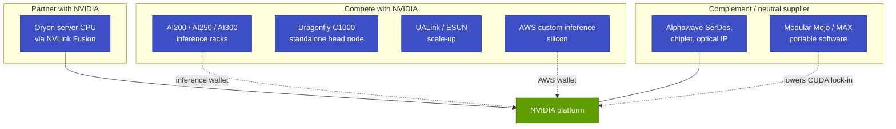

# Qualcomm: a second datacenter attempt, mapped against NVIDIA

Cross-cutting 15 · Competitive landscape · ~16 min read · Last verified: 2026-11-05

> [!IMPORTANT]
> **Public information only.** Everything on this page comes from Qualcomm's public announcements, filings and press
> coverage, cited inline. It states facts and open questions; it makes no recommendations and uses no internal
> information.

## ⚡ The Executive Take

- **This is Qualcomm's second datacenter attempt.** The 48-core Centriq 2400 launched in November 2017; within about a
  year the unit was cut from ~1,000 to ~50 people [[S4542]](../../sources/bibliography.md#s4542)[[S4543]](../../sources/bibliography.md#s4543)[[S4544]](../../sources/bibliography.md#s4544).
- **The rebuild has been by acquisition.** NUVIA ($1.4B, 2021) for CPU cores, Alphawave (~$2.4B, closed 2025-12-18) for
  [SerDes](../../glossary.md#serdes) and connectivity, Ventana (RISC-V, December 2025, undisclosed) and Modular ($3.9B, closed
  2026-07-29) for hardware-portable AI software [[S4538]](../../sources/bibliography.md#s4538)[[S4513]](../../sources/bibliography.md#s4513)[[S4514]](../../sources/bibliography.md#s4514)[[S4512]](../../sources/bibliography.md#s4512)[[S9511]](../../sources/bibliography.md#s9511).
- **Accelerators bet on memory capacity, not HBM.** AI200 (2026) puts 768 GB of [LPDDR](../../glossary.md#lpddr) on each card in
  160 kW liquid-cooled racks; AI250 (2027) adds [near-memory compute](../../glossary.md#near-memory-compute); Dragonfly AI300
  (2028) claims 54× AI200's memory bandwidth and uses [UALink](../../glossary.md#ualink) and [ESUN](../../glossary.md#esun) [scale-up](../../glossary.md#scale-up) [[S173]](../../sources/bibliography.md#s173)[[S90060]](../../sources/bibliography.md#s90060). No AI200 volume shipment
  was public by 2026-11-05 🔴 [[S90028]](../../sources/bibliography.md#s90028).
- **CPUs are a partner play with NVIDIA and a standalone play.** Qualcomm joined [NVLink](../../glossary.md#nvlink) Fusion for server CPUs in May
  2025 [[S90031]](../../sources/bibliography.md#s90031); the Dragonfly C1000 (>250 Oryon cores) has Meta as first customer, deploying from H2 2028 [[S90056]](../../sources/bibliography.md#s90056)[[S90058]](../../sources/bibliography.md#s90058).
- **Customers now exist on paper.** HUMAIN plans 200 MW [[S90030]](../../sources/bibliography.md#s90030). AWS signed a multi-generation deal for custom inference
  silicon and 1.6T optics, with a warrant for up to 25M Qualcomm shares that vests as AWS buys up to $60B over ~10 years
  🟢 [[S15510]](../../sources/bibliography.md#s15510)[[S15509]](../../sources/bibliography.md#s15509). Two [hyperscaler](../../glossary.md#hyperscaler) custom-silicon contracts exceed $1B each [[S15511]](../../sources/bibliography.md#s15511).
- **The targets are $5B of datacenter revenue in FY2027 and $15B by FY2029** [[S15512]](../../sources/bibliography.md#s15512)[[S90059]](../../sources/bibliography.md#s90059). The FY2029 goal is ~8% of
  NVIDIA's FY2026 data-center revenue [[S1]](../../sources/bibliography.md#s1).
- **Map vs NVIDIA:** partner in CPUs (NVLink Fusion), competitor in inference accelerators and scale-up standards
  (UALink/ESUN), complement in connectivity IP and portable software.

![Timeline of Qualcomm's public datacenter moves in four lanes. Before 2025: Centriq 2400 server CPU (Nov 2017), the unit wound down (2018), NUVIA bought for $1.4B (2021) and the Cloud AI 100 Ultra card (2023). Since May 2025: NVLink Fusion CPU partnership and HUMAIN MoU (May 2025); AI200 and AI250 unveiled with HUMAIN's 200 MW plan (Oct 2025); Ventana (RISC-V) and Alphawave (~$2.4B) acquisitions (Dec 2025); Investor Day with the Dragonfly C1000 CPU for Meta, the AI300 accelerator and the Modular deal (Jun 2026); Modular closed at $3.9B (Jul 2026); a multi-generation AWS custom inference-silicon and 1.6T optics deal backed by a $4B warrant (Sep 2026). Roadmap: AI200 in 2026 (no volume shipment confirmed by Nov 2026), AI250 in 2027, AI300 and C1000 deployments in 2028.](../../assets/charts/15-qualcomm-dc-roadmap-timeline.svg)

## What the first attempt shows (Centriq, 2017–2018)

Centriq 2400 was a credible chip: 48 custom Arm cores on Samsung 10 nm, launched at $1,995 [[S4542]](../../sources/bibliography.md#s4542). It reached the
market as Qualcomm was cutting ~$1B of costs, and the exit was reported about seven months after launch [[S4543]](../../sources/bibliography.md#s4543). The
unit went from ~1,000 people to ~50, and the IP lived on in a Chinese joint venture [[S4544]](../../sources/bibliography.md#s4544).

> [!TIP]
> **Worked example — what the record implies for diligence.** From launch (2017-11-08) to the reported exit decision
> (May 2018) is ~6–7 months [[S4542]](../../sources/bibliography.md#s4542)[[S4543]](../../sources/bibliography.md#s4543); a staff cut from ~1,000 to ~50 is 95% [[S4544]](../../sources/bibliography.md#s4544). Server CPUs need multi-year
> qualification at cloud customers, so a program measured in quarters rarely reaches volume. The public differences this
> time are anchor customers before volume (HUMAIN, Meta, AWS), acquired IP rather than only in-house builds, and stated
> multi-year targets [[S90030]](../../sources/bibliography.md#s90030)[[S90058]](../../sources/bibliography.md#s90058)[[S15510]](../../sources/bibliography.md#s15510)[[S15512]](../../sources/bibliography.md#s15512). Whether those differences hold through a downturn is a question the
> record raises, not one it answers.

## The accelerator line: AI 100 to AI300

Qualcomm's inference accelerators trade memory bandwidth for memory capacity and power efficiency, the opposite corner
from NVIDIA's [HBM](../../glossary.md#hbm) GPUs ([the memory wall](../../layers/03-memory-packaging-supply-chain/the-memory-wall.md)).

| Product | Year | Memory | Bandwidth | Power / cooling | Scale-up | Status | Sources |
|---|---|---|---|---|---|---|---|
| Cloud AI 100 Ultra | 2023 | 128 GB LPDDR4x | 0.548 TB/s | 150 W card | PCIe | shipping | [[S172]](../../sources/bibliography.md#s172) |
| AI200 | 2026 | 768 GB LPDDR per card | not disclosed | 160 kW rack, direct liquid | PCIe; Ethernet scale-out | 🔴 no volume seen | [[S173]](../../sources/bibliography.md#s173)[[S90029]](../../sources/bibliography.md#s90029) |
| AI250 | 2027 | LPDDR + near-memory compute | ">10×" effective vs AI200 (claim) | rack-scale | PCIe; Ethernet | roadmap | [[S173]](../../sources/bibliography.md#s173) |
| Dragonfly AI300 | 2028 | High Bandwidth Compute Gen 2 | "54×" AI200 (claim) | rack-scale | UALink, ESUN | roadmap | [[S90060]](../../sources/bibliography.md#s90060) |
| NVIDIA Rubin (reference) | 2026 | 288 GB HBM4 | 19.2 TB/s | liquid-cooled NVL72 rack | NVLink 6, 72 packages | ramping | [[S90006]](../../sources/bibliography.md#s90006)[[S90009]](../../sources/bibliography.md#s90009) |

> [!TIP]
> **Worked example — capacity vs bandwidth on one model.** A 70B-parameter model in [FP8](../../glossary.md#fp8) needs ~70 GB of weights.
> [Decode](../../glossary.md#decode) re-reads them for every token, so one user's speed is capped at bandwidth ÷ weights: 0.548 TB/s ÷ 70 GB ≈ 8
> tokens/s on a Cloud AI 100 Ultra vs 19.2 TB/s ÷ 70 GB ≈ 274 on a Rubin GPU [[S172]](../../sources/bibliography.md#s172)[[S90006]](../../sources/bibliography.md#s90006). Batching many users shares
> each weight read, so total throughput per card can be respectable at low power; what LPDDR cannot buy is high speed per
> user. 768 GB per AI200 card holds a ~600B-parameter FP8 model with ~170 GB left for [KV cache](../../glossary.md#kv-cache),
> which no single HBM GPU can (Rubin has 288 GB). The open question is AI200's bandwidth, which Qualcomm has not disclosed, so the 54× AI300 claim
> cannot yet be converted to TB/s.

![Log-log scatter of inference chips by memory capacity and bandwidth. SRAM designs sit top-left: NVIDIA's Groq 3 LPU holds 0.5 GB at 150 TB/s (~300,000 full reads per second), Groq LPU v1 0.23 GB at 80 TB/s, d-Matrix Corsair 2 GB at 150 TB/s and Cerebras WSE-3 44 GB at 21,000 TB/s. HBM GPUs and cloud ASICs cluster in the middle at 80-432 GB and 3-23 TB/s (25-70 reads per second): Rubin 288 GB at 19.2 TB/s, MI455X 432 GB at 23.3 TB/s, Ironwood 192 GB at 7.4 TB/s, Maia 200 216 GB at 7 TB/s. LPDDR cards sit bottom-right: Qualcomm AI 100 Ultra 128 GB at 0.548 TB/s (~4 reads per second) and the AI200 with 768 GB per card (bandwidth not disclosed).](../../assets/charts/11-inference-memory-tradeoff.svg)

🔧 Under the hood: why LPDDR, and what "near-memory" and HBC change

LPDDR is phone and laptop memory: cheap per gigabyte, low power, made in high volume by several vendors, and it needs no
[CoWoS](../../glossary.md#cowos) interposer. It reaches a processor through narrow channels, so bandwidth per gigabyte is low. HBM stacks DRAM dies
with thousands of through-silicon connections next to the GPU: Rubin's 19.2 TB/s is ~35× the AI 100 Ultra's 0.548 TB/s
[[S90006]](../../sources/bibliography.md#s90006)[[S172]](../../sources/bibliography.md#s172), but HBM supply is tight and expensive ([HBM explained](../../layers/03-memory-packaging-supply-chain/hbm-explained.md)). Qualcomm's AI250 moves some
compute next to memory so less data travels over the narrow channel, which is why it quotes *effective* bandwidth gains
[[S173]](../../sources/bibliography.md#s173). [High Bandwidth Compute](../../glossary.md#high-bandwidth-compute) in the AI300 is Qualcomm's next step on that path
[[S90060]](../../sources/bibliography.md#s90060). The repo scores Qualcomm "different approach" on memory and supply for this reason: it sidesteps the HBM and
CoWoS allocations where NVIDIA holds ~60% of 2026 CoWoS wafers (Est.) [[S379]](../../sources/bibliography.md#s379).

## The CPU line: from Centriq to Dragonfly C1000

Two CPU tracks run in parallel. The first is a partner track: Oryon-based server CPUs that attach to NVIDIA GPUs through
[NVLink Fusion](../../glossary.md#nvlink-fusion), announced at Computex 2025 [[S90031]](../../sources/bibliography.md#s90031)[[S4516]](../../sources/bibliography.md#s4516). The second is standalone: the
Dragonfly C1000, a chiplet CPU with more than 250 cores, a >5 GHz target, [PCIe](../../glossary.md#pcie) Gen 7 and CXL, pitched as an
[AI head node](../../glossary.md#ai-head-node) for agentic workloads, with Meta as the first named customer and deployments from
H2 2028 [[S90056]](../../sources/bibliography.md#s90056)[[S90058]](../../sources/bibliography.md#s90058). An earlier unconfirmed report described an 80-core part with NVLink Fusion [[S4515]](../../sources/bibliography.md#s4515). For scale,
NVIDIA's Vera has 88 cores and AMD's EPYC Venice up to 256 [[S100]](../../sources/bibliography.md#s100)[[S144]](../../sources/bibliography.md#s144); RISC-V work from Ventana runs alongside Oryon
[[S4512]](../../sources/bibliography.md#s4512) ([CPU competition](../../layers/04-cpu-grace-vera/competition.md)).

> [!TIP]
> **Worked example — cores and calendar.** More than 250 cores is ~2.8× Vera's 88 and level with EPYC Venice's 256
> [[S100]](../../sources/bibliography.md#s100)[[S144]](../../sources/bibliography.md#s144). Venice ships in AMD's Helios racks from around Q3 2026 and Vera in Vera Rubin [NVL72](../../glossary.md#nvl72) from Q3 2026
> [[S90020]](../../sources/bibliography.md#s90020)[[S90009]](../../sources/bibliography.md#s90009); C1000 deploys from H2 2028 [[S90058]](../../sources/bibliography.md#s90058), so it will meet those vendors' next generations. Core count gets a
> CPU into evaluation; memory bandwidth per core, the GPU link and the software ecosystem decide head-node wins
> ([why AI needs a CPU](../../layers/04-cpu-grace-vera/why-ai-needs-a-cpu.md)).

## Connectivity, software and custom silicon: Alphawave, Modular, AWS

**Alphawave** brings SerDes, chiplet and optical-connectivity IP, the same capability the custom-ASIC houses treat as
their moat ([custom-ASIC houses](custom-asic-houses.md)) [[S4514]](../../sources/bibliography.md#s4514). **Modular**
brings Mojo and the MAX inference engine, a hardware-portable stack; Mojo was open-sourced under Apache 2.0 in August
2026 [[S9511]](../../sources/bibliography.md#s9511)[[S9512]](../../sources/bibliography.md#s9512). The repo's layer-09 analysis treats portable software as one of the main erosion vectors for [CUDA](../../glossary.md#cuda)
([CUDA competition](../../layers/09-cuda-and-system-software/competition.md)).

**AWS** is the largest public customer signal. Qualcomm and AWS agreed to co-develop custom AI inference chips across
generations plus optical connectivity up to 1.6T, with revenue expected from Qualcomm's fiscal Q1 2027 [[S15509]](../../sources/bibliography.md#s15509)[[S15510]](../../sources/bibliography.md#s15510).

> [!TIP]
> **Worked example — reading a purchase-vested warrant.** The warrant covers up to 25M shares at $161.26, ~$4.0B of
> strike value, vesting as Amazon buys up to $60B of products by 2036; 3.75M shares vested on initial commitments
> [[S15510]](../../sources/bibliography.md#s15510). That is $60B ÷ 25M = $2,400 of purchases per vested share. If the stock traded $40 above the strike, each
> share would be worth $40 to Amazon, ~1.7% of the purchases that vest it (🔴 illustrative price). If vesting were
> linear (not disclosed), 3.75M shares would map to ~$9B of initial commitments (🔴 repo arithmetic). Structurally it is a
> volume rebate paid in equity, like AMD's warrant to OpenAI, but at a positive strike [[S13506]](../../sources/bibliography.md#s13506)
> ([purchase-vested warrant](../../glossary.md#purchase-vested-warrant)).

## Layer-by-layer map: partner, compete, complement

| NVIDIA layer | Qualcomm's public effort | Relation to NVIDIA | Verdict vs NVIDIA | Sources |
|---|---|---|---|---|
| 02 Accelerator silicon | Cloud AI 100 Ultra; AI200/AI250/AI300 | Compete (inference) | 🟦 Different: LPDDR inference NPU | [[S172]](../../sources/bibliography.md#s172)[[S173]](../../sources/bibliography.md#s173)[[S90060]](../../sources/bibliography.md#s90060) |
| 03 Memory & supply | LPDDR instead of HBM/CoWoS | Compete (supply-independent) | 🟦 Different: 768 GB per card, low bandwidth | [[S173]](../../sources/bibliography.md#s173) |
| 04 CPU | Oryon CPUs via NVLink Fusion; Dragonfly C1000 | Partner and compete | 🟥 Behind: not shipping until 2028 | [[S90031]](../../sources/bibliography.md#s90031)[[S90056]](../../sources/bibliography.md#s90056) |
| 05 Scale-up | AI300 on UALink and ESUN | Compete (rival standard) | 🟥 Behind: PCIe today | [[S90060]](../../sources/bibliography.md#s90060)[[S173]](../../sources/bibliography.md#s173) |
| 06 Scale-out & optics | Alphawave IP; AWS 1.6T optics | Complement (sells to many) | 🟥 Behind in switching; 🔴 IP supplier role | [[S4514]](../../sources/bibliography.md#s4514)[[S15509]](../../sources/bibliography.md#s15509) |
| 08 Systems & racks | 160 kW AI200 racks | Compete | 🟥 Behind: first racks 2026 target | [[S173]](../../sources/bibliography.md#s173) |
| 09–11 Software | Cloud AI SDK with vLLM; Modular (Mojo/MAX) | Complement (portability) | 🟦 Different: portable stack | [[S596]](../../sources/bibliography.md#s596)[[S9511]](../../sources/bibliography.md#s9511) |
| 12 Cloud | No cloud service | — | 🟥 Behind | [[S173]](../../sources/bibliography.md#s173) |
| 13 Ecosystem & capital | HUMAIN, Meta, AWS; $5B / $15B targets | Compete for hyperscale wallets | 🟥 Behind: early customers | [[S90030]](../../sources/bibliography.md#s90030)[[S90058]](../../sources/bibliography.md#s90058)[[S15512]](../../sources/bibliography.md#s15512) |

![Two-panel chart. Left: radar of Qualcomm versus NVIDIA on nine capability axes, averaging 2.7 versus 4.7 of 5 (Compute 2 vs 5; Memory 4 vs 4; Scale-up 1 vs 5; Scale-out 2 vs 5; Software 2 vs 5; Racks 2 vs 5; Supply 4 vs 5; Cost/TCO 4 vs 3; Merchant 3 vs 5). Right: Qualcomm's score in each of NVIDIA's 12 stack layers with its verdict: behind 9, different 3. Public information only: Qualcomm's LPDDR-based design scores on memory capacity and on independence from CoWoS and HBM, its cost claim is a vendor claim, and scale-up, software and racks are early.](../../assets/charts/15-qualcomm-capability-profile.svg)

## The targets in context

> [!TIP]
> **Worked example — sizing the $15B goal.** Qualcomm's FY2026 revenue was $43.1B [[S15513]](../../sources/bibliography.md#s15513). A $15B datacenter line by
> FY2029 would equal ~35% of that base, ~7.7% of NVIDIA's FY2026 data-center revenue ($193.7B) and roughly AMD's 2025
> data-center revenue (~$16.7B) [[S1]](../../sources/bibliography.md#s1)[[S450]](../../sources/bibliography.md#s450). The FY2027 step ($5B) includes at least $1B from two hyperscaler
> custom-silicon customers [[S15511]](../../sources/bibliography.md#s15511), so the merchant accelerator share of the near-term target is smaller than the
> headline.

## Their best argument, and how much the gap has closed

**The best public argument** is that inference rewards cost and power more than peak speed, and Qualcomm's LPDDR design,
150 W-class heritage and supply independence from HBM and CoWoS target exactly that [[S172]](../../sources/bibliography.md#s172)[[S173]](../../sources/bibliography.md#s173). The AWS and Meta
agreements show hyperscale buyers engaging [[S15510]](../../sources/bibliography.md#s15510)[[S90058]](../../sources/bibliography.md#s90058).

**How much the gap has closed:** on shipped datacenter accelerators, little so far; no AI200 volume shipment, MLPerf
datacenter result or InferenceX result was public by 2026-11-05 🔴 [[S90028]](../../sources/bibliography.md#s90028)[[S602]](../../sources/bibliography.md#s602)[[S620]](../../sources/bibliography.md#s620). On customers and IP, more than at
any time since 2018 (see the timeline above). The repo's matrix scores Qualcomm 2.7 of 5 vs NVIDIA's 4.7 (🔴 analyst judgement; capability chart above).

> [!NOTE]
> **🐂 Bull view (for NVIDIA).** Qualcomm's CPUs plug into NVLink Fusion, so part of its effort expands NVIDIA's rack
> rather than replacing it [[S90031]](../../sources/bibliography.md#s90031); NVIDIA's own inference line-up now spans HBM GPUs and SRAM-based Groq 3 LPX
> racks, covering both cost and latency tiers [[S114]](../../sources/bibliography.md#s114)[[S90003]](../../sources/bibliography.md#s90003).

> [!WARNING]
> **🐻 Bear view (for NVIDIA).** A company with $43.1B of FY2026 revenue [[S15513]](../../sources/bibliography.md#s15513) now has a hyperscaler custom-silicon deal (AWS),
> a CPU deal (Meta), portable software (Modular) and UALink/ESUN scale-up, all aimed at the inference wallet where
> NVIDIA's software lead matters least [[S15510]](../../sources/bibliography.md#s15510)[[S90058]](../../sources/bibliography.md#s90058)[[S9511]](../../sources/bibliography.md#s9511)[[S90060]](../../sources/bibliography.md#s90060).

## Questions a corp dev team would ask

| Question | Why it matters | Public evidence so far |
|---|---|---|
| When does AI200 ship in volume, and to whom besides HUMAIN? | Revenue timing for the FY2027 $5B target | 2026 target; no shipment confirmed [[S173]](../../sources/bibliography.md#s173)[[S90028]](../../sources/bibliography.md#s90028) |
| What is AI200's memory bandwidth and measured tokens/s? | Decides which models and latency tiers it can serve | Not disclosed; no MLPerf/InferenceX result [[S602]](../../sources/bibliography.md#s602)[[S620]](../../sources/bibliography.md#s620) |
| How much of the AWS ceiling ($60B) becomes firm orders? | Warrant vests only with purchases | 3.75M of 25M shares vested on initial commitments [[S15510]](../../sources/bibliography.md#s15510) |
| Does the NVLink Fusion CPU ship before C1000? | Partner vs standalone priority | No ship date public [[S90031]](../../sources/bibliography.md#s90031)[[S90056]](../../sources/bibliography.md#s90056) |
| How do Modular's tools reach Qualcomm silicon and rivals' silicon? | Portability helps everyone, including competitors | Mojo open-sourced Aug 2026 [[S9512]](../../sources/bibliography.md#s9512) |
| How do UALink/ESUN timelines line up with AI300 in 2028? | Scale-up standard maturity | UALink products expected 2027 [[S90051]](../../sources/bibliography.md#s90051) |

## 🎯 Corp Dev Lens

1. Qualcomm is partner (NVLink Fusion CPUs), competitor (AI200–AI300, C1000, AWS silicon) and neutral supplier
   (Alphawave IP, Mojo) at once. Which public evidence would show which role contributes most revenue by FY2029?
2. The custom-silicon contracts (>$1B each, two hyperscalers) and the AWS deal resemble Broadcom's model. How do NRE,
   per-unit margin and warrant dilution compare with the merchant AI200 line, on public numbers?
3. LPDDR capacity is now shared ground with Intel's Crescent Island and [SRAM](../../glossary.md#sram)/HBM hybrids from start-ups. What would
   distinguish a durable position in that niche: memory, software, power or customer access?
4. Modular was bought for $3.9B, ~2.4× its $1.6B Series C valuation [[S9511]](../../sources/bibliography.md#s9511)[[S9510]](../../sources/bibliography.md#s9510). What milestones (framework adoption, third-party
   hardware support, developer counts) would show the software is moving workloads?
5. Centriq's exit came ~6 months after launch [[S4543]](../../sources/bibliography.md#s4543). Which public disclosures (shipments, customer count, segment
   reporting) will mark whether this attempt clears the stage where the first one stopped?

## 📚 Sources

<!-- Auto-generated from the [S…] citations on this page by `make build`. Edit sources/registry/*.csv, not this list. -->

- [**S1**](../../sources/bibliography.md#s1) NVIDIA Corporation via SEC EDGAR, *NVIDIA Announces Financial Results for Fourth Quarter and Fiscal 2026 (Form 8-K exhibit 99.1)*, 2026-02-25. [Link](https://www.sec.gov/Archives/edgar/data/1045810/000104581026000019/q4fy26pr.htm)
- [**S100**](../../sources/bibliography.md#s100) NVIDIA Technical Blog, *Inside the NVIDIA Vera Rubin Platform: Six New Chips, One AI Supercomputer*, 2026-01-05. [Link](https://developer.nvidia.com/blog/inside-the-nvidia-rubin-platform-six-new-chips-one-ai-supercomputer/)
- [**S114**](../../sources/bibliography.md#s114) StorageReview, *NVIDIA Groq 3 LPX: Everything we know*, 2026-03. [Link](https://www.storagereview.com/news/nvidia-groq-3-lpx-everything-we-know)
- [**S144**](../../sources/bibliography.md#s144) AMD Newsroom, *AMD Unveils Vision for an Open AI Ecosystem, Detailing New Silicon, Software and Systems at Advancing AI 2025*, 2025-06-12. [Link](https://www.amd.com/en/newsroom/press-releases/2025-6-12-amd-unveils-vision-for-an-open-ai-ecosystem-detai.html)
- [**S172**](../../sources/bibliography.md#s172) Qualcomm, *Qualcomm Cloud AI 100 (incl. Cloud AI 100 Ultra)*, 2023-11. [Link](https://www.qualcomm.com/products/technology/processors/cloud-artificial-intelligence/cloud-ai-100)
- [**S173**](../../sources/bibliography.md#s173) Qualcomm, *Qualcomm Unveils AI200 and AI250 - Redefining Rack-Scale Data Center Inference*, 2025-10-27. [Link](https://www.qualcomm.com/news/releases/2025/10/qualcomm-unveils-ai200-and-ai250-redefining-rack-scale-data-cent)
- [**S379**](../../sources/bibliography.md#s379) TrendForce News, *TSMC CoWoS capacity and customer allocation estimates (TrendForce / Morgan Stanley, as reported)*, 2025. [Link](https://www.trendforce.com/news/)
- [**S450**](../../sources/bibliography.md#s450) U.S. Securities and Exchange Commission (EDGAR), *Advanced Micro Devices Form 10-K / 10-Q filings (EDGAR index)*, 2025-02-05. [Link](https://www.sec.gov/cgi-bin/browse-edgar?action=getcompany&CIK=0000002488&type=10-&dateb=&owner=include&count=40)
- [**S596**](../../sources/bibliography.md#s596) Qualcomm (GitHub: quic), *Qualcomm Cloud AI SDK and Efficient Transformers repositories*, 2026-11. [Link](https://github.com/quic/cloud-ai-sdk)
- [**S602**](../../sources/bibliography.md#s602) MLCommons, *MLPerf Inference v6.0 results (summary_results.json and per-submitter logs)*, 2026-04-01. [Link](https://github.com/mlcommons/inference_results_v6.0)
- [**S620**](../../sources/bibliography.md#s620) SemiAnalysis, *SemiAnalysis InferenceX (formerly InferenceMAX) open-source benchmark repository*, 2026-11. [Link](https://github.com/SemiAnalysisAI/InferenceX)
- [**S4512**](../../sources/bibliography.md#s4512) DatacenterDynamics, *Qualcomm buys RISC-V server chip maker Ventana Micro Systems*, 2025-12-10. [Link](https://www.datacenterdynamics.com/en/news/qualcomm-buys-risc-v-server-chip-maker-ventana-microsystems/)
- [**S4513**](../../sources/bibliography.md#s4513) I-Connect007, *Qualcomm completes acquisition of Alphawave Semi*, 2025-12-18. [Link](https://iconnect007.com/article/148161/qualcomm-completes-acquisition-of-alphawave-semi/148158/ein)
- [**S4514**](../../sources/bibliography.md#s4514) CRN Asia, *Qualcomm: US$2.4 billion Alphawave Semi buy to boost data center push*, 2025-06. [Link](https://www.crnasia.com/news-network/2025/qualcomm-us-2)
- [**S4515**](../../sources/bibliography.md#s4515) 3DNews, *Qualcomm server processor to get 80 Oryon cores, NVLink Fusion, PCIe 5.0 and HBM support (DigiTimes report)*, 2025. [Link](https://3dnews.ru/1123267/serverniy-protsessor-qualcomm-poluchit-80-yader-oryon-poddergku-nvlink-fusionpcie-50-i-pamyatihbm/amp)
- [**S4516**](../../sources/bibliography.md#s4516) DatacenterDynamics, *Qualcomm to return to data center market with AI CPUs*, 2025-05. [Link](https://www.datacenterdynamics.com/en/news/qualcomm-to-return-to-data-center-market-with-ai-cpus/)
- [**S4538**](../../sources/bibliography.md#s4538) Qualcomm Investor Relations, *Qualcomm completes acquisition of NUVIA*, 2021-03-16. [Link](https://investor.qualcomm.com/news-events/press-releases/news-details/2021/Qualcomm-Completes-Acquisition-of-NUVIA-03-16-2021/default.aspx)
- [**S4542**](../../sources/bibliography.md#s4542) AnandTech, *Qualcomm launches 48-core Centriq for $1,995: Arm servers for cloud native applications*, 2017-11-08. [Link](https://www.anandtech.com/show/12025)
- [**S4543**](../../sources/bibliography.md#s4543) The Next Platform, *What Qualcomm's exit from Arm server chips means*, 2018-05-10. [Link](https://www.nextplatform.com/2018/05/10/what-qualcomms-exit-from-arm-server-chips-means)
- [**S4544**](../../sources/bibliography.md#s4544) Network World, *Qualcomm makes it official: no more data center chip*, 2018-12. [Link](https://www.networkworld.com/article/3327214/qualcomm-makes-it-official-no-more-data-center-chip.html)
- [**S9510**](../../sources/bibliography.md#s9510) SDxCentral, *Modular raises $250M for AI's unified compute layer at $1.6B valuation*, 2025-09-24. [Link](https://www.sdxcentral.com/news/modular-raises-250m-for-ais-unified-compute-layer-at-16b-valuation/)
- [**S9511**](../../sources/bibliography.md#s9511) Nasdaq (Qualcomm press release), *Qualcomm Completes Acquisition of Modular*, 2026-07-29. [Link](https://www.nasdaq.com/press-release/qualcomm-completes-acquisition-modular-2026-07-29)
- [**S9512**](../../sources/bibliography.md#s9512) Phoronix (Michael Larabel), *Modular's Mojo Language Now Open-Source Following Qualcomm Acquisition*, 2026-08-18. [Link](https://www.phoronix.com/news/Modular-Mojo-Open-Source)
- [**S13506**](../../sources/bibliography.md#s13506) Tom's Hardware, *OpenAI signs 6 GW AMD GPU deal*, 2025-10-06. [Link](https://www.tomshardware.com/pc-components/gpus/openai-signs-6gw-amd-gpu-deal)
- [**S15509**](../../sources/bibliography.md#s15509) Mobile World Live, *Qualcomm lands custom AI chip deal with Amazon*, 2026-09. [Link](https://www.mobileworldlive.com/ai-cloud/qualcomm-lands-custom-ai-chip-deal-with-amazon/)
- [**S15510**](../../sources/bibliography.md#s15510) Manufacturing Dive, *Qualcomm makes custom chips for Amazon in $4B partnership*, 2026-09. [Link](https://www.manufacturingdive.com/news/qualcomm-custom-chips-amazon-4b-partnership/829914/)
- [**S15511**](../../sources/bibliography.md#s15511) Futurum Group, *Qualcomm lands $60 billion custom silicon and 1.6T optics deal with AWS, backed by a $4 billion warrant*, 2026-09. [Link](https://futurumgroup.com/insights/qualcomm-lands-60-billion-custom-silicon-and-16t-optics-deal-with-aws-backed-by-a-4-billion-warrant/)
- [**S15512**](../../sources/bibliography.md#s15512) Nasdaq, *Qualcomm Q3 earnings call highlights*, 2026-07-29. [Link](https://www.nasdaq.com/articles/qualcomm-q3-earnings-call-highlights)
- [**S15513**](../../sources/bibliography.md#s15513) Qualcomm via SEC EDGAR, *Qualcomm announces fourth quarter and fiscal 2026 results (Form 8-K exhibit 99.1)*, 2026-11-04. [Link](https://www.sec.gov/Archives/edgar/data/0000804328/000080432826000127/qcom092726erex991.htm)
- [**S90003**](../../sources/bibliography.md#s90003) eWeek, *Everything Nvidia Just Announced at GTC 2026: 7 Chips, 5 Racks, 1 Giant Bet on Agentic AI*, 2026-03-17. [Link](https://www.eweek.com/news/nvidia-gtc-2026-ai-inference-vera-rubin-neuron/)
- [**S90006**](../../sources/bibliography.md#s90006) TweakTown, *Nvidia cuts Vera Rubin's memory bandwidth by up to 26% and AMD's Helios now leads in memory bandwidth*, 2026-10. [Link](https://www.tweaktown.com/news/114304/nvidia-cuts-vera-rubins-memory-bandwidth-by-up-to-26-percent-and-amds-helios-now-leads-in-memory-bandwidth/index.html)
- [**S90009**](../../sources/bibliography.md#s90009) GamesBeat, *Nvidia Vera Rubin ramps into full production for fall launch*, 2026. [Link](https://gamesbeat.com/nvidia-vera-rubin-ramps-into-full-production-for-fall-launch-again/)
- [**S90020**](../../sources/bibliography.md#s90020) Shacknews, *AMD Helios AI rack system on track for initial shipments in Q3 2026*, 2026. [Link](https://www.shacknews.com/article/150249/amd-helios-ai-system-shipping-q3-2026)
- [**S90028**](../../sources/bibliography.md#s90028) TechRepublic, *Qualcomm unveils AI chips to rival Nvidia, AMD*, 2025-10-27. [Link](https://techrepublic.com/article/news-qualcomm-unveils-ai-chips-to-rival-nvidia-amd)
- [**S90029**](../../sources/bibliography.md#s90029) Verdict, *Qualcomm AI200 and AI250 racks for AI inference*, 2025-10. [Link](https://www.verdict.co.uk/qualcomm-ai200-ai250-racks-ai-inference/)
- [**S90030**](../../sources/bibliography.md#s90030) Morningstar, *Qualcomm: Humain deal provides some AI upside*, 2025-10. [Link](https://www.morningstar.com/stocks/qualcomm-humain-deal-provides-some-ai-upside)
- [**S90031**](../../sources/bibliography.md#s90031) ServeTheHome, *NVIDIA announces NVLink Fusion bringing NVLink to third-party CPUs and accelerators*, 2025-05-19. [Link](https://www.servethehome.com/nvidia-announces-nvlink-fusion-bringing-nvlink-to-third-party-cpus-and-accelerators/nvlink-fusion-partners/)
- [**S90051**](../../sources/bibliography.md#s90051) SDxCentral, *UALink Consortium takes another swing at Nvidia's NVLink supremacy with specification 2.0*, 2026-04. [Link](https://www.sdxcentral.com/news/ualink-consortium-takes-another-swing-at-nvidias-nvlink-supremacy-with-specification-20/)
- [**S90056**](../../sources/bibliography.md#s90056) HPCwire (Qualcomm press release), *Qualcomm unveils data center roadmap for the agentic AI era with new Dragonfly portfolio*, 2026-06-24. [Link](https://www.hpcwire.com/off-the-wire/qualcomm-unveils-data-center-roadmap-for-the-agentic-ai-era-with-new-dragonfly-portfolio/)
- [**S90058**](../../sources/bibliography.md#s90058) Constellation Research, *Qualcomm outlines new CPU, AI accelerator roadmap, inks deal with Meta*, 2026-06-24. [Link](https://www.constellationr.com/insights/news/qualcomm-outlines-new-cpu-ai-accelerator-roadmap-inks-deal-meta)
- [**S90059**](../../sources/bibliography.md#s90059) Counterpoint Research, *Qualcomm unveils data center roadmap at Investor Day 2026*, 2026-06. [Link](https://counterpointresearch.com/cn/reports/qualcomm-unveils-data-center-roadmap-at-investor-day-2026)
- [**S90060**](../../sources/bibliography.md#s90060) Qualcomm, *Qualcomm Dragonfly AI300 (product page)*, 2026-06. [Link](https://www.qualcomm.com/data-center/products/qualcomm-dragonfly-ai300)
