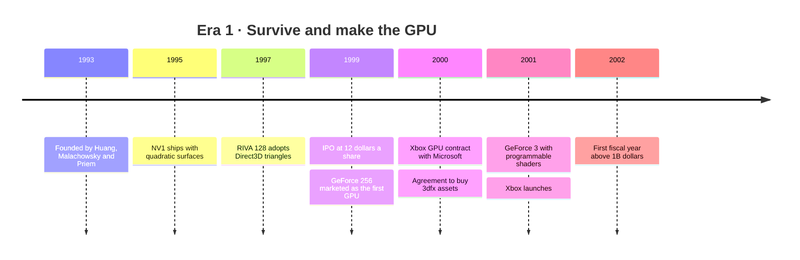
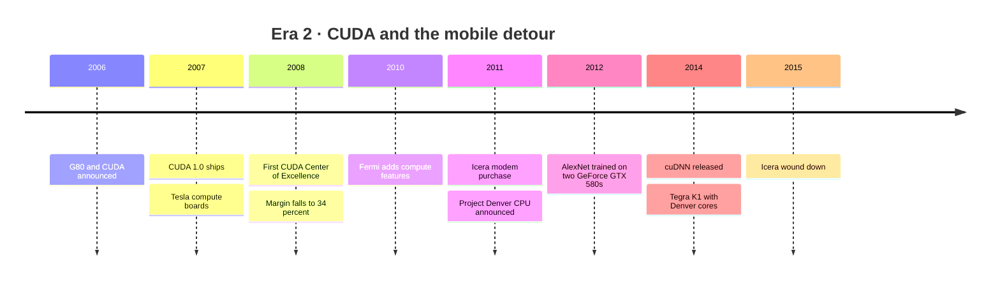
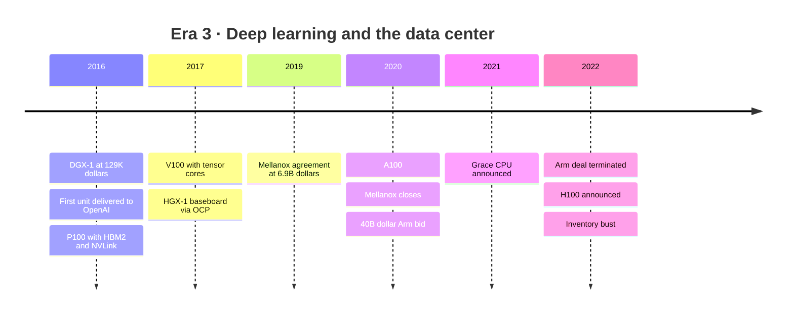
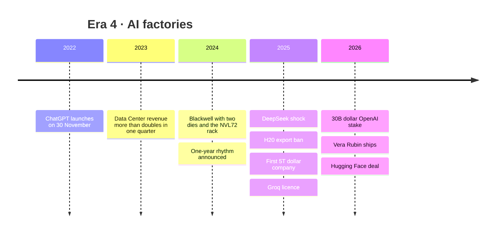
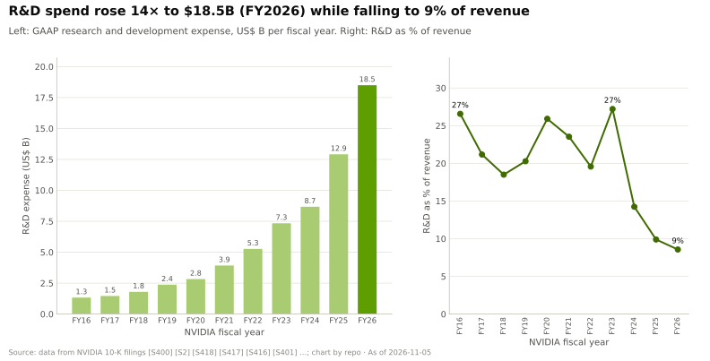
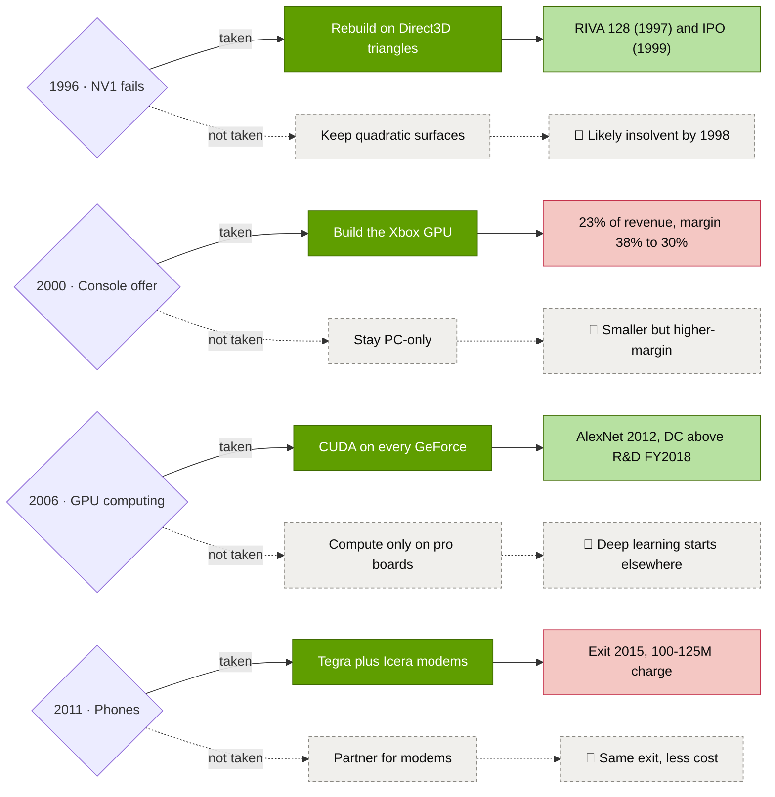
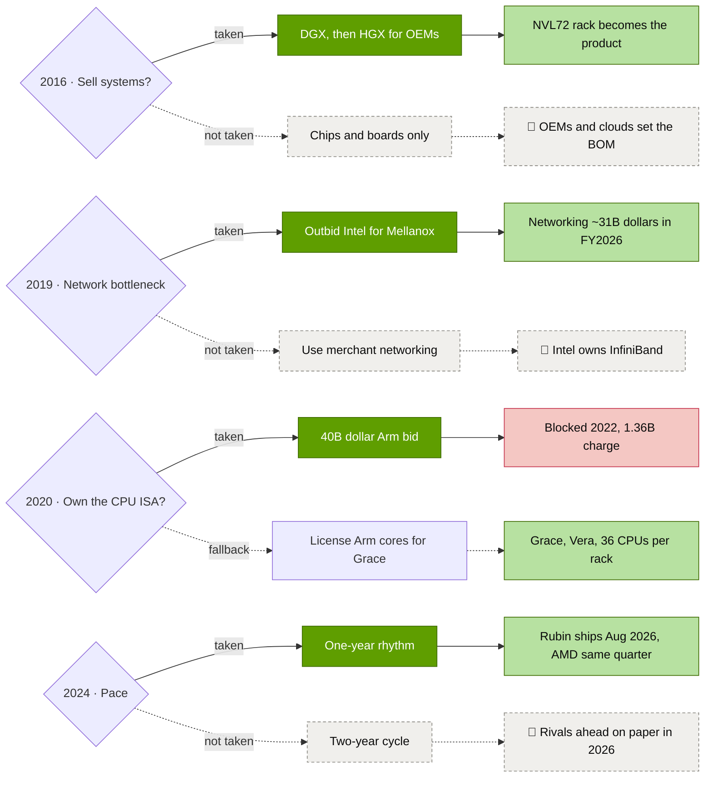
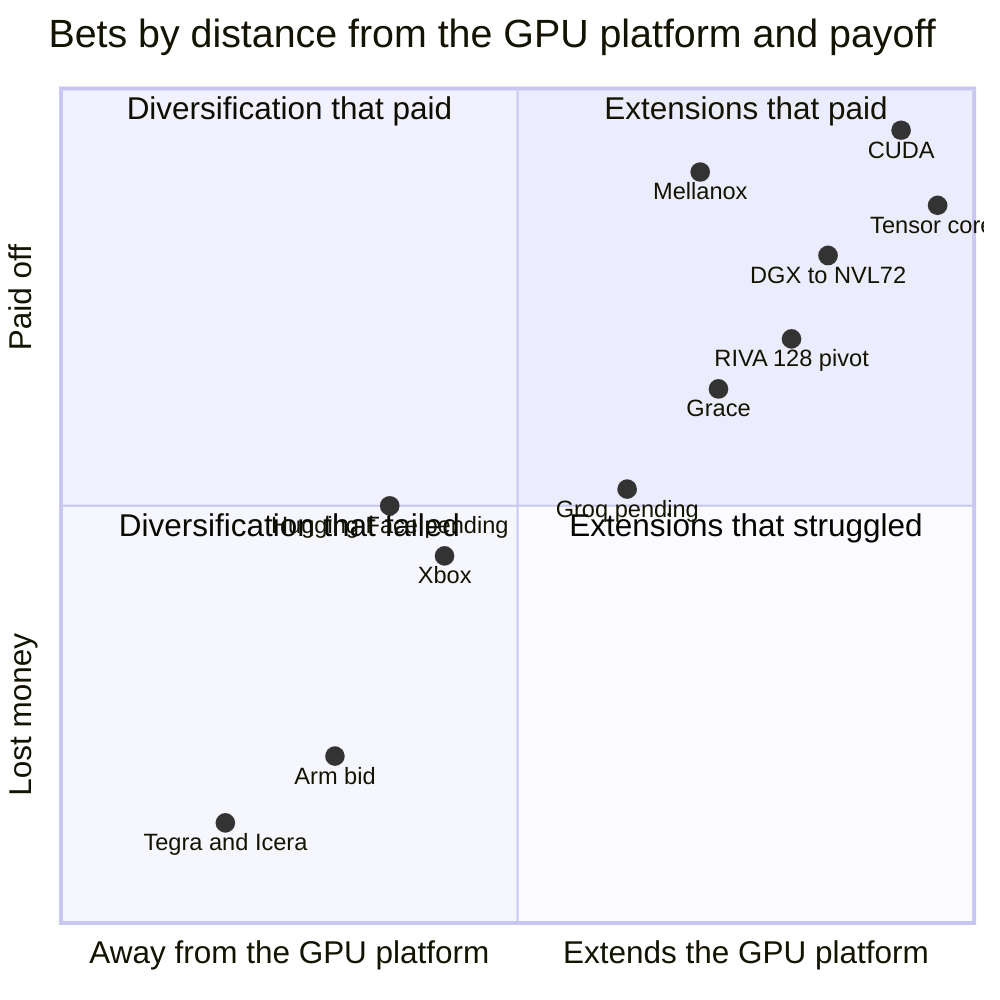

# 16 — How NVIDIA built it (timeline)

Cross-cutting 16 · From a diner booth in 1993 to a ~$5T company · ~28 min read · Last verified: 2026-11-05

## ⚡ The Executive Take

- **A near-failure start.** NVIDIA was incorporated in California in April 1993 [[S401]](../sources/bibliography.md#s401) by Jensen Huang (then at LSI Logic) and Chris Malachowsky and Curtis Priem (Sun Microsystems), who planned it at a Denny's in San Jose [[S16002]](../sources/bibliography.md#s16002). Its first chip, NV1 (1995), bet on a 3D method the industry did not adopt; the [Direct3D](../glossary.md#direct3d)-compatible RIVA 128 (1997) saved the company [[S16000]](../sources/bibliography.md#s16000)[[S16001]](../sources/bibliography.md#s16001).
- **Four eras, one compounding curve.** Revenue grew from $158M in FY1999, the IPO year, to $215.9B in FY2026, ~1,365× [[S16015]](../sources/bibliography.md#s16015)[[S1]](../sources/bibliography.md#s1). 88% of that dollar growth came in FY2024–FY2026 alone (repo arithmetic) [[S16016]](../sources/bibliography.md#s16016).
- **The defining bet was patient and expensive.** [CUDA](../glossary.md#cuda) shipped on every GPU from 2006–07 [[S9528]](../sources/bibliography.md#s9528)[[S525]](../sources/bibliography.md#s525) while gross margin fell from 45.6% (FY2008) to 34.3% (FY2009) [[S22000]](../sources/bibliography.md#s22000). The payoff came from outside: [AlexNet](../glossary.md#alexnet) trained on two gaming GPUs in 2012 [[S9530]](../sources/bibliography.md#s9530). Data Center revenue first beat total R&D only in FY2018 [[S400]](../sources/bibliography.md#s400).
- **NVIDIA bought what it could not build fast enough.** It paid $70M plus shares for 3dfx's assets (2000–01) [[S16005]](../sources/bibliography.md#s16005) and $6.9B for Mellanox (2019–20) [[S464]](../sources/bibliography.md#s464); networking reached ~$31.4B in FY2026 [[S402]](../sources/bibliography.md#s402). Its failures were also deals: Icera modems ($367M, wound down in 2015) [[S16009]](../sources/bibliography.md#s16009) and the $40B Arm bid (terminated in 2022, ~$1.36B charge) [[S465]](../sources/bibliography.md#s465)[[S466]](../sources/bibliography.md#s466).
- **The pattern in twelve bets:** the winners took 2–11 years to pay off; the losers were cut within 1.4–4 years (🔴 repo analysis) [[S16016]](../sources/bibliography.md#s16016).
- **The product kept growing:** from a chip to a $129K DGX-1 server (2016) [[S310]](../sources/bibliography.md#s310), to the 72-GPU GB200 NVL72 rack (2024) [[S396]](../sources/bibliography.md#s396), to Vera Rubin, shipping since August 2026 [[S500]](../sources/bibliography.md#s500). Generations now arrive ~yearly, down from ~29 months [[S33020]](../sources/bibliography.md#s33020)[[S17003]](../sources/bibliography.md#s17003).
- **Market value followed:** NVIDIA became the first company worth $5T on 2025-10-29 [[S25010]](../sources/bibliography.md#s25010) and was near ~$5.8T in early October 2026 🟡 [[S16012]](../sources/bibliography.md#s16012)[[S18005]](../sources/bibliography.md#s18005).
- **Balance:** the decisive demand shift (deep learning) came from outside NVIDIA's plan, and most moves away from its core (consoles, phones, Arm) disappointed. The 2025–26 bets, the ~$20B Groq licence and the $12.9B Hugging Face purchase, are large and unproven 🟡 [[S90019]](../sources/bibliography.md#s90019)[[S11500]](../sources/bibliography.md#s11500).

![Log-scale bar chart of NVIDIA annual revenue from FY1999 ($158M, the IPO year) to FY2026 ($216B), about 1,365 times higher, in four shaded eras: survive and make the GPU (FY1999–FY2006, to $2.4B), CUDA and the mobile detour (FY2007–FY2016, revenue stuck at $3.3–5.0B), deep learning and the data center (FY2017–FY2023, to $27B) and AI factories (FY2024–FY2026). Labels mark the IPO, GeForce 256, Xbox, CUDA 1.0, AlexNet, cuDNN, DGX-1, tensor cores, Mellanox, the Arm termination, ChatGPT and Blackwell; 88% of all dollar growth came after FY2023.](../assets/charts/16-revenue-by-era-log.svg)

## Four eras at a glance

NVIDIA's history reads best as four eras. Each had a different product, customer and margin structure, and each ended with a bet that set up the next. The table is the map for the rest of the page; mechanisms are explained in the linked layer pages.

| Era | Calendar years | What NVIDIA sold | Revenue at era end | Defining bet | Near-death or setback |
|---|---|---|---|---|---|
| 1 · Survive and make the GPU | 1993–2005 | PC graphics chips, Xbox GPU, chipsets | $2.4B (FY2006) [[S16007]](../sources/bibliography.md#s16007) | Follow Direct3D; define the [GPU](../glossary.md#gpu) | NV1 flop (1995–96) [[S16000]](../sources/bibliography.md#s16000) |
| 2 · CUDA and the mobile detour | 2006–2015 | GeForce, Quadro, Tesla boards, Tegra | $5.0B (FY2016) [[S400]](../sources/bibliography.md#s400) | CUDA on every GPU | Margin trough FY2009–FY2010 [[S22000]](../sources/bibliography.md#s22000); Icera exit [[S16009]](../sources/bibliography.md#s16009) |
| 3 · Deep learning and the data center | 2016–2022 | V100/A100, DGX, InfiniBand | $27.0B (FY2023) [[S2]](../sources/bibliography.md#s2) | Tensor cores; Mellanox | Arm deal blocked [[S466]](../sources/bibliography.md#s466); FY2023 inventory bust [[S418]](../sources/bibliography.md#s418) |
| 4 · AI factories | 2023–2026 | Hopper, Blackwell and Rubin racks, networking, capital | $215.9B (FY2026) [[S1]](../sources/bibliography.md#s1) | Annual cadence; the rack as product | GB200 ramp problems [[S5500]](../sources/bibliography.md#s5500); H20 ban [[S90081]](../sources/bibliography.md#s90081) |

**How one era hands over to the next.** Each transition followed the same sequence. A cash engine (PC graphics, then gaming, then data-center GPUs) funded a platform bet that looked uneconomic at the time. An outside event then created demand for that platform: Direct3D games, deep learning, ChatGPT. Finally, NVIDIA bought or built whatever became the next bottleneck: shaders, libraries, networking, racks. The margin floor rose each time because the next product carried more of NVIDIA's own design and software, not because chips got cheaper to make.

> [!TIP]
> **Worked example — what the slow middle cost.** NVIDIA needed ~9 years from founding to its first $1B fiscal year (FY2002) and 17 more to pass $10B (FY2019) [[S16006]](../sources/bibliography.md#s16006)[[S400]](../sources/bibliography.md#s400). Revenue grew only ~8% a year from FY2006 ($2.4B) to FY2016 ($5.0B) [[S16007]](../sources/bibliography.md#s16007)[[S400]](../sources/bibliography.md#s400), while R&D averaged ~25% of revenue (chart above). A peer growing 8% a year with 25% R&D would trade as a mature hardware company. **Conclusion:** the platform that produced the later ~100% annual growth was built during a decade investors could easily have read as stagnation.

## Era 1 — Survive and make the GPU (1993–2005)

**The founding bet** was that PCs would need dedicated 3D graphics chips, built by a [fabless](../glossary.md#fabless) company that designs chips and has a foundry manufacture them. **The first product almost killed it.** NV1 (1995) drew 3D scenes from curved [quadratic surfaces](../glossary.md#quadratic-surfaces) and bundled audio. Microsoft's Direct3D then standardised on triangles, leaving NV1 incompatible with the software developers were writing [[S16000]](../sources/bibliography.md#s16000). A planned console chip for Sega was also dropped 🟡 [[S16000]](../sources/bibliography.md#s16000).

**The pivot took about two years.** With few customers and a reduced staff, NVIDIA rebuilt around triangles and Direct3D and shipped RIVA 128 in the first half of 1997 [[S16001]](../sources/bibliography.md#s16001). One analyst estimate put NVIDIA at ~24% of high-performance graphics by the end of 1997 🟡 [[S16003]](../sources/bibliography.md#s16003). The company went public in January 1999 at $12 a share, selling 3.5M shares plus an over-allotment for ~$43.3M of net proceeds [[S16004]](../sources/bibliography.md#s16004).

**Then it named the category.** NVIDIA marketed the GeForce 256 (1999) as the first "GPU", because it moved [transform and lighting](../glossary.md#transform-and-lighting) off the CPU [[S2502]](../sources/bibliography.md#s2502). Two deals followed. Microsoft chose NVIDIA for the Xbox GPU in March 2000 and paid a $200M advance against purchases [[S16005]](../sources/bibliography.md#s16005). In December 2000 NVIDIA agreed to buy the patents, brands and inventory of 3dfx, the fallen market leader, for $70M in cash and 1M shares, closing in April 2001 [[S16005]](../sources/bibliography.md#s16005)[[S484]](../sources/bibliography.md#s484). GeForce 3 (2001) added [programmable shaders](../glossary.md#programmable-shader) [[S16011]](../sources/bibliography.md#s16011), the feature that later made general-purpose GPU computing possible.

> [!TIP]
> **Worked example — the Xbox trade-off.** Xbox processors rose from 9% of revenue in FY2002 to 23% in FY2003, and gross margin fell from 38% to 30% [[S16008]](../sources/bibliography.md#s16008). On FY2003 revenue of $1.91B [[S16006]](../sources/bibliography.md#s16006), eight points of margin is ~$150M of gross profit, though an ~$21M inventory write-down also contributed [[S16008]](../sources/bibliography.md#s16008). **Conclusion:** the console made NVIDIA bigger but not richer. The later phone bet taught the same lesson: volume at a customer's price does not build a moat.

🔧 Under the hood: from fixed-function to programmable graphics

Early 3D chips were a [fixed-function pipeline](../glossary.md#fixed-function-pipeline): each stage (transform, lighting, texturing, blending) was hard-wired circuitry with a few settings. GeForce 256 moved transform and lighting from the CPU into such hardware [[S2502]](../sources/bibliography.md#s2502). GeForce 3 replaced parts of the pipeline with small programs that run once per vertex or per pixel [[S16011]](../sources/bibliography.md#s16011). A chip that runs thousands of tiny programs in parallel is a parallel processor, which is why researchers began disguising maths as pixel shading (Stanford's [Brook](../glossary.md#brook), 2004) [[S9532]](../sources/bibliography.md#s9532). The G80 (2006) then made every shader core identical, a [unified shader architecture](../glossary.md#unified-shader-architecture), and exposed it through CUDA [[S2503]](../sources/bibliography.md#s2503).

## Era 2 — CUDA and the mobile detour (2006–2015)

**CUDA was a bet on a market that did not exist.** NVIDIA announced CUDA with the G80 on 2006-11-08 and shipped CUDA 1.0 in June 2007 [[S9528]](../sources/bibliography.md#s9528)[[S525]](../sources/bibliography.md#s525). It put the capability on every GeForce card, so any student with a gaming PC had a parallel computer (see [CS2](../case-studies/CS2-cuda-the-15-year-bet.md)). It then paid universities to teach it: the first CUDA Center of Excellence (Illinois, 2008) received $500,000 plus a cluster [[S9529]](../sources/bibliography.md#s9529). Huang has recalled that CUDA raised product costs ~50% when NVIDIA was a ~35%-margin company 🟡 [[S22005]](../sources/bibliography.md#s22005)[[S22006]](../sources/bibliography.md#s22006).

**The cost showed up in the income statement.** Gross margin fell from 45.6% in FY2008 to 34.3% in FY2009, including a $196M charge for a weak die and packaging material set, and was 35.4% in FY2010 [[S22000]](../sources/bibliography.md#s22000). R&D rose from 17% of revenue to 24–32% in FY2009–FY2015 [[S22001]](../sources/bibliography.md#s22001)[[S22003]](../sources/bibliography.md#s22003), while revenue stayed between $3.3B and $4.7B [[S22000]](../sources/bibliography.md#s22000)[[S22004]](../sources/bibliography.md#s22004).

**Meanwhile NVIDIA chased phones.** Tegra [systems-on-chip](../glossary.md#system-on-chip) needed a modem to compete with Qualcomm, so NVIDIA bought Icera for ~$367M in 2011. Icera's software [baseband modems](../glossary.md#baseband-modem) won few phones, and in May 2015 NVIDIA said it would wind the unit down, with a $100–125M charge if it found no buyer [[S16009]](../sources/bibliography.md#s16009)[[S16010]](../sources/bibliography.md#s16010). Its custom Arm CPU effort, Project Denver (announced 2011), shipped only in Tegra parts from 2014 [[S4536]](../sources/bibliography.md#s4536).

**The payoff arrived from outside.** In 2012 Krizhevsky, Sutskever and Hinton trained AlexNet on two GeForce GTX 580 gaming GPUs [[S9530]](../sources/bibliography.md#s9530). NVIDIA responded by packaging deep-learning kernels as [cuDNN](../glossary.md#cudnn) in 2014 [[S9531]](../sources/bibliography.md#s9531). A decade after CUDA 1.0, Data Center revenue first exceeded NVIDIA's total R&D, in FY2018 [[S400]](../sources/bibliography.md#s400).

![Two-panel line chart, FY2007 to FY2026. Top: NVIDIA's GAAP gross margin was 42.4% in FY2007 and 45.6% in FY2008, the year CUDA 1.0 shipped, then fell to 34.3% in FY2009 (including a $196M packaging-defect charge and the recession) and 35.4% in FY2010, regained the FY2008 level only in FY2012 (51.4%), and reached 75.0% in FY2025. Bottom: R&D rose from 17% of revenue in FY2008 to 27% in FY2010 and a peak of 32% in FY2014, then fell to 9% in FY2026 as revenue outgrew spending. Milestones marked: CUDA 1.0 (FY2008), AlexNet (FY2013), cuDNN (FY2015), DGX-1 (FY2017).](../assets/charts/CS2-margin-and-rd-through-cuda-years.svg)

> [!TIP]
> **Worked example — two bets of the same decade.** The case study [CS2](../case-studies/CS2-cuda-the-15-year-bet.md) estimates the CUDA "option premium" (R&D above the FY2008 intensity, FY2009–FY2015) at ~$2.8B (🔴 repo estimate) [[S22009]](../sources/bibliography.md#s22009). The mobile modem bet cost ~$367M for Icera plus a $100–125M exit charge [[S16009]](../sources/bibliography.md#s16009)[[S16010]](../sources/bibliography.md#s16010): roughly $0.5B. Both were bets on new markets. One fed the installed base of every GPU NVIDIA sold; the other entered a market where Qualcomm and MediaTek already sold integrated modems. **Conclusion:** the cheaper bet failed because it fought an incumbent's platform; the costlier bet succeeded because it extended NVIDIA's own.

🔧 Under the hood: why "CUDA on every GeForce" mattered more than the compiler

A developer platform needs cheap hardware in many hands. By shipping CUDA-capable silicon in consumer cards, NVIDIA let researchers prototype on a gaming PC and deploy on data-center boards with the same code. The [PTX](../glossary.md#ptx) virtual instruction set kept old programs running on new GPUs, so a decade of research code accumulated on one target (see [layer 09 history](../layers/09-cuda-and-system-software/history-and-how-built.md)). Fermi (2010) and its successors then added the features supercomputers wanted, such as error-correcting memory and faster double precision [[S2503]](../sources/bibliography.md#s2503).

## Era 3 — Deep learning and the data center (2016–2022)

**NVIDIA started selling computers, not just chips.** The DGX-1 (April 2016) put eight P100 GPUs in a $129,000, 3.2 kW box [[S310]](../sources/bibliography.md#s310); Huang hand-delivered the first one to OpenAI that August [[S8522]](../sources/bibliography.md#s8522). P100 was also NVIDIA's first GPU with [HBM](../glossary.md#hbm) and [NVLink](../glossary.md#nvlink) [[S125]](../sources/bibliography.md#s125). In 2017 the [HGX](../glossary.md#hgx)-1 baseboard, published through OCP with Microsoft, gave every server maker the same design [[S8525]](../sources/bibliography.md#s8525).

**The hardware turned toward matrix maths.** V100 (2017) added [tensor cores](../glossary.md#tensor-core): 125 TFLOPS of FP16 matrix maths against 15.7 TFLOPS of general FP32 [[S126]](../sources/bibliography.md#s126)[[S33010]](../sources/bibliography.md#s33010). The A100 (2020) followed [[S127]](../sources/bibliography.md#s127).

**Then NVIDIA bought the network and tried to buy the CPU.** It agreed to pay $6.9B in cash for Mellanox on 2019-03-11, outbidding Intel's reported ~$6B, and closed on 2020-04-27 after China's approval [[S464]](../sources/bibliography.md#s464)[[S6509]](../sources/bibliography.md#s6509)[[S21005]](../sources/bibliography.md#s21005). In September 2020 it bid $40B for Arm; the deal died on 2022-02-08 after regulatory opposition, with a ~$1.36B charge [[S465]](../sources/bibliography.md#s465)[[S466]](../sources/bibliography.md#s466). NVIDIA built a CPU instead: Grace, announced in April 2021 with licensed Arm cores [[S537]](../sources/bibliography.md#s537) (see [layer 04 history](../layers/04-cpu-grace-vera/history-and-how-built.md)).

**It also built the ecosystem around the hardware.** The NCCL communication library appeared on GitHub in April 2016 and RAPIDS brought GPU data science in October 2018 [[S10506]](../sources/bibliography.md#s10506)[[S10517]](../sources/bibliography.md#s10517). GTC, which drew ~1,500 attendees at its first edition in 2009 [[S13024]](../sources/bibliography.md#s13024), became the annual stage for the roadmap. Reaching 1M registered CUDA developers took 13 years; the second million took about two [[S529]](../sources/bibliography.md#s529). These are the assets that [layer 10](../layers/10-libraries-cuda-x/history-and-how-built.md) and [layer 13](../layers/13-ecosystem-gtm-and-capital/history-and-how-built.md) describe as the moat.

**The era ended with a bust.** FY2023 revenue was flat at $27.0B [[S2]](../sources/bibliography.md#s2), gross margin fell to 56.9% [[S418]](../sources/bibliography.md#s418), and NVIDIA booked ~$2.17B of inventory provisions [[S418]](../sources/bibliography.md#s418). The H100, announced in March 2022 [[S35012]](../sources/bibliography.md#s35012), was ready for the demand that came next.

![Bar chart of networking revenue. Mellanox alone earned $1.09B in 2018 and $1.33B in 2019. After the April 2020 close NVIDIA's networking line was about $1.67B in FY2021 (estimate: ~10% of revenue for ~9 months), was not disclosed for FY2022-FY2023, then reached about $8.6B in FY2024 (estimate), $13.0B in FY2025 and about $31.4B in FY2026, roughly 24 times Mellanox's 2019 revenue; the first half of FY2027 alone brought about $32.3B. The line now also includes NVLink switches, which Mellanox never sold.](../assets/charts/CS1-networking-before-after.svg)

> [!TIP]
> **Worked example — the same management, two deals, opposite outcomes.** Mellanox cost $6.9B [[S464]](../sources/bibliography.md#s464); on the case study's harsh assumption (half of networking credited to Mellanox at a 65% margin) it paid back by FY2025 (🔴 repo model) [[S21014]](../sources/bibliography.md#s21014). Arm would have cost $40B and ended in a ~$1.36B write-off [[S465]](../sources/bibliography.md#s465)[[S466]](../sources/bibliography.md#s466). Mellanox sold to some rivals; Arm licensed to nearly all of them, including Qualcomm and the hyperscalers' own CPU teams [[S4517]](../sources/bibliography.md#s4517)[[S4022]](../sources/bibliography.md#s4022)[[S4024]](../sources/bibliography.md#s4024)[[S4026]](../sources/bibliography.md#s4026) (see [CS1](../case-studies/CS1-mellanox-the-best-deal.md)). **Conclusion:** buying a supplier to rivals is negotiable with regulators; buying the neutral standard everyone depends on is not.

🔧 Under the hood: what a tensor core changed

A general GPU core does one multiply-add per instruction. A tensor core multiplies two small matrices and adds a third in one step, so a single instruction does dozens of multiply-adds. Neural networks are mostly matrix multiplications, so V100's tensor cores delivered 8× its FP32 rate on that maths [[S126]](../sources/bibliography.md#s126). Every later generation added lower-precision formats (FP8 in 2022, [NVFP4](../glossary.md#nvfp4) in 2025) to the same idea [[S35011]](../sources/bibliography.md#s35011)[[S32017]](../sources/bibliography.md#s32017); see [GPU silicon history](../layers/02-gpu-silicon/history-and-how-built.md).

## Era 4 — AI factories (2023–2026)

**Demand arrived all at once.** OpenAI released ChatGPT on 2022-11-30 [[S16014]](../sources/bibliography.md#s16014). Two quarters later, NVIDIA's Data Center revenue jumped from $4.3B to $10.3B (Q2 FY2024) [[S436]](../sources/bibliography.md#s436)[[S437]](../sources/bibliography.md#s437). Revenue went from $60.9B in FY2024 to $130.5B in FY2025 and $215.9B in FY2026 [[S2]](../sources/bibliography.md#s2)[[S1]](../sources/bibliography.md#s1).

**NVIDIA used the cash to speed up.** At Computex 2024 it moved to a "one-year rhythm" for data-center products [[S17003]](../sources/bibliography.md#s17003). Blackwell (2024) joined two reticle-sized dies into one GPU [[S35014]](../sources/bibliography.md#s35014) and cost ~$10B to develop [[S35028]](../sources/bibliography.md#s35028). The [NVL72](../glossary.md#nvl72) rack made 72 GPUs one NVLink domain [[S396]](../sources/bibliography.md#s396) (see [layer 08 history](../layers/08-systems-racks-ai-factories/history-and-how-built.md)). Vera Rubin began production shipments in early August 2026 [[S500]](../sources/bibliography.md#s500).

**The shocks were real but did not stop the curve.** Early GB200 racks reportedly overheated and some customers trimmed orders 🟡 [[S5500]](../sources/bibliography.md#s5500). DeepSeek's release erased $589B of market value in one day (2025-01-27) [[S25001]](../sources/bibliography.md#s25001). The April 2025 H20 licence requirement cost ~$4.5B in charges [[S90081]](../sources/bibliography.md#s90081). Rubin's memory and NVLink bandwidth were cut after launch [[S90006]](../sources/bibliography.md#s90006). NVIDIA still became the first $5T company on 2025-10-29 [[S25010]](../sources/bibliography.md#s25010). By Q2 FY2027 quarterly revenue was $96.2B at a 75.0% GAAP gross margin, with $108B ±2% guided for Q3 [[S405]](../sources/bibliography.md#s405)[[S3]](../sources/bibliography.md#s3).

**And it became a capital allocator.** NVIDIA licensed Groq's technology and hired its team for a reported ~$20B (December 2025) [[S90018]](../sources/bibliography.md#s90018)[[S90019]](../sources/bibliography.md#s90019), shelved a $100B OpenAI letter of intent for a ~$30B equity stake (February 2026) 🟡 [[S90015]](../sources/bibliography.md#s90015)[[S90016]](../sources/bibliography.md#s90016), and agreed to buy Hugging Face for $12.9B (September 2026) [[S11500]](../sources/bibliography.md#s11500). Its equity stakes total ~$99B (🟡 secondary reading of the July 2026 10-Q) [[S90073]](../sources/bibliography.md#s90073) (see [capital deployment](../layers/13-ecosystem-gtm-and-capital/capital-deployment.md)).

**The business model changed with the scale.** Supply and capacity commitments reached $279B at Q2 FY2027 [[S407]](../sources/bibliography.md#s407), one direct customer was 16% of quarterly revenue [[S90069]](../sources/bibliography.md#s90069), and H1 FY2027 net equity gains of $23.7B, largely mark-to-market, flowed through earnings [[S90072]](../sources/bibliography.md#s90072). The era began with a chip company and ended with one that pre-buys its suppliers' capacity, finances its customers and holds a large equity book: a more complex risk profile than the GPU vendor of 2016 (see [chapter 18](18-vulnerabilities-and-bear-case.md)).

> [!TIP]
> **Worked example — why falling R&D intensity is not a weakness.** NVIDIA spent $18.5B on R&D in FY2026, only ~8.6% of revenue but ~14× FY2016's $1.33B [[S401]](../sources/bibliography.md#s401)[[S400]](../sources/bibliography.md#s400). AMD's total 2024 R&D across all products was ~$6.5B [[S450]](../sources/bibliography.md#s450). Blackwell alone cost ~$10B to develop over several years [[S35028]](../sources/bibliography.md#s35028): equal to ~54% of NVIDIA's FY2026 R&D budget, but ~1.5× AMD's whole 2024 budget. **Conclusion:** a lower percentage on a much larger base buys more absolute engineering than any rival, which is what sustains the annual cadence.

🔧 Under the hood: why the product kept getting bigger

Each step moved a bottleneck inside NVIDIA's own design: DGX put eight GPUs on one board, NVSwitch (2018) connected sixteen, and NVL72 (2024) connected seventy-two across a copper spine in one rack [[S310]](../sources/bibliography.md#s310)[[S396]](../sources/bibliography.md#s396). When most data stays inside one NVLink domain, whoever designs the domain sets the [bill of materials](../glossary.md#bill-of-materials) and captures the margin. The same logic explains Mellanox (the network between racks), Grace and Vera (the host CPU) and BlueField (the data path); see the [flywheel chapter](../01-the-nvidia-flywheel.md).

## Near-death moments and how NVIDIA got through them

NVIDIA's own culture leans on the idea that the company is always close to failure. The record supports a narrower claim: it has had at least eight serious setbacks, and in most of them it protected R&D and kept shipping. The table lists them with the size of each hit.

| When | What happened | Size of the hit | Response | Source |
|---|---|---|---|---|
| 1996–97 | NV1 built on the wrong 3D standard | Few customers, reduced staff | RIVA 128 in ~2 years | [[S16000]](../sources/bibliography.md#s16000)[[S16001]](../sources/bibliography.md#s16001) |
| FY2003 | Xbox mix shift and inventory write-down | Gross margin 38% → 30% | Kept the PC GPU line growing; revenue reached $1.91B | [[S16008]](../sources/bibliography.md#s16008)[[S16006]](../sources/bibliography.md#s16006) |
| FY2009–FY2010 | Packaging defect and the 2008 recession | Gross margin 45.6% → 34.3%; $196M charge | R&D rose from 17% to 27% of revenue | [[S22000]](../sources/bibliography.md#s22000)[[S22001]](../sources/bibliography.md#s22001) |
| 2015 | Icera modems failed | $100–125M expected charge | Left phone basebands; refocused on GPUs, cars and data centers | [[S16009]](../sources/bibliography.md#s16009)[[S16010]](../sources/bibliography.md#s16010) |
| FY2023 | Gaming and channel inventory bust | Quarterly revenue −28% in two quarters; gross margin 43.5% in Q2 | R&D +39%; H100 ramped | [[S432]](../sources/bibliography.md#s432)[[S434]](../sources/bibliography.md#s434)[[S2]](../sources/bibliography.md#s2) |
| Jan 2025 | DeepSeek efficiency shock | −$589B of market value in one day | Revenue still rose to $215.9B in FY2026 | [[S25001]](../sources/bibliography.md#s25001)[[S1]](../sources/bibliography.md#s1) |
| 2025 | H20 export licence requirement | ~$4.5B of charges | China Data Center compute removed from guidance | [[S90081]](../sources/bibliography.md#s90081)[[S3]](../sources/bibliography.md#s3) |
| 2026 | Rubin specs revised after launch | HBM 22 → 19.2 TB/s per GPU | Specs restated as volume-production values | [[S90006]](../sources/bibliography.md#s90006)[[S104]](../sources/bibliography.md#s104) |

> [!TIP]
> **Worked example — investing through the FY2023 bust.** Quarterly revenue fell from $8.29B (Q1 FY2023) to $5.93B (Q3 FY2023), −28% in two quarters [[S432]](../sources/bibliography.md#s432)[[S434]](../sources/bibliography.md#s434), and full-year revenue was flat at $27.0B [[S2]](../sources/bibliography.md#s2). NVIDIA still raised R&D from $5.27B in FY2022 to $7.34B in FY2023, +39% [[S2]](../sources/bibliography.md#s2), while launching the H100 it had announced in March 2022 [[S35012]](../sources/bibliography.md#s35012). When demand arrived with ChatGPT, the product was ready: Data Center revenue rose ~2.4× in a single quarter [[S436]](../sources/bibliography.md#s436)[[S437]](../sources/bibliography.md#s437). **Conclusion:** cutting R&D in that downturn would have saved ~$2B and cost the Hopper cycle.

## The decision tree of key bets

Each diagram shows a decision, the branch NVIDIA took (green), the branch it did not take (dashed) and what followed. Counterfactual outcomes are the repo's analysis (🔴).

| Date | Decision | Alternatives not taken | Why it mattered | Source |
|---|---|---|---|---|
| 1996–97 | Rebuild around Direct3D triangles | Keep NV1's quadratic surfaces | Survival; RIVA 128 restored sales | [[S16000]](../sources/bibliography.md#s16000)[[S16001]](../sources/bibliography.md#s16001) |
| 1999 | Market GeForce 256 as "the GPU" | Remain an accelerator vendor | Named the category NVIDIA still sells | [[S2502]](../sources/bibliography.md#s2502) |
| 2000 | Take the Xbox contract; buy 3dfx assets | PC-only focus; let 3dfx assets go elsewhere | Scale and a $200M advance, but lower margins | [[S16005]](../sources/bibliography.md#s16005)[[S16008]](../sources/bibliography.md#s16008) |
| 2006–07 | CUDA on every GPU | Compute only on premium boards | ~6M developers by 2026 | [[S9528]](../sources/bibliography.md#s9528)[[S528]](../sources/bibliography.md#s528) |
| 2011–15 | Tegra phones with Icera modems, then exit | Stay out of handsets | ~$0.5B lesson in fighting an incumbent platform | [[S16009]](../sources/bibliography.md#s16009)[[S16010]](../sources/bibliography.md#s16010) |
| 2016–17 | Sell DGX systems and HGX baseboards | Sell chips and let OEMs design | Led to the rack as the unit of sale | [[S310]](../sources/bibliography.md#s310)[[S8525]](../sources/bibliography.md#s8525) |
| 2017 | Tensor cores in V100 | General-purpose cores only | 8× FP32 on matrix maths | [[S126]](../sources/bibliography.md#s126) |
| 2019–20 | Buy Mellanox for $6.9B | Merchant networking | Networking ~$31.4B in FY2026 | [[S464]](../sources/bibliography.md#s464)[[S402]](../sources/bibliography.md#s402) |
| 2020–22 | Bid $40B for Arm; fall back to licensing | Build CPU from licensed cores from the start | Grace and Vera arrived anyway | [[S465]](../sources/bibliography.md#s465)[[S466]](../sources/bibliography.md#s466)[[S537]](../sources/bibliography.md#s537) |
| 2024 | One-year rhythm | Two-year cycle | Rivals had to match it | [[S17003]](../sources/bibliography.md#s17003)[[S17007]](../sources/bibliography.md#s17007) |
| 2025–26 | Groq licence (~$20B); Hugging Face ($12.9B) | Build an SRAM decode chip; stay out of model hosting | Pending; tests NVIDIA as acquirer at scale | [[S90019]](../sources/bibliography.md#s90019)[[S11500]](../sources/bibliography.md#s11500) |

![Gantt-style bar chart of twelve NVIDIA bets. Paid off: GeForce 256 to the first $1B year in 2.4 years, CUDA to Data Center revenue exceeding R&D in 11.2 years, DGX-1 to the NVL72 rack in 8.6, tensor cores to the Hopper surge in 6.2, Mellanox to payback in 5.8 and Grace to GB200 in 3.6. Failed: NV1's quadratic surfaces (about 2 years to the RIVA 128 pivot), Tegra phones and Icera modems (4 years) and the $40B Arm bid (1.4 years). Mixed: Xbox. Pending: the ~$20B Groq licence and the $12.9B Hugging Face purchase.](../assets/charts/16-bet-lag-to-payoff.svg)

> [!TIP]
> **Worked example — reading the bet ledger as a portfolio.** Six bets paid off, after 2.4 to 11.2 years (median ~6) [[S16016]](../sources/bibliography.md#s16016). Three failed, and NVIDIA cut them after 1.4 to 4.0 years. Measured by disclosed price, the failures (Icera ~$0.37B, Arm's ~$1.36B charge) cost ~$1.7B [[S16009]](../sources/bibliography.md#s16009)[[S466]](../sources/bibliography.md#s466). One win, Mellanox, produced ~$31.4B of networking revenue in a single year [[S402]](../sources/bibliography.md#s402). **Conclusion:** the portfolio worked because losses were capped quickly while winners were held for up to a decade, the classic venture pattern inside a public company.

## Counterfactual analysis

All six counterfactuals are the repo's analysis (🔴 Speculative). Each states the reasoning and what it would have meant for NVIDIA and its rivals. Layer-specific counterfactuals are on the [GPU silicon](../layers/02-gpu-silicon/history-and-how-built.md), [networking](../layers/06-scale-out-scale-across-networking/history-and-how-built.md) and [CUDA](../layers/09-cuda-and-system-software/history-and-how-built.md) history pages.

| # | What if NVIDIA had… | 🔴 Most likely outcome | What it would have meant |
|---|---|---|---|
| 1 | …kept NV1's quadratic surfaces after Direct3D chose triangles | Out of cash by ~1998 | PC graphics consolidates around 3dfx and ATI; no GeForce, no CUDA |
| 2 | …put CUDA only on premium compute boards | AlexNet runs on CPUs or another vendor's hardware | Deep learning's default stack forms elsewhere, possibly around Google's TPU |
| 3 | …lost Mellanox to Intel | Intel owns InfiniBand and ConnectX | No NVIDIA networking line (~$31.4B in FY2026); a weaker NVL72-to-cluster story |
| 4 | …closed the $40B Arm deal | Behavioural remedies; licensees hedge to RISC-V and x86 | NVIDIA owns a neutral licensor that its customers distrust |
| 5 | …stayed on a two-year cycle | Rubin arrives ~2027 | AMD MI455X and TPU 8t out-spec NVIDIA through 2026 |
| 6 | …pushed DGX Cloud as a full public cloud | Open channel conflict with its largest customers | Hyperscalers accelerate TPU, Trainium and Maia; neoclouds lose their supplier-partner |

**1. Without the RIVA 128 pivot.** NV1 was technically interesting but incompatible with the triangle-based Direct3D that game developers adopted [[S16000]](../sources/bibliography.md#s16000). The company had few customers and a reduced staff before RIVA 128 [[S16001]](../sources/bibliography.md#s16001). Another year on the wrong standard would likely have exhausted it. *What it would have meant:* PC 3D graphics would have consolidated around 3dfx and ATI. Instead NVIDIA bought 3dfx's assets for $70M plus shares in 2000–01 [[S16005]](../sources/bibliography.md#s16005).

**2. CUDA on premium boards only.** This is the subtle one. AlexNet was trained on two consumer GTX 580s [[S9530]](../sources/bibliography.md#s9530), and the platform's reach came from shipping CUDA on gaming cards [[S22006]](../sources/bibliography.md#s22006). Had compute been gated to costly Tesla boards, academic work would have stayed on CPUs or moved to whatever hardware was cheapest. Google had a TPU running in its data centers by 2015 [[S23000]](../sources/bibliography.md#s23000). *What it would have meant:* the framework ecosystem (now 36/36 native for CUDA in the repo matrix [[S580]](../sources/bibliography.md#s580)) might have formed around a hyperscaler's compiler, as XLA later did for TPUs.

**3. Intel wins Mellanox.** Intel reportedly bid ~$6B, and seven bidders took part [[S6509]](../sources/bibliography.md#s6509)[[S6508]](../sources/bibliography.md#s6508). *What it would have meant:* Intel would have owned the InfiniBand switches and ConnectX NICs that connect most AI clusters, giving it the leverage NVIDIA now holds. Spectrum-X, which grew 2.6× year on year in Q2 FY2027 [[S408]](../sources/bibliography.md#s408), would have had no Mellanox team to build it. NVIDIA's networking line (~$31.4B in FY2026 [[S402]](../sources/bibliography.md#s402)) and Spectrum-X would not exist in their current form. NVIDIA would likely have built on Broadcom Ethernet silicon.

**4. The Arm deal closes.** The $40B price [[S465]](../sources/bibliography.md#s465) would have bought the instruction set behind Qualcomm's server CPUs and the in-house CPUs of AWS, Google and Microsoft [[S4517]](../sources/bibliography.md#s4517)[[S4022]](../sources/bibliography.md#s4022)[[S4026]](../sources/bibliography.md#s4026)[[S4024]](../sources/bibliography.md#s4024). Regulators would likely have imposed neutrality conditions, as China did on Mellanox [[S21002]](../sources/bibliography.md#s21002). *What it would have meant:* customers would have hedged earlier to RISC-V or x86; NVIDIA would have owned a royalty stream it could not use strategically. Grace and Vera were built on licensed cores anyway [[S537]](../sources/bibliography.md#s537).

**5. No annual cadence.** On the old ~29-month rhythm [[S33020]](../sources/bibliography.md#s33020), Rubin would have landed in ~2027, against AMD's MI455X (432 GB HBM4) and Google's TPU 8t in 2026 [[S144]](../sources/bibliography.md#s144)[[S550]](../sources/bibliography.md#s550). On paper MI455X already edges Rubin on HBM bandwidth (19.6 vs 19.2 TB/s) and capacity (432 vs 288 GB) [[S144]](../sources/bibliography.md#s144)[[S90006]](../sources/bibliography.md#s90006); against Blackwell Ultra's 288 GB at 8 TB/s [[S32004]](../sources/bibliography.md#s32004) the gap would have been more than 2× on bandwidth. *What it would have meant:* a full year in which rivals led on every headline spec, the opening that [chapter 17](17-roadmap-2025-2028.md) shows NVIDIA's roadmap is designed to deny.

**6. NVIDIA as a full cloud.** DGX Cloud launched in March 2023 at $36,999 per 8-GPU instance-month, hosted inside Oracle, Microsoft and Google data centers [[S12007]](../sources/bibliography.md#s12007). By 2025 most of its capacity was reportedly redirected to NVIDIA's own research, and DGX Cloud Lepton began routing developers to partner clouds instead 🟡 [[S90068]](../sources/bibliography.md#s90068). Had NVIDIA pushed on, it would have competed for end customers with the hyperscalers that were then its largest buyers (one direct customer alone was 16% of Q2 FY2027 revenue [[S90069]](../sources/bibliography.md#s90069)). *What it would have meant:* faster investment in TPU, Trainium and Maia as a defensive response, and a weaker neocloud channel. The retreat is a rare case of NVIDIA choosing not to own a layer.

> [!WARNING]
> **Myth vs. reality: "NVIDIA foresaw the AI boom."** The record shows a company that built a general platform and waited. NVIDIA did not predict deep learning: AlexNet came from university researchers [[S9530]](../sources/bibliography.md#s9530), and Data Center revenue stayed below R&D until FY2018 [[S400]](../sources/bibliography.md#s400). What NVIDIA did was make experimentation cheap, then move fast once demand appeared: cuDNN within two years of AlexNet [[S9531]](../sources/bibliography.md#s9531), DGX within four [[S310]](../sources/bibliography.md#s310).

🔧 Under the hood: how the counterfactuals were judged

Each counterfactual changes one decision and holds the rest of the world fixed (rival roadmaps, the arrival of deep learning, regulators' behaviour). Plausibility rests on documented alternatives: Intel's reported bid for Mellanox [[S6509]](../sources/bibliography.md#s6509), the Sega chip that was dropped [[S16000]](../sources/bibliography.md#s16000), the 2015 Icera exit [[S16009]](../sources/bibliography.md#s16009) and AMD's 2026 specs [[S144]](../sources/bibliography.md#s144). The bigger the gap between the change and the outcome, the lower the confidence; counterfactual 2 is the least certain because it depends on how researchers would have behaved.

## Lessons

The quadrant places each bet by how directly it extended the GPU platform and by its payoff; it is the repo's judgement (🔴), but the pattern is stark: every bet in the top-right extended the platform, and every clear loss moved away from it.

| # | Lesson | Evidence | Implication for a challenger |
|---|---|---|---|
| 1 | Build the platform before the market exists, but fund it from a cash engine | CUDA ran ~11 years before Data Center revenue covered R&D [[S9528]](../sources/bibliography.md#s9528)[[S400]](../sources/bibliography.md#s400); gaming paid for it | Platform bets need a profitable core and a board that tolerates a decade |
| 2 | Adopt the standard fast when it goes against you | NV1 → RIVA 128 in ~2 years [[S16000]](../sources/bibliography.md#s16000)[[S16001]](../sources/bibliography.md#s16001) | Lose the standards war early, not slowly |
| 3 | Buy the adjacent bottleneck before it is obvious | Mellanox $6.9B → ~$31.4B networking in FY2026 [[S464]](../sources/bibliography.md#s464)[[S402]](../sources/bibliography.md#s402) | Today's equivalents may be optics, power or memory interfaces |
| 4 | Do not buy the neutral layer everyone depends on | Arm blocked; ~$1.36B charge [[S466]](../sources/bibliography.md#s466) | Regulatory risk scales with how many rivals depend on the asset |
| 5 | Moves away from the platform disappoint | Xbox margins [[S16008]](../sources/bibliography.md#s16008), Icera [[S16009]](../sources/bibliography.md#s16009) | Diversify by extending the platform, not by entering others' markets |
| 6 | Sell the system, capture the bill of materials | DGX → NVL72 [[S310]](../sources/bibliography.md#s310)[[S396]](../sources/bibliography.md#s396) | Whoever writes the rack specification keeps the margin |
| 7 | Speed is a strategy | ~29 → ~11 months per generation [[S33020]](../sources/bibliography.md#s33020) | Matching the cadence is now the price of entry |
| 8 | Step back where you would compete with your buyers | DGX Cloud refocused inward; Lepton routes demand to partner clouds 🟡 [[S90068]](../sources/bibliography.md#s90068) | A platform vendor keeps its channel by not becoming its customers' rival |

**What the lessons do not say.** NVIDIA's history is not an acquisition story until 2019. Before Mellanox its largest purchases were PortalPlayer (~$357M, which seeded Tegra) and Icera (~$367M) 🟡 [[S484]](../sources/bibliography.md#s484)[[S16009]](../sources/bibliography.md#s16009), and the core platform (GPUs, CUDA, libraries) was built in-house. Nor is it a story of foresight: deep learning and ChatGPT arrived from outside. The transferable part is an operating habit: hold the platform bet through troughs, cut side bets quickly, and buy the next bottleneck when it appears. Each habit is cheaper to copy than the installed base it produced, which took two decades to accumulate and is the real barrier for any challenger (see [chapter 17](17-roadmap-2025-2028.md) for how the roadmap now defends it).

> [!NOTE]
> **🐂 Bull view:** the history shows an organisation that survives near-death, holds a decade-long bet and cuts losers fast. That culture, plus ~$18.5B a year of R&D [[S401]](../sources/bibliography.md#s401), is harder to copy than any chip.

> [!WARNING]
> **🐻 Bear view:** the defining payoff came from an outside event NVIDIA did not cause [[S9530]](../sources/bibliography.md#s9530), and its record outside the GPU platform is weak (Xbox margins, Icera, Arm). The 2025–26 bets (Groq ~$20B, Hugging Face $12.9B, a ~$99B equity book) are the largest of its history and the least like its past successes [[S90019]](../sources/bibliography.md#s90019)[[S11500]](../sources/bibliography.md#s11500)[[S90073]](../sources/bibliography.md#s90073). See [chapter 18](18-vulnerabilities-and-bear-case.md).

## 🎯 Corp Dev Lens

1. **Option value needs a cash engine.** CUDA's ~$2.8B premium (🔴 Est.) [[S22009]](../sources/bibliography.md#s22009) was affordable because gaming funded it. Which of a challenger's businesses could fund a decade-long platform bet without investor revolt?
2. **Kill criteria are part of the strategy.** NVIDIA exited its three failed bets within 1.4–4 years [[S16016]](../sources/bibliography.md#s16016). What explicit milestones and exit triggers attach to today's data-center bets across the industry, including Qualcomm's AI200/AI250 and Dragonfly programmes (public information only) [[S173]](../sources/bibliography.md#s173)[[S90056]](../sources/bibliography.md#s90056)?
3. **The next Mellanox.** The lesson is to buy the adjacent bottleneck before it binds. Which independent assets in optics, 800 V DC power, memory controllers or scale-up switching remain unowned by NVIDIA, AMD or Broadcom? The value-chain pages for [memory](../layers/03-memory-packaging-supply-chain/value-chain-and-corp-dev.md), [scale-up](../layers/05-scale-up-nvlink-nvswitch/value-chain-and-corp-dev.md), [networking](../layers/06-scale-out-scale-across-networking/value-chain-and-corp-dev.md) and [systems](../layers/08-systems-racks-ai-factories/value-chain-and-corp-dev.md) list the private companies in each.
4. **Pricing alternative architectures.** NVIDIA paid ~$20B for Groq's licence and team, ~2.9× its $6.9B last private valuation [[S90019]](../sources/bibliography.md#s90019). What does that imply for the value of proven SRAM, near-memory or capacity-first inference designs to an incumbent?
5. **Outside-in demand shifts decide eras.** AlexNet, not NVIDIA, opened era 3; ChatGPT opened era 4 [[S9530]](../sources/bibliography.md#s9530)[[S16014]](../sources/bibliography.md#s16014). Which external shift (agentic CPU demand, power-limited inference, edge-to-cloud models) could open the next era for a challenger with the right platform already in place?

## 📚 Sources

<!-- Auto-generated from the [S…] citations on this page by `make build`. Edit sources/registry/*.csv, not this list. -->

- [**S1**](../sources/bibliography.md#s1) NVIDIA Corporation via SEC EDGAR, *NVIDIA Announces Financial Results for Fourth Quarter and Fiscal 2026 (Form 8-K exhibit 99.1)*, 2026-02-25. [Link](https://www.sec.gov/Archives/edgar/data/1045810/000104581026000019/q4fy26pr.htm)
- [**S2**](../sources/bibliography.md#s2) U.S. Securities and Exchange Commission (EDGAR), *NVIDIA Corporation Form 10-K annual reports FY2020–FY2025 (filing index)*, 2025-02-26. [Link](https://www.sec.gov/cgi-bin/browse-edgar?action=getcompany&CIK=0001045810&type=10-K&dateb=&owner=include&count=40)
- [**S3**](../sources/bibliography.md#s3) StorageNewsletter, *NVIDIA Q2 Fiscal 2027 results coverage: revenue $96.2B*, 2026-08-27. [Link](https://www.storagenewsletter.com/2026/08/27/nvidia-fiscal-2q27-financial-results/)
- [**S104**](../sources/bibliography.md#s104) Wccftech, *NVIDIA's Official Statement on Vera Rubin Spec Change*, 2026-10-29. [Link](https://wccftech.com/nvidia-official-statement-on-vera-rubin-spec-change/)
- [**S125**](../sources/bibliography.md#s125) NVIDIA, *NVIDIA Tesla P100 (Pascal GP100) Architecture Whitepaper*, 2016-04. [Link](https://images.nvidia.com/content/pdf/tesla/whitepaper/pascal-architecture-whitepaper.pdf)
- [**S126**](../sources/bibliography.md#s126) NVIDIA, *NVIDIA Tesla V100 GPU Architecture Whitepaper*, 2017-08. [Link](https://images.nvidia.com/content/volta-architecture/pdf/volta-architecture-whitepaper.pdf)
- [**S127**](../sources/bibliography.md#s127) NVIDIA Technical Blog, *NVIDIA Ampere Architecture In-Depth*, 2020-05-14. [Link](https://developer.nvidia.com/blog/nvidia-ampere-architecture-in-depth/)
- [**S144**](../sources/bibliography.md#s144) AMD Newsroom, *AMD Unveils Vision for an Open AI Ecosystem, Detailing New Silicon, Software and Systems at Advancing AI 2025*, 2025-06-12. [Link](https://www.amd.com/en/newsroom/press-releases/2025-6-12-amd-unveils-vision-for-an-open-ai-ecosystem-detai.html)
- [**S173**](../sources/bibliography.md#s173) Qualcomm, *Qualcomm Unveils AI200 and AI250 - Redefining Rack-Scale Data Center Inference*, 2025-10-27. [Link](https://www.qualcomm.com/news/releases/2025/10/qualcomm-unveils-ai200-and-ai250-redefining-rack-scale-data-cent)
- [**S310**](../sources/bibliography.md#s310) AnandTech (Ryan Smith), *NVIDIA unveils the DGX-1 HPC server: 8 Teslas, 3U, Q2 2016*, 2016-04-05. [Link](https://www.anandtech.com/show/10229)
- [**S396**](../sources/bibliography.md#s396) NVIDIA Newsroom, *NVIDIA Blackwell platform arrives to power a new era of computing*, 2024-03-18. [Link](https://nvidianews.nvidia.com/news/nvidia-blackwell-platform-arrives-to-power-a-new-era-of-computing)
- [**S400**](../sources/bibliography.md#s400) U.S. Securities and Exchange Commission (EDGAR), *NVIDIA Corporation Form 10-K annual reports FY2001–FY2019 (EDGAR filing index)*, 2019-02-21. [Link](https://www.sec.gov/cgi-bin/browse-edgar?action=getcompany&CIK=0001045810&type=10-K&dateb=&owner=include&count=40)
- [**S401**](../sources/bibliography.md#s401) NVIDIA Corporation via SEC EDGAR, *NVIDIA Corporation Form 10-K for fiscal year ended January 25, 2026*, 2026-02-25. [Link](https://www.sec.gov/Archives/edgar/data/1045810/000104581026000021/nvda-20260125.htm)
- [**S402**](../sources/bibliography.md#s402) NVIDIA Corporation via SEC EDGAR (Colette Kress), *CFO Commentary on Fourth Quarter and Fiscal 2026 Results (Form 8-K exhibit 99.2)*, 2026-02-25. [Link](https://www.sec.gov/Archives/edgar/data/1045810/000104581026000019/q4fy26cfocommentary.htm)
- [**S405**](../sources/bibliography.md#s405) NVIDIA Corporation via SEC EDGAR, *NVIDIA Announces Financial Results for Second Quarter Fiscal 2027 (Form 8-K exhibit 99.1)*, 2026-08-26. [Link](https://www.sec.gov/Archives/edgar/data/0001045810/000104581026000073/q2fy27pr.htm)
- [**S407**](../sources/bibliography.md#s407) NVIDIA Corporation via SEC EDGAR, *NVIDIA Corporation Form 10-Q for quarter ended July 26, 2026*, 2026-08-28. [Link](https://www.sec.gov/Archives/edgar/data/1045810/000104581026000075/nvda-20260726.htm)
- [**S408**](../sources/bibliography.md#s408) NVIDIA Corporation, *NVIDIA Corp. (NVDA) Q2 Fiscal 2027 earnings call transcript (26 August 2026)*, 2026-08-26. [Link](https://s201.q4cdn.com/141608511/files/content_files/TRANSCRIPT_-NVIDIA-Corp-NVDA-US-Q2-2027-Earnings-Call-26-August-2026-5_00-PM-ET.pdf)
- [**S418**](../sources/bibliography.md#s418) NVIDIA Corporation via SEC EDGAR, *NVIDIA Corporation Form 10-K for fiscal year ended January 29, 2023*, 2023-02-24. [Link](https://www.sec.gov/Archives/edgar/data/1045810/000104581023000017/nvda-20230129.htm)
- [**S432**](../sources/bibliography.md#s432) NVIDIA Corporation, *NVIDIA Announces Financial Results for First Quarter Fiscal 2023 (press release with CFO commentary)*, 2022-05-25. [Link](https://nvidianews.nvidia.com/news/nvidia-announces-financial-results-for-first-quarter-fiscal-2023)
- [**S434**](../sources/bibliography.md#s434) NVIDIA Corporation, *NVIDIA Announces Financial Results for Third Quarter Fiscal 2023 (press release with CFO commentary)*, 2022-11-16. [Link](https://nvidianews.nvidia.com/news/nvidia-announces-financial-results-for-third-quarter-fiscal-2023)
- [**S436**](../sources/bibliography.md#s436) NVIDIA Corporation, *NVIDIA Announces Financial Results for First Quarter Fiscal 2024 (press release with CFO commentary)*, 2023-05-24. [Link](https://nvidianews.nvidia.com/news/nvidia-announces-financial-results-for-first-quarter-fiscal-2024)
- [**S437**](../sources/bibliography.md#s437) NVIDIA Corporation, *NVIDIA Announces Financial Results for Second Quarter Fiscal 2024 (press release with CFO commentary)*, 2023-08-23. [Link](https://nvidianews.nvidia.com/news/nvidia-announces-financial-results-for-second-quarter-fiscal-2024)
- [**S450**](../sources/bibliography.md#s450) U.S. Securities and Exchange Commission (EDGAR), *Advanced Micro Devices Form 10-K / 10-Q filings (EDGAR index)*, 2025-02-05. [Link](https://www.sec.gov/cgi-bin/browse-edgar?action=getcompany&CIK=0000002488&type=10-&dateb=&owner=include&count=40)
- [**S464**](../sources/bibliography.md#s464) NVIDIA Newsroom, *NVIDIA to Acquire Mellanox for $6.9 Billion*, 2019-03-11. [Link](https://nvidianews.nvidia.com/news/nvidia-to-acquire-mellanox-for-6-9-billion)
- [**S465**](../sources/bibliography.md#s465) NVIDIA Newsroom, *NVIDIA to Acquire Arm for $40 Billion, Creating World's Premier Computing Company for the Age of AI*, 2020-09-13. [Link](https://nvidianews.nvidia.com/news/nvidia-to-acquire-arm-for-40-billion-creating-worlds-premier-computing-company-for-the-age-of-ai)
- [**S466**](../sources/bibliography.md#s466) NVIDIA Newsroom, *NVIDIA and SoftBank Group Announce Termination of NVIDIA's Acquisition of Arm Limited*, 2022-02-08. [Link](https://nvidianews.nvidia.com/news/nvidia-and-softbank-group-announce-termination-of-nvidias-acquisition-of-arm-limited)
- [**S484**](../sources/bibliography.md#s484) NVIDIA press releases as summarised in NVIDIA 10-K filings and contemporaneous press, *History of NVIDIA acquisitions 2000–2013 (3dfx assets, MediaQ, ULi, Hybrid Graphics, PortalPlayer, mental images, Ageia, Icera, The Portland Group)*, 2013-07. [Link](https://en.wikipedia.org/wiki/Nvidia)
- [**S500**](../sources/bibliography.md#s500) NVIDIA Corporation, *NVIDIA Q2 Fiscal 2027 Quarterly Presentation (CFO commentary deck)*, 2026-08-26. [Link](https://s201.q4cdn.com/141608511/files/doc_financials/2027/Q227/NVDA-F2Q27-Quarterly-Presentation-final-1.pdf)
- [**S525**](../sources/bibliography.md#s525) NVIDIA Developer, *CUDA Toolkit Archive*, 2026. [Link](https://developer.nvidia.com/cuda-toolkit-archive)
- [**S528**](../sources/bibliography.md#s528) NVIDIA Developer Forums, *20 Years of CUDA: Honoring the Architects of the Accelerated Age*, 2026-03. [Link](https://forums.developer.nvidia.com/t/20-years-of-cuda-honoring-the-architects-of-the-accelerated-age/364654)
- [**S529**](../sources/bibliography.md#s529) NVIDIA Blog (Will Ramey), *2 Million Registered Developers, Countless Breakthroughs*, 2020. [Link](https://blogs.nvidia.com/blog/2-million-registered-developers-breakthroughs/)
- [**S537**](../sources/bibliography.md#s537) NVIDIA press release via Yahoo Finance, *NVIDIA Announces CPU for Giant AI and High Performance Computing Workloads*, 2021-04-12. [Link](https://sg.finance.yahoo.com/news/nvidia-announces-cpu-giant-ai-161900753.html)
- [**S550**](../sources/bibliography.md#s550) SiliconANGLE, *Google Cloud unveils eighth-generation TPUs (TPU 8t and TPU 8i)*, 2026-04-22. [Link](https://siliconangle.com/?p=740999)
- [**S580**](../sources/bibliography.md#s580) vLLM project (GitHub), *vLLM README and installation docs — supported hardware*, 2026-11. [Link](https://github.com/vllm-project/vllm/blob/main/docs/getting_started/installation/README.md)
- [**S2502**](../sources/bibliography.md#s2502) Tom's Hardware, *Nvidia GeForce 256 celebrates its 25th birthday — company talks about a quarter century of GPU progression*, 2024-10. [Link](https://www.tomshardware.com/pc-components/gpus/nvidia-geforce-256-celebrates-its-25th-birthday-company-talks-about-a-quarter-century-of-gpu-progression)
- [**S2503**](../sources/bibliography.md#s2503) TechSpot, *TechSpot's History of the GPU, Part 4: the coming of general-purpose GPUs*, 2013. [Link](https://www.techspot.com/article/659-history-of-the-gpu-part-4/)
- [**S4022**](../sources/bibliography.md#s4022) Amazon Science, *Graviton5's improved design increases speed and energy efficiency beyond Moore's law*, 2025-12. [Link](https://www.amazon.science/blog/graviton5s-improved-design-increases-speed-and-energy-efficiency-beyond-moores-law)
- [**S4024**](../sources/bibliography.md#s4024) DatacenterDynamics, *Microsoft reveals next-generation Cobalt CPU and Azure Boost*, 2025-11-18. [Link](https://www.datacenterdynamics.com/en/news/microsoft-reveals-next-generation-cobalt-cpu-and-azure-boost/)
- [**S4026**](../sources/bibliography.md#s4026) Phoronix, *Google Axion CPU performance with the new Google Cloud N4A instances*, 2026-01. [Link](https://www.phoronix.com/review/google-cloud-n4a-axion)
- [**S4517**](../sources/bibliography.md#s4517) Futurum Group, *Qualcomm's Arm-based data center CPUs to smoothly integrate with NVIDIA*, 2025-05. [Link](https://futurumgroup.com/insights/qualcomms-arm-based-data-center-cpus-to-smoothly-integrate-with-nvidia)
- [**S4536**](../sources/bibliography.md#s4536) Wikipedia, *Project Denver*, 2026. [Link](https://en.wikipedia.org/wiki/Project_Denver)
- [**S5500**](../sources/bibliography.md#s5500) TrendForce, *NVIDIA GB200 racks reportedly overheat, major clients cut orders*, 2025-01-14. [Link](https://www.trendforce.com/news/2025/01/14/news-nvidia-gb200-racks-reportedly-overheat-major-clients-cut-orders/)
- [**S6508**](../sources/bibliography.md#s6508) Globes, *Seven companies took part in bidding war for Mellanox*, 2019-03. [Link](https://en.globes.co.il/en/article-seven-companies-took-part-in-bidding-war-for-mellanox-1001283325)
- [**S6509**](../sources/bibliography.md#s6509) Tom's Hardware, *Nvidia outbids Intel for Mellanox (Reuters via Calcalist)*, 2019-03. [Link](https://www.tomshardware.com/news/nvidia-intel-mellanox-acquisition-outbid,38778.html)
- [**S8522**](../sources/bibliography.md#s8522) TOP500, *NVIDIA delivers DGX-1 'supercomputer in a box' to OpenAI*, 2016-08-15. [Link](https://top500.org/news/nvidia-delivers-dgx-1-supercomputer-in-a-box-to-openai/)
- [**S8525**](../sources/bibliography.md#s8525) DatacenterDynamics, *OCP Summit: Nvidia, Microsoft announce HGX-1 hyperscale GPU accelerator*, 2017-03. [Link](https://www.datacenterdynamics.com/en/news/ocp-summit-nvidia-microsoft-announce-hgx-1-hyperscale-gpu-accelerator/)
- [**S9528**](../sources/bibliography.md#s9528) Digital Engineering 24/7 (NVIDIA press release), *NVIDIA Unveils CUDA - The GPU Computing Revolution Begins*, 2006-11-08. [Link](https://www.digitalengineering247.com/article/nvidia-unveils-cuda)
- [**S9529**](../sources/bibliography.md#s9529) TechPowerUp, *NVIDIA appoints first CUDA Center of Excellence*, 2008-07-01. [Link](https://techpowerup.com/64493/nvidia-appoints-first-cuda-center-of-excellence)
- [**S9530**](../sources/bibliography.md#s9530) NeurIPS 2012 (Advances in Neural Information Processing Systems 25) (Alex Krizhevsky, Ilya Sutskever, Geoffrey E. Hinton), *ImageNet Classification with Deep Convolutional Neural Networks*, 2012-12. [Link](https://papers.nips.cc/paper/4824-imagenet-classification-with-deep-convolutional-neural-networks)
- [**S9531**](../sources/bibliography.md#s9531) arXiv:1410.0759 (Sharan Chetlur, Cliff Woolley, Philippe Vandermersch, Jonathan Cohen, John Tran, Bryan Catanzaro, Evan Shelhamer), *cuDNN: Efficient Primitives for Deep Learning*, 2014-10-03. [Link](https://arxiv.org/abs/1410.0759)
- [**S9532**](../sources/bibliography.md#s9532) Stanford Graphics Lab (SIGGRAPH 2004) (Ian Buck, Tim Foley, Daniel Horn, Jeremy Sugerman, Kayvon Fatahalian, Mike Houston, Pat Hanrahan), *Brook for GPUs: Stream Computing on Graphics Hardware*, 2004-08. [Link](https://graphics.stanford.edu/papers/brookgpu/)
- [**S10506**](../sources/bibliography.md#s10506) GitHub (NVIDIA), *NVIDIA/nccl tags*, 2026-09-17. [Link](https://github.com/NVIDIA/nccl/tags)
- [**S10517**](../sources/bibliography.md#s10517) Phoronix, *NVIDIA Announces "RAPIDS" Open-Source Data Analytics / Machine Learning Platform*, 2018-10-10. [Link](https://www.phoronix.com/news/NVIDIA-Open-Source-RAPIDS)
- [**S11500**](../sources/bibliography.md#s11500) TechRadar Pro, *'The planets aligned': Nvidia confirms $12.9bn Hugging Face deal in potentially huge AI shake-up*, 2026-09-03. [Link](https://techradar.com/pro/the-planets-aligned-nvidia-confirms-usd12-9bn-hugging-face-deal-in-potentially-huge-ai-shake-up)
- [**S12007**](../sources/bibliography.md#s12007) NVIDIA Newsroom, *NVIDIA Launches DGX Cloud, Giving Every Enterprise Instant Access to AI Supercomputer From a Browser*, 2023-03-21. [Link](https://nvidianews.nvidia.com/news/nvidia-launches-dgx-cloud-giving-every-enterprise-instant-access-to-ai-supercomputer-from-a-browser)
- [**S13024**](../sources/bibliography.md#s13024) Wikipedia, *Nvidia GTC*, 2026. [Link](https://en.wikipedia.org/wiki/Nvidia_GTC)
- [**S16000**](../sources/bibliography.md#s16000) Electronic Design (Jon Peddie Research) (Jon Peddie), *Nvidia's Quadratic Processor: The NV1 (Famous Graphics Chips series)*, 2021. [Link](https://www.electronicdesign.com/technologies/embedded-revolution/article/21167684/jon-peddie-research-nvidias-quadratic-processor-the-nv1)
- [**S16001**](../sources/bibliography.md#s16001) Electronic Design (Jon Peddie Research) (Jon Peddie), *Nvidia's RIVA 128 (Famous Graphics Chips series)*, 2021. [Link](https://www.electronicdesign.com/technologies/embedded-revolution/article/21131077/nvidias-riva-128)
- [**S16002**](../sources/bibliography.md#s16002) NBC Miami (CNBC Make It), *Jensen Huang started his $2 trillion company Nvidia at a Denny's breakfast booth*, 2024-03. [Link](https://www.nbcmiami.com/news/business/money-report/jensen-huang-started-his-2-trillion-company-nvidia-at-a-dennys-breakfast-booth/3302554/)
- [**S16003**](../sources/bibliography.md#s16003) FundingUniverse (International Directory of Company Histories), *NVIDIA Corporation History*, 2004. [Link](https://www.fundinguniverse.com/company-histories/nvidia-corporation-history/)
- [**S16004**](../sources/bibliography.md#s16004) NVIDIA Corporation via SEC EDGAR, *NVIDIA Corp Form 10-Q (1999) - initial public offering disclosure*, 1999. [Link](https://www.sec.gov/Archives/edgar/data/0001045810/000101287099001954/0001012870-99-001954.txt)
- [**S16005**](../sources/bibliography.md#s16005) NVIDIA Corporation via SEC EDGAR, *NVIDIA Corporation Form 10-K for fiscal year 2002*, 2002-04. [Link](https://www.sec.gov/Archives/edgar/data/0001045810/000101287002002262/d10k.htm)
- [**S16006**](../sources/bibliography.md#s16006) NVIDIA Corporation via SEC EDGAR, *NVIDIA Corporation Form 10-K for fiscal year 2005*, 2005-03. [Link](https://www.sec.gov/Archives/edgar/data/0001045810/000104581005000008/annualreport.htm)
- [**S16007**](../sources/bibliography.md#s16007) NVIDIA Corporation via SEC EDGAR, *NVIDIA Corporation Form 10-K for fiscal year 2006*, 2006-03. [Link](https://www.sec.gov/Archives/edgar/data/0001045810/000104581006000014/fy2006annualreportonform10-k.htm)
- [**S16008**](../sources/bibliography.md#s16008) NVIDIA Corporation via SEC EDGAR, *NVIDIA Corporation Form 10-K for fiscal year 2003*, 2003-04. [Link](https://www.sec.gov/Archives/edgar/data/0001045810/000104596903001196/d10k.htm)
- [**S16009**](../sources/bibliography.md#s16009) PCWorld (IDG News Service), *Nvidia's shift away from mobile devices cuts modem unit*, 2015-05. [Link](https://www.pcworld.com/article/427329/nvidias-shift-away-from-mobile-devices-cuts-modem-unit.html)
- [**S16010**](../sources/bibliography.md#s16010) Mobile World Live, *Nvidia facing $125M charge on modem business exit*, 2015-05. [Link](https://www.mobileworldlive.com/network-tech/nvidia-facing-125m-charge-modem-business-exit/)
- [**S16011**](../sources/bibliography.md#s16011) Tom's Hardware, *The Nvidia GeForce3 launched 25 years ago - underappreciated at launch, its impact shaped the industry*, 2026-02. [Link](https://www.tomshardware.com/pc-components/gpus/the-geforce3-launched-25-years-ago-underappreciated-at-launch-its-impact-shaped-the-industry)
- [**S16012**](../sources/bibliography.md#s16012) Proactive Investors, *Nvidia closes in on $6 trillion as prediction markets back year-end break*, 2026-10. [Link](https://www.proactiveinvestors.co.uk/a/789bce91/nvidia-closes-in-on-6-trillion-as-prediction-markets-back-year-end-break)
- [**S16014**](../sources/bibliography.md#s16014) OpenAI, *Introducing ChatGPT*, 2022-11-30. [Link](https://openai.com/index/chatgpt/)
- [**S16015**](../sources/bibliography.md#s16015) NVIDIA Corporation via SEC EDGAR, *NVIDIA Corp Form 10-K405 for fiscal year 2001*, 2001-04. [Link](https://www.sec.gov/Archives/edgar/data/0001045810/000101287001500492/d10k405.txt)
- [**S16016**](../sources/bibliography.md#s16016) nvidia_deep_dive_claude repository, *Repo analysis: chapter 16 era scorecard, revenue milestones and bet-to-payoff ledger*, 2026-11-05. [Link](https://github.com/FrankHuang94/nvidia_deep_dive_claude/blob/main/cross-cutting/16-how-nvidia-built-it-timeline.md)
- [**S17003**](../sources/bibliography.md#s17003) Constellation Research, *Nvidia outlines roadmap including Rubin GPU platform, new Arm-based CPU Vera*, 2024-06-02. [Link](https://www.constellationr.com/insights/news/nvidia-outlines-roadmap-including-rubin-gpu-platform-new-arm-based-cpu-vera)
- [**S17007**](../sources/bibliography.md#s17007) AMD (press release), *AMD Accelerates Pace of Data Center AI Innovation and Leadership with Expanded AMD Instinct GPU Roadmap*, 2024-06-02. [Link](https://d1io3yog0oux5.cloudfront.net/_e6d2954671111d7f15d49cdaedef84dd/amd/news/2024-06-02_AMD_Accelerates_Pace_of_Data_Center_AI_Innovation__1201.pdf)
- [**S18005**](../sources/bibliography.md#s18005) Crowdfund Insider, *Nvidia ($NVDA) nears $6T market cap as company stock hits ATH*, 2026-10. [Link](https://www.crowdfundinsider.com/?p=316268)
- [**S21002**](../sources/bibliography.md#s21002) NVIDIA Corporation via SEC EDGAR, *NVIDIA Form 8-K: Mellanox acquisition receives SAMR antitrust approval*, 2020-04-16. [Link](https://www.sec.gov/Archives/edgar/data/1045810/000104581020000048/mellanoxantitrustappro.htm)
- [**S21005**](../sources/bibliography.md#s21005) Techzine, *Nvidia closes acquisition of Mellanox for 6.9 billion dollars*, 2020-04-27. [Link](https://www.techzine.eu/news/infrastructure/46408/nvidia-closes-acquisition-of-mellanox-for-6-9-billion-dollars/)
- [**S21014**](../sources/bibliography.md#s21014) nvidia_deep_dive_claude repository, *Repo analysis: CS1 Mellanox deal economics (multiples, cumulative networking gross profit, payback scenarios)*, 2026-11-05. [Link](https://github.com/FrankHuang94/nvidia_deep_dive_claude/blob/main/case-studies/CS1-mellanox-the-best-deal.md)
- [**S22000**](../sources/bibliography.md#s22000) NVIDIA Corporation via SEC EDGAR, *NVIDIA Corporation Form 10-K for fiscal year 2010*, 2010-03. [Link](https://www.sec.gov/Archives/edgar/data/0001045810/000104581010000006/fy2010form10k.htm)
- [**S22001**](../sources/bibliography.md#s22001) NVIDIA Corporation via SEC EDGAR, *NVIDIA Corporation Form 10-K for fiscal year 2009*, 2009-03. [Link](https://www.sec.gov/Archives/edgar/data/0001045810/000104581009000013/fy2009form10k.htm)
- [**S22003**](../sources/bibliography.md#s22003) NVIDIA Corporation via SEC EDGAR, *NVIDIA Corporation Form 10-K for fiscal year 2013*, 2013-03. [Link](https://www.sec.gov/Archives/edgar/data/0001045810/000104581013000008/nvda-2013x10k.htm)
- [**S22004**](../sources/bibliography.md#s22004) NVIDIA Corporation via SEC EDGAR, *NVIDIA Corporation Form 10-K for fiscal year 2015*, 2015-03. [Link](https://www.sec.gov/Archives/edgar/data/0001045810/000104581015000036/nvda-2015x10k.htm)
- [**S22005**](../sources/bibliography.md#s22005) Shortform (summary of Lex Fridman Podcast), *Lex Fridman Podcast #494 - Jensen Huang: NVIDIA, the $4 trillion company and the AI revolution (episode summary)*, 2026-03-23. [Link](https://www.shortform.com/podcast/episode/lex-fridman-podcast-2026-03-23-episode-summary-494-jensen-huang-nvidia-the-4-trillion-company-the-ai-revolution)
- [**S22006**](../sources/bibliography.md#s22006) Wccftech, *Nvidia CEO reveals how the company survived an existential threat after forcing CUDA on gaming GPUs*, 2026-03. [Link](https://wccftech.com/nvidia-ceo-reveals-how-the-company-survived-an-existential-threat-after-forcing-cuda-on-gaming-gpus/)
- [**S22009**](../sources/bibliography.md#s22009) nvidia_deep_dive_claude repository, *Repo analysis: CS2 CUDA payback (gross-margin trough, R&D intensity, Data Center revenue per registered CUDA developer)*, 2026-11-05. [Link](https://github.com/FrankHuang94/nvidia_deep_dive_claude/blob/main/case-studies/CS2-cuda-the-15-year-bet.md)
- [**S23000**](../sources/bibliography.md#s23000) Google Cloud Blog (Norm Jouppi), *Google supercharges machine learning tasks with TPU custom chip*, 2016-05-18. [Link](https://cloud.google.com/blog/products/gcp/google-supercharges-machine-learning-tasks-with-custom-chip)
- [**S25001**](../sources/bibliography.md#s25001) Tom's Hardware, *Nvidia loses $589 billion in market cap - broad stock plunge triggered by DeepSeek AI release*, 2025-01-27. [Link](https://www.tomshardware.com/tech-industry/artificial-intelligence/nvidia-loses-usd589-billion-in-market-cap-broad-stock-plunge-triggered-by-deepseek-ai-release)
- [**S25010**](../sources/bibliography.md#s25010) Fox Business, *Nvidia becomes first company to hit $5 trillion market valuation as AI boom drives historic growth*, 2025-10-29. [Link](https://www.foxbusiness.com/markets/nvidia-becomes-first-company-hit-5-trillion-market-valuation-ai-boom-drives-historic-growth)
- [**S32004**](../sources/bibliography.md#s32004) NVIDIA, *NVIDIA GB300 NVL72 / Blackwell Ultra (product page)*, 2025-03. [Link](https://www.nvidia.com/en-us/data-center/gb300-nvl72/)
- [**S32017**](../sources/bibliography.md#s32017) NVIDIA Technical Blog, *Introducing NVFP4 for Efficient and Accurate Low-Precision Inference*, 2025-06. [Link](https://developer.nvidia.com/blog/introducing-nvfp4-for-efficient-and-accurate-low-precision-inference/)
- [**S33010**](../sources/bibliography.md#s33010) NVIDIA, *NVIDIA V100 Tensor Core GPU datasheet*, 2018. [Link](https://images.nvidia.com/content/technologies/volta/pdf/volta-v100-datasheet-update-us-1165301-r5.pdf)
- [**S33020**](../sources/bibliography.md#s33020) NVIDIA (Jensen Huang), *NVIDIA GTC 2025 keynote (Jensen Huang)*, 2025-03-18. [Link](https://www.nvidia.com/gtc/keynote/)
- [**S35011**](../sources/bibliography.md#s35011) NVIDIA, *NVIDIA Hopper Architecture*, 2022-03. [Link](https://www.nvidia.com/en-in/data-center/technologies/hopper-architecture/)
- [**S35012**](../sources/bibliography.md#s35012) Tom's Hardware, *Nvidia Reveals Hopper H100 GPU With 80 Billion Transistors*, 2022-03-22. [Link](https://www.tomshardware.com/uk/news/nvidia-hopper-h100-gpu-revealed-gtc-2022)
- [**S35014**](../sources/bibliography.md#s35014) NVIDIA, *NVIDIA Blackwell Architecture*, 2024-03. [Link](https://www.nvidia.com/en-us/data-center/technologies/blackwell-architecture/)
- [**S35028**](../sources/bibliography.md#s35028) TweakTown, *NVIDIA spent $10 billion on developing its next-generation Blackwell GPU*, 2024-03. [Link](https://www.tweaktown.com/news/96987/nvidia-spent-10-billion-on-developing-its-next-generation-blackwell-gpu/index.html)
- [**S90006**](../sources/bibliography.md#s90006) TweakTown, *Nvidia cuts Vera Rubin's memory bandwidth by up to 26% and AMD's Helios now leads in memory bandwidth*, 2026-10. [Link](https://www.tweaktown.com/news/114304/nvidia-cuts-vera-rubins-memory-bandwidth-by-up-to-26-percent-and-amds-helios-now-leads-in-memory-bandwidth/index.html)
- [**S90015**](../sources/bibliography.md#s90015) DatacenterDynamics, *Nvidia plans $30bn investment in upcoming OpenAI funding round*, 2026-02. [Link](https://www.datacenterdynamics.com/en/news/nvidia-plans-30bn-investment-in-upcoming-openai-funding-round/)
- [**S90016**](../sources/bibliography.md#s90016) Storyboard18 (Financial Times), *Nvidia set for $30bn OpenAI deal as $100bn partnership shelved, report says (FT)*, 2026-02-20. [Link](https://www.storyboard18.com/digital/nvidia-set-for-30bn-openai-deal-as-100bn-partnership-shelved-report-says-90188.htm)
- [**S90018**](../sources/bibliography.md#s90018) Constellation Research, *Nvidia's Groq deal: acquisition, acquihire or creative licensing deal?*, 2025-12. [Link](https://www.constellationr.com/insights/news/nvidias-groq-deal-acquisition-acquihire-or-creative-licensing-deal)
- [**S90019**](../sources/bibliography.md#s90019) TechSpot, *Nvidia's $20 billion Groq deal looks a lot like an acquisition*, 2025-12. [Link](https://www.techspot.com/news/110723-nvidia-20-billion-groq-deal-looks-lot-like.html)
- [**S90056**](../sources/bibliography.md#s90056) HPCwire (Qualcomm press release), *Qualcomm unveils data center roadmap for the agentic AI era with new Dragonfly portfolio*, 2026-06-24. [Link](https://www.hpcwire.com/off-the-wire/qualcomm-unveils-data-center-roadmap-for-the-agentic-ai-era-with-new-dragonfly-portfolio/)
- [**S90068**](../sources/bibliography.md#s90068) Tom's Hardware, *Nvidia steps back from DGX Cloud — stops trying to compete with AWS and Azure*, 2025-09. [Link](https://www.tomshardware.com/tech-industry/nvidia-steps-back-from-dgx-cloud)
- [**S90069**](../sources/bibliography.md#s90069) NVIDIA Corporation via SEC EDGAR, *NVIDIA Form 10-Q for the quarter ended July 26, 2026 (Q2 FY2027)*, 2026-08. [Link](https://www.sec.gov/Archives/edgar/data/0001045810/000104581026000075/nvda-20260726.htm)
- [**S90072**](../sources/bibliography.md#s90072) Unite.AI, *Nvidia's AI sector equity stakes grow, SEC filing shows*, 2026-08. [Link](https://unite.ai/nvidias-ai-sector-equity-stakes-grow-sec-filing-shows)
- [**S90073**](../sources/bibliography.md#s90073) FourWeekMBA, *NVIDIA's $99 billion investment portfolio and the circular financing loop at the center of AI*, 2026-08. [Link](https://fourweekmba.com/ai-nvidia-99-billion-investment-portfolio-circular-financing-ai/)
- [**S90081**](../sources/bibliography.md#s90081) NVIDIA Corporation via SEC EDGAR, *NVIDIA Form 10-K for fiscal year 2026 (ended January 25, 2026)*, 2026-02. [Link](https://www.sec.gov/Archives/edgar/data/1045810/000104581026000021/nvda-20260125.htm)
