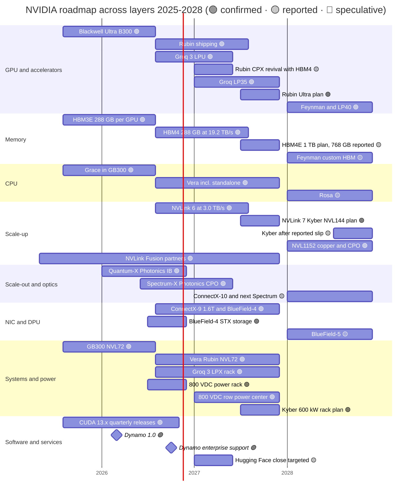
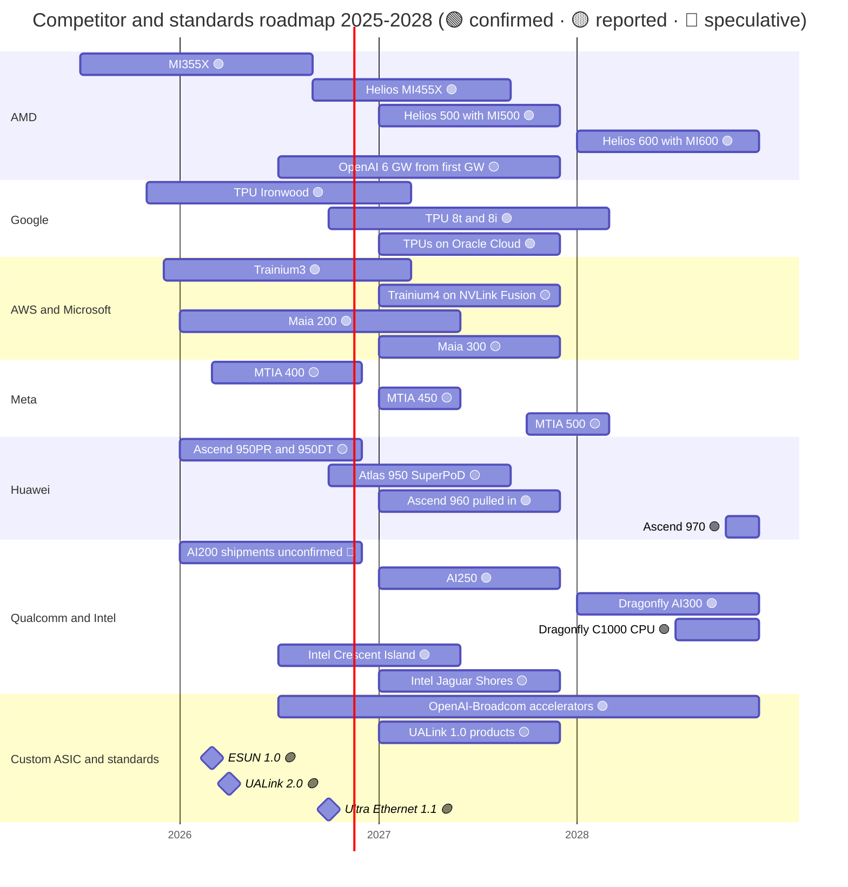
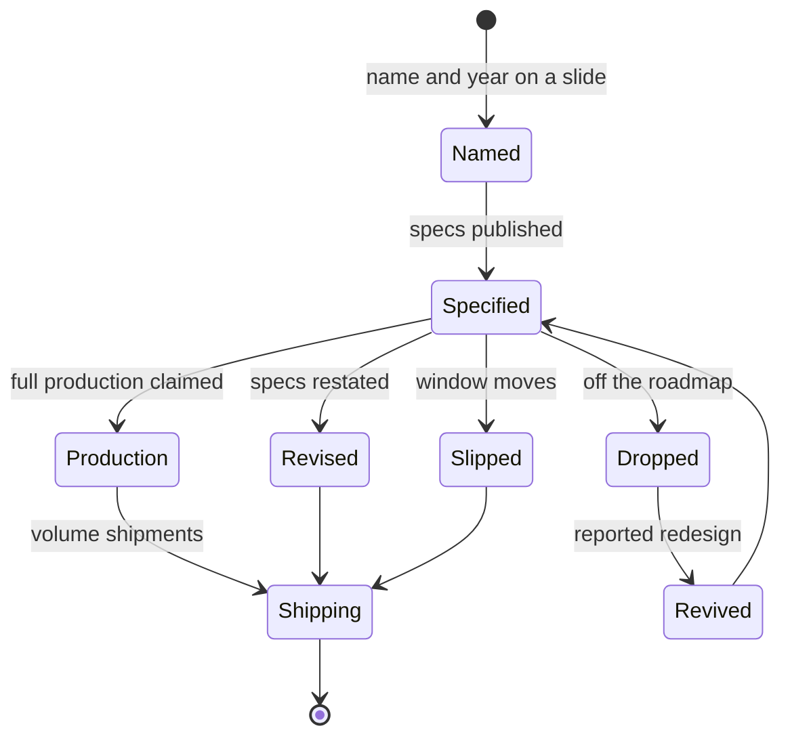
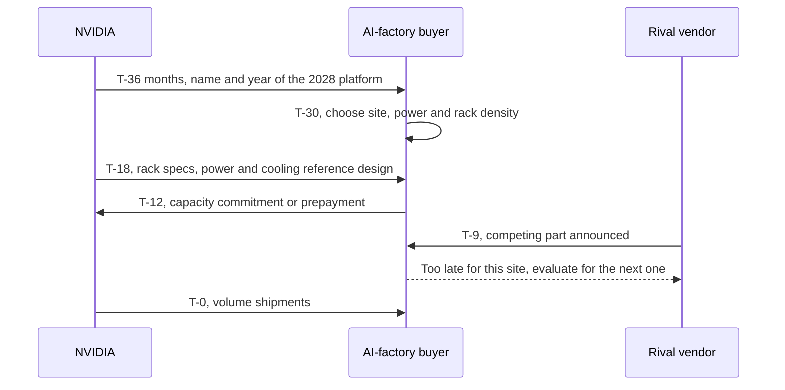
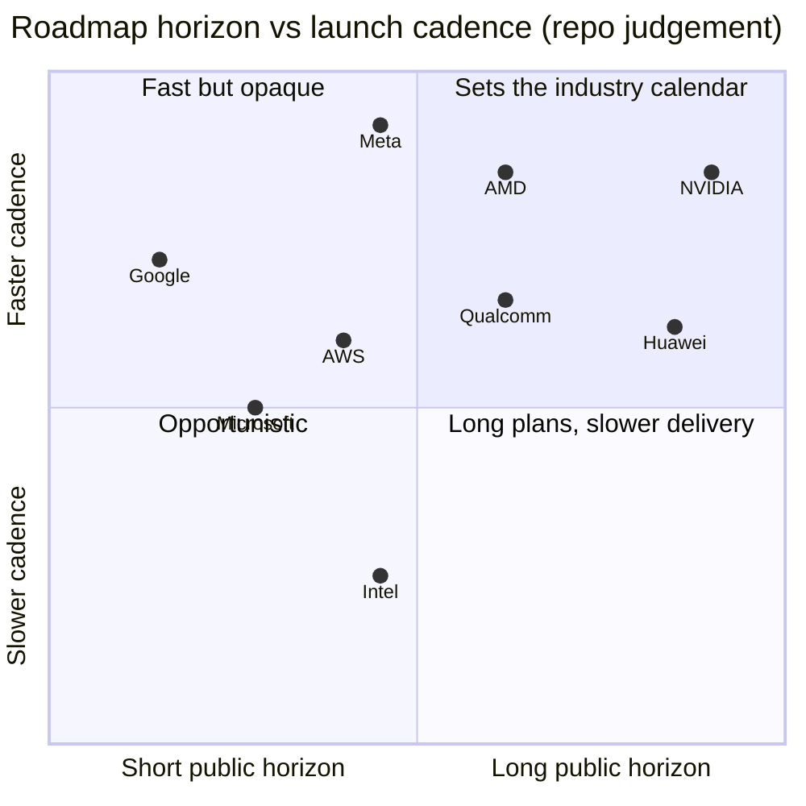

# 17 — Roadmap 2025–2028

Cross-cutting 17 · Every layer, NVIDIA and its rivals, 2025–2028 · ~28 min read · Last verified: 2026-11-05

## ⚡ The Executive Take

- **Where the plan stands.** Vera Rubin [NVL72](../glossary.md#nvl72) began production shipments in early August 2026, with the volume ramp in Q4 2026 [[S500]](../sources/bibliography.md#s500)[[S90009]](../sources/bibliography.md#s90009). 🟢 [Rubin Ultra](../glossary.md#rubin-ultra) is due in H2 2027 and 🟢 [Feynman](../glossary.md#feynman) in 2028, paired with a Rosa CPU, an LP40 decode chip, BlueField-5 and ConnectX-10 🟡 [[S35018]](../sources/bibliography.md#s35018)[[S109]](../sources/bibliography.md#s109)[[S90004]](../sources/bibliography.md#s90004).
- **Every layer moves about once a year.** NVIDIA has products dated 2027 or later in all six hardware layers, while 68% of rivals' items dated 2027 or later are chips or racks (repo count of `data/roadmap.csv`) [[S17006]](../sources/bibliography.md#s17006)[[S502]](../sources/bibliography.md#s502)[[S538]](../sources/bibliography.md#s538).
- **2026 bent the plan in four places.** 🟢 Rubin's listed [HBM4](../glossary.md#hbm4) bandwidth fell from 22 to 19.2 TB/s and [NVLink](../glossary.md#nvlink) 6 from 3.6 to 3.0 TB/s per GPU [[S90006]](../sources/bibliography.md#s90006)[[S103]](../sources/bibliography.md#s103). 🟡 [Rubin CPX](../glossary.md#rubin-cpx) left the roadmap and is reported back for 1Q27 [[S115]](../sources/bibliography.md#s115)[[S117]](../sources/bibliography.md#s117). 🟡 The [Kyber](../glossary.md#kyber) rack is reported to slip to 2028, which NVIDIA denies [[S507]](../sources/bibliography.md#s507)[[S508]](../sources/bibliography.md#s508). Rack names now count packages, not dies [[S90009]](../sources/bibliography.md#s90009)[[S108]](../sources/bibliography.md#s108).
- **A second inference line arrived.** The Groq 3 LPX rack (256 [LPUs](../glossary.md#lpu)) entered full production in August 2026, with LP35 (2027) and LP40 (2028) to follow [[S506]](../sources/bibliography.md#s506)[[S108]](../sources/bibliography.md#s108)[[S109]](../sources/bibliography.md#s109).
- **The roadmap is a sales tool.** NVIDIA dated Rubin, Rubin Ultra and Feynman 26–40 months before availability; Google dates TPUs ~7 months ahead (🔴 repo analysis) [[S17006]](../sources/bibliography.md#s17006)[[S17003]](../sources/bibliography.md#s17003)[[S35018]](../sources/bibliography.md#s35018). Data Center revenue still rose for 14 straight quarters through six roadmap reveals: no [Osborne effect](../glossary.md#osborne-effect) so far [[S405]](../sources/bibliography.md#s405)[[S17006]](../sources/bibliography.md#s17006).
- **Rivals now match the cadence.** AMD moved to an annual rhythm at Computex 2024 (MI500 in 2027, MI600 in 2028) [[S17007]](../sources/bibliography.md#s17007)[[S538]](../sources/bibliography.md#s538). Also coming: TPU 8t/8i (late 2026), Trainium4 and Maia 300 (2027, 🟡), Ascend 960 (pulled in to Q1 2027) and Qualcomm AI250/AI300 (2027/2028) [[S550]](../sources/bibliography.md#s550)[[S156]](../sources/bibliography.md#s156)[[S90046]](../sources/bibliography.md#s90046)[[S567]](../sources/bibliography.md#s567)[[S173]](../sources/bibliography.md#s173)[[S90060]](../sources/bibliography.md#s90060).
- **Weakness:** on paper AMD's MI455X now leads Rubin on HBM capacity (432 vs 288 GB) and bandwidth (23.3 vs 19.2 TB/s, ~21% more) [[S144]](../sources/bibliography.md#s144)[[S90093]](../sources/bibliography.md#s90093)[[S90006]](../sources/bibliography.md#s90006). The next 18 months test execution (Kyber, [HBM4E](../glossary.md#hbm4e), [co-packaged optics](../glossary.md#co-packaged-optics)) more than vision.
- **Next markers:** Q3 FY2027 results on 2026-11-17 [[S17005]](../sources/bibliography.md#s17005), the GTC DC keynote on 2026-12-01 [[S90047]](../sources/bibliography.md#s90047) and GTC 2027 in San Jose, March 14–18, 2027 [[S17000]](../sources/bibliography.md#s17000).

[Interactive version](../assets/interactive/17-roadmap-gantt-nvidia.html)

## The consolidated roadmap across all layers

NVIDIA sells a platform, so its roadmap is a set of synchronised product lines: GPU, decode accelerator, memory, CPU, [scale-up](../glossary.md#scale-up) switch, [NIC](../glossary.md#nic) and [DPU](../glossary.md#dpu), rack, power and software. Each generation of one line is designed to ship with a matching generation of the others, and each GPU generation now gets a [mid-cycle refresh](../glossary.md#mid-cycle-refresh) ("Ultra") about a year later. The gantt below combines the twelve layer roadmaps into one view. Tags: 🟢 confirmed by NVIDIA, 🟡 reported, 🔴 speculative. Each layer's own roadmap page has the detail, for example [GPU silicon](../layers/02-gpu-silicon/roadmap.md), [scale-up](../layers/05-scale-up-nvlink-nvswitch/roadmap.md) and [systems](../layers/08-systems-racks-ai-factories/roadmap.md).

Sources per row in the consolidated table below; bars not in it: Grace in GB300 [[S32004]](../sources/bibliography.md#s32004); the reported Kyber slip [[S507]](../sources/bibliography.md#s507) and NVIDIA's denial [[S508]](../sources/bibliography.md#s508).

The rivals' calendars line up against it year by year. AMD names a rack per year to 2028; the cloud providers date one or two years ahead; Huawei publishes the longest horizon after NVIDIA.

Sources per row in the consolidated table below; bar not in it: OpenAI–Broadcom accelerators, 10 GW from H2 2026 [[S174]](../sources/bibliography.md#s174).

### Consolidated roadmap table

Drawn from `data/roadmap.csv` and the layer roadmap pages. Windows are calendar quarters or years; "status" is as of 2026-11-05.

| Layer | Item | Window | Status | Confidence | Source |
|---|---|---|---|---|---|
| 02 | Rubin GPU (336B transistors, 288 GB HBM4) | Shipments Q3 2026, volume Q4 2026 | shipping | 🟢 | [[S100]](../sources/bibliography.md#s100)[[S500]](../sources/bibliography.md#s500)[[S90009]](../sources/bibliography.md#s90009) |
| 02 | Rubin CPX (prefill GPU) | Was end-2026; reported 1Q27 with HBM4 | delayed | 🟡 | [[S33023]](../sources/bibliography.md#s33023)[[S115]](../sources/bibliography.md#s115)[[S117]](../sources/bibliography.md#s117) |
| 02 | Groq 3 LPU (~500 MB SRAM) | Q3 2026 | full production | 🟢 | [[S113]](../sources/bibliography.md#s113)[[S506]](../sources/bibliography.md#s506) |
| 02 | Groq LP35 (adds NVFP4) | 2027 | roadmap | 🟢 | [[S108]](../sources/bibliography.md#s108) |
| 02 | Rubin Ultra (4 dies, ~100 PFLOPS FP4 as announced) | H2 2027; two-die version reported | roadmap | 🟢 / 🟡 | [[S35018]](../sources/bibliography.md#s35018)[[S509]](../sources/bibliography.md#s509) |
| 02 | Feynman GPU with LP40 | 2028 | roadmap | 🟢 | [[S109]](../sources/bibliography.md#s109)[[S502]](../sources/bibliography.md#s502) |
| 03 | HBM4, 288 GB at 19.2 TB/s per GPU | 2026 | shipping (revised) | 🟢 | [[S102]](../sources/bibliography.md#s102)[[S103]](../sources/bibliography.md#s103)[[S104]](../sources/bibliography.md#s104) |
| 03 | HBM4E, 1 TB per Rubin Ultra (768 GB reported) | H2 2027 | roadmap | 🟢 / 🟡 | [[S110]](../sources/bibliography.md#s110)[[S111]](../sources/bibliography.md#s111) |
| 03 | CoWoS capacity ~105–130k wafers/month end-2026, ~260k by 2028 | 2026–2028 | estimates | 🟡 | [[S90039]](../sources/bibliography.md#s90039)[[S3002]](../sources/bibliography.md#s3002) |
| 04 | Vera CPU (88 cores), also sold standalone | 2026 | shipping | 🟢 | [[S100]](../sources/bibliography.md#s100)[[S90003]](../sources/bibliography.md#s90003) |
| 04 | Rosa CPU | 2028 | roadmap | 🟡 | [[S109]](../sources/bibliography.md#s109)[[S90004]](../sources/bibliography.md#s90004) |
| 05 | NVLink 6, 3.0 TB/s per GPU (was 3.6) | 2026 | shipping (revised) | 🟢 | [[S100]](../sources/bibliography.md#s100)[[S103]](../sources/bibliography.md#s103) |
| 05 | NVLink 7 in Kyber NVL144 | H2 2027 official; 2028 reported | disputed | 🟡 | [[S108]](../sources/bibliography.md#s108)[[S507]](../sources/bibliography.md#s507)[[S508]](../sources/bibliography.md#s508) |
| 05 | Feynman Kyber NVL1152, copper plus CPO | 2028 | roadmap | 🟢 | [[S108]](../sources/bibliography.md#s108)[[S112]](../sources/bibliography.md#s112) |
| 05 | NVLink Fusion (Trainium4 among adopters) | 2025–2027 | shipping / roadmap | 🟢 / 🟡 | [[S131]](../sources/bibliography.md#s131)[[S518]](../sources/bibliography.md#s518) |
| 06 | Quantum-X Photonics InfiniBand | Early 2026 (slipped from 2025) | deploying | 🟡 | [[S515]](../sources/bibliography.md#s515)[[S6022]](../sources/bibliography.md#s6022) |
| 06 | Spectrum-X Photonics Ethernet (CPO) | H2 2026 | full production reported | 🟡 | [[S514]](../sources/bibliography.md#s514)[[S6020]](../sources/bibliography.md#s6020) |
| 06 | ConnectX-10 and next-generation Spectrum | 2028 | roadmap | 🟡 | [[S109]](../sources/bibliography.md#s109)[[S502]](../sources/bibliography.md#s502) |
| 07 | ConnectX-9 (1.6 Tb/s) and BlueField-4 | 2026 | shipping | 🟢 | [[S33004]](../sources/bibliography.md#s33004)[[S512]](../sources/bibliography.md#s512) |
| 07 | BlueField-4 STX context-storage design | H2 2026 | announced | 🟢 | [[S7511]](../sources/bibliography.md#s7511) |
| 07 | BlueField-5 | 2028 | roadmap | 🟡 | [[S109]](../sources/bibliography.md#s109)[[S90004]](../sources/bibliography.md#s90004) |
| 08 | Vera Rubin NVL72 (~190–230 kW) | Q3 2026 | shipping | 🟢 / 🟡 power | [[S102]](../sources/bibliography.md#s102)[[S500]](../sources/bibliography.md#s500)[[S303]](../sources/bibliography.md#s303) |
| 08 | 800 V DC power rack; row power center | H2 2026; 2027 | roadmap | 🟢 | [[S90063]](../sources/bibliography.md#s90063) |
| 08 | Kyber rack (~600 kW) for Rubin Ultra | H2 2027 official; 2028 reported | disputed | 🟡 | [[S305]](../sources/bibliography.md#s305)[[S507]](../sources/bibliography.md#s507) |
| 09 | CUDA 13.x, roughly quarterly (13.5 on 2026-11-04) | Ongoing | shipping | 🟢 | [[S523]](../sources/bibliography.md#s523) |
| 11 | Dynamo 1.0 → 1.5.1 with enterprise support | Mar → Oct 2026 | shipping | 🟢 | [[S520]](../sources/bibliography.md#s520)[[S521]](../sources/bibliography.md#s521) |
| 11 | Hugging Face acquisition close | H1 2027 | pending review | 🟡 | [[S11500]](../sources/bibliography.md#s11500)[[S11027]](../sources/bibliography.md#s11027) |
| Rival | AMD Helios (72 × MI455X) | First shipments ~end Q3 2026 | shipping | 🟢 | [[S538]](../sources/bibliography.md#s538)[[S90020]](../sources/bibliography.md#s90020) |
| Rival | AMD MI500 / MI600 | 2027 / 2028 | roadmap | 🟢 | [[S538]](../sources/bibliography.md#s538) |
| Rival | Google TPU 8t / 8i | Late 2026 | announced | 🟢 | [[S550]](../sources/bibliography.md#s550) |
| Rival | AWS Trainium4 | 2027 (estimate) | roadmap | 🟡 | [[S156]](../sources/bibliography.md#s156)[[S518]](../sources/bibliography.md#s518) |
| Rival | Microsoft Maia 300 | 2027 | announced | 🟡 | [[S90046]](../sources/bibliography.md#s90046) |
| Rival | Huawei Ascend 960 / 970 | Q1 2027 / Q4 2028 | roadmap | 🟢 | [[S163]](../sources/bibliography.md#s163)[[S567]](../sources/bibliography.md#s567) |
| Rival | Qualcomm AI250 / Dragonfly AI300 | 2027 / 2028 | roadmap | 🟢 | [[S173]](../sources/bibliography.md#s173)[[S90060]](../sources/bibliography.md#s90060) |
| Standard | UALink 1.0 products | 2027 | expected | 🟡 | [[S90051]](../sources/bibliography.md#s90051) |

> [!TIP]
> **Worked example — how many NVIDIA launches a buyer must track.** Counting only the hardware rows above, NVIDIA has 7 items shipping in 2026, about 6 dated for 2027 and 8 for 2028, across GPU, decode chip, memory, CPU, NVLink, NIC/DPU, switches and racks. A [hyperscaler](../glossary.md#hyperscaler) qualifying each one needs thermal, power, network and software validation. **Conclusion:** the platform cadence is also a qualification burden. It favours buyers with large engineering teams (hyperscalers) and buyers who take the whole rack as designed ([neoclouds](../glossary.md#neocloud), sovereigns), and squeezes buyers in between.

## Spec progression: what each step buys

The spec charts make the roadmap concrete. From H100 to Rubin, low-precision compute per GPU rose ~18× while HBM bandwidth rose ~5.7× and power ~3.3×. That gap, the [memory wall](../glossary.md#memory-wall), is why so much of the 2027–28 roadmap is about memory and interconnect rather than FLOPS.

The scale-up domain grows even faster than the chip. NVLink connects 72 GPU packages in a Vera Rubin rack today, 144 in Kyber (2027 plan) and 1,152 in Feynman's Kyber NVL1152 (2028), the last using co-packaged optics because copper cannot reach that far [[S100]](../sources/bibliography.md#s100)[[S108]](../sources/bibliography.md#s108). Per-rack power follows: ~132 kW for GB300 NVL72, ~190–230 kW for Vera Rubin and ~600 kW for Kyber [[S337]](../sources/bibliography.md#s337)[[S303]](../sources/bibliography.md#s303)[[S305]](../sources/bibliography.md#s305).

![Two line charts of memory per accelerator, 2024-2028. Capacity: NVIDIA B200 180 GB, B300 288, Rubin 288, Rubin Ultra 1,024 GB announced for 2027 (a report says 768 GB); AMD MI325X 256, MI355X 288, MI455X 432; Google Trillium 32 and Ironwood 192; AWS Trainium2 96, Trainium3 144, Trainium4 about 288 (estimate); Huawei 910C 128, 950DT 144, 960 and 970 288. Bandwidth: Rubin 19.2 TB/s (launch target 22), MI455X 23.3, Trainium4 about 19.6 (estimate), Ironwood 7.37, Huawei 950DT 4.0 rising to 14.4 in 2028, Rubin Ultra about 32 TB/s.](../assets/charts/03-memory-roadmap-by-vendor.svg)

> [!TIP]
> **Worked example — what Kyber buys per kilowatt.** A Vera Rubin NVL72 delivers ~1,260 [PFLOPS](../glossary.md#flops) of dense [FP8](../glossary.md#fp8) at ~190–230 kW 🟡 [[S102]](../sources/bibliography.md#s102)[[S303]](../sources/bibliography.md#s303): ~5.5–6.6 PFLOPS per kW. Kyber, as announced, targets ~5,000 PFLOPS dense FP8 at ~600 kW [[S35018]](../sources/bibliography.md#s35018)[[S305]](../sources/bibliography.md#s305): ~8.3 PFLOPS per kW, 26–51% better. Rack HBM rises from 20.7 TB to ~144 TB as announced [[S102]](../sources/bibliography.md#s102)[[S110]](../sources/bibliography.md#s110), ~7×, against ~3× the power. **Conclusion:** the 2027 step is mainly a memory-capacity step. If the reported cut to 768 GB per GPU holds 🟡 [[S111]](../sources/bibliography.md#s111), rack HBM falls to ~108 TB (repo arithmetic: 144 × 768/1,024), still ~5× today's rack.

🔧 Under the hood: why memory and packaging set the roadmap's pace

Compute scales with transistors and number formats; memory bandwidth scales with the number of [HBM](../glossary.md#hbm) stacks around the GPU and the [pin speed](../glossary.md#pin-speed) of each. Rubin uses 8 HBM4 stacks; Rubin Ultra plans 16 stacks of HBM4E [[S110]](../sources/bibliography.md#s110), which needs a larger [CoWoS](../glossary.md#cowos) interposer and fewer packages per wafer (see [layer 03 roadmap](../layers/03-memory-packaging-supply-chain/roadmap.md)). The 2026 Rubin cut was attributed by one analyst to HBM4 pins running at ~9.4 instead of ~10.7 Gb/s (🔴 cause unconfirmed) [[S90006]](../sources/bibliography.md#s90006). Every later step therefore depends on memory makers' yields: SK hynix and Samsung sampled HBM4E in mid-2026 [[S3528]](../sources/bibliography.md#s3528), and TrendForce expects HBM4E to be ~40% of the 2027 HBM market [[S3531]](../sources/bibliography.md#s3531).

### The inference roadmap now has three chips

Until 2025 NVIDIA's answer to every workload was the next GPU. The 2026 roadmap splits inference into phases. [Prefill](../glossary.md#prefill), reading the prompt, needs compute; [decode](../glossary.md#decode), writing tokens one by one, needs memory bandwidth. The Rubin GPU with HBM4 remains the general engine. Rubin CPX was announced in September 2025 as a GDDR7-based prefill GPU with 30 PFLOPS of [NVFP4](../glossary.md#nvfp4) and 128 GB of memory [[S33023]](../sources/bibliography.md#s33023); it left the GTC 2026 roadmap and is reported to return with HBM4 in 1Q27 🟡 [[S115]](../sources/bibliography.md#s115)[[S117]](../sources/bibliography.md#s117). The Groq-derived LPU took the decode slot: each LP30 chip holds ~500 MB of on-chip [SRAM](../glossary.md#sram), and a 256-chip LPX rack sits beside Vera Rubin [[S114]](../sources/bibliography.md#s114)[[S506]](../sources/bibliography.md#s506). LP35 (2027) adds NVFP4, and LP40 pairs with Feynman in 2028 [[S108]](../sources/bibliography.md#s108)[[S109]](../sources/bibliography.md#s109).

> [!TIP]
> **Worked example — why decode moved to SRAM.** An LPX rack carries 256 × ~0.5 GB ≈ 128 GB of SRAM with ~40 PB/s of aggregate bandwidth [[S114]](../sources/bibliography.md#s114). A Vera Rubin NVL72 carries 20.7 TB of HBM4 at ~1,400 TB/s [[S102]](../sources/bibliography.md#s102)[[S90006]](../sources/bibliography.md#s90006): ~160× the capacity but ~1/29 of the bandwidth. A 70B-parameter model at FP8 (~70 GB) fits inside one LPX rack's SRAM, so each token can be generated at SRAM speed; a 1T-parameter model does not fit and still needs HBM. **Conclusion:** the three-chip roadmap is a bet that latency-critical decode of mid-sized models is a large enough market to justify its own silicon, the same bet Groq, Cerebras and d-Matrix made, now inside NVIDIA's rack.

## Layer by layer: what changes from 2026 to 2028

| Layer | 2026 (now) | 2027 | 2028 | What could change the picture | Layer roadmap |
|---|---|---|---|---|---|
| 02 GPU silicon | Rubin; Groq 3 LPU | Rubin Ultra; LP35; CPX? | Feynman; LP40 | Two-die Rubin Ultra; MI500 lead on paper | [02](../layers/02-gpu-silicon/roadmap.md) |
| 03 Memory | HBM4 at 19.2 TB/s | HBM4E, 1 TB plan | Custom HBM | HBM4E pin speed, Samsung's share, memory prices | [03](../layers/03-memory-packaging-supply-chain/roadmap.md) |
| 04 CPU | Vera, standalone Vera | — | Rosa | Agentic CPU demand; Fusion CPUs shipping | [04](../layers/04-cpu-grace-vera/roadmap.md) |
| 05 Scale-up | NVLink 6, 72 GPUs | NVLink 7, 144 packages | NVL1152 with CPO | Kyber date; UALink silicon | [05](../layers/05-scale-up-nvlink-nvswitch/roadmap.md) |
| 06 Scale-out | CX-9 1.6T; CPO switches | — | CX-10; next Spectrum | Ultra Ethernet NICs at scale | [06](../layers/06-scale-out-scale-across-networking/roadmap.md) |
| 07 DPU / storage | BlueField-4; STX | — | BlueField-5 | KV-cache storage becoming standard | [07](../layers/07-dpu-supernic-storage-security/roadmap.md) |
| 08 Systems | VR NVL72; LPX; 800 VDC rack | Kyber (~600 kW); row power | Kyber NVL1152 | Midplane yield; grid power | [08](../layers/08-systems-racks-ai-factories/roadmap.md) |
| 09–11 Software | CUDA 13.x; Dynamo 1.x | HF close | — | Open serving parity on rival racks | [09](../layers/09-cuda-and-system-software/roadmap.md), [11](../layers/11-inference-and-ai-software/roadmap.md) |
| 12–13 Cloud, capital | Lepton; financing platforms | Contract tranches | — | Capex pause; neocloud credit | [12](../layers/12-orchestration-and-cloud-services/roadmap.md), [13](../layers/13-ecosystem-gtm-and-capital/roadmap.md) |

This chapter agrees with the layer pages on dates and tags. One difference of emphasis: the [systems roadmap](../layers/08-systems-racks-ai-factories/roadmap.md) treats Kyber's date as the contested item. This chapter treats it as the single most important roadmap fact for 2027, because the NVLink 7, HBM4E and 800 V DC lines all converge on that rack.

## What changed in 2026: revisions, slips and renames

| Item | As first announced | As of 2026-11-05 | Tag | Source |
|---|---|---|---|---|
| Rubin HBM4 bandwidth per GPU | 22 TB/s | 19.2 TB/s | 🟢 | [[S100]](../sources/bibliography.md#s100)[[S90006]](../sources/bibliography.md#s90006) |
| NVLink 6 per GPU | 3.6 TB/s | 3.0 TB/s | 🟢 | [[S33004]](../sources/bibliography.md#s33004)[[S103]](../sources/bibliography.md#s103) |
| Vera Rubin NVL72 rack HBM bandwidth | 1,580 TB/s | 1,400 TB/s | 🟢 | [[S102]](../sources/bibliography.md#s102)[[S90006]](../sources/bibliography.md#s90006) |
| Rubin CPX | End-2026, GDDR7, 30 PFLOPS NVFP4 | Off the GTC 2026 roadmap; reported HBM4 redesign for 1Q27 | 🟡 | [[S33023]](../sources/bibliography.md#s33023)[[S115]](../sources/bibliography.md#s115)[[S117]](../sources/bibliography.md#s117) |
| Kyber NVL144 rack | H2 2027 | Reported slip of more than 12 months; NVIDIA: "roadmap is intact" | 🟡 | [[S305]](../sources/bibliography.md#s305)[[S507]](../sources/bibliography.md#s507)[[S508]](../sources/bibliography.md#s508) |
| Rubin Ultra package | 4 reticle-sized dies, 1 TB HBM4E | Two-die version and 768 GB reported | 🟡 | [[S35018]](../sources/bibliography.md#s35018)[[S509]](../sources/bibliography.md#s509)[[S111]](../sources/bibliography.md#s111) |
| Rack naming | "Vera Rubin NVL144", "Rubin Ultra NVL576" | Vera Rubin NVL72, Kyber NVL144 (packages, not dies) | 🟢 | [[S90009]](../sources/bibliography.md#s90009)[[S108]](../sources/bibliography.md#s108) |

**The Rubin revision is the most consequential.** NVIDIA edited its product pages in September–October 2026 and said the new figures reflect what systems sustain in quality volume production [[S104]](../sources/bibliography.md#s104). Capacity (288 GB) and compute were unchanged [[S90006]](../sources/bibliography.md#s90006). The effect is to widen AMD's MI455X paper lead on bandwidth (23.3 vs 19.2 TB/s, from 23.3 vs 22) and leave it ahead on capacity (432 vs 288 GB) [[S144]](../sources/bibliography.md#s144)[[S90093]](../sources/bibliography.md#s90093). AMD has revised specs too: MI325X was announced with up to 288 GB of [HBM3E](../glossary.md#hbm3e) at Computex 2024 and launched with 256 GB [[S17007]](../sources/bibliography.md#s17007)[[S142]](../sources/bibliography.md#s142), while MI455X's listed HBM4 bandwidth went the other way, from 19.6 TB/s in June 2025 to 23.3 TB/s [[S144]](../sources/bibliography.md#s144)[[S90093]](../sources/bibliography.md#s90093).

**NVIDIA's explanation matters for every future spec.** By saying launch figures were targets and the new ones reflect volume production [[S104]](../sources/bibliography.md#s104), NVIDIA effectively told buyers to read every pre-production number on its roadmap, including Rubin Ultra's 1 TB and Feynman's coming specs, as an upper bound. Buyers sizing a 2027–28 deployment should discount announced bandwidth until production pages are published.

**The renames are not cosmetic.** "NVL144" counted GPU dies; "NVL72" counts packages. The same Rubin rack carries both names [[S90009]](../sources/bibliography.md#s90009). Readers comparing racks across vendors should always count packages ([NVL naming](../glossary.md#nvl-naming)).

> [!TIP]
> **Worked example — what the Rubin cut costs a buyer.** Decode, the token-by-token phase of inference, is limited by memory bandwidth (see [P2](../primers/P2-how-ai-inference-works.md)). A rack's HBM bandwidth fell from 1,580 to 1,400 TB/s, −11% [[S102]](../sources/bibliography.md#s102)[[S90006]](../sources/bibliography.md#s90006). For a bandwidth-bound model at a fixed batch size, peak decode tokens per second fall roughly in proportion (🔴 repo approximation). On a ~$7.8M rack (Est., Morgan Stanley) [[S331]](../sources/bibliography.md#s331), an 11% cut in peak decode throughput is worth ~$0.9M of rack value at a constant price per token. **Conclusion:** the revision changed no compute figure, but it narrowed the gap that justifies NVIDIA's premium on memory-bound inference.

The life of a roadmap item now has more states than "announced" and "shipping". Rubin CPX went through four of them in twelve months.

## The roadmap is backed by commitments

A roadmap is credible only if the supply behind it is booked. NVIDIA's supply and capacity commitments reached $279B at the end of Q2 FY2027, up from $119B a quarter earlier, mostly memory and manufacturing capacity for the Rubin generation [[S407]](../sources/bibliography.md#s407)[[S404]](../sources/bibliography.md#s404). On the demand side, Huang sized Blackwell and Vera Rubin demand at $1 trillion through 2027 at GTC 2026; outlets differ on whether he meant orders or a revenue opportunity 🟡 [[S90001]](../sources/bibliography.md#s90001)[[S90002]](../sources/bibliography.md#s90002). The largest buyers have announced multi-gigawatt programmes, but they spread them across suppliers.

![Stacked horizontal bar chart of announced compute programmes in gigawatts. OpenAI 26 GW: NVIDIA 10 (September 2025 letter of intent, since restructured), Broadcom custom accelerators 10 and AMD 6. Anthropic 4 GW: AMD Helios up to 2 (with an up-to-$5B AMD investment), NVIDIA up to 1 and Google TPUs over 1 GW in 2026 (a further multi-GW TPU expansion from 2027 is unquantified). HUMAIN: NVIDIA up to 0.5 GW, AMD 0.5 GW and Qualcomm 0.2 GW. xAI: about 1 GW on NVIDIA (company claim, contested). NVIDIA's share across these programmes is about 39%.](../assets/charts/13-gw-pipeline-by-supplier.svg)

> [!TIP]
> **Worked example — what $279B of commitments means for the roadmap.** $279B is ~2.9× NVIDIA's $96.2B Q2 FY2027 revenue [[S407]](../sources/bibliography.md#s407)[[S405]](../sources/bibliography.md#s405), against ~1.4× before the FY2023 write-downs (chart above). If Rubin Ultra slipped a year, the memory and capacity booked for it would have to be absorbed by Rubin demand or carried as inventory. The FY2023 precedent is a $2.17B inventory provision and a $348M charge for commitments above demand [[S418]](../sources/bibliography.md#s418)[[S421]](../sources/bibliography.md#s421). **Conclusion:** the roadmap is now a balance-sheet commitment. Slips are costly for NVIDIA, which is one reason it moves fast to deny them [[S508]](../sources/bibliography.md#s508).

## The roadmap as a competitive tactic

A product roadmap is usually an internal plan. NVIDIA's is a public instrument with three jobs: it freezes buyers' decisions in NVIDIA's favour, it sets the pace rivals must match, and it does both without stalling current sales. Each job has a mechanism and a risk.

### It freezes customer decisions

**The mechanism is planning lead time.** An AI factory needs power, cooling, floor loading and network design fixed long before chips arrive. US generation projects wait years in interconnection queues [[S8009]](../sources/bibliography.md#s8009), and a gigawatt site is designed around one rack's power density, ~132 kW for GB300 NVL72 versus ~600 kW for Kyber [[S337]](../sources/bibliography.md#s337)[[S305]](../sources/bibliography.md#s305). A buyer choosing a 2028 design in 2026 can only design around a vendor that has published a 2028 rack. Measured as a [pre-announcement horizon](../glossary.md#pre-announcement-horizon), NVIDIA dates its GPUs 26–40 months ahead; Google dates TPUs ~7 months ahead and AMD ~13–25 months (🔴 repo analysis) [[S17006]](../sources/bibliography.md#s17006).

![Horizontal bar chart of how far ahead vendors publicly date their accelerators. NVIDIA named Rubin and Rubin Ultra at Computex 2024 and Feynman at GTC 2025, 26 to 40 months before their planned volume availability; Huawei dated Ascend 970 about 38 months ahead; AMD dates Instinct parts 13–25 months ahead on its annual cadence; AWS, Meta, Microsoft and Qualcomm sit between about 0 and 25 months; Google announces each TPU only about 7 months before general availability. Future availability dates are plans; year-only plans use mid-year.](../assets/charts/17-preannouncement-horizon.svg)

**The freeze extends to the building.** NVIDIA's 800 V DC power architecture is a roadmap item for facilities, not chips: about 20 power and electrical partners showed 800 V DC parts at GTC DC 2025, and neoclouds including CoreWeave, Lambda, Nebius, OCI and Together AI said they were designing for it [[S90061]](../sources/bibliography.md#s90061). An MGX-compatible 800 V DC power rack is due in H2 2026 and a row-level power center in 2027 [[S90063]](../sources/bibliography.md#s90063). A data hall wired for 800 V DC and ~600 kW racks is a long-lived asset built around NVIDIA's rack plan, even if Dell'Oro calls the design a reference architecture rather than a standard [[S90062]](../sources/bibliography.md#s90062).

> [!TIP]
> **Worked example — the planning window in dates.** A 1 GW site switched on in mid-2028 needs its electrical design fixed by ~2026 (🔴 assumption based on multi-year power lead times [[S8009]](../sources/bibliography.md#s8009)). By then NVIDIA had dated Feynman for 2028 and published a 2028 rack class (Kyber NVL1152) [[S109]](../sources/bibliography.md#s109)[[S108]](../sources/bibliography.md#s108), and AMD had named Helios 600 for 2028 without specifications [[S538]](../sources/bibliography.md#s538). Google's TPU for 2028 had not been announced: its 8t/8i parts were announced in April 2026 for GA later in 2026 [[S550]](../sources/bibliography.md#s550). **Conclusion:** for 2028 power-on, only NVIDIA offered a dated rack architecture. AMD offered a name, and the cloud ASICs nothing public, so the planning default went to NVIDIA by construction.

### It sets the cadence rivals must match

NVIDIA moved data-center products to a "one-year rhythm" at Computex 2024 [[S17003]](../sources/bibliography.md#s17003); AMD announced an annual Instinct cadence the same week [[S17007]](../sources/bibliography.md#s17007)[[S17008]](../sources/bibliography.md#s17008). Since then NVIDIA and AMD have launched flagships in the same quarter three years running. Matching the pace is expensive: Blackwell alone cost ~$10B to develop [[S35028]](../sources/bibliography.md#s35028), and NVIDIA spent $18.5B on R&D in FY2026 [[S401]](../sources/bibliography.md#s401).

> [!TIP]
> **Worked example — what keeping pace costs.** If each NVIDIA generation costs ~$10B to develop [[S35028]](../sources/bibliography.md#s35028) and arrives every ~12 months, platform development alone runs ~$10B a year, inside NVIDIA's $18.5B FY2026 R&D [[S401]](../sources/bibliography.md#s401). AMD's R&D across all products was ~$6.5B in 2024 [[S450]](../sources/bibliography.md#s450). A hyperscaler [ASIC](../glossary.md#asic) built with a design partner costs ~$0.5–1.5B per generation (Est.) [[S2501]](../sources/bibliography.md#s2501), because it covers one chip for one customer's workloads rather than a whole platform. **Conclusion:** the annual cadence is affordable at full-platform scale only for NVIDIA. Rivals keep pace either by narrowing scope (custom ASICs) or by sharing NVIDIA's own platform ([NVLink Fusion](../glossary.md#nvlink-fusion)).

### The Osborne-effect risk, and why it has not bitten

The Osborne effect is named after a 1980s computer maker whose early announcement of a better model reportedly froze sales of the current one. NVIDIA invites it every year. At GTC 2025 Huang called himself the "chief revenue destroyer" while telling customers that Hopper was fine in few situations [[S17001]](../sources/bibliography.md#s17001). One report put 2024 Hopper sales to the top four clouds at 1.3M GPUs against 3.6M Blackwell GPUs in 2025 🟡 [[S17002]](../sources/bibliography.md#s17002).

The data show no freeze. Data Center revenue rose quarter on quarter 14 times in a row from Q1 FY2024 to Q2 FY2027, through six roadmap reveals [[S405]](../sources/bibliography.md#s405)[[S17006]](../sources/bibliography.md#s17006). The weakest quarter (+5%, Q2 FY2026) coincided with the H20 export ban, not a buyer pause [[S90081]](../sources/bibliography.md#s90081).

![Bar chart of NVIDIA quarterly Data Center revenue from Q1FY24 ($4.3B) to Q2FY27 ($89.0B). Revenue rose quarter on quarter 14 times in a row while NVIDIA revealed Blackwell (GTC 2024), moved to a one-year rhythm and named Rubin (Computex 2024), dated Rubin Ultra and Feynman (GTC 2025), put Rubin in full production (CES 2026), showed Kyber and Feynman details (GTC 2026) and began Rubin shipments (August 2026). The weakest quarter, Q2FY26 at +5%, coincided with the H20 export ban rather than a buyer pause; customers did not stop buying the current generation to wait for the announced one.](../assets/charts/17-dc-revenue-through-transitions.svg)

> [!TIP]
> **Worked example — why a buyer with power in hand does not wait.** A neocloud with 10 MW of IT power can fill it now with GB300 NVL72 racks at ~132 kW [[S337]](../sources/bibliography.md#s337), ~75 racks (~5,400 GPUs). Vera Rubin racks at ~190–230 kW 🟡 [[S303]](../sources/bibliography.md#s303) fit ~43–52 racks, but deliver roughly 2× GB300's DeepSeek-R1 tokens per MW at moderate speeds 🟡 [[S626]](../sources/bibliography.md#s626). Waiting one quarter forgoes ~25% of a year's output from the whole site; switching on Rubin once volume exists gains ~100% more output per MW for the rest of its life. **Conclusion:** rational buyers switch as soon as the new generation is available but do not stop buying before it is. The transition shows up as a mix shift, not a revenue gap, while supply stays short; the CFO called the FY2028 outlook "supply-constrained" [[S90012]](../sources/bibliography.md#s90012).

> [!WARNING]
> **When the Osborne effect would bite.** Three conditions would turn the roadmap into a liability: supply catching up with demand (estimates have CoWoS reaching ~260k wafers a month by 2028 [[S3002]](../sources/bibliography.md#s3002)), a visible slip that makes buyers wait for a promised step (Kyber 🟡 [[S507]](../sources/bibliography.md#s507)), or a new generation whose gain per MW is large enough to strand the old one before its depreciation ends. Hyperscalers depreciate servers over five to six years [[S383]](../sources/bibliography.md#s383)[[S385]](../sources/bibliography.md#s385), so with a ~2× gain per generation a rack can sit two or three generations behind the frontier while it is still on the books. The FY2023 bust, when quarterly revenue fell 28% in two quarters, shows how quickly a glut can hit [[S432]](../sources/bibliography.md#s432)[[S434]](../sources/bibliography.md#s434).

### Track record: promised versus delivered

A public roadmap is only as useful as its record. The table compares what vendors promised with what shipped for items due by late 2026. It covers dates and headline specs only; delivered performance is a separate question (see [competition](../layers/02-gpu-silicon/competition.md)).

| Vendor | Item | Promised | Delivered (as of 2026-11-05) | Assessment (tag = confidence in the delivery fact) | Source |
|---|---|---|---|---|---|
| NVIDIA | Blackwell Ultra (GB300) | 2025 | Shipping from 2H 2025 | 🟢 On time | [[S17003]](../sources/bibliography.md#s17003)[[S32004]](../sources/bibliography.md#s32004) |
| NVIDIA | Rubin / Vera Rubin NVL72 | 2026 (named in 2024) | Production shipments August 2026; bandwidth specs cut | 🟢 On time, specs revised | [[S17003]](../sources/bibliography.md#s17003)[[S500]](../sources/bibliography.md#s500)[[S90006]](../sources/bibliography.md#s90006) |
| NVIDIA | Quantum-X Photonics | Later in 2025 | Deploying early 2026 | 🟡 ~3-month slip | [[S514]](../sources/bibliography.md#s514)[[S515]](../sources/bibliography.md#s515) |
| NVIDIA | Spectrum-X Photonics | 2026, then H2 2026 | Full production reported | 🟡 On time | [[S514]](../sources/bibliography.md#s514)[[S6020]](../sources/bibliography.md#s6020) |
| NVIDIA | Rubin CPX | End-2026 | Off roadmap; 1Q27 revival reported | 🟡 Missed | [[S33023]](../sources/bibliography.md#s33023)[[S115]](../sources/bibliography.md#s115)[[S117]](../sources/bibliography.md#s117) |
| AMD | MI325X | Q4 2024 with up to 288 GB | Q4 2024 with 256 GB | 🟢 On time, capacity cut | [[S17007]](../sources/bibliography.md#s17007)[[S142]](../sources/bibliography.md#s142) |
| AMD | MI355X | 2025 | Shipping from Q3 2025 | 🟢 On time | [[S17007]](../sources/bibliography.md#s17007)[[S143]](../sources/bibliography.md#s143) |
| AMD | MI455X / Helios | 2026 | First shipments ~end Q3 2026 | 🟡 On time | [[S17007]](../sources/bibliography.md#s17007)[[S90020]](../sources/bibliography.md#s90020) |
| Google | TPU Ironwood | Late 2025 | GA announced 2025-11-06 | 🟢 On time | [[S151]](../sources/bibliography.md#s151)[[S547]](../sources/bibliography.md#s547) |
| Huawei | Ascend 960 | Q4 2027 | Pulled in to Q1 2027 | 🟢 Ahead (pending) | [[S163]](../sources/bibliography.md#s163)[[S567]](../sources/bibliography.md#s567) |
| Qualcomm | AI200 | 2026 | No shipment confirmation found | 🔴 Unconfirmed | [[S173]](../sources/bibliography.md#s173) |

The pattern is consistent: dates mostly hold, while headline specs and secondary products move. NVIDIA's misses are on its newest product categories (CPX, co-packaged optics, the Kyber midplane), not its core GPU cadence.

### How competitors respond

| Competitor | Response to NVIDIA's roadmap | Evidence | Effect |
|---|---|---|---|
| AMD | Match the cadence and land in the same quarter; buy anchor customers with warrants | Annual since Computex 2024; OpenAI and Meta 6 GW warrant deals [[S17007]](../sources/bibliography.md#s17007)[[S13506]](../sources/bibliography.md#s13506)[[S24004]](../sources/bibliography.md#s24004) | 🟨 Parity on paper specs; 🟥 behind on dated rack architecture beyond 2027 |
| Google | Short public horizon; sell TPUs beyond Google | TPU 8t/8i announced ~6 months before GA; Anthropic up to 1M TPUs; TPUs on OCI in 2027 [[S550]](../sources/bibliography.md#s550)[[S90026]](../sources/bibliography.md#s90026)[[S552]](../sources/bibliography.md#s552) | 🟦 Wins on cost for committed buyers, not on planning visibility |
| AWS | Co-opt NVIDIA's interconnect | Trainium4 to support NVLink Fusion [[S518]](../sources/bibliography.md#s518)[[S156]](../sources/bibliography.md#s156) | 🟦 Rides NVIDIA's rack roadmap instead of competing with it |
| Microsoft | Own inference chip on a yearly step | Maia 200 (2026), Maia 300 and multi-GW deployment from 2027 [[S158]](../sources/bibliography.md#s158)[[S90046]](../sources/bibliography.md#s90046)[[S90045]](../sources/bibliography.md#s90045) | 🟦 Captive demand; little effect on merchant buyers |
| Meta | Fastest cadence of any custom ASIC | MTIA 400, 450, 500 through 2027, ~6-month steps [[S561]](../sources/bibliography.md#s561) | 🟦 Narrow workloads (ranking, inference) |
| Huawei | Long published horizon and pull-ins | Ascend 960 moved three quarters earlier; 970 dated for Q4 2028 [[S567]](../sources/bibliography.md#s567)[[S163]](../sources/bibliography.md#s163) | 🟦 Sets China's planning default under export controls |
| Qualcomm | Annual cadence and open fabrics (public information only) | AI200 (2026), AI250 (2027), AI300 with UALink and ESUN (2028) [[S173]](../sources/bibliography.md#s173)[[S90060]](../sources/bibliography.md#s90060) | 🔴 Credibility depends on first shipments, not yet confirmed |
| Standards bodies | Open alternatives to NVLink and InfiniBand | UALink 2.0 (April 2026), ESUN 1.0, UEC 1.1; UALink products 2027 [[S574]](../sources/bibliography.md#s574)[[S576]](../sources/bibliography.md#s576)[[S575]](../sources/bibliography.md#s575)[[S90051]](../sources/bibliography.md#s90051) | 🟥 Two years behind NVLink but on a converging path |

**AMD's answer is to match and to buy time with capital.** Its annual cadence lands flagships in the same quarter as NVIDIA's, and its warrant deals give OpenAI and Meta up to 160M AMD shares each if they deploy 6 GW [[S13506]](../sources/bibliography.md#s13506)[[S24004]](../sources/bibliography.md#s24004). The roadmap gap that remains is depth: AMD has named Helios 500 and Helios 600, but published far fewer layer-level specs for 2027–28 than NVIDIA [[S538]](../sources/bibliography.md#s538).

**Google's answer is not to play.** It announces each TPU a few months before availability, sells capacity rather than roadmap slides, and now places TPUs in other clouds and in customers' own data centers [[S550]](../sources/bibliography.md#s550)[[S552]](../sources/bibliography.md#s552)[[S90027]](../sources/bibliography.md#s90027). Its buyers commit to a relationship, not a spec sheet; Anthropic's up-to-1M-TPU deal is the template [[S90026]](../sources/bibliography.md#s90026).

> [!NOTE]
> **🐂 Bull view:** a dated, multi-layer roadmap is a moat in its own right. Buyers plan gigawatt sites around it, rivals spend to keep pace, and 14 straight quarters of growth through six reveals show the Osborne risk is manageable while supply is short [[S17006]](../sources/bibliography.md#s17006). Revisions so far changed specs at the margin, not the rhythm.

> [!WARNING]
> **🐻 Bear view:** the roadmap is now promising more than the supply chain can deliver on time. In one year NVIDIA cut Rubin's bandwidth, pulled and reportedly revived CPX, and faces a reported 12-month Kyber slip [[S90006]](../sources/bibliography.md#s90006)[[S115]](../sources/bibliography.md#s115)[[S117]](../sources/bibliography.md#s117)[[S507]](../sources/bibliography.md#s507). Every miss is visible because the plan is public, and rivals with shorter horizons cannot miss what they never promised. If supply loosens in 2027–28, the same roadmap invites buyers to wait.

🔧 Under the hood: how the horizon and lead-time numbers were built

`data/x17_preannouncement_horizon.csv` records, for 25 accelerators, the first public mention with a target year and the (planned) start of volume availability. Year-only plans are placed at mid-year, so a "2028" item counts as July 2028. NVIDIA's Rubin, Rubin Ultra and Vera were first dated at Computex 2024 [[S17003]](../sources/bibliography.md#s17003)[[S17004]](../sources/bibliography.md#s17004) and Feynman at GTC 2025 [[S35018]](../sources/bibliography.md#s35018). For rivals the first mention is usually the launch event in `data/roadmap.csv`, which may miss earlier informal hints; AMD's MI400 series, for example, was named for 2026 at Computex 2024 [[S17007]](../sources/bibliography.md#s17007). The quarterly test uses Data Center revenue from `data/financials.csv`; it cannot separate a hidden Osborne effect from strong demand, but a freeze large enough to matter would show up as a down quarter.

🔧 Under the hood: how NVIDIA's roadmap disclosure changed, 2024–2026

- **Computex 2024:** the "one-year rhythm" slide named Blackwell Ultra (2025), Rubin (2026) and Rubin Ultra (2027), plus the Vera CPU, with HBM stack heights but few other specs [[S17003]](../sources/bibliography.md#s17003)[[S17004]](../sources/bibliography.md#s17004).
- **GTC 2025:** Rubin and Rubin Ultra got per-GPU and per-rack numbers (Rubin Ultra: four dies, ~100 PFLOPS [FP4](../glossary.md#fp4), 1 TB HBM4E, a 600 kW Kyber rack), and Feynman was added for 2028 [[S35018]](../sources/bibliography.md#s35018)[[S305]](../sources/bibliography.md#s305).
- **September 2025:** Rubin CPX announced for end-2026 [[S33023]](../sources/bibliography.md#s33023).
- **CES 2026:** Rubin declared in full production; rack names switched from dies to packages (NVL144 → NVL72) [[S33004]](../sources/bibliography.md#s33004)[[S90009]](../sources/bibliography.md#s90009).
- **GTC 2026:** Kyber NVL144, Feynman's NVL1152 with copper plus co-packaged optics, the Rosa CPU and the Groq LPU line (LP30, LP35, LP40); CPX dropped [[S108]](../sources/bibliography.md#s108)[[S109]](../sources/bibliography.md#s109)[[S115]](../sources/bibliography.md#s115).
- **September–October 2026:** product pages quietly revised Rubin's memory and NVLink bandwidth [[S103]](../sources/bibliography.md#s103)[[S105]](../sources/bibliography.md#s105).

Each step disclosed more, further out, for more layers. The cost is that each revision is now visible and dated.

## What to watch: Q3 FY2027, GTC DC and GTC 2027

| Event | Date | What to watch | What would change the picture |
|---|---|---|---|
| Q3 FY2027 results | 2026-11-17 [[S17005]](../sources/bibliography.md#s17005) | Rubin ramp; Data Center against the $108B total-revenue guide and ~74% gross-margin guide [[S3]](../sources/bibliography.md#s3)[[S90085]](../sources/bibliography.md#s90085); FY2028 supply commentary | A weaker "supply-constrained" message would raise the Osborne risk |
| GTC DC keynote | 2026-12-01 [[S90047]](../sources/bibliography.md#s90047) | Kyber date; 800 V DC partners; US AI-infrastructure and policy announcements | A confirmed Kyber slip would push Rubin Ultra's rack into 2028 |
| GTC DC keynote | 2026-12-01 [[S90047]](../sources/bibliography.md#s90047) | Rubin CPX status; LP35 specs | A revived CPX would confirm a three-chip inference line (GPU, CPX, LPU) |
| GTC 2027 | March 14–18, 2027 [[S17000]](../sources/bibliography.md#s17000) | Rubin Ultra final memory (1 TB vs 768 GB) and die count | Two dies at ~half the performance would close the gap to MI500 |
| GTC 2027 | March 14–18, 2027 [[S17000]](../sources/bibliography.md#s17000) | Feynman process, HBM and NVL1152 specs; Rosa CPU | First Feynman numbers set the 2028 planning default |
| NVLink Fusion ramp | Throughout 2027 | NVLink Fusion silicon (Trainium4, Qualcomm and Fujitsu CPUs, Intel x86) [[S518]](../sources/bibliography.md#s518)[[S90031]](../sources/bibliography.md#s90031) | Shipping Fusion parts extend NVIDIA's rack to rivals' chips |
| Open-fabric and rival ramps | Throughout 2027 | UALink 1.0 products; Helios volume; TPU 8t GA [[S90051]](../sources/bibliography.md#s90051)[[S538]](../sources/bibliography.md#s538)[[S550]](../sources/bibliography.md#s550) | Open fabrics in volume would loosen NVLink lock-in |
| Hugging Face close | H1 2027 (targeted) | Hugging Face close and any EU or DOJ conditions [[S11500]](../sources/bibliography.md#s11500)[[S11027]](../sources/bibliography.md#s11027) | Conditions would test NVIDIA's neutrality as a model platform |

**How to read the next keynotes.** Three signals matter more than new product names. First, whether NVIDIA restates dates for items already on the roadmap (Kyber, Rubin Ultra, CPX): a restated date is more informative than a new codename. Second, whether specs are given as ranges or targets, which became NVIDIA's own explanation for the Rubin revision [[S104]](../sources/bibliography.md#s104). Third, which partners stand on stage for NVLink Fusion and 800 V DC: shipping partner silicon would show the platform extending into rivals' chips and the power chain [[S90031]](../sources/bibliography.md#s90031)[[S90063]](../sources/bibliography.md#s90063).

## 🎯 Corp Dev Lens

1. **Visibility is a product feature.** Buyers plan gigawatt sites two to three years out; NVIDIA dates 26–40 months ahead (🔴 repo analysis) [[S17006]](../sources/bibliography.md#s17006). For any challenger, including Qualcomm's AI250 (2027) and Dragonfly AI300 (2028) [[S173]](../sources/bibliography.md#s173)[[S90060]](../sources/bibliography.md#s90060), is a public roadmap with rack-level specs worth the credibility risk it creates?
2. **Credibility is the currency.** NVIDIA's 2026 revisions and AMD's MI325X capacity cut [[S90006]](../sources/bibliography.md#s90006)[[S17007]](../sources/bibliography.md#s17007)[[S142]](../sources/bibliography.md#s142) show both leaders over-promise. Diligence should track promised-versus-delivered specs and dates as a hard metric.
3. **Matching the cadence costs ~$10B a generation** [[S35028]](../sources/bibliography.md#s35028). Who can ride the cadence instead? NVLink Fusion and design partners let others ship into NVIDIA's rack calendar (Trainium4 [[S518]](../sources/bibliography.md#s518)); is co-option cheaper than competition?
4. **The Osborne risk flips in a glut.** Watch "supply-constrained" language [[S90012]](../sources/bibliography.md#s90012) and CoWoS capacity estimates [[S3002]](../sources/bibliography.md#s3002). A 2027–28 supply overhang would turn NVIDIA's long horizon into a reason to wait, an opening for cheaper current-generation alternatives.
5. **The 2027 window.** Kyber, HBM4E and [UALink](../glossary.md#ualink) products all cluster in 2027 [[S507]](../sources/bibliography.md#s507)[[S3531]](../sources/bibliography.md#s3531)[[S90051]](../sources/bibliography.md#s90051). A Kyber slip into 2028 would give open-fabric racks such as Helios 500 a year against Vera Rubin. Which partnerships would position a challenger for that window? The value-chain pages for [scale-up](../layers/05-scale-up-nvlink-nvswitch/value-chain-and-corp-dev.md) and [systems](../layers/08-systems-racks-ai-factories/value-chain-and-corp-dev.md) map the suppliers that sit on both sides of that contest.

## 📚 Sources

<!-- Auto-generated from the [S…] citations on this page by `make build`. Edit sources/registry/*.csv, not this list. -->

- [**S3**](../sources/bibliography.md#s3) StorageNewsletter, *NVIDIA Q2 Fiscal 2027 results coverage: revenue $96.2B*, 2026-08-27. [Link](https://www.storagenewsletter.com/2026/08/27/nvidia-fiscal-2q27-financial-results/)
- [**S100**](../sources/bibliography.md#s100) NVIDIA Technical Blog, *Inside the NVIDIA Vera Rubin Platform: Six New Chips, One AI Supercomputer*, 2026-01-05. [Link](https://developer.nvidia.com/blog/inside-the-nvidia-rubin-platform-six-new-chips-one-ai-supercomputer/)
- [**S102**](../sources/bibliography.md#s102) NVIDIA, *NVIDIA DGX Vera Rubin NVL72*, 2026. [Link](https://www.nvidia.com/en-us/data-center/dgx-vera-rubin-nvl72/)
- [**S103**](../sources/bibliography.md#s103) VideoCardz, *NVIDIA quietly cuts Vera Rubin specs, HBM4 bandwidth and NVLink 6 speeds now lower*, 2026-10. [Link](https://videocardz.com/newz/nvidia-quietly-cuts-vera-rubin-specs-hbm4-bandwidth-and-nvlink-6-speeds-now-lower)
- [**S104**](../sources/bibliography.md#s104) Wccftech, *NVIDIA's Official Statement on Vera Rubin Spec Change*, 2026-10-29. [Link](https://wccftech.com/nvidia-official-statement-on-vera-rubin-spec-change/)
- [**S105**](../sources/bibliography.md#s105) Hardware Busters, *Nvidia Quietly Lowers Vera Rubin HBM4 Bandwidth, and the HGX NVL8 Loses a Quarter of It*, 2026-10. [Link](https://hwbusters.com/news/nvidia-quietly-lowers-vera-rubin-hbm4-bandwidth-and-the-hgx-nvl8-loses-a-quarter-of-it/)
- [**S108**](../sources/bibliography.md#s108) HPCwire / AIwire, *Huang Shares Nvidia Roadmap Showing More Chips, NVL1152, Scale-Up CPO*, 2026-03-18. [Link](https://www.hpcwire.com/aiwire/2026/03/18/huang-shares-nvidia-roadmap-showing-more-chips-nvl1152-scale-up-cpo/)
- [**S109**](../sources/bibliography.md#s109) NVIDIA Blog, *NVIDIA GTC 2026: Live Updates on What's Next in AI*, 2026-03-16. [Link](https://blogs.nvidia.com/blog/gtc-2026-news/)
- [**S110**](../sources/bibliography.md#s110) Tom's Hardware, *Nvidia demonstrates Rubin Ultra tray, the world's first AI GPU with 1TB of HBM4E memory*, 2026-03. [Link](https://www.tomshardware.com/pc-components/gpus/nvidia-demonstrates-rubin-ultra-tray-worlds-1st-ai-gpu-with-1tb-of-hbm4e)
- [**S111**](../sources/bibliography.md#s111) Crypto Briefing, *Nvidia's Rubin Ultra targets 768GB of HBM4E as Kyber platform stays on schedule*, 2026. [Link](https://cryptobriefing.com/nvidia-rubin-ultra-hbm4e-kyber-2027/)
- [**S112**](../sources/bibliography.md#s112) Glenn K. Lockwood (blog) (Glenn K. Lockwood), *GTC 2026 recap*, 2026-03. [Link](https://blog.glennklockwood.com/2026/03/gtc-2026-recap.html)
- [**S113**](../sources/bibliography.md#s113) Tom's Hardware, *How Nvidia's $20 billion Groq 3 LPU deal reshapes the Nvidia Vera Rubin Platform*, 2026-03. [Link](https://www.tomshardware.com/tech-industry/semiconductors/nvidias-20-billion-groq-deal-produces-its-first-chip)
- [**S114**](../sources/bibliography.md#s114) StorageReview, *NVIDIA Groq 3 LPX: Everything we know*, 2026-03. [Link](https://www.storagereview.com/news/nvidia-groq-3-lpx-everything-we-know)
- [**S115**](../sources/bibliography.md#s115) Tom's Hardware, *Nvidia removes Rubin CPX accelerators from its roadmap - Groq 3 LPUs take center stage*, 2026-03. [Link](https://www.tomshardware.com/pc-components/gpus/nvidia-removes-rubin-cpx-accelerators-from-its-roadmap-groq-3-lpus-take-center-stage-as-cpx-is-removed)
- [**S117**](../sources/bibliography.md#s117) TechNews (Taiwan), *Nvidia Rubin CPX re-enters roadmap with HBM4 for AI prefill*, 2026-09-02. [Link](https://technews.tw/2026/09/02/nvidia-rubin-cpx-reenters-roadmap-hbm4-ai-prefill/)
- [**S131**](../sources/bibliography.md#s131) NVIDIA Newsroom, *NVIDIA NVLink Fusion: semi-custom AI infrastructure partner ecosystem (Computex 2025)*, 2025-05-19. [Link](https://nvidianews.nvidia.com/news/nvidia-nvlink-fusion-semi-custom-ai-infrastructure-partner-ecosystem)
- [**S142**](../sources/bibliography.md#s142) AMD, *AMD Instinct MI325X Accelerator*, 2024-10-10. [Link](https://www.amd.com/en/products/accelerators/instinct/mi300/mi325x.html)
- [**S143**](../sources/bibliography.md#s143) AMD, *AMD Instinct MI350 Series (MI350X, MI355X)*, 2025-06-12. [Link](https://www.amd.com/en/products/accelerators/instinct/mi350.html)
- [**S144**](../sources/bibliography.md#s144) AMD Newsroom, *AMD Unveils Vision for an Open AI Ecosystem, Detailing New Silicon, Software and Systems at Advancing AI 2025*, 2025-06-12. [Link](https://www.amd.com/en/newsroom/press-releases/2025-6-12-amd-unveils-vision-for-an-open-ai-ecosystem-detai.html)
- [**S151**](../sources/bibliography.md#s151) Google Blog (Amin Vahdat), *Ironwood: The first Google TPU for the age of inference*, 2025-04-09. [Link](https://blog.google/products/google-cloud/ironwood-tpu-age-of-inference/)
- [**S156**](../sources/bibliography.md#s156) About Amazon, *AWS re:Invent 2025: top announcements (Trainium3 GA, Trainium4 preview, Graviton5)*, 2025-12-02. [Link](https://www.aboutamazon.com/news/aws/aws-re-invent-2025-ai-news-updates)
- [**S158**](../sources/bibliography.md#s158) Microsoft, *Maia 200: Microsoft's AI accelerator built for inference*, 2026-01. [Link](https://blogs.microsoft.com/blog/2026/01/26/maia-200-the-ai-accelerator-built-for-inference/)
- [**S163**](../sources/bibliography.md#s163) Huawei (Eric Xu), *Huawei Connect 2025 keynote: Ascend roadmap and SuperPoD interconnect (Eric Xu)*, 2025-09-18. [Link](https://www.huawei.com/en/news/2025/9/hc-xu-keynote-speech)
- [**S173**](../sources/bibliography.md#s173) Qualcomm, *Qualcomm Unveils AI200 and AI250 - Redefining Rack-Scale Data Center Inference*, 2025-10-27. [Link](https://www.qualcomm.com/news/releases/2025/10/qualcomm-unveils-ai200-and-ai250-redefining-rack-scale-data-cent)
- [**S174**](../sources/bibliography.md#s174) OpenAI, *OpenAI and Broadcom announce strategic collaboration to deploy 10 gigawatts of OpenAI-designed AI accelerators*, 2025-10-13. [Link](https://openai.com/index/openai-and-broadcom-announce-strategic-collaboration/)
- [**S303**](../sources/bibliography.md#s303) Commercial Times (ctee.com.tw), *Vera Rubin NVL72 Max-Q / Max-P rack power (Commercial Times report)*, 2026-01-07. [Link](https://www.ctee.com.tw/news/20260107701081-430704)
- [**S305**](../sources/bibliography.md#s305) DatacenterDynamics, *Nvidia's Rubin Ultra NVL576 rack expected to be 600kW, coming second half of 2027*, 2025-03-19. [Link](https://datacenterdynamics.com/en/news/nvidias-rubin-ultra-nvl576-rack-expected-to-be-600kw-coming-second-half-of-2027)
- [**S331**](../sources/bibliography.md#s331) Wccftech, *NVIDIA's Vera Rubin rack hit with 435% memory price surge, pushing HBM4 & LPDDR5X bill to $2M of $7.8M total*, 2026-05. [Link](https://wccftech.com/nvidia-vera-rubin-rack-hit-with-memory-price-surge-pushing-hbm4-lpddr5x-bill-to-2m-of-7-8m-total/)
- [**S337**](../sources/bibliography.md#s337) Spheron, *NVIDIA GB300 (rental and specifications)*, 2026. [Link](https://spheron.network/gpu-rental/gb300/)
- [**S383**](../sources/bibliography.md#s383) Alphabet via SEC EDGAR, *Alphabet Inc. Form 10-K filings (FY2020, FY2022) - useful lives of servers and network equipment*, 2023-02-03. [Link](https://www.sec.gov/cgi-bin/browse-edgar?action=getcompany&CIK=0001652044&type=10-K&dateb=&owner=include&count=40)
- [**S385**](../sources/bibliography.md#s385) Amazon via SEC EDGAR, *Amazon.com Form 10-K filings (FY2019-FY2024) - useful lives of servers*, 2025-02-07. [Link](https://www.sec.gov/cgi-bin/browse-edgar?action=getcompany&CIK=0001018724&type=10-K&dateb=&owner=include&count=40)
- [**S401**](../sources/bibliography.md#s401) NVIDIA Corporation via SEC EDGAR, *NVIDIA Corporation Form 10-K for fiscal year ended January 25, 2026*, 2026-02-25. [Link](https://www.sec.gov/Archives/edgar/data/1045810/000104581026000021/nvda-20260125.htm)
- [**S404**](../sources/bibliography.md#s404) NVIDIA Corporation via SEC EDGAR, *NVIDIA Corporation Form 10-Q for quarter ended April 26, 2026*, 2026-05-27. [Link](https://www.sec.gov/Archives/edgar/data/1045810/000104581026000052/nvda-20260426.htm)
- [**S405**](../sources/bibliography.md#s405) NVIDIA Corporation via SEC EDGAR, *NVIDIA Announces Financial Results for Second Quarter Fiscal 2027 (Form 8-K exhibit 99.1)*, 2026-08-26. [Link](https://www.sec.gov/Archives/edgar/data/0001045810/000104581026000073/q2fy27pr.htm)
- [**S407**](../sources/bibliography.md#s407) NVIDIA Corporation via SEC EDGAR, *NVIDIA Corporation Form 10-Q for quarter ended July 26, 2026*, 2026-08-28. [Link](https://www.sec.gov/Archives/edgar/data/1045810/000104581026000075/nvda-20260726.htm)
- [**S418**](../sources/bibliography.md#s418) NVIDIA Corporation via SEC EDGAR, *NVIDIA Corporation Form 10-K for fiscal year ended January 29, 2023*, 2023-02-24. [Link](https://www.sec.gov/Archives/edgar/data/1045810/000104581023000017/nvda-20230129.htm)
- [**S421**](../sources/bibliography.md#s421) NVIDIA Corporation (via CapEdge mirror of Form 8-K) (Colette Kress), *CFO Commentary on Third Quarter Fiscal 2023 Results*, 2022-11-16. [Link](https://capedge.com/filing/1045810/0001045810-22-000163/NVDA-8K/file/3)
- [**S432**](../sources/bibliography.md#s432) NVIDIA Corporation, *NVIDIA Announces Financial Results for First Quarter Fiscal 2023 (press release with CFO commentary)*, 2022-05-25. [Link](https://nvidianews.nvidia.com/news/nvidia-announces-financial-results-for-first-quarter-fiscal-2023)
- [**S434**](../sources/bibliography.md#s434) NVIDIA Corporation, *NVIDIA Announces Financial Results for Third Quarter Fiscal 2023 (press release with CFO commentary)*, 2022-11-16. [Link](https://nvidianews.nvidia.com/news/nvidia-announces-financial-results-for-third-quarter-fiscal-2023)
- [**S450**](../sources/bibliography.md#s450) U.S. Securities and Exchange Commission (EDGAR), *Advanced Micro Devices Form 10-K / 10-Q filings (EDGAR index)*, 2025-02-05. [Link](https://www.sec.gov/cgi-bin/browse-edgar?action=getcompany&CIK=0000002488&type=10-&dateb=&owner=include&count=40)
- [**S500**](../sources/bibliography.md#s500) NVIDIA Corporation, *NVIDIA Q2 Fiscal 2027 Quarterly Presentation (CFO commentary deck)*, 2026-08-26. [Link](https://s201.q4cdn.com/141608511/files/doc_financials/2027/Q227/NVDA-F2Q27-Quarterly-Presentation-final-1.pdf)
- [**S502**](../sources/bibliography.md#s502) Tom's Hardware, *Nvidia updates data center roadmap with Rosa CPU and stacked Feynman GPUs; optical NVLink; Groq LPUs with NVFP4 and NVLink also on deck*, 2026-03-17. [Link](https://www.tomshardware.com/pc-components/gpus/nvidia-updates-data-center-roadmap-with-rosa-cpu-and-stacked-feynman-gpus-optical-nvlink-groq-lpus-with-nvfp4-and-nvlink-also-on-deck)
- [**S506**](../sources/bibliography.md#s506) SamMobile, *Samsung Foundry begins mass production of NVIDIA Groq 3 LPX chip*, 2026-08-25. [Link](https://www.sammobile.com/news/samsung-foundry-mass-production-nvidia-groq-3-lpx-chip/)
- [**S507**](../sources/bibliography.md#s507) Tom's Hardware, *Nvidia's Kyber rack for Rubin Ultra slips to 2028*, 2026-07-06. [Link](https://www.tomshardware.com/pc-components/gpus/nvidias-kyber-rack-for-rubin-ultra-slips-to-2028)
- [**S508**](../sources/bibliography.md#s508) Wccftech, *NVIDIA Quashes Rubin & Kyber Rack Delay Rumors, Says 'Chip Roadmap Is Intact'*, 2026-07. [Link](https://wccftech.com/nvidia-quashes-rubin-kyber-rack-delay-rumors-says-chip-roadmap-is-intact/)
- [**S509**](../sources/bibliography.md#s509) TrendForce, *NVIDIA Rubin Ultra four-die single-package design not adopted amid advanced-packaging constraints*, 2026-04-01. [Link](https://www.trendforce.com/news/?p=55442)
- [**S512**](../sources/bibliography.md#s512) NVIDIA Blog, *NVIDIA Launches BlueField-4: The Processor Powering the Operating System of AI Factories*, 2025-10-28. [Link](https://blogs.nvidia.com/blog/bluefield-4-ai-factory/)
- [**S514**](../sources/bibliography.md#s514) NVIDIA Investor Relations, *NVIDIA Announces Spectrum-X Photonics, Co-Packaged Optics Networking Switches to Scale AI Factories to Millions of GPUs*, 2025-03-18. [Link](https://investor.nvidia.com/news/press-release-details/2025/NVIDIA-Announces-Spectrum-X-Photonics-Co-Packaged-Optics-Networking-Switches-to-Scale-AI-Factories-to-Millions-of-GPUs/default.aspx)
- [**S515**](../sources/bibliography.md#s515) Converge Digest, *NVIDIA debuts Spectrum-X and Quantum-X Photonics switches*, 2025-08. [Link](https://convergedigest.com/nvidia-debuts-spectrum-x-and-quantum-x-photonics-switches/)
- [**S518**](../sources/bibliography.md#s518) ServeTheHome, *NVIDIA NVLink Fusion tapped for future AWS Trainium4 deployments*, 2025-12-02. [Link](https://www.servethehome.com/nvidia-nvlink-fusion-tapped-for-future-aws-trainium4-deployments/)
- [**S520**](../sources/bibliography.md#s520) NVIDIA via ResearchPool, *NVIDIA Enters Production With Dynamo, the Broadly Adopted Inference Operating System for AI Factories (press release mirror)*, 2026-03-16. [Link](https://app.researchpool.com/company/nvda-us67066g1040-nvidia-corp-e9VqYYGjs8/press/nvidia-corporation-nvda-nvidia-enters-production-with-dynamo-the-broadly-adopted-inference-ope-DxMC1Gq48d)
- [**S521**](../sources/bibliography.md#s521) NVIDIA Docs, *NVIDIA Dynamo release notes*, 2026-10. [Link](https://docs.nvidia.com/dynamo/zh-CN/latest/reference/releases)
- [**S523**](../sources/bibliography.md#s523) Python Package Index (NVIDIA), *nvidia-cuda-runtime (CUDA 13.x runtime wheels) release history*, 2026-11-04. [Link](https://pypi.org/project/nvidia-cuda-runtime/#history)
- [**S538**](../sources/bibliography.md#s538) AMD Investor Relations, *AAI 2026: AMD Delivers Full-Stack Compute for the Agentic AI Era*, 2026-07-23. [Link](https://ir.amd.com/news-events/press-releases/detail/1294/aai-2026-amd-delivers-full-stack-compute-for-the-agentic-ai-era)
- [**S547**](../sources/bibliography.md#s547) Google Cloud Blog, *Ironwood TPUs and new Axion-based VMs for your AI workloads*, 2025-11-06. [Link](https://cloud.google.com/blog/products/compute/ironwood-tpus-and-new-axion-based-vms-for-your-ai-workloads)
- [**S550**](../sources/bibliography.md#s550) SiliconANGLE, *Google Cloud unveils eighth-generation TPUs (TPU 8t and TPU 8i)*, 2026-04-22. [Link](https://siliconangle.com/?p=740999)
- [**S552**](../sources/bibliography.md#s552) Google Cloud Blog (Karan Batta), *Bringing Google TPUs to Oracle Cloud Infrastructure*, 2026-10-27. [Link](https://cloud.google.com/blog/products/infrastructure/bringing-google-tpus-to-oracle-cloud-infrastructure)
- [**S561**](../sources/bibliography.md#s561) DatacenterDynamics, *Meta unveils next four generations of its MTIA chip*, 2026-03-11. [Link](https://www.datacenterdynamics.com/en/news/meta-unveils-next-four-generations-of-its-mtia-chip/)
- [**S567**](../sources/bibliography.md#s567) Huawei, *Huawei Connect 2026: Ascend 960 SuperNode*, 2026-09. [Link](https://www.huawei.com/br/news/2026/9/hc-ascend960-supernode)
- [**S574**](../sources/bibliography.md#s574) HPCwire, *UALink Consortium Publishes 4 Specifications Defining In-Network Compute, Chiplets, Manageability and 200G Performance*, 2026-04-07. [Link](https://www.hpcwire.com/off-the-wire/ualink-consortium-publishes-4-specifications-defining-in-network-compute-chiplets-manageability-and-200g-performance/)
- [**S575**](../sources/bibliography.md#s575) Network World, *Ultra Ethernet 1.1 extends the specification to scale-up networks and adds programmable congestion control*, 2026-10. [Link](https://www.networkworld.com/article/4235340/ultra-ethernet-1-1-extends-the-specification-to-scale-up-networks-and-adds-programmable-congestion-control.html)
- [**S576**](../sources/bibliography.md#s576) Converge Digest, *OCP releases ESUN 1.0 spec for Ethernet-based scale-up AI fabrics*, 2026-03. [Link](https://convergedigest.com/ocp-releases-esun-1-0-spec-for-ethernet-based-scale-up-ai-fabrics/)
- [**S626**](../sources/bibliography.md#s626) SemiAnalysis, *Vera Rubin NVL72 vs GB200 NVL72? Inference TCO & Architecture Analysis*, 2026-07-23. [Link](https://github.com/SemiAnalysisAI/InferenceX-app/blob/main/packages/app/content/blog/vera-rubin-nvl72-vs-gb200-nvl72-inference.mdx)
- [**S2501**](../sources/bibliography.md#s2501) Silicon Analysts, *Chip Design & NRE Cost by Node — Historical Time Series Data*, 2026. [Link](https://siliconanalysts.com/market-data/nre-design-cost)
- [**S3002**](../sources/bibliography.md#s3002) TrendForce, *TSMC reportedly targets 22% 2nm, 16% 3nm capacity boost by mid-2027; CoWoS to double by 2028*, 2026-09-14. [Link](https://www.trendforce.com/news/2026/09/14/news-tsmc-reportedly-targets-22-2nm-16-3nm-capacity-boost-by-mid-2027-cowos-to-double-by-2028/)
- [**S3528**](../sources/bibliography.md#s3528) TrendForce, *SK hynix reportedly pulls forward HBM4E sample timeline, eyeing June-July shipments to key customers*, 2026-06-15. [Link](https://www.trendforce.com/news/2026/06/15/news-sk-hynix-reportedly-pulls-forward-hbm4e-sample-timeline-eyeing-june-july-shipments-to-key-customers/)
- [**S3531**](../sources/bibliography.md#s3531) TrendForce, *HBM4E seen hitting 40% of 2027 market; Samsung, SK hynix reportedly aim for 1H26 completion*, 2025-11-13. [Link](https://www.trendforce.com/news/2025/11/13/news-hbm4e-seen-hitting-40-of-2027-market-samsung-sk-hynix-reportedly-aim-for-1h26-completion/)
- [**S6020**](../sources/bibliography.md#s6020) StorageReview, *NVIDIA Spectrum-X Ethernet Photonics enters full production with 4x fewer lasers and a five-vendor CPO supply chain*, 2026-08. [Link](https://storagereview.com/news/nvidia-spectrum-x-ethernet-photonics-enters-full-production-with-4x-fewer-lasers-and-a-five-vendor-cpo-supply-chain)
- [**S6022**](../sources/bibliography.md#s6022) Fintool, *NVIDIA CPO webinar: co-packaged silicon photonics switches for gigawatt AI factories*, 2026-02. [Link](https://fintool.com/news/nvidia-cpo-webinar-ai-factories)
- [**S7511**](../sources/bibliography.md#s7511) NVIDIA Newsroom, *NVIDIA Launches BlueField-4 STX Storage Architecture With Broad Industry Adoption*, 2026-03-16. [Link](https://nvidianews.nvidia.com/news/nvidia-launches-bluefield-4-stx-storage-architecture-with-broad-industry-adoption)
- [**S8009**](../sources/bibliography.md#s8009) Lawrence Berkeley National Laboratory, *Queued Up: 2025 Edition, Characteristics of Power Plants Seeking Transmission Interconnection As of the End of 2024*, 2025-12-15. [Link](https://emp.lbl.gov/sites/default/files/2025-12/Queued%20Up%202025%20Edition%20-%2012.15.2025.pdf)
- [**S11027**](../sources/bibliography.md#s11027) MLex, *Nvidia may seek EU review of Hugging Face deal amid filing uncertainty*, 2026-09-23. [Link](https://www.mlex.com/mlex/articles/2528556/nvidia-may-seek-eu-review-of-hugging-face-deal-amid-european-filing-uncertainty)
- [**S11500**](../sources/bibliography.md#s11500) TechRadar Pro, *'The planets aligned': Nvidia confirms $12.9bn Hugging Face deal in potentially huge AI shake-up*, 2026-09-03. [Link](https://techradar.com/pro/the-planets-aligned-nvidia-confirms-usd12-9bn-hugging-face-deal-in-potentially-huge-ai-shake-up)
- [**S13506**](../sources/bibliography.md#s13506) Tom's Hardware, *OpenAI signs 6 GW AMD GPU deal*, 2025-10-06. [Link](https://www.tomshardware.com/pc-components/gpus/openai-signs-6gw-amd-gpu-deal)
- [**S17000**](../sources/bibliography.md#s17000) NVIDIA, *GTC 2027 Conference FAQs*, 2026. [Link](https://www.nvidia.com/en-zz/gtc/faq/)
- [**S17001**](../sources/bibliography.md#s17001) TechCrunch, *'Chief revenue destroyer' (Jensen Huang at GTC 2025)*, 2025-03-18. [Link](https://techcrunch.com/?p=2982699)
- [**S17002**](../sources/bibliography.md#s17002) Barchart, *Nvidia GTC: 7 big takeaways from Jensen*, 2025-03. [Link](https://www.barchart.com/story/news/31480527/nvidia-gtc-7-big-takeaways-from-jensen)
- [**S17003**](../sources/bibliography.md#s17003) Constellation Research, *Nvidia outlines roadmap including Rubin GPU platform, new Arm-based CPU Vera*, 2024-06-02. [Link](https://www.constellationr.com/insights/news/nvidia-outlines-roadmap-including-rubin-gpu-platform-new-arm-based-cpu-vera)
- [**S17004**](../sources/bibliography.md#s17004) Maginative, *NVIDIA unveils Rubin GPU architecture and roadmap at Computex 2024*, 2024-06-02. [Link](https://www.maginative.com/article/nvidia-unveils-rubin-gpu-architecture-and-roadmap-at-computex-2024/)
- [**S17005**](../sources/bibliography.md#s17005) NVIDIA Newsroom, *NVIDIA Sets Conference Call for Third-Quarter Financial Results*, 2026-10-28. [Link](https://nvidianews.nvidia.com/news/nvidia-sets-conference-call-for-third-quarter-financial-results-6928873)
- [**S17006**](../sources/bibliography.md#s17006) nvidia_deep_dive_claude repository, *Repo analysis: chapter 17 pre-announcement horizon and Osborne-effect test*, 2026-11-05. [Link](https://github.com/FrankHuang94/nvidia_deep_dive_claude/blob/main/cross-cutting/17-roadmap-2025-2028.md)
- [**S17007**](../sources/bibliography.md#s17007) AMD (press release), *AMD Accelerates Pace of Data Center AI Innovation and Leadership with Expanded AMD Instinct GPU Roadmap*, 2024-06-02. [Link](https://d1io3yog0oux5.cloudfront.net/_e6d2954671111d7f15d49cdaedef84dd/amd/news/2024-06-02_AMD_Accelerates_Pace_of_Data_Center_AI_Innovation__1201.pdf)
- [**S17008**](../sources/bibliography.md#s17008) DatacenterDynamics, *AMD unveils new Instinct accelerator, plans to release new data center GPU every year*, 2024-06. [Link](https://www.datacenterdynamics.com/en/news/amd-unveils-new-instinct-accelerator-plans-to-release-new-data-center-gpu-every-year/)
- [**S24004**](../sources/bibliography.md#s24004) The Register, *AMD copy-pastes 6 GW chips-for-stock deal in new Meta agreement*, 2026-02-24. [Link](https://www.theregister.com/2026/02/24/amd_copypastes_openai_6gw_chipsforstock/)
- [**S32004**](../sources/bibliography.md#s32004) NVIDIA, *NVIDIA GB300 NVL72 / Blackwell Ultra (product page)*, 2025-03. [Link](https://www.nvidia.com/en-us/data-center/gb300-nvl72/)
- [**S33004**](../sources/bibliography.md#s33004) NVIDIA Newsroom, *NVIDIA Kicks Off the Next Generation of AI With Rubin — Six New Chips; One Incredible AI Supercomputer*, 2026-01-05. [Link](https://nvidianews.nvidia.com/news/rubin-platform-ai-supercomputer)
- [**S33023**](../sources/bibliography.md#s33023) NVIDIA Newsroom, *NVIDIA Unveils Rubin CPX: A New Class of GPU Designed for Massive-Context Inference*, 2025-09-09. [Link](https://nvidianews.nvidia.com/news/nvidia-unveils-rubin-cpx-a-new-class-of-gpu-designed-for-massive-context-inference)
- [**S35018**](../sources/bibliography.md#s35018) Tom's Hardware, *Nvidia announces Rubin GPUs in 2026, Rubin Ultra in 2027, Feynman also added to roadmap*, 2025-03-18. [Link](https://www.tomshardware.com/pc-components/gpus/nvidia-announces-rubin-gpus-in-2026-rubin-ultra-in-2027-feynam-after)
- [**S35028**](../sources/bibliography.md#s35028) TweakTown, *NVIDIA spent $10 billion on developing its next-generation Blackwell GPU*, 2024-03. [Link](https://www.tweaktown.com/news/96987/nvidia-spent-10-billion-on-developing-its-next-generation-blackwell-gpu/index.html)
- [**S90001**](../sources/bibliography.md#s90001) The Star (Reuters), *Nvidia bets on AI inference as chip revenue opportunity hits $1 trillion (Reuters)*, 2026-03-17. [Link](https://www.thestar.com.my/tech/tech-news/2026/03/17/nvidia-bets-on-ai-inference-as-chip-revenue-opportunity-hits-1-trillion)
- [**S90002**](../sources/bibliography.md#s90002) MarketScreener, *Nvidia forecasts $1 trillion in orders for its AI systems by 2027*, 2026-03-16. [Link](https://www.marketscreener.com/news/nvidia-forecasts-1-trillion-in-orders-for-its-ai-systems-by-2027-ce7e5edad08eff27)
- [**S90003**](../sources/bibliography.md#s90003) eWeek, *Everything Nvidia Just Announced at GTC 2026: 7 Chips, 5 Racks, 1 Giant Bet on Agentic AI*, 2026-03-17. [Link](https://www.eweek.com/news/nvidia-gtc-2026-ai-inference-vera-rubin-neuron/)
- [**S90004**](../sources/bibliography.md#s90004) TrendForce, *Key GTC takeaways: how Samsung, Micron, Intel and more power NVIDIA's Vera Rubin and Feynman*, 2026-03-17. [Link](https://www.trendforce.com/news/2026/03/17/news-key-gtc-takeaways-how-samsung-micron-intel-more-power-nvidias-vera-rubin-and-feynman/)
- [**S90006**](../sources/bibliography.md#s90006) TweakTown, *Nvidia cuts Vera Rubin's memory bandwidth by up to 26% and AMD's Helios now leads in memory bandwidth*, 2026-10. [Link](https://www.tweaktown.com/news/114304/nvidia-cuts-vera-rubins-memory-bandwidth-by-up-to-26-percent-and-amds-helios-now-leads-in-memory-bandwidth/index.html)
- [**S90009**](../sources/bibliography.md#s90009) GamesBeat, *Nvidia Vera Rubin ramps into full production for fall launch*, 2026. [Link](https://gamesbeat.com/nvidia-vera-rubin-ramps-into-full-production-for-fall-launch-again/)
- [**S90012**](../sources/bibliography.md#s90012) Tomasz Tunguz (Tomasz Tunguz), *Nvidia Q2 FY27 earnings*, 2026-08. [Link](https://www.tomtunguz.com/nvidia-q2-fy27-earnings/index.md)
- [**S90020**](../sources/bibliography.md#s90020) Shacknews, *AMD Helios AI rack system on track for initial shipments in Q3 2026*, 2026. [Link](https://www.shacknews.com/article/150249/amd-helios-ai-system-shipping-q3-2026)
- [**S90026**](../sources/bibliography.md#s90026) Maginative, *Anthropic secures 1M Google TPUs while keeping Amazon as primary training partner*, 2025-10. [Link](https://www.maginative.com/anthropic-secures-1m-google-tpus-while-keeping-amazon-as-primary-training-partner)
- [**S90027**](../sources/bibliography.md#s90027) The Next Web, *Google is building a four-partner chip supply chain to challenge Nvidia in AI inference*, 2026. [Link](https://thenextweb.com/news/google-inference-chips-nvidia-challenge-supply-chain)
- [**S90031**](../sources/bibliography.md#s90031) ServeTheHome, *NVIDIA announces NVLink Fusion bringing NVLink to third-party CPUs and accelerators*, 2025-05-19. [Link](https://www.servethehome.com/nvidia-announces-nvlink-fusion-bringing-nvlink-to-third-party-cpus-and-accelerators/nvlink-fusion-partners/)
- [**S90039**](../sources/bibliography.md#s90039) TrendForce, *Samsung, SK hynix reportedly tapped as NVIDIA Rubin HBM4 suppliers; shipments could start in March*, 2026-03-09. [Link](https://www.trendforce.com/news/2026/03/09/news-samsung-sk%E2%80%AFhynix-reportedly-tapped-as-nvidia-rubin-hbm4-suppliers-shipments-could-start-in-march/)
- [**S90045**](../sources/bibliography.md#s90045) Pulse 2.0, *Microsoft to expand Azure Maia AI infrastructure to multi-gigawatt deployments starting in 2027*, 2026-10. [Link](https://pulse2.com/microsoft-to-expand-azure-maia-ai-infrastructure/)
- [**S90046**](../sources/bibliography.md#s90046) IT Brief UK, *Microsoft unveils Maia 300 for 2027 AI deployments*, 2026-10. [Link](https://itbrief.co.uk/story/microsoft-unveils-maia-300-for-2027-ai-deployments)
- [**S90047**](../sources/bibliography.md#s90047) NVIDIA, *NVIDIA GTC DC 2026 (November 30 – December 3, 2026)*, 2026. [Link](https://www.nvidia.com/en-us/gtc-dc/topics/ai-policy/)
- [**S90051**](../sources/bibliography.md#s90051) SDxCentral, *UALink Consortium takes another swing at Nvidia's NVLink supremacy with specification 2.0*, 2026-04. [Link](https://www.sdxcentral.com/news/ualink-consortium-takes-another-swing-at-nvidias-nvlink-supremacy-with-specification-20/)
- [**S90060**](../sources/bibliography.md#s90060) Qualcomm, *Qualcomm Dragonfly AI300 (product page)*, 2026-06. [Link](https://www.qualcomm.com/data-center/products/qualcomm-dragonfly-ai300)
- [**S90061**](../sources/bibliography.md#s90061) DatacenterDynamics, *NVIDIA prepares data center industry for 1MW racks and 800 volt DC power architectures*, 2025-10. [Link](https://www.datacenterdynamics.com/en/news/nvidia-prepares-data-center-industry-for-1mw-racks-and-800-volt-dc-power-architectures/)
- [**S90062**](../sources/bibliography.md#s90062) Dell'Oro Group, *GTC 2026: moving from chip launches to infrastructure architecture*, 2026-03. [Link](https://www.delloro.com/gtc-2026-moving-from-chip-launches-to-infrastructure-architecture/)
- [**S90063**](../sources/bibliography.md#s90063) Converge Digest, *The megawatt shift: NVIDIA's 800 VDC strategy*, 2026. [Link](https://convergedigest.com/the-megawatt-shift-nvidias-800-vdc-strategy/)
- [**S90081**](../sources/bibliography.md#s90081) NVIDIA Corporation via SEC EDGAR, *NVIDIA Form 10-K for fiscal year 2026 (ended January 25, 2026)*, 2026-02. [Link](https://www.sec.gov/Archives/edgar/data/1045810/000104581026000021/nvda-20260125.htm)
- [**S90085**](../sources/bibliography.md#s90085) Shacknews, *NVIDIA (NVDA) expects gross margin decrease over next two quarters*, 2026-08-26. [Link](https://www.shacknews.com/article/150499/nvidia-nvda-gross-margin-decrease-fy27)
- [**S90093**](../sources/bibliography.md#s90093) Tom's Hardware, *AMD takes the wraps off its Instinct MI455X AI accelerator: CDNA 5 and Helios rack-scale architecture*, 2026. [Link](https://www.tomshardware.com/pc-components/gpus/amd-takes-the-wraps-off-its-instinct-mi455x-ai-accelerator-cdna-5-and-helios-rack-scale-architecture-combine-to-take-the-fight-to-nvidia-in-the-data-center)
