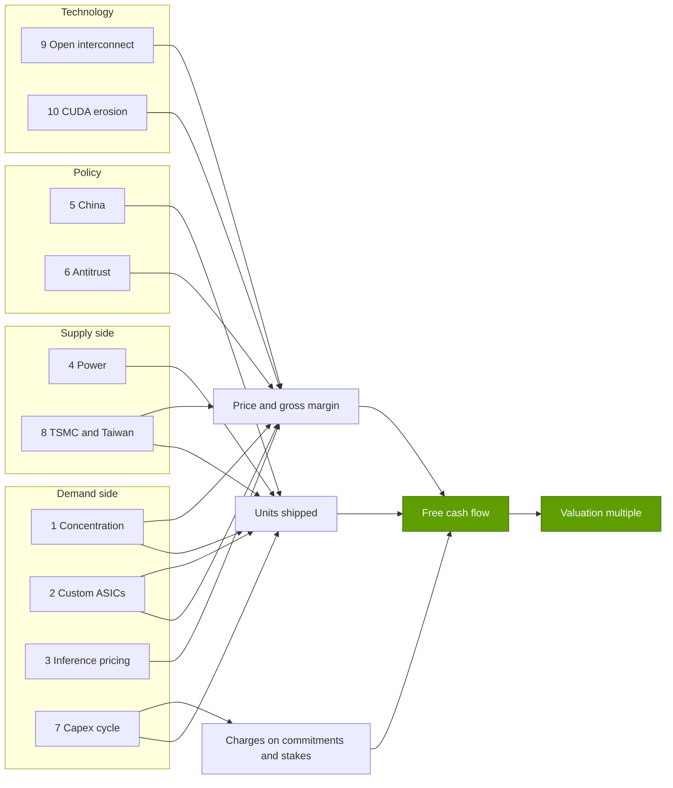
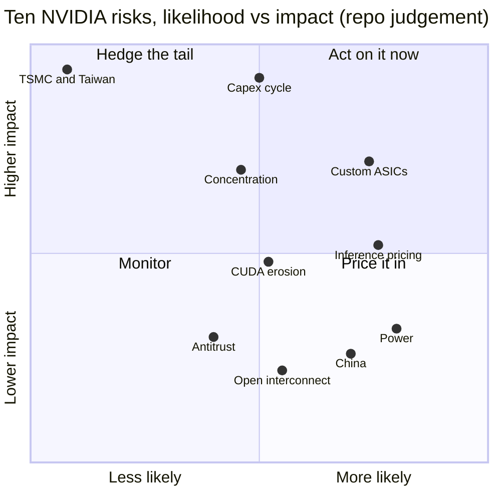
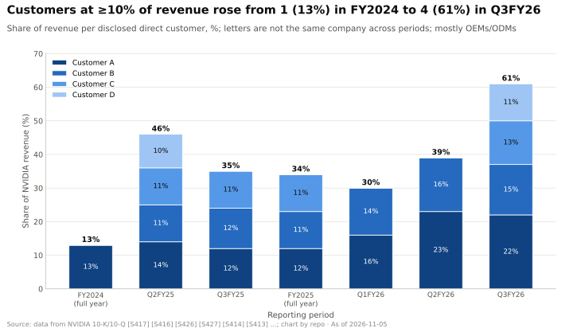
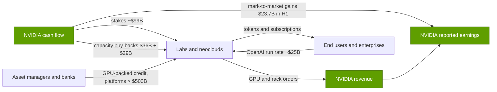
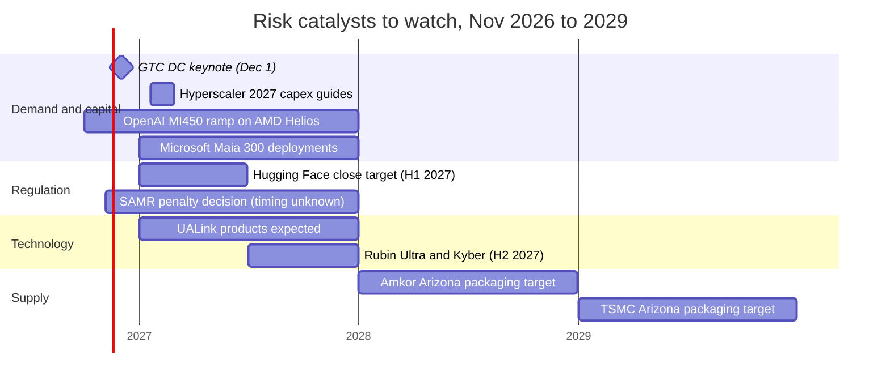

# 18 — Vulnerabilities and bear case

Cross-cutting 18 · Ten risks, steelmanned, scored and tracked · ~38 min read · Last verified: 2026-11-05

## ⚡ The Executive Take

- **The bear case is not "demand is weak".** Q2 FY2027 revenue was $96.2B (+106 % y/y) at a 75.0 % GAAP gross margin, Q3 is guided to $108B, and management frames ~70 % FY2028 growth as what supply allows [[S405]](../sources/bibliography.md#s405)[[S90012]](../sources/bibliography.md#s90012)[[S18000]](../sources/bibliography.md#s18000). The strongest bear case is that today's demand is concentrated, partly self-financed and substitutable, and that all three show up in pricing before they show up in volume.
- **Two risks dominate the repo's heatmap.** 🔴 Hyperscaler custom silicon scores 16 of 25 (likelihood 4 × impact 4): Broadcom's quarterly AI revenue already equals ~19 % of NVIDIA's Data Center revenue, and Anthropic has access to up to 1M TPUs [[S2516]](../sources/bibliography.md#s2516)[[S653]](../sources/bibliography.md#s653). 🔴 The capex cycle scores 15 (3 × 5): supply commitments reached $279B, 2.9× quarterly revenue, against ~1.4× before the FY2023 inventory bust [[S407]](../sources/bibliography.md#s407).
- **The circular-financing ratio now matches Lucent's.** NVIDIA bought $42.4B of equity in H1 FY2027, ~24 % of half-year revenue, the same share Lucent extended as vendor financing in 1999–2000 [[S90072]](../sources/bibliography.md#s90072)[[S18007]](../sources/bibliography.md#s18007). The difference is who pays: NVIDIA generated $50.3B of operating cash flow in Q1 FY2027 alone, and its largest buyers are cash-rich hyperscalers, not start-up carriers [[S403]](../sources/bibliography.md#s403).
- **Concentration is the amplifier.** One direct customer was 16 % of Q2 FY2027 revenue, three were 44 % of H1, and hyperscale was ~55 % of Data Center revenue [[S90069]](../sources/bibliography.md#s90069)[[S90011]](../sources/bibliography.md#s90011)[[S406]](../sources/bibliography.md#s406). The same buyers build TPU, Trainium, Maia and MTIA, so risks 1, 2 and 7 are one correlated bet.
- **Policy risks are likely but bounded.** China fell from ~26 % of revenue (FY2022) to 5.6–8.2 % in FY2027 quarters and is excluded from guidance [[S2]](../sources/bibliography.md#s2)[[S90070]](../sources/bibliography.md#s90070)[[S90069]](../sources/bibliography.md#s90069); a SAMR fine of 1–10 % of prior-year China sales would be ~$0.2–2.5B (repo calc) [[S9505]](../sources/bibliography.md#s9505)[[S401]](../sources/bibliography.md#s401).
- **Technology risks erode pricing power slowly.** UALink products are expected in 2027 and AMD's lag on a new frontier model fell to 26 days [[S90051]](../sources/bibliography.md#s90051)[[S631]](../sources/bibliography.md#s631); 🔴 the repo scores CUDA lock-in at 2.75/5 for frontier labs. Taiwan (1 × 5) is the tail: all CoWoS packaging is on the island [[S18012]](../sources/bibliography.md#s18012).
- **The market already prices a peak.** At ~$5.3–5.8T (Aug–Oct 2026) NVIDIA trades near 14× guided FY2028 earnings, which implies only ~2 % a year of growth afterwards (🔴 repo arithmetic) [[S18004]](../sources/bibliography.md#s18004)[[S18005]](../sources/bibliography.md#s18005)[[S18027]](../sources/bibliography.md#s18027). A bear needs earnings to *fall* after FY2028. 🔴 The most probable bear outcome is gross margin drifting from 75 % toward the mid-60s; a 2001-style air pocket is the tail.

![Risk heatmap with likelihood on the x-axis and impact on the y-axis, each scored 1 to 5, plus a ranked bar panel. Scores (likelihood x impact): hyperscaler custom ASICs 16 (4x4), circular financing and the capex cycle 15 (3x5), customer concentration 12 (3x4), inference commoditization 12 (4x3), software abstraction eroding CUDA 9 (3x3), power constraints 8 (4x2), China and export controls 8 (4x2), antitrust 6 (3x2), open interconnect standards 6 (3x2) and TSMC/Taiwan concentration 5 (1x5), a low-probability, extreme-impact tail. All scores are the repo's judgement.](../assets/charts/18-risk-heatmap.svg)

## How to read this chapter

Every other page in this repo explains why NVIDIA wins. This one does the opposite on purpose. For each of ten risks it builds a [steelman](../glossary.md#steelman): the strongest honest version of the bear argument, with numbers. It then gives NVIDIA's best counter and ends with a verdict. The verdict scores **likelihood** (does the risk bite within its horizon?) and **impact** (how much FY2028–FY2030 gross profit is at stake if it does?) and lists the [leading indicators](../glossary.md#leading-indicator) to watch. The scores are the repo's judgement (🔴) and sit, with a rationale and evidence per row, in `data/x18_risks.csv` [[S18027]](../sources/bibliography.md#s18027). Treat them as a structured argument, not a forecast.

| Score | Likelihood (within the stated horizon) | Impact (on FY2028–FY2030 gross profit) |
|---|---|---|
| 1 | < 10 % | < 2 % |
| 2 | 10–30 % | 2–5 % |
| 3 | 30–50 % | 5–15 % |
| 4 | 50–70 % | 15–30 % |
| 5 | > 70 % | > 30 %, or a multi-year revenue decline |

Risks reach NVIDIA's value through four channels: fewer units, lower prices (gross margin), one-off charges on commitments and stakes, and a lower valuation multiple. The map below shows which risk travels through which channel. Most of them run through **price**, which is why gross margin is the single best early-warning gauge.

The [risk heatmap](../glossary.md#risk-heatmap) at the top of the page and the quadrant below show the same scores two ways. The top-right quadrant is where the analysis should spend its time.

> [!TIP]
> **Worked example — what an impact score means in dollars.** On the guided FY2028 path, revenue is ~$697B at a ~72.5 % gross margin, ~$505B of gross profit (🔴 repo arithmetic from [[S18000]](../sources/bibliography.md#s18000)). Impact 4 means a 15–30 % hit: **$76–152B a year**. With likelihood 4 (50–70 %), the probability-weighted exposure is ~$38–106B a year. Impact 2 means 2–5 %, or $10–25B. **Conclusion:** even a "low" score on this scale is a number most semiconductor companies would call their whole business; the scale is relative to NVIDIA's size.

🔧 Under the hood: why the risks are correlated, and why that matters

The ten risks are not independent draws. Risks 1 (concentration), 2 (custom silicon) and 7 (capex cycle) share the same five or six counterparties: Alphabet, Amazon, Meta, Microsoft, OpenAI and Anthropic. A single decision by one of them, for example to slow 2028 capex and fill the remainder with in-house chips, would trigger all three at once. Risks 3 (inference pricing) and 10 (CUDA erosion) are also linked: open serving engines are both the reason inference is portable and the reason CUDA matters less. Conversely, risk 2 partly hedges risk 6. The more credible TPUs and Trainium become, the weaker any antitrust case that NVIDIA controls the market. A portfolio view would therefore not add the ten scores; it would stress-test the correlated cluster (1 + 2 + 7) as one scenario. The [valuation section](#valuation-what-the-market-already-implies) does that.

## Risk 1 — Customer concentration

### 🐻 The steelman

NVIDIA's [customer concentration](../glossary.md#customer-concentration) is high and its biggest customers are its most capable competitors. In the Q2 FY2027 10-Q, one direct customer accounted for 16 % of quarterly revenue, and three direct customers accounted for 16 %, 15 % and 13 % of first-half revenue, 44 % in all [[S90069]](../sources/bibliography.md#s90069). These "direct" customers are mostly OEMs and ODMs that assemble racks; the money behind them comes from a few [hyperscalers](../glossary.md#hyperscaler) and labs. NVIDIA says several [indirect customers](../glossary.md#indirect-customer) each pass 10 % of revenue [[S90069]](../sources/bibliography.md#s90069). Hyperscale revenue was ~$48.7B in Q2 FY2027, ~55 % of Data Center revenue [[S90011]](../sources/bibliography.md#s90011)[[S406]](../sources/bibliography.md#s406).

Three features make this worse than an ordinary concentrated supplier. First, the base has become *more* American: non-US-headquartered customers were 22 % of Q1 FY2027 revenue, down from 42 % a year earlier [[S90070]](../sources/bibliography.md#s90070). Second, one AI research lab contributed meaningfully to revenue through cloud providers [[S90070]](../sources/bibliography.md#s90070), so a single model company's funding round can move NVIDIA's quarter. Third, NVIDIA buys back from the same customers: it holds $29B of multi-year cloud service agreements and $36B of AI-cloud capacity agreements [[S407]](../sources/bibliography.md#s407). A buyer that is also a supplier and a competitor has unusual bargaining power.

### 🛡️ NVIDIA's counter

The latest disclosures move in NVIDIA's favour. The Q2 FY2027 10-Q names a single direct customer above 10 % for the quarter (16 %), against four totalling 61 % in Q3 FY2026 [[S90069]](../sources/bibliography.md#s90069)[[S412]](../sources/bibliography.md#s412). The non-hyperscale book is large: AI clouds, industrial and enterprise buyers ([ACIE](../glossary.md#acie)) took ~$40.3B, 45 % of Q2 FY2027 Data Center revenue [[S406]](../sources/bibliography.md#s406); sovereign AI passed ~$30B in FY2026 (+80 %); and regional [neoclouds](../glossary.md#neocloud) grew 35 % q/q in Q2 [[S90071]](../sources/bibliography.md#s90071). Above all, NVIDIA is [supply-constrained](../glossary.md#supply-constrained). Management says demand is "much greater" than the ~70 % growth it can supply in FY2028 [[S18000]](../sources/bibliography.md#s18000). In that world a cancelled order is re-allocated, not lost.

> [!TIP]
> **Worked example — what one hyperscaler's pause costs.** Hyperscale revenue was $48.7B in Q2 FY2027 [[S90011]](../sources/bibliography.md#s90011). Assume (🔴) the largest of four buyers is ~30 % of it, ~$15B a quarter, and moves a third of its spend to in-house silicon: −$5B of revenue a quarter, ~5 % of NVIDIA's total, or ~$3.8B of gross profit at 75 %. If the remaining hyperscalers then negotiate 5 points off gross margin, that is another $48.7B × 5 % ≈ **$2.4B a quarter**. **Conclusion:** in a supply-constrained market the volume can be resold, so the lasting damage from concentration is the price concession, ~$10B of gross profit a year in this example.

🔧 Under the hood: how to read NVIDIA's customer disclosures

NVIDIA reports any *direct* customer above 10 % of revenue, labelled A, B, C, and re-assigns the letters every period, so "Customer A" in two filings may be different firms. Direct customers are mostly ODMs (Foxconn, Quanta, Wistron and others) and OEMs, which is why the direct numbers swing when a hyperscaler moves orders between assemblers. NVIDIA also *estimates* indirect customers (the end buyers behind the ODMs) from channel data; these are not audited figures. The repo's earlier quarterly rows (Q1–Q3 FY2026) were transcribed from memory and are flagged for re-verification; the FY2027 figures come from the Q2 FY2027 10-Q [[S90069]](../sources/bibliography.md#s90069). The practical rule: track hyperscale share of Data Center revenue (now ~55 %) rather than the direct-customer letters.

> [!IMPORTANT]
> **Verdict — customer concentration.** Likelihood **3** · Impact **4** · Score **12** · Horizon **2027–2028**. The concentration is real and correlated with risks 2 and 7, but supply scarcity converts most of it into a pricing risk. **Watch:** hyperscale share of Data Center revenue (~55 %; > 60 % is a warning), the number of ≥ 10 % customers in each 10-Q, and whether NVIDIA's cloud-capacity agreements keep growing.

## Risk 2 — Hyperscaler custom silicon (TPU, Trainium, Maia, MTIA)

### 🐻 The steelman

Every large buyer now has a credible [ASIC](../glossary.md#asic). Google's [TPU](../glossary.md#tpu) is the proof: Ironwood delivers 4,614 TFLOPS of dense FP8 per chip in 9,216-chip pods [[S151]](../sources/bibliography.md#s151)[[S650]](../sources/bibliography.md#s650), TPU 8t reaches 12.6 PFLOPS of FP4 [[S552]](../sources/bibliography.md#s552), and the chips are now sold outside Google. Anthropic has access to up to 1M TPUs, more than 1 GW in 2026 [[S653]](../sources/bibliography.md#s653); Meta rents Ironwood capacity and has discussed buying TPUs for its own sites 🟡 [[S90025]](../sources/bibliography.md#s90025); Oracle will host TPUs [[S552]](../sources/bibliography.md#s552). OpenAI is co-designing 10 GW of accelerators with Broadcom [[S174]](../sources/bibliography.md#s174), and its first inference chip reportedly does 13.4 PFLOPS of MXFP4 on one die, against 17.5 PFLOPS of NVFP4 per Rubin die 🟡 [[S628]](../sources/bibliography.md#s628). AWS made Trainium3 generally available on 3 nm and promises Trainium4 with 6× its FP4 throughput [[S90034]](../sources/bibliography.md#s90034)[[S90035]](../sources/bibliography.md#s90035). Microsoft runs Copilot on Maia 200 and plans Maia 300 in 2027 and multi-gigawatt Maia deployments from 2027 [[S90044]](../sources/bibliography.md#s90044)[[S90045]](../sources/bibliography.md#s90045)[[S90046]](../sources/bibliography.md#s90046). Meta has MTIA 300 in production with three more generations through 2027 [[S561]](../sources/bibliography.md#s561).

The money is already moving. Broadcom booked $16.7B of AI semiconductor revenue in its quarter to 2026-08-02, about 19 % of NVIDIA's $89.0B Data Center revenue, and guided $21.7B for the next [[S2516]](../sources/bibliography.md#s2516). Two years earlier the ratio was ~11–14 % [[S660]](../sources/bibliography.md#s660)[[S661]](../sources/bibliography.md#s661). On a unit basis, TrendForce-type estimates put ASIC-based servers near 28 % of 2026 AI server shipments (as recalled, unverified) [[S666]](../sources/bibliography.md#s666).

The economics explain why. SemiAnalysis estimates an owned Ironwood at ~$1.21 per chip-hour against ~$1.73 for a B200 and ~$2.31 for a GB300 (Est.) [[S622]](../sources/bibliography.md#s622), and ~18 % cheaper per token than B200 on one FP8 workload [[S625]](../sources/bibliography.md#s625). A hyperscaler's walk-away price for NVIDIA is its own chip's cost. That caps NVIDIA's price at exactly the accounts that make up half its Data Center revenue.

### 🛡️ NVIDIA's counter

Share has barely moved while the pool exploded. NVIDIA kept ~87 % of AI silicon revenue in 2025 as the pool grew ~4.2× from 2023; custom ASICs stayed near 10 % (Est.) [[S416]](../sources/bibliography.md#s416)[[S1]](../sources/bibliography.md#s1)[[S660]](../sources/bibliography.md#s660)[[S661]](../sources/bibliography.md#s661)[[S662]](../sources/bibliography.md#s662). An in-house program needs roughly 130,000 chips per generation to beat buying GPUs (🔴, see [CS3](../case-studies/CS3-google-tpu-the-credible-alternative.md)) [[S23010]](../sources/bibliography.md#s23010), a bar only a handful of buyers clear. Hyperscalers also rent NVIDIA GPUs to cloud customers who ask for [CUDA](../glossary.md#cuda), so ASICs serve internal workloads first. NVIDIA is co-opting the threat: Trainium4 is designed to plug into [NVLink Fusion](../glossary.md#nvlink-fusion) and NVIDIA's MGX racks [[S518]](../sources/bibliography.md#s518)[[S90034]](../sources/bibliography.md#s90034). Finally, NVIDIA can price against the ASIC: a repo estimate suggests it could match the TPU's per-token cost and still keep a ~62 % gross margin (🔴) [[S23010]](../sources/bibliography.md#s23010).

> [!TIP]
> **Worked example — the price ceiling an ASIC sets.** Take the repo's CS3 estimate that matching TPU cost per token would take NVIDIA's gross margin on that business to ~62 % (🔴) [[S23010]](../sources/bibliography.md#s23010). Apply it only to hyperscale (~55 % of Data Center revenue [[S90011]](../sources/bibliography.md#s90011)) and keep 75 % elsewhere: the blended margin is 0.55 × 62 % + 0.45 × 75 % ≈ **68 %**. On the guided FY2028 revenue of ~$697B, 4.5 points below the guided ~72.5 % is ~$31B of gross profit a year, ~6 % of the total. **Conclusion:** custom silicon is a margin risk long before it is a volume risk, and it is the risk most likely to show up first, in the gross-margin line.

> [!IMPORTANT]
> **Verdict — hyperscaler ASICs.** Likelihood **4** · Impact **4** · Score **16** (highest) · Horizon **2027–2029**. Already visible in share of *growth* and in external TPU deals, not yet in NVIDIA's absolute revenue. Consistent with [CS3](../case-studies/CS3-google-tpu-the-credible-alternative.md): it caps pricing power, not volume. **Watch:** Broadcom AI revenue ÷ NVIDIA Data Center revenue (~19 %; > 25 % is a warning), a Meta TPU *purchase*, Maia 300 and Trainium4 volumes, and NVIDIA's gross margin.

## Risk 3 — Inference commoditization

### 🐻 The steelman

[Inference](../glossary.md#inference) is where NVIDIA's moat is thinnest and its growth is largest. Management last sized it at more than 40 % of Data Center revenue, for the year to Q2 FY2025 [[S11011]](../sources/bibliography.md#s11011). Unlike frontier training, inference splits into small, independent jobs that are easy to benchmark and easy to move.

Prices are falling faster than any hardware cost curve. [Token price deflation](../glossary.md#token-price-deflation) took the cheapest GPT-3.5-level model from $20 to $0.07 per million tokens in two years, ~286× [[S11526]](../sources/bibliography.md#s11526). H100 rentals fell from ~$8 per GPU-hour in 2023 to under ~$2 on marketplaces by late 2024 [[S393]](../sources/bibliography.md#s393). The serving layer is neutral: [vLLM](../glossary.md#vllm) ships in-tree support for NVIDIA, AMD and Intel and plugins for TPU, Gaudi and Huawei Ascend [[S580]](../sources/bibliography.md#s580). And purpose-built inference silicon keeps arriving: OpenAI's Broadcom chip [[S628]](../sources/bibliography.md#s628), up to 750 MW of Cerebras for OpenAI [[S11523]](../sources/bibliography.md#s11523), TPUs ~18 % cheaper per token than B200 on one workload [[S625]](../sources/bibliography.md#s625). NVIDIA itself paid a reported ~$20B to license Groq's technology and hire its team 🟡 [[S90019]](../sources/bibliography.md#s90019), a price that signals how seriously it took the threat. DeepSeek V4-Pro was priced at ~$3.48 per million output tokens [[S90080]](../sources/bibliography.md#s90080).

### 🛡️ NVIDIA's counter

Cheaper tokens have so far meant more spending, the [Jevons paradox](../glossary.md#jevons-paradox). Google's monthly tokens rose ~134× in 18 months [[S32018]](../sources/bibliography.md#s32018)[[S32020]](../sources/bibliography.md#s32020). The SemiAnalysis H100 one-year rental index rebounded from a $1.70 low in October 2025 to $2.35 in March 2026, +38 %, as old GPUs were re-priced upward [[S12516]](../sources/bibliography.md#s12516). Frontier prices are rising, not falling: GPT-5.5 launched at ~3.3× GPT-5's blended price 🟡 [[S11535]](../sources/bibliography.md#s11535). NVIDIA's rack-scale systems win where inference is hardest: GB300 NVL72 serves ~13× H200's DeepSeek-R1 [tokens per MW](../glossary.md#tokens-per-megawatt) at 50 tokens/s per user (Est.) [[S621]](../sources/bibliography.md#s621)[[S622]](../sources/bibliography.md#s622), and software alone lifted DeepSeek-R1 throughput on an unchanged GB300 NVL72 2.9× in a year [[S601]](../sources/bibliography.md#s601)[[S603]](../sources/bibliography.md#s603). NVIDIA also bought the inference-ASIC idea instead of fighting it: the Groq 3 LPX rack now sits beside Vera Rubin [[S90003]](../sources/bibliography.md#s90003).

> [!TIP]
> **Worked example — the elasticity line the bear has to cross.** Spending on tokens = price × quantity. If the price of a fixed-quality token falls 10× and the [price elasticity](../glossary.md#price-elasticity) of demand is 1.5, quantity rises 10^1.5 ≈ 32× and spending rises **~3.2×**. At an elasticity of 0.8, quantity rises only 10^0.8 ≈ 6.3× and spending *falls* to ~0.63× (🔴 repo arithmetic, see [CS5](../case-studies/CS5-deepseek-moment-and-efficiency-shock.md)). **Conclusion:** the bear case is not "tokens get cheap"; it is that elasticity drops below 1 in mature workloads. The rental rebound says it has not happened yet.

> [!IMPORTANT]
> **Verdict — inference commoditization.** Likelihood **4** · Impact **3** · Score **12** · Horizon **2026–2029**. Price deflation is certain; whether it hurts depends on elasticity, which is still above 1. **Watch:** the H100 and B200 rental indices ($2.35 for H100; below the $1.70 low is a warning), fixed-capability token prices, and any renewed disclosure of NVIDIA's inference share.

## Risk 4 — Power constraints

### 🐻 The steelman

NVIDIA ships chips faster than the world builds substations. Power per NVIDIA system rose ~190× in a decade, from 3.2 kW (DGX-1) to ~600 kW for the 2027 Kyber rack [[S310]](../sources/bibliography.md#s310)[[S305]](../sources/bibliography.md#s305). Getting that power is slow: the median US project waits more than 48 months from [interconnection queue](../glossary.md#interconnection-queue) request to operation [[S8009]](../sources/bibliography.md#s8009); large data centers in Dominion's Northern Virginia territory may wait up to seven years [[S8010]](../sources/bibliography.md#s8010); ERCOT tracks ~410 GW of large loads seeking connection, ~87 % of them data centers [[S8011]](../sources/bibliography.md#s8011). The IEA expects data-center electricity to rise from ~415 TWh (2024) to ~945 TWh by 2030 and flags ~20 % of planned projects as at risk of delay [[S33015]](../sources/bibliography.md#s33015).

Prices show the scarcity. In PJM, the largest US data-center market, the [capacity market](../glossary.md#capacity-market) price rose from $28.92 per MW-day (2024/25) to $333.44 (2027/28), ~11.5× in three auctions, held down only by a negotiated cap; PJM estimates ~$530 without it [[S18018]](../sources/bibliography.md#s18018)[[S18016]](../sources/bibliography.md#s18016)[[S18017]](../sources/bibliography.md#s18017). The region fell ~6,600 MW short of its reliability target [[S18019]](../sources/bibliography.md#s18019). Gigawatt claims are also slipping: satellite analysis found ~350 MW of cooling at a site claimed as the first gigawatt cluster [[S90077]](../sources/bibliography.md#s90077), and the Abilene expansion was dropped after financing talks failed [[S27001]](../sources/bibliography.md#s27001).

### 🛡️ NVIDIA's counter

A power cap does not cut AI budgets; it redirects them to the best output per megawatt, which is NVIDIA's strongest metric. A buyer with a fixed 1 GW maximises tokens per MW, and GB300 NVL72 delivers ~13× H200 on that measure (Est.) [[S621]](../sources/bibliography.md#s621)[[S622]](../sources/bibliography.md#s622). Electricity is only ~12–19 % of a GPU's yearly cost [[S389]](../sources/bibliography.md#s389)[[S382]](../sources/bibliography.md#s382), so access, not price, is the problem, and NVIDIA is working on access: ~20 partners are building [800 V DC](../glossary.md#hvdc-800v) power gear, with an MGX 800 VDC rack in H2 2026 and an Omniverse DSX digital-twin blueprint for site design [[S90061]](../sources/bibliography.md#s90061)[[S90063]](../sources/bibliography.md#s90063). Builders also go [behind the meter](../glossary.md#behind-the-meter) with on-site gas, as at Colossus 2 [[S8015]](../sources/bibliography.md#s8015).

> [!TIP]
> **Worked example — what a slipped gigawatt is worth.** NVIDIA puts its content in a 1 GW AI factory at ~$35B [[S398]](../sources/bibliography.md#s398). If 5 GW of 2027 builds slip by a year (🔴), ~$175B of NVIDIA revenue moves right, about a quarter of the guided FY2028 revenue. But a delay is not a loss: the revenue arrives later, and in a [supply-constrained](../glossary.md#supply-constrained) year the chips go to sites that are powered. **Conclusion:** power is a timing risk with a large near-term P&L swing and a small effect on long-run value, unless delays trigger order cancellations and feed risk 7.

> [!IMPORTANT]
> **Verdict — power.** Likelihood **4** · Impact **2** · Score **8** · Horizon **2026–2030**. Here the repo differs mildly from the [layer 08 framing](../layers/08-systems-racks-ai-factories/index.md) that power is "often the binding constraint": we agree it binds timing, but score impact lower because deferred revenue is not lost revenue. **Watch:** PJM and ERCOT capacity prices, queue times, neocloud active vs contracted power (CoreWeave ~1.5 GW active vs ~3.7 GW contracted [[S12010]](../sources/bibliography.md#s12010)), and reports of GPUs sitting unpowered.

## Risk 5 — China and export controls

### 🐻 The steelman

China used to be a quarter of NVIDIA: 26.4 % of FY2022 revenue on the old billing basis [[S2]](../sources/bibliography.md#s2). On the customer-headquarters basis it peaked at $25.0B in FY2025, then fell to 9.1 % in FY2026 and 5.6–8.2 % in FY2027 quarters [[S401]](../sources/bibliography.md#s401)[[S90070]](../sources/bibliography.md#s90070)[[S90069]](../sources/bibliography.md#s90069). The path was costly: the April 2025 [export controls](../glossary.md#export-controls) forced a $4.5B H20 charge and pushed GAAP gross margin to 60.5 % [[S90081]](../sources/bibliography.md#s90081)[[S444]](../sources/bibliography.md#s444). Licences came back with levies of 15 % (H20) and then 25 % (H200) of revenue to the US government [[S26004]](../sources/bibliography.md#s26004)[[S90032]](../sources/bibliography.md#s90032), and Beijing told buyers to avoid NVIDIA parts and banned foreign AI chips from state-funded data centers [[S26006]](../sources/bibliography.md#s26006)[[S26007]](../sources/bibliography.md#s26007). NVIDIA has recognised no H200 revenue, and press reports put Q2 FY2027 China H200 sales below 1 % of Data Center revenue 🟡 [[S90081]](../sources/bibliography.md#s90081)[[S26009]](../sources/bibliography.md#s26009).

The long-run cost is a protected rival. Huawei's Ascend 950 series ships in 2026 and its Atlas 950 SuperPoD of 8,192 chips is promised for Q4 2026 [[S90042]](../sources/bibliography.md#s90042)[[S90043]](../sources/bibliography.md#s90043); DeepSeek V4 was partly trained on Ascend [[S90079]](../sources/bibliography.md#s90079). The contagion risk is wider: sovereign AI earned NVIDIA more than ~$30B in FY2026 [[S90071]](../sources/bibliography.md#s90071), and Gulf deals such as HUMAIN's up to 600,000 GPUs [[S13003]](../sources/bibliography.md#s13003) depend on US licences. Full detail is in [CS6](../case-studies/CS6-china-export-controls-h20-and-beyond.md).

![Two-panel chart of China's share of NVIDIA revenue. Left, by fiscal year on the old billing basis: 23.9% FY2019, 25.0% FY2020, 23.3% FY2021, 26.4% FY2022, 21.4% FY2023, 16.9% FY2024, 13.1% FY2025; on the new customer-headquarters basis: 20.2% FY2024, 19.2% FY2025 ($25.0B, the dollar peak) and 9.1% FY2026 ($19.7B). Right, by quarter on the headquarters basis: 21.9% in Q1 FY2026, 8.6% in Q2 FY2026 after the H20 licence requirement, 5.6% in Q1 FY2027 and 8.2% in Q2 FY2027 (all platforms, including gaming).](../assets/charts/CS6-china-revenue-share.svg)

### 🛡️ NVIDIA's counter

The damage is already in the numbers. Guidance has excluded China Data Center compute since early 2026 [[S405]](../sources/bibliography.md#s405), so any H200 shipment is upside. NVIDIA grew total revenue 65 % in FY2026 while China's share collapsed [[S1]](../sources/bibliography.md#s1). And because NVIDIA is supply-constrained, wafers not sold to China are sold elsewhere at the same margin; CS6's scenarios put the cost of a ban near zero in that case, against up to ~$13B a year of gross profit if the capacity could not be resold (🔴).

> [!TIP]
> **Worked example — what the levy is worth.** CS6 sizes China's data-center market at ~$17.5B a year (🔴). At a 75 % gross margin that is ~$13.1B of gross profit; a 25 % revenue levy cuts the effective margin to 50 %, or ~$8.8B. **The levy costs ~$4.4B a year**, about 1 % of guided FY2028 gross profit. **Conclusion:** China is now an option, not a pillar; the risk that matters is the rule that reaches the Gulf or other sovereign buyers.

> [!IMPORTANT]
> **Verdict — China and export controls.** Likelihood **4** · Impact **2** · Score **8** · Horizon **2026–2028**. Policy will keep moving, but China is ~6–9 % of revenue and outside guidance. Impact would rise to 3–4 if controls extended to the Middle East. **Watch:** H200 revenue actually recognised, new BIS rules for third countries, Huawei SuperPoD shipments, and the China line in each 10-Q.

## Risk 6 — Antitrust

### 🐻 The steelman

Three regulators are looking at NVIDIA's conduct. China's [SAMR](../glossary.md#samr) opened a probe in December 2024 and on 2025-09-15 issued a preliminary finding that NVIDIA breached conditions attached to its 2020 Mellanox approval; penalties of 1–10 % of prior-year China sales are possible [[S9505]](../sources/bibliography.md#s9505)[[S21003]](../sources/bibliography.md#s21003). The US DOJ opened an investigation in mid-2024 after rivals complained, then issued subpoenas; the reported concern is that NVIDIA makes switching harder and penalises buyers that do not use it exclusively [[S9504]](../sources/bibliography.md#s9504)[[S9503]](../sources/bibliography.md#s9503). Deals add new fronts: the $12.9B Hugging Face purchase may face EU review and has drawn reported DOJ interest 🟡 [[S11027]](../sources/bibliography.md#s11027)[[S11028]](../sources/bibliography.md#s11028), and Senators Warren and Blumenthal questioned the ~$20B Groq licence-plus-hire as a way around [merger review](../glossary.md#merger-review), with the FTC saying it would scrutinise such structures [[S13511]](../sources/bibliography.md#s13511).

The deeper exposure is conduct. When supply is short, allocation is power: the DOJ's reported concern maps directly onto who gets Rubin first. NVIDIA also sells racks in which GPUs, NVLink switches, NICs and software arrive as one bundle, a [tying](../glossary.md#tying) pattern regulators know well, and it now holds ~$99B of stakes in customers and partners [[S90072]](../sources/bibliography.md#s90072). A [behavioural remedy](../glossary.md#behavioural-remedy) that forced unbundled pricing or neutral allocation would reach the networking business, ~20 % of Data Center revenue [[S90012]](../sources/bibliography.md#s90012).

### 🛡️ NVIDIA's counter

The market looks contestable: TPUs, Trainium, Maia, MTIA and AMD's 6 GW OpenAI and Meta deals all exist, so risk 2 is NVIDIA's best antitrust defence [[S653]](../sources/bibliography.md#s653)[[S546]](../sources/bibliography.md#s546)[[S24004]](../sources/bibliography.md#s24004). NVIDIA has also opened up: it open-sourced Run:ai and the KAI scheduler [[S12510]](../sources/bibliography.md#s12510), released Dynamo under Apache 2.0 [[S90066]](../sources/bibliography.md#s90066), opened NVLink to third-party silicon through NVLink Fusion [[S131]](../sources/bibliography.md#s131), joined ESUN as a founding member [[S576]](../sources/bibliography.md#s576) and pledged that Hugging Face will not require NVIDIA chips [[S11026]](../sources/bibliography.md#s11026). Run:ai closed after EU clearance [[S476]](../sources/bibliography.md#s476).

> [!TIP]
> **Worked example — the size of the fine vs the size of a remedy.** SAMR's maximum is 10 % of prior-year China sales: 10 % × $25.0B (FY2025) = **$2.5B** [[S9505]](../sources/bibliography.md#s9505)[[S401]](../sources/bibliography.md#s401), about 4 % of one quarter's net income of $59.7B [[S405]](../sources/bibliography.md#s405). A remedy that cut networking attach by a quarter would touch ~$17.5B × 25 % ≈ **$4.4B of revenue a quarter** (🔴) [[S90012]](../sources/bibliography.md#s90012). **Conclusion:** fines are noise; conduct remedies on bundling or allocation are the version of this risk worth modelling.

> [!IMPORTANT]
> **Verdict — antitrust.** Likelihood **3** · Impact **2** · Score **6** · Horizon **2026–2028**. A SAMR penalty is likely but small; a US or EU conduct remedy is less likely but larger. **Watch:** SAMR's penalty decision, a DOJ second request or EU Phase 2 on Hugging Face, any complaint about allocation or bundling, and FTC action on licence-plus-hire deals.

## Risk 7 — Circular financing and the capex cycle

This is the risk with the largest impact score, because a downturn would hit revenue, commitments and stakes at the same time.

### 🐻 The steelman

**The capex is unprecedented.** Alphabet, Amazon and Meta spent $127B in 2022 and guided ~$505B for 2026 [[S455]](../sources/bibliography.md#s455)[[S456]](../sources/bibliography.md#s456)[[S457]](../sources/bibliography.md#s457)[[S460]](../sources/bibliography.md#s460)[[S461]](../sources/bibliography.md#s461)[[S462]](../sources/bibliography.md#s462); by mid-2026 their guides had drifted up to ~$558B, ~$728B with Microsoft [[S12518]](../sources/bibliography.md#s12518)[[S12519]](../sources/bibliography.md#s12519). Forecasters put 2027 near or above $1T [[S18023]](../sources/bibliography.md#s18023), and Alphabet's 2027 consensus alone is $311.8B, against $91.4B in 2025 [[S18022]](../sources/bibliography.md#s18022). Revenue has not kept pace: Bain estimates AI needs ~$2T of annual revenue by 2030 to fund its compute and sees an ~$800B shortfall [[S18024]](../sources/bibliography.md#s18024). OpenAI, with a run rate of roughly $25B in early 2026, guided ~$600B of compute spending through 2030, down from a ~$1.4T commitment framing in 2025 [[S18026]](../sources/bibliography.md#s18026)[[S18025]](../sources/bibliography.md#s18025).

**NVIDIA finances part of its own demand.** That is the core of the [circular financing](../glossary.md#circular-financing) critique. Equity stakes reached ~$99B in July 2026 (a CNBC aggregation of three balance-sheet lines in the 10-Q) [[S90073]](../sources/bibliography.md#s90073); equity purchases were $42.4B in H1 FY2027 against $1.2B a year earlier; and net equity gains of $23.7B in H1 equalled ~20 % of H1 net income of $118B [[S90072]](../sources/bibliography.md#s90072)[[S90069]](../sources/bibliography.md#s90069)[[S403]](../sources/bibliography.md#s403)[[S405]](../sources/bibliography.md#s405). The biggest stakes sit in customers: ~$30B in OpenAI and up to $10B in Anthropic [[S90015]](../sources/bibliography.md#s90015)[[S90075]](../sources/bibliography.md#s90075). NVIDIA also backstops demand: it will buy up to $6.3B of CoreWeave's unsold capacity through 2032 [[S90067]](../sources/bibliography.md#s90067) ([capacity backstop](../glossary.md#capacity-backstop)), and it holds $36B of AI-cloud capacity agreements plus $29B of cloud service agreements [[S407]](../sources/bibliography.md#s407). In August 2026 it organised platforms with Apollo, BlackRock, Blackstone, Brookfield, Goldman Sachs and KKR to mobilise more than $500B of third-party capital [[S12528]](../sources/bibliography.md#s12528), which moves risk into GPU-backed credit.

**The supply side would amplify a downturn.** NVIDIA's [purchase obligations](../glossary.md#purchase-obligations) (supply and capacity commitments) reached $279B, up from $119B a quarter earlier: 2.9× quarterly revenue, against ~1.4× before the FY2023 inventory write-downs [[S407]](../sources/bibliography.md#s407). Michael Burry called the 10-K's $95B of purchase obligations "troubling" in February [[S431]](../sources/bibliography.md#s431); the 10-Q's $279B is a broader line item, so the like-for-like rise is $119B → $279B in one quarter [[S90092]](../sources/bibliography.md#s90092). Downstream, CoreWeave plans $35–39B of 2026 capex on $12.4–13.2B of revenue [[S12500]](../sources/bibliography.md#s12500), and hyperscalers depreciate servers over 5.5–6 years while NVIDIA ships a new architecture every year ([useful life](../glossary.md#useful-life)) [[S382]](../sources/bibliography.md#s382)[[S385]](../sources/bibliography.md#s385).

**The telecom precedent is uncomfortably close.** Lucent's [vendor financing](../glossary.md#vendor-financing) commitments reached $8.1B in 1999–2000, ~24 % of its $33.6B revenue [[S18007]](../sources/bibliography.md#s18007). Nortel's financed agreements fell from $5.2B in 2000 to $2.1B in 2001 as the cycle broke [[S18008]](../sources/bibliography.md#s18008). Cisco said demand "consistently exceeded our expectations" through 2000, then guided a ~30 % sequential revenue drop and took a $2.25B excess-inventory charge in Q3 FY2001 [[S18010]](../sources/bibliography.md#s18010)[[S18009]](../sources/bibliography.md#s18009). NVIDIA's H1 FY2027 equity buying, as a share of revenue, now equals Lucent's peak ratio.

![Horizontal bar chart of customer financing as a share of revenue. Lucent's vendor-financing commitments in 1999-2000 were $8.1B, 24% of $33.6B revenue. NVIDIA's purchases of equity securities in H1 FY2027 were $42.4B, 24% of $177.8B half-year revenue; its equity stakes of about $99B equal 33% of $303B last-four-quarter revenue; and all customer-support ties (stakes, further equity commitments, AI-cloud capacity and cloud service agreements, about $189B) equal 62%. NVIDIA funds these from operating cash flow, while Lucent lent to thinly capitalised carriers.](../assets/charts/18-financing-vs-lucent.svg)

### 🛡️ NVIDIA's counter

NVIDIA's own answer is short: "Unlike Lucent, NVIDIA does not rely on vendor financing arrangements to grow revenue" [[S18007]](../sources/bibliography.md#s18007). The numbers support part of that. NVIDIA funds its stakes from operating cash flow ($50.3B in Q1 FY2027 alone) [[S403]](../sources/bibliography.md#s403), not borrowing. Its largest buyers (hyperscale, ~55 % of Data Center revenue) pay from their own operating cash flow [[S90011]](../sources/bibliography.md#s90011). The OpenAI deal was restructured from a $100B, deployment-linked letter of intent into a ~$30B straight equity stake with no deployment milestones 🟡 [[S90015]](../sources/bibliography.md#s90015)[[S90016]](../sources/bibliography.md#s90016), which loosens the "stake buys orders" link. The August 2026 platforms put third-party capital, not NVIDIA's, behind future builds [[S12528]](../sources/bibliography.md#s12528). Demand signals are still tight: H100 rental prices rose 38 % from their October 2025 low [[S12516]](../sources/bibliography.md#s12516), CoreWeave's backlog was $104.2B [[S12500]](../sources/bibliography.md#s12500), and NVIDIA sized Blackwell plus Vera Rubin demand at $1T through 2027 [[S90001]](../sources/bibliography.md#s90001). The supply commitments are the reason NVIDIA can grow ~70 % in FY2028 at all [[S18000]](../sources/bibliography.md#s18000).

| Feature | Telecom 1999–2001 | NVIDIA 2026 | Does the analogy hold? |
|---|---|---|---|
| Customer financing as % of revenue | Lucent ~24 % [[S18007]](../sources/bibliography.md#s18007) | Equity purchases ~24 % of H1 revenue; all ties ~62 % of LTM revenue [[S90072]](../sources/bibliography.md#s90072)[[S407]](../sources/bibliography.md#s407) | 🟥 Holds on size |
| Who borrowed | Start-up carriers on high-yield debt | Hyperscalers paying from cash flow; labs and neoclouds on equity and GPU-backed credit | 🟨 Partly: neoclouds and labs resemble carriers; hyperscalers do not |
| Vendor's funding | Debt and guarantees, some off balance sheet | Operating cash flow; third-party platforms [[S403]](../sources/bibliography.md#s403)[[S12528]](../sources/bibliography.md#s12528) | 🟩 Does not hold |
| Asset life after an overbuild | Fiber lasts decades, so excess capacity weighed on prices for years | GPUs depreciate in 3–6 years; excess is consumed faster [[S382]](../sources/bibliography.md#s382)[[S385]](../sources/bibliography.md#s385) | 🟨 Shorter but sharper |
| Price signal at the time | Bandwidth prices collapsing | H100 rentals +38 % since Oct 2025 [[S12516]](../sources/bibliography.md#s12516) | 🟩 Does not hold yet |
| Supplier commitments | Cisco inventory charge $2.25B [[S18009]](../sources/bibliography.md#s18009) | $279B commitments, 2.9× quarterly revenue [[S407]](../sources/bibliography.md#s407) | 🟥 Holds; larger in scale |

> [!TIP]
> **Worked example — a 2001-style stress test.** Suppose (🔴) quarterly revenue falls 40 % from the Q3 FY2027 guide of $108B to ~$65B. Commitments of $279B would then equal ~4.3 quarters of revenue. If 5 % of them became excess, as with the H20, the charge would be **~$14B**; a 30 % fall in the value of ~$99B of stakes adds **~$30B** of losses through other income [[S407]](../sources/bibliography.md#s407)[[S90072]](../sources/bibliography.md#s90072). Together, ~$44B, about three-quarters of one recent quarter's net income ($59.7B) [[S405]](../sources/bibliography.md#s405). **Conclusion:** NVIDIA's balance sheet survives this easily; its earnings and multiple would not, because revenue, charges and marks would all hit in the same quarters.

🔧 Under the hood: how financing can flatter reported results

Three accounting paths matter. (1) **Gains on stakes.** Changes in the value of NVIDIA's listed holdings, and remeasurements of private holdings when a new funding round prices them, run through "other income", so a hot private market lifts net income without any product being sold; that is why the repo tracks net equity gains against net income (~20 % in H1 FY2027). (2) **Consideration paid to customers.** Under revenue-recognition rules, value a vendor gives back to a customer (rebates, credits, some capacity purchases) can be treated as a reduction of revenue rather than an expense unless it buys something distinct at fair value. Capacity agreements in which NVIDIA buys compute it cannot resell are the line to read in the notes. (3) **Commitments.** Supply and capacity commitments are off balance sheet until goods arrive; if demand falls, the excess becomes an inventory or purchase-obligation charge, as the $4.5B H20 charge showed [[S90081]](../sources/bibliography.md#s90081). None of this implies misstatement; it means the reported numbers are more cyclical than the revenue line suggests.

> [!IMPORTANT]
> **Verdict — circular financing and the capex cycle.** Likelihood **3** · Impact **5** · Score **15** · Horizon **2027–2029**. The analogy holds on size and on supplier commitments, not on funding quality. Capex cycles do turn; the question is whether 2028 is a pause or a cut. **Watch:** the second derivative of hyperscaler capex guides (a first year-on-year cut), commitments ÷ quarterly revenue (2.9×), equity purchases ÷ revenue (~24 %), net equity gains ÷ net income (~20 %), the H100 rental index, and neocloud financing costs.

## Risk 8 — TSMC and Taiwan concentration

### 🐻 The steelman

Every NVIDIA data-center GPU die is made by TSMC and packaged with [CoWoS](../glossary.md#cowos), and all CoWoS capacity is in Taiwan [[S18012]](../sources/bibliography.md#s18012). Rubin itself is built on TSMC's 3 nm process (N3P reported) [[S100]](../sources/bibliography.md#s100)[[S35015]](../sources/bibliography.md#s35015). NVIDIA booked ~60 % of 2026 CoWoS wafers (Est.) [[S379]](../sources/bibliography.md#s379) and became TSMC's largest customer, ~19 % of its 2025 revenue (~$23.2B) [[S18015]](../sources/bibliography.md#s18015). Diversification is slow: TSMC made the first Blackwell wafer in Arizona on 2025-10-17 [[S18013]](../sources/bibliography.md#s18013), but those wafers still fly back to Taiwan for packaging [[S18012]](../sources/bibliography.md#s18012); an Arizona packaging plant is targeted for 2029 and an Amkor partnership for 2028 [[S18014]](../sources/bibliography.md#s18014). Memory adds a second concentration: SK hynix is expected to supply more than half of NVIDIA's 2026 [HBM](../glossary.md#hbm) [[S90039]](../sources/bibliography.md#s90039).

The acute scenario is a blockade or conflict. Bloomberg Economics estimates a one-year blockade would cut world GDP ~5 % and a war ~10.2 %, ~$10T, in the first year [[S18011]](../sources/bibliography.md#s18011). No second source exists for leading-node logic plus CoWoS at NVIDIA's volume, so its shipments would stop for the duration. The chronic scenario is supplier pricing power: TSMC reportedly raised N3P prices ~20 % [[S35037]](../sources/bibliography.md#s35037) and prices N2 at ~$30,000 a wafer [[S35003]](../sources/bibliography.md#s35003); Micron's gross margin (86.8 %) now exceeds NVIDIA's (75.0 %) [[S3533]](../sources/bibliography.md#s3533)[[S405]](../sources/bibliography.md#s405); and NVIDIA guided gross margin down to 71–72 % in Q4 FY2027 and 72–73 % in FY2028, citing memory costs [[S18000]](../sources/bibliography.md#s18000)[[S18002]](../sources/bibliography.md#s18002)[[S18001]](../sources/bibliography.md#s18001). The Rubin HBM4 bandwidth cut from 22 to 19.2 TB/s shows suppliers now shape NVIDIA's specs too [[S90006]](../sources/bibliography.md#s90006).

### 🛡️ NVIDIA's counter

Taiwan is a systemic risk, not a competitive one. AMD, Broadcom's TPU and OpenAI programmes, Trainium and Maia all depend on the same fabs and packaging lines, so a disruption would not hand share to a rival; buyers would have nowhere to go. As the anchor customer NVIDIA gets allocation first, and reported plans take CoWoS to ~260k wafers a month by 2028, ~17× end-2023 [[S3002]](../sources/bibliography.md#s3002). Arizona wafers (2025) and US packaging (2028–2029) reduce the single point of failure over time. On the chronic version, NVIDIA's guide assumes price increases that take margin back up in FY2028 [[S18000]](../sources/bibliography.md#s18000).

> [!TIP]
> **Worked example — how long the buffer lasts.** At the Q3 FY2027 guide ($108B revenue, 74 % margin), quarterly cost of sales is ~$28B [[S18000]](../sources/bibliography.md#s18000). NVIDIA held $31.6B of inventory at Q2 FY2027 [[S407]](../sources/bibliography.md#s407), ~1.1 quarters of cost of sales, part of it work in progress. **Conclusion:** a disruption shorter than about one quarter is survivable from inventory; anything longer is an industry-wide supply shock in which NVIDIA's relative position holds but its absolute revenue does not.

> [!IMPORTANT]
> **Verdict — TSMC and Taiwan.** Likelihood **1** (acute) · Impact **5** · Score **5** · Horizon **any time**. A tail to hedge, not a base case. The chronic margin squeeze from TSMC and memory makers would score ~4 × 2 on its own. **Watch:** the Arizona CoWoS and Amkor timelines, TSMC wafer price rises, HBM contract prices, and the gross-margin guide.

## Risk 9 — Open interconnect standards

### 🐻 The steelman

[Scale-up](../glossary.md#scale-up) was NVIDIA's most proprietary layer, and it is being standardised. [UALink](../glossary.md#ualink) 2.0 was ratified on 2026-04-07 with in-network compute, a chiplet definition and 200G links; UALink 1.0 silicon reaches labs in H2 2026 and products are expected in 2027 [[S90050]](../sources/bibliography.md#s90050)[[S574]](../sources/bibliography.md#s574)[[S90051]](../sources/bibliography.md#s90051). Its consortium has more than 65 members, with AMD, AWS, Google, Meta, Microsoft and Apple on the board [[S5520]](../sources/bibliography.md#s5520)[[S5521]](../sources/bibliography.md#s5521). Ethernet is attacking scale-up from the other side: [ESUN](../glossary.md#esun) published a 1.0 specification in March 2026 [[S576]](../sources/bibliography.md#s576), and [Ultra Ethernet](../glossary.md#ultra-ethernet) 1.1 extends to scale-up [[S575]](../sources/bibliography.md#s575) after 1.0 in June 2025 [[S257]](../sources/bibliography.md#s257). AMD's Helios already joins 72 GPUs at ~260 TB/s over UALink-on-Ethernet with Broadcom switches [[S226]](../sources/bibliography.md#s226)[[S5523]](../sources/bibliography.md#s5523)[[S5524]](../sources/bibliography.md#s5524), and after the Rubin revision gives each GPU 3.6 TB/s against Rubin's 3.0 TB/s [[S226]](../sources/bibliography.md#s226)[[S201]](../sources/bibliography.md#s201). In scale-out the shift has happened: Ethernet was ~two-thirds of AI back-end switch sales in 1Q 2026, and a white-box maker led the vendor ranking [[S90054]](../sources/bibliography.md#s90054).

What is at stake is NVIDIA networking, ~$17.5B a quarter and ~20 % of Data Center revenue [[S90012]](../sources/bibliography.md#s90012), plus the rack-level bundle that lets NVIDIA price the system rather than the chip. See [layer 05](../layers/05-scale-up-nvlink-nvswitch/index.md) and [layer 06](../layers/06-scale-out-scale-across-networking/index.md).

### 🛡️ NVIDIA's counter

NVIDIA wins in open networks too: Spectrum-X Ethernet grew 2.6× y/y in Q2 FY2027 [[S408]](../sources/bibliography.md#s408). It is turning the scale-up threat into a licence: NVLink Fusion has partners including Qualcomm, Fujitsu, Intel and AWS for Trainium4, with NVIDIA silicon in every system [[S131]](../sources/bibliography.md#s131)[[S518]](../sources/bibliography.md#s518). NVLink is in its sixth generation with a proven copper spine, while open fabrics are about two years behind, as [layer 05](../layers/05-scale-up-nvlink-nvswitch/competition.md) concludes. And NVIDIA sits inside ESUN as a founding member [[S576]](../sources/bibliography.md#s576).

> [!TIP]
> **Worked example — what losing networking share costs.** Data Center is ~93 % of revenue [[S405]](../sources/bibliography.md#s405); on the guided FY2028 path that is ~$648B (🔴). If open fabrics cut NVIDIA networking from ~20 % to ~15 % of that, ~$32B of revenue goes, roughly $23B of gross profit at a company-average 72.5 %, ~5 % of the total. **Conclusion:** a real but second-order loss, which is why impact scores 2; the bigger effect is losing the rack bundle as a pricing tool.

> [!IMPORTANT]
> **Verdict — open interconnect.** Likelihood **3** · Impact **2** · Score **6** · Horizon **2027–2029**. Consistent with layer 05: the window for NVLink Fusion is now; standards bite once UALink switch silicon ships in volume. **Watch:** UALink switch shipments, Helios deployments at Azure, OpenAI and Oracle, NVIDIA networking growth vs compute growth, and NVLink Fusion design wins.

## Risk 10 — Software abstraction eroding CUDA

### 🐻 The steelman

The CUDA moat was built for a world where programmers wrote kernels by hand. That world is fading. [PyTorch](../glossary.md#pytorch) builds in-tree for CUDA, [ROCm](../glossary.md#rocm) and Intel XPU [[S587]](../sources/bibliography.md#s587); [torch.compile](../glossary.md#torch-compile) generates [Triton](../glossary.md#triton) code [[S9021]](../sources/bibliography.md#s9021), and Triton runs on AMD GPUs [[S578]](../sources/bibliography.md#s578); Meta's MTIA compiler is built on TorchInductor and Triton [[S9028]](../sources/bibliography.md#s9028); Google's [JAX](../glossary.md#jax) runs on NVIDIA GPUs, TPUs and, through an AMD-supported plugin, AMD GPUs [[S577]](../sources/bibliography.md#s577); vLLM serves on six hardware families [[S580]](../sources/bibliography.md#s580). AMD's lag behind CUDA fell from ~8.8 years (platform 1.0) to ~8 months (FP4) to 26 days to serve DeepSeek-V4-Pro usably [[S586]](../sources/bibliography.md#s586)[[S631]](../sources/bibliography.md#s631). Qualcomm closed its ~$3.9B purchase of Modular on 2026-07-29 and open-sourced [Mojo](../glossary.md#mojo) under Apache 2.0 [[S9511]](../sources/bibliography.md#s9511)[[S9512]](../sources/bibliography.md#s9512). Now AI writes kernels: an agentic system from ByteDance Seed and Tsinghua reports beating torch.compile on 100 %, 100 % and 92 % of [KernelBench](../glossary.md#kernelbench) tasks at its three levels [[S18020]](../sources/bibliography.md#s18020), and AMD and Anthropic say they use Claude to optimise workloads on Instinct [[S9538]](../sources/bibliography.md#s9538).

The repo scores CUDA lock-in at only 2.75/5 for frontier labs and 2.5 for Chinese labs, against 4.5 for enterprises (🔴). The buyers with the most dollars are the least locked in. See [layer 09](../layers/09-cuda-and-system-software/index.md).

### 🛡️ NVIDIA's counter

Abstraction narrows the gap but does not remove it. CUDA is native in all 12 major frameworks and engines the repo tracks (36/36), against 26 for ROCm [[S587]](../sources/bibliography.md#s587)[[S580]](../sources/bibliography.md#s580)[[S586]](../sources/bibliography.md#s586). DeepSeek-V4-Pro ran on CUDA on [day 0](../glossary.md#day-zero-support); MI355X took 27 days to reach 50 tokens/s per user and still trailed B200 ~5× [[S633]](../sources/bibliography.md#s633)[[S631]](../sources/bibliography.md#s631). Kernel-generation claims are contested: a verified version of KernelBench found the original understated PyTorch's speed, and many generated kernels broke when tensor shapes changed [[S18021]](../sources/bibliography.md#s18021). NVIDIA is also meeting developers in Python with cuTile and the CuTe DSL [[S9007]](../sources/bibliography.md#s9007)[[S9030]](../sources/bibliography.md#s9030), and AI agents that write kernels can write CUDA kernels too.

> [!TIP]
> **Worked example — how big the "time tax" really is.** Assume (🔴) an AMD fleet costs half as much per GPU as NVIDIA's, delivers equal tokens most of the year, but runs 5× slower for the first month after each major model launch (the DeepSeek-V4 pattern [[S631]](../sources/bibliography.md#s631)). Its cost per token is 0.5× NVIDIA's for 11 months and 2.5× for one: (11 × 0.5 + 1 × 2.5) ÷ 12 ≈ **0.67×**. **Conclusion:** at a large price gap the CUDA time tax does not save NVIDIA; it protects NVIDIA only where its cost premium is small or speed to launch is worth more than a month of cheaper tokens, which is why the moat is strongest for enterprises and weakest for labs.

> [!IMPORTANT]
> **Verdict — CUDA erosion.** Likelihood **3** · Impact **3** · Score **9** · Horizon **2027–2030**. Consistent with layer 09: the moat is a time tax paid per model launch, and it is shrinking. **Watch:** day-0 support for new open models on AMD and TPU, ROCm and TPU share of vLLM/SGLang deployments, Mojo adoption under Qualcomm, and frontier labs' silicon mix.

## What would have to be true for the bear case

The bear case is a set of conditions, not a mood. The table lists what would have to happen, where each condition stands today and how plausible the repo thinks it is.

| # | Condition | Where it stands (Nov 2026) | Bear threshold | Plausibility by 2028 (🔴) |
|---|---|---|---|---|
| 1 | Hyperscaler capex stops growing | Big-3 2026 guides ~$558B; 2027 forecasts near $1T [[S12518]](../sources/bibliography.md#s12518)[[S18023]](../sources/bibliography.md#s18023) | First year-on-year capex cut guided | Low for 2027, moderate for 2028 |
| 2 | Custom silicon takes the growth | Broadcom AI ≈ 19 % of NVIDIA DC revenue [[S2516]](../sources/bibliography.md#s2516) | > 25 %, plus a merchant TPU deal with Meta | Moderate |
| 3 | Gross margin resets | 75.0 % now; guided 72–73 % for FY2028 [[S405]](../sources/bibliography.md#s405)[[S18000]](../sources/bibliography.md#s18000) | < 65 % for several quarters outside one-off charges | Moderate |
| 4 | Token demand turns inelastic | H100 rentals +38 % since Oct 2025 [[S12516]](../sources/bibliography.md#s12516) | Rental index below the $1.70 low; flat token volumes | Low to moderate |
| 5 | Financing tightens | $42.4B of H1 equity buying; > $500B platforms [[S90072]](../sources/bibliography.md#s90072)[[S12528]](../sources/bibliography.md#s12528) | Neocloud refinancing fails; NVIDIA has to widen backstops | Moderate |
| 6 | Supply catches up and [double ordering](../glossary.md#double-ordering) unwinds | FY2028 "supply-constrained"; CoWoS toward ~260k wafers/month by 2028 [[S18000]](../sources/bibliography.md#s18000)[[S3002]](../sources/bibliography.md#s3002) | Lead times collapse; customer inventory builds | Moderate in 2028 |
| 7 | Software reaches day-0 parity | AMD lag 26 days on DeepSeek-V4 [[S631]](../sources/bibliography.md#s631) | Day-0 parity on AMD and TPU for top open models | Moderate |
| 8 | Policy widens | China 5.6–8.2 % of revenue [[S90070]](../sources/bibliography.md#s90070)[[S90069]](../sources/bibliography.md#s90069) | Controls extend to Gulf sovereign buyers | Low |

Conditions 1, 3 and 5 together describe the 2001-style case; conditions 2, 3 and 7 together describe the slower "good-enough silicon" case, which the repo considers more likely.

## Leading indicators dashboard

These are the gauges the repo would put on a single screen. Most update quarterly with filings; the rental index and capacity prices update faster.

| Metric | Current value | Bear threshold | Source and cadence |
|---|---|---|---|
| Hyperscale share of NVIDIA Data Center revenue | ~55 % (Q2 FY2027) | > 60 % | CFO commentary, quarterly [[S406]](../sources/bibliography.md#s406) |
| Largest direct customer, % of revenue | 16 % (Q2 FY2027) | > 20 % | 10-Q, quarterly [[S90069]](../sources/bibliography.md#s90069) |
| Broadcom AI revenue ÷ NVIDIA DC revenue | ~19 % | > 25 % | Broadcom 8-K, quarterly [[S2516]](../sources/bibliography.md#s2516) |
| GAAP gross margin | 75.0 %; Q3 guide 74.0 % | < 70 % outside one-off charges | Earnings release [[S405]](../sources/bibliography.md#s405)[[S18000]](../sources/bibliography.md#s18000) |
| Supply commitments ÷ quarterly revenue | 2.9× ($279B) | > 3.5× with revenue slowing | 10-Q, quarterly [[S407]](../sources/bibliography.md#s407) |
| Equity purchases ÷ revenue | ~24 % (H1 FY2027) | Rising for two more halves | 10-Q cash-flow statement [[S90072]](../sources/bibliography.md#s90072) |
| Net equity gains ÷ net income | ~20 % (H1 FY2027) | > 25 % | 10-Q [[S90069]](../sources/bibliography.md#s90069) |
| Big-3 hyperscaler capex guide | ~$558B (2026) | First year-on-year cut | Earnings calls, quarterly [[S12518]](../sources/bibliography.md#s12518) |
| H100 one-year rental index | $2.35 (Mar 2026) | < $1.70 (Oct 2025 low) | SemiAnalysis, monthly [[S12516]](../sources/bibliography.md#s12516) |
| PJM capacity price | $333.44/MW-day, at the cap | Cap binding and shortfall widening | PJM auction, yearly [[S18016]](../sources/bibliography.md#s18016) |
| AMD day-0 gap on new open models | 26 days (DeepSeek-V4) | < 7 days | SemiAnalysis InferenceX [[S631]](../sources/bibliography.md#s631) |
| UALink switch silicon | In labs (H2 2026) | Volume shipments | Consortium and vendors [[S90051]](../sources/bibliography.md#s90051) |
| SAMR and Hugging Face reviews | Preliminary finding; possible EU/DOJ review | Fine > $1B or a remedy on bundling | Regulators [[S9505]](../sources/bibliography.md#s9505)[[S11027]](../sources/bibliography.md#s11027) |
| US advanced packaging | Planned 2028–2029 | Slip beyond 2029 | TSMC, Amkor [[S18014]](../sources/bibliography.md#s18014) |

The catalyst calendar below shows when several of these gauges will next move.

Sources for the calendar: GTC DC [[S90047]](../sources/bibliography.md#s90047), AMD Helios and OpenAI [[S90020]](../sources/bibliography.md#s90020)[[S90021]](../sources/bibliography.md#s90021), Maia 300 [[S90046]](../sources/bibliography.md#s90046), Hugging Face [[S11026]](../sources/bibliography.md#s11026), SAMR [[S9505]](../sources/bibliography.md#s9505), UALink [[S90051]](../sources/bibliography.md#s90051), Rubin Ultra [[S90003]](../sources/bibliography.md#s90003), Arizona packaging [[S18014]](../sources/bibliography.md#s18014).

## Valuation: what the market already implies

A bear case is only useful relative to what the price assumes. NVIDIA's market value was ~$5.28T on 2026-08-28, after an 8.7 % jump and a 4.6 % fall in the two sessions following the Q2 FY2027 report [[S18004]](../sources/bibliography.md#s18004) and ~$5.76T at a record close on 2026-10-05 [[S18005]](../sources/bibliography.md#s18005); no reliable November 2026 figure was found. In April 2026, at ~$4.8T, it traded at ~24× forward earnings against ~21× for the S&P 500 [[S18006]](../sources/bibliography.md#s18006). Then the earnings outlook jumped: NVIDIA guided ~70 % FY2028 revenue growth, against ~45–47 % that analysts had expected [[S18000]](../sources/bibliography.md#s18000)[[S18003]](../sources/bibliography.md#s18003).

The repo's arithmetic (🔴) takes FY2027E revenue of ~$410B (Q1 $81.6B + Q2 $96.2B + the $108B Q3 guide + ~$124B assumed for Q4) [[S403]](../sources/bibliography.md#s403)[[S405]](../sources/bibliography.md#s405), applies four FY2028 paths and divides a ~$5.5T market value by the resulting net income. The [forward P/E](../glossary.md#forward-pe) on the guided path is ~14×, below the S&P 500's.

![Bar chart of NVIDIA's price-to-earnings multiple on FY2028 net income at a market value of about $5.5 trillion. Guide delivered (+70% revenue to about $697B, 72.5% gross margin, about $390B net income): 14.1 times. Pre-guide consensus (+45%, $594B, $333B): 16.5 times. Growth stalls (flat at $410B, 65% gross margin, $197B): 27.9 times. A 2001-style reset (revenue down 40% to $246B, 55% gross margin, $81B): 67.8 times. The S&P 500 traded near 21 times forward earnings in April 2026. At the guided path the price implies only about 2% annual growth after FY2028.](../assets/charts/18-implied-pe-scenarios.svg)

> [!TIP]
> **Worked example — a one-line reverse DCF.** In a [reverse DCF](../glossary.md#reverse-dcf) with full payout, P/E = 1 ÷ (cost of equity − growth). At ~14.1× guided FY2028 earnings and a 9 % cost of equity, growth = 9 % − 1/14.1 ≈ 9 % − 7.1 % = **~1.9 % a year** after FY2028 (🔴) [[S18027]](../sources/bibliography.md#s18027). Under the "growth stalls" path the same price needs ~5.4 % a year from a lower base; under the 2001-style reset it needs ~7.5 %. **Conclusion:** the market is not extrapolating the boom; it treats FY2028 as close to a plateau. The bear case therefore has to argue that earnings *fall* after FY2028, not just that growth slows.

🔧 Under the hood: assumptions and sensitivities in the valuation scenarios

Net margin is set at 56 % on the two growth paths: FY2026 GAAP net margin was 55.6 % at a 71.1 % gross margin and Q2 FY2027 operating margin was ~66 % [[S1]](../sources/bibliography.md#s1)[[S405]](../sources/bibliography.md#s405); equity gains are excluded. The "growth stalls" path assumes a 65 % gross margin (ASIC price competition plus memory costs) and a 48 % net margin; the reset assumes 55 % gross margin, comparable to the 60.5 % H20 quarter plus commitment charges, and a 33 % net margin. Sensitivities: at a 10 % cost of equity the guided path implies ~2.9 % growth; at 8 %, ~0.9 %. A ±$0.3T change in market value moves every multiple by ~±5 %. All inputs are in `data/x18_valuation_scenarios.csv`. These are scenarios for testing the argument, not price targets.

## Bull and bear, in one place

> [!NOTE]
> **🐂 Bull view.** NVIDIA is supply-constrained into FY2028 with ~70 % guided growth [[S18000]](../sources/bibliography.md#s18000), gross margins in the 70s and a balance sheet that funds its ecosystem from operating cash flow [[S403]](../sources/bibliography.md#s403). Its share of AI silicon revenue held at ~87 % while the pool grew ~4.2× [[S416]](../sources/bibliography.md#s416)[[S660]](../sources/bibliography.md#s660). Every risk on this page is either already in the numbers (China), bounded (antitrust), a timing issue (power), systemic rather than competitive (Taiwan) or being co-opted (NVLink Fusion, Groq, open-source Dynamo). And at ~14× guided earnings the stock already assumes the boom plateaus. Anything better is upside.

> [!WARNING]
> **🐻 Bear view.** NVIDIA's best customers are building its replacement, and they are the same customers that make up its concentration and fund the capex cycle. Custom silicon already equals ~19 % of NVIDIA's Data Center revenue [[S2516]](../sources/bibliography.md#s2516); NVIDIA's own equity buying equals Lucent's vendor-financing ratio [[S18007]](../sources/bibliography.md#s18007)[[S90072]](../sources/bibliography.md#s90072); supply commitments are 2.9× quarterly revenue [[S407]](../sources/bibliography.md#s407); and gross margin is guided down even before ASIC competition bites [[S18000]](../sources/bibliography.md#s18000). When supply catches up in 2028, pricing power fades first, double orders unwind second, and a 14× multiple on peak earnings is not cheap.

> [!IMPORTANT]
> **The one thing to remember.** The ten risks collapse into one question: what happens to NVIDIA's price per unit of compute when supply stops being the constraint? Gross margin is the gauge to watch.

## 🎯 Corp Dev Lens

1. **The correlated cluster is also the customer list.** Risks 1, 2 and 7 run through the same five or six buyers. For any challenger, those buyers are the market *and* the biggest source of competition. Which of them is most likely to multi-source with a merchant vendor rather than build in-house, and on which workloads?
2. **A margin reset is an opening, not just a risk.** If NVIDIA's gross margin drifts from 75 % toward the mid-60s, the price umbrella shrinks for every merchant entrant. At what NVIDIA price point does a second-source inference offer, such as Qualcomm's public AI200/AI250 and Dragonfly AI300 roadmap, still clear its own return hurdle [[S90028]](../sources/bibliography.md#s90028)[[S90060]](../sources/bibliography.md#s90060)?
3. **Do not copy the financing playbook without the cash flow.** NVIDIA can fund ~$42B of stakes in six months from operating cash flow [[S90072]](../sources/bibliography.md#s90072)[[S403]](../sources/bibliography.md#s403). For a smaller balance sheet, which structures shift utilization risk to third parties (sovereign offtake, prepayments, asset-manager platforms) rather than onto the vendor?
4. **Power and inference commoditization favour efficiency specialists.** Where the meter, not the budget, binds, tokens per MW decides. What independent evidence (MLPerf, InferenceX) would a power-capped buyer need before trusting a non-NVIDIA tokens-per-MW claim?
5. **Software portability is now an asset class.** Modular (Qualcomm), Hugging Face (NVIDIA, pending) and open kernel generators shape how fast CUDA erodes [[S9511]](../sources/bibliography.md#s9511)[[S11026]](../sources/bibliography.md#s11026)[[S18020]](../sources/bibliography.md#s18020). Which remaining portability assets (compilers, kernel libraries, serving engines) are independent, and which risks on this dashboard would change their value fastest?
6. **Use the dashboard for timing.** A first hyperscaler capex cut or an H100 index below $1.70 would likely reprice AI-chip start-ups quickly. Which leading indicators should trigger a review of partnership or acquisition options?

## 📚 Sources

<!-- Auto-generated from the [S…] citations on this page by `make build`. Edit sources/registry/*.csv, not this list. -->

- [**S1**](../sources/bibliography.md#s1) NVIDIA Corporation via SEC EDGAR, *NVIDIA Announces Financial Results for Fourth Quarter and Fiscal 2026 (Form 8-K exhibit 99.1)*, 2026-02-25. [Link](https://www.sec.gov/Archives/edgar/data/1045810/000104581026000019/q4fy26pr.htm)
- [**S2**](../sources/bibliography.md#s2) U.S. Securities and Exchange Commission (EDGAR), *NVIDIA Corporation Form 10-K annual reports FY2020–FY2025 (filing index)*, 2025-02-26. [Link](https://www.sec.gov/cgi-bin/browse-edgar?action=getcompany&CIK=0001045810&type=10-K&dateb=&owner=include&count=40)
- [**S100**](../sources/bibliography.md#s100) NVIDIA Technical Blog, *Inside the NVIDIA Vera Rubin Platform: Six New Chips, One AI Supercomputer*, 2026-01-05. [Link](https://developer.nvidia.com/blog/inside-the-nvidia-rubin-platform-six-new-chips-one-ai-supercomputer/)
- [**S131**](../sources/bibliography.md#s131) NVIDIA Newsroom, *NVIDIA NVLink Fusion: semi-custom AI infrastructure partner ecosystem (Computex 2025)*, 2025-05-19. [Link](https://nvidianews.nvidia.com/news/nvidia-nvlink-fusion-semi-custom-ai-infrastructure-partner-ecosystem)
- [**S151**](../sources/bibliography.md#s151) Google Blog (Amin Vahdat), *Ironwood: The first Google TPU for the age of inference*, 2025-04-09. [Link](https://blog.google/products/google-cloud/ironwood-tpu-age-of-inference/)
- [**S174**](../sources/bibliography.md#s174) OpenAI, *OpenAI and Broadcom announce strategic collaboration to deploy 10 gigawatts of OpenAI-designed AI accelerators*, 2025-10-13. [Link](https://openai.com/index/openai-and-broadcom-announce-strategic-collaboration/)
- [**S201**](../sources/bibliography.md#s201) VideoCardz, *NVIDIA quietly cuts Vera Rubin specs, HBM4 bandwidth and NVLink 6 speeds now lower*, 2026-10. [Link](https://videocardz.com/newz/nvidia-quietly-cuts-vera-rubin-specs-hbm4-bandwidth-and-nvlink-6-speeds-now-lower)
- [**S226**](../sources/bibliography.md#s226) AMD, *AMD Helios Rackscale Solution (product page)*, 2026. [Link](https://www.amd.com/en/products/rackscale-solutions/helios.html)
- [**S257**](../sources/bibliography.md#s257) Ultra Ethernet Consortium, *Ultra Ethernet Consortium launches Specification 1.0*, 2025-06-11. [Link](https://ultraethernet.org/ultra-ethernet-consortium-uec-launches-specification-1-0-transforming-ethernet-for-ai-and-hpc-at-scale/)
- [**S305**](../sources/bibliography.md#s305) DatacenterDynamics, *Nvidia's Rubin Ultra NVL576 rack expected to be 600kW, coming second half of 2027*, 2025-03-19. [Link](https://datacenterdynamics.com/en/news/nvidias-rubin-ultra-nvl576-rack-expected-to-be-600kw-coming-second-half-of-2027)
- [**S310**](../sources/bibliography.md#s310) AnandTech (Ryan Smith), *NVIDIA unveils the DGX-1 HPC server: 8 Teslas, 3U, Q2 2016*, 2016-04-05. [Link](https://www.anandtech.com/show/10229)
- [**S379**](../sources/bibliography.md#s379) TrendForce News, *TSMC CoWoS capacity and customer allocation estimates (TrendForce / Morgan Stanley, as reported)*, 2025. [Link](https://www.trendforce.com/news/)
- [**S382**](../sources/bibliography.md#s382) Microsoft via SEC EDGAR, *Microsoft Corporation Form 10-K filings (FY2021, FY2023) - property and equipment useful lives*, 2023-07-27. [Link](https://www.sec.gov/cgi-bin/browse-edgar?action=getcompany&CIK=0000789019&type=10-K&dateb=&owner=include&count=40)
- [**S385**](../sources/bibliography.md#s385) Amazon via SEC EDGAR, *Amazon.com Form 10-K filings (FY2019-FY2024) - useful lives of servers*, 2025-02-07. [Link](https://www.sec.gov/cgi-bin/browse-edgar?action=getcompany&CIK=0001018724&type=10-K&dateb=&owner=include&count=40)
- [**S389**](../sources/bibliography.md#s389) U.S. Energy Information Administration, *EIA Electric Power Monthly, Table 5.6.A: average price of electricity to ultimate customers by end-use sector*, 2025. [Link](https://www.eia.gov/electricity/monthly/epm_table_grapher.php?t=epmt_5_6_a)
- [**S393**](../sources/bibliography.md#s393) Latent Space (Eugene Cheah), *$2 H100s: how the GPU bubble burst*, 2024-10. [Link](https://www.latent.space/p/gpu-bubble)
- [**S398**](../sources/bibliography.md#s398) NVIDIA Investor Relations, *NVIDIA Q2 FY2026 earnings call (2025-08-27): AI factory economics commentary*, 2025-08-27. [Link](https://investor.nvidia.com/events-and-presentations/events-and-presentations/default.aspx)
- [**S401**](../sources/bibliography.md#s401) NVIDIA Corporation via SEC EDGAR, *NVIDIA Corporation Form 10-K for fiscal year ended January 25, 2026*, 2026-02-25. [Link](https://www.sec.gov/Archives/edgar/data/1045810/000104581026000021/nvda-20260125.htm)
- [**S403**](../sources/bibliography.md#s403) NVIDIA Corporation via SEC EDGAR, *NVIDIA Announces Financial Results for First Quarter Fiscal 2027 (Form 8-K exhibit 99.1)*, 2026-05-20. [Link](https://www.sec.gov/Archives/edgar/data/0001045810/000104581026000051/q1fy27pr.htm)
- [**S405**](../sources/bibliography.md#s405) NVIDIA Corporation via SEC EDGAR, *NVIDIA Announces Financial Results for Second Quarter Fiscal 2027 (Form 8-K exhibit 99.1)*, 2026-08-26. [Link](https://www.sec.gov/Archives/edgar/data/0001045810/000104581026000073/q2fy27pr.htm)
- [**S406**](../sources/bibliography.md#s406) NVIDIA Corporation (Colette Kress), *CFO Commentary on Second Quarter Fiscal 2027 Results*, 2026-08-26. [Link](https://s201.q4cdn.com/141608511/files/doc_financials/2027/Q227/Q2FY27-CFO-Commentary.pdf)
- [**S407**](../sources/bibliography.md#s407) NVIDIA Corporation via SEC EDGAR, *NVIDIA Corporation Form 10-Q for quarter ended July 26, 2026*, 2026-08-28. [Link](https://www.sec.gov/Archives/edgar/data/1045810/000104581026000075/nvda-20260726.htm)
- [**S408**](../sources/bibliography.md#s408) NVIDIA Corporation, *NVIDIA Corp. (NVDA) Q2 Fiscal 2027 earnings call transcript (26 August 2026)*, 2026-08-26. [Link](https://s201.q4cdn.com/141608511/files/content_files/TRANSCRIPT_-NVIDIA-Corp-NVDA-US-Q2-2027-Earnings-Call-26-August-2026-5_00-PM-ET.pdf)
- [**S412**](../sources/bibliography.md#s412) NVIDIA Corporation via SEC EDGAR, *NVIDIA Corporation Form 10-Q for quarter ended October 26, 2025*, 2025-11-19. [Link](https://www.sec.gov/Archives/edgar/data/1045810/000104581025000230/nvda-20251026.htm)
- [**S416**](../sources/bibliography.md#s416) NVIDIA Corporation via SEC EDGAR, *NVIDIA Corporation Form 10-K for fiscal year ended January 26, 2025*, 2025-02-26. [Link](https://www.sec.gov/Archives/edgar/data/1045810/000104581025000023/nvda-20250126.htm)
- [**S431**](../sources/bibliography.md#s431) Barchart, *Michael Burry called Nvidia's $95 billion in purchase obligations 'troubling' in February; six months later the filings show $279 billion*, 2026-09. [Link](https://www.barchart.com/story/news/4406785/michael-burry-called-nvidias-95-billion-in-purchase-obligations-troubling-in-february-six-months-later-the-filings-show-that-number-ballooned-to-279-billion)
- [**S444**](../sources/bibliography.md#s444) NVIDIA Corporation, *NVIDIA Announces Financial Results for First Quarter Fiscal 2026 (press release with CFO commentary)*, 2025-05-28. [Link](https://nvidianews.nvidia.com/news/nvidia-announces-financial-results-for-first-quarter-fiscal-2026)
- [**S455**](../sources/bibliography.md#s455) U.S. Securities and Exchange Commission (EDGAR), *Alphabet Inc. Form 10-K filings (EDGAR index)*, 2026-02-04. [Link](https://www.sec.gov/cgi-bin/browse-edgar?action=getcompany&CIK=0001652044&type=10-K&dateb=&owner=include&count=40)
- [**S456**](../sources/bibliography.md#s456) U.S. Securities and Exchange Commission (EDGAR), *Amazon.com Inc. Form 10-K filings (EDGAR index)*, 2026-02-06. [Link](https://www.sec.gov/cgi-bin/browse-edgar?action=getcompany&CIK=0001018724&type=10-K&dateb=&owner=include&count=40)
- [**S457**](../sources/bibliography.md#s457) U.S. Securities and Exchange Commission (EDGAR), *Meta Platforms Form 10-K filings (EDGAR index)*, 2026-01-29. [Link](https://www.sec.gov/cgi-bin/browse-edgar?action=getcompany&CIK=0001326801&type=10-K&dateb=&owner=include&count=40)
- [**S460**](../sources/bibliography.md#s460) Alphabet Investor Relations, *Alphabet Q4 and fiscal year 2025 results and 2026 capex outlook*, 2026-02. [Link](https://abc.xyz/investor/)
- [**S461**](../sources/bibliography.md#s461) Amazon Investor Relations, *Amazon.com Q4 2025 results and 2026 capex commentary*, 2026-02. [Link](https://ir.aboutamazon.com/)
- [**S462**](../sources/bibliography.md#s462) Meta Investor Relations, *Meta Q4 and full year 2025 results and 2026 capex outlook*, 2026-01. [Link](https://investor.atmeta.com/)
- [**S476**](../sources/bibliography.md#s476) NVIDIA Blog, *NVIDIA to Acquire GPU Orchestration Software Provider Run:ai*, 2024-04-24. [Link](https://blogs.nvidia.com/blog/runai/)
- [**S518**](../sources/bibliography.md#s518) ServeTheHome, *NVIDIA NVLink Fusion tapped for future AWS Trainium4 deployments*, 2025-12-02. [Link](https://www.servethehome.com/nvidia-nvlink-fusion-tapped-for-future-aws-trainium4-deployments/)
- [**S546**](../sources/bibliography.md#s546) TechWire Asia, *AMD Advancing AI 2026: Helios, OpenAI, Meta, Anthropic*, 2026-07. [Link](https://techwireasia.com/2026/07/amd-advancing-ai-2026-helios-openai-meta-anthropic/)
- [**S552**](../sources/bibliography.md#s552) Google Cloud Blog (Karan Batta), *Bringing Google TPUs to Oracle Cloud Infrastructure*, 2026-10-27. [Link](https://cloud.google.com/blog/products/infrastructure/bringing-google-tpus-to-oracle-cloud-infrastructure)
- [**S561**](../sources/bibliography.md#s561) DatacenterDynamics, *Meta unveils next four generations of its MTIA chip*, 2026-03-11. [Link](https://www.datacenterdynamics.com/en/news/meta-unveils-next-four-generations-of-its-mtia-chip/)
- [**S574**](../sources/bibliography.md#s574) HPCwire, *UALink Consortium Publishes 4 Specifications Defining In-Network Compute, Chiplets, Manageability and 200G Performance*, 2026-04-07. [Link](https://www.hpcwire.com/off-the-wire/ualink-consortium-publishes-4-specifications-defining-in-network-compute-chiplets-manageability-and-200g-performance/)
- [**S575**](../sources/bibliography.md#s575) Network World, *Ultra Ethernet 1.1 extends the specification to scale-up networks and adds programmable congestion control*, 2026-10. [Link](https://www.networkworld.com/article/4235340/ultra-ethernet-1-1-extends-the-specification-to-scale-up-networks-and-adds-programmable-congestion-control.html)
- [**S576**](../sources/bibliography.md#s576) Converge Digest, *OCP releases ESUN 1.0 spec for Ethernet-based scale-up AI fabrics*, 2026-03. [Link](https://convergedigest.com/ocp-releases-esun-1-0-spec-for-ethernet-based-scale-up-ai-fabrics/)
- [**S577**](../sources/bibliography.md#s577) JAX (GitHub: jax-ml/jax docs/installation.md), *JAX installation guide — supported platforms*, 2026-11. [Link](https://github.com/jax-ml/jax/blob/main/docs/installation.md)
- [**S578**](../sources/bibliography.md#s578) OpenAI Triton (GitHub), *Triton (triton-lang/triton) README — supported hardware*, 2026-11. [Link](https://github.com/triton-lang/triton/blob/main/README.md)
- [**S580**](../sources/bibliography.md#s580) vLLM project (GitHub), *vLLM README and installation docs — supported hardware*, 2026-11. [Link](https://github.com/vllm-project/vllm/blob/main/docs/getting_started/installation/README.md)
- [**S586**](../sources/bibliography.md#s586) AMD (GitHub: ROCm/ROCm docs), *ROCm documentation sources: release history, AI-ecosystem compatibility matrix, consolidated changelog*, 2026-08-26. [Link](https://github.com/ROCm/ROCm/blob/develop/docs/release/versions.rst)
- [**S587**](../sources/bibliography.md#s587) PyTorch (GitHub: pytorch/pytorch), *PyTorch README — building with CUDA, ROCm and Intel GPU support*, 2026-11. [Link](https://github.com/pytorch/pytorch/blob/main/README.md)
- [**S601**](../sources/bibliography.md#s601) MLCommons, *MLPerf Inference v5.1 results (summary_results.json and per-submitter logs)*, 2025-09-09. [Link](https://github.com/mlcommons/inference_results_v5.1)
- [**S603**](../sources/bibliography.md#s603) MLCommons, *MLPerf Inference v6.1 results (summary.csv and per-submitter logs)*, 2026-09. [Link](https://github.com/mlcommons/inference_results_v6.1)
- [**S621**](../sources/bibliography.md#s621) SemiAnalysis (InferenceX-app repository), *InferenceX public API snapshot (benchmarks.json and benchmarks-history.json fixtures)*, 2026-10-17. [Link](https://github.com/SemiAnalysisAI/InferenceX-app/tree/main/packages/app/cypress/fixtures/api)
- [**S622**](../sources/bibliography.md#s622) SemiAnalysis (InferenceX-app repository), *InferenceX hardware registry: TCO per GPU-hour by SKU (SemiAnalysis July 2026 pricing surveys and AI Cloud TCO Model)*, 2026-07. [Link](https://github.com/SemiAnalysisAI/InferenceX-app/blob/main/packages/constants/src/gpu-keys.ts)
- [**S625**](../sources/bibliography.md#s625) SemiAnalysis, *TPU Inference Externalization Full Steam Ahead*, 2026-09-07. [Link](https://github.com/SemiAnalysisAI/InferenceX-app/blob/main/packages/app/content/blog/tpu-inferencex-full-steam.mdx)
- [**S628**](../sources/bibliography.md#s628) SemiAnalysis, *OpenAI Jalapeño: Better Than Nvidia Blackwell*, 2026-08-25. [Link](https://github.com/SemiAnalysisAI/InferenceX-app/blob/main/packages/app/content/blog/openai-jalapeno-better-than-nvidia.mdx)
- [**S631**](../sources/bibliography.md#s631) SemiAnalysis, *MI355X DeepSeek-V4-Pro on SGLang: 110.5x Throughput per GPU in 26 Days*, 2026-05-26. [Link](https://github.com/SemiAnalysisAI/InferenceX-app/blob/main/packages/app/content/blog/mi355x-deepseek-v4-pro-sglang-110x-in-26-days.mdx)
- [**S633**](../sources/bibliography.md#s633) SemiAnalysis, *DeepSeekV4 1.6T Day 0 to Day 43 Performance Over Time — Huawei, GB300 NVL72, MI355X, B200*, 2026-06-09. [Link](https://github.com/SemiAnalysisAI/InferenceX-app/blob/main/packages/app/content/blog/deepseekv4-16t-day-0-to-day-43-performance.mdx)
- [**S650**](../sources/bibliography.md#s650) Google Cloud Blog, *Inside the Ironwood TPU codesigned AI stack*, 2025-11-06. [Link](https://cloud.google.com/blog/products/compute/inside-the-ironwood-tpu-codesigned-ai-stack)
- [**S653**](../sources/bibliography.md#s653) Anthropic, *Expanding our use of Google Cloud TPUs and Services*, 2025-10-23. [Link](https://www.anthropic.com/news/expanding-our-use-of-google-cloud-tpus-and-services)
- [**S660**](../sources/bibliography.md#s660) Broadcom Inc., *Broadcom Inc. Announces Fourth Quarter and Fiscal Year 2024 Financial Results*, 2024-12-12. [Link](https://investors.broadcom.com/financial-information/quarterly-results)
- [**S661**](../sources/bibliography.md#s661) Broadcom Inc., *Broadcom Inc. Announces Fourth Quarter and Fiscal Year 2025 Financial Results*, 2025-12-11. [Link](https://investors.broadcom.com/financial-information/quarterly-results)
- [**S662**](../sources/bibliography.md#s662) Marvell Technology, *Marvell Technology fourth quarter and fiscal 2025 results and AI revenue commentary*, 2025-03-04. [Link](https://investor.marvell.com/news-events/press-releases)
- [**S666**](../sources/bibliography.md#s666) TrendForce, *TrendForce AI server shipment forecasts (GPU-based vs ASIC-based share)*, 2025-10. [Link](https://www.trendforce.com/presscenter/news)
- [**S2516**](../sources/bibliography.md#s2516) Broadcom Inc. via SEC EDGAR, *Broadcom Inc. Announces Third Quarter Fiscal Year 2026 Financial Results (Form 8-K exhibit 99.1)*, 2026-09. [Link](https://www.sec.gov/Archives/edgar/data/0001730168/000173016826000076/avgo-08022026x8kxex99.htm)
- [**S3002**](../sources/bibliography.md#s3002) TrendForce, *TSMC reportedly targets 22% 2nm, 16% 3nm capacity boost by mid-2027; CoWoS to double by 2028*, 2026-09-14. [Link](https://www.trendforce.com/news/2026/09/14/news-tsmc-reportedly-targets-22-2nm-16-3nm-capacity-boost-by-mid-2027-cowos-to-double-by-2028/)
- [**S3533**](../sources/bibliography.md#s3533) Micron Technology via SEC EDGAR, *Micron Technology fiscal Q4 2026 results (Form 8-K exhibit 99.1)*, 2026-09. [Link](https://www.sec.gov/Archives/edgar/data/0000723125/000072312526000018/a2026q4ex991-pressrelease.htm)
- [**S5520**](../sources/bibliography.md#s5520) Business Wire, *Ultra Accelerator Link Consortium incorporates and opens membership*, 2024-10-29. [Link](https://www.businesswire.com/news/home/20241029998800/en)
- [**S5521**](../sources/bibliography.md#s5521) Converge Digest, *UALink Consortium expands board with Alibaba, Apple and Synopsys*, 2025-01-14. [Link](https://convergedigest.com/ualink-consortium-expands-board-with-alibaba-apple-and-synopsys/)
- [**S5523**](../sources/bibliography.md#s5523) The Register, *HPE backs AMD's Helios AI rack with Juniper's scale-up switch*, 2025-12-02. [Link](https://www.theregister.com/2025/12/02/hpe_amd_helios_racks/)
- [**S5524**](../sources/bibliography.md#s5524) Fierce Network, *AMD's Helios bets AI networking on open Ethernet*, 2026. [Link](https://www.fierce-network.com/cloud/amds-helios-bets-ai-networking-open-ethernet)
- [**S8009**](../sources/bibliography.md#s8009) Lawrence Berkeley National Laboratory, *Queued Up: 2025 Edition, Characteristics of Power Plants Seeking Transmission Interconnection As of the End of 2024*, 2025-12-15. [Link](https://emp.lbl.gov/sites/default/files/2025-12/Queued%20Up%202025%20Edition%20-%2012.15.2025.pdf)
- [**S8010**](../sources/bibliography.md#s8010) Bloomberg, *Data Centers Face Seven-Year Wait for Dominion Power Hookups*, 2024-08-29. [Link](https://www.bloomberg.com/news/articles/2024-08-29/data-centers-face-seven-year-wait-for-power-hookups-in-virginia)
- [**S8011**](../sources/bibliography.md#s8011) ERCOT, *ERCOT Large Load Update (April 2026 hearing)*, 2026-04-01. [Link](https://www.ercot.com/files/docs/2026/04/01/ERCOT_LargeLoad_Update_April2026_B-C_-Hearing.pdf)
- [**S8015**](../sources/bibliography.md#s8015) Cleanview, *Behind-the-meter data centers: Colossus (xAI) report*, 2026-05. [Link](https://cleanview.co/reports/behind-the-meter-data-centers/full-report/colossus)
- [**S9007**](../sources/bibliography.md#s9007) NVIDIA (GitHub: NVIDIA/cutile-python), *cuTile Python README*, 2026-11. [Link](https://github.com/NVIDIA/cutile-python/blob/main/README.md)
- [**S9021**](../sources/bibliography.md#s9021) ACM ASPLOS 2024 (PDF hosted by PyTorch) (Jason Ansel et al.), *PyTorch 2: Faster Machine Learning Through Dynamic Python Bytecode Transformation and Graph Compilation*, 2024-04. [Link](https://pytorch.org/assets/pytorch2-2.pdf)
- [**S9028**](../sources/bibliography.md#s9028) StorageReview, *Meta's MTIA roadmap: four chip generations in two years put GenAI inference first*, 2026-03. [Link](https://www.storagereview.com/news/metas-mtia-roadmap-four-chip-generations-in-two-years-put-genai-inference-first)
- [**S9030**](../sources/bibliography.md#s9030) NVIDIA (GitHub: NVIDIA/cutlass), *CUTLASS 4.8.1 README (CuTe DSL)*, 2026-10. [Link](https://github.com/NVIDIA/cutlass/blob/main/README.md)
- [**S9503**](../sources/bibliography.md#s9503) Business Standard (Bloomberg), *Nvidia gets subpoena from US Justice Dept as antitrust probe deepens*, 2024-09-04. [Link](https://www.business-standard.com/world-news/nvidia-gets-subpoena-from-us-justice-dept-as-antitrust-probe-deepens-124090400121_1.html)
- [**S9504**](../sources/bibliography.md#s9504) Business Standard, *US launches antitrust investigation into Nvidia over sales practices*, 2024-08-02. [Link](https://www.business-standard.com/world-news/us-launches-antitrust-investigation-into-nvidia-over-sales-practices-124080201689_1.html)
- [**S9505**](../sources/bibliography.md#s9505) JURIST, *China finds Nvidia violated antimonopoly law in preliminary probe*, 2025-09-15. [Link](https://www.jurist.org/news/2025/09/china-finds-nvidia-violated-antimonopoly-law-in-preliminary-probe/)
- [**S9511**](../sources/bibliography.md#s9511) Nasdaq (Qualcomm press release), *Qualcomm Completes Acquisition of Modular*, 2026-07-29. [Link](https://www.nasdaq.com/press-release/qualcomm-completes-acquisition-modular-2026-07-29)
- [**S9512**](../sources/bibliography.md#s9512) Phoronix (Michael Larabel), *Modular's Mojo Language Now Open-Source Following Qualcomm Acquisition*, 2026-08-18. [Link](https://www.phoronix.com/news/Modular-Mojo-Open-Source)
- [**S9538**](../sources/bibliography.md#s9538) The Next Web, *AMD is investing $5 billion in Anthropic and deploying 2 gigawatts of Helios GPUs to run Claude*, 2026. [Link](https://thenextweb.com/news/amd-anthropic-5-billion-investment-2gw-helios-mi450)
- [**S11011**](../sources/bibliography.md#s11011) MarketBeat, *NVIDIA Q2 Fiscal 2025 earnings call transcript (28 August 2024)*, 2024-08-28. [Link](https://www.marketbeat.com/earnings/transcripts/110080/)
- [**S11026**](../sources/bibliography.md#s11026) Implicator.ai, *Nvidia confirms $12.9 billion Hugging Face deal, says its chips won't be required*, 2026-09. [Link](https://www.implicator.ai/nvidia-confirms-12-9-billion-hugging-face-deal-says-its-chips-wont-be-required/)
- [**S11027**](../sources/bibliography.md#s11027) MLex, *Nvidia may seek EU review of Hugging Face deal amid filing uncertainty*, 2026-09-23. [Link](https://www.mlex.com/mlex/articles/2528556/nvidia-may-seek-eu-review-of-hugging-face-deal-amid-european-filing-uncertainty)
- [**S11028**](../sources/bibliography.md#s11028) Stocktwits, *NVDA stock edges down on DOJ interest in $12.9 billion Hugging Face acquisition*, 2026-10-28. [Link](https://stocktwits.com/news-articles/markets/equity/nvda-stock-edges-down-on-doj-interest-in-12-9-billion-hugging-face-acquisition/cZU9MDeR9Go)
- [**S11523**](../sources/bibliography.md#s11523) DatacenterDynamics, *OpenAI signs $10 billion deal with Cerebras with 750MW of big chip compute*, 2026-01-14. [Link](https://www.datacenterdynamics.com/en/news/openai-signs-10-billion-deal-with-cerebras-with-750mw-of-big-chip-compute/)
- [**S11526**](../sources/bibliography.md#s11526) Stanford HAI, *The 2025 AI Index Report*, 2025-04. [Link](https://hai.stanford.edu/ai-index/2025-ai-index-report)
- [**S11535**](../sources/bibliography.md#s11535) Doolpa, *OpenAI launches GPT-5.5 with state-of-the-art agentic coding and doubles API prices (April 2026)*, 2026-04. [Link](https://doolpa.com/news/openai-gpt-5-5-launch-agentic-coding-pricing-april-2026)
- [**S12010**](../sources/bibliography.md#s12010) DatacenterDynamics, *Neocloud results Q2 2026: CoreWeave, Nebius, Cerebras*, 2026-08. [Link](https://www.datacenterdynamics.com/en/news/neocloud-results-q2-2026-coreweave-nebius-cerebras/)
- [**S12500**](../sources/bibliography.md#s12500) CoreWeave (press release via Seeking Alpha), *CoreWeave Reports Strong Second Quarter 2026 Results*, 2026-08. [Link](https://seekingalpha.com/pr/20615715)
- [**S12510**](../sources/bibliography.md#s12510) NVIDIA Technical Blog, *NVIDIA Run:ai is now open source as part of NVIDIA DSX AI Factory platform*, 2026-10. [Link](https://developer.nvidia.com/blog/nvidia-runai-is-now-open-source-as-part-of-nvidia-dsx-ai-factory-platform/)
- [**S12516**](../sources/bibliography.md#s12516) SemiAnalysis, *The Great GPU Shortage - Rental Capacity - Launching our H100 1 Year Rental Price Index*, 2026-03. [Link](https://newsletter.semianalysis.com/p/the-great-gpu-shortage-rental-capacity)
- [**S12518**](../sources/bibliography.md#s12518) Datacentres.com, *Hyperscaler capex trends: over $700 billion for 2026*, 2026-08. [Link](https://www.datacentres.com/guides/hyperscaler-capex-trends)
- [**S12519**](../sources/bibliography.md#s12519) Hargreaves Lansdown, *AI hyperscalers are expected to finish the year spending a whopping $828 billion on capex*, 2026-10. [Link](https://www.hl.co.uk/news/ai-hyperscalers-are-expected-to-finish-the-year-spending-a-whopping-828-billion-on-capex)
- [**S12528**](../sources/bibliography.md#s12528) NVIDIA Newsroom, *NVIDIA Partners With Apollo, BlackRock, Blackstone, Brookfield, Goldman Sachs and KKR to Establish AI Compute Infrastructure Financing Platforms to Mobilize Over $500 Billion of Third-Party Capital*, 2026-08-10. [Link](https://nvidianews.nvidia.com/news/nvidia-partners-with-apollo-blackrock-blackstone-brookfield-goldman-sachs-and-kkr-to-establish-ai-compute-infrastructure-financing-platforms-to-mobilize-over-500-billion-of-third-party-capital)
- [**S13003**](../sources/bibliography.md#s13003) Middle East AI News, *HUMAIN to deploy 600,000 NVIDIA GPUs across KSA, USA*, 2025-11-19. [Link](https://www.middleeastainews.com/p/humain-to-deploy-600000-nvidia-gpus)
- [**S13511**](../sources/bibliography.md#s13511) Kavout, *Is Nvidia's Groq deal a masterstroke or an antitrust minefield?*, 2026. [Link](https://www.kavout.com/market-lens/is-nvidia-s-groq-deal-a-masterstroke-or-an-antitrust-minefield)
- [**S18000**](../sources/bibliography.md#s18000) Implicator.ai, *Nvidia guides ~70% fiscal 2028 growth as memory costs squeeze margins*, 2026-08-27. [Link](https://www.implicator.ai/nvidia-70-percent-growth-forecast-margin-outlook/)
- [**S18001**](../sources/bibliography.md#s18001) Saxo Bank, *Nvidia earnings: AI boom meets margin test*, 2026-08-27. [Link](https://www.home.saxo/content/articles/equities/nvidia-earnings-ai-boom-meets-margin-test-27082026)
- [**S18002**](../sources/bibliography.md#s18002) Zacks Investment Research (via Nasdaq), *Memory costs rise: can NVIDIA protect its 70%+ gross margin?*, 2026-09. [Link](https://www.zacks.com/stock/news/2984225/memory-costs-rise-can-nvidia-protect-its-70-gross-margin)
- [**S18003**](../sources/bibliography.md#s18003) Barchart, *Nvidia (NVDA) earns price target upgrades after monster Q2*, 2026-08. [Link](https://www.barchart.com/story/news/4226449/nvidia-nvda-earns-price-target-upgrades-after-monster-q2)
- [**S18004**](../sources/bibliography.md#s18004) TS2 Tech, *Nvidia shares fall 4.6%, wiping out $253 billion as margin concerns eclipse $108 billion forecast*, 2026-08-28. [Link](https://ts2.tech/?p=21256496)
- [**S18005**](../sources/bibliography.md#s18005) Crowdfund Insider, *Nvidia ($NVDA) nears $6T market cap as company stock hits ATH*, 2026-10. [Link](https://www.crowdfundinsider.com/?p=316268)
- [**S18006**](../sources/bibliography.md#s18006) The Motley Fool, *Will Nvidia be worth $6 trillion a year from now?*, 2026-04-19. [Link](https://fool.com/investing/2026/04/19/will-nvidia-be-worth-6-trillion-a-year-from-now-wa/)
- [**S18007**](../sources/bibliography.md#s18007) tomtunguz.com (Tomasz Tunguz), *Circular financing: does Nvidia's $110B bet echo the telecom bubble?*, 2025-11. [Link](https://tomtunguz.com/nvidia_nortel_vendor_financing_comparison/)
- [**S18008**](../sources/bibliography.md#s18008) IT World Canada, *Telecom equipment giants rethink the value of vendor financing model*, 2002. [Link](https://itworldcanada.com/?p=24821)
- [**S18009**](../sources/bibliography.md#s18009) Cisco Systems via SEC EDGAR, *Cisco Systems Form 10-K for fiscal 2001 (Exhibit 13: annual report financial section)*, 2001-10. [Link](https://www.sec.gov/Archives/edgar/data/0000858877/000109581101505065/f75710ex13.txt)
- [**S18010**](../sources/bibliography.md#s18010) Cisco Newsroom, *Cisco Systems offers business and financial update*, 2001-04-16. [Link](https://newsroom.cisco.com/c/r/newsroom/en/us/a/y2001/m04/cisco-systems-offers-business-and-financial-update.html)
- [**S18011**](../sources/bibliography.md#s18011) Insurance Journal (Bloomberg), *A war over Taiwan would cost the world $10 trillion (Bloomberg Economics)*, 2024-01-11. [Link](https://www.insurancejournal.com/news/international/2024/01/11/755295.htm)
- [**S18012**](../sources/bibliography.md#s18012) TechSpot, *TSMC produces first Nvidia Blackwell GPU in the US, but it still has to fly to Taiwan for packaging*, 2025-10. [Link](https://www.techspot.com/news/109958-tsmc-produces-first-nvidia-blackwell-gpu-us-but.html)
- [**S18013**](../sources/bibliography.md#s18013) DatacenterDynamics, *First US-made Nvidia Blackwell wafer manufactured at TSMC's Arizona fab*, 2025-10-17. [Link](https://www.datacenterdynamics.com/en/news/first-us-made-nvidia-blackwell-wafer-manufactured-at-tsmcs-arizona-fab/)
- [**S18014**](../sources/bibliography.md#s18014) Pulse (news aggregator), *TSMC starts work on Arizona packaging plant*, 2026-04. [Link](https://www.pulse.bot/hardware/news/tsmc-starts-work-on-arizona-packaging-plant-ec06e32a-3aa1-479a-8f35-32ab6d7b68b9/)
- [**S18015**](../sources/bibliography.md#s18015) Taiwan News, *Nvidia overtakes Apple as TSMC's largest customer*, 2026. [Link](https://www.taiwannews.com.tw/news/6289054)
- [**S18016**](../sources/bibliography.md#s18016) PJM Interconnection, *PJM auction procures 134,479 MW of generation resources (2027/2028 Base Residual Auction)*, 2025-12-17. [Link](https://www.pjm.com/-/media/DotCom/about-pjm/newsroom/2025-releases/20251217-pjm-auction-procures-134479-mw-of-generation-resources.pdf)
- [**S18017**](../sources/bibliography.md#s18017) Utility Dive, *PJM capacity auction hits price cap as data center demand strains grid*, 2025-12. [Link](https://www.utilitydive.com/news/pjm-interconnection-capacity-auction-data-center/808264/)
- [**S18018**](../sources/bibliography.md#s18018) Citizens Utility Board, *PJM capacity auction prices (2024/25 to 2026/27)*, 2025. [Link](https://www.citizensutilityboard.org/?p=44301)
- [**S18019**](../sources/bibliography.md#s18019) Maryland Office of People's Counsel, *Data center power demands again drive record power auction prices*, 2025-12. [Link](https://content.govdelivery.com/accounts/MDOPC/bulletins/4006939)
- [**S18020**](../sources/bibliography.md#s18020) arXiv (ByteDance Seed and Tsinghua University), *CUDA Agent: large-scale agentic reinforcement learning for high-performance CUDA kernel generation (arXiv 2602.24286)*, 2026-02. [Link](https://arxiv.org/abs/2602.24286)
- [**S18021**](../sources/bibliography.md#s18021) Towards Data Science, *AI agents beat PyTorch writing faster CUDA kernels (with caveats)*, 2026-10. [Link](https://towardsdatascience.com/ai-agents-beat-pytorch-writing-faster-cuda-kernels/)
- [**S18022**](../sources/bibliography.md#s18022) S&P Global Market Intelligence, *Microsoft and Alphabet earnings previews (Research — October 26 2026)*, 2026-10-26. [Link](https://www.spglobal.com/market-intelligence/en/news-insights/research/2026/10/microsoft-and-alphabet-earnings-previews)
- [**S18023**](../sources/bibliography.md#s18023) DatacenterDynamics, *Moody's hyperscaler capex forecasts marked up by $85bn to close in on $1trn by 2027*, 2026. [Link](https://datacenterdynamics.com/en/news/moodys-hyperscaler-capex-forecasts-marked-up-by-85bn-to-close-in-on-1trn-by-2027/)
- [**S18024**](../sources/bibliography.md#s18024) Bain & Company, *$2 trillion in new revenue needed to fund AI's scaling trend (Bain & Company's 6th annual Global Technology Report)*, 2025-09-23. [Link](https://www.bain.com/about/media-center/press-releases/20252/%25242-trillion-in-new-revenue-needed-to-fund-ais-scaling-trend---bain--companys-6th-annual-global-technology-report)
- [**S18025**](../sources/bibliography.md#s18025) TechCrunch, *Sam Altman says OpenAI has $20B ARR and about $1.4 trillion in data center commitments*, 2025-11-06. [Link](https://techcrunch.com/2025/11/06/sam-altman-says-openai-has-20b-arr-and-about-1-4-trillion-in-data-center-commitments/)
- [**S18026**](../sources/bibliography.md#s18026) Business Standard, *OpenAI expects $600 bn in compute spending through 2030 ahead of IPO (Reuters)*, 2026-02-21. [Link](https://www.business-standard.com/world-news/openai-expects-600-bn-in-compute-spending-through-2030-ahead-of-ipo-126022100286_1.html)
- [**S18027**](../sources/bibliography.md#s18027) nvidia_deep_dive_claude repository, *Repo analysis: chapter 18 risk scores, financing ratios and valuation scenarios*, 2026-11-05. [Link](https://github.com/FrankHuang94/nvidia_deep_dive_claude/blob/main/cross-cutting/18-vulnerabilities-and-bear-case.md)
- [**S21003**](../sources/bibliography.md#s21003) Akin Gump, *Nvidia/Mellanox: China's close scrutiny of semiconductor deals continues*, 2020-04. [Link](https://www.akingump.com/en/insights/alerts/nvidiamellanox-chinas-close-scrutiny-of-semiconductor-deals-continues)
- [**S23010**](../sources/bibliography.md#s23010) nvidia_deep_dive_claude repository, *Repo analysis: CS3 TPU economics (break-even fleet for an in-house ASIC, per-token gap vs B200, implied GPU price cut)*, 2026-11-05. [Link](https://github.com/FrankHuang94/nvidia_deep_dive_claude/blob/main/case-studies/CS3-google-tpu-the-credible-alternative.md)
- [**S24004**](../sources/bibliography.md#s24004) The Register, *AMD copy-pastes 6 GW chips-for-stock deal in new Meta agreement*, 2026-02-24. [Link](https://www.theregister.com/2026/02/24/amd_copypastes_openai_6gw_chipsforstock/)
- [**S26004**](../sources/bibliography.md#s26004) NPR, *Trump says Nvidia will hand the U.S. 15% of its H20 chip sales to China*, 2025-08-11. [Link](https://www.npr.org/2025/08/11/nx-s1-5498689/trump-nvidia-h20-chip-sales-china)
- [**S26006**](../sources/bibliography.md#s26006) DatacenterDynamics, *China's internet regulator tells Chinese tech companies to stop buying Nvidia AI chips - report*, 2025-09-17. [Link](https://www.datacenterdynamics.com/en/news/chinas-internet-regulator-tells-chinese-tech-companies-to-stop-buying-nvidia-ai-chips-report/)
- [**S26007**](../sources/bibliography.md#s26007) Tom's Hardware, *China bans foreign AI chips from state-funded data centers*, 2025-11. [Link](https://www.tomshardware.com/tech-industry/semiconductors/china-bans-foreign-ai-chips-from-state-funded-data-centers)
- [**S26009**](../sources/bibliography.md#s26009) South China Morning Post, *China freeze on H200 chip sales clouds Nvidia's record earnings*, 2026-08. [Link](https://www.scmp.com/tech/article/3344663/china-freeze-h200-chip-sales-clouds-nvidias-record-earnings)
- [**S27001**](../sources/bibliography.md#s27001) Tom's Hardware, *Oracle and OpenAI scrap planned 600MW Abilene expansion*, 2026-03. [Link](https://www.tomshardware.com/tech-industry/oracle-and-openai-scrap-planned-600mw-abilene-expansion)
- [**S32018**](../sources/bibliography.md#s32018) Google (The Keyword) (Sundar Pichai), *Google I/O 2025 keynote remarks (Sundar Pichai)*, 2025-05-20. [Link](https://blog.google/technology/ai/io-2025-keynote/)
- [**S32020**](../sources/bibliography.md#s32020) Alphabet / Google (The Keyword) (Sundar Pichai), *Alphabet CEO remarks on token volume (October 2025)*, 2025-10. [Link](https://blog.google/inside-google/message-ceo/alphabet-earnings-q3-2025/)
- [**S33015**](../sources/bibliography.md#s33015) International Energy Agency, *Energy and AI*, 2025-04-10. [Link](https://www.iea.org/reports/energy-and-ai)
- [**S35003**](../sources/bibliography.md#s35003) TechNode, *TSMC sets 2nm wafer price at $30,000, far below earlier 50% increase speculation*, 2025-10-09. [Link](https://technode.com/2025/10/09/tsmc-sets-2nm-wafer-price-at-30000-far-below-earlier-50-increase-speculation/)
- [**S35015**](../sources/bibliography.md#s35015) Introl, *NVIDIA Rubin Enters Full Production: The 336 Billion Transistor GPU Reshaping AI Infrastructure*, 2026-01. [Link](https://introl.com/blog/nvidia-rubin-full-production-ces-2026-ai-infrastructure)
- [**S35037**](../sources/bibliography.md#s35037) TrendForce, *TSMC reportedly raising N3P prices 20% ahead of 2nm era; pressuring Qualcomm and MediaTek*, 2025-09-23. [Link](https://www.trendforce.com/news/2025/09/23/news-tsmc-reportedly-raising-n3p-prices-20-ahead-of-2nm-era-pressuring-qualcomm-and-mediatek/)
- [**S90001**](../sources/bibliography.md#s90001) The Star (Reuters), *Nvidia bets on AI inference as chip revenue opportunity hits $1 trillion (Reuters)*, 2026-03-17. [Link](https://www.thestar.com.my/tech/tech-news/2026/03/17/nvidia-bets-on-ai-inference-as-chip-revenue-opportunity-hits-1-trillion)
- [**S90003**](../sources/bibliography.md#s90003) eWeek, *Everything Nvidia Just Announced at GTC 2026: 7 Chips, 5 Racks, 1 Giant Bet on Agentic AI*, 2026-03-17. [Link](https://www.eweek.com/news/nvidia-gtc-2026-ai-inference-vera-rubin-neuron/)
- [**S90006**](../sources/bibliography.md#s90006) TweakTown, *Nvidia cuts Vera Rubin's memory bandwidth by up to 26% and AMD's Helios now leads in memory bandwidth*, 2026-10. [Link](https://www.tweaktown.com/news/114304/nvidia-cuts-vera-rubins-memory-bandwidth-by-up-to-26-percent-and-amds-helios-now-leads-in-memory-bandwidth/index.html)
- [**S90011**](../sources/bibliography.md#s90011) Nasdaq (Zacks), *NVIDIA Q2 earnings beat on Blackwell Ultra and Data Center strength*, 2026-08-27. [Link](https://www.nasdaq.com/articles/nvidia-q2-earnings-beat-blackwell-ultra-data-center-strength)
- [**S90012**](../sources/bibliography.md#s90012) Tomasz Tunguz (Tomasz Tunguz), *Nvidia Q2 FY27 earnings*, 2026-08. [Link](https://www.tomtunguz.com/nvidia-q2-fy27-earnings/index.md)
- [**S90015**](../sources/bibliography.md#s90015) DatacenterDynamics, *Nvidia plans $30bn investment in upcoming OpenAI funding round*, 2026-02. [Link](https://www.datacenterdynamics.com/en/news/nvidia-plans-30bn-investment-in-upcoming-openai-funding-round/)
- [**S90016**](../sources/bibliography.md#s90016) Storyboard18 (Financial Times), *Nvidia set for $30bn OpenAI deal as $100bn partnership shelved, report says (FT)*, 2026-02-20. [Link](https://www.storyboard18.com/digital/nvidia-set-for-30bn-openai-deal-as-100bn-partnership-shelved-report-says-90188.htm)
- [**S90019**](../sources/bibliography.md#s90019) TechSpot, *Nvidia's $20 billion Groq deal looks a lot like an acquisition*, 2025-12. [Link](https://www.techspot.com/news/110723-nvidia-20-billion-groq-deal-looks-lot-like.html)
- [**S90020**](../sources/bibliography.md#s90020) Shacknews, *AMD Helios AI rack system on track for initial shipments in Q3 2026*, 2026. [Link](https://www.shacknews.com/article/150249/amd-helios-ai-system-shipping-q3-2026)
- [**S90021**](../sources/bibliography.md#s90021) Igor's Lab, *AMD Helios in production: MI455X, EPYC Venice and OpenAI challenge Nvidia AI racks*, 2026. [Link](https://www.igorslab.de/en/amd-helios-in-production-mi455x-epyc-venice-openai-challenge-nvidia-ai-racks/)
- [**S90025**](../sources/bibliography.md#s90025) SiliconANGLE, *Google and Meta reportedly strike new multibillion-dollar AI chip deal*, 2026-02-26. [Link](https://siliconangle.com/2026/02/26/google-meta-reportedly-strike-new-multibillion-dollar-ai-chip-deal/)
- [**S90028**](../sources/bibliography.md#s90028) TechRepublic, *Qualcomm unveils AI chips to rival Nvidia, AMD*, 2025-10-27. [Link](https://techrepublic.com/article/news-qualcomm-unveils-ai-chips-to-rival-nvidia-amd)
- [**S90032**](../sources/bibliography.md#s90032) Bloomberg Government, *Nvidia gets US license for small amount of H200 exports to China*, 2026-02. [Link](https://news.bgov.com/international-trade/nvidia-gets-us-license-for-small-amount-of-h200-exports-to-china)
- [**S90034**](../sources/bibliography.md#s90034) NAND Research, *AWS releases Trainium3, teases Trainium4*, 2025-12. [Link](https://nand-research.com/research-note-aws-releases-trainium3-teases-trainium4/4/)
- [**S90035**](../sources/bibliography.md#s90035) Business Today ME, *Trainium3 UltraServers now available*, 2025-12. [Link](https://businesstoday.me/tech-news/trainium3-ultraservers-now-available-enabling-customers-to-train-and-deploy-ai-models-fasterat-lower-cost/)
- [**S90039**](../sources/bibliography.md#s90039) TrendForce, *Samsung, SK hynix reportedly tapped as NVIDIA Rubin HBM4 suppliers; shipments could start in March*, 2026-03-09. [Link](https://www.trendforce.com/news/2026/03/09/news-samsung-sk%E2%80%AFhynix-reportedly-tapped-as-nvidia-rubin-hbm4-suppliers-shipments-could-start-in-march/)
- [**S90042**](../sources/bibliography.md#s90042) TrendForce, *Huawei unveils Ascend 950 with in-house HBM in 2026, touts SuperPoD to rival NVIDIA*, 2025-09-18. [Link](https://www.trendforce.com/news/2025/09/18/news-huawei-unveils-ascend-950-with-in-house-hbm-in-2026-touts-superpod-to-rival-nvidia/)
- [**S90043**](../sources/bibliography.md#s90043) Tom's Hardware, *Huawei Ascend NPU roadmap examined: targets 4 zettaflops FP4 by 2028 amid manufacturing constraints*, 2025-09. [Link](https://www.tomshardware.com/tech-industry/artificial-intelligence/huawei-ascend-npu-roadmap-examined-company-targets-4-zettaflops-fp4-performance-by-2028-amid-manufacturing-constraints)
- [**S90044**](../sources/bibliography.md#s90044) eWeek, *Microsoft introduces Maia 200, its most powerful AI chip yet*, 2026-01-27. [Link](https://www.eweek.com/news/microsoft-maia-200-ai-chip/)
- [**S90045**](../sources/bibliography.md#s90045) Pulse 2.0, *Microsoft to expand Azure Maia AI infrastructure to multi-gigawatt deployments starting in 2027*, 2026-10. [Link](https://pulse2.com/microsoft-to-expand-azure-maia-ai-infrastructure/)
- [**S90046**](../sources/bibliography.md#s90046) IT Brief UK, *Microsoft unveils Maia 300 for 2027 AI deployments*, 2026-10. [Link](https://itbrief.co.uk/story/microsoft-unveils-maia-300-for-2027-ai-deployments)
- [**S90047**](../sources/bibliography.md#s90047) NVIDIA, *NVIDIA GTC DC 2026 (November 30 – December 3, 2026)*, 2026. [Link](https://www.nvidia.com/en-us/gtc-dc/topics/ai-policy/)
- [**S90050**](../sources/bibliography.md#s90050) HPCwire, *UALink Consortium publishes 4 specifications defining in-network compute, chiplets, manageability and 200G performance*, 2026-04-07. [Link](https://www.hpcwire.com/off-the-wire/ualink-consortium-publishes-4-specifications-defining-in-network-compute-chiplets-manageability-and-200g-performance/)
- [**S90051**](../sources/bibliography.md#s90051) SDxCentral, *UALink Consortium takes another swing at Nvidia's NVLink supremacy with specification 2.0*, 2026-04. [Link](https://www.sdxcentral.com/news/ualink-consortium-takes-another-swing-at-nvidias-nvlink-supremacy-with-specification-20/)
- [**S90054**](../sources/bibliography.md#s90054) Dell'Oro Group, *Ethernet extends lead in AI scale-out networks despite strong InfiniBand rebound*, 2026. [Link](https://www.delloro.com/news/ethernet-extends-lead-in-ai-scale-out-networks-despite-strong-infiniband-rebound/)
- [**S90060**](../sources/bibliography.md#s90060) Qualcomm, *Qualcomm Dragonfly AI300 (product page)*, 2026-06. [Link](https://www.qualcomm.com/data-center/products/qualcomm-dragonfly-ai300)
- [**S90061**](../sources/bibliography.md#s90061) DatacenterDynamics, *NVIDIA prepares data center industry for 1MW racks and 800 volt DC power architectures*, 2025-10. [Link](https://www.datacenterdynamics.com/en/news/nvidia-prepares-data-center-industry-for-1mw-racks-and-800-volt-dc-power-architectures/)
- [**S90063**](../sources/bibliography.md#s90063) Converge Digest, *The megawatt shift: NVIDIA's 800 VDC strategy*, 2026. [Link](https://convergedigest.com/the-megawatt-shift-nvidias-800-vdc-strategy/)
- [**S90066**](../sources/bibliography.md#s90066) HPCwire (NVIDIA press release), *NVIDIA enters production with Dynamo, the broadly adopted inference operating system for AI factories*, 2026-03-17. [Link](https://www.hpcwire.com/aiwire/tag/dynamo-1-0/)
- [**S90067**](../sources/bibliography.md#s90067) DatacenterDynamics, *Nvidia to purchase unsold compute capacity from CoreWeave for $6.3bn*, 2025-09-16. [Link](https://www.datacenterdynamics.com/en/news/nvidia-to-purchase-unsold-compute-capacity-from-coreweave-for-63bn/)
- [**S90069**](../sources/bibliography.md#s90069) NVIDIA Corporation via SEC EDGAR, *NVIDIA Form 10-Q for the quarter ended July 26, 2026 (Q2 FY2027)*, 2026-08. [Link](https://www.sec.gov/Archives/edgar/data/0001045810/000104581026000075/nvda-20260726.htm)
- [**S90070**](../sources/bibliography.md#s90070) NVIDIA Corporation via SEC EDGAR, *NVIDIA Form 10-Q for the quarter ended April 26, 2026 (Q1 FY2027)*, 2026-05. [Link](https://www.sec.gov/Archives/edgar/data/0001045810/000104581026000052/nvda-20260426.htm)
- [**S90071**](../sources/bibliography.md#s90071) Crypto Briefing, *Nvidia CFO emphasizes neutral partnership with AI customers as company diversifies beyond hyperscalers*, 2026. [Link](https://cryptobriefing.com/nvidia-cfo-neutral-ai-partnership/)
- [**S90072**](../sources/bibliography.md#s90072) Unite.AI, *Nvidia's AI sector equity stakes grow, SEC filing shows*, 2026-08. [Link](https://unite.ai/nvidias-ai-sector-equity-stakes-grow-sec-filing-shows)
- [**S90073**](../sources/bibliography.md#s90073) FourWeekMBA, *NVIDIA's $99 billion investment portfolio and the circular financing loop at the center of AI*, 2026-08. [Link](https://fourweekmba.com/ai-nvidia-99-billion-investment-portfolio-circular-financing-ai/)
- [**S90075**](../sources/bibliography.md#s90075) Windows Central, *NVIDIA joins Microsoft's push on Claude — piling billions into Anthropic's future*, 2025-11-18. [Link](https://www.windowscentral.com/microsoft/nvidia-joins-microsofts-push-on-claude-piling-billions-into-anthropics-future)
- [**S90077**](../sources/bibliography.md#s90077) Tom's Hardware (via 3DTested mirror), *Elon Musk's xAI Colossus 2 is nowhere near 1 gigawatt capacity, satellite imagery suggests*, 2026-01. [Link](https://www.3dtested.com/tech-industry/artificial-intelligence/elon-musks-xai-colossus-2-is-nowhere-near-1-gigawatt-capacity-satellite-imagery-suggests-despite-claims-site-only-has-350-megawatts-of-cooling-capacity)
- [**S90079**](../sources/bibliography.md#s90079) TechRepublic, *DeepSeek V4 AI model backed by Huawei*, 2026-04-24. [Link](https://www.techrepublic.com/article/news-apac-deepseek-v4-ai-model-huawei-ascend-chips-support/)
- [**S90080**](../sources/bibliography.md#s90080) Asia Financial, *China's DeepSeek says new V4 AI model can run on Huawei chips*, 2026-04. [Link](https://www.asiafinancial.com/chinas-deepseek-says-new-v4-ai-model-can-run-on-huawei-chips)
- [**S90081**](../sources/bibliography.md#s90081) NVIDIA Corporation via SEC EDGAR, *NVIDIA Form 10-K for fiscal year 2026 (ended January 25, 2026)*, 2026-02. [Link](https://www.sec.gov/Archives/edgar/data/1045810/000104581026000021/nvda-20260125.htm)
- [**S90092**](../sources/bibliography.md#s90092) Nasdaq (Motley Fool), *Nvidia's supply commitments more than doubled to $279 billion: here's what it does to the stock*, 2026-09. [Link](https://www.nasdaq.com/articles/nvidias-supply-commitments-more-doubled-279-billion-heres-what-it-does-stock)
