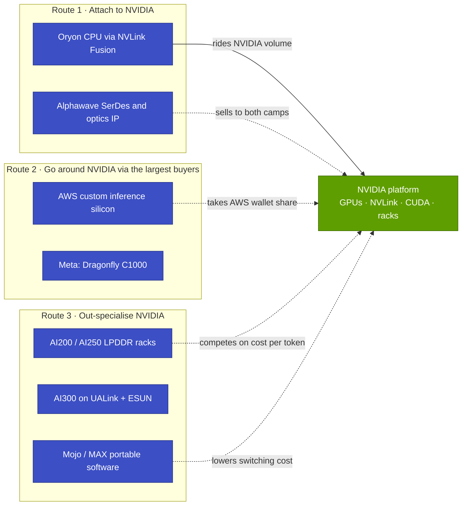
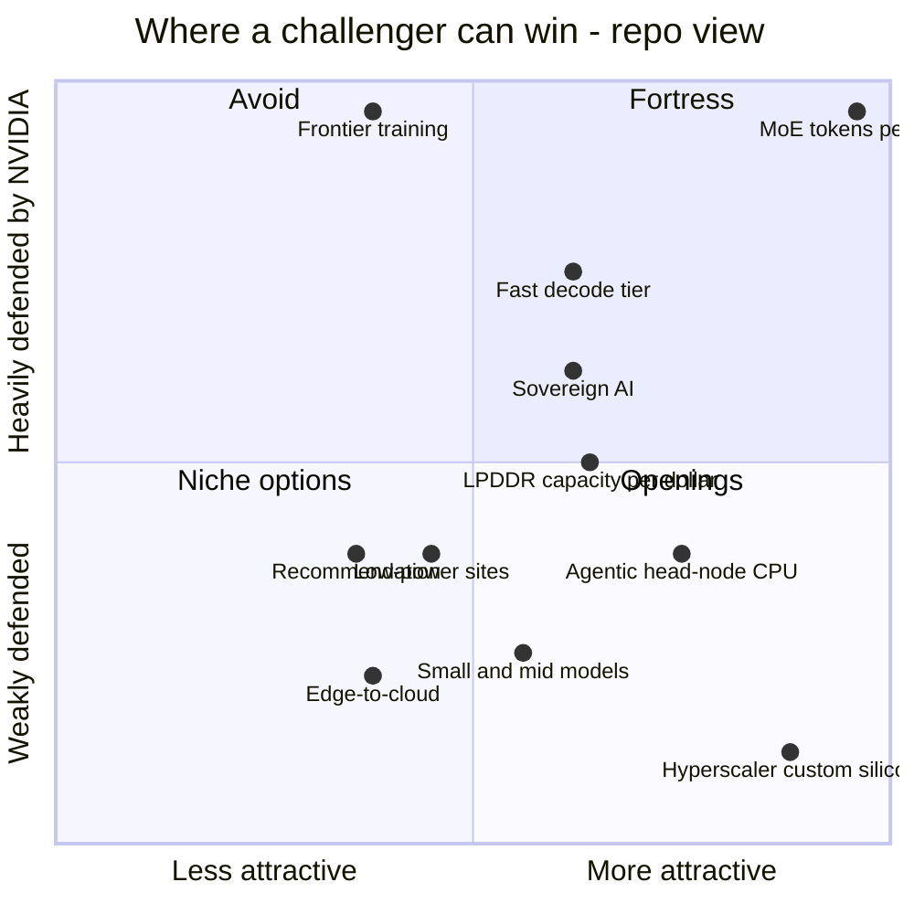
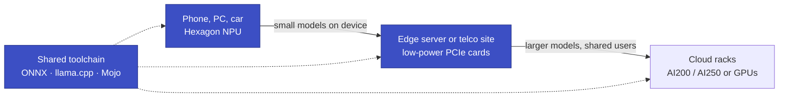
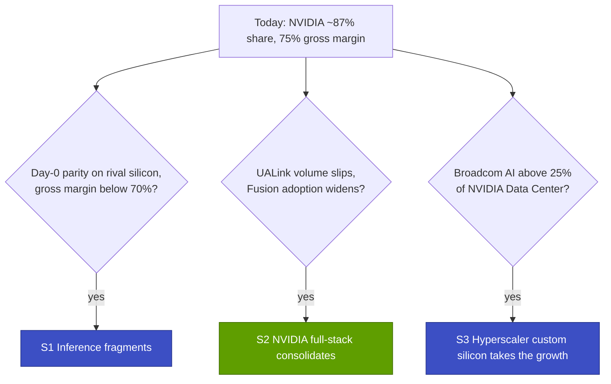

# 19 — Implications for Qualcomm

Cross-cutting 19 · What NVIDIA's position means for a challenger with Qualcomm's public assets · ~32 min read · Last verified: 2026-11-05

> [!IMPORTANT]
> **Public information only; questions and options, not recommendations.** Every statement about Qualcomm on this page
> comes from its public announcements, filings or press coverage, cited inline. Nothing is internal and nothing is
> invented. Judgements about where a challenger "can win" are this repo's analysis and carry 🔴. The page builds on the
> [Qualcomm competitor profile](15-competitive-landscape/qualcomm.md) instead of repeating it.

## ⚡ The Executive Take

- **NVIDIA's lead is in platform and cadence, so a challenger chooses its battlefield.** NVIDIA took ~87% of AI
  data-center silicon revenue in 2025 (Est.) at a 75.0% gross margin in Q2 FY2027 [[S660]](../sources/bibliography.md#s660)[[S663]](../sources/bibliography.md#s663)[[S405]](../sources/bibliography.md#s405). Qualcomm's goal of
  $15B of datacenter revenue by FY2029 is ~8% of NVIDIA's FY2026 data-center revenue [[S90059]](../sources/bibliography.md#s90059)[[S1]](../sources/bibliography.md#s1).
- **Qualcomm is in all four relationships with NVIDIA.** By primary role it competes in 6 of NVIDIA's 12 layers and partners
  in 1 (Oryon CPUs through [NVLink Fusion](../glossary.md#nvlink-fusion)). It complements NVIDIA in 2 (Alphawave connectivity IP,
  Mojo) and is absent from 3 (DPUs and NICs, domain libraries, cloud capacity). It ships product in only 4 (🔴 repo map)
  [[S90031]](../sources/bibliography.md#s90031)[[S173]](../sources/bibliography.md#s173)[[S4513]](../sources/bibliography.md#s4513)[[S9511]](../sources/bibliography.md#s9511).
- **The assets were bought quickly; the customers exist on paper.** NUVIA ($1.4B), Alphawave (~$2.4B) and Modular ($3.9B)
  total ~$7.7B, plus Ventana at an undisclosed price [[S4538]](../sources/bibliography.md#s4538)[[S4514]](../sources/bibliography.md#s4514)[[S90057]](../sources/bibliography.md#s90057)[[S4512]](../sources/bibliography.md#s4512). HUMAIN plans 200 MW. 🟢 Meta is the first
  Dragonfly C1000 customer from H2 2028. AWS signed for custom inference silicon, with a warrant vesting on up to $60B of
  purchases through 2036 [[S90030]](../sources/bibliography.md#s90030)[[S90058]](../sources/bibliography.md#s90058)[[S90087]](../sources/bibliography.md#s90087). No AI200 volume shipment or MLPerf/InferenceX result was public
  🔴 [[S90028]](../sources/bibliography.md#s90028)[[S602]](../sources/bibliography.md#s602)[[S620]](../sources/bibliography.md#s620).
- **🔴 Where a challenger can win:** the repo scores hyperscaler custom silicon and agentic head-node CPUs as the most open
  segments; in custom silicon the main rival is Broadcom, not NVIDIA. Chat-speed [MoE](../glossary.md#mixture-of-experts)
  serving per megawatt is NVIDIA's fortress: GB300 NVL72 serves ~2.6M tokens/s per MW against ≤0.7M for shipping rivals
  (Est.) [[S14000]](../sources/bibliography.md#s14000)[[S2516]](../sources/bibliography.md#s2516)[[S4522]](../sources/bibliography.md#s4522).
- **LPDDR capacity is a different bet, not a moat.** A reported 🟡 AI200 rack holds ~43 TB on its cards, 2× a Vera Rubin
  NVL72's 20.7 TB of HBM4. But NVIDIA's rack also carries 54 TB of LPDDR5X behind its Vera CPUs, and an LPDDR card's
  bandwidth is ~35× below Rubin's (0.548 vs 19.2 TB/s) [[S19003]](../sources/bibliography.md#s19003)[[S362]](../sources/bibliography.md#s362)[[S172]](../sources/bibliography.md#s172)[[S90006]](../sources/bibliography.md#s90006).
- **The edge is the one place the challenger is bigger.** Qualcomm's chip business sold ~$8.5B in the quarter to June
  2026, against $7.2B for NVIDIA's Edge Computing platform. In datacenter, NVIDIA's $89.0B quarter is ~71× Qualcomm's
  FY2027 run-rate goal [[S19002]](../sources/bibliography.md#s19002)[[S405]](../sources/bibliography.md#s405)[[S15512]](../sources/bibliography.md#s15512). Whether device incumbency wins cloud orders is unproven 🔴.
- **Deal terms differ more than the headlines suggest.** At signing, AMD's penny warrant was worth ~29% of OpenAI's
  estimated purchases. Qualcomm's AWS warrant is struck at the money, so it is worth nothing unless Qualcomm's stock rises:
  ~1.7% of purchases at +25% (🔴 repo arithmetic) [[S24000]](../sources/bibliography.md#s24000)[[S24001]](../sources/bibliography.md#s24001)[[S15510]](../sources/bibliography.md#s15510).

![Heatmap of Qualcomm's public datacenter efforts against NVIDIA's 12 stack layers, by relationship (partner, compete, complement, absent) and evidence stage. Primary roles: compete in 6 layers (accelerators, memory approach, scale-up, racks, inference software, ecosystem), partner in 1 (CPU via NVLink Fusion), complement in 2 (Alphawave connectivity IP and 1.6T optics; Mojo, which also runs on NVIDIA GPUs) and absent from 3 (DPUs and NICs, domain libraries, cloud capacity). Only 4 layers have a shipping product (Cloud AI 100, LPDDR cards, Cloud AI SDK and Mojo, MAX and vLLM); AI200 racks, C1000 and AI300 are announced, signed or in initial deployment. A fifth column repeats chapter 15's layer scores: 1.7 of 5 on average, behind in 9 layers and different in 3.](../assets/charts/19-layer-relationship-heatmap.svg)

## 1. Framing: what NVIDIA's position means for a challenger

The other chapters describe NVIDIA as a [full-stack merchant](../glossary.md#full-stack-merchant). It sells chips, racks,
networking and free software to every buyer, refreshes the platform every year and supports new models on day zero
([chapter 15](15-competitive-landscape/index.md), [chapter 16](16-how-nvidia-built-it-timeline.md),
[chapter 17](17-roadmap-2025-2028.md)). The same chapters list the weak points. The 75% gross margin is a
[price umbrella](../glossary.md#price-umbrella) that rivals can price under. Three direct customers were 16%, 15% and 13% of
H1 FY2027 revenue [[S90069]](../sources/bibliography.md#s90069), and those buyers build their own chips: Broadcom's AI revenue already equals ~19% of NVIDIA's
data-center revenue [[S2516]](../sources/bibliography.md#s2516)[[S405]](../sources/bibliography.md#s405). Power, not money, binds many sites
([chapter 18](18-vulnerabilities-and-bear-case.md)).

That leaves a challenger three broad routes, and Qualcomm's public moves take all three at once:

Each route has a different economic engine. Attaching rides NVIDIA's volume but earns small dollars per rack: 36 Vera
CPUs are ~2% of a ~$7.8M Vera Rubin rack (Est.) [[S331]](../sources/bibliography.md#s331). Going around NVIDIA through a hyperscaler earns design-services
margins on large volumes but depends on a few buyers. Out-specialising needs a workload where NVIDIA's strengths matter
least, plus independent evidence that the product wins there.

| Public asset | What it is | Status (Nov 2026) | Sources |
|---|---|---|---|
| Oryon CPU cores (NUVIA) | Custom Arm cores, bought for $1.4B in 2021 | In Snapdragon devices; datacenter CPU for NVLink Fusion announced May 2025 | [[S4538]](../sources/bibliography.md#s4538)[[S4516]](../sources/bibliography.md#s4516)[[S90031]](../sources/bibliography.md#s90031) |
| Dragonfly C1000 | >250-core chiplet CPU, >5 GHz target, PCIe Gen 7, [CXL](../glossary.md#cxl); for agentic head nodes | Meta first customer; deployments from H2 2028 🟢 | [[S90056]](../sources/bibliography.md#s90056)[[S90058]](../sources/bibliography.md#s90058) |
| Hexagon NPU lineage: Cloud AI 100 Ultra | 150 W PCIe card, 128 GB LPDDR4x at 0.548 TB/s, 870 TOPS INT8 | Shipping since 2023 | [[S172]](../sources/bibliography.md#s172)[[S4514]](../sources/bibliography.md#s4514) |
| AI200 / AI250 | 768 GB of [LPDDR](../glossary.md#lpddr) per card in 160 kW liquid-cooled racks; AI250 adds [near-memory compute](../glossary.md#near-memory-compute) | AI200 sampling with initial deployments H2 2026 🟡; no volume shipment confirmed 🔴 | [[S173]](../sources/bibliography.md#s173)[[S4030]](../sources/bibliography.md#s4030) |
| Dragonfly AI300 | [High Bandwidth Compute](../glossary.md#high-bandwidth-compute) Gen 2; "54×" AI200's bandwidth (vendor claim); [UALink](../glossary.md#ualink) and [ESUN](../glossary.md#esun) scale-up | Sampling 2028 🟢 | [[S90060]](../sources/bibliography.md#s90060)[[S4029]](../sources/bibliography.md#s4029) |
| Ventana | RISC-V server CPU team | Acquired Dec 2025, terms undisclosed | [[S4512]](../sources/bibliography.md#s4512) |
| Alphawave Semi | [SerDes](../glossary.md#serdes), chiplet and optical-connectivity IP, ~$2.4B | Closed 2025-12-18 🟢 | [[S4513]](../sources/bibliography.md#s4513)[[S4514]](../sources/bibliography.md#s4514) |
| Modular | [Mojo](../glossary.md#mojo) language and MAX inference engine, $3.9B | Closed 2026-07-29; Mojo open-sourced Aug 2026 | [[S9511]](../sources/bibliography.md#s9511)[[S9512]](../sources/bibliography.md#s9512) |
| Edge installed base | Chips for handsets ($5.09B), IoT ($1.83B) and automotive ($1.59B) in one quarter | Shipping | [[S19002]](../sources/bibliography.md#s19002) |
| Datacenter customers | HUMAIN 200 MW; Meta (C1000); AWS custom silicon and 1.6T optics | Signed | [[S90030]](../sources/bibliography.md#s90030)[[S90058]](../sources/bibliography.md#s90058)[[S90087]](../sources/bibliography.md#s90087) |
| Financial capacity | FY2026 revenue $43.1B; cash and securities $7.7B against $15.1B of debt | Reported | [[S15513]](../sources/bibliography.md#s15513)[[S13503]](../sources/bibliography.md#s13503) |

![Timeline of Qualcomm's public datacenter moves in four lanes. Before 2025: Centriq 2400 server CPU (Nov 2017), the unit wound down (2018), NUVIA bought for $1.4B (2021) and the Cloud AI 100 Ultra card (2023). Since May 2025: NVLink Fusion CPU partnership and HUMAIN MoU (May 2025); AI200 and AI250 unveiled with HUMAIN's 200 MW plan (Oct 2025); Ventana (RISC-V) and Alphawave (~$2.4B) acquisitions (Dec 2025); Investor Day with the Dragonfly C1000 CPU for Meta, the AI300 accelerator and the Modular deal (Jun 2026); Modular closed at $3.9B (Jul 2026); a multi-generation AWS custom inference-silicon and 1.6T optics deal backed by a $4B warrant (Sep 2026). Roadmap: AI200 in 2026 (no volume shipment confirmed by Nov 2026), AI250 in 2027, AI300 and C1000 deployments in 2028.](../assets/charts/15-qualcomm-dc-roadmap-timeline.svg)

> [!TIP]
> **Worked example — sizing the goal against the incumbent.** NVIDIA's Data Center platform booked $89.0B in the 13
> weeks to 2026-07-26 [[S405]](../sources/bibliography.md#s405), ~$6.8B a week. Qualcomm's $15B FY2029 goal [[S90059]](../sources/bibliography.md#s90059) equals ~2.2 weeks of that run-rate,
> and ~35% of Qualcomm's own FY2026 revenue of $43.1B [[S15513]](../sources/bibliography.md#s15513). The FY2027 step is $5B, reiterated on 2026-11-04 and
> including at least $1B from two hyperscaler custom-silicon contracts [[S15513]](../sources/bibliography.md#s15513)[[S15511]](../sources/bibliography.md#s15511). **Conclusion:** the goal does not
> require displacing NVIDIA. It requires ~2–8% of a market where NVIDIA holds ~87%. The question is which slice.

🔧 Under the hood: why a chip discount buys less than it seems

Chapter 14's model shows that NVIDIA's ~75% gross margin is only ~24% of a GB300 token's all-in cost. Capital charges on
the rack, network, facility, power and operations make up the rest. Halving NVIDIA's gross profit would cut cost per
token by only ~18% (Est.) [[S14000]](../sources/bibliography.md#s14000). The same model finds NVIDIA could cut the GB300 price ~20% to match Google's internal
TPU at 100 tokens/s per user and still keep ~66% gross margin (🔴) [[S14000]](../sources/bibliography.md#s14000). For a challenger, a lower chip price is
therefore weak leverage on its own. The strong levers are tokens per megawatt, utilization and time to deploy. A
challenger that sells only on price competes against a ~10-point cushion NVIDIA can spend selectively
([chapter 14, section 6](14-training-vs-inference-economics.md)).

## 2. Layer map: partner, compete, complement or absent

The map places each public Qualcomm effort against the NVIDIA layer it touches. It asks two questions: what is the
relationship to NVIDIA, and how far has the effort progressed? The **relationship** is one of 🤝 Partner (sells into NVIDIA's
platform), ⚔️ Compete (for the same wallet), 🧩 Complement (neutral supplier or portable layer that serves both camps) or
⬜ Absent (no public effort). The **stage** is announced, signed (contracted, acquired or in initial deployment) or ships.
The last column repeats chapter 15's capability verdict (🟩 leads · 🟨 parity · 🟥 behind · 🟦 different approach) and
score out of 5 from `competitor_matrix.csv`. Data: `data/x19_layer_map.csv`.

| NVIDIA layer | Qualcomm's public effort | Relationship | Stage | Ch. 15 verdict | Sources |
|---|---|---|---|---|---|
| [02 Accelerator silicon](../layers/02-gpu-silicon/index.md) | Cloud AI 100 Ultra; AI200, AI250, AI300; AWS custom inference silicon | ⚔️ Compete | ships (AI 100); signed (AWS) | 🟦 2/5 | [[S172]](../sources/bibliography.md#s172)[[S173]](../sources/bibliography.md#s173)[[S90060]](../sources/bibliography.md#s90060)[[S90087]](../sources/bibliography.md#s90087) |
| [03 Memory & supply](../layers/03-memory-packaging-supply-chain/index.md) | LPDDR cards that need no [HBM](../glossary.md#hbm) or [CoWoS](../glossary.md#cowos) | ⚔️ Compete by routing around | ships (AI 100) | 🟦 3/5 | [[S172]](../sources/bibliography.md#s172)[[S173]](../sources/bibliography.md#s173) |
| [04 CPU](../layers/04-cpu-grace-vera/index.md) | Oryon CPU via NVLink Fusion; Dragonfly C1000; Ventana | 🤝 Partner and ⚔️ Compete | announced; signed (Meta) | 🟥 2/5 | [[S90031]](../sources/bibliography.md#s90031)[[S90058]](../sources/bibliography.md#s90058)[[S4512]](../sources/bibliography.md#s4512) |
| [05 Scale-up](../layers/05-scale-up-nvlink-nvswitch/index.md) | AI300 on UALink and ESUN; Fusion CPU link; Alphawave SerDes | ⚔️ Compete (also 🤝, 🧩) | announced | 🟥 1/5 | [[S90060]](../sources/bibliography.md#s90060)[[S131]](../sources/bibliography.md#s131)[[S4513]](../sources/bibliography.md#s4513) |
| [06 Scale-out & optics](../layers/06-scale-out-scale-across-networking/index.md) | Alphawave IP; 1.6T optics for AWS; no switch or NIC | 🧩 Complement | signed | 🟥 2/5 | [[S4513]](../sources/bibliography.md#s4513)[[S90087]](../sources/bibliography.md#s90087) |
| [07 DPU, SuperNIC, storage](../layers/07-dpu-supernic-storage-security/index.md) | None; AI200 lists [confidential computing](../glossary.md#confidential-computing) | ⬜ Absent | — | 🟥 1/5 | [[S173]](../sources/bibliography.md#s173) |
| [08 Systems & racks](../layers/08-systems-racks-ai-factories/index.md) | AI200 160 kW racks; rack software deployed at HUMAIN | ⚔️ Compete | signed (initial deployment) | 🟥 2/5 | [[S173]](../sources/bibliography.md#s173)[[S19001]](../sources/bibliography.md#s19001) |
| [09 CUDA-equivalent](../layers/09-cuda-and-system-software/index.md) | Mojo (also runs on NVIDIA GPUs); Cloud AI SDK | 🧩 Complement (also ⚔️) | ships | 🟥 2/5 | [[S9512]](../sources/bibliography.md#s9512)[[S9023]](../sources/bibliography.md#s9023)[[S596]](../sources/bibliography.md#s596) |
| [10 Libraries](../layers/10-libraries-cuda-x/index.md) | MAX AI kernels only; no domain libraries | ⬜ Absent | — (AI kernels early) | 🟥 1/5 | [[S9513]](../sources/bibliography.md#s9513) |
| [11 Inference software](../layers/11-inference-and-ai-software/index.md) | MAX engine; vLLM container; upstream [vLLM](../glossary.md#vllm) | ⚔️ Compete (also 🧩) | ships | 🟦 2/5 | [[S9511]](../sources/bibliography.md#s9511)[[S596]](../sources/bibliography.md#s596) |
| [12 Orchestration & cloud](../layers/12-orchestration-and-cloud-services/index.md) | Rack management suite; no cloud capacity | ⬜ Absent | — | 🟥 1/5 | [[S19001]](../sources/bibliography.md#s19001) |
| [13 Ecosystem & capital](../layers/13-ecosystem-gtm-and-capital/index.md) | HUMAIN, Meta, AWS; $5B FY2027 and $15B FY2029 goals | ⚔️ Compete for the same wallets | signed | 🟥 1/5 | [[S90030]](../sources/bibliography.md#s90030)[[S90058]](../sources/bibliography.md#s90058)[[S90087]](../sources/bibliography.md#s90087)[[S90059]](../sources/bibliography.md#s90059) |

Three readings of the map differ from, or add to, [chapter 15's Qualcomm page](15-competitive-landscape/qualcomm.md):

- **Layers 07 and 10 appear separately here.** Chapter 15 merges layers 09–11 and leaves 07 out. The absent layers are
  where build, buy and partner questions concentrate (section 4), so this page shows them on their own.
- **Today's merchant rack partners with NVIDIA's nearest merchant rival.** Two low-tier reports from MWC 2026 describe
  the AI200 rack as 56 cards hosted by AMD EPYC CPUs, linked by PCIe inside each node and 800G Ethernet across the rack
  🟡 [[S19003]](../sources/bibliography.md#s19003)[[S19005]](../sources/bibliography.md#s19005). The NVLink Fusion CPU and the C1000 are later items, so in 2026 Qualcomm's CPU "partner" role
  with NVIDIA is still on paper.
- **"Compete" in scale-up is about governance, not a boycott.** ESUN is an OCP workstream that NVIDIA itself co-founded
  [[S576]](../sources/bibliography.md#s576). UALink is where NVIDIA is absent. The dual track (Fusion CPU, UALink/ESUN accelerator) keeps Qualcomm on both
  sides, as it does Intel ([NVLink Fusion](../layers/05-scale-up-nvlink-nvswitch/nvlink-fusion.md)).

> [!TIP]
> **Worked example — counting what ships.** The map's data file holds 21 public efforts across the 12 layers. Six are
> at the shipping stage. Two of those six are hardware, and both are the same 2023 product line: the Cloud AI 100 and its
> LPDDR memory design. The other four are software (Cloud AI SDK, Mojo, MAX with a vLLM container, upstream vLLM)
> [[S172]](../sources/bibliography.md#s172)[[S596]](../sources/bibliography.md#s596)[[S9511]](../sources/bibliography.md#s9511). The racks, CPUs, scale-up fabric and AWS silicon arrive between 2026 and 2028. NVIDIA ships Vera
> Rubin in 2026, Rubin Ultra in H2 2027 and Feynman in 2028 over the same period [[S90009]](../sources/bibliography.md#s90009)[[S90003]](../sources/bibliography.md#s90003)[[S90004]](../sources/bibliography.md#s90004). **Conclusion:**
> most of the map is a roadmap. Each Qualcomm generation will meet the NVIDIA generation after the one shipping today.

![Two-panel chart. Left: radar of Qualcomm versus NVIDIA on nine capability axes, averaging 2.7 versus 4.7 of 5 (Compute 2 vs 5; Memory 4 vs 4; Scale-up 1 vs 5; Scale-out 2 vs 5; Software 2 vs 5; Racks 2 vs 5; Supply 4 vs 5; Cost/TCO 4 vs 3; Merchant 3 vs 5). Right: Qualcomm's score in each of NVIDIA's 12 stack layers with its verdict: behind 9, different 3. Public information only: Qualcomm's LPDDR-based design scores on memory capacity and on independence from CoWoS and HBM, its cost claim is a vendor claim, and scale-up, software and racks are early.](../assets/charts/15-qualcomm-capability-profile.svg)

🔧 Under the hood: how relationships and stages are assigned

A layer gets one **primary** relationship (bold outline in the heatmap), chosen as the one with the most revenue at
stake in Qualcomm's public plans. Secondary relationships stay visible. In layer 04 the primary role is "partner" because
it is Qualcomm's only partner relationship with NVIDIA, even though the C1000 has a signed customer and the Fusion CPU
does not. **Stage** follows the strongest public evidence: an announcement or roadmap entry (1); a signed contract,
closed acquisition or reported initial deployment (2); or a product on sale (3). Stages say nothing about quality. A
shipping 2023 card can still lose to an announced 2028 rival. The chapter 15 scores are analyst judgements relative to
NVIDIA in November 2026 (`competitor_matrix.csv`).

## 3. Where a challenger can win

This section scores eleven segments on two axes (all 🔴 repo judgement). **Attractiveness** combines the size and growth
of the spending pool with how well it fits a challenger's public assets. **NVIDIA defensibility** measures how hard
NVIDIA's advantages make it to take share: [tokens per MW](../glossary.md#tokens-per-megawatt), the 72-GPU NVLink domain, CUDA, the
annual cadence and supply allocation. Evidence comes from the layer pages and chapters 14, 15 and 18. Data:
`data/x19_win_matrix.csv`.

![Scatter of eleven segments by attractiveness to a challenger (x, 1-5) and NVIDIA's defensibility (y, 1-5), all repo judgements. Most open (attractive, weakly defended): hyperscaler custom silicon (4.5, 1.5) and agentic head-node CPUs (4.0, 2.5). NVIDIA's fortress: chat-speed MoE serving per megawatt (5.0, 5.0) and the fast-decode tier (3.5, 4.0); frontier training (2.5, 5.0) is shown for reference. Middle ground: LPDDR capacity-bound serving (3.5, 3.0) and sovereign programmes (3.5, 3.5). Niches with low defensibility but smaller, captive or unproven pools: small and medium dense models (3.25, 2.0), power-capped sites (2.75, 2.5), recommendation (2.5, 2.5) and edge-to-cloud continuity (2.5, 2.0).](../assets/charts/19-challenger-win-matrix.svg)

| Segment | Attract. | NVIDIA defence | 🔴 Reasoning | Evidence |
|---|---|---|---|---|
| Chat-speed MoE serving per MW | 5 | 5 | Largest inference pool, but NVL72 serves ~2.6M tokens/s per MW vs ≤0.7M (Est.) | [Ch. 14](14-training-vs-inference-economics.md) [[S14000]](../sources/bibliography.md#s14000) |
| Capacity-bound serving (LPDDR per $) | 3.5 | 3 | LPDDR is cheaper per GB, but NVIDIA has its own LPDDR tier and 1 TB HBM4E coming | [Memory wall](../layers/03-memory-packaging-supply-chain/the-memory-wall.md) [[S362]](../sources/bibliography.md#s362)[[S305]](../sources/bibliography.md#s305) |
| Fast decode tier (≥100 tokens/s per user) | 3.5 | 4 | Bandwidth-bound; SRAM leads and NVIDIA now sells Groq 3 LPX | [Layer 11](../layers/11-inference-and-ai-software/competition.md) [[S90003]](../sources/bibliography.md#s90003) |
| Power-capped or air-cooled sites | 2.75 | 2.5 | NVL72 cannot be installed there; 150 W cards can; Intel targets it too | [Power](../layers/08-systems-racks-ai-factories/power-and-cooling.md) [[S172]](../sources/bibliography.md#s172)[[S162]](../sources/bibliography.md#s162) |
| Agentic head-node CPUs | 4 | 2.5 | Outside the GPU rack the CPU market is open; NVIDIA itself sizes it in the tens of $B | [Layer 04](../layers/04-cpu-grace-vera/value-chain-and-corp-dev.md) [[S4522]](../sources/bibliography.md#s4522) |
| Recommendation and ranking | 2.5 | 2.5 | Capacity-bound and LPDDR-friendly, but the largest buyers build their own chips | [MTIA](15-competitive-landscape/meta-mtia.md) [[S160]](../sources/bibliography.md#s160) |
| Small and medium dense models | 3.25 | 2 | NVL72 adds little; competitors are old GPUs and AMD on price | [Ch. 14](14-training-vs-inference-economics.md) [[S623]](../sources/bibliography.md#s623)[[S12516]](../sources/bibliography.md#s12516) |
| Sovereign multi-vendor programmes | 3.5 | 3.5 | Buyers multi-source, but NVIDIA holds most named sovereign GPUs | [Sovereign AI](../layers/13-ecosystem-gtm-and-capital/sovereign-ai.md) [[S13003]](../sources/bibliography.md#s13003) |
| Edge-to-cloud continuity | 2.5 | 2 | Qualcomm's base is larger than NVIDIA's edge business; the datacenter payoff is unproven | Section 3.4 [[S19002]](../sources/bibliography.md#s19002) |
| Hyperscaler custom silicon | 4.5 | 1.5 | Fastest-growing pool; NVIDIA co-opts (Fusion) but cannot block; Broadcom is the rival | [ASIC houses](15-competitive-landscape/custom-asic-houses.md) [[S2516]](../sources/bibliography.md#s2516) |
| Frontier pre-training (reference) | 2.5 | 5 | Six or so buyers needing large scale-up domains; no Qualcomm product | [Ch. 14](14-training-vs-inference-economics.md) [[S14000]](../sources/bibliography.md#s14000) |

### 3.1 Inference efficiency: tokens per watt and LPDDR capacity per dollar

[Decode](../glossary.md#decode), the token-by-token phase of inference, re-reads a model's weights for every token. Speed per
user is therefore set by memory bandwidth. Throughput per watt is set by how many users share each read (batching) and by
how well a rack spreads a large MoE model across many chips. NVIDIA wins tokens per MW on large MoE models because its
72-GPU NVLink domain lets one model spread across the whole rack at high bandwidth
([why domain size matters](../layers/05-scale-up-nvlink-nvswitch/why-domain-size-matters.md)). Qualcomm's LPDDR designs
make the opposite trade: lots of cheap, low-power capacity per card at low bandwidth per gigabyte
([the memory wall](../layers/03-memory-packaging-supply-chain/the-memory-wall.md)).

![Two-panel horizontal bar chart. At 50 tokens/s per user GB300 NVL72 costs about $0.156 per million tokens at full price, while rivals' costs with their accelerator systems given away are: MI355X (8-GPU) $0.480, Trainium2 $0.817, Trainium3 $0.297, TPU v7 (external owner) $0.242, TPU v7 (Google itself) $0.214, Helios MI455X $0.062; only Helios MI455X beat GB300 when free. At 100 tokens/s per user GB300 costs about $1.74 and every free version undercuts it except Trainium2 (TPU v7 external free $0.78). The 'free is not cheap enough' argument holds only where NVIDIA's rack-scale throughput lead is large.](../assets/charts/14-tco-free-chip-test.svg)

The [free-chip test](../glossary.md#free-chip-test) above is the sharpest constraint on any inference challenger. At chat speed
(50 tokens/s per user) even a free MI355X, TPU or Trainium makes dearer tokens than a paid-for GB300. At 100 tokens/s per
user most free rivals undercut it (Est.) [[S14000]](../sources/bibliography.md#s14000). The [operating point](../glossary.md#operating-point) a challenger chooses to
compete at is therefore a strategic decision, not a benchmark detail.

> [!TIP]
> **Worked example — LPDDR versus HBM, per gigabyte and per read.** Morgan Stanley's Vera Rubin rack figures imply
> ~$1.1M for 54 TB of LPDDR5X, ~$20 per GB (🔴 repo arithmetic) [[S332]](../sources/bibliography.md#s332)[[S362]](../sources/bibliography.md#s362). Bernstein expects HBM4 at ~$53 per GB in
> 2027 [[S333]](../sources/bibliography.md#s333). At those prices 768 GB costs ~$15.6K as LPDDR against ~$40.7K as HBM4. Bandwidth runs the other way. A
> Cloud AI 100 Ultra can read its full 128 GB ~4.3 times a second (0.548 TB/s ÷ 128 GB). A Rubin GPU reads its 288 GB
> ~67 times a second (19.2 TB/s ÷ 288 GB), ~16× more often [[S172]](../sources/bibliography.md#s172)[[S90006]](../sources/bibliography.md#s90006). **Conclusion:** LPDDR wins where capacity
> binds (very large models at low batch, long [KV caches](../glossary.md#kv-cache), many models resident at once). HBM wins where
> bandwidth binds (fast chat on large MoE models). AI200's bandwidth is undisclosed, so the crossover cannot yet be placed.

![Two-panel bar chart. Left: memory per rack. A Qualcomm AI200 rack in a reported 56-card MWC 2026 configuration holds about 43 TB of LPDDR on its accelerators; AMD Helios 31.1 TB of HBM4; GB300 NVL72 20.7 TB of HBM3E plus about 17 TB of CPU-attached LPDDR5X; Vera Rubin NVL72 20.7 TB of HBM4 plus 54 TB of LPDDR5X on its Vera CPUs, about 75 TB in all. Right: accelerator-attached memory per kW of rack power: AI200 about 0.27 TB/kW at 160 kW, GB300 0.16, Helios 0.13 and Vera Rubin 0.09. Capacity per watt favours the LPDDR design; bandwidth, which Qualcomm has not disclosed for AI200, favours HBM (Vera Rubin 1,400 TB/s per rack).](../assets/charts/19-rack-memory-capacity.svg)

![Log-log scatter of memory capacity versus bandwidth per chip. SRAM designs sit top-left: NVIDIA's Groq 3 LPU 0.5 GB at about 150 TB/s, d-Matrix Corsair 2 GB at 150 TB/s and Cerebras WSE-3 44 GB at 21,000 TB/s. HBM sits in the middle: H100 80 GB at 3.35 TB/s, B300 288 GB at 8 TB/s, Rubin 288 GB at 19.2 TB/s and AMD MI455X 432 GB at 23.3 TB/s. LPDDR sits bottom-right: Grace 480 GB at 0.5 TB/s, Vera 1,536 GB at 1.2 TB/s and Qualcomm AI 100 Ultra 128 GB at 0.55 TB/s; Qualcomm AI200 (768 GB) and Rubin CPX (128 GB GDDR7) have no disclosed bandwidth. A BlueField-4 link to NVMe context storage moves ~0.1 TB/s.](../assets/charts/03-memory-tiers-bandwidth-vs-capacity.svg)

> [!WARNING]
> **Myth vs. reality: "memory capacity is Qualcomm's moat."** Capacity is shared ground. Each Vera CPU carries ~1.5 TB of
> LPDDR5X (54 TB per rack) [[S362]](../sources/bibliography.md#s362) and reaches its GPUs coherently over [NVLink-C2C](../glossary.md#nvlink-c2c) at 1.8 TB/s [[S209]](../sources/bibliography.md#s209). Rubin
> Ultra targets 1 TB of HBM4E per package in H2 2027 [[S305]](../sources/bibliography.md#s305). Intel's inference GPU carries 160 GB of LPDDR5X and samples
> in H2 2026 [[S162]](../sources/bibliography.md#s162), and d-Matrix pairs SRAM with LPDDR [[S2511]](../sources/bibliography.md#s2511). A capacity position is defensible only together with
> software, cost and a published cost-per-token result at a named operating point.

### 3.2 Power-constrained deployments

"Power-constrained" covers two different situations, and they point in opposite directions. When the **grid connection**
is the cap, a buyer maximises tokens per MW. That is NVIDIA's strongest metric, which is why chapter 18 scores power as a
timing risk for NVIDIA rather than a loss of share [[S18027]](../sources/bibliography.md#s18027). When the **site envelope** is the cap, the rack never
arrives. Air-cooled halls, older enterprise rooms and telecom edge sites cannot take a ~238 kW all-in Vera Rubin rack
(Est.) [[S622]](../sources/bibliography.md#s622). There the contest is between PCIe cards measured on performance per watt. Grid scarcity is real: PJM's
capacity price rose from $28.92 to $333.44 per MW-day in three auctions, and new US projects wait more than 48 months
in the [interconnection queue](../glossary.md#interconnection-queue) [[S18016]](../sources/bibliography.md#s18016)[[S8009]](../sources/bibliography.md#s8009).

> [!TIP]
> **Worked example — two kinds of megawatt.** On a new 100 MW site, chapter 14's model gives GB300 NVL72 ~5.7 quadrillion
> tokens a year at 70% utilization. An MI355X fleet gets ~0.7 quadrillion for broadly similar annual cost (Est.)
> [[S14000]](../sources/bibliography.md#s14000). A challenger has to match tokens per MW there, not watts per card. In an existing hall built for ~15 kW
> racks (🔴 illustrative), no NVL72-class rack fits at all. A 150 W Cloud AI 100 Ultra fits a standard server [[S172]](../sources/bibliography.md#s172).
> **Conclusion:** the "power-constrained" opening for a low-power design is the installed base of ordinary datacenters
> and edge sites, not new gigawatt campuses.

### 3.3 Specific workloads

**Agentic orchestration CPUs.** [Agentic AI](../glossary.md#agentic-ai) workloads call tools, run code and coordinate many
model calls, and much of that work runs on CPUs. NVIDIA reported visibility to nearly $20B of standalone CPU revenue
this fiscal year and cited a "$200B" CPU opportunity 🟡 [[S4522]](../sources/bibliography.md#s4522). The C1000's >250 cores are ~2.8× Vera's 88 and level
with AMD's 256-core EPYC Venice [[S90056]](../sources/bibliography.md#s90056)[[S100]](../sources/bibliography.md#s100)[[S144]](../sources/bibliography.md#s144). The market is crowded: AMD holds ~46% of x86 server CPU revenue,
and Arm now sells its own 136-core AGI CPU to Meta [[S4503]](../sources/bibliography.md#s4503)[[S4510]](../sources/bibliography.md#s4510). Meta is also the C1000's first customer [[S90058]](../sources/bibliography.md#s90058).

> [!TIP]
> **Worked example — two very different CPU pools.** Inside NVIDIA's rack, 36 Vera CPUs are worth ~$0.18M of a ~$7.8M
> Vera Rubin NVL72, ~2% (Est.) [[S331]](../sources/bibliography.md#s331). A Fusion-attached CPU competes for that thin slice. NVIDIA's ~$20B of standalone
> visibility equals the Vera content of ~110,000 such racks (🔴 repo arithmetic) [[S4522]](../sources/bibliography.md#s4522). **Conclusion:**
> the head-node CPU is valuable mostly *outside* NVIDIA's rack, which is where a standalone part such as the C1000 points,
> and where x86 and hyperscaler Arm CPUs already compete.

**Recommendation and ranking.** Large embedding tables make up most of a ranking model. They need capacity more than
bandwidth, which suits LPDDR: Meta's MTIA v2 ran them with 128 GB of LPDDR5 at ~0.2 TB/s and 90 W [[S159]](../sources/bibliography.md#s159)[[S160]](../sources/bibliography.md#s160). But the
largest buyer of recommendation compute built its own chip and has since moved MTIA to HBM [[S15003]](../sources/bibliography.md#s15003). The merchant opening
lies with second-tier platforms and enterprises, a smaller and less visible pool (🔴).

**Small and medium dense models.** A 70B-parameter model in FP8 (~70 GB) fits on one Cloud AI 100 Ultra with ~58 GB left
for KV cache. Because LPDDR is slow per gigabyte, one user would see only ~8 tokens/s, against ~274 on a Rubin GPU
[[S172]](../sources/bibliography.md#s172)[[S90006]](../sources/bibliography.md#s90006). Batching many users recovers throughput per card. Dense models also gain little from a 72-GPU domain. In
SemiAnalysis tests MI355X beat B200 on vLLM cost per token below 225 tokens/s per user [[S623]](../sources/bibliography.md#s623), and a depreciated H100 rents
for ~$2.35 an hour [[S12516]](../sources/bibliography.md#s12516). This is a cost-per-token contest against old GPUs, in a market where fixed-capability token
prices fell ~286× in two years ([token price deflation](../glossary.md#token-price-deflation)) [[S11526]](../sources/bibliography.md#s11526).

**Sovereign programmes.** Sovereign buyers want local control and multiple suppliers. NVIDIA counted more than ~$30B of sovereign
revenue in FY2026 [[S90071]](../sources/bibliography.md#s90071), and HUMAIN buys from all three merchants [[S13003]](../sources/bibliography.md#s13003)[[S13517]](../sources/bibliography.md#s13517)[[S90030]](../sources/bibliography.md#s90030).

![Horizontal bar chart of NVIDIA GPUs named in sovereign AI announcements: Saudi Arabia's HUMAIN up to 600,000 over three years (across Saudi Arabia and the US, Nov 2025), South Korea 260,000 (Oct 2025: government 50,000, Samsung, SK and Hyundai 50,000 each, Naver 60,000), United Kingdom 120,000 by end-2026, India's Yotta 20,736 B300, France's Mistral Compute 18,000 Grace Blackwell and Germany's Deutsche Telekom 10,000. About 1.03M GPUs in total, 84% of them in the Saudi and Korean deals. Stargate UAE (1 GW) and Japan's subsidised clouds (>$740M) disclosed no GPU count.](../assets/charts/13-sovereign-gpu-commitments.svg)

> [!TIP]
> **Worked example — Qualcomm's share of one sovereign buyer.** HUMAIN's public plans: up to 600,000 NVIDIA GPUs over
> three years, up to 500 MW of AMD for up to $10B, and 200 MW of Qualcomm AI200/AI250 [[S13003]](../sources/bibliography.md#s13003)[[S13517]](../sources/bibliography.md#s13517)[[S90030]](../sources/bibliography.md#s90030). At
> SemiAnalysis's 2.1–3.3 kW all-in per GB300 or Vera Rubin GPU, 600,000 NVIDIA GPUs need ~1.3–2.0 GW [[S622]](../sources/bibliography.md#s622). Qualcomm's
> 200 MW is therefore ~7–10% of HUMAIN's announced capacity (🔴 repo arithmetic). **Conclusion:** the anchor customer is
> real but shared. NVIDIA is HUMAIN's main supplier, so a second source wins on price or fit, not exclusivity.

### 3.4 Edge-to-cloud continuity

[Edge-to-cloud continuity](../glossary.md#edge-to-cloud-continuity) means one model family, file format and toolchain runs on
devices, edge servers and cloud racks. [Hybrid AI](../glossary.md#hybrid-ai) splits each workload between them. Qualcomm's
assets touch every tier. Snapdragon's Hexagon NPU is a supported backend in llama.cpp and in ONNX Runtime (QNN) [[S579]](../sources/bibliography.md#s579)[[S585]](../sources/bibliography.md#s585). Mojo claims one codebase across CPUs, GPUs and NPUs [[S9023]](../sources/bibliography.md#s9023). Cloud AI 100 and AI200 cover the datacenter end. NVIDIA's own Edge
Computing platform (gaming, professional visualization, automotive and OEM) booked $7.2B in Q2 FY2027 [[S405]](../sources/bibliography.md#s405).

![Two-panel horizontal bar chart of quarterly revenue. Edge: Qualcomm's QCT chip revenue for the quarter to 2026-06-28 was about $8.5B (handsets $5.09B, IoT $1.83B, automotive $1.59B), against NVIDIA's Edge Computing platform at $7.2B for the quarter to 2026-07-26 (former gaming, professional visualization, automotive and OEM). Datacenter: NVIDIA's Data Center platform $89.0B in the same quarter versus $1.25B a quarter implied by Qualcomm's $5B FY2027 data-center target (hatched), a ratio of about 71 to 1.](../assets/charts/19-edge-vs-datacenter-revenue.svg)

> [!TIP]
> **Worked example — what the goals imply relative to the edge base.** Qualcomm's chip revenue was $8.50B in the quarter
> to 2026-06-28 [[S19002]](../sources/bibliography.md#s19002). The $5B FY2027 datacenter goal averages $1.25B a quarter, ~15% of that base. The $15B FY2029
> goal averages $3.75B a quarter, ~44% [[S15512]](../sources/bibliography.md#s15512)[[S90059]](../sources/bibliography.md#s90059). Qualcomm also targets $40B of non-handset revenue by FY2029
> [[S19004]](../sources/bibliography.md#s19004). **Conclusion:** the datacenter goal is large relative to Qualcomm, which is why continuity matters as a
> selling point. No public evidence yet shows a buyer choosing a cloud accelerator because of device incumbency (🔴).

## 4. Build, buy or partner, layer by layer

The table pairs each layer with one build question, one buy question and one partner question, plus the evidence that
would answer them. The "buy" column names only private or recently acquired companies listed on the layers'
value-chain pages, with their last public valuation. These are examples of what exists, not targets.

| Layer | Build question | Buy question (public examples) | Partner question | Evidence that would answer it |
|---|---|---|---|---|
| 02 Accelerators | Can one team sustain a yearly merchant cadence (AI200 → AI250 → AI300) and AWS custom silicon at once? | Would SRAM or near-memory decode IP add a fast tier? d-Matrix ($2B), Positron ($5B), Etched ($10.3B) [[S2511]](../sources/bibliography.md#s2511)[[S11521]](../sources/bibliography.md#s11521)[[S2507]](../sources/bibliography.md#s2507) | Is a design-services partner needed for TSMC capacity, as Alchip is for Trainium3? [[S2517]](../sources/bibliography.md#s2517) | AI200 volume shipments; MLPerf or InferenceX submissions; AWS revenue from fiscal Q1 2027 |
| 03 Memory & supply | How far can near-memory compute and HBC close the bandwidth gap? | Is a capacity tier worth owning? Panmnesia (CXL, >$250M) [[S3523]](../sources/bibliography.md#s3523); Celestial AI went to Marvell for $3.25B [[S2513]](../sources/bibliography.md#s2513) | LTAs or prepayments with DRAM makers while contract prices rose 93–98% in a quarter? [[S3518]](../sources/bibliography.md#s3518) | LPDDR contract prices; measured AI250 effective bandwidth |
| 04 CPU | Can the C1000 meet H2 2028 against the next Vera and EPYC? | Most independent CPU teams are gone: Ampere to SoftBank ($6.5B), Rivos to Meta [[S4530]](../sources/bibliography.md#s4530)[[S4518]](../sources/bibliography.md#s4518) | Fusion socket inside NVIDIA racks, or standalone head nodes only? | Fusion CPU ship date; C1000 sampling; Meta deployment volumes |
| 05 Scale-up | Build a UALink/ESUN switch, or rely on merchants for AI300? | Upscale AI (~$2B, UALink switch), Ayar Labs (~$3.75B, optical I/O), Lightmatter ($4.4B) [[S6518]](../sources/bibliography.md#s6518)[[S5511]](../sources/bibliography.md#s5511)[[S2510]](../sources/bibliography.md#s2510) | NVLink Fusion (NVIDIA silicon and switches required) vs UALink (products 2027) vs ESUN [[S5018]](../sources/bibliography.md#s5018)[[S90051]](../sources/bibliography.md#s90051)[[S576]](../sources/bibliography.md#s576) | First UALink switches in volume; Fusion licence terms |
| 06 Scale-out & optics | How far can Alphawave IP go beyond 1.6T optics for AWS? | Nexthop AI ($4.2B), Xscape Photonics (lasers) [[S6517]](../sources/bibliography.md#s6517)[[S6520]](../sources/bibliography.md#s6520) | Merchant Ethernet and [Ultra Ethernet](../glossary.md#ultra-ethernet) partners for AI200 racks? | AWS optics revenue; laser supply after NVIDIA's $2B stakes in Lumentum and Coherent [[S6511]](../sources/bibliography.md#s6511) |
| 07 DPU & NIC | Build a UEC NIC on Alphawave SerDes? | Xsight Labs ($2.8B); an Enfabrica-style licence and team (>$900M) [[S7517]](../sources/bibliography.md#s7517)[[S475]](../sources/bibliography.md#s475) | Broadcom, AMD or NVIDIA NICs in Qualcomm racks? | Whether inference buyers require a vendor NIC; NIC cost per rack |
| 08 Racks | Keep rack design in-house (AI200) or hand it to OEMs? | ZT-style design team (~$2B net to AMD); cooling and 800 V power start-ups [[S5527]](../sources/bibliography.md#s5527)[[S8519]](../sources/bibliography.md#s8519) | ODM/EMS (Sanmina model) or OEM brands? [[S5528]](../sources/bibliography.md#s5528) | HUMAIN rack deliveries; OEM listings of AI200 systems |
| 09 System software | Grow Mojo adoption, or also ship Triton and vLLM back ends? | Small compiler teams remain (Luminal, seed) [[S9534]](../sources/bibliography.md#s9534) | Upstream PyTorch and Triton maintainers | Day-zero model support on Qualcomm silicon; framework support (4 of 36 today) |
| 10 Libraries | Match only the AI core (GEMM, attention, collectives)? | Domain libraries are rarely for sale; vendor-neutral Voltron Data, Anyscale [[S10561]](../sources/bibliography.md#s10561)[[S10562]](../sources/bibliography.md#s10562) | Open data engines instead of CUDA-X clones ([layer 10](../layers/10-libraries-cuda-x/competition.md)) | Which CUDA-X domains inference buyers actually require |
| 11 Inference software | Make MAX the differentiator or lean on upstream vLLM? | Engine companies: Inferact ($800M, vLLM), RadixArk ($400M, SGLang) [[S11511]](../sources/bibliography.md#s11511)[[S11513]](../sources/bibliography.md#s11513) | Inference clouds (Together AI $8.3B, Baseten $5B) as launch customers? [[S11516]](../sources/bibliography.md#s11516)[[S11518]](../sources/bibliography.md#s11518) | InferenceX results; providers listing Qualcomm capacity |
| 12 Orchestration & cloud | Is rack software enough without capacity of its own? | Neocloud equity, as NVIDIA holds | Neoclouds with contracted but unbuilt power; Google-style lease backstops [[S12525]](../sources/bibliography.md#s12525) | A neocloud offering Qualcomm capacity publicly |
| 13 Ecosystem & capital | A developer programme to match CUDA's reach? | Equity-for-capacity (warrants) and sovereign co-investment | HUMAIN, Meta, AWS; asset-manager financing platforms | Warrant vesting disclosures; MW deployed; a reported datacenter segment line |

![Log-scale horizontal bar chart of datacenter capability deals. Qualcomm (indigo): NUVIA CPU cores $1.4B (2021), Alphawave SerDes and connectivity IP ~$2.4B (2025) and Modular portable AI software $3.9B (2026), $7.7B in total; Ventana (RISC-V) was undisclosed. For comparison: NVIDIA's Groq licence and team ~$20B, Mellanox $6.9B, Enfabrica >$0.9B and Run:ai ~$0.7B; SoftBank-Ampere $6.5B; AMD's ZT Systems $4.9B (~$2B net), Pensando ~$1.9B and Silo AI $0.665B; Marvell-Celestial AI $3.25B upfront; Intel-Habana ~$2B; Amazon-Annapurna ~$0.36B; Microsoft-Fungible ~$0.19B. Capabilities Qualcomm has not publicly bought, such as NIC, DPU and rack-design teams, changed hands for $0.19-4.9B (layers 07 and 08).](../assets/charts/19-capability-price-points.svg)

> [!TIP]
> **Worked example — the NIC, priced three ways.** AMD paid ~$1.9B for Pensando and took ~4 years to reach an 800G AI
> NIC. NVIDIA paid >$900M for Enfabrica's team and a licence [[S7527]](../sources/bibliography.md#s7527)[[S475]](../sources/bibliography.md#s475). Buying two merchant 800G NICs per
> accelerator costs ~$0.2–0.4M per 72-accelerator rack, or $0.2–0.4B a year at 1,000 racks (Est., layer 07)
> ([value chain](../layers/07-dpu-supernic-storage-security/value-chain-and-corp-dev.md)). **Conclusion:** at a few
> hundred racks a year, partnering is cheaper. Owning the NIC pays only at volume, or if NIC control decides which racks
> win.

🔧 Under the hood: the scale-up fabric choice (NVLink Fusion vs UALink vs ESUN)

The three fabrics trade time, control and openness ([NVLink Fusion](../layers/05-scale-up-nvlink-nvswitch/nvlink-fusion.md)):

- **Time.** Fusion IP has been offered since May 2025, and AWS committed Trainium4 to it that December [[S131]](../sources/bibliography.md#s131)[[S518]](../sources/bibliography.md#s518).
  UALink 2.0 was ratified in April 2026, but products are expected only in 2027 🟡 [[S90050]](../sources/bibliography.md#s90050)[[S90051]](../sources/bibliography.md#s90051).
- **Control.** Fusion is a licence, not a standard. Reports say NVIDIA requires its own silicon in the link and its own
  switches [[S5018]](../sources/bibliography.md#s5018). UALink lets any vendor build switches; Upscale AI's first UALink switch was targeted for Q4 2026 🟡
  [[S5506]](../sources/bibliography.md#s5506). ESUN runs over merchant Ethernet under OCP, with NVIDIA among its founders [[S576]](../sources/bibliography.md#s576)[[S90052]](../sources/bibliography.md#s90052).
- **Optionality.** Alphawave's SerDes IP works in either camp [[S4513]](../sources/bibliography.md#s4513). Qualcomm's public plan uses Fusion for CPUs and
  UALink/ESUN for the 2028 accelerator [[S90031]](../sources/bibliography.md#s90031)[[S90060]](../sources/bibliography.md#s90060). That keeps both doors open and costs two integration efforts.
  The decision signposts are UALink switch volume in 2027 and the commercial terms of Fusion, which are not public.

## 5. Scenario sketches (🔴)

Three end-states for 2028–29 bracket the options. The [signposts](../glossary.md#signpost) come from chapter 18's
[leading-indicator dashboard](18-vulnerabilities-and-bear-case.md). The scenarios are not exclusive.
Chapter 18 rates a slow "good-enough silicon" path, a blend of the first and third, as more likely than a sharp reset.

| Scenario 🔴 | What would have to be true | What it implies for a challenger with Qualcomm's public assets | Signposts (chapter 18) | Reading in Nov 2026 |
|---|---|---|---|---|
| **S1 Inference fragments** | Open serving engines reach day-zero parity across silicon; buyers choose per workload on cost per token; NVIDIA gross margin drifts toward the mid-60s | Merchant inference niches and portable software (Mojo, MAX) gain value. Prices fall, so published benchmarks and operating cost matter most | AMD's day-0 lag below 7 days (26 today) [[S631]](../sources/bibliography.md#s631); NVIDIA GM below 70% (75.0%; 72–73% guided for FY2028) [[S405]](../sources/bibliography.md#s405)[[S18000]](../sources/bibliography.md#s18000); H100 index below $1.70 | Moving: lag shrinking, margin guided down |
| **S2 NVIDIA full-stack consolidates** | NVL72 and Kyber keep the tokens-per-MW lead; Groq 3 LPX covers the fast tier; Fusion pulls custom chips into NVIDIA racks | Partner roles (Fusion CPU, SerDes IP, optics) are worth more than merchant accelerators. Niches survive at low power and at the edge | Trainium4 ships with NVLink [[S518]](../sources/bibliography.md#s518); UALink volume slips past 2027 [[S90051]](../sources/bibliography.md#s90051); hyperscale stays ~55% of Data Center [[S406]](../sources/bibliography.md#s406) | Partly: Fusion adoption growing; UALink silicon in labs |
| **S3 Hyperscaler custom silicon takes the growth** | ASIC unit share heads toward ~40% by 2030; Broadcom reaches its ~$115B FY2027 target [[S2517]](../sources/bibliography.md#s2517)[[S15501]](../sources/bibliography.md#s15501) | Design services, IP and CPUs for hyperscalers form the main pool. The AWS deal is the template. Margins per unit are lower and buyers are concentrated | Broadcom AI ÷ NVIDIA Data Center above 25% (~19% last quarter) [[S2516]](../sources/bibliography.md#s2516); TPU sales outside Google; AWS warrant vesting pace [[S15510]](../sources/bibliography.md#s15510) | Moving fastest |
| **Variant: power-bound and edge-heavy** | Grid limits stay binding; more inference moves to devices and small sites | Low-power cards and the device base gain value, but gigawatt sites still favour tokens per MW | PJM price at its cap [[S18016]](../sources/bibliography.md#s18016); neocloud active vs contracted power [[S12010]](../sources/bibliography.md#s12010); on-device backends [[S579]](../sources/bibliography.md#s579) | Grid tight; edge pull unproven |

> [!TIP]
> **Worked example — how close is the custom-silicon signpost?** Broadcom guided $21.7B of AI revenue for its quarter to
> early November 2026 [[S2516]](../sources/bibliography.md#s2516). Against NVIDIA's last reported Data Center quarter ($89.0B) that is ~24% [[S405]](../sources/bibliography.md#s405). If
> Data Center keeps Q2's ~92% share of revenue ($89.0B of $96.2B) within the $108B Q3 guide (🔴 assumption), the ratio
> is ~22% [[S90012]](../sources/bibliography.md#s90012). **Conclusion:**
> chapter 18's 25% threshold is one or two prints away. S3's signpost may flash before S1's or S2's.

## 6. Lessons from NVIDIA's playbook and from peers

NVIDIA's history ([chapter 16](16-how-nvidia-built-it-timeline.md), [layer 13](../layers/13-ecosystem-gtm-and-capital/value-chain-and-corp-dev.md),
[CS1](../case-studies/CS1-mellanox-the-best-deal.md), [CS2](../case-studies/CS2-cuda-the-15-year-bet.md)) and its peers'
moves ([CS4](../case-studies/CS4-amd-openai-and-the-second-source.md), [custom-ASIC houses](15-competitive-landscape/custom-asic-houses.md),
[CS3](../case-studies/CS3-google-tpu-the-credible-alternative.md)) suggest a set of questions. Each lesson below is
evidence from those pages. The right-hand column turns it into a question, not advice.

| # | Lesson | Evidence | Question it raises for a challenger |
|---|---|---|---|
| 1 | Fund the platform from a cash engine and hold it for a decade | CUDA ran ~11 years before Data Center revenue covered R&D; gross margin fell from 45.6% to 34.3% in FY2009 [[S400]](../sources/bibliography.md#s400)[[S22000]](../sources/bibliography.md#s22000) | Which business funds the datacenter bet through a downturn, given Centriq's exit ~7 months after launch? [[S4543]](../sources/bibliography.md#s4543) |
| 2 | Buy the adjacent bottleneck before it binds | Mellanox ($6.9B) became ~$31.4B of networking revenue in FY2026 [[S464]](../sources/bibliography.md#s464)[[S402]](../sources/bibliography.md#s402) | Which bottleneck is next for an inference rack: NICs, optics, memory interfaces or power? |
| 3 | Do not buy the neutral layer everyone depends on | The $40B Arm bid was blocked; ~$1.36B charge [[S466]](../sources/bibliography.md#s466) | Does owning Modular make rivals less willing to adopt Mojo? |
| 4 | Sell the system and write the [reference design](../glossary.md#reference-design) | ODMs keep ~2% of a Vera Rubin rack (Est.) [[S332]](../sources/bibliography.md#s332) | With AI200 racks, does Qualcomm write the reference design, or do OEMs? |
| 5 | Speed is a deal structure | Groq's [licence plus acquihire](../glossary.md#licence-plus-acquihire) closed in days; Run:ai took eight months [[S474]](../sources/bibliography.md#s474)[[S476]](../sources/bibliography.md#s476) | Is the speed worth the regulatory scrutiny the structure now draws? [[S13511]](../sources/bibliography.md#s13511) |
| 6 | Give software away; monetise hardware | Software ~$1B run-rate vs $193.7B Data Center revenue [[S9516]](../sources/bibliography.md#s9516)[[S1]](../sources/bibliography.md#s1) | Should Mojo and MAX be priced, or treated as cost of entry? |
| 7 | Use equity to reserve supply | $2B stakes each in Lumentum and Coherent, tied to purchase commitments [[S6511]](../sources/bibliography.md#s6511) | Is LPDDR or packaging supply scarce enough to justify a prepayment? |
| 8 | Step back where you would compete with your buyers | DGX Cloud refocused inward; Lepton routes demand to partner clouds 🟡 [[S90068]](../sources/bibliography.md#s90068) | How do AWS custom silicon and merchant AI200 sales to AWS's rivals coexist? |
| 9 | AMD: pay for capacity with equity | 160M-share penny warrants to OpenAI and Meta; AMD rose from ~$165 to ~$612 [[S24000]](../sources/bibliography.md#s24000)[[S24004]](../sources/bibliography.md#s24004)[[S24005]](../sources/bibliography.md#s24005) | Does an [at-the-money](../glossary.md#at-the-money) warrant buy enough commitment? |
| 10 | Broadcom: custom silicon as a service | ~$58B FY2026 AI revenue; moat in SerDes, packaging and integration [[S15501]](../sources/bibliography.md#s15501) | Is Alphawave plus the AWS deal a "Broadcom-lite" model, and at what margin? |
| 11 | Google: owner economics need scale | In-house break-even ~130,000 chips per generation (🔴) [[S23010]](../sources/bibliography.md#s23010) | Can a merchant reach the volume an in-house program needs? |
| 12 | Intel–Habana: buying an accelerator is not enough | Gaudi missed its 2024 revenue target after a ~$2B purchase [[S2514]](../sources/bibliography.md#s2514)[[S668]](../sources/bibliography.md#s668) | What milestones would show early whether AI200–AI300 is on a different path? |

![Line chart of warrant intrinsic value as a share of the purchases that vest it. AMD's warrant to OpenAI (160M shares at a $0.01 strike, against a repo base case of ~$90B of AMD hardware for 6 GW) is worth ~29% of purchases at the pre-deal price of $164.67 and ~109% at the $612.46 close of 2026-09-21. Qualcomm's warrant to Amazon (25M shares at a $161.26 strike, vesting on up to $60B of purchases through 2036) is worth 0% at the strike, ~1.7% if the stock is 25% higher and ~6.7% if it doubles. The AMD structure is a large equity rebate; the Qualcomm structure is an at-the-money option that pays only if Qualcomm's shares appreciate.](../assets/charts/19-warrant-rebate-curves.svg)

> [!TIP]
> **Worked example — two warrants, one purchase dollar.** AMD gave OpenAI 160M shares at a $0.01 strike. At the pre-deal
> price of $164.67 that was ~$26.3B against ~$90B of estimated AMD purchases (🔴 CS4 scenario), a ~29% equity rebate
> [[S24000]](../sources/bibliography.md#s24000)[[S24001]](../sources/bibliography.md#s24001)[[S24010]](../sources/bibliography.md#s24010). Qualcomm's warrant to Amazon covers 25M shares at $161.26, vesting on up to $60B of purchases
> [[S15510]](../sources/bibliography.md#s15510). Its [intrinsic value](../glossary.md#intrinsic-value) is zero at the strike. At $201.58 (+25%) it is 25M × $40.32
> ≈ $1.0B, ~1.7% of $60B, and if the stock doubles ~$4.0B, ~6.7% (🔴 repo arithmetic). **Conclusion:** the Qualcomm
> structure costs far less dilution per purchase dollar. It rewards AWS mainly if Qualcomm's stock rises, which is a
> weaker lock-in than AMD's and a cheaper one.

![Line chart: the warrant for 160 million AMD shares at a $0.01 strike is worth about $26B at the pre-deal price of $164.67 (2025-10-03), $33B after the first day's ~24% jump, $96B at the reported $600 final-tranche hurdle and $98B at the $612.46 close of 2026-09-21. A shaded band shows a repo assumption of OpenAI's AMD hardware spend for 6 GW: $60B to $120B (base $90B). Above roughly $562 a share the fully vested warrant would be worth as much as the base-case hardware bill; vesting also needs all 6 GW deployed.](../assets/charts/CS4-warrant-value-vs-hardware-spend.svg)

![Line chart of a repo break-even model. Buying merchant GPUs costs $35K each, so cost rises in a straight line from zero. A custom ASIC starts with $1.19B of fixed cost (a ~$0.59B 3 nm design and a ~$0.6B software and systems team) and costs $15K per chip. If each chip does 70% of a GPU's useful work, the lines cross at about 87k GPU-equivalents; at 50% the crossover moves to about 237k; at 90% it falls to about 65k. Only buyers deploying hundreds of thousands of accelerators clear the bar comfortably.](../assets/charts/15-asic-breakeven-volume.svg)

> [!NOTE]
> **🐂 Bull view (for the challenger).** The buyers that matter most are already multi-sourcing. Meta buys NVIDIA, AMD
> and TPUs and signed for the C1000. AWS chose Qualcomm for custom inference silicon. HUMAIN buys from all three merchants
> [[S4006]](../sources/bibliography.md#s4006)[[S24004]](../sources/bibliography.md#s24004)[[S90025]](../sources/bibliography.md#s90025)[[S90058]](../sources/bibliography.md#s90058)[[S90087]](../sources/bibliography.md#s90087)[[S13517]](../sources/bibliography.md#s13517). The fastest-growing pool, custom silicon, is one NVIDIA can co-opt but not block [[S2516]](../sources/bibliography.md#s2516).
> Qualcomm already owns the hardest-to-buy pieces of a Broadcom-style model (SerDes IP, CPU cores, portable software).

> [!WARNING]
> **🐻 Bear view (for the challenger).** Everything that ships today is a 2023 card plus software. The rack, CPU, fabric
> and AWS chips land in 2026–2028 against Rubin, Rubin Ultra and Feynman [[S90003]](../sources/bibliography.md#s90003)[[S90004]](../sources/bibliography.md#s90004). NVIDIA holds ~$57B of cash
> against Qualcomm's $7.7B, and Qualcomm carries $15.1B of debt [[S13500]](../sources/bibliography.md#s13500)[[S13503]](../sources/bibliography.md#s13503). It cannot match NVIDIA's customer
> financing, and its warrant buys less commitment than AMD's. The first attempt ended ~7 months after launch [[S4543]](../sources/bibliography.md#s4543).

## 7. Questions for leadership

1. Of the $15B FY2029 goal, how much is expected from each role: merchant AI200–AI300, custom silicon for AWS and the two
   >$1B hyperscaler contracts, CPUs, and connectivity IP? Which public disclosures would reveal the mix? [[S90059]](../sources/bibliography.md#s90059)[[S15511]](../sources/bibliography.md#s15511)
2. At which operating points (model size, batch, tokens/s per user) does AI200 beat a GB300 on cost per token, or a
   depreciated H100 at ~$2.35 an hour? When will independent results (MLPerf, InferenceX) show it? [[S12516]](../sources/bibliography.md#s12516)[[S602]](../sources/bibliography.md#s602)[[S620]](../sources/bibliography.md#s620)
3. Does the dual track (NVLink Fusion for CPUs, UALink and ESUN for AI300) keep options open, or split engineering? Which
   signpost (UALink switch volume, Fusion terms) would settle it?
4. LPDDR is exposed to the same DRAM upcycle that coincided with a 20% fall in Qualcomm's handset revenue [[S19002]](../sources/bibliography.md#s19002)[[S3518]](../sources/bibliography.md#s3518).
   What contracts or prepayments secure supply for AI200 and AI250?
5. Which absent layers (NIC/DPU, domain libraries, cloud capacity) would need filling before neoclouds and sovereigns buy
   AI200 racks? Is the answer build, buy (precedents at $0.2–4.9B) or partner?
6. How do custom chips for AWS and merchant AI200 sales to AWS's competitors coexist without channel conflict?
7. Which milestones would show that this attempt has passed the point where Centriq stopped, ~7 months after launch:
   shipments, a customer count, a reported datacenter segment? [[S4543]](../sources/bibliography.md#s4543)
8. Is Modular worth more as a neutral, cross-vendor stack that also runs on NVIDIA and AMD, or as Qualcomm's
   differentiation? Which adoption metrics would tell?
9. Where is edge-to-cloud continuity an actual buying criterion, and for whom (OEMs, telcos, automotive, sovereigns)?
10. How much of AWS's $60B ceiling must become firm orders for the warrant to vest materially, and what would the vesting
    pace signal? [[S15510]](../sources/bibliography.md#s15510)
11. If NVIDIA can cut prices ~20% and keep ~66% gross margin (🔴), what is the lowest NVIDIA price at which AI200 and
    AI250 still clear their return hurdle? [[S14000]](../sources/bibliography.md#s14000)
12. Which scenario signposts (Broadcom above 25% of NVIDIA Data Center, AMD's day-0 gap below 7 days, UALink volume,
    NVIDIA margin below 70%) would change the relative value of the partner and compete roles?
13. Are the remaining independent assets (optical I/O, UALink switches, NIC teams, inference-engine companies) better
    approached through minority stakes plus commercial agreements than through control?
14. With $7.7B of cash and $15.1B of debt [[S13503]](../sources/bibliography.md#s13503), which structures (sovereign offtake, customer prepayments,
    asset-manager platforms) could seed demand without NVIDIA-style balance-sheet financing?

## 🎯 Corp Dev Lens

1. **Value pools.** The pool most open to a challenger is custom silicon, where NVIDIA co-opts but cannot block and
   Broadcom booked $16.7B in one quarter [[S2516]](../sources/bibliography.md#s2516). The merchant inference pool is larger but defended by tokens per MW
   (🔴). Which pool does each Qualcomm program primarily serve, and do they compete for the same engineers?
2. **Complement roles may be the cheapest leverage.** Alphawave IP, optics and Mojo sell to both camps and gain under
   every scenario in section 5 (🔴). What public metrics (licence revenue, optics shipments, third-party Mojo use) would
   show them compounding?
3. **The absent layers concentrate the M&A questions.** NIC, DPU and rack-design capabilities changed hands at $0.2–4.9B,
   and independents such as Xsight Labs ($2.8B) and Upscale AI (~$2B) remain [[S7517]](../sources/bibliography.md#s7517)[[S6518]](../sources/bibliography.md#s6518). Is a stake plus a
   commercial agreement enough, or does control matter for racks that must win on day one?
4. **Deal structure is strategy.** Penny warrants (AMD) buy deep commitment at high dilution. At-the-money warrants
   (Qualcomm–AWS) buy lighter commitment cheaply [[S24000]](../sources/bibliography.md#s24000)[[S15510]](../sources/bibliography.md#s15510). Which structure fits each future anchor customer?
5. **Timing.** Each product meets NVIDIA's next generation, so the signposts in section 5 are review triggers, not
   forecasts. Which two or three of them should prompt a formal look at build, buy and partner choices?

## 📚 Sources

<!-- Auto-generated from the [S…] citations on this page by `make build`. Edit sources/registry/*.csv, not this list. -->

- [**S1**](../sources/bibliography.md#s1) NVIDIA Corporation via SEC EDGAR, *NVIDIA Announces Financial Results for Fourth Quarter and Fiscal 2026 (Form 8-K exhibit 99.1)*, 2026-02-25. [Link](https://www.sec.gov/Archives/edgar/data/1045810/000104581026000019/q4fy26pr.htm)
- [**S100**](../sources/bibliography.md#s100) NVIDIA Technical Blog, *Inside the NVIDIA Vera Rubin Platform: Six New Chips, One AI Supercomputer*, 2026-01-05. [Link](https://developer.nvidia.com/blog/inside-the-nvidia-rubin-platform-six-new-chips-one-ai-supercomputer/)
- [**S131**](../sources/bibliography.md#s131) NVIDIA Newsroom, *NVIDIA NVLink Fusion: semi-custom AI infrastructure partner ecosystem (Computex 2025)*, 2025-05-19. [Link](https://nvidianews.nvidia.com/news/nvidia-nvlink-fusion-semi-custom-ai-infrastructure-partner-ecosystem)
- [**S144**](../sources/bibliography.md#s144) AMD Newsroom, *AMD Unveils Vision for an Open AI Ecosystem, Detailing New Silicon, Software and Systems at Advancing AI 2025*, 2025-06-12. [Link](https://www.amd.com/en/newsroom/press-releases/2025-6-12-amd-unveils-vision-for-an-open-ai-ecosystem-detai.html)
- [**S159**](../sources/bibliography.md#s159) Meta AI Blog, *MTIA v1: Meta's first-generation AI inference accelerator*, 2023-05-18. [Link](https://ai.meta.com/blog/meta-training-inference-accelerator-AI-MTIA/)
- [**S160**](../sources/bibliography.md#s160) Meta AI Blog, *Our next-generation Meta Training and Inference Accelerator*, 2024-04-10. [Link](https://ai.meta.com/blog/next-generation-meta-training-inference-accelerator-AI-MTIA/)
- [**S162**](../sources/bibliography.md#s162) Intel Newsroom, *Intel to Expand AI Accelerator Portfolio with New GPU (Crescent Island)*, 2025-10-14. [Link](https://newsroom.intel.com/artificial-intelligence/intel-to-expand-ai-accelerator-portfolio-with-new-gpu)
- [**S172**](../sources/bibliography.md#s172) Qualcomm, *Qualcomm Cloud AI 100 (incl. Cloud AI 100 Ultra)*, 2023-11. [Link](https://www.qualcomm.com/products/technology/processors/cloud-artificial-intelligence/cloud-ai-100)
- [**S173**](../sources/bibliography.md#s173) Qualcomm, *Qualcomm Unveils AI200 and AI250 - Redefining Rack-Scale Data Center Inference*, 2025-10-27. [Link](https://www.qualcomm.com/news/releases/2025/10/qualcomm-unveils-ai200-and-ai250-redefining-rack-scale-data-cent)
- [**S209**](../sources/bibliography.md#s209) DatacenterDynamics, *Nvidia announces Vera Rubin superchip for late 2026*, 2025-10-28. [Link](https://datacenterdynamics.com/en/news/nvidia-announces-vera-rubin-superchip-for-late-2026)
- [**S305**](../sources/bibliography.md#s305) DatacenterDynamics, *Nvidia's Rubin Ultra NVL576 rack expected to be 600kW, coming second half of 2027*, 2025-03-19. [Link](https://datacenterdynamics.com/en/news/nvidias-rubin-ultra-nvl576-rack-expected-to-be-600kw-coming-second-half-of-2027)
- [**S331**](../sources/bibliography.md#s331) Wccftech, *NVIDIA's Vera Rubin rack hit with 435% memory price surge, pushing HBM4 & LPDDR5X bill to $2M of $7.8M total*, 2026-05. [Link](https://wccftech.com/nvidia-vera-rubin-rack-hit-with-memory-price-surge-pushing-hbm4-lpddr5x-bill-to-2m-of-7-8m-total/)
- [**S332**](../sources/bibliography.md#s332) Tiger Brokers (iTiger), *Morgan Stanley's BOM analysis of NVIDIA's Rubin: GPU share declines; PCB, MLCC and ABF substrate values soar*, 2026-05-20. [Link](https://www.itiger.com/news/1188068712)
- [**S333**](../sources/bibliography.md#s333) Wccftech, *Bernstein warns NVIDIA's Vera Rubin racks will hit $9.1 million as HBM4 prices triple to $53 per gigabyte*, 2026-07. [Link](https://wccftech.com/bernstein-warns-nvidias-vera-rubin-racks-will-hit-9-1-million-as-hbm4-prices-triple-to-53-per-gigabyte/)
- [**S362**](../sources/bibliography.md#s362) Digital Citizen, *NVIDIA Vera Rubin pushes memory costs higher as NVL72 rack reaches 74.7 TB of DRAM*, 2026-05. [Link](https://www.digitalcitizen.life/nvidia-vera-rubin-pushes-memory-costs-higher-as-nvl72-rack-reaches-74-7-tb-of-dram/)
- [**S400**](../sources/bibliography.md#s400) U.S. Securities and Exchange Commission (EDGAR), *NVIDIA Corporation Form 10-K annual reports FY2001–FY2019 (EDGAR filing index)*, 2019-02-21. [Link](https://www.sec.gov/cgi-bin/browse-edgar?action=getcompany&CIK=0001045810&type=10-K&dateb=&owner=include&count=40)
- [**S402**](../sources/bibliography.md#s402) NVIDIA Corporation via SEC EDGAR (Colette Kress), *CFO Commentary on Fourth Quarter and Fiscal 2026 Results (Form 8-K exhibit 99.2)*, 2026-02-25. [Link](https://www.sec.gov/Archives/edgar/data/1045810/000104581026000019/q4fy26cfocommentary.htm)
- [**S405**](../sources/bibliography.md#s405) NVIDIA Corporation via SEC EDGAR, *NVIDIA Announces Financial Results for Second Quarter Fiscal 2027 (Form 8-K exhibit 99.1)*, 2026-08-26. [Link](https://www.sec.gov/Archives/edgar/data/0001045810/000104581026000073/q2fy27pr.htm)
- [**S406**](../sources/bibliography.md#s406) NVIDIA Corporation (Colette Kress), *CFO Commentary on Second Quarter Fiscal 2027 Results*, 2026-08-26. [Link](https://s201.q4cdn.com/141608511/files/doc_financials/2027/Q227/Q2FY27-CFO-Commentary.pdf)
- [**S464**](../sources/bibliography.md#s464) NVIDIA Newsroom, *NVIDIA to Acquire Mellanox for $6.9 Billion*, 2019-03-11. [Link](https://nvidianews.nvidia.com/news/nvidia-to-acquire-mellanox-for-6-9-billion)
- [**S466**](../sources/bibliography.md#s466) NVIDIA Newsroom, *NVIDIA and SoftBank Group Announce Termination of NVIDIA's Acquisition of Arm Limited*, 2022-02-08. [Link](https://nvidianews.nvidia.com/news/nvidia-and-softbank-group-announce-termination-of-nvidias-acquisition-of-arm-limited)
- [**S474**](../sources/bibliography.md#s474) Groq Newsroom, *Groq and NVIDIA enter non-exclusive inference technology licensing agreement*, 2025-12-24. [Link](https://groq.com/newsroom)
- [**S475**](../sources/bibliography.md#s475) CNBC, *Nvidia spends over $900 million on Enfabrica CEO, AI startup technology*, 2025-09-18. [Link](https://www.cnbc.com/technology/)
- [**S476**](../sources/bibliography.md#s476) NVIDIA Blog, *NVIDIA to Acquire GPU Orchestration Software Provider Run:ai*, 2024-04-24. [Link](https://blogs.nvidia.com/blog/runai/)
- [**S518**](../sources/bibliography.md#s518) ServeTheHome, *NVIDIA NVLink Fusion tapped for future AWS Trainium4 deployments*, 2025-12-02. [Link](https://www.servethehome.com/nvidia-nvlink-fusion-tapped-for-future-aws-trainium4-deployments/)
- [**S576**](../sources/bibliography.md#s576) Converge Digest, *OCP releases ESUN 1.0 spec for Ethernet-based scale-up AI fabrics*, 2026-03. [Link](https://convergedigest.com/ocp-releases-esun-1-0-spec-for-ethernet-based-scale-up-ai-fabrics/)
- [**S579**](../sources/bibliography.md#s579) ggml-org (GitHub), *llama.cpp README — supported backends*, 2026-11. [Link](https://github.com/ggml-org/llama.cpp/blob/master/README.md)
- [**S585**](../sources/bibliography.md#s585) Microsoft (GitHub: microsoft/onnxruntime gh-pages docs/execution-providers/index.md), *ONNX Runtime Execution Providers (summary table)*, 2026-11. [Link](https://github.com/microsoft/onnxruntime/blob/gh-pages/docs/execution-providers/index.md)
- [**S596**](../sources/bibliography.md#s596) Qualcomm (GitHub: quic), *Qualcomm Cloud AI SDK and Efficient Transformers repositories*, 2026-11. [Link](https://github.com/quic/cloud-ai-sdk)
- [**S602**](../sources/bibliography.md#s602) MLCommons, *MLPerf Inference v6.0 results (summary_results.json and per-submitter logs)*, 2026-04-01. [Link](https://github.com/mlcommons/inference_results_v6.0)
- [**S620**](../sources/bibliography.md#s620) SemiAnalysis, *SemiAnalysis InferenceX (formerly InferenceMAX) open-source benchmark repository*, 2026-11. [Link](https://github.com/SemiAnalysisAI/InferenceX)
- [**S622**](../sources/bibliography.md#s622) SemiAnalysis (InferenceX-app repository), *InferenceX hardware registry: TCO per GPU-hour by SKU (SemiAnalysis July 2026 pricing surveys and AI Cloud TCO Model)*, 2026-07. [Link](https://github.com/SemiAnalysisAI/InferenceX-app/blob/main/packages/constants/src/gpu-keys.ts)
- [**S623**](../sources/bibliography.md#s623) SemiAnalysis, *InferenceMAX: Open Source Inference Benchmarking*, 2025-10-09. [Link](https://github.com/SemiAnalysisAI/InferenceX-app/blob/main/packages/app/content/blog/inferencemax-open-source-inference-benchmarking.mdx)
- [**S631**](../sources/bibliography.md#s631) SemiAnalysis, *MI355X DeepSeek-V4-Pro on SGLang: 110.5x Throughput per GPU in 26 Days*, 2026-05-26. [Link](https://github.com/SemiAnalysisAI/InferenceX-app/blob/main/packages/app/content/blog/mi355x-deepseek-v4-pro-sglang-110x-in-26-days.mdx)
- [**S660**](../sources/bibliography.md#s660) Broadcom Inc., *Broadcom Inc. Announces Fourth Quarter and Fiscal Year 2024 Financial Results*, 2024-12-12. [Link](https://investors.broadcom.com/financial-information/quarterly-results)
- [**S663**](../sources/bibliography.md#s663) AMD, *AMD Reports Fourth Quarter and Full Year 2024 Financial Results*, 2025-02-04. [Link](https://ir.amd.com/news-events/press-releases)
- [**S668**](../sources/bibliography.md#s668) Reuters (as reported), *Intel says it will not hit $500 million Gaudi 3 revenue target for 2024*, 2024-10-31. [Link](https://www.reuters.com/technology/)
- [**S2507**](../sources/bibliography.md#s2507) AI Weekly, *Etched closes $300M Series C at $10.3B led by Sequoia, books ~$1B in pre-orders for Sohu*, 2026-07. [Link](https://aiweekly.co/alerts/etched-closes-300m-series-c-at-103b-led-by-sequoia-books-1b-in-pre-orders-for)
- [**S2510**](../sources/bibliography.md#s2510) Bloomberg, *Photonic Computing Startup Lightmatter Reaches $4.4 Billion Valuation*, 2024-10-16. [Link](https://www.bloomberg.com/news/articles/2024-10-16/photonic-computing-startup-lightmatter-reaches-4-4-billion-valuation)
- [**S2511**](../sources/bibliography.md#s2511) Converge Digest, *d-Matrix raises $275 million to accelerate the age of AI inference*, 2025-11-12. [Link](https://convergedigest.com/d-matrix-raises-275-million-to-accelerate-the-age-of-ai-inference/)
- [**S2513**](../sources/bibliography.md#s2513) Business Wire (Marvell), *Marvell Completes Acquisition of Celestial AI*, 2026-02-02. [Link](https://www.businesswire.com/news/home/20260201331090/en/marvell-completes-acquisition-of-celestial-ai)
- [**S2514**](../sources/bibliography.md#s2514) bit-tech, *Intel acquires AI chipmaker, Habana Labs*, 2019-12-16. [Link](https://www.bit-tech.net/news/tech/cpus/intel-acquires-ai-chipmaker-habana-labs/1/)
- [**S2516**](../sources/bibliography.md#s2516) Broadcom Inc. via SEC EDGAR, *Broadcom Inc. Announces Third Quarter Fiscal Year 2026 Financial Results (Form 8-K exhibit 99.1)*, 2026-09. [Link](https://www.sec.gov/Archives/edgar/data/0001730168/000173016826000076/avgo-08022026x8kxex99.htm)
- [**S2517**](../sources/bibliography.md#s2517) TrendForce, *CSPs accelerate ASIC push in 2H26, challenging NVIDIA as MediaTek, GUC, Alchip benefit*, 2026-03-20. [Link](https://www.trendforce.com/news/2026/03/20/news-csps-accelerate-asic-push-in-2h26-challenging-nvidia-as-mediatek-guc-alchip-benefit/)
- [**S3518**](../sources/bibliography.md#s3518) Tiger Brokers (iTiger), *DRAM industry revenue soars 81% to $97 billion in Q1 amid accelerating price hikes (TrendForce)*, 2026-06. [Link](https://www.itiger.com/hans/news/1108307708)
- [**S3523**](../sources/bibliography.md#s3523) Blocks and Files, *Panmnesia scores $60M to push CXL switch chip designs*, 2024-11-25. [Link](https://www.blocksandfiles.com/ai-ml/2024/11/25/panmnesia-scores-60m-to-push-cxl-switch-chip-designs/1611800)
- [**S4006**](../sources/bibliography.md#s4006) SiliconANGLE, *Meta agrees to buy millions of AI chips from Nvidia, raising doubts about its in-house hardware*, 2026-02-17. [Link](https://siliconangle.com/2026/02/17/meta-agrees-buy-millions-ai-chips-nvidia-raising-doubts-house-hardware/)
- [**S4029**](../sources/bibliography.md#s4029) StorageReview, *Qualcomm unveils Dragonfly data center roadmap: C1000 CPU, AI300 accelerator*, 2026-06-24. [Link](https://www.storagereview.com/news/qualcomm-unveils-dragonfly-data-center-roadmap-c1000-cpu-ai300-accelerator-and-modular-acquisition)
- [**S4030**](../sources/bibliography.md#s4030) Counterpoint Research, *Qualcomm unveils data center roadmap at Investor Day 2026*, 2026-06. [Link](https://counterpointresearch.com/cn/reports/qualcomm-unveils-data-center-roadmap-at-investor-day-2026)
- [**S4503**](../sources/bibliography.md#s4503) Analytics Insight, *AMD server CPU revenue share hits record 46.2% as Intel faces pressure*, 2026-05. [Link](https://www.analyticsinsight.net/news/amd-server-cpu-revenue-share-hits-record-462-as-intel-faces-pressure)
- [**S4510**](../sources/bibliography.md#s4510) TechCrunch, *Arm is releasing its first in-house chip in its 35-year history*, 2026-03-24. [Link](https://techcrunch.com/2026/03/24/arm-is-releasing-its-first-in-house-chip-in-its-35-year-history/)
- [**S4512**](../sources/bibliography.md#s4512) DatacenterDynamics, *Qualcomm buys RISC-V server chip maker Ventana Micro Systems*, 2025-12-10. [Link](https://www.datacenterdynamics.com/en/news/qualcomm-buys-risc-v-server-chip-maker-ventana-microsystems/)
- [**S4513**](../sources/bibliography.md#s4513) I-Connect007, *Qualcomm completes acquisition of Alphawave Semi*, 2025-12-18. [Link](https://iconnect007.com/article/148161/qualcomm-completes-acquisition-of-alphawave-semi/148158/ein)
- [**S4514**](../sources/bibliography.md#s4514) CRN Asia, *Qualcomm: US$2.4 billion Alphawave Semi buy to boost data center push*, 2025-06. [Link](https://www.crnasia.com/news-network/2025/qualcomm-us-2)
- [**S4516**](../sources/bibliography.md#s4516) DatacenterDynamics, *Qualcomm to return to data center market with AI CPUs*, 2025-05. [Link](https://www.datacenterdynamics.com/en/news/qualcomm-to-return-to-data-center-market-with-ai-cpus/)
- [**S4518**](../sources/bibliography.md#s4518) DatacenterDynamics, *Meta acquires RISC-V chip startup Rivos (report)*, 2025-10. [Link](https://www.datacenterdynamics.com/en/news/meta-acquires-risc-v-chip-startup-rivos-report/)
- [**S4522**](../sources/bibliography.md#s4522) The Stack, *Nvidia: Vera CPU opportunity sits on top of $1 trillion GPU forecast*, 2026-05. [Link](https://www.thestack.technology/nvidia-vera-cpu-gpu-1-trillion/)
- [**S4530**](../sources/bibliography.md#s4530) SoftBank Group, *Completion of acquisition of Ampere Computing Holdings LLC*, 2025-11-26. [Link](https://group.softbank/en/news/press/20251126)
- [**S4538**](../sources/bibliography.md#s4538) Qualcomm Investor Relations, *Qualcomm completes acquisition of NUVIA*, 2021-03-16. [Link](https://investor.qualcomm.com/news-events/press-releases/news-details/2021/Qualcomm-Completes-Acquisition-of-NUVIA-03-16-2021/default.aspx)
- [**S4543**](../sources/bibliography.md#s4543) The Next Platform, *What Qualcomm's exit from Arm server chips means*, 2018-05-10. [Link](https://www.nextplatform.com/2018/05/10/what-qualcomms-exit-from-arm-server-chips-means)
- [**S5018**](../sources/bibliography.md#s5018) Tom's Hardware, *Alchip responds to report that Nvidia is reportedly keeping prized NVLink tech closely guarded (updated)*, 2025. [Link](https://www.tomshardware.com/tech-industry/nvidia-keeping-prized-nvlink-tech-closely-guarded-companies-warn-restrictions-could-hamper-deployment-of-some-solutions)
- [**S5506**](../sources/bibliography.md#s5506) The Register, *AI networking startup Upscale AI scores $200M to challenge Nvidia's NVSwitch*, 2026-01-22. [Link](https://www.theregister.com/2026/01/22/upscale_skyhammer_nvidia/)
- [**S5511**](../sources/bibliography.md#s5511) Berkeley Wireless Research Center (Ayar Labs announcement), *Ayar Labs closes $500M Series E, accelerates volume production of co-packaged optics*, 2026-03. [Link](https://bwrc.berkeley.edu/node/535)
- [**S5527**](../sources/bibliography.md#s5527) Evertiq, *AMD completes sale of ZT Systems manufacturing unit to Sanmina*, 2025-10-27. [Link](https://evertiq.com/design/2025-10-27-amd-completes-sale-of-zt-systems-manufacturing-unit-to-sanmina)
- [**S5528**](../sources/bibliography.md#s5528) Sanmina, *Sanmina completes acquisition of ZT Systems data center infrastructure manufacturing business from AMD*, 2025-10-27. [Link](https://s201.q4cdn.com/209924174/files/doc_news/SANMINA-COMPLETES-ACQUISITION-OF-ZT-SYSTEMS-DATA-CENTER-INFRASTRUCTURE-MANUFACTURING-BUSINESS-FROM-AMD-2025.pdf)
- [**S6511**](../sources/bibliography.md#s6511) SiliconANGLE, *Nvidia invests $4B in co-packaged optics suppliers Lumentum and Coherent*, 2026-03-02. [Link](https://siliconangle.com/2026/03/02/nvidia-invests-4b-co-packaged-optics-suppliers-lumentum-coherent/)
- [**S6517**](../sources/bibliography.md#s6517) Built In, *Nexthop AI raises $500M Series B at $4.2B valuation*, 2026-03-10. [Link](https://builtin.com/articles/nexthop-ai-raises-500m-series-b-4b-valuation-20260310)
- [**S6518**](../sources/bibliography.md#s6518) Converge Digest, *Upscale AI secures $190 million for data center networking for AI*, 2026. [Link](https://convergedigest.com/upscale-ai-secures-190-million-for-data-center-networking-for-ai/)
- [**S6520**](../sources/bibliography.md#s6520) Let's Data Science, *Xscape Photonics raises $37 million Series A extension*, 2026-03-11. [Link](https://letsdatascience.com/news/xscape-photonics-raises-37-million-series-a-63fb75ee)
- [**S7517**](../sources/bibliography.md#s7517) StorageNewsletter, *Xsight Labs raises more than $300 million at $2.8 billion valuation to power next-generation AI and cloud networks*, 2026-08-06. [Link](https://www.storagenewsletter.com/2026/08/06/fms-2026-xsight-labs-raises-more-than-300-million-at-2-8-billion-valuation-to-power-next-generation-ai-and-cloud-networks/)
- [**S7527**](../sources/bibliography.md#s7527) AMD Investor Relations, *AMD expands data center solutions capabilities with acquisition of Pensando*, 2022-05-26. [Link](https://ir.amd.com/news-events/press-releases/detail/1071/amd-expands-data-center-solutions-capabilities-with)
- [**S8009**](../sources/bibliography.md#s8009) Lawrence Berkeley National Laboratory, *Queued Up: 2025 Edition, Characteristics of Power Plants Seeking Transmission Interconnection As of the End of 2024*, 2025-12-15. [Link](https://emp.lbl.gov/sites/default/files/2025-12/Queued%20Up%202025%20Edition%20-%2012.15.2025.pdf)
- [**S8519**](../sources/bibliography.md#s8519) TechCrunch, *Heron Power raises $140M to ramp production of grid-altering tech*, 2026-02-18. [Link](https://techcrunch.com/2026/02/18/heron-power-raises-140m-to-ramp-production-of-grid-altering-tech/)
- [**S9023**](../sources/bibliography.md#s9023) Modular, *Modular 25.6: unifying the latest GPUs from NVIDIA, AMD and Apple*, 2025-09. [Link](https://www.modular.com/blog/modular-25-6-unifying-the-latest-gpus-from-nvidia-amd-and-apple)
- [**S9511**](../sources/bibliography.md#s9511) Nasdaq (Qualcomm press release), *Qualcomm Completes Acquisition of Modular*, 2026-07-29. [Link](https://www.nasdaq.com/press-release/qualcomm-completes-acquisition-modular-2026-07-29)
- [**S9512**](../sources/bibliography.md#s9512) Phoronix (Michael Larabel), *Modular's Mojo Language Now Open-Source Following Qualcomm Acquisition*, 2026-08-18. [Link](https://www.phoronix.com/news/Modular-Mojo-Open-Source)
- [**S9513**](../sources/bibliography.md#s9513) modular/modular (GitHub), *Modular Platform repository README (MAX framework and Mojo language)*, 2026-11. [Link](https://github.com/modular/modular)
- [**S9516**](../sources/bibliography.md#s9516) MarketBeat, *NVIDIA Q4 FY2024 earnings call transcript*, 2024-02-21. [Link](https://www.marketbeat.com/earnings/reports/2024-2-21-nvidia-co-stock)
- [**S9534**](../sources/bibliography.md#s9534) Pulse (venture deals), *Luminal secures $5.3M seed round led by Felicis*, 2025-11-20. [Link](https://www.pulse.bot/venture-capital/deals/luminal-secures-53m-seed-round-led-by-felicis-78d26e9e-5e3c-454a-b29c-ee001f227446)
- [**S10561**](../sources/bibliography.md#s10561) FinSMEs, *Voltron Data receives investment from Accenture Ventures*, 2025-02. [Link](https://finsmes.com/2025/02/voltron-data-receives-investment-from-accenture-ventures.html)
- [**S10562**](../sources/bibliography.md#s10562) Fenwick, *Fenwick represents Anyscale in $100 million Series C financing*, 2021-12. [Link](https://www.fenwick.com/insights/experience/fenwick-represents-anyscale-in-100-million-series-c-financing)
- [**S11511**](../sources/bibliography.md#s11511) TechCrunch, *Inference startup Inferact lands $150M to commercialize vLLM*, 2026-01-22. [Link](https://techcrunch.com/2026/01/22/inference-startup-inferact-lands-150m-to-commercialize-vllm/)
- [**S11513**](../sources/bibliography.md#s11513) Doolpa, *RadixArk raises $100M seed to grow the SGLang inference engine*, 2026-05-05. [Link](https://doolpa.com/news/radixark-100m-seed-accel-spark-nvidia-amd-sglang-may-5-2026)
- [**S11516**](../sources/bibliography.md#s11516) DatacenterDynamics, *Together AI raises $800m in Series C funding round*, 2026-07. [Link](https://www.datacenterdynamics.com/en/news/together-ai-raises-800m-in-series-c-funding-round/)
- [**S11518**](../sources/bibliography.md#s11518) Pulse (venture deals aggregator), *Baseten Labs raises $300M in growth-stage round, valuation hits $5B*, 2026-01-23. [Link](https://www.pulse.bot/ai/deals/baseten-labs-raises-300m-in-growth-stage-round-valuation-hits-5b-7b6470b8-a313-4df3-a2a6-7cb9d288dd92/)
- [**S11521**](../sources/bibliography.md#s11521) Latham & Watkins, *Latham & Watkins advises Positron AI on Series C*, 2026-09. [Link](https://www.lw.com/en/news/2026/09/latham-watkins-advises-positron-ai-on-series-c)
- [**S11526**](../sources/bibliography.md#s11526) Stanford HAI, *The 2025 AI Index Report*, 2025-04. [Link](https://hai.stanford.edu/ai-index/2025-ai-index-report)
- [**S12010**](../sources/bibliography.md#s12010) DatacenterDynamics, *Neocloud results Q2 2026: CoreWeave, Nebius, Cerebras*, 2026-08. [Link](https://www.datacenterdynamics.com/en/news/neocloud-results-q2-2026-coreweave-nebius-cerebras/)
- [**S12516**](../sources/bibliography.md#s12516) SemiAnalysis, *The Great GPU Shortage - Rental Capacity - Launching our H100 1 Year Rental Price Index*, 2026-03. [Link](https://newsletter.semianalysis.com/p/the-great-gpu-shortage-rental-capacity)
- [**S12525**](../sources/bibliography.md#s12525) The Energy Mag, *Fluidstack seeks $700M at $7B valuation; TeraWulf and Cipher leases backstopped by Google*, 2025-12-07. [Link](https://theenergymag.com/news/2025-12-07/fluidstack-ai-terawulf-cipher)
- [**S13003**](../sources/bibliography.md#s13003) Middle East AI News, *HUMAIN to deploy 600,000 NVIDIA GPUs across KSA, USA*, 2025-11-19. [Link](https://www.middleeastainews.com/p/humain-to-deploy-600000-nvidia-gpus)
- [**S13500**](../sources/bibliography.md#s13500) Securities.io, *Nvidia board adds $150 billion to share repurchase program*, 2026-08. [Link](https://www.securities.io/nvidia-board-adds-150-billion-to-share-repurchase-program/)
- [**S13503**](../sources/bibliography.md#s13503) Qualcomm via SEC EDGAR, *Qualcomm Form 10-K for fiscal year ended September 27, 2026*, 2026-11. [Link](https://www.sec.gov/Archives/edgar/data/0000804328/000080432826000128/qcom-20260927.htm)
- [**S13511**](../sources/bibliography.md#s13511) Kavout, *Is Nvidia's Groq deal a masterstroke or an antitrust minefield?*, 2026. [Link](https://www.kavout.com/market-lens/is-nvidia-s-groq-deal-a-masterstroke-or-an-antitrust-minefield)
- [**S13517**](../sources/bibliography.md#s13517) Futuriom, *NVIDIA and AMD score AI hub deals in Saudi Arabia*, 2025-05. [Link](https://www.futuriom.com/articles/news/nvidia-amd-score-deals-for-the-saudi-ai-hub/2025/05)
- [**S14000**](../sources/bibliography.md#s14000) nvidia_deep_dive_claude repository, *Repo analysis: chapter 14 TCO model (scripts/tco/tco_model.py with data/x14_tco_scenarios.csv)*, 2026-11-05. [Link](https://github.com/FrankHuang94/nvidia_deep_dive_claude/blob/main/scripts/tco/README.md)
- [**S15003**](../sources/bibliography.md#s15003) Meta AI Blog, *Meta MTIA: scaling AI chips for billions of users*, 2026-03-11. [Link](https://ai.meta.com/blog/meta-mtia-scale-ai-chips-for-billions/)
- [**S15501**](../sources/bibliography.md#s15501) DatacenterDynamics, *Broadcom slams AI silicon-fuelled Q3, promises double-double on the way*, 2026-09-03. [Link](https://www.datacenterdynamics.com/en/news/broadcom-slams-ai-silicon-fueled-q3-promises-double-double-on-the-way/)
- [**S15510**](../sources/bibliography.md#s15510) Manufacturing Dive, *Qualcomm makes custom chips for Amazon in $4B partnership*, 2026-09. [Link](https://www.manufacturingdive.com/news/qualcomm-custom-chips-amazon-4b-partnership/829914/)
- [**S15511**](../sources/bibliography.md#s15511) Futurum Group, *Qualcomm lands $60 billion custom silicon and 1.6T optics deal with AWS, backed by a $4 billion warrant*, 2026-09. [Link](https://futurumgroup.com/insights/qualcomm-lands-60-billion-custom-silicon-and-16t-optics-deal-with-aws-backed-by-a-4-billion-warrant/)
- [**S15512**](../sources/bibliography.md#s15512) Nasdaq, *Qualcomm Q3 earnings call highlights*, 2026-07-29. [Link](https://www.nasdaq.com/articles/qualcomm-q3-earnings-call-highlights)
- [**S15513**](../sources/bibliography.md#s15513) Qualcomm via SEC EDGAR, *Qualcomm announces fourth quarter and fiscal 2026 results (Form 8-K exhibit 99.1)*, 2026-11-04. [Link](https://www.sec.gov/Archives/edgar/data/0000804328/000080432826000127/qcom092726erex991.htm)
- [**S18000**](../sources/bibliography.md#s18000) Implicator.ai, *Nvidia guides ~70% fiscal 2028 growth as memory costs squeeze margins*, 2026-08-27. [Link](https://www.implicator.ai/nvidia-70-percent-growth-forecast-margin-outlook/)
- [**S18016**](../sources/bibliography.md#s18016) PJM Interconnection, *PJM auction procures 134,479 MW of generation resources (2027/2028 Base Residual Auction)*, 2025-12-17. [Link](https://www.pjm.com/-/media/DotCom/about-pjm/newsroom/2025-releases/20251217-pjm-auction-procures-134479-mw-of-generation-resources.pdf)
- [**S18027**](../sources/bibliography.md#s18027) nvidia_deep_dive_claude repository, *Repo analysis: chapter 18 risk scores, financing ratios and valuation scenarios*, 2026-11-05. [Link](https://github.com/FrankHuang94/nvidia_deep_dive_claude/blob/main/cross-cutting/18-vulnerabilities-and-bear-case.md)
- [**S19001**](../sources/bibliography.md#s19001) Qualcomm (OnQ blog), *AI inference that scales: Qualcomm AI200 Infrastructure Management Suite*, 2026-03. [Link](https://www.qualcomm.com/news/onq/2026/03/ai-inference-that-scales-qualcomm-ai200-infrastructure-management-suite)
- [**S19002**](../sources/bibliography.md#s19002) Qualcomm via SEC EDGAR, *Qualcomm announces third quarter fiscal 2026 results (Form 8-K exhibit 99.1)*, 2026-07-29. [Link](https://www.sec.gov/Archives/edgar/data/804328/000080432826000085/qcom062826erex991.htm)
- [**S19003**](../sources/bibliography.md#s19003) Serverflow (blog), *Qualcomm showed an AI rack with AI200 accelerators at MWC 2026 (Qualcomm pokazala II-stoyku s uskoritelyami AI200 na vystavke MWC 2026)*, 2026-03. [Link](https://serverflow.ru/blog/novosti/qualcomm-pokazala-ii-stoyku-s-uskoritelyami-ai200-na-vystavke-mwc-2026/)
- [**S19004**](../sources/bibliography.md#s19004) MarketBeat, *Qualcomm Q3 earnings call highlights*, 2026-07-29. [Link](https://www.marketbeat.com/instant-alerts/qualcomm-q3-earnings-call-highlights-2026-07-29/)
- [**S19005**](../sources/bibliography.md#s19005) abit.ee, *Qualcomm AI200 AI rack server at MWC 2026 with AMD EPYC host processors*, 2026-03. [Link](https://abit.ee/et/tehisintellekt/qualcomm-ai200-ai-rack-server-mwc-2026-amd-epyc-ai-accelerator-data-centre-ai-et)
- [**S22000**](../sources/bibliography.md#s22000) NVIDIA Corporation via SEC EDGAR, *NVIDIA Corporation Form 10-K for fiscal year 2010*, 2010-03. [Link](https://www.sec.gov/Archives/edgar/data/0001045810/000104581010000006/fy2010form10k.htm)
- [**S23010**](../sources/bibliography.md#s23010) nvidia_deep_dive_claude repository, *Repo analysis: CS3 TPU economics (break-even fleet for an in-house ASIC, per-token gap vs B200, implied GPU price cut)*, 2026-11-05. [Link](https://github.com/FrankHuang94/nvidia_deep_dive_claude/blob/main/case-studies/CS3-google-tpu-the-credible-alternative.md)
- [**S24000**](../sources/bibliography.md#s24000) AMD (press release PDF), *AMD and OpenAI Announce Strategic Partnership to Deploy 6 Gigawatts of AMD GPUs*, 2025-10-06. [Link](https://d1io3yog0oux5.cloudfront.net/_be34f20d01abfe28aeec9c2c12afe601/amd/news/2025-10-06_AMD_and_OpenAI_Announce_Strategic_Partnership_to_1260.pdf)
- [**S24001**](../sources/bibliography.md#s24001) MarketBeat, *AMD (NASDAQ:AMD) stock price history and chart*, 2025-10-03. [Link](https://www.marketbeat.com/stocks/nasdaq/amd/chart)
- [**S24004**](../sources/bibliography.md#s24004) The Register, *AMD copy-pastes 6 GW chips-for-stock deal in new Meta agreement*, 2026-02-24. [Link](https://www.theregister.com/2026/02/24/amd_copypastes_openai_6gw_chipsforstock/)
- [**S24005**](../sources/bibliography.md#s24005) Vested Finance, *OpenAI can buy 160 million shares of trillion-dollar AMD at just 1 cent each. How?*, 2026-09-24. [Link](https://vestedfinance.com/blog/us-stocks/openai-can-buy-160-million-shares-of-trillion-dollar-amd-at-just-1-cent-each-how/)
- [**S24010**](../sources/bibliography.md#s24010) ITPro, *OpenAI signs another chip deal, this time with AMD*, 2025-10-06. [Link](https://www.itpro.com/technology/artificial-intelligence/openai-signs-another-chip-deal-this-time-with-amd)
- [**S90003**](../sources/bibliography.md#s90003) eWeek, *Everything Nvidia Just Announced at GTC 2026: 7 Chips, 5 Racks, 1 Giant Bet on Agentic AI*, 2026-03-17. [Link](https://www.eweek.com/news/nvidia-gtc-2026-ai-inference-vera-rubin-neuron/)
- [**S90004**](../sources/bibliography.md#s90004) TrendForce, *Key GTC takeaways: how Samsung, Micron, Intel and more power NVIDIA's Vera Rubin and Feynman*, 2026-03-17. [Link](https://www.trendforce.com/news/2026/03/17/news-key-gtc-takeaways-how-samsung-micron-intel-more-power-nvidias-vera-rubin-and-feynman/)
- [**S90006**](../sources/bibliography.md#s90006) TweakTown, *Nvidia cuts Vera Rubin's memory bandwidth by up to 26% and AMD's Helios now leads in memory bandwidth*, 2026-10. [Link](https://www.tweaktown.com/news/114304/nvidia-cuts-vera-rubins-memory-bandwidth-by-up-to-26-percent-and-amds-helios-now-leads-in-memory-bandwidth/index.html)
- [**S90009**](../sources/bibliography.md#s90009) GamesBeat, *Nvidia Vera Rubin ramps into full production for fall launch*, 2026. [Link](https://gamesbeat.com/nvidia-vera-rubin-ramps-into-full-production-for-fall-launch-again/)
- [**S90012**](../sources/bibliography.md#s90012) Tomasz Tunguz (Tomasz Tunguz), *Nvidia Q2 FY27 earnings*, 2026-08. [Link](https://www.tomtunguz.com/nvidia-q2-fy27-earnings/index.md)
- [**S90025**](../sources/bibliography.md#s90025) SiliconANGLE, *Google and Meta reportedly strike new multibillion-dollar AI chip deal*, 2026-02-26. [Link](https://siliconangle.com/2026/02/26/google-meta-reportedly-strike-new-multibillion-dollar-ai-chip-deal/)
- [**S90028**](../sources/bibliography.md#s90028) TechRepublic, *Qualcomm unveils AI chips to rival Nvidia, AMD*, 2025-10-27. [Link](https://techrepublic.com/article/news-qualcomm-unveils-ai-chips-to-rival-nvidia-amd)
- [**S90030**](../sources/bibliography.md#s90030) Morningstar, *Qualcomm: Humain deal provides some AI upside*, 2025-10. [Link](https://www.morningstar.com/stocks/qualcomm-humain-deal-provides-some-ai-upside)
- [**S90031**](../sources/bibliography.md#s90031) ServeTheHome, *NVIDIA announces NVLink Fusion bringing NVLink to third-party CPUs and accelerators*, 2025-05-19. [Link](https://www.servethehome.com/nvidia-announces-nvlink-fusion-bringing-nvlink-to-third-party-cpus-and-accelerators/nvlink-fusion-partners/)
- [**S90050**](../sources/bibliography.md#s90050) HPCwire, *UALink Consortium publishes 4 specifications defining in-network compute, chiplets, manageability and 200G performance*, 2026-04-07. [Link](https://www.hpcwire.com/off-the-wire/ualink-consortium-publishes-4-specifications-defining-in-network-compute-chiplets-manageability-and-200g-performance/)
- [**S90051**](../sources/bibliography.md#s90051) SDxCentral, *UALink Consortium takes another swing at Nvidia's NVLink supremacy with specification 2.0*, 2026-04. [Link](https://www.sdxcentral.com/news/ualink-consortium-takes-another-swing-at-nvidias-nvlink-supremacy-with-specification-20/)
- [**S90052**](../sources/bibliography.md#s90052) Synopsys, *Ethernet standards for scale-up AI: an overview of ESUN, SUE, and UALink*, 2025-11. [Link](https://www.synopsys.com/articles/ethernet-standards-scale-up-ai.html)
- [**S90056**](../sources/bibliography.md#s90056) HPCwire (Qualcomm press release), *Qualcomm unveils data center roadmap for the agentic AI era with new Dragonfly portfolio*, 2026-06-24. [Link](https://www.hpcwire.com/off-the-wire/qualcomm-unveils-data-center-roadmap-for-the-agentic-ai-era-with-new-dragonfly-portfolio/)
- [**S90057**](../sources/bibliography.md#s90057) StorageReview, *Qualcomm unveils Dragonfly data center roadmap: C1000 CPU, AI300 accelerator and Modular acquisition*, 2026-06-24. [Link](https://www.storagereview.com/es/news/qualcomm-unveils-dragonfly-data-center-roadmap-c1000-cpu-ai300-accelerator-and-modular-acquisition)
- [**S90058**](../sources/bibliography.md#s90058) Constellation Research, *Qualcomm outlines new CPU, AI accelerator roadmap, inks deal with Meta*, 2026-06-24. [Link](https://www.constellationr.com/insights/news/qualcomm-outlines-new-cpu-ai-accelerator-roadmap-inks-deal-meta)
- [**S90059**](../sources/bibliography.md#s90059) Counterpoint Research, *Qualcomm unveils data center roadmap at Investor Day 2026*, 2026-06. [Link](https://counterpointresearch.com/cn/reports/qualcomm-unveils-data-center-roadmap-at-investor-day-2026)
- [**S90060**](../sources/bibliography.md#s90060) Qualcomm, *Qualcomm Dragonfly AI300 (product page)*, 2026-06. [Link](https://www.qualcomm.com/data-center/products/qualcomm-dragonfly-ai300)
- [**S90068**](../sources/bibliography.md#s90068) Tom's Hardware, *Nvidia steps back from DGX Cloud — stops trying to compete with AWS and Azure*, 2025-09. [Link](https://www.tomshardware.com/tech-industry/nvidia-steps-back-from-dgx-cloud)
- [**S90069**](../sources/bibliography.md#s90069) NVIDIA Corporation via SEC EDGAR, *NVIDIA Form 10-Q for the quarter ended July 26, 2026 (Q2 FY2027)*, 2026-08. [Link](https://www.sec.gov/Archives/edgar/data/0001045810/000104581026000075/nvda-20260726.htm)
- [**S90071**](../sources/bibliography.md#s90071) Crypto Briefing, *Nvidia CFO emphasizes neutral partnership with AI customers as company diversifies beyond hyperscalers*, 2026. [Link](https://cryptobriefing.com/nvidia-cfo-neutral-ai-partnership/)
- [**S90087**](../sources/bibliography.md#s90087) HotHardware, *Qualcomm strikes major Amazon AWS deal for custom AI data center chips*, 2026-09-08. [Link](https://hothardware.com/news/qualcomm-strikes-deal-amazon-custom-ai-data-center-chips)
