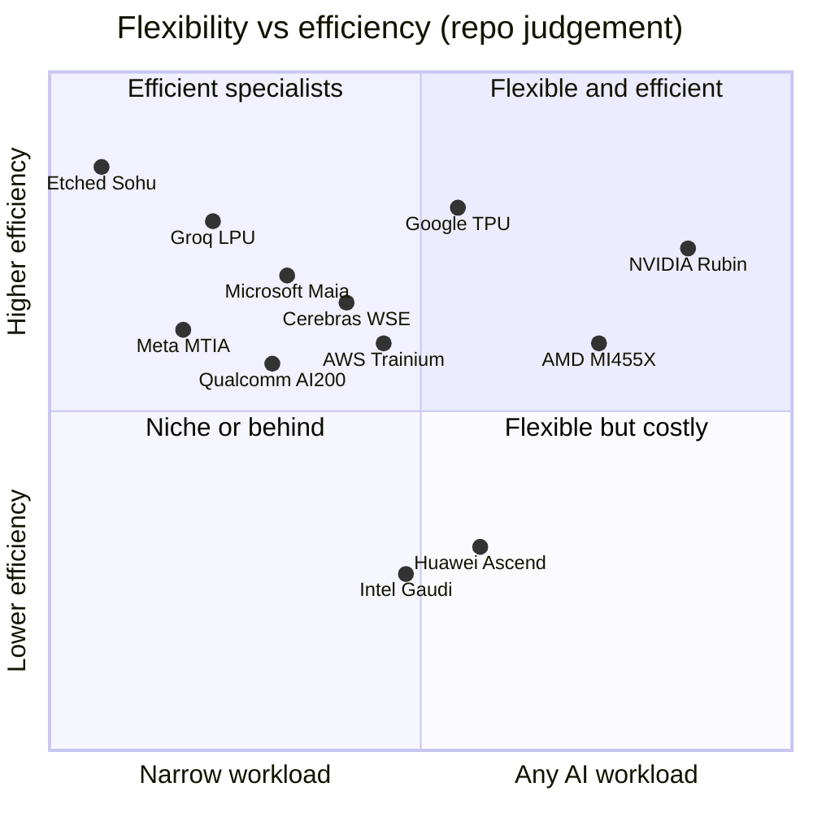

# GPU silicon: Competition

Layer 02 · GPU silicon · ~13 min read · Last verified: 2026-11-05

## ⚡ The Executive Take

- **On paper, the chip-level gap has closed.** AMD's MI455X claims 20 PFLOPS FP8, 432 GB of [HBM](../../glossary.md#hbm)
  and 19.6 TB/s [[S144]](../../sources/bibliography.md#s144)[[S538]](../../sources/bibliography.md#s538); NVIDIA's Rubin lists 17.5 PFLOPS dense FP8, 288 GB and, after a 2026 revision,
  19.2 TB/s [[S33005]](../../sources/bibliography.md#s33005)[[S90006]](../../sources/bibliography.md#s90006). Both ship from late Q3 2026 [[S90009]](../../sources/bibliography.md#s90009)[[S90020]](../../sources/bibliography.md#s90020).
- **AMD is the strongest challenger at the chip level; Google's TPU is the strongest overall.** SemiAnalysis
  measured Ironwood at $0.181 per million tokens vs $0.222 for B200 [[S625]](../../sources/bibliography.md#s625); Anthropic has signed for up to 1M
  TPUs [[S90026]](../../sources/bibliography.md#s90026).
- **Custom [ASICs](../../glossary.md#asic) trail per chip but gain share of wallet.** Trainium3, Ironwood and Maia 200
  deliver 2.5–5 PFLOPS FP8 [[S155]](../../sources/bibliography.md#s155)[[S151]](../../sources/bibliography.md#s151)[[S158]](../../sources/bibliography.md#s158), yet Broadcom's AI revenue rose from ~12% to ~19% of NVIDIA's
  data-center revenue in 2026 [[S2516]](../../sources/bibliography.md#s2516)[[S405]](../../sources/bibliography.md#s405).
- **NVIDIA still leads where it counts commercially:** ~7.6 FP8 TFLOPS/W for Rubin vs ~3.6 for MI355X (power
  partly reported) [[S106]](../../sources/bibliography.md#s106)[[S143]](../../sources/bibliography.md#s143), framework support of 36/36 vs ROCm's 26 [[S580]](../../sources/bibliography.md#s580)[[S586]](../../sources/bibliography.md#s586), and the only
  [merchant](../../glossary.md#merchant-silicon) platform shipping at scale.
- **Share has barely moved:** ~87% of AI data-center silicon revenue in 2025 vs ~90% in 2023 (repo calculation)
  [[S416]](../../sources/bibliography.md#s416)[[S660]](../../sources/bibliography.md#s660)[[S663]](../../sources/bibliography.md#s663).
- **China is a separate market:** Huawei's Ascend 950 (1 PFLOPS FP8) is ~17× behind Rubin per chip but ships into
  8,192-chip SuperPoD designs [[S163]](../../sources/bibliography.md#s163)[[S90042]](../../sources/bibliography.md#s90042).

## The scorecard: five metrics, nine challengers

Verdicts compare each flagship with Rubin/B300 (vendor peak figures; "dense" = no [sparsity](../../glossary.md#sparsity)
credit).

| Challenger (flagship) | Dense FP8 / FP4 per chip | Memory capacity / bandwidth | Perf/W | Software maturity | Availability |
|---|---|---|---|---|---|
| AMD MI455X | 🟨 20 / 40 PF, basis unstated [[S144]](../../sources/bibliography.md#s144) | 🟩 432 GB, 19.6 TB/s [[S144]](../../sources/bibliography.md#s144) | 🟥 MI355X ~3.6 TFLOPS/W [[S143]](../../sources/bibliography.md#s143) | 🟥 ROCm 26/36 [[S586]](../../sources/bibliography.md#s586) | 🟨 merchant; ships end-Q3 2026 [[S90020]](../../sources/bibliography.md#s90020) |
| Google Ironwood / TPU 8t | 🟥 4.6 PF FP8; 8t 12.6 PF FP4 [[S151]](../../sources/bibliography.md#s151)[[S552]](../../sources/bibliography.md#s552) | 🟥 192 GB, 7.4 TB/s [[S151]](../../sources/bibliography.md#s151) | 🟦 no TDP; ~2× per generation [[S552]](../../sources/bibliography.md#s552) | 🟨 JAX/XLA; TorchTPU new [[S553]](../../sources/bibliography.md#s553) | 🟦 Google Cloud, Anthropic, Meta [[S90025]](../../sources/bibliography.md#s90025) |
| AWS Trainium3 / 4 | 🟥 2.5 PF FP8 [[S155]](../../sources/bibliography.md#s155) | 🟥 144 GB, 4.9 TB/s [[S155]](../../sources/bibliography.md#s155) | 🟦 undisclosed | 🟥 Neuron 7/36 [[S594]](../../sources/bibliography.md#s594) | 🟦 AWS only |
| Microsoft Maia 200 | 🟥 >5 / >10 PF [[S158]](../../sources/bibliography.md#s158) | 🟥 216 GB, ~7 TB/s [[S158]](../../sources/bibliography.md#s158) | 🟨 ~6.7 at 750 W [[S158]](../../sources/bibliography.md#s158) | 🟦 internal (Copilot) [[S90044]](../../sources/bibliography.md#s90044) | 🟦 internal |
| Meta MTIA 300–500 | 🟦 ranking and inference [[S561]](../../sources/bibliography.md#s561) | 🟦 HBM from MTIA 400 [[S561]](../../sources/bibliography.md#s561) | 🟦 undisclosed | 🟦 PyTorch, internal | 🟦 internal |
| Intel Gaudi 3 / Crescent Island | 🟥 1.8 PF FP8 [[S161]](../../sources/bibliography.md#s161) | 🟥 128 GB, 3.7 TB/s [[S161]](../../sources/bibliography.md#s161) | 🟥 ~2.0 [[S161]](../../sources/bibliography.md#s161) | 🟥 18/36 [[S580]](../../sources/bibliography.md#s580) | 🟥 sampling H2 2026 [[S162]](../../sources/bibliography.md#s162) |
| Huawei Ascend 950DT | 🟥 1 / 2 PF [[S163]](../../sources/bibliography.md#s163) | 🟥 144 GB, 4 TB/s [[S163]](../../sources/bibliography.md#s163) | 🟦 undisclosed | 🟥 CANN 17/36 [[S592]](../../sources/bibliography.md#s592) | 🟦 China only |
| Cerebras, Etched, Groq-type | 🟦 wafer-scale, SRAM or fixed-function | 🟦 44 GB SRAM, 21 PB/s [[S166]](../../sources/bibliography.md#s166) | 🟦 | 🟥 narrow | 🟥 niche |
| Qualcomm AI200 / AI250 | 🟦 undisclosed [[S173]](../../sources/bibliography.md#s173) | 🟦 768 GB LPDDR per card [[S173]](../../sources/bibliography.md#s173) | 🟦 TCO claims only | 🟥 4/36 [[S596]](../../sources/bibliography.md#s596) | 🟥 no shipment confirmed [[S90028]](../../sources/bibliography.md#s90028) |

> [!TIP]
> **Worked example — what AMD's memory lead buys.** A 1-trillion-parameter model at [FP8](../../glossary.md#fp8) needs
> ~1,000 GB for weights. Four Rubin GPUs hold 1,152 GB, leaving ~152 GB for the [KV cache](../../glossary.md#kv-cache);
> four MI455X hold 1,728 GB, leaving ~728 GB: **4.8× the room for concurrent conversations** on the same GPU
> count. Bigger decode batches mean more tokens per GPU-hour, AMD's best economic argument.

## Challenger by challenger

**AMD Instinct — memory and openness.** In MLPerf Inference v6.0 the MI355X matched B200 per GPU on Llama 2 70B
(12,935 vs 12,994 tokens/s) but trailed GB300 (15,651) [[S602]](../../sources/bibliography.md#s602). MI455X ships in the 72-GPU Helios rack (1.4 EF
FP8, 31 TB HBM4) [[S90021]](../../sources/bibliography.md#s90021), anchored by OpenAI (6 GW), Oracle (50,000 MI450) and Anthropic (up to 2 GW)
[[S546]](../../sources/bibliography.md#s546)[[S90022]](../../sources/bibliography.md#s90022)[[S538]](../../sources/bibliography.md#s538). MI300X trailed H100 by about a year [[S141]](../../sources/bibliography.md#s141)[[S33002]](../../sources/bibliography.md#s33002); MI455X lands in Rubin's quarter.
Still missing: revenue (~3% share in 2025) [[S663]](../../sources/bibliography.md#s663) and software depth.

**Google TPU — cost per token.** Ironwood offers 4,614 TFLOPS FP8 and 9,216-chip pods [[S151]](../../sources/bibliography.md#s151); TPU 8t claims 12.6
PFLOPS FP4 per chip [[S552]](../../sources/bibliography.md#s552). TPUs now reach outside customers: Anthropic (up to 1M), a multibillion-dollar Meta
rental with purchase talks, and Oracle Cloud from 2027 [[S90026]](../../sources/bibliography.md#s90026)[[S90025]](../../sources/bibliography.md#s90025)[[S552]](../../sources/bibliography.md#s552).

> [!TIP]
> **Worked example — where the TPU's cost edge comes from.** On Qwen3.5-397B at 20 tokens/s per user, Ironwood
> served 9,364 tokens/s per chip vs 8,903 for B200, only ~5% more [[S625]](../../sources/bibliography.md#s625). At 100 tokens/s per user it cost
> $0.181 vs $0.222 per million tokens, ~18% less. Most of the gap is **cheaper chip-hours**, not faster silicon,
> so it moves with NVIDIA's pricing rather than with specs.

**AWS, Microsoft and Meta — "good enough, cheaper, ours".** Trainium3 runs in 144-chip UltraServers; AWS claims
Trainium4 brings 3× FP8, 4× memory bandwidth and [NVLink Fusion](../../glossary.md#nvlink-fusion) support
[[S155]](../../sources/bibliography.md#s155)[[S90034]](../../sources/bibliography.md#s90034). Maia 200 runs Copilot; Maia 300 deploys in 2027 [[S90044]](../../sources/bibliography.md#s90044)[[S90046]](../../sources/bibliography.md#s90046). Meta plans four MTIA
generations through 2027 [[S561]](../../sources/bibliography.md#s561).

**Huawei, Intel, start-ups, Qualcomm.** Huawei's SuperPoD shipments are unconfirmed (🔴) [[S90042]](../../sources/bibliography.md#s90042); Intel cancelled
Falcon Shores after Gaudi 3 missed its target [[S668]](../../sources/bibliography.md#s668)[[S564]](../../sources/bibliography.md#s564); Groq's technology now sits inside NVIDIA [[S90018]](../../sources/bibliography.md#s90018);
Qualcomm's AI200 (768 GB LPDDR per card) has no confirmed 2026 volume (🔴) [[S173]](../../sources/bibliography.md#s173)[[S90028]](../../sources/bibliography.md#s90028).

## Perf/W and the flexibility–efficiency trade-off

[Perf/W](../../glossary.md#perf-per-watt) decides how many tokens a power-capped site can sell. Only some vendors publish
chip power, which is itself a signal.

> [!TIP]
> **Worked example — peak FP8 per megawatt of chip power.** 1 MW feeds ~435 Rubin GPUs at 2.3 kW (≈ 7.6 EF),
> ~714 MI355X at 1.4 kW (≈ 3.6 EF) or ~1,333 Maia 200 at 750 W (≈ 6.7 EF) [[S106]](../../sources/bibliography.md#s106)[[S143]](../../sources/bibliography.md#s143)[[S158]](../../sources/bibliography.md#s158). The
> inference-only Maia gets within ~12% of Rubin by dropping generality: the ASIC bargain.

🔧 Under the hood: why spec-sheet comparisons mislead

- **Dense vs sparse.** AMD has not said whether MI455X's 20/40 PFLOPS are dense [[S144]](../../sources/bibliography.md#s144); Rubin's 50 PFLOPS NVFP4
  "inference" figure relies on adaptive compression, 35 PFLOPS is the training figure [[S100]](../../sources/bibliography.md#s100).
- **Power definitions differ.** Rubin's ~1.8/2.3 kW are analyst-reported [[S106]](../../sources/bibliography.md#s106); Maia's 750 W is a vendor TDP [[S158]](../../sources/bibliography.md#s158).
- **Paper vs product.** Rubin's HBM and NVLink figures were cut after launch (see [roadmap](roadmap.md));
  measured results (MLPerf, InferenceX) are the better guide [[S602]](../../sources/bibliography.md#s602)[[S625]](../../sources/bibliography.md#s625).

## Beyond the chip: where the moat sits

> [!TIP]
> **Worked example — what one point of share is worth.** The AI silicon pool was ~$224B in 2025 and is estimated
> at ~$436B in 2026 (repo calculation) [[S416]](../../sources/bibliography.md#s416)[[S660]](../../sources/bibliography.md#s660)[[S663]](../../sources/bibliography.md#s663). One share point is worth ~$2.2B, then ~$4.4B: AMD
> moving from ~3% to ~6% of the 2026 pool would mean ~$13B more revenue, without denting NVIDIA's lead.

**[Q5 · Strongest challenger]** At the chip level it is **AMD**: its best argument is memory (432 vs 288 GB) and,
since NVIDIA's 2026 revision, a paper lead in HBM and scale-up bandwidth, sold as an open merchant alternative
[[S144]](../../sources/bibliography.md#s144)[[S90006]](../../sources/bibliography.md#s90006). The gap has closed from "a year late" to "same quarter, better paper specs", but not in revenue
(~3%) or software [[S663]](../../sources/bibliography.md#s663)[[S586]](../../sources/bibliography.md#s586). At the system level it is **Google's TPU**: ~18% lower measured cost per token
and parity or better in more stack layers than any rival [[S625]](../../sources/bibliography.md#s625).

> [!NOTE]
> **🐂 Bull view.** Rivals now match NVIDIA's *specs*, yet NVIDIA kept ~87% share and a ~75% gross margin
> [[S405]](../../sources/bibliography.md#s405). Matching one chip is not matching a platform every year.

> [!WARNING]
> **🐻 Bear view.** A merchant rival out-specs NVIDIA's flagship, the largest buyers design their own chips and
> TPUs are sold outside Google. Once silicon is "good enough", price per token decides, and NVIDIA's premium is
> exactly what an ASIC removes.

## 🎯 Corp Dev Lens

1. With the chip gap measured in months and gigabytes, does differentiation move to racks, software or supply?
2. [Hyperscaler](../../glossary.md#hyperscaler) ASICs win on cost per token for their own workloads. Is there a durable
   pool for a third-party inference accelerator outside the largest clouds, and at what price per token?
3. AMD and Qualcomm both lead on memory capacity. How defensible is that once HBM4E stacks reach 48–64 GB (see
   [Layer 03](../03-memory-packaging-supply-chain/index.md))?
4. Would credible, audited perf/W disclosure be a commercial weapon for a newcomer?
5. As TPUs become merchant silicon, which suppliers gain bargaining power?

## 📚 Sources

<!-- Auto-generated from the [S…] citations on this page by `make build`. Edit sources/registry/*.csv, not this list. -->

- [**S100**](../../sources/bibliography.md#s100) NVIDIA Technical Blog, *Inside the NVIDIA Vera Rubin Platform: Six New Chips, One AI Supercomputer*, 2026-01-05. [Link](https://developer.nvidia.com/blog/inside-the-nvidia-rubin-platform-six-new-chips-one-ai-supercomputer/)
- [**S106**](../../sources/bibliography.md#s106) SemiAnalysis, *Vera Rubin - Extreme Co-Design: An Evolution*, 2026. [Link](https://newsletter.semianalysis.com/p/vera-rubin-extreme-co-design-an-evolution)
- [**S141**](../../sources/bibliography.md#s141) AMD, *AMD Instinct MI300X Accelerator*, 2023-12-06. [Link](https://www.amd.com/en/products/accelerators/instinct/mi300/mi300x.html)
- [**S143**](../../sources/bibliography.md#s143) AMD, *AMD Instinct MI350 Series (MI350X, MI355X)*, 2025-06-12. [Link](https://www.amd.com/en/products/accelerators/instinct/mi350.html)
- [**S144**](../../sources/bibliography.md#s144) AMD Newsroom, *AMD Unveils Vision for an Open AI Ecosystem, Detailing New Silicon, Software and Systems at Advancing AI 2025*, 2025-06-12. [Link](https://www.amd.com/en/newsroom/press-releases/2025-6-12-amd-unveils-vision-for-an-open-ai-ecosystem-detai.html)
- [**S151**](../../sources/bibliography.md#s151) Google Blog (Amin Vahdat), *Ironwood: The first Google TPU for the age of inference*, 2025-04-09. [Link](https://blog.google/products/google-cloud/ironwood-tpu-age-of-inference/)
- [**S155**](../../sources/bibliography.md#s155) Amazon Web Services, *AWS Trainium (product page: Trn2, Trn3)*, 2025-12. [Link](https://aws.amazon.com/ai/machine-learning/trainium/)
- [**S158**](../../sources/bibliography.md#s158) Microsoft, *Maia 200: Microsoft's AI accelerator built for inference*, 2026-01. [Link](https://blogs.microsoft.com/blog/2026/01/26/maia-200-the-ai-accelerator-built-for-inference/)
- [**S161**](../../sources/bibliography.md#s161) Intel, *Intel Gaudi AI accelerators (Gaudi 2, Gaudi 3)*, 2024-04-09. [Link](https://www.intel.com/content/www/us/en/products/details/processors/ai-accelerators/gaudi.html)
- [**S162**](../../sources/bibliography.md#s162) Intel Newsroom, *Intel to Expand AI Accelerator Portfolio with New GPU (Crescent Island)*, 2025-10-14. [Link](https://newsroom.intel.com/artificial-intelligence/intel-to-expand-ai-accelerator-portfolio-with-new-gpu)
- [**S163**](../../sources/bibliography.md#s163) Huawei (Eric Xu), *Huawei Connect 2025 keynote: Ascend roadmap and SuperPoD interconnect (Eric Xu)*, 2025-09-18. [Link](https://www.huawei.com/en/news/2025/9/hc-xu-keynote-speech)
- [**S166**](../../sources/bibliography.md#s166) Cerebras, *Cerebras Systems Unveils World's Fastest AI Chip with 4 Trillion Transistors (WSE-3)*, 2024-03-13. [Link](https://www.cerebras.ai/press-release/cerebras-announces-third-generation-wafer-scale-engine)
- [**S173**](../../sources/bibliography.md#s173) Qualcomm, *Qualcomm Unveils AI200 and AI250 - Redefining Rack-Scale Data Center Inference*, 2025-10-27. [Link](https://www.qualcomm.com/news/releases/2025/10/qualcomm-unveils-ai200-and-ai250-redefining-rack-scale-data-cent)
- [**S405**](../../sources/bibliography.md#s405) NVIDIA Corporation via SEC EDGAR, *NVIDIA Announces Financial Results for Second Quarter Fiscal 2027 (Form 8-K exhibit 99.1)*, 2026-08-26. [Link](https://www.sec.gov/Archives/edgar/data/0001045810/000104581026000073/q2fy27pr.htm)
- [**S416**](../../sources/bibliography.md#s416) NVIDIA Corporation via SEC EDGAR, *NVIDIA Corporation Form 10-K for fiscal year ended January 26, 2025*, 2025-02-26. [Link](https://www.sec.gov/Archives/edgar/data/1045810/000104581025000023/nvda-20250126.htm)
- [**S538**](../../sources/bibliography.md#s538) AMD Investor Relations, *AAI 2026: AMD Delivers Full-Stack Compute for the Agentic AI Era*, 2026-07-23. [Link](https://ir.amd.com/news-events/press-releases/detail/1294/aai-2026-amd-delivers-full-stack-compute-for-the-agentic-ai-era)
- [**S546**](../../sources/bibliography.md#s546) TechWire Asia, *AMD Advancing AI 2026: Helios, OpenAI, Meta, Anthropic*, 2026-07. [Link](https://techwireasia.com/2026/07/amd-advancing-ai-2026-helios-openai-meta-anthropic/)
- [**S552**](../../sources/bibliography.md#s552) Google Cloud Blog (Karan Batta), *Bringing Google TPUs to Oracle Cloud Infrastructure*, 2026-10-27. [Link](https://cloud.google.com/blog/products/infrastructure/bringing-google-tpus-to-oracle-cloud-infrastructure)
- [**S553**](../../sources/bibliography.md#s553) Google Cloud Blog (Alex Barrett), *What's new in AI infrastructure and orchestration in October*, 2026-11. [Link](https://cloud.google.com/blog/topics/ai-infrastructure/whats-new-in-ai-infrastructure-this-month)
- [**S561**](../../sources/bibliography.md#s561) DatacenterDynamics, *Meta unveils next four generations of its MTIA chip*, 2026-03-11. [Link](https://www.datacenterdynamics.com/en/news/meta-unveils-next-four-generations-of-its-mtia-chip/)
- [**S564**](../../sources/bibliography.md#s564) Tom's Hardware, *Intel's roadmaps examined — 14A, Nova Lake, Diamond Rapids & AI accelerator push*, 2026. [Link](https://www.tomshardware.com/tech-industry/semiconductors/intel-chip-roadmap-2026-2028)
- [**S580**](../../sources/bibliography.md#s580) vLLM project (GitHub), *vLLM README and installation docs — supported hardware*, 2026-11. [Link](https://github.com/vllm-project/vllm/blob/main/docs/getting_started/installation/README.md)
- [**S586**](../../sources/bibliography.md#s586) AMD (GitHub: ROCm/ROCm docs), *ROCm documentation sources: release history, AI-ecosystem compatibility matrix, consolidated changelog*, 2026-08-26. [Link](https://github.com/ROCm/ROCm/blob/develop/docs/release/versions.rst)
- [**S592**](../../sources/bibliography.md#s592) Huawei Ascend (GitHub: Ascend org), *Huawei Ascend open-source adapters: torch_npu, MindSpeed, triton-ascend*, 2026-11. [Link](https://github.com/Ascend/pytorch)
- [**S594**](../../sources/bibliography.md#s594) AWS (GitHub: aws-neuron/neuronx-distributed), *NeuronX Distributed (NxD) README*, 2026-11. [Link](https://github.com/aws-neuron/neuronx-distributed)
- [**S596**](../../sources/bibliography.md#s596) Qualcomm (GitHub: quic), *Qualcomm Cloud AI SDK and Efficient Transformers repositories*, 2026-11. [Link](https://github.com/quic/cloud-ai-sdk)
- [**S602**](../../sources/bibliography.md#s602) MLCommons, *MLPerf Inference v6.0 results (summary_results.json and per-submitter logs)*, 2026-04-01. [Link](https://github.com/mlcommons/inference_results_v6.0)
- [**S625**](../../sources/bibliography.md#s625) SemiAnalysis, *TPU Inference Externalization Full Steam Ahead*, 2026-09-07. [Link](https://github.com/SemiAnalysisAI/InferenceX-app/blob/main/packages/app/content/blog/tpu-inferencex-full-steam.mdx)
- [**S660**](../../sources/bibliography.md#s660) Broadcom Inc., *Broadcom Inc. Announces Fourth Quarter and Fiscal Year 2024 Financial Results*, 2024-12-12. [Link](https://investors.broadcom.com/financial-information/quarterly-results)
- [**S663**](../../sources/bibliography.md#s663) AMD, *AMD Reports Fourth Quarter and Full Year 2024 Financial Results*, 2025-02-04. [Link](https://ir.amd.com/news-events/press-releases)
- [**S668**](../../sources/bibliography.md#s668) Reuters (as reported), *Intel says it will not hit $500 million Gaudi 3 revenue target for 2024*, 2024-10-31. [Link](https://www.reuters.com/technology/)
- [**S2516**](../../sources/bibliography.md#s2516) Broadcom Inc. via SEC EDGAR, *Broadcom Inc. Announces Third Quarter Fiscal Year 2026 Financial Results (Form 8-K exhibit 99.1)*, 2026-09. [Link](https://www.sec.gov/Archives/edgar/data/0001730168/000173016826000076/avgo-08022026x8kxex99.htm)
- [**S33002**](../../sources/bibliography.md#s33002) NVIDIA, *NVIDIA H100 Tensor Core GPU (product page and datasheet)*, 2022-03-22. [Link](https://www.nvidia.com/en-us/data-center/h100/)
- [**S33005**](../../sources/bibliography.md#s33005) NVIDIA, *NVIDIA Vera Rubin NVL72 (product page and specifications)*, 2026. [Link](https://www.nvidia.com/en-us/data-center/vera-rubin-nvl72/)
- [**S90006**](../../sources/bibliography.md#s90006) TweakTown, *Nvidia cuts Vera Rubin's memory bandwidth by up to 26% and AMD's Helios now leads in memory bandwidth*, 2026-10. [Link](https://www.tweaktown.com/news/114304/nvidia-cuts-vera-rubins-memory-bandwidth-by-up-to-26-percent-and-amds-helios-now-leads-in-memory-bandwidth/index.html)
- [**S90009**](../../sources/bibliography.md#s90009) GamesBeat, *Nvidia Vera Rubin ramps into full production for fall launch*, 2026. [Link](https://gamesbeat.com/nvidia-vera-rubin-ramps-into-full-production-for-fall-launch-again/)
- [**S90018**](../../sources/bibliography.md#s90018) Constellation Research, *Nvidia's Groq deal: acquisition, acquihire or creative licensing deal?*, 2025-12. [Link](https://www.constellationr.com/insights/news/nvidias-groq-deal-acquisition-acquihire-or-creative-licensing-deal)
- [**S90020**](../../sources/bibliography.md#s90020) Shacknews, *AMD Helios AI rack system on track for initial shipments in Q3 2026*, 2026. [Link](https://www.shacknews.com/article/150249/amd-helios-ai-system-shipping-q3-2026)
- [**S90021**](../../sources/bibliography.md#s90021) Igor's Lab, *AMD Helios in production: MI455X, EPYC Venice and OpenAI challenge Nvidia AI racks*, 2026. [Link](https://www.igorslab.de/en/amd-helios-in-production-mi455x-epyc-venice-openai-challenge-nvidia-ai-racks/)
- [**S90022**](../../sources/bibliography.md#s90022) Tom's Hardware, *AMD and Oracle partner to deploy 50,000 MI450 Instinct GPUs*, 2025-10. [Link](https://www.tomshardware.com/tech-industry/artificial-intelligence/amd-and-oracle-partner-to-deploy-50-000-mi450-instinct-gpus-in-new-ai-superclusters-deployment-of-expansion-set-for-2026-powered-by-amds-helios-rack)
- [**S90025**](../../sources/bibliography.md#s90025) SiliconANGLE, *Google and Meta reportedly strike new multibillion-dollar AI chip deal*, 2026-02-26. [Link](https://siliconangle.com/2026/02/26/google-meta-reportedly-strike-new-multibillion-dollar-ai-chip-deal/)
- [**S90026**](../../sources/bibliography.md#s90026) Maginative, *Anthropic secures 1M Google TPUs while keeping Amazon as primary training partner*, 2025-10. [Link](https://www.maginative.com/anthropic-secures-1m-google-tpus-while-keeping-amazon-as-primary-training-partner)
- [**S90028**](../../sources/bibliography.md#s90028) TechRepublic, *Qualcomm unveils AI chips to rival Nvidia, AMD*, 2025-10-27. [Link](https://techrepublic.com/article/news-qualcomm-unveils-ai-chips-to-rival-nvidia-amd)
- [**S90034**](../../sources/bibliography.md#s90034) NAND Research, *AWS releases Trainium3, teases Trainium4*, 2025-12. [Link](https://nand-research.com/research-note-aws-releases-trainium3-teases-trainium4/4/)
- [**S90042**](../../sources/bibliography.md#s90042) TrendForce, *Huawei unveils Ascend 950 with in-house HBM in 2026, touts SuperPoD to rival NVIDIA*, 2025-09-18. [Link](https://www.trendforce.com/news/2025/09/18/news-huawei-unveils-ascend-950-with-in-house-hbm-in-2026-touts-superpod-to-rival-nvidia/)
- [**S90044**](../../sources/bibliography.md#s90044) eWeek, *Microsoft introduces Maia 200, its most powerful AI chip yet*, 2026-01-27. [Link](https://www.eweek.com/news/microsoft-maia-200-ai-chip/)
- [**S90046**](../../sources/bibliography.md#s90046) IT Brief UK, *Microsoft unveils Maia 300 for 2027 AI deployments*, 2026-10. [Link](https://itbrief.co.uk/story/microsoft-unveils-maia-300-for-2027-ai-deployments)
