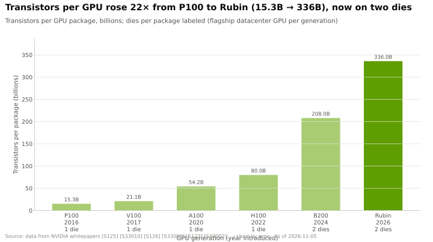
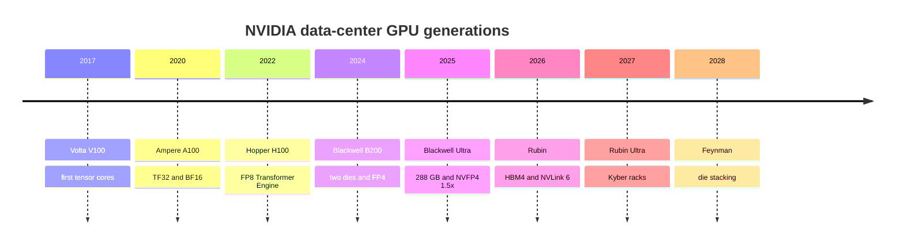
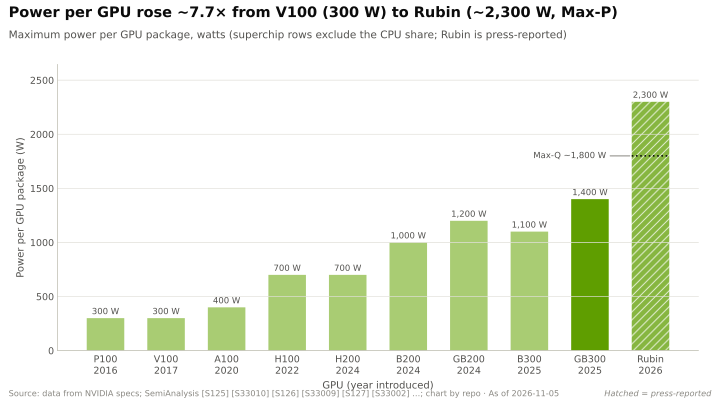

# Generations: Volta to Feynman

Layer 02 · GPU silicon · What each generation added, then vs. now, and the 2026 Rubin revisions · ~7 min read · Last verified: 2026-11-05

## ⚡ The Executive Take

- **The cadence went from ~2–3 years to annual:** Volta (2017), Ampere (2020), Hopper (2022), Blackwell (2024), Blackwell Ultra (2025), Rubin (2026), with Rubin Ultra (H2 2027) and Feynman (2028) on the official roadmap 🟢 [[S33020]](../../sources/bibliography.md#s33020)[[S502]](../../sources/bibliography.md#s502).
- **Each generation pairs a new [tensor core](../../glossary.md#tensor-core) with a new number format, a new [HBM](../../glossary.md#hbm) generation and a faster [NVLink](../../glossary.md#nvlink);** the format usually delivers the biggest jump (FP8 on Hopper, FP4 on Blackwell) [[S2023]](../../sources/bibliography.md#s2023)[[S35014]](../../sources/bibliography.md#s35014).
- **Transistors per GPU rose 16× from V100 to Rubin** (21.1B → 336B), the last 4× by adding a second die [[S126]](../../sources/bibliography.md#s126)[[S100]](../../sources/bibliography.md#s100).
- **Power rose ~7.7×** from 300 W (V100) to ~2,300 W for Rubin's reported Max-P profile [[S33010]](../../sources/bibliography.md#s33010)[[S106]](../../sources/bibliography.md#s106).
- **2026 brought NVIDIA's first visible spec retreat:** Rubin's HBM4 fell from 22 to 19.2 TB/s per GPU and NVLink 6 from 3.6 to 3.0 TB/s 🟢; the cause is unconfirmed 🔴 [[S90006]](../../sources/bibliography.md#s90006)[[S90007]](../../sources/bibliography.md#s90007)[[S90008]](../../sources/bibliography.md#s90008).
- **The roadmap is getting more heterogeneous:** Rubin CPX left the GTC 2026 roadmap 🟡 [[S115]](../../sources/bibliography.md#s115), a Groq-derived [LPU](../../glossary.md#lpu) now sits beside Rubin [[S114]](../../sources/bibliography.md#s114), and Feynman is reported with an LP40 LPU and a Rosa CPU 🟡 [[S90004]](../../sources/bibliography.md#s90004).

## What each generation added

**[Q3 · Generational progress]**

| Generation (flagship) | Year | New tensor formats | Memory per GPU | NVLink per GPU | Signature change |
|---|---|---|---|---|---|
| Volta (V100) | 2017 | FP16 | 32 GB HBM2, 0.9 TB/s | 300 GB/s | First tensor cores [[S126]](../../sources/bibliography.md#s126)[[S33010]](../../sources/bibliography.md#s33010) |
| Ampere (A100) | 2020 | TF32, BF16, 2:4 sparsity | 80 GB HBM2e, 2.0 TB/s | 600 GB/s | 2× tensor rate per SM [[S127]](../../sources/bibliography.md#s127)[[S33009]](../../sources/bibliography.md#s33009) |
| Hopper (H100) | 2022 | FP8 | 80 GB HBM3, 3.35 TB/s | 900 GB/s | Transformer Engine, TMA [[S2023]](../../sources/bibliography.md#s2023)[[S33002]](../../sources/bibliography.md#s33002) |
| Blackwell (B200) | 2024 | FP6, FP4, MX, NVFP4 | 192 GB HBM3E, 8 TB/s | 1.8 TB/s | Two dies, [NV-HBI](../../glossary.md#nv-hbi) [[S35014]](../../sources/bibliography.md#s35014)[[S33003]](../../sources/bibliography.md#s33003) |
| Blackwell Ultra (GB300) | 2025 | [NVFP4](../../glossary.md#nvfp4) at 1.5× | 288 GB HBM3E, 8 TB/s | 1.8 TB/s | FP64 cut to ~1.3 TFLOPS [[S2003]](../../sources/bibliography.md#s2003)[[S32004]](../../sources/bibliography.md#s32004)[[S123]](../../sources/bibliography.md#s123) |
| Rubin | 2026 | NVFP4 adaptive compression | 288 GB HBM4, 19.2 TB/s | 3.0 TB/s | 336B transistors, 224 SMs [[S100]](../../sources/bibliography.md#s100)[[S2000]](../../sources/bibliography.md#s2000)[[S33007]](../../sources/bibliography.md#s33007) |
| Rubin Ultra 🟢 | H2 2027 | not disclosed | ~1 TB HBM4E, 16 stacks | NVLink 7 | Four dies (two-die reported 🟡) [[S35018]](../../sources/bibliography.md#s35018)[[S509]](../../sources/bibliography.md#s509) |
| Feynman 🟢 | 2028 | not disclosed | custom HBM, die stacking 🟡 | NVLink 8, copper + optics 🟡 | Rosa CPU, LP40 LPU 🟡 [[S502]](../../sources/bibliography.md#s502)[[S90004]](../../sources/bibliography.md#s90004) |

> [!TIP]
> **Worked example — what a megawatt of GPUs buys, H100 vs Rubin.** 1 MW of GPU power runs ~1,430
> H100s at 700 W, or ~435 Rubins at ~2,300 W [[S33002]](../../sources/bibliography.md#s33002)[[S106]](../../sources/bibliography.md#s106). At FP8 that is 1,430 × 1.98 = **2.8 EF**
> versus 435 × 17.5 = **7.6 EF**, 2.7× more; at Rubin's FP4 it is 15.2 EF, 5.4× more (repo arithmetic).
> Power-limited sites therefore upgrade for the formats, not the transistor count.

## The 2026 Rubin revisions

| Spec | CES 2026 launch | Product pages, Oct 2026 | Change |
|---|---|---|---|
| HBM4 bandwidth per GPU | 22 TB/s [[S33006]](../../sources/bibliography.md#s33006) | 19.2 TB/s [[S33007]](../../sources/bibliography.md#s33007)[[S90006]](../../sources/bibliography.md#s90006) | −13% |
| NVLink 6 per GPU | 3.6 TB/s [[S33004]](../../sources/bibliography.md#s33004) | 3.0 TB/s [[S90006]](../../sources/bibliography.md#s90006)[[S103]](../../sources/bibliography.md#s103) | −17% |
| NVL72 rack HBM bandwidth | 1,580 TB/s | 1,400 TB/s [[S90007]](../../sources/bibliography.md#s90007) | −11% |
| HBM capacity; dense FP8 | 288 GB; 17.5 PFLOPS | unchanged [[S33005]](../../sources/bibliography.md#s33005) | 0 |

> [!TIP]
> **Worked example — what the cut means for a customer.** Decode is bandwidth-bound, so its ceiling
> falls in proportion: a 70B model at FP8 drops from ~236 to ~206 tokens/s per stream at 75% bandwidth
> efficiency (22 or 19.2 TB/s × 0.75 ÷ 70 GB; repo arithmetic). Compute-bound training is unaffected.
> NVIDIA says the new figures reflect what systems sustain in volume production [[S104]](../../sources/bibliography.md#s104); an analyst links
> them to HBM4 pins at ~9.4 rather than ~10.7 Gb/s 🔴 [[S90008]](../../sources/bibliography.md#s90008). Vera Rubin began production shipments in
> early August 2026 [[S500]](../../sources/bibliography.md#s500)[[S90009]](../../sources/bibliography.md#s90009).

🔧 Under the hood: Rubin CPX, the LPU and Feynman

- **Rubin CPX** (announced 2025-09-09): a single-die prefill accelerator with 30 PFLOPS NVFP4 and 128 GB
  of GDDR7 instead of HBM [[S33023]](../../sources/bibliography.md#s33023). It was missing from the GTC 2026 roadmap; NVIDIA's Ian Buck said it
  was pushed out to focus on LPU decode 🟡 [[S115]](../../sources/bibliography.md#s115)[[S116]](../../sources/bibliography.md#s116); an analyst reports a redesign with HBM4 for 1Q27
  🔴 [[S117]](../../sources/bibliography.md#s117).
- **Groq 3 LPU (LP30)**: ~500 MB of SRAM at ~150 TB/s and ~1.2 PFLOPS FP8 per chip, 256 per LPX rack,
  shipping beside Vera Rubin [[S114]](../../sources/bibliography.md#s114)[[S90003]](../../sources/bibliography.md#s90003).
- **Feynman (2028)**: die stacking and custom HBM, Kyber NVL1152 racks with copper and co-packaged optics
  🟡 [[S502]](../../sources/bibliography.md#s502)[[S108]](../../sources/bibliography.md#s108); process reported as TSMC A16 🔴 [[S119]](../../sources/bibliography.md#s119). No compute or memory figures are published.

## 🎯 Corp Dev Lens

1. An annual cadence shrinks each product's selling window to ~12 months; what does that do to residual values and customers' depreciation lives?
2. Suppliers can now move NVIDIA's headline specs; should diligence weight memory roadmaps as heavily as NVIDIA's?
3. A CPU, a GPU and an LPU per rack: does that heterogeneity open sockets for third-party accelerators via NVLink Fusion, or close them?

## 📚 Sources

<!-- Auto-generated from the [S…] citations on this page by `make build`. Edit sources/registry/*.csv, not this list. -->

- [**S100**](../../sources/bibliography.md#s100) NVIDIA Technical Blog, *Inside the NVIDIA Vera Rubin Platform: Six New Chips, One AI Supercomputer*, 2026-01-05. [Link](https://developer.nvidia.com/blog/inside-the-nvidia-rubin-platform-six-new-chips-one-ai-supercomputer/)
- [**S103**](../../sources/bibliography.md#s103) VideoCardz, *NVIDIA quietly cuts Vera Rubin specs, HBM4 bandwidth and NVLink 6 speeds now lower*, 2026-10. [Link](https://videocardz.com/newz/nvidia-quietly-cuts-vera-rubin-specs-hbm4-bandwidth-and-nvlink-6-speeds-now-lower)
- [**S104**](../../sources/bibliography.md#s104) Wccftech, *NVIDIA's Official Statement on Vera Rubin Spec Change*, 2026-10-29. [Link](https://wccftech.com/nvidia-official-statement-on-vera-rubin-spec-change/)
- [**S106**](../../sources/bibliography.md#s106) SemiAnalysis, *Vera Rubin - Extreme Co-Design: An Evolution*, 2026. [Link](https://newsletter.semianalysis.com/p/vera-rubin-extreme-co-design-an-evolution)
- [**S108**](../../sources/bibliography.md#s108) HPCwire / AIwire, *Huang Shares Nvidia Roadmap Showing More Chips, NVL1152, Scale-Up CPO*, 2026-03-18. [Link](https://www.hpcwire.com/aiwire/2026/03/18/huang-shares-nvidia-roadmap-showing-more-chips-nvl1152-scale-up-cpo/)
- [**S114**](../../sources/bibliography.md#s114) StorageReview, *NVIDIA Groq 3 LPX: Everything we know*, 2026-03. [Link](https://www.storagereview.com/news/nvidia-groq-3-lpx-everything-we-know)
- [**S115**](../../sources/bibliography.md#s115) Tom's Hardware, *Nvidia removes Rubin CPX accelerators from its roadmap - Groq 3 LPUs take center stage*, 2026-03. [Link](https://www.tomshardware.com/pc-components/gpus/nvidia-removes-rubin-cpx-accelerators-from-its-roadmap-groq-3-lpus-take-center-stage-as-cpx-is-removed)
- [**S116**](../../sources/bibliography.md#s116) Wccftech, *NVIDIA's Rubin CPX Is Off the Roadmap, Replaced by Groq LPUs for Inference, But May Return With Feynman in 2028*, 2026-03. [Link](https://wccftech.com/nvidia-rubin-cpx-is-off-the-roadmap-but-may-return-with-feynman-in-2028/)
- [**S117**](../../sources/bibliography.md#s117) TechNews (Taiwan), *Nvidia Rubin CPX re-enters roadmap with HBM4 for AI prefill*, 2026-09-02. [Link](https://technews.tw/2026/09/02/nvidia-rubin-cpx-reenters-roadmap-hbm4-ai-prefill/)
- [**S119**](../../sources/bibliography.md#s119) XenoSpectrum, *NVIDIA's Feynman May Combine TSMC A16 and N3P, Reports Say*, 2026. [Link](https://xenospectrum.com/en/nvidia-feynman-tsmc-a16-report/)
- [**S123**](../../sources/bibliography.md#s123) Glenn K. Lockwood (blog) (Glenn K. Lockwood), *HGX B300 specifications compilation (B300 per-GPU figures)*, 2025. [Link](https://glennklockwood.com/garden/processors/B300)
- [**S126**](../../sources/bibliography.md#s126) NVIDIA, *NVIDIA Tesla V100 GPU Architecture Whitepaper*, 2017-08. [Link](https://images.nvidia.com/content/volta-architecture/pdf/volta-architecture-whitepaper.pdf)
- [**S127**](../../sources/bibliography.md#s127) NVIDIA Technical Blog, *NVIDIA Ampere Architecture In-Depth*, 2020-05-14. [Link](https://developer.nvidia.com/blog/nvidia-ampere-architecture-in-depth/)
- [**S500**](../../sources/bibliography.md#s500) NVIDIA Corporation, *NVIDIA Q2 Fiscal 2027 Quarterly Presentation (CFO commentary deck)*, 2026-08-26. [Link](https://s201.q4cdn.com/141608511/files/doc_financials/2027/Q227/NVDA-F2Q27-Quarterly-Presentation-final-1.pdf)
- [**S502**](../../sources/bibliography.md#s502) Tom's Hardware, *Nvidia updates data center roadmap with Rosa CPU and stacked Feynman GPUs; optical NVLink; Groq LPUs with NVFP4 and NVLink also on deck*, 2026-03-17. [Link](https://www.tomshardware.com/pc-components/gpus/nvidia-updates-data-center-roadmap-with-rosa-cpu-and-stacked-feynman-gpus-optical-nvlink-groq-lpus-with-nvfp4-and-nvlink-also-on-deck)
- [**S509**](../../sources/bibliography.md#s509) TrendForce, *NVIDIA Rubin Ultra four-die single-package design not adopted amid advanced-packaging constraints*, 2026-04-01. [Link](https://www.trendforce.com/news/?p=55442)
- [**S2000**](../../sources/bibliography.md#s2000) NVIDIA Technical Blog, *Inside NVIDIA Rubin GPU Architecture: Powering the Era of Agentic AI*, 2026-07-21. [Link](https://developer.nvidia.com/blog/inside-nvidia-rubin-gpu-architecture-powering-the-era-of-agentic-ai/)
- [**S2003**](../../sources/bibliography.md#s2003) NVIDIA Technical Blog, *Inside NVIDIA Blackwell Ultra: The Chip Powering the AI Factory Era*, 2025-08. [Link](https://developer.nvidia.com/blog/inside-nvidia-blackwell-ultra-the-chip-powering-the-ai-factory-era/)
- [**S2023**](../../sources/bibliography.md#s2023) NVIDIA Technical Blog, *NVIDIA Hopper Architecture In-Depth*, 2022-03-22. [Link](https://developer.nvidia.com/blog/nvidia-hopper-architecture-in-depth/)
- [**S32004**](../../sources/bibliography.md#s32004) NVIDIA, *NVIDIA GB300 NVL72 / Blackwell Ultra (product page)*, 2025-03. [Link](https://www.nvidia.com/en-us/data-center/gb300-nvl72/)
- [**S33002**](../../sources/bibliography.md#s33002) NVIDIA, *NVIDIA H100 Tensor Core GPU (product page and datasheet)*, 2022-03-22. [Link](https://www.nvidia.com/en-us/data-center/h100/)
- [**S33003**](../../sources/bibliography.md#s33003) Lenovo Press, *ThinkSystem NVIDIA B200 180GB 1000W GPU product guide*, 2025. [Link](https://lenovopress.lenovo.com/lp2226-thinksystem-nvidia-b200-180gb-1000w-gpu)
- [**S33004**](../../sources/bibliography.md#s33004) NVIDIA Newsroom, *NVIDIA Kicks Off the Next Generation of AI With Rubin — Six New Chips; One Incredible AI Supercomputer*, 2026-01-05. [Link](https://nvidianews.nvidia.com/news/rubin-platform-ai-supercomputer)
- [**S33005**](../../sources/bibliography.md#s33005) NVIDIA, *NVIDIA Vera Rubin NVL72 (product page and specifications)*, 2026. [Link](https://www.nvidia.com/en-us/data-center/vera-rubin-nvl72/)
- [**S33006**](../../sources/bibliography.md#s33006) Tom's Hardware, *Nvidia launches Vera Rubin NVL72 AI supercomputer at CES*, 2026-01-05. [Link](https://www.tomshardware.com/pc-components/gpus/nvidia-launches-vera-rubin-nvl72-ai-supercomputer-at-ces-promises-up-to-5x-greater-inference-performance-and-10x-lower-cost-per-token-than-blackwell-coming-2h-2026)
- [**S33007**](../../sources/bibliography.md#s33007) Dataconomy, *Nvidia Quietly Cuts Vera Rubin HBM4 And NVLink Bandwidth Specs*, 2026-11-02. [Link](https://dataconomy.com/2026/11/02/nvidia-quietly-cuts-vera-rubin-hbm4-and-nvlink-bandwidth/)
- [**S33009**](../../sources/bibliography.md#s33009) NVIDIA, *NVIDIA A100 Tensor Core GPU datasheet*, 2021. [Link](https://www.nvidia.com/content/dam/en-zz/Solutions/Data-Center/a100/pdf/nvidia-a100-datasheet-us-nvidia-1758950-r4-web.pdf)
- [**S33010**](../../sources/bibliography.md#s33010) NVIDIA, *NVIDIA V100 Tensor Core GPU datasheet*, 2018. [Link](https://images.nvidia.com/content/technologies/volta/pdf/volta-v100-datasheet-update-us-1165301-r5.pdf)
- [**S33020**](../../sources/bibliography.md#s33020) NVIDIA (Jensen Huang), *NVIDIA GTC 2025 keynote (Jensen Huang)*, 2025-03-18. [Link](https://www.nvidia.com/gtc/keynote/)
- [**S33023**](../../sources/bibliography.md#s33023) NVIDIA Newsroom, *NVIDIA Unveils Rubin CPX: A New Class of GPU Designed for Massive-Context Inference*, 2025-09-09. [Link](https://nvidianews.nvidia.com/news/nvidia-unveils-rubin-cpx-a-new-class-of-gpu-designed-for-massive-context-inference)
- [**S35014**](../../sources/bibliography.md#s35014) NVIDIA, *NVIDIA Blackwell Architecture*, 2024-03. [Link](https://www.nvidia.com/en-us/data-center/technologies/blackwell-architecture/)
- [**S35018**](../../sources/bibliography.md#s35018) Tom's Hardware, *Nvidia announces Rubin GPUs in 2026, Rubin Ultra in 2027, Feynman also added to roadmap*, 2025-03-18. [Link](https://www.tomshardware.com/pc-components/gpus/nvidia-announces-rubin-gpus-in-2026-rubin-ultra-in-2027-feynam-after)
- [**S90003**](../../sources/bibliography.md#s90003) eWeek, *Everything Nvidia Just Announced at GTC 2026: 7 Chips, 5 Racks, 1 Giant Bet on Agentic AI*, 2026-03-17. [Link](https://www.eweek.com/news/nvidia-gtc-2026-ai-inference-vera-rubin-neuron/)
- [**S90004**](../../sources/bibliography.md#s90004) TrendForce, *Key GTC takeaways: how Samsung, Micron, Intel and more power NVIDIA's Vera Rubin and Feynman*, 2026-03-17. [Link](https://www.trendforce.com/news/2026/03/17/news-key-gtc-takeaways-how-samsung-micron-intel-more-power-nvidias-vera-rubin-and-feynman/)
- [**S90006**](../../sources/bibliography.md#s90006) TweakTown, *Nvidia cuts Vera Rubin's memory bandwidth by up to 26% and AMD's Helios now leads in memory bandwidth*, 2026-10. [Link](https://www.tweaktown.com/news/114304/nvidia-cuts-vera-rubins-memory-bandwidth-by-up-to-26-percent-and-amds-helios-now-leads-in-memory-bandwidth/index.html)
- [**S90007**](../../sources/bibliography.md#s90007) TechRadar Pro, *Nvidia forced to dial back key bandwidth targets on Vera Rubin*, 2026-10. [Link](https://techradar.com/pro/nvidia-forced-to-dial-back-key-bandwidth-targets-on-vera-rubin-hardware-tweaks-will-affect-target-specifications-for-memory-and-interconnect-fabric)
- [**S90008**](../../sources/bibliography.md#s90008) XenoSpectrum, *Nvidia Rubin bandwidth specification (HGX vs NVL72)*, 2026-10. [Link](https://xenospectrum.com/en/nvidia-rubin-bandwidth-specification-hgx-nvl72/)
- [**S90009**](../../sources/bibliography.md#s90009) GamesBeat, *Nvidia Vera Rubin ramps into full production for fall launch*, 2026. [Link](https://gamesbeat.com/nvidia-vera-rubin-ramps-into-full-production-for-fall-launch-again/)
