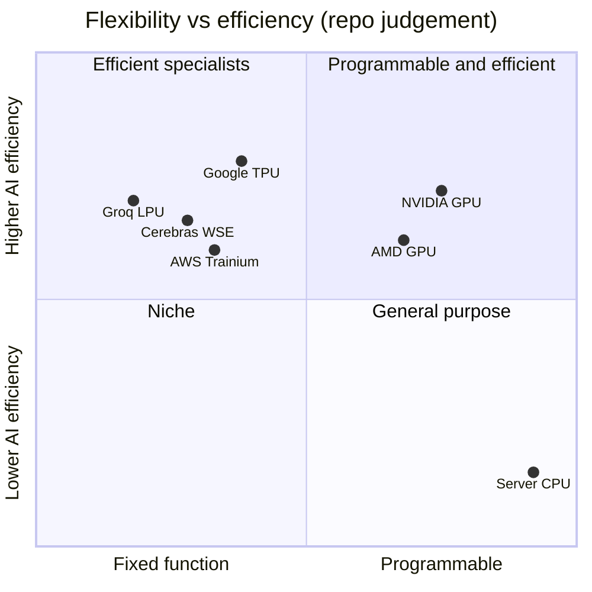

# GPU vs CPU vs ASIC

Layer 02 · GPU silicon · Why parallel matrix math favors GPUs, and what ASICs trade away · ~7 min read · Last verified: 2026-11-05

## ⚡ The Executive Take

- **AI math is one operation repeated trillions of times:** a matrix multiply ([GEMM](../../glossary.md#gemm)) built from [fused multiply-adds](../../glossary.md#fma) that do not depend on each other, so the winner is whoever can do the most at once per watt.
- **Per clock, an H100 does ~541,000 16-bit FLOPs** (132 SMs × 4,096) [[S33024]](../../sources/bibliography.md#s33024), about 8,400× one CPU core without matrix units and ~4× a 128-core Xeon with [AMX](../../glossary.md#amx) at its theoretical peak [[S2015]](../../sources/bibliography.md#s2015)[[S179]](../../sources/bibliography.md#s179).
- **A CPU spends its silicon on doing one thread fast; a [GPU](../../glossary.md#gpu) spends it on thousands of threads; an [ASIC](../../glossary.md#asic) spends it on one kind of math.** Google's Ironwood matrix unit is a single 256×256 array doing 65,536 multiply-accumulates per clock [[S2016]](../../sources/bibliography.md#s2016)[[S2017]](../../sources/bibliography.md#s2017).
- **The trade-off is flexibility for efficiency.** A big [systolic array](../../glossary.md#systolic-array) idles on awkward matrix shapes [[S2017]](../../sources/bibliography.md#s2017); a GPU keeps schedulers, caches and [CUDA cores](../../glossary.md#cuda-core) that cost area but run any new model on day one.
- **The ASIC gap is about cost more than physics:** Ironwood delivers 4.6 PFLOPS FP8 per chip [[S151]](../../sources/bibliography.md#s151) against Rubin's 17.5 per package [[S33005]](../../sources/bibliography.md#s33005), but hyperscalers buy ASICs without paying NVIDIA's ~80% chip margin (Est.) [[S35020]](../../sources/bibliography.md#s35020).
- **NVIDIA hedged its own bet** by licensing Groq's SRAM-based [LPU](../../glossary.md#lpu) for a reported ~$20B in December 2025 🟡 [[S90018]](../../sources/bibliography.md#s90018)[[S90019]](../../sources/bibliography.md#s90019) and shipping it beside Vera Rubin for decode [[S114]](../../sources/bibliography.md#s114).

## Why matrix math favors parallel hardware

Think of grading a million exams. A CPU is 64–128 brilliant professors who can do any task. A GPU is
a hall of thousands of teaching assistants working in squads of 32 (a [warp](../../glossary.md#warp)) that do
the same step at once. An ASIC is an optical scanner built for one answer-sheet layout: fastest of
all, until the format changes.

A GEMM is the perfect job for the hall. Each output number is a dot product that needs nothing from
its neighbours, so the work splits cleanly across 132 [streaming multiprocessors](../../glossary.md#streaming-multiprocessor),
each with four [tensor cores](../../glossary.md#tensor-core) that do a small matrix multiply every clock [[S33024]](../../sources/bibliography.md#s33024).

> [!TIP]
> **Worked example — one 8,192 × 8,192 × 8,192 matrix multiply.** FLOPs = 2 × 8,192³ ≈ **1.1 trillion**.
> An H100 does 540,672 FLOPs per clock (132 SMs × 4,096) [[S33024]](../../sources/bibliography.md#s33024); at the ~1.83 GHz implied by its
> 989 TFLOPS rating [[S33002]](../../sources/bibliography.md#s33002) that is ~1.1 ms at peak, or ~1.6 ms at a realistic 70% utilization. Each of
> the 528 tensor cores performs ~2 million clocks of 1,024 FLOPs. One CPU core without AMX (64 FLOPs per
> clock at ~2 GHz [[S2015]](../../sources/bibliography.md#s2015)) would need **~8.6 seconds**, ~7,700× longer. A 128-core AMX Xeon could in theory
> finish in ~4 ms, but its 845 GB/s memory bus [[S179]](../../sources/bibliography.md#s179) is a quarter of the H100's 3.35 TB/s, and AMX
> clocks drop under load: the CPU is a credible small-model inference engine, not a training one.

**[Q2 · Metrics that matter]** For comparing architectures, the useful numbers are matrix FLOPs per
clock and per watt *at a stated format*, memory bandwidth per FLOP, and achieved utilization on real
models — not peak TFLOPS alone.

🔧 Under the hood: where the GPU's "flexibility tax" goes

A GPU SM carries hardware an ASIC can drop: warp schedulers that juggle dozens of warps to hide
memory latency, a 256 KB [register file](../../glossary.md#register-file) and 256 KB of L1/shared memory per
SM [[S33024]](../../sources/bibliography.md#s33024)[[S2022]](../../sources/bibliography.md#s2022), CUDA cores for non-matrix work (softmax, normalization, expert routing) and a full
instruction set. That overhead lets a GPU run a new attention variant the week a paper appears; a
fixed-function design can spend the same area and power on more matrix math.

## The flexibility vs. efficiency trade-off

| | CPU (Xeon, EPYC, Grace) | NVIDIA GPU | ASIC (TPU, Trainium, Maia) | SRAM dataflow (Groq LPU, Cerebras) |
|---|---|---|---|---|
| Matrix FLOPs per chip | 🟥 ~4× lower at peak, less in practice | Reference | 🟨 Ironwood 4.6 PF FP8 vs Rubin 17.5 [[S151]](../../sources/bibliography.md#s151)[[S33005]](../../sources/bibliography.md#s33005) | 🟥 LP30 ~1.2 PF FP8 [[S114]](../../sources/bibliography.md#s114) |
| Memory bandwidth | 🟥 <1 TB/s [[S179]](../../sources/bibliography.md#s179) | Reference: 19.2 TB/s HBM4 [[S33007]](../../sources/bibliography.md#s33007) | 🟨 Ironwood 7.4 TB/s [[S151]](../../sources/bibliography.md#s151) | 🟩 ~150 TB/s SRAM, but only ~0.5 GB [[S114]](../../sources/bibliography.md#s114) |
| Runs any new model | 🟩 | Reference | 🟥 compiler-dependent | 🟥 model must fit SRAM across many chips |
| Cost per token at scale | 🟥 | Reference (pays NVIDIA margin) | 🟩 no merchant margin for the owner | 🟦 low latency, high chip count |
| Buyable by anyone | 🟩 | 🟩 | 🟥 mostly in-house or cloud-only | 🟨 |

> [!TIP]
> **Worked example — why a giant array is not always faster.** An Ironwood matrix unit does 65,536
> multiply-accumulates per clock only when both matrix dimensions are multiples of 256 [[S2017]](../../sources/bibliography.md#s2017). A layer
> 300 values wide needs two 256-wide passes, 512 slots for 300 values: **~59% utilization** on that
> dimension. GPU tensor-core instructions work on much smaller tiles, so the same matrix pads to a few
> percent of waste (repo arithmetic); on a GPU the libraries absorb the shape problem.

> [!WARNING]
> **Myth vs. reality: "ASICs are 10× more efficient than GPUs."** On peak specs the gap is small or
> reversed: OpenAI's Broadcom-built inference chip reportedly does 13.4 PFLOPS MXFP4 on one die versus
> 17.5 PFLOPS NVFP4 per Rubin die 🟡 [[S628]](../../sources/bibliography.md#s628). The ASIC case rests on owning the chip at cost, which is
> why the strongest challengers are hyperscalers (see [Competition](competition.md)).

## 🎯 Corp Dev Lens

1. If peak efficiency is near parity, ASICs are a margin-capture play; at what NVIDIA price cut does a hyperscaler program stop paying back?
2. NVIDIA's Groq licence shows the leader buying specialised decode designs; which SRAM or near-memory architectures are still independent?
3. CPU matrix units (AMX, Arm SME) make small-model inference on general servers plausible; how big is that "good-enough" segment?
4. Compiler talent is the hidden cost of any ASIC; is a compiler team a cheaper entry ticket than a chip team?

## 📚 Sources

<!-- Auto-generated from the [S…] citations on this page by `make build`. Edit sources/registry/*.csv, not this list. -->

- [**S114**](../../sources/bibliography.md#s114) StorageReview, *NVIDIA Groq 3 LPX: Everything we know*, 2026-03. [Link](https://www.storagereview.com/news/nvidia-groq-3-lpx-everything-we-know)
- [**S151**](../../sources/bibliography.md#s151) Google Blog (Amin Vahdat), *Ironwood: The first Google TPU for the age of inference*, 2025-04-09. [Link](https://blog.google/products/google-cloud/ironwood-tpu-age-of-inference/)
- [**S179**](../../sources/bibliography.md#s179) Intel, *Intel Xeon 6 processors with P-cores (Granite Rapids, 6900P/6700P)*, 2024-09-24. [Link](https://www.intel.com/content/www/us/en/products/details/processors/xeon/xeon6-p-cores.html)
- [**S628**](../../sources/bibliography.md#s628) SemiAnalysis, *OpenAI Jalapeño: Better Than Nvidia Blackwell*, 2026-08-25. [Link](https://github.com/SemiAnalysisAI/InferenceX-app/blob/main/packages/app/content/blog/openai-jalapeno-better-than-nvidia.mdx)
- [**S2015**](../../sources/bibliography.md#s2015) Intel, *Intel Architecture Day 2021 performance index (claims)*, 2021-08-19. [Link](https://www.intel.com/ArchDay21claims)
- [**S2016**](../../sources/bibliography.md#s2016) arXiv (2606.15870), *Google's Training Supercomputers from TPU v2 to Ironwood: Architectural Stability, Scale, Resilience, Power Efficiency, and Sustainability Across Five Generations*, 2026-06. [Link](https://arxiv.org/abs/2606.15870)
- [**S2017**](../../sources/bibliography.md#s2017) SemiAnalysis InferenceX, *Systolic array (glossary)*, 2026. [Link](https://inferencex.semianalysis.com/glossary/systolic-array)
- [**S2022**](../../sources/bibliography.md#s2022) NVIDIA Docs, *CUDA C++ Programming Guide (compute capabilities; shared memory)*, 2025. [Link](https://docs.nvidia.com/cuda/cuda-c-programming-guide/)
- [**S33002**](../../sources/bibliography.md#s33002) NVIDIA, *NVIDIA H100 Tensor Core GPU (product page and datasheet)*, 2022-03-22. [Link](https://www.nvidia.com/en-us/data-center/h100/)
- [**S33005**](../../sources/bibliography.md#s33005) NVIDIA, *NVIDIA Vera Rubin NVL72 (product page and specifications)*, 2026. [Link](https://www.nvidia.com/en-us/data-center/vera-rubin-nvl72/)
- [**S33007**](../../sources/bibliography.md#s33007) Dataconomy, *Nvidia Quietly Cuts Vera Rubin HBM4 And NVLink Bandwidth Specs*, 2026-11-02. [Link](https://dataconomy.com/2026/11/02/nvidia-quietly-cuts-vera-rubin-hbm4-and-nvlink-bandwidth/)
- [**S33024**](../../sources/bibliography.md#s33024) NVIDIA, *NVIDIA H100 Tensor Core GPU Architecture (whitepaper)*, 2022. [Link](https://resources.nvidia.com/en-us-tensor-core)
- [**S35020**](../../sources/bibliography.md#s35020) Epoch AI, *NVIDIA's B200 costs around $6,400 to produce, with memory accounting for half*, 2025-12. [Link](https://epoch.ai/data-insights/b200-cost-breakdown)
- [**S90018**](../../sources/bibliography.md#s90018) Constellation Research, *Nvidia's Groq deal: acquisition, acquihire or creative licensing deal?*, 2025-12. [Link](https://www.constellationr.com/insights/news/nvidias-groq-deal-acquisition-acquihire-or-creative-licensing-deal)
- [**S90019**](../../sources/bibliography.md#s90019) TechSpot, *Nvidia's $20 billion Groq deal looks a lot like an acquisition*, 2025-12. [Link](https://www.techspot.com/news/110723-nvidia-20-billion-groq-deal-looks-lot-like.html)
