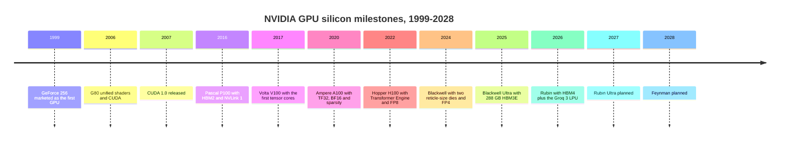

# GPU silicon: History and how NVIDIA built it

Layer 02 · GPU silicon · ~11 min read · Last verified: 2026-11-05

## ⚡ The Executive Take

- **Twenty-seven years, one compounding bet.** NVIDIA marketed the GeForce 256 (1999) as the first GPU [[S2502]](../../sources/bibliography.md#s2502);
  the G80 (2006) made it programmable with [CUDA](../../glossary.md#cuda) [[S2503]](../../sources/bibliography.md#s2503); Rubin (2026) packs 336B transistors on
  two dies [[S100]](../../sources/bibliography.md#s100).
- **Three hardware bets defined the AI era:** HBM2 and NVLink on P100 (2016) [[S125]](../../sources/bibliography.md#s125),
  [tensor cores](../../glossary.md#tensor-core) on V100 (2017; 8× its FP32 throughput on matrix math) [[S126]](../../sources/bibliography.md#s126), and ever lower
  precision, from FP8 (2022) to [NVFP4](../../glossary.md#nvfp4) (2025) [[S35011]](../../sources/bibliography.md#s35011)[[S32017]](../../sources/bibliography.md#s32017).
- **Since 2024 NVIDIA scales by adding dies and shortening the cycle:** two reticle-sized dies in Blackwell
  [[S35014]](../../sources/bibliography.md#s35014) and ~11 months between generations, down from ~29 [[S33020]](../../sources/bibliography.md#s33020)[[S100]](../../sources/bibliography.md#s100).
- **[Q4 · Source of advantage]** No longer the silicon itself (AMD's MI455X out-specs Rubin on paper [[S144]](../../sources/bibliography.md#s144)), but
  execution speed × hardware-software [co-design](../../glossary.md#co-design) × scale: $18.5B of R&D in FY2026 and
  ~31,000 R&D staff [[S401]](../../sources/bibliography.md#s401).
- **[Q6 · Replication cost]** One leading-edge design costs ~$0.6–0.7B [[S2501]](../../sources/bibliography.md#s2501); a generation program ~$10B
  [[S35028]](../../sources/bibliography.md#s35028). Est. (🔴): 5–7 years and $20–30B to reach rough merchant parity, a decade for the full stack.
- **The cautionary tale:** Intel paid ~$2B for Habana in 2019 [[S2514]](../../sources/bibliography.md#s2514); Gaudi 3 still missed a $500M revenue
  target in 2024 [[S668]](../../sources/bibliography.md#s668).

## From graphics chip to AI factory engine

Between G80 and P100, the Fermi and Kepler generations added compute features that won supercomputer contracts
and kept CUDA alive before deep learning existed [[S2503]](../../sources/bibliography.md#s2503). CUDA 1.0 shipped in June 2007 [[S525]](../../sources/bibliography.md#s525); reaching 1M
registered developers took 13 years [[S529]](../../sources/bibliography.md#s529).

| Date | Decision | Why it mattered | Source |
|---|---|---|---|
| 2006 | Make the GPU programmable in C (G80 + CUDA) | ~6M developers by 2026, a base rivals lack | [[S2503]](../../sources/bibliography.md#s2503)[[S528]](../../sources/bibliography.md#s528) |
| 2016 | Adopt HBM2 and NVLink early (P100) | 732 GB/s memory, 160 GB/s GPU-to-GPU links | [[S125]](../../sources/bibliography.md#s125) |
| 2017 | Add tensor cores (V100) | 125 TFLOPS FP16 tensor vs 15.7 TFLOPS FP32 | [[S126]](../../sources/bibliography.md#s126)[[S33010]](../../sources/bibliography.md#s33010) |
| 2022 | Transformer Engine and FP8 (H100) | 1,979 TFLOPS dense FP8, 2× BF16 | [[S35011]](../../sources/bibliography.md#s35011)[[S33002]](../../sources/bibliography.md#s33002) |
| 2024 | Go multi-die (Blackwell) | 208B transistors, beyond the 858 mm² [reticle limit](../../glossary.md#reticle-limit) | [[S35014]](../../sources/bibliography.md#s35014)[[S35010]](../../sources/bibliography.md#s35010) |
| 2024–25 | Move to an annual cadence | ~29 → ~11 months per generation | [[S33020]](../../sources/bibliography.md#s33020)[[S100]](../../sources/bibliography.md#s100) |
| 2025 | NVFP4 block-scaled 4-bit format | 2× FP8 throughput on Rubin | [[S32017]](../../sources/bibliography.md#s32017)[[S33005]](../../sources/bibliography.md#s33005) |
| 2025 | Groq licence and team (~$20B reported) | Bought an SRAM decode architecture | [[S90018]](../../sources/bibliography.md#s90018)[[S90019]](../../sources/bibliography.md#s90019) |

> [!TIP]
> **Worked example — what the faster cadence delivered.** Over five years from V100 (2017) to H100 (2022), 16-bit
> tensor peak rose 7.9× (125 → 989 TFLOPS) [[S33010]](../../sources/bibliography.md#s33010)[[S33002]](../../sources/bibliography.md#s33002). Over four years from H100 to Rubin (2026), dense FP8
> rose 8.8× (1,979 → 17,500) and the lowest precision 17.7× (FP8 1,979 → NVFP4 35,000) [[S33005]](../../sources/bibliography.md#s33005)[[S100]](../../sources/bibliography.md#s100). More
> generations per year compound faster than bigger jumps per generation.

## [Q4] Is the advantage the silicon, or how NVIDIA builds it?

Think of Formula 1: a rival can copy last season's car, but the winner ships a better one every season. In 2026
the rival's car is faster on paper (MI455X: 432 vs 288
GB, 19.6 vs 19.2 TB/s [[S144]](../../sources/bibliography.md#s144)[[S90006]](../../sources/bibliography.md#s90006)); NVIDIA's lead sits elsewhere.

| Candidate source | Evidence | Still unique to NVIDIA? |
|---|---|---|
| Raw silicon and architecture | MI455X matches or beats Rubin on four headline specs [[S144]](../../sources/bibliography.md#s144)[[S90006]](../../sources/bibliography.md#s90006) | 🟥 No |
| Execution speed | ~11-month cadence, but AMD now launches in the same quarter [[S538]](../../sources/bibliography.md#s538) | 🟨 Narrowing |
| Hardware-software co-design | New formats arrive with kernels; CUDA 36/36 framework score vs ROCm 26 [[S580]](../../sources/bibliography.md#s580)[[S586]](../../sources/bibliography.md#s586) | 🟩 Yes |
| Supply access | ~60% of 2026 [CoWoS](../../glossary.md#cowos) bookings (Est.) [[S379]](../../sources/bibliography.md#s379) | 🟩 Yes, but it buys time |
| Scale of R&D | $18.5B (FY2026) vs AMD $6.5B (2024, all products) [[S401]](../../sources/bibliography.md#s401)[[S450]](../../sources/bibliography.md#s450) | 🟩 Yes |

> [!TIP]
> **Worked example — why NVFP4 is a co-design win, not a transistor win.** From Blackwell to Rubin, transistors
> rose 1.6× (208B → 336B) [[S35014]](../../sources/bibliography.md#s35014)[[S100]](../../sources/bibliography.md#s100). Within Rubin, BF16 runs at 4 PFLOPS, FP8 at 17.5 and NVFP4 at 35 dense
> [[S33005]](../../sources/bibliography.md#s33005)[[S100]](../../sources/bibliography.md#s100): an **8.75× gain from number formats** on one chip. It pays only if models keep accuracy at 4
> bits (NVFP4 stores one FP8 scale per 16 values [[S32017]](../../sources/bibliography.md#s32017)) and if kernels and serving engines support it on day
> one. That is software, where the moat now lives.

**[Q4 · Source of advantage]** Mostly **speed of execution and co-design, financed by scale**; supply access is
secondary and time-limited; the silicon alone is now matched.

## [Q6] What would it cost to replicate?

A single design is the cheap part: the [NRE](../../glossary.md#nre) for a large 2 nm chip is ~$0.72B on IBS's model, likely
high [[S2501]](../../sources/bibliography.md#s2501)[[S2500]](../../sources/bibliography.md#s2500). A *platform* adds packaging, memory, interconnect, systems and software, every year.

| Path | Time | Dollars (Est. 🔴) | Talent (Est. 🔴) | Evidence |
|---|---|---|---|---|
| Start-up to first silicon | 3–4 years | $0.5–1B | 200–500 engineers | MatX $0.5B, Tenstorrent $0.69B rounds [[S2508]](../../sources/bibliography.md#s2508)[[S2509]](../../sources/bibliography.md#s2509) |
| Hyperscaler ASIC with a design partner | 2–3 years per generation | $0.5–1.5B per generation | 500–1,500 plus partner | IBS design cost [[S2501]](../../sources/bibliography.md#s2501); MTIA and Maia cadences [[S561]](../../sources/bibliography.md#s561)[[S90046]](../../sources/bibliography.md#s90046) |
| Merchant training-grade challenger | 5–7 years to rough parity | $20–30B cumulative | thousands, hardware and software | AMD MI250X (2021) → MI455X (2026) [[S140]](../../sources/bibliography.md#s140)[[S144]](../../sources/bibliography.md#s144) |
| Full NVIDIA-equivalent stack | 10+ years | ~$15–20B per year | ~31,000 R&D staff | NVIDIA FY2026 R&D and headcount [[S401]](../../sources/bibliography.md#s401) |

> [!TIP]
> **Worked example — the same program, two balance sheets.** Blackwell cost ~$10B to develop [[S35028]](../../sources/bibliography.md#s35028). At a ~75%
> gross margin, NVIDIA recoups it with ~$13.3B of revenue, about **4.5 weeks** of its $89.0B quarterly Data
> Center revenue [[S405]](../../sources/bibliography.md#s405). AMD's data-center GPU revenue "exceeded $5 billion" in 2024 [[S663]](../../sources/bibliography.md#s663): the same $13.3B is
> **over 2.5 years** of it. Scale turns the entry ticket into a rounding error for the incumbent.

🔧 Under the hood: why talent, not money, binds

- **Teams compound.** NVIDIA had ~42,000 employees at FY2026 year-end, ~31,000 in R&D, with 3.7% turnover [[S401]](../../sources/bibliography.md#s401).
- **Design partners rent out talent.** Broadcom, Marvell, MediaTek and Alchip supply physical design, SerDes and
  packaging teams, so hyperscalers skip part of the hiring curve (see [value chain](value-chain-and-corp-dev.md)).
- **Acquired teams leak.** Habana ran alongside a rival Intel GPU roadmap and never cracked CUDA [[S2515]](../../sources/bibliography.md#s2515).

## Counterfactuals — what if NVIDIA hadn't…

All analysis below is the repo's (🔴 Speculative).

| What if NVIDIA hadn't… | Likely outcome | Evidence anchor |
|---|---|---|
| …added tensor cores in 2017 | ~15.7 TFLOPS FP32 instead of 125 TFLOPS tensor; Google's TPU would likely have owned transformer training | [[S126]](../../sources/bibliography.md#s126) |
| …gone multi-die in 2024 | One reticle-limited die ≈ half of B200's 208B transistors; chiplet MI300X (153B, 192 GB) and MI355X (185B, 288 GB) would have led | [[S35014]](../../sources/bibliography.md#s35014)[[S141]](../../sources/bibliography.md#s141)[[S143]](../../sources/bibliography.md#s143) |
| …moved to an annual cadence | Rubin in ~2027 against MI455X and TPU 8t in 2026: a year with rivals ahead on every headline spec | [[S144]](../../sources/bibliography.md#s144)[[S550]](../../sources/bibliography.md#s550) |

> [!TIP]
> **Worked example — the tensor-core counterfactual in GPU-hours.** GPT-3 took 3.14 × 10²³ FLOPs to train
> [[S31015]](../../sources/bibliography.md#s31015). On V100 tensor cores (125 TFLOPS) at 30% utilisation that is ~2.3M GPU-hours; on its FP32 units (15.7
> TFLOPS) ~18.5M [[S126]](../../sources/bibliography.md#s126). For a 10,000-GPU cluster: **~10 days vs ~77 days**, the difference between iterating on
> models and waiting on them.

## 🎯 Corp Dev Lens

1. If the moat is cadence plus co-design, which assets would compress a newcomer's 5–7 year parity timeline:
   compiler teams, packaging know-how or memory partnerships?
2. Design partners sell hard-to-hire talent by the project. Is that a better route than buying a start-up team,
   given Intel's Habana experience?
3. NVIDIA paid ~$20B to license Groq rather than build an SRAM decode chip. What does that price say about the
   value of proven alternative architectures to the incumbent?
4. Each new number format shifted value to whoever controlled the software at launch. Which transition (HBM4E,
   near-memory compute) could reset that advantage?

## 📚 Sources

<!-- Auto-generated from the [S…] citations on this page by `make build`. Edit sources/registry/*.csv, not this list. -->

- [**S100**](../../sources/bibliography.md#s100) NVIDIA Technical Blog, *Inside the NVIDIA Vera Rubin Platform: Six New Chips, One AI Supercomputer*, 2026-01-05. [Link](https://developer.nvidia.com/blog/inside-the-nvidia-rubin-platform-six-new-chips-one-ai-supercomputer/)
- [**S125**](../../sources/bibliography.md#s125) NVIDIA, *NVIDIA Tesla P100 (Pascal GP100) Architecture Whitepaper*, 2016-04. [Link](https://images.nvidia.com/content/pdf/tesla/whitepaper/pascal-architecture-whitepaper.pdf)
- [**S126**](../../sources/bibliography.md#s126) NVIDIA, *NVIDIA Tesla V100 GPU Architecture Whitepaper*, 2017-08. [Link](https://images.nvidia.com/content/volta-architecture/pdf/volta-architecture-whitepaper.pdf)
- [**S140**](../../sources/bibliography.md#s140) AMD, *AMD Instinct MI250X Accelerator*, 2021-11-08. [Link](https://www.amd.com/en/products/accelerators/instinct/mi200/mi250x.html)
- [**S141**](../../sources/bibliography.md#s141) AMD, *AMD Instinct MI300X Accelerator*, 2023-12-06. [Link](https://www.amd.com/en/products/accelerators/instinct/mi300/mi300x.html)
- [**S143**](../../sources/bibliography.md#s143) AMD, *AMD Instinct MI350 Series (MI350X, MI355X)*, 2025-06-12. [Link](https://www.amd.com/en/products/accelerators/instinct/mi350.html)
- [**S144**](../../sources/bibliography.md#s144) AMD Newsroom, *AMD Unveils Vision for an Open AI Ecosystem, Detailing New Silicon, Software and Systems at Advancing AI 2025*, 2025-06-12. [Link](https://www.amd.com/en/newsroom/press-releases/2025-6-12-amd-unveils-vision-for-an-open-ai-ecosystem-detai.html)
- [**S379**](../../sources/bibliography.md#s379) TrendForce News, *TSMC CoWoS capacity and customer allocation estimates (TrendForce / Morgan Stanley, as reported)*, 2025. [Link](https://www.trendforce.com/news/)
- [**S401**](../../sources/bibliography.md#s401) NVIDIA Corporation via SEC EDGAR, *NVIDIA Corporation Form 10-K for fiscal year ended January 25, 2026*, 2026-02-25. [Link](https://www.sec.gov/Archives/edgar/data/1045810/000104581026000021/nvda-20260125.htm)
- [**S405**](../../sources/bibliography.md#s405) NVIDIA Corporation via SEC EDGAR, *NVIDIA Announces Financial Results for Second Quarter Fiscal 2027 (Form 8-K exhibit 99.1)*, 2026-08-26. [Link](https://www.sec.gov/Archives/edgar/data/0001045810/000104581026000073/q2fy27pr.htm)
- [**S450**](../../sources/bibliography.md#s450) U.S. Securities and Exchange Commission (EDGAR), *Advanced Micro Devices Form 10-K / 10-Q filings (EDGAR index)*, 2025-02-05. [Link](https://www.sec.gov/cgi-bin/browse-edgar?action=getcompany&CIK=0000002488&type=10-&dateb=&owner=include&count=40)
- [**S525**](../../sources/bibliography.md#s525) NVIDIA Developer, *CUDA Toolkit Archive*, 2026. [Link](https://developer.nvidia.com/cuda-toolkit-archive)
- [**S528**](../../sources/bibliography.md#s528) NVIDIA Developer Forums, *20 Years of CUDA: Honoring the Architects of the Accelerated Age*, 2026-03. [Link](https://forums.developer.nvidia.com/t/20-years-of-cuda-honoring-the-architects-of-the-accelerated-age/364654)
- [**S529**](../../sources/bibliography.md#s529) NVIDIA Blog (Will Ramey), *2 Million Registered Developers, Countless Breakthroughs*, 2020. [Link](https://blogs.nvidia.com/blog/2-million-registered-developers-breakthroughs/)
- [**S538**](../../sources/bibliography.md#s538) AMD Investor Relations, *AAI 2026: AMD Delivers Full-Stack Compute for the Agentic AI Era*, 2026-07-23. [Link](https://ir.amd.com/news-events/press-releases/detail/1294/aai-2026-amd-delivers-full-stack-compute-for-the-agentic-ai-era)
- [**S550**](../../sources/bibliography.md#s550) SiliconANGLE, *Google Cloud unveils eighth-generation TPUs (TPU 8t and TPU 8i)*, 2026-04-22. [Link](https://siliconangle.com/?p=740999)
- [**S561**](../../sources/bibliography.md#s561) DatacenterDynamics, *Meta unveils next four generations of its MTIA chip*, 2026-03-11. [Link](https://www.datacenterdynamics.com/en/news/meta-unveils-next-four-generations-of-its-mtia-chip/)
- [**S580**](../../sources/bibliography.md#s580) vLLM project (GitHub), *vLLM README and installation docs — supported hardware*, 2026-11. [Link](https://github.com/vllm-project/vllm/blob/main/docs/getting_started/installation/README.md)
- [**S586**](../../sources/bibliography.md#s586) AMD (GitHub: ROCm/ROCm docs), *ROCm documentation sources: release history, AI-ecosystem compatibility matrix, consolidated changelog*, 2026-08-26. [Link](https://github.com/ROCm/ROCm/blob/develop/docs/release/versions.rst)
- [**S663**](../../sources/bibliography.md#s663) AMD, *AMD Reports Fourth Quarter and Full Year 2024 Financial Results*, 2025-02-04. [Link](https://ir.amd.com/news-events/press-releases)
- [**S668**](../../sources/bibliography.md#s668) Reuters (as reported), *Intel says it will not hit $500 million Gaudi 3 revenue target for 2024*, 2024-10-31. [Link](https://www.reuters.com/technology/)
- [**S2500**](../../sources/bibliography.md#s2500) Tom's Hardware, *Firm Estimates a 2nm Chip Now Costs $725 Million to Design*, 2023. [Link](https://www.tomshardware.com/news/firm-estimates-a-2nm-chip-now-costs-dollar725-million-to-design)
- [**S2501**](../../sources/bibliography.md#s2501) Silicon Analysts, *Chip Design & NRE Cost by Node — Historical Time Series Data*, 2026. [Link](https://siliconanalysts.com/market-data/nre-design-cost)
- [**S2502**](../../sources/bibliography.md#s2502) Tom's Hardware, *Nvidia GeForce 256 celebrates its 25th birthday — company talks about a quarter century of GPU progression*, 2024-10. [Link](https://www.tomshardware.com/pc-components/gpus/nvidia-geforce-256-celebrates-its-25th-birthday-company-talks-about-a-quarter-century-of-gpu-progression)
- [**S2503**](../../sources/bibliography.md#s2503) TechSpot, *TechSpot's History of the GPU, Part 4: the coming of general-purpose GPUs*, 2013. [Link](https://www.techspot.com/article/659-history-of-the-gpu-part-4/)
- [**S2508**](../../sources/bibliography.md#s2508) AI2.Work, *MatX raises $500M to build AI chips*, 2026-02-24. [Link](https://ai2.work/blog/matx-raises-500m-to-build-ai-chips-that-beat-nvidia-by-10x)
- [**S2509**](../../sources/bibliography.md#s2509) TechPowerUp, *Tenstorrent closes $693M+ of Series D funding led by Samsung Securities and AFW Partners*, 2024-12-02. [Link](https://techpowerup.com/329396/tenstorrent-closes-usd-693m-of-series-d-funding-led-by-samsung-securities-and-afw-partners)
- [**S2514**](../../sources/bibliography.md#s2514) bit-tech, *Intel acquires AI chipmaker, Habana Labs*, 2019-12-16. [Link](https://www.bit-tech.net/news/tech/cpus/intel-acquires-ai-chipmaker-habana-labs/1/)
- [**S2515**](../../sources/bibliography.md#s2515) Ynetnews, *How Intel wrecked a $2B purchase of Israeli startup and fell behind in the AI race*, 2025. [Link](https://www.ynetnews.com/business/article/sjgqydwf1l)
- [**S31015**](../../sources/bibliography.md#s31015) OpenAI (arXiv 2005.14165) (Brown et al.), *Language Models are Few-Shot Learners (GPT-3)*, 2020-05-28. [Link](https://arxiv.org/abs/2005.14165)
- [**S32017**](../../sources/bibliography.md#s32017) NVIDIA Technical Blog, *Introducing NVFP4 for Efficient and Accurate Low-Precision Inference*, 2025-06. [Link](https://developer.nvidia.com/blog/introducing-nvfp4-for-efficient-and-accurate-low-precision-inference/)
- [**S33002**](../../sources/bibliography.md#s33002) NVIDIA, *NVIDIA H100 Tensor Core GPU (product page and datasheet)*, 2022-03-22. [Link](https://www.nvidia.com/en-us/data-center/h100/)
- [**S33005**](../../sources/bibliography.md#s33005) NVIDIA, *NVIDIA Vera Rubin NVL72 (product page and specifications)*, 2026. [Link](https://www.nvidia.com/en-us/data-center/vera-rubin-nvl72/)
- [**S33010**](../../sources/bibliography.md#s33010) NVIDIA, *NVIDIA V100 Tensor Core GPU datasheet*, 2018. [Link](https://images.nvidia.com/content/technologies/volta/pdf/volta-v100-datasheet-update-us-1165301-r5.pdf)
- [**S33020**](../../sources/bibliography.md#s33020) NVIDIA (Jensen Huang), *NVIDIA GTC 2025 keynote (Jensen Huang)*, 2025-03-18. [Link](https://www.nvidia.com/gtc/keynote/)
- [**S35010**](../../sources/bibliography.md#s35010) Semiconductor Engineering, *Are Larger Reticle Sizes On The Horizon?*, 2024. [Link](https://semiengineering.com/are-larger-reticle-sizes-on-the-horizon)
- [**S35011**](../../sources/bibliography.md#s35011) NVIDIA, *NVIDIA Hopper Architecture*, 2022-03. [Link](https://www.nvidia.com/en-in/data-center/technologies/hopper-architecture/)
- [**S35014**](../../sources/bibliography.md#s35014) NVIDIA, *NVIDIA Blackwell Architecture*, 2024-03. [Link](https://www.nvidia.com/en-us/data-center/technologies/blackwell-architecture/)
- [**S35028**](../../sources/bibliography.md#s35028) TweakTown, *NVIDIA spent $10 billion on developing its next-generation Blackwell GPU*, 2024-03. [Link](https://www.tweaktown.com/news/96987/nvidia-spent-10-billion-on-developing-its-next-generation-blackwell-gpu/index.html)
- [**S90006**](../../sources/bibliography.md#s90006) TweakTown, *Nvidia cuts Vera Rubin's memory bandwidth by up to 26% and AMD's Helios now leads in memory bandwidth*, 2026-10. [Link](https://www.tweaktown.com/news/114304/nvidia-cuts-vera-rubins-memory-bandwidth-by-up-to-26-percent-and-amds-helios-now-leads-in-memory-bandwidth/index.html)
- [**S90018**](../../sources/bibliography.md#s90018) Constellation Research, *Nvidia's Groq deal: acquisition, acquihire or creative licensing deal?*, 2025-12. [Link](https://www.constellationr.com/insights/news/nvidias-groq-deal-acquisition-acquihire-or-creative-licensing-deal)
- [**S90019**](../../sources/bibliography.md#s90019) TechSpot, *Nvidia's $20 billion Groq deal looks a lot like an acquisition*, 2025-12. [Link](https://www.techspot.com/news/110723-nvidia-20-billion-groq-deal-looks-lot-like.html)
- [**S90046**](../../sources/bibliography.md#s90046) IT Brief UK, *Microsoft unveils Maia 300 for 2027 AI deployments*, 2026-10. [Link](https://itbrief.co.uk/story/microsoft-unveils-maia-300-for-2027-ai-deployments)
