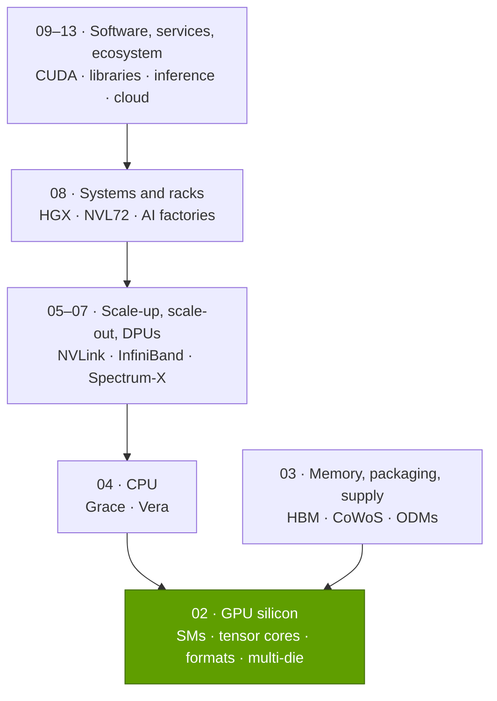
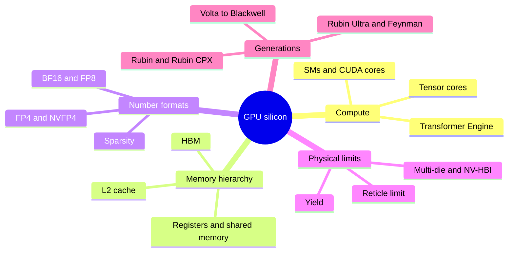

# Layer 02 — GPU silicon

Layer 02 of 12 · The accelerator chip itself: SMs, tensor cores, number formats, multi-die packages · ~10 min read · Last verified: 2026-11-05

## ⚡ The Executive Take

- **The GPU is a matrix-multiply factory.** An H100 runs 132 [streaming multiprocessors](../../glossary.md#streaming-multiprocessor) with 528 [tensor cores](../../glossary.md#tensor-core) [[S33024]](../../sources/bibliography.md#s33024) for 989 TFLOPS of dense [BF16](../../glossary.md#bf16) [[S33002]](../../sources/bibliography.md#s33002); the 2026 Rubin GPU has 224 SMs and 896 tensor cores on two dies [[S2000]](../../sources/bibliography.md#s2000)[[S2001]](../../sources/bibliography.md#s2001).
- **Most of the gain since 2017 came from smaller numbers, not bigger silicon.** Rubin's 35 [PFLOPS](../../glossary.md#flops) of dense [NVFP4](../../glossary.md#nvfp4) is ~280× V100's 125 TFLOPS of FP16, but at 16-bit the gain is only ~32× [[S33005]](../../sources/bibliography.md#s33005)[[S33010]](../../sources/bibliography.md#s33010)[[S100]](../../sources/bibliography.md#s100).
- **Chips hit the size wall in 2017.** Every flagship die since V100 has used ~95% of the 858 mm² [reticle limit](../../glossary.md#reticle-limit) [[S35010]](../../sources/bibliography.md#s35010)[[S126]](../../sources/bibliography.md#s126); since Blackwell, NVIDIA scales by joining two reticle-sized [dies](../../glossary.md#die) with a 10 TB/s [NV-HBI](../../glossary.md#nv-hbi) link [[S35014]](../../sources/bibliography.md#s35014)[[S208]](../../sources/bibliography.md#s208).
- **Memory sets the pace for inference.** [HBM](../../glossary.md#hbm) bandwidth per GPU rose only ~5.7× from H100 (3.35 TB/s) to Rubin (19.2 TB/s) while low-precision compute rose ~18× [[S33002]](../../sources/bibliography.md#s33002)[[S33007]](../../sources/bibliography.md#s33007).
- **2026 brought a spec retreat:** Rubin's [HBM4](../../glossary.md#hbm4) bandwidth was cut from 22 to 19.2 TB/s and [NVLink](../../glossary.md#nvlink) 6 from 3.6 to 3.0 TB/s per GPU in September–October 🟢 [[S90006]](../../sources/bibliography.md#s90006)[[S90007]](../../sources/bibliography.md#s90007)[[S103]](../../sources/bibliography.md#s103); Vera Rubin began production shipments in early August 2026 [[S500]](../../sources/bibliography.md#s500)[[S90009]](../../sources/bibliography.md#s90009).
- **Weakness / strongest challenger:** on paper AMD's MI455X claims 20 PFLOPS [FP8](../../glossary.md#fp8) (dense or sparse not stated) and 432 GB of HBM4 versus Rubin's 17.5 PFLOPS and 288 GB [[S144]](../../sources/bibliography.md#s144)[[S33005]](../../sources/bibliography.md#s33005), and OpenAI's Broadcom-built [ASIC](../../glossary.md#asic) reportedly does 13.4 PFLOPS MXFP4 on one die 🟡 [[S628]](../../sources/bibliography.md#s628). 🔴 Repo view: the silicon lead is now months, not generations.
- **The chip is the profit engine.** A B200 costs an estimated ~$6,400 to build against a $30–40K price (Est., Epoch AI) [[S35020]](../../sources/bibliography.md#s35020)[[S35026]](../../sources/bibliography.md#s35026).

## Where this layer sits in the stack

## Layer map

## The job, the metrics and the progress

**[Q1 · Job & failure mode]** The layer turns electricity into matrix multiplications, nearly all of the math in training and inference (see [P1](../../primers/P1-how-ai-training-works.md) and [P2](../../primers/P2-how-ai-inference-works.md)). If it is weak, a cluster needs more racks, power and capital for the same tokens. Specific failure modes: too little HBM bandwidth starves [decode](../../glossary.md#decode), too little capacity spreads a model over more GPUs, missing formats leave cheap [FP4](../../glossary.md#fp4) math unused, and a slipped tape-out delays a year of roadmap.

**[Q2 · Metrics that matter]**

| Metric | Why it matters | H100 (2022) → Rubin (2026) |
|---|---|---|
| Dense PFLOPS in the format you actually run | Sets training time and prefill cost | 1.98 FP8 → 17.5 FP8 / 35 FP4 [[S33002]](../../sources/bibliography.md#s33002)[[S33005]](../../sources/bibliography.md#s33005)[[S100]](../../sources/bibliography.md#s100) |
| HBM bandwidth (TB/s) | Caps decode tokens/s per GPU | 3.35 → 19.2 [[S33002]](../../sources/bibliography.md#s33002)[[S33007]](../../sources/bibliography.md#s33007) |
| HBM capacity (GB) | How many GPUs one model needs | 80 → 288 [[S33002]](../../sources/bibliography.md#s33002)[[S33005]](../../sources/bibliography.md#s33005) |
| Scale-up bandwidth per GPU (TB/s) | Lets 72 GPUs act as one (Layer 05) | 0.9 → 3.0 [[S33002]](../../sources/bibliography.md#s33002)[[S90006]](../../sources/bibliography.md#s90006) |
| Dense TFLOPS per watt | Tokens per megawatt, the binding constraint | 2.8 (FP8) → 7.6 (FP8) / 15.2 (FP4) [[S33002]](../../sources/bibliography.md#s33002)[[S106]](../../sources/bibliography.md#s106) |

**[Q3 · Generational progress]** From H100 to Rubin, low-precision compute rose ~18×, bandwidth 5.7×, capacity 3.6× and power ~3.3×; the full history, charted generation by generation, is on [Generations: Volta to Feynman](generations-volta-to-feynman.md).

> [!TIP]
> **Worked example — why the GPU, not the rack, is where NVIDIA's margin lives.** Epoch AI estimates a
> B200 costs ~$6,400 to make: ~$2,900 of HBM, ~$1,100 of CoWoS-L packaging and only ~$850–2,200 of logic
> silicon (Est.) [[S35020]](../../sources/bibliography.md#s35020)[[S35022]](../../sources/bibliography.md#s35022)[[S355]](../../sources/bibliography.md#s355). At the $30–40K price NVIDIA's CEO cited [[S35026]](../../sources/bibliography.md#s35026), each GPU carries
> ~$24–34K of gross profit, near 80% (Est.): ~$1.7–2.4M per [NVL72](../../glossary.md#nvl72) rack before switches, NICs or software.

🔧 Under the hood: what "one GPU" means in 2026

Since Blackwell, "GPU" means a package with two compute dies, eight HBM stacks and an interposer;
NVIDIA's rack names switched from counting dies ("NVL144") to packages ("NVL72") at CES 2026 [[S90003]](../../sources/bibliography.md#s90003).
This layer quotes per package and dense (non-sparse) throughput; see
[Number formats](number-formats-and-precision.md) for why vendors quote sparse.

## The eight questions at a glance

| # | Question | Short answer | Where answered |
|---|---|---|---|
| Q1 | Job and failure mode | Turn power into matrix math; weak silicon idles the whole stack | [This page](index.md) |
| Q2 | Metrics that matter | Dense FLOPS at the run format, HBM TB/s and GB, NVLink TB/s, FLOPS per watt | [This page](index.md), [Inside a modern GPU](inside-a-modern-gpu.md) |
| Q3 | Generational progress | ~18× low-precision compute H100→Rubin; mostly from formats and a second die | [Generations](generations-volta-to-feynman.md) |
| Q4 | Source of advantage | Speed of execution and hardware-software co-design, financed by scale; silicon alone is now matched | [History and how built](history-and-how-built.md) |
| Q5 | Strongest challenger | AMD at the chip level (memory, paper specs); Google TPU at the system level | [Competition](competition.md) |
| Q6 | Replication cost | ~$10B per generation program [[S35028]](../../sources/bibliography.md#s35028); Est. 5–7 years and $20–30B to reach merchant parity 🔴 | [History and how built](history-and-how-built.md) |
| Q7 | Roadmap | Rubin Ultra (H2 2027), Feynman (2028); packaging and HBM are swing factors | [Roadmap](roadmap.md) |
| Q8 | Value pools and M&A | ~80% chip margin; value shifting to HBM, packaging, interconnect | [Value chain and corp dev](value-chain-and-corp-dev.md) |

## Pages in this layer

| Page | What you will learn |
|---|---|
| [GPU vs CPU vs ASIC](gpu-vs-cpu-vs-asic.md) | Why matrix math favors GPUs; flexibility vs efficiency |
| [Inside a modern GPU](inside-a-modern-gpu.md) | SMs, tensor cores, memory hierarchy, package anatomy |
| [Number formats and precision](number-formats-and-precision.md) | FP32 → FP4, microscaling, sparsity, tokens per dollar |
| [Reticle limits and multi-die](reticle-limits-and-multi-die.md) | The 858 mm² wall, yield, NV-HBI, chiplets |
| [Generations: Volta to Feynman](generations-volta-to-feynman.md) | What each generation added; 2026 Rubin revisions |
| [Competition](competition.md) | Challengers, verdict by verdict |
| [History and how NVIDIA built it](history-and-how-built.md) | Key bets and replication cost |
| [Roadmap](roadmap.md) | Rubin Ultra, Feynman, rivals' counter-moves |
| [Value chain and corp dev angles](value-chain-and-corp-dev.md) | Who captures the dollars; private companies |

## 🎯 Corp Dev Lens

1. The ~80% chip-level margin (Est.) [[S35020]](../../sources/bibliography.md#s35020) is what every challenger prices against; how much survives as HBM's share of build cost keeps rising?
2. NVIDIA's lead now comes from formats, packaging and cadence more than transistors; which of these could a partner license rather than build?
3. The Rubin cut shows memory suppliers now set headline specs; who holds pricing power in HBM4/HBM4E?
4. For an inference entrant, are SRAM-heavy or capacity-heavy designs (the LPU or 768 GB-per-card route) a cleaner wedge than matching tensor-core FLOPS?

## 📚 Sources

<!-- Auto-generated from the [S…] citations on this page by `make build`. Edit sources/registry/*.csv, not this list. -->

- [**S100**](../../sources/bibliography.md#s100) NVIDIA Technical Blog, *Inside the NVIDIA Vera Rubin Platform: Six New Chips, One AI Supercomputer*, 2026-01-05. [Link](https://developer.nvidia.com/blog/inside-the-nvidia-rubin-platform-six-new-chips-one-ai-supercomputer/)
- [**S103**](../../sources/bibliography.md#s103) VideoCardz, *NVIDIA quietly cuts Vera Rubin specs, HBM4 bandwidth and NVLink 6 speeds now lower*, 2026-10. [Link](https://videocardz.com/newz/nvidia-quietly-cuts-vera-rubin-specs-hbm4-bandwidth-and-nvlink-6-speeds-now-lower)
- [**S106**](../../sources/bibliography.md#s106) SemiAnalysis, *Vera Rubin - Extreme Co-Design: An Evolution*, 2026. [Link](https://newsletter.semianalysis.com/p/vera-rubin-extreme-co-design-an-evolution)
- [**S126**](../../sources/bibliography.md#s126) NVIDIA, *NVIDIA Tesla V100 GPU Architecture Whitepaper*, 2017-08. [Link](https://images.nvidia.com/content/volta-architecture/pdf/volta-architecture-whitepaper.pdf)
- [**S144**](../../sources/bibliography.md#s144) AMD Newsroom, *AMD Unveils Vision for an Open AI Ecosystem, Detailing New Silicon, Software and Systems at Advancing AI 2025*, 2025-06-12. [Link](https://www.amd.com/en/newsroom/press-releases/2025-6-12-amd-unveils-vision-for-an-open-ai-ecosystem-detai.html)
- [**S208**](../../sources/bibliography.md#s208) Wccftech, *NVIDIA deep dives into Blackwell infrastructure: NV-HBI used to fuse two AI GPUs together (Hot Chips 2024)*, 2024-08. [Link](https://wccftech.com/nvidia-blackwell-ai-deep-dive-nv-hbi-fuse-two-ai-gpus-together-5th-gen-tensor-cores-5th-gen-nvlink-spectrum-x/amp/)
- [**S355**](../../sources/bibliography.md#s355) Epoch AI, *NVIDIA's B200 costs around $6,400 to produce, with memory accounting for half*, 2025-12. [Link](https://epoch.ai/data-insights/b200-cost-breakdown)
- [**S500**](../../sources/bibliography.md#s500) NVIDIA Corporation, *NVIDIA Q2 Fiscal 2027 Quarterly Presentation (CFO commentary deck)*, 2026-08-26. [Link](https://s201.q4cdn.com/141608511/files/doc_financials/2027/Q227/NVDA-F2Q27-Quarterly-Presentation-final-1.pdf)
- [**S628**](../../sources/bibliography.md#s628) SemiAnalysis, *OpenAI Jalapeño: Better Than Nvidia Blackwell*, 2026-08-25. [Link](https://github.com/SemiAnalysisAI/InferenceX-app/blob/main/packages/app/content/blog/openai-jalapeno-better-than-nvidia.mdx)
- [**S2000**](../../sources/bibliography.md#s2000) NVIDIA Technical Blog, *Inside NVIDIA Rubin GPU Architecture: Powering the Era of Agentic AI*, 2026-07-21. [Link](https://developer.nvidia.com/blog/inside-nvidia-rubin-gpu-architecture-powering-the-era-of-agentic-ai/)
- [**S2001**](../../sources/bibliography.md#s2001) Guru3D, *NVIDIA details Rubin GPU architecture with HBM4, NVLink 6 and 336 billion transistors*, 2026-07. [Link](https://www.guru3d.com/story/nvidia-details-rubin-gpu-architecture-with-hbm4-nvlink-6-and-336-billion-transistors/)
- [**S33002**](../../sources/bibliography.md#s33002) NVIDIA, *NVIDIA H100 Tensor Core GPU (product page and datasheet)*, 2022-03-22. [Link](https://www.nvidia.com/en-us/data-center/h100/)
- [**S33005**](../../sources/bibliography.md#s33005) NVIDIA, *NVIDIA Vera Rubin NVL72 (product page and specifications)*, 2026. [Link](https://www.nvidia.com/en-us/data-center/vera-rubin-nvl72/)
- [**S33007**](../../sources/bibliography.md#s33007) Dataconomy, *Nvidia Quietly Cuts Vera Rubin HBM4 And NVLink Bandwidth Specs*, 2026-11-02. [Link](https://dataconomy.com/2026/11/02/nvidia-quietly-cuts-vera-rubin-hbm4-and-nvlink-bandwidth/)
- [**S33010**](../../sources/bibliography.md#s33010) NVIDIA, *NVIDIA V100 Tensor Core GPU datasheet*, 2018. [Link](https://images.nvidia.com/content/technologies/volta/pdf/volta-v100-datasheet-update-us-1165301-r5.pdf)
- [**S33024**](../../sources/bibliography.md#s33024) NVIDIA, *NVIDIA H100 Tensor Core GPU Architecture (whitepaper)*, 2022. [Link](https://resources.nvidia.com/en-us-tensor-core)
- [**S35010**](../../sources/bibliography.md#s35010) Semiconductor Engineering, *Are Larger Reticle Sizes On The Horizon?*, 2024. [Link](https://semiengineering.com/are-larger-reticle-sizes-on-the-horizon)
- [**S35014**](../../sources/bibliography.md#s35014) NVIDIA, *NVIDIA Blackwell Architecture*, 2024-03. [Link](https://www.nvidia.com/en-us/data-center/technologies/blackwell-architecture/)
- [**S35020**](../../sources/bibliography.md#s35020) Epoch AI, *NVIDIA's B200 costs around $6,400 to produce, with memory accounting for half*, 2025-12. [Link](https://epoch.ai/data-insights/b200-cost-breakdown)
- [**S35022**](../../sources/bibliography.md#s35022) Silicon Analysts, *NVIDIA B200 (Blackwell) cost breakdown*, 2026. [Link](https://siliconanalysts.com/analysis/nvidia-b200-blackwell-cost-breakdown)
- [**S35026**](../../sources/bibliography.md#s35026) Tom's Hardware, *Nvidia's Jensen Huang says Blackwell GPU to cost $30,000-$40,000, later clarifies that pricing will vary as they won't sell just the chip*, 2024-03-19. [Link](https://www.tomshardware.com/pc-components/gpus/nvidias-jensen-huang-says-blackwell-gpu-to-cost-dollar30000-dollar40000-later-clarifies-that-pricing-will-vary-as-they-wont-sell-just-the-chip)
- [**S35028**](../../sources/bibliography.md#s35028) TweakTown, *NVIDIA spent $10 billion on developing its next-generation Blackwell GPU*, 2024-03. [Link](https://www.tweaktown.com/news/96987/nvidia-spent-10-billion-on-developing-its-next-generation-blackwell-gpu/index.html)
- [**S90003**](../../sources/bibliography.md#s90003) eWeek, *Everything Nvidia Just Announced at GTC 2026: 7 Chips, 5 Racks, 1 Giant Bet on Agentic AI*, 2026-03-17. [Link](https://www.eweek.com/news/nvidia-gtc-2026-ai-inference-vera-rubin-neuron/)
- [**S90006**](../../sources/bibliography.md#s90006) TweakTown, *Nvidia cuts Vera Rubin's memory bandwidth by up to 26% and AMD's Helios now leads in memory bandwidth*, 2026-10. [Link](https://www.tweaktown.com/news/114304/nvidia-cuts-vera-rubins-memory-bandwidth-by-up-to-26-percent-and-amds-helios-now-leads-in-memory-bandwidth/index.html)
- [**S90007**](../../sources/bibliography.md#s90007) TechRadar Pro, *Nvidia forced to dial back key bandwidth targets on Vera Rubin*, 2026-10. [Link](https://techradar.com/pro/nvidia-forced-to-dial-back-key-bandwidth-targets-on-vera-rubin-hardware-tweaks-will-affect-target-specifications-for-memory-and-interconnect-fabric)
- [**S90009**](../../sources/bibliography.md#s90009) GamesBeat, *Nvidia Vera Rubin ramps into full production for fall launch*, 2026. [Link](https://gamesbeat.com/nvidia-vera-rubin-ramps-into-full-production-for-fall-launch-again/)
