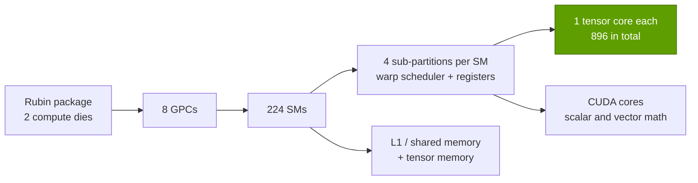

# Inside a modern GPU

Layer 02 · GPU silicon · SMs, tensor cores, the Transformer Engine, the memory hierarchy and the package · ~9 min read · Last verified: 2026-11-05

## ⚡ The Executive Take

- **A GPU is a hierarchy of copies:** Rubin has 8 [GPCs](../../glossary.md#gpc) holding 224 [SMs](../../glossary.md#streaming-multiprocessor), each with four [tensor cores](../../glossary.md#tensor-core) (896 in total), split across two dies [[S2000]](../../sources/bibliography.md#s2000)[[S2001]](../../sources/bibliography.md#s2001)[[S2025]](../../sources/bibliography.md#s2025).
- **Tensor cores do the matrix math; [CUDA cores](../../glossary.md#cuda-core) do the rest.** The 16-bit matrix rate per SM doubled every generation from V100 to H100, from 1,024 to 4,096 FLOPs per clock [[S126]](../../sources/bibliography.md#s126)[[S127]](../../sources/bibliography.md#s127)[[S2023]](../../sources/bibliography.md#s2023).
- **Since H100, 16-bit throughput per SM rose only ~2.4×, while [FP8](../../glossary.md#fp8)/FP4 per SM rose ~10×:** new tensor-core silicon goes to narrow formats (Rubin: 17.9 vs 156 dense TFLOPS per SM, repo arithmetic) [[S33005]](../../sources/bibliography.md#s33005)[[S100]](../../sources/bibliography.md#s100)[[S2000]](../../sources/bibliography.md#s2000).
- **The [Transformer Engine](../../glossary.md#transformer-engine)** chooses formats and scale factors so models survive FP8 (Hopper), [FP4](../../glossary.md#fp4) (Blackwell) and Rubin's adaptive compression [[S2024]](../../sources/bibliography.md#s2024)[[S2000]](../../sources/bibliography.md#s2000).
- **Memory is a ladder:** on H100, registers move data ~110× faster than HBM but hold ~2,400× less (Est.) [[S2021]](../../sources/bibliography.md#s2021); B200's [L2](../../glossary.md#l2-cache) grew to 126 MB at ~21 TB/s measured [[S2004]](../../sources/bibliography.md#s2004).
- **Compute has outrun memory:** since V100, peak compute rose ~280× but HBM bandwidth only ~21× [[S33010]](../../sources/bibliography.md#s33010)[[S33007]](../../sources/bibliography.md#s33007), so on-chip reuse decides real-world speed.

![Log-log chart of capacity against bandwidth for each GPU memory level. H100: registers about 33 MB at an estimated 371 TB/s, L1/shared memory 33 MB at about 31 TB/s, L2 50 MB at over 5.5 TB/s, HBM3 80 GB at 3.35 TB/s and the 8-GPU NVLink domain 640 GB at 0.9 TB/s per GPU. B200: L2 126 MB at about 21 TB/s, HBM3E 180 GB at 8 TB/s and the NVL72 domain 13.4 TB at 1.8 TB/s. Rubin: HBM4 288 GB at 19.2 TB/s and the NVL72 domain 20.7 TB at 3.0 TB/s. Each step outward gives roughly 100 to 1,000 times more capacity for less bandwidth.](../../assets/charts/02-memory-hierarchy-capacity-vs-bandwidth.svg)

## SMs, CUDA cores and tensor cores

Picture a factory campus: the GPC is a building, the SM a production line, and the tensor core the
press that stamps out a small matrix multiply every clock. [CUDA](../../glossary.md#cuda) cores are the general workers for
everything that is not a matrix.

> [!TIP]
> **Worked example — rebuilding a datasheet number from the parts.** An H100 SM does 8,192 FP8 FLOPs
> per clock (twice its 4,096 at [BF16](../../glossary.md#bf16)) [[S2023]](../../sources/bibliography.md#s2023). 8,192 × 132 SMs × ~1.83 GHz = **1.98 [PFLOPS](../../glossary.md#flops)**, exactly
> the dense FP8 figure on the datasheet [[S33002]](../../sources/bibliography.md#s33002). Run the same arithmetic backwards on Rubin: 4 PFLOPS
> of BF16 [[S33005]](../../sources/bibliography.md#s33005) ÷ 224 SMs = 17.9 TFLOPS per SM, which at an assumed Blackwell-like 8,192 FLOPs per clock
> implies ~2.2 GHz (repo Est.). So Rubin's 16-bit gain over Blackwell comes from more SMs and clock,
> while its FP8 path (17.5 PFLOPS, 4.4× BF16) must have been widened inside the tensor core (repo inference).

**[Q2 · Metrics that matter]** SM count × per-SM rate × clock gives peak FLOPS; delivered performance
depends on bytes available per FLOP at each level of the memory ladder.

🔧 Under the hood: the Transformer Engine, generation by generation

- **Hopper (2022):** FP8 tensor cores plus software that tracks the largest value (amax) of each tensor
  over recent steps and picks one FP32 scale per tensor ("delayed scaling") [[S2024]](../../sources/bibliography.md#s2024)[[S2023]](../../sources/bibliography.md#s2023).
- **Blackwell (2024):** hardware support for block scaling, so each small block of values carries its
  own scale (MXFP8, MXFP6, MXFP4 and [NVFP4](../../glossary.md#nvfp4)) [[S2024]](../../sources/bibliography.md#s2024)[[S2007]](../../sources/bibliography.md#s2007); a 256 KB per-SM [tensor memory](../../glossary.md#tensor-memory)
  holds accumulators next to the larger tensor cores [[S2006]](../../sources/bibliography.md#s2006).
- **Rubin (2026):** a third-generation Transformer Engine with hardware "adaptive compression" that NVIDIA
  credits for 50 PFLOPS of NVFP4 inference versus 35 PFLOPS dense for training [[S2000]](../../sources/bibliography.md#s2000)[[S100]](../../sources/bibliography.md#s100). It is not
  2:4 sparsity, and how often real models hit the 50 PFLOPS figure is not yet independently measured.
- Hopper also added the [Tensor Memory Accelerator](../../glossary.md#tma), which copies whole tiles from HBM into
  [shared memory](../../glossary.md#shared-memory) in the background [[S2023]](../../sources/bibliography.md#s2023).

## The memory hierarchy: registers → shared memory → L2 → HBM

Closer to the tensor cores means faster and smaller. The [register file](../../glossary.md#register-file) feeds
operands every clock, L1/shared memory stages matrix tiles, the L2 is shared by all SMs, and
[HBM](../../glossary.md#hbm) holds the model.

| Level (per GPU) | H100 SXM (2022) | B200 (2024) | Rubin (2026) |
|---|---|---|---|
| Registers | 33 MB (132 × 256 KB) [[S33024]](../../sources/bibliography.md#s33024)[[S2022]](../../sources/bibliography.md#s2022) | 37 MB (148 × 256 KB) [[S2004]](../../sources/bibliography.md#s2004) | not disclosed |
| L1 / shared memory | 256 KB per SM, ≤228 KB shared [[S2022]](../../sources/bibliography.md#s2022) | 256 KB per SM + 256 KB tensor memory [[S2004]](../../sources/bibliography.md#s2004)[[S2006]](../../sources/bibliography.md#s2006) | not disclosed |
| L2 cache | 50 MB, >5.5 TB/s measured on PCIe card [[S2005]](../../sources/bibliography.md#s2005) | 126 MB, ~21 TB/s measured [[S2004]](../../sources/bibliography.md#s2004) | not disclosed |
| HBM | 80 GB HBM3, 3.35 TB/s [[S33002]](../../sources/bibliography.md#s33002) | 180 GB HBM3E, 8 TB/s [[S33003]](../../sources/bibliography.md#s33003) | 288 GB HBM4, 19.2 TB/s [[S33007]](../../sources/bibliography.md#s33007)[[S90006]](../../sources/bibliography.md#s90006) |

> [!TIP]
> **Worked example — why reuse matters more than raw bandwidth.** To keep an H100's 989 TFLOPS of BF16
> busy straight from HBM, every byte fetched must feed ~295 FLOPs (989 ÷ 3.35). Rubin at dense FP4 needs
> ~1,820 FLOPs per HBM byte (35,000 ÷ 19.2) [[S100]](../../sources/bibliography.md#s100)[[S33007]](../../sources/bibliography.md#s33007). A 128 × 128 BF16 tile staged once in shared
> memory and reused across 128 output columns supplies that reuse; batch-1 [decode](../../glossary.md#decode), which reads every weight
> once per token, cannot, and runs at under 1% of peak FLOPS (see [P3](../../primers/P3-the-four-bottlenecks.md)).

> [!WARNING]
> **Bear view:** Rubin's [HBM4](../../glossary.md#hbm4) bandwidth was cut 13% before volume shipment [[S33007]](../../sources/bibliography.md#s33007)[[S90007]](../../sources/bibliography.md#s90007), and
> SRAM-heavy designs such as the Groq LPU (~500 MB at ~150 TB/s) [[S114]](../../sources/bibliography.md#s114) attack the gap this ladder leaves
> for decode.

## Anatomy of the package

The physical object a customer buys is a package: two compute dies joined by [NV-HBI](../../glossary.md#nv-hbi),
eight HBM stacks, all mounted on a [CoWoS-L](../../glossary.md#cowos-l) interposer and an organic substrate
[[S35014]](../../sources/bibliography.md#s35014)[[S358]](../../sources/bibliography.md#s358)[[S380]](../../sources/bibliography.md#s380). Depth on HBM and packaging supply sits in [Layer 03](../03-memory-packaging-supply-chain/index.md).

> [!TIP]
> **Worked example — how much bandwidth each HBM stack must deliver.** B200: 8 TB/s ÷ 8 stacks = 1 TB/s
> per stack [[S33003]](../../sources/bibliography.md#s33003). Rubin: 19.2 TB/s ÷ 8 stacks = 2.4 TB/s per stack over a 2,048-bit HBM4 interface,
> which implies ~9.4 Gb/s per pin; the original 22 TB/s target needed ~10.7 Gb/s, which reports link to
> the downgrade 🔴 [[S90006]](../../sources/bibliography.md#s90006)[[S90007]](../../sources/bibliography.md#s90007)[[S90008]](../../sources/bibliography.md#s90008).

## 🎯 Corp Dev Lens

1. Per-SM 16-bit throughput has flattened; can a cheaper, simpler architecture compete for BF16-heavy training?
2. On-chip [SRAM](../../glossary.md#sram) is the least disclosed, most strategic spec; which IP vendors (SRAM, 3D-stacked cache) gain if Feynman's die stacking moves cache onto separate dies?
3. HBM pin speed now caps NVIDIA's headline bandwidth; is a memory or base-die partner more strategic than a logic designer?
4. Tensor memory and block-scaled formats tie kernels to each NVIDIA generation; how much porting cost does that impose on rivals?

## 📚 Sources

<!-- Auto-generated from the [S…] citations on this page by `make build`. Edit sources/registry/*.csv, not this list. -->

- [**S100**](../../sources/bibliography.md#s100) NVIDIA Technical Blog, *Inside the NVIDIA Vera Rubin Platform: Six New Chips, One AI Supercomputer*, 2026-01-05. [Link](https://developer.nvidia.com/blog/inside-the-nvidia-rubin-platform-six-new-chips-one-ai-supercomputer/)
- [**S114**](../../sources/bibliography.md#s114) StorageReview, *NVIDIA Groq 3 LPX: Everything we know*, 2026-03. [Link](https://www.storagereview.com/news/nvidia-groq-3-lpx-everything-we-know)
- [**S126**](../../sources/bibliography.md#s126) NVIDIA, *NVIDIA Tesla V100 GPU Architecture Whitepaper*, 2017-08. [Link](https://images.nvidia.com/content/volta-architecture/pdf/volta-architecture-whitepaper.pdf)
- [**S127**](../../sources/bibliography.md#s127) NVIDIA Technical Blog, *NVIDIA Ampere Architecture In-Depth*, 2020-05-14. [Link](https://developer.nvidia.com/blog/nvidia-ampere-architecture-in-depth/)
- [**S358**](../../sources/bibliography.md#s358) glennklockwood.com (Glenn K. Lockwood), *NVIDIA B200 processor notes*, 2025. [Link](https://glennklockwood.com/garden/processors/B200)
- [**S380**](../../sources/bibliography.md#s380) TSMC, *TSMC 3DFabric: CoWoS-S, CoWoS-R and CoWoS-L technology overview and roadmap*, 2025. [Link](https://3dfabric.tsmc.com/english/dedicatedFoundry/technology/cowos.htm)
- [**S2000**](../../sources/bibliography.md#s2000) NVIDIA Technical Blog, *Inside NVIDIA Rubin GPU Architecture: Powering the Era of Agentic AI*, 2026-07-21. [Link](https://developer.nvidia.com/blog/inside-nvidia-rubin-gpu-architecture-powering-the-era-of-agentic-ai/)
- [**S2001**](../../sources/bibliography.md#s2001) Guru3D, *NVIDIA details Rubin GPU architecture with HBM4, NVLink 6 and 336 billion transistors*, 2026-07. [Link](https://www.guru3d.com/story/nvidia-details-rubin-gpu-architecture-with-hbm4-nvlink-6-and-336-billion-transistors/)
- [**S2004**](../../sources/bibliography.md#s2004) Chips and Cheese, *Nvidia's B200: Keeping the CUDA Juggernaut Rolling*, 2026. [Link](https://chipsandcheese.com/p/nvidias-b200-keeping-the-cuda-juggernaut)
- [**S2005**](../../sources/bibliography.md#s2005) Chips and Cheese, *Nvidia's H100: Funny L2, and Tons of Bandwidth*, 2023-07. [Link](https://chipsandcheese.com/p/nvidias-h100-funny-l2-and-tons-of-bandwidth)
- [**S2006**](../../sources/bibliography.md#s2006) arXiv (2512.02189), *Microbenchmarking NVIDIA's Blackwell Architecture: An in-depth Architectural Analysis*, 2025-12. [Link](https://arxiv.org/abs/2512.02189)
- [**S2007**](../../sources/bibliography.md#s2007) Open Compute Project (AMD, Arm, Intel, Meta, Microsoft, NVIDIA, Qualcomm), *OCP Microscaling Formats (MX) Specification v1.0*, 2023-09. [Link](https://www.opencompute.org/documents/ocp-microscaling-formats-mx-v1-0-spec-final-pdf)
- [**S2021**](../../sources/bibliography.md#s2021) nvidia_deep_dive_claude repository, *Repo analysis: Layer 02 GPU silicon models (memory-hierarchy estimates; multi-die silicon cost; decode throughput by precision)*, 2026-11-05. [Link](https://github.com/FrankHuang94/nvidia_deep_dive_claude/blob/main/layers/02-gpu-silicon/index.md)
- [**S2022**](../../sources/bibliography.md#s2022) NVIDIA Docs, *CUDA C++ Programming Guide (compute capabilities; shared memory)*, 2025. [Link](https://docs.nvidia.com/cuda/cuda-c-programming-guide/)
- [**S2023**](../../sources/bibliography.md#s2023) NVIDIA Technical Blog, *NVIDIA Hopper Architecture In-Depth*, 2022-03-22. [Link](https://developer.nvidia.com/blog/nvidia-hopper-architecture-in-depth/)
- [**S2024**](../../sources/bibliography.md#s2024) NVIDIA Docs, *Transformer Engine user guide (FP8 and block-scaled recipes)*, 2025. [Link](https://docs.nvidia.com/deeplearning/transformer-engine/user-guide/index.html)
- [**S2025**](../../sources/bibliography.md#s2025) Tom's Hardware, *Nvidia details Rubin architectural optimizations for inference*, 2026-07. [Link](https://www.tomshardware.com/pc-components/gpus/nvidia-details-rubin-architectural-optimizations-for-inference-improvements-target-better-performance-and-efficiency-from-the-gpu-to-the-rack)
- [**S33002**](../../sources/bibliography.md#s33002) NVIDIA, *NVIDIA H100 Tensor Core GPU (product page and datasheet)*, 2022-03-22. [Link](https://www.nvidia.com/en-us/data-center/h100/)
- [**S33003**](../../sources/bibliography.md#s33003) Lenovo Press, *ThinkSystem NVIDIA B200 180GB 1000W GPU product guide*, 2025. [Link](https://lenovopress.lenovo.com/lp2226-thinksystem-nvidia-b200-180gb-1000w-gpu)
- [**S33005**](../../sources/bibliography.md#s33005) NVIDIA, *NVIDIA Vera Rubin NVL72 (product page and specifications)*, 2026. [Link](https://www.nvidia.com/en-us/data-center/vera-rubin-nvl72/)
- [**S33007**](../../sources/bibliography.md#s33007) Dataconomy, *Nvidia Quietly Cuts Vera Rubin HBM4 And NVLink Bandwidth Specs*, 2026-11-02. [Link](https://dataconomy.com/2026/11/02/nvidia-quietly-cuts-vera-rubin-hbm4-and-nvlink-bandwidth/)
- [**S33010**](../../sources/bibliography.md#s33010) NVIDIA, *NVIDIA V100 Tensor Core GPU datasheet*, 2018. [Link](https://images.nvidia.com/content/technologies/volta/pdf/volta-v100-datasheet-update-us-1165301-r5.pdf)
- [**S33024**](../../sources/bibliography.md#s33024) NVIDIA, *NVIDIA H100 Tensor Core GPU Architecture (whitepaper)*, 2022. [Link](https://resources.nvidia.com/en-us-tensor-core)
- [**S35014**](../../sources/bibliography.md#s35014) NVIDIA, *NVIDIA Blackwell Architecture*, 2024-03. [Link](https://www.nvidia.com/en-us/data-center/technologies/blackwell-architecture/)
- [**S90006**](../../sources/bibliography.md#s90006) TweakTown, *Nvidia cuts Vera Rubin's memory bandwidth by up to 26% and AMD's Helios now leads in memory bandwidth*, 2026-10. [Link](https://www.tweaktown.com/news/114304/nvidia-cuts-vera-rubins-memory-bandwidth-by-up-to-26-percent-and-amds-helios-now-leads-in-memory-bandwidth/index.html)
- [**S90007**](../../sources/bibliography.md#s90007) TechRadar Pro, *Nvidia forced to dial back key bandwidth targets on Vera Rubin*, 2026-10. [Link](https://techradar.com/pro/nvidia-forced-to-dial-back-key-bandwidth-targets-on-vera-rubin-hardware-tweaks-will-affect-target-specifications-for-memory-and-interconnect-fabric)
- [**S90008**](../../sources/bibliography.md#s90008) XenoSpectrum, *Nvidia Rubin bandwidth specification (HGX vs NVL72)*, 2026-10. [Link](https://xenospectrum.com/en/nvidia-rubin-bandwidth-specification-hgx-nvl72/)
