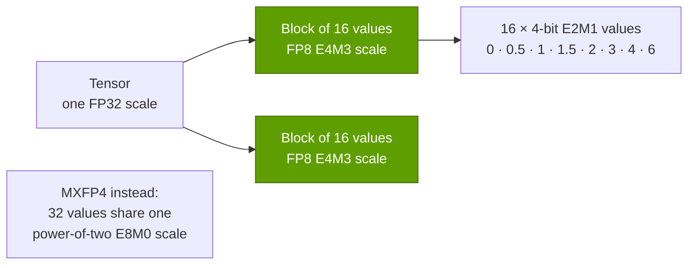

# Number formats and precision

Layer 02 · GPU silicon · FP32 to NVFP4, microscaling, sparsity and tokens per dollar · ~9 min read · Last verified: 2026-11-05

## ⚡ The Executive Take

- **Fewer bits per number is the cheapest performance there is.** On Rubin, dense FP8 runs 4.4× and FP4 8.75× faster than [BF16](../../glossary.md#bf16) (17.5 and 35 vs 4 PFLOPS) [[S33005]](../../sources/bibliography.md#s33005)[[S100]](../../sources/bibliography.md#s100); on H100, [FP8](../../glossary.md#fp8) was 2× [[S33002]](../../sources/bibliography.md#s33002).
- **Each generation added a narrower format:** [TF32](../../glossary.md#tf32) and BF16 (Ampere, 2020) [[S127]](../../sources/bibliography.md#s127), FP8 (Hopper, 2022) [[S2013]](../../sources/bibliography.md#s2013)[[S33024]](../../sources/bibliography.md#s33024), FP6 and [FP4](../../glossary.md#fp4) with block scaling (Blackwell, 2024) [[S2007]](../../sources/bibliography.md#s2007)[[S32017]](../../sources/bibliography.md#s32017).
- **[Microscaling](../../glossary.md#microscaling) makes 4-bit usable:** the OCP MX standard gives every 32 values a shared power-of-two scale (4.25 bits per value); NVIDIA's [NVFP4](../../glossary.md#nvfp4) uses 16-value blocks with an FP8 scale plus a per-tensor FP32 scale (4.5 bits) [[S2007]](../../sources/bibliography.md#s2007)[[S2008]](../../sources/bibliography.md#s2008)[[S32017]](../../sources/bibliography.md#s32017).
- **Vendors quote "sparse" peaks** that assume 2:4 [sparsity](../../glossary.md#sparsity) and are exactly 2× dense: H100's FP8 is 3,958 TFLOPS sparse but 1,979 dense [[S33002]](../../sources/bibliography.md#s33002)[[S2012]](../../sources/bibliography.md#s2012). This repo always uses dense.
- **Lower precision converts directly into tokens per dollar:** modelled on one B200, a 70B model at NVFP4 serves ~2.7× the decode tokens/s of BF16 (~4,700 vs ~1,700, Est.) [[S2021]](../../sources/bibliography.md#s2021).
- **Accuracy holds better than expected, with caveats:** NVIDIA reports a 12B model pretrained on 10T tokens in NVFP4 close to an FP8 baseline [[S2009]](../../sources/bibliography.md#s2009)[[S2010]](../../sources/bibliography.md#s2010); MXFP4 loses more accuracy unless extra techniques are applied [[S2008]](../../sources/bibliography.md#s2008).

## From FP32 to FP4: what the bits buy

A floating-point number is scientific notation in binary: a sign, an exponent (the range) and a
mantissa (the precision). Cutting bits shrinks three costs at once: memory capacity, memory bandwidth
and multiplier area, which grows roughly with the square of the mantissa width (a rule of thumb).
That is why a tensor core does about twice as many FP8 as BF16 operations.

| Format | Bits (exponent / mantissa) | Largest value | Block scale | Bits per value incl. scale | First NVIDIA tensor support |
|---|---|---|---|---|---|
| FP32 | 8 / 23 | 3.4 × 10³⁸ | none | 32 | CUDA cores only [[S127]](../../sources/bibliography.md#s127) |
| TF32 | 8 / 10 | 3.4 × 10³⁸ | none | 32 (stored as FP32) | Ampere [[S127]](../../sources/bibliography.md#s127) |
| BF16 | 8 / 7 | 3.4 × 10³⁸ | none | 16 | Ampere [[S127]](../../sources/bibliography.md#s127) |
| FP8 E4M3 / E5M2 | 4 / 3 · 5 / 2 | 448 · 57,344 | one per tensor | 8 | Hopper [[S2013]](../../sources/bibliography.md#s2013)[[S33024]](../../sources/bibliography.md#s33024) |
| MXFP8 / MXFP6 / MXFP4 | E4M3 / E2M3 / E2M1 | 448 / 7.5 / 6 | power of two per 32 values | 8.25 / 6.25 / 4.25 | Blackwell [[S2007]](../../sources/bibliography.md#s2007) |
| NVFP4 | 2 / 1 | 6 | FP8 per 16 values + FP32 per tensor | 4.5 | Blackwell [[S32017]](../../sources/bibliography.md#s32017)[[S2008]](../../sources/bibliography.md#s2008) |

> [!TIP]
> **Worked example — weight bytes and decode speed for a 70B model on one B200.** Weights: 70B × 2 bytes =
> **140 GB** in BF16, **70 GB** in FP8, **~39 GB** in NVFP4 (4.5 bits). A single user's decode must read
> every weight once per token, so at 75% of B200's 8 TB/s [[S33003]](../../sources/bibliography.md#s33003) the ceiling is 6 TB/s ÷ 140 GB ≈
> **43 tokens/s** (BF16), ≈ **86** (FP8) and ≈ **152** (NVFP4). With 64 users sharing each read, the same
> GPU reaches ~1,700, ~3,400 and ~4,700 tokens/s (repo model, below) [[S2021]](../../sources/bibliography.md#s2021). Same GPU, same hour, same
> depreciation: ~2.7× more tokens per dollar from the format alone.

**[Q2 · Metrics that matter]** Always ask "PFLOPS at which format, dense or sparse?" and "does my
model keep its accuracy in that format?" 35 PFLOPS of FP4 is worth little to a BF16-bound customer.

## Microscaling: MX formats vs. NVFP4

A 4-bit float can represent only eight magnitudes (0, 0.5, 1, 1.5, 2, 3, 4, 6) [[S2007]](../../sources/bibliography.md#s2007), so each small
block is divided by a scale factor that brings its largest value near 6. The OCP MX standard
(co-authored in 2023 by AMD, Arm, Intel, Meta, Microsoft, NVIDIA and Qualcomm) uses 32-value blocks
and a power-of-two scale [[S2007]](../../sources/bibliography.md#s2007); NVFP4 uses 16-value blocks and a fractional FP8 scale, for 0.25
extra bits per value [[S2008]](../../sources/bibliography.md#s2008)[[S32017]](../../sources/bibliography.md#s32017).

> [!TIP]
> **Worked example — encoding a block whose largest value is 3.6.** MXFP4 must pick a power-of-two
> scale: the standard rule gives 0.5, so 3.6 ÷ 0.5 = 7.2, which saturates at 6 and decodes as **3.0, a
> 17% error** on the most important value [[S2007]](../../sources/bibliography.md#s2007). NVFP4 can use a fractional scale: 3.6 ÷ 6 = 0.6,
> stored in FP8 as 0.625; 3.6 ÷ 0.625 = 5.76 rounds to 6 and decodes as **3.75, a 4% error**. Smaller
> blocks also mean one outlier distorts 16 values instead of 32 (repo arithmetic).

> [!NOTE]
> **🐂 Bull view:** Microsoft reports NVFP4 cut DeepSeek-V3.2's memory 1.7× versus native FP8 with
> near-parity results [[S2011]](../../sources/bibliography.md#s2011), NVIDIA has shown NVFP4 pretraining [[S2009]](../../sources/bibliography.md#s2009), and NVFP4 has an accuracy edge
> over the open MX format [[S2008]](../../sources/bibliography.md#s2008).

> [!WARNING]
> **🐻 Bear view:** formats are a one-time gift: below 4 bits little is left to cut, so later gains must
> come from silicon and memory. Nor are they a moat: AMD's MI355X runs FP4 at ~10 PFLOPS dense [[S143]](../../sources/bibliography.md#s143),
> and better quantization narrows the MXFP4 gap to ~1–2% [[S2008]](../../sources/bibliography.md#s2008).

🔧 Under the hood: 2:4 sparsity and why NVIDIA quotes sparse numbers

Ampere introduced Sparse Tensor Cores: if, in every group of four weights, two are zero, the hardware
skips them and doubles matrix throughput [[S2012]](../../sources/bibliography.md#s2012). The pattern needs pruning and retraining to recover
accuracy, so most production LLMs run dense; NVIDIA datasheets nevertheless headline the sparse figure
(H100: 3,958 TFLOPS FP8 "with sparsity") [[S33002]](../../sources/bibliography.md#s33002). Rubin's 50 PFLOPS NVFP4 "inference" figure is a
different mechanism (the Transformer Engine's adaptive compression) against 35 PFLOPS dense [[S100]](../../sources/bibliography.md#s100)[[S2000]](../../sources/bibliography.md#s2000).
The price of the AI-format race is double precision: Blackwell Ultra cut FP64 to ~1.25 TFLOPS from
H100's 67 [[S123]](../../sources/bibliography.md#s123)[[S33002]](../../sources/bibliography.md#s33002), a real loss for scientific-computing buyers.

## 🎯 Corp Dev Lens

1. NVFP4 is NVIDIA-defined; MX is an open standard Qualcomm co-authored [[S2007]](../../sources/bibliography.md#s2007). Does format governance become a competitive lever?
2. Quantization tooling decides whether FP4 silicon is usable; is it a partnership or acquisition category in its own right?
3. If format gains end at FP4, which levers (memory, packaging, sparsity) drive cost per token after 2028, and who owns them?
4. FP64 buyers (labs, sovereign HPC) are being deprioritized; is that a profitable niche for a challenger?

## 📚 Sources

<!-- Auto-generated from the [S…] citations on this page by `make build`. Edit sources/registry/*.csv, not this list. -->

- [**S100**](../../sources/bibliography.md#s100) NVIDIA Technical Blog, *Inside the NVIDIA Vera Rubin Platform: Six New Chips, One AI Supercomputer*, 2026-01-05. [Link](https://developer.nvidia.com/blog/inside-the-nvidia-rubin-platform-six-new-chips-one-ai-supercomputer/)
- [**S123**](../../sources/bibliography.md#s123) Glenn K. Lockwood (blog) (Glenn K. Lockwood), *HGX B300 specifications compilation (B300 per-GPU figures)*, 2025. [Link](https://glennklockwood.com/garden/processors/B300)
- [**S127**](../../sources/bibliography.md#s127) NVIDIA Technical Blog, *NVIDIA Ampere Architecture In-Depth*, 2020-05-14. [Link](https://developer.nvidia.com/blog/nvidia-ampere-architecture-in-depth/)
- [**S143**](../../sources/bibliography.md#s143) AMD, *AMD Instinct MI350 Series (MI350X, MI355X)*, 2025-06-12. [Link](https://www.amd.com/en/products/accelerators/instinct/mi350.html)
- [**S2000**](../../sources/bibliography.md#s2000) NVIDIA Technical Blog, *Inside NVIDIA Rubin GPU Architecture: Powering the Era of Agentic AI*, 2026-07-21. [Link](https://developer.nvidia.com/blog/inside-nvidia-rubin-gpu-architecture-powering-the-era-of-agentic-ai/)
- [**S2007**](../../sources/bibliography.md#s2007) Open Compute Project (AMD, Arm, Intel, Meta, Microsoft, NVIDIA, Qualcomm), *OCP Microscaling Formats (MX) Specification v1.0*, 2023-09. [Link](https://www.opencompute.org/documents/ocp-microscaling-formats-mx-v1-0-spec-final-pdf)
- [**S2008**](../../sources/bibliography.md#s2008) arXiv (2509.23202), *Bridging the Gap Between Promise and Performance for Microscaling FP4 Quantization*, 2025-09. [Link](https://arxiv.org/abs/2509.23202)
- [**S2009**](../../sources/bibliography.md#s2009) arXiv (2509.25149) / NVIDIA, *Pretraining Large Language Models with NVFP4*, 2025-09. [Link](https://arxiv.org/abs/2509.25149)
- [**S2010**](../../sources/bibliography.md#s2010) Tom's Hardware, *Nvidia details efficiency of the NVFP4 format for LLM training*, 2025. [Link](https://www.tomshardware.com/tech-industry/artificial-intelligence/nvidia-details-efficiency-of-the-nvfp4-format-for-llm-training-new-paper-reveals-how-nvfp4-offers-benefits-over-fp8-and-bf16)
- [**S2011**](../../sources/bibliography.md#s2011) Microsoft Tech Community (Microsoft Foundry Blog), *Unlocking NVIDIA Blackwell for DeepSeek: a collaborative effort*, 2026. [Link](https://techcommunity.microsoft.com/t5/microsoft-foundry-blog/unlocking-nvidia-blackwell-for-deepseek-a-collaborative/ba-p/4497936)
- [**S2012**](../../sources/bibliography.md#s2012) arXiv (2104.08378) / NVIDIA (Asit Mishra et al.), *Accelerating Sparse Deep Neural Networks*, 2021-04-16. [Link](https://arxiv.org/abs/2104.08378)
- [**S2013**](../../sources/bibliography.md#s2013) arXiv (2209.05433) (Paulius Micikevicius et al. (NVIDIA, Arm, Intel)), *FP8 Formats for Deep Learning*, 2022-09. [Link](https://arxiv.org/abs/2209.05433)
- [**S2021**](../../sources/bibliography.md#s2021) nvidia_deep_dive_claude repository, *Repo analysis: Layer 02 GPU silicon models (memory-hierarchy estimates; multi-die silicon cost; decode throughput by precision)*, 2026-11-05. [Link](https://github.com/FrankHuang94/nvidia_deep_dive_claude/blob/main/layers/02-gpu-silicon/index.md)
- [**S32017**](../../sources/bibliography.md#s32017) NVIDIA Technical Blog, *Introducing NVFP4 for Efficient and Accurate Low-Precision Inference*, 2025-06. [Link](https://developer.nvidia.com/blog/introducing-nvfp4-for-efficient-and-accurate-low-precision-inference/)
- [**S33002**](../../sources/bibliography.md#s33002) NVIDIA, *NVIDIA H100 Tensor Core GPU (product page and datasheet)*, 2022-03-22. [Link](https://www.nvidia.com/en-us/data-center/h100/)
- [**S33003**](../../sources/bibliography.md#s33003) Lenovo Press, *ThinkSystem NVIDIA B200 180GB 1000W GPU product guide*, 2025. [Link](https://lenovopress.lenovo.com/lp2226-thinksystem-nvidia-b200-180gb-1000w-gpu)
- [**S33005**](../../sources/bibliography.md#s33005) NVIDIA, *NVIDIA Vera Rubin NVL72 (product page and specifications)*, 2026. [Link](https://www.nvidia.com/en-us/data-center/vera-rubin-nvl72/)
- [**S33024**](../../sources/bibliography.md#s33024) NVIDIA, *NVIDIA H100 Tensor Core GPU Architecture (whitepaper)*, 2022. [Link](https://resources.nvidia.com/en-us-tensor-core)
