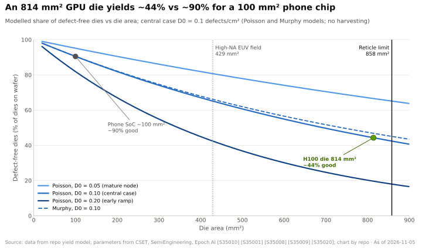

# Reticle limits and multi-die GPUs

Layer 02 · GPU silicon · The 858 mm² wall, yield economics, NV-HBI and AMD's chiplet alternative · ~7 min read · Last verified: 2026-11-05

## ⚡ The Executive Take

- **A chip cannot be larger than the scanner's exposure field:** 26 × 33 mm = 858 mm², the [reticle limit](../../glossary.md#reticle-limit); High-NA EUV halves it to 429 mm² [[S35010]](../../sources/bibliography.md#s35010).
- **NVIDIA hit the wall in 2017:** V100 (815 mm²), A100 (826 mm²) and H100 (814 mm²) each used ~95% of it [[S126]](../../sources/bibliography.md#s126)[[S127]](../../sources/bibliography.md#s127)[[S35013]](../../sources/bibliography.md#s35013).
- **Big dies are expensive because defects are random:** in a standard model an 814 mm² die is defect-free (its [die yield](../../glossary.md#die-yield)) only ~44% of the time at 0.1 defects/cm², vs ~90% for a 100 mm² die (repo model; inputs from Epoch AI) [[S35020]](../../sources/bibliography.md#s35020).
- **Blackwell's answer: two reticle-sized dies, one GPU.** B200 joins them with a 10 TB/s [NV-HBI](../../glossary.md#nv-hbi) link so software sees a single device with 208B transistors [[S35014]](../../sources/bibliography.md#s35014)[[S208]](../../sources/bibliography.md#s208)[[S2003]](../../sources/bibliography.md#s2003).
- **Rubin Ultra was announced with four compute dies** and 1 TB of [HBM4E](../../glossary.md#hbm4e) for H2 2027 🟢 [[S35018]](../../sources/bibliography.md#s35018)[[S110]](../../sources/bibliography.md#s110); in 2026 TrendForce and SemiAnalysis reported a switch to a two-die design with ~half the performance 🟡 [[S509]](../../sources/bibliography.md#s509)[[S2018]](../../sources/bibliography.md#s2018), which NVIDIA has not confirmed; it says its roadmap is intact [[S508]](../../sources/bibliography.md#s508).
- **AMD went further, earlier:** MI355X stacks eight small N3P compute [chiplets](../../glossary.md#chiplet) on two N6 I/O dies (185B transistors) [[S2019]](../../sources/bibliography.md#s2019)[[S2020]](../../sources/bibliography.md#s2020)[[S143]](../../sources/bibliography.md#s143); the cost is more packaging steps and die-to-die energy.

## The reticle wall and the yield curve

A scanner prints a chip like a projector printing one photo at a time; the largest photo is the
reticle field, so a bigger GPU means printing several dies and joining them. Size costs money before
the wall, too: one defect kills a die, and a large die is a large target (see
[P5 · Chip economics 101](../../primers/P5-chip-economics-101.md)).

> [!TIP]
> **Worked example — what splitting 1,600 mm² of logic saves.** On a $17,000 wafer at 0.1 defects/cm²
> [[S35020]](../../sources/bibliography.md#s35020), one hypothetical 1,600 mm² die would be defect-free 20% of the time: ~$3,100 of silicon per
> good GPU, if it could be printed at all. Two 800 mm² dies yield 45% each and, because dies are tested
> before assembly, cost **~$1,180 per pair (−62%)**. Eight 200 mm² chiplets cost **~$540 (−83%)**, but
> the last step saves only ~$640 more while adding six dies' worth of interfaces, bonding and assembly
> risk (repo model) [[S2021]](../../sources/bibliography.md#s2021). That is why NVIDIA stopped at two and AMD went to eight.

![Bar chart of modelled silicon cost for 1,600 mm2 of GPU logic split into 1, 2, 4, 8 or 16 dies on a $17,000 wafer at 0.1 defects per cm2. One 1,600 mm2 die (impossible: the reticle limit is 858 mm2) would yield 20% and cost about $3,119; two 800 mm2 dies like Blackwell or Rubin yield 45% each and cost about $1,182; four 400 mm2 dies about $709; eight 200 mm2 chiplets about $543; sixteen 100 mm2 about $470. Savings flatten while packaging cost, die-to-die power and assembly risk rise with every extra die.](../../assets/charts/02-multi-die-silicon-cost.svg)

## Two dies, one GPU: NV-HBI and CoWoS-L

The hard part is making software ignore the split. A kernel on die A reading [HBM](../../glossary.md#hbm) attached to die B
crosses the die-to-die link; if it is slow, programmers must manage two GPUs. NVIDIA made NV-HBI wide
enough that the split disappears and moved to [CoWoS-L](../../glossary.md#cowos-l), whose embedded bridges
carry the wires; TSMC targets ~5.5-reticle packages in 2026 and ~9.5 in 2027 [[S380]](../../sources/bibliography.md#s380).

> [!TIP]
> **Worked example — is 10 TB/s enough?** Each B200 die owns four HBM stacks, ~4 TB/s of the
> package's 8 TB/s [[S33003]](../../sources/bibliography.md#s33003). NV-HBI's 10 TB/s [[S208]](../../sources/bibliography.md#s208) exceeds the HBM bandwidth on the far side by
> 2.5×, so a remote read is limited by memory, not the bridge. It is also 5.6× the GPU's entire [NVLink](../../glossary.md#nvlink) 5
> bandwidth (1.8 TB/s) [[S263]](../../sources/bibliography.md#s263). For Rubin each die owns ~9.6 TB/s of [HBM4](../../glossary.md#hbm4) [[S33007]](../../sources/bibliography.md#s33007); NVIDIA has not published
> Rubin's die-to-die bandwidth, so whether the link kept a comfortable margin is unknown 🔴.

| Product | Compute dies | Process | Transistors | Die-to-die | Memory |
|---|---|---|---|---|---|
| NVIDIA B200 (2024) | 2 × ~800 mm² (Est.) | TSMC 4NP | 208B | NV-HBI, 10 TB/s | 8 HBM3E stacks [[S35014]](../../sources/bibliography.md#s35014)[[S358]](../../sources/bibliography.md#s358) |
| NVIDIA Rubin (2026) | 2 reticle-sized | TSMC 3 nm-class | 336B | NV-HBI, not disclosed | 8 HBM4, 288 GB [[S100]](../../sources/bibliography.md#s100)[[S106]](../../sources/bibliography.md#s106) |
| NVIDIA Rubin Ultra (H2 2027) | 4 🟢, two-die version reported 🟡 | 3 nm-class (reported) | not disclosed | not disclosed | 16 HBM4E, ~1 TB [[S35018]](../../sources/bibliography.md#s35018)[[S509]](../../sources/bibliography.md#s509) |
| AMD MI355X (2025) | 8 XCDs on 2 I/O dies | N3P + N6 | 185B | 3D stacking + Infinity Fabric | 288 GB HBM3E [[S2019]](../../sources/bibliography.md#s2019)[[S143]](../../sources/bibliography.md#s143) |
| AMD MI455X (2026) | chiplets, compute on N2 (reported) | N2 + N3 | 320B (reported) | not disclosed | 432 GB HBM4 [[S144]](../../sources/bibliography.md#s144)[[S145]](../../sources/bibliography.md#s145) |

> [!WARNING]
> **Myth vs. reality: "chiplets are always cheaper."** Silicon gets cheaper, but packaging does not:
> CoWoS-L adds ~$1,100 per B200 versus ~$750 of CoWoS-S for H100 (Est.) [[S35040]](../../sources/bibliography.md#s35040), and a failed assembly
> scraps known-good dies and HBM worth several thousand dollars [[S35020]](../../sources/bibliography.md#s35020). The optimum die count depends on
> packaging yield, which TSMC does not publish.

🔧 Under the hood: what happened to four-die Rubin Ultra in 2026

NVIDIA showed four reticle-sized dies, 16 HBM4E stacks and ~100 [PFLOPS](../../glossary.md#flops) [FP4](../../glossary.md#fp4) at GTC 2025 and a 1 TB Rubin
Ultra tray at GTC 2026, in Kyber racks of 144 GPU packages for H2 2027 🟢 [[S35018]](../../sources/bibliography.md#s35018)[[S110]](../../sources/bibliography.md#s110)[[S90003]](../../sources/bibliography.md#s90003).
TrendForce reported in April 2026 that the four-die single-package design was not adopted amid
packaging constraints, and SemiAnalysis (June 2026) described a two-die replacement at roughly half
the performance 🟡 [[S509]](../../sources/bibliography.md#s509)[[S2018]](../../sources/bibliography.md#s2018). In July SemiAnalysis also reported Kyber slipping to 2028 on midplane
manufacturability 🟡 [[S507]](../../sources/bibliography.md#s507); NVIDIA replied that its roadmap is intact [[S508]](../../sources/bibliography.md#s508). GTC DC (Dec 1, 2026) falls
after this page's as-of date [[S90047]](../../sources/bibliography.md#s90047). See [Roadmap](roadmap.md) for the tracking table.

## 🎯 Corp Dev Lens

1. The constraint has moved from transistors to packaging; who besides TSMC can add CoWoS-L-class capacity, and how fast?
2. If even NVIDIA retreated from four dies, die-to-die IP and known-good-die test become strategic; are chiplet-interconnect IP vendors acquirable?
3. Does a chiplet strategy (mixing nodes per function, as AMD does) lower a new accelerator's entry cost enough to change build-vs-partner math?
4. High-NA EUV halves the reticle (429 mm²) [[S35010]](../../sources/bibliography.md#s35010); when every flagship is multi-die, who owns the interconnect standard?

## 📚 Sources

<!-- Auto-generated from the [S…] citations on this page by `make build`. Edit sources/registry/*.csv, not this list. -->

- [**S100**](../../sources/bibliography.md#s100) NVIDIA Technical Blog, *Inside the NVIDIA Vera Rubin Platform: Six New Chips, One AI Supercomputer*, 2026-01-05. [Link](https://developer.nvidia.com/blog/inside-the-nvidia-rubin-platform-six-new-chips-one-ai-supercomputer/)
- [**S106**](../../sources/bibliography.md#s106) SemiAnalysis, *Vera Rubin - Extreme Co-Design: An Evolution*, 2026. [Link](https://newsletter.semianalysis.com/p/vera-rubin-extreme-co-design-an-evolution)
- [**S110**](../../sources/bibliography.md#s110) Tom's Hardware, *Nvidia demonstrates Rubin Ultra tray, the world's first AI GPU with 1TB of HBM4E memory*, 2026-03. [Link](https://www.tomshardware.com/pc-components/gpus/nvidia-demonstrates-rubin-ultra-tray-worlds-1st-ai-gpu-with-1tb-of-hbm4e)
- [**S126**](../../sources/bibliography.md#s126) NVIDIA, *NVIDIA Tesla V100 GPU Architecture Whitepaper*, 2017-08. [Link](https://images.nvidia.com/content/volta-architecture/pdf/volta-architecture-whitepaper.pdf)
- [**S127**](../../sources/bibliography.md#s127) NVIDIA Technical Blog, *NVIDIA Ampere Architecture In-Depth*, 2020-05-14. [Link](https://developer.nvidia.com/blog/nvidia-ampere-architecture-in-depth/)
- [**S143**](../../sources/bibliography.md#s143) AMD, *AMD Instinct MI350 Series (MI350X, MI355X)*, 2025-06-12. [Link](https://www.amd.com/en/products/accelerators/instinct/mi350.html)
- [**S144**](../../sources/bibliography.md#s144) AMD Newsroom, *AMD Unveils Vision for an Open AI Ecosystem, Detailing New Silicon, Software and Systems at Advancing AI 2025*, 2025-06-12. [Link](https://www.amd.com/en/newsroom/press-releases/2025-6-12-amd-unveils-vision-for-an-open-ai-ecosystem-detai.html)
- [**S145**](../../sources/bibliography.md#s145) AMD (Lisa Su), *AMD at CES 2026 (keynote: Helios, MI455X, MI440X, MI500 preview)*, 2026-01-05. [Link](https://www.amd.com/en/corporate/events/ces.html)
- [**S208**](../../sources/bibliography.md#s208) Wccftech, *NVIDIA deep dives into Blackwell infrastructure: NV-HBI used to fuse two AI GPUs together (Hot Chips 2024)*, 2024-08. [Link](https://wccftech.com/nvidia-blackwell-ai-deep-dive-nv-hbi-fuse-two-ai-gpus-together-5th-gen-tensor-cores-5th-gen-nvlink-spectrum-x/amp/)
- [**S263**](../../sources/bibliography.md#s263) NVIDIA, *NVIDIA Blackwell Architecture Technical Brief*, 2024-03. [Link](https://resources.nvidia.com/en-us-blackwell-architecture)
- [**S358**](../../sources/bibliography.md#s358) glennklockwood.com (Glenn K. Lockwood), *NVIDIA B200 processor notes*, 2025. [Link](https://glennklockwood.com/garden/processors/B200)
- [**S380**](../../sources/bibliography.md#s380) TSMC, *TSMC 3DFabric: CoWoS-S, CoWoS-R and CoWoS-L technology overview and roadmap*, 2025. [Link](https://3dfabric.tsmc.com/english/dedicatedFoundry/technology/cowos.htm)
- [**S507**](../../sources/bibliography.md#s507) Tom's Hardware, *Nvidia's Kyber rack for Rubin Ultra slips to 2028*, 2026-07-06. [Link](https://www.tomshardware.com/pc-components/gpus/nvidias-kyber-rack-for-rubin-ultra-slips-to-2028)
- [**S508**](../../sources/bibliography.md#s508) Wccftech, *NVIDIA Quashes Rubin & Kyber Rack Delay Rumors, Says 'Chip Roadmap Is Intact'*, 2026-07. [Link](https://wccftech.com/nvidia-quashes-rubin-kyber-rack-delay-rumors-says-chip-roadmap-is-intact/)
- [**S509**](../../sources/bibliography.md#s509) TrendForce, *NVIDIA Rubin Ultra four-die single-package design not adopted amid advanced-packaging constraints*, 2026-04-01. [Link](https://www.trendforce.com/news/?p=55442)
- [**S2003**](../../sources/bibliography.md#s2003) NVIDIA Technical Blog, *Inside NVIDIA Blackwell Ultra: The Chip Powering the AI Factory Era*, 2025-08. [Link](https://developer.nvidia.com/blog/inside-nvidia-blackwell-ultra-the-chip-powering-the-ai-factory-era/)
- [**S2018**](../../sources/bibliography.md#s2018) igor'sLAB, *Nvidia soll Vier-Die-Version von Rubin Ultra gestrichen haben*, 2026-07. [Link](https://www.igorslab.de/nvidia-soll-vier-die-version-von-rubin-ultra-gestrichen-haben-der-angeblich-neue-rueckzieher-ist-allerdings-nicht-ganz-neu/)
- [**S2019**](../../sources/bibliography.md#s2019) ServeTheHome, *AMD dives deep on CDNA 4 architecture and MI350 accelerator at Hot Chips 2025*, 2025-08. [Link](https://www.servethehome.com/amd-dives-deep-on-cdna-4-architecture-and-mi350-accelerator-at-hot-chips-2025/)
- [**S2020**](../../sources/bibliography.md#s2020) AMD ROCm documentation, *AMD Instinct MI350 Series microarchitecture*, 2025. [Link](https://rocm.docs.amd.com/en/develop/reference/gpu-arch/mi350.html)
- [**S2021**](../../sources/bibliography.md#s2021) nvidia_deep_dive_claude repository, *Repo analysis: Layer 02 GPU silicon models (memory-hierarchy estimates; multi-die silicon cost; decode throughput by precision)*, 2026-11-05. [Link](https://github.com/FrankHuang94/nvidia_deep_dive_claude/blob/main/layers/02-gpu-silicon/index.md)
- [**S33003**](../../sources/bibliography.md#s33003) Lenovo Press, *ThinkSystem NVIDIA B200 180GB 1000W GPU product guide*, 2025. [Link](https://lenovopress.lenovo.com/lp2226-thinksystem-nvidia-b200-180gb-1000w-gpu)
- [**S33007**](../../sources/bibliography.md#s33007) Dataconomy, *Nvidia Quietly Cuts Vera Rubin HBM4 And NVLink Bandwidth Specs*, 2026-11-02. [Link](https://dataconomy.com/2026/11/02/nvidia-quietly-cuts-vera-rubin-hbm4-and-nvlink-bandwidth/)
- [**S35010**](../../sources/bibliography.md#s35010) Semiconductor Engineering, *Are Larger Reticle Sizes On The Horizon?*, 2024. [Link](https://semiengineering.com/are-larger-reticle-sizes-on-the-horizon)
- [**S35013**](../../sources/bibliography.md#s35013) ComputerBase, *Nvidia Hopper: So schnell ist die neue Architektur für Supercomputer*, 2022-05. [Link](https://www.computerbase.de/2022-05/nvidia-hoppher-gh100-whitepaper/)
- [**S35014**](../../sources/bibliography.md#s35014) NVIDIA, *NVIDIA Blackwell Architecture*, 2024-03. [Link](https://www.nvidia.com/en-us/data-center/technologies/blackwell-architecture/)
- [**S35018**](../../sources/bibliography.md#s35018) Tom's Hardware, *Nvidia announces Rubin GPUs in 2026, Rubin Ultra in 2027, Feynman also added to roadmap*, 2025-03-18. [Link](https://www.tomshardware.com/pc-components/gpus/nvidia-announces-rubin-gpus-in-2026-rubin-ultra-in-2027-feynam-after)
- [**S35020**](../../sources/bibliography.md#s35020) Epoch AI, *NVIDIA's B200 costs around $6,400 to produce, with memory accounting for half*, 2025-12. [Link](https://epoch.ai/data-insights/b200-cost-breakdown)
- [**S35040**](../../sources/bibliography.md#s35040) Silicon Analysts, *CoWoS packaging cost: chiplet vs monolithic (2026)*, 2026. [Link](https://siliconanalysts.com/analysis/cowos-packaging-cost-chiplet-vs-monolithic-2026)
- [**S90003**](../../sources/bibliography.md#s90003) eWeek, *Everything Nvidia Just Announced at GTC 2026: 7 Chips, 5 Racks, 1 Giant Bet on Agentic AI*, 2026-03-17. [Link](https://www.eweek.com/news/nvidia-gtc-2026-ai-inference-vera-rubin-neuron/)
- [**S90047**](../../sources/bibliography.md#s90047) NVIDIA, *NVIDIA GTC DC 2026 (November 30 – December 3, 2026)*, 2026. [Link](https://www.nvidia.com/en-us/gtc-dc/topics/ai-policy/)
