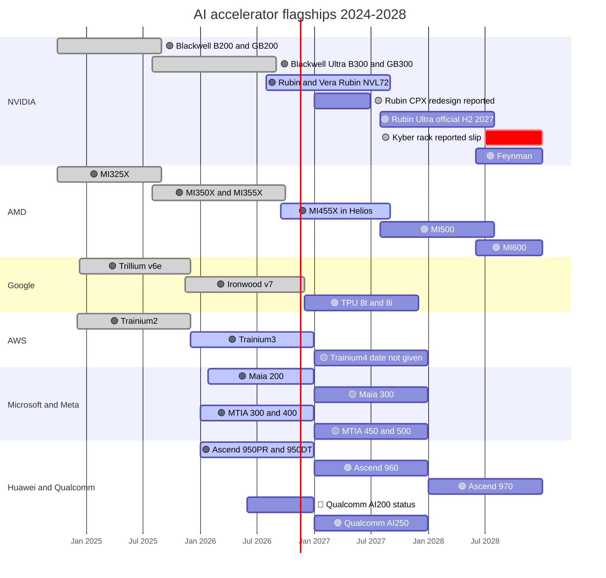

# GPU silicon: Roadmap

Layer 02 · GPU silicon · ~10 min read · Last verified: 2026-11-05

## ⚡ The Executive Take

- **Rubin is shipping; the next two steps are dated.** Production shipments began in August 2026, with volume in
  Q4 [[S500]](../../sources/bibliography.md#s500)[[S90009]](../../sources/bibliography.md#s90009); 🟢 Rubin Ultra is officially due in H2 2027 and 🟢 Feynman in 2028 [[S35018]](../../sources/bibliography.md#s35018)[[S109]](../../sources/bibliography.md#s109).
- **Rubin's specs were cut after launch:** per-GPU HBM4 bandwidth from 22 to 19.2 TB/s and NVLink 6 from 3.6 to
  3.0 TB/s; capacity (288 GB) and compute are unchanged [[S90006]](../../sources/bibliography.md#s90006)[[S90007]](../../sources/bibliography.md#s90007). The cause is unresolved (🔴) [[S104]](../../sources/bibliography.md#s104).
- **Two items moved.** 🟡 Rubin CPX left the GTC 2026 roadmap and is reported back as an HBM4 redesign for 1Q27
  [[S115]](../../sources/bibliography.md#s115)[[S117]](../../sources/bibliography.md#s117); 🟢 the Groq 3 LPU took the inference-accelerator slot [[S113]](../../sources/bibliography.md#s113)[[S506]](../../sources/bibliography.md#s506).
- **Rubin Ultra is the biggest open question:** 🟡 reports of a two-die package, 768 GB instead of 1 TB and a
  Kyber rack slip to 2028 [[S509]](../../sources/bibliography.md#s509)[[S111]](../../sources/bibliography.md#s111)[[S507]](../../sources/bibliography.md#s507), against NVIDIA's "roadmap intact" [[S508]](../../sources/bibliography.md#s508).
- **Everyone is on an annual cadence:** 🟢 AMD MI500 (2027) and MI600 (2028) [[S538]](../../sources/bibliography.md#s538), 🟢 TPU 8t/8i (late 2026)
  [[S550]](../../sources/bibliography.md#s550), 🟢 Trainium4 (AWS claims 3× FP8) [[S90034]](../../sources/bibliography.md#s90034), 🟡 Maia 300 (2027) [[S90046]](../../sources/bibliography.md#s90046), 🟢 Ascend 960/970 [[S90042]](../../sources/bibliography.md#s90042).
- **Per chip, NVIDIA and AMD pull away from the ASICs:** Est. ~35 PFLOPS FP8 for Rubin Ultra vs ~7.6 for
  Trainium4 and 2 for Ascend 960 (repo estimates from vendor multiples) [[S35018]](../../sources/bibliography.md#s35018)[[S90034]](../../sources/bibliography.md#s90034)[[S163]](../../sources/bibliography.md#s163).

## The 2024–2028 calendar

Bars run from volume availability to the next flagship. 🟢 company-confirmed timing · 🟡 reported · 🔴 unresolved.

> [!TIP]
> **Worked example — how far behind is each rival, in years?** Match each chip's FP8 to the year NVIDIA first
> shipped that level. Ironwood (4.6 PFLOPS, 2025) ≈ B200 (4.5, 2024): ~1 year. Trainium3 (2.5, 2025) sits between
> H100 (2.0, 2022) and B200: ~2–3 years. Ascend 950 (1.0, 2026) is below H100: over 4 years. MI455X (20, 2026)
> matches Rubin: zero [[S151]](../../sources/bibliography.md#s151)[[S155]](../../sources/bibliography.md#s155)[[S163]](../../sources/bibliography.md#s163)[[S144]](../../sources/bibliography.md#s144)[[S33002]](../../sources/bibliography.md#s33002)[[S33003]](../../sources/bibliography.md#s33003).

### Roadmap table (layer 02 rows of `data/roadmap.csv`, re-checked against the fact sheet)

| Item | Window | Status | Confidence | Source |
|---|---|---|---|---|
| NVIDIA Rubin GPU | 2026-Q3 → Q4 ramp | shipping; specs revised Sep–Oct 2026 | 🟢 | [[S500]](../../sources/bibliography.md#s500)[[S90009]](../../sources/bibliography.md#s90009)[[S90006]](../../sources/bibliography.md#s90006) |
| NVIDIA Rubin CPX | was end-2026; reported 1Q27 | delayed | 🟡 | [[S33023]](../../sources/bibliography.md#s33023)[[S115]](../../sources/bibliography.md#s115)[[S117]](../../sources/bibliography.md#s117) |
| NVIDIA Groq 3 LPU (LP30) | 2026-Q3 | in production | 🟢 | [[S113]](../../sources/bibliography.md#s113)[[S506]](../../sources/bibliography.md#s506) |
| NVIDIA Rubin Ultra | H2 2027 | roadmap; two-die and 768 GB reports | 🟢 date / 🟡 changes | [[S35018]](../../sources/bibliography.md#s35018)[[S509]](../../sources/bibliography.md#s509)[[S111]](../../sources/bibliography.md#s111) |
| NVIDIA Feynman, LP40, Rosa CPU | 2028 | roadmap | 🟢 name / 🟡 details | [[S109]](../../sources/bibliography.md#s109)[[S90004]](../../sources/bibliography.md#s90004) |
| AMD MI455X (Helios) | end-Q3 2026, Q4 ramp | shipping | 🟢 | [[S538]](../../sources/bibliography.md#s538)[[S90020]](../../sources/bibliography.md#s90020)[[S90021]](../../sources/bibliography.md#s90021) |
| AMD MI500 / MI600 | 2027 / 2028 | roadmap | 🟢 | [[S538]](../../sources/bibliography.md#s538)[[S90023]](../../sources/bibliography.md#s90023) |
| Google TPU 8t / 8i | "later in 2026" | announced | 🟢 | [[S550]](../../sources/bibliography.md#s550)[[S552]](../../sources/bibliography.md#s552) |
| AWS Trainium4 | no date (2027 Est.) | roadmap | 🟡 | [[S90034]](../../sources/bibliography.md#s90034)[[S518]](../../sources/bibliography.md#s518) |
| Microsoft Maia 200 / 300 | Jan 2026 / 2027 | shipping / roadmap | 🟢 / 🟡 | [[S90044]](../../sources/bibliography.md#s90044)[[S90046]](../../sources/bibliography.md#s90046) |
| Meta MTIA 400 / 450 / 500 | 2026 / early 2027 / late 2027 | announced / roadmap | 🟡 | [[S561]](../../sources/bibliography.md#s561) |
| Intel Crescent Island | sampling H2 2026 | announced | 🟢 | [[S162]](../../sources/bibliography.md#s162)[[S564]](../../sources/bibliography.md#s564) |
| Huawei Ascend 950DT / 960 / 970 | Q4 2026 / 2027 / 2028 | roadmap; SuperPoD shipments unconfirmed | 🟢 / 🔴 | [[S90042]](../../sources/bibliography.md#s90042)[[S567]](../../sources/bibliography.md#s567)[[S90043]](../../sources/bibliography.md#s90043) |
| Qualcomm AI200 / AI250 | 2026 / 2027 | announced; no shipment confirmed | 🟢 / 🔴 | [[S173]](../../sources/bibliography.md#s173)[[S90028]](../../sources/bibliography.md#s90028) |

## The 2026 Rubin revision: what changed and why it matters

NVIDIA's pages now list lower bandwidth than at launch: the NVL72 rack fell from 1,580 to 1,400 TB/s of HBM
bandwidth and the HGX NVL8 board from 176 to 130 TB/s [[S90007]](../../sources/bibliography.md#s90007)[[S105]](../../sources/bibliography.md#s105). The pages give no reason; press reports
quote an NVIDIA statement tying the figures to quality volume production [[S104]](../../sources/bibliography.md#s104)[[S2523]](../../sources/bibliography.md#s2523), while an analyst blames
HBM4 pin speeds of ~9.4 instead of ~10.7 Gb/s (🔴 unresolved) [[S90006]](../../sources/bibliography.md#s90006). NVIDIA had pushed suppliers for HBM4 above
10–11 Gb/s [[S90040]](../../sources/bibliography.md#s90040).

> [!TIP]
> **Worked example — what a 13% bandwidth cut does to decode.** One token for one user of a 70B-parameter model at
> FP8 means reading ~70 GB of weights. At 22 TB/s the ceiling is ≈ 314 tokens/s; at 19.2 TB/s ≈ 274, the same
> ~13% loss. [Decode](../../glossary.md#decode) is [memory-bound](../../glossary.md#memory-bound), so the cut hits interactive
> serving, while training and [prefill](../../glossary.md#prefill) are untouched. MI455X's 23.3 TB/s gives ≈ 333 [[S90093]](../../sources/bibliography.md#s90093),
> above even Rubin's launch spec.

## What would change the picture

**[Q7 · Roadmap & what changes the picture]** NVIDIA plans one flagship a year to 2028 (Rubin → Rubin Ultra →
Feynman), plus LPUs for decode [[S109]](../../sources/bibliography.md#s109)[[S113]](../../sources/bibliography.md#s113); AMD matches the cadence and hyperscalers iterate yearly. Signposts:

- 🟡 **Rubin Ultra downgraded or late.** A two-die, 768 GB part or a 2028 Kyber rack [[S509]](../../sources/bibliography.md#s509)[[S111]](../../sources/bibliography.md#s111)[[S507]](../../sources/bibliography.md#s507) would let
  MI500 (2027) [[S538]](../../sources/bibliography.md#s538) lead on memory for a second year.
- 🟡 **AMD's ramp slips.** A February 2026 report of MI455X rack delays was denied by AMD [[S2521]](../../sources/bibliography.md#s2521)[[S2524]](../../sources/bibliography.md#s2524); Helios
  volume through H1 2027 is the test [[S90020]](../../sources/bibliography.md#s90020).
- 🟡 **HBM4/HBM4E falls short.** SK hynix supplies over half of NVIDIA's 2026 HBM [[S90039]](../../sources/bibliography.md#s90039); a bandwidth-led
  roadmap is exposed first to pin-speed and yield problems.
- 🟢 **TPUs become merchant silicon.** Meta's rental and purchase talks plus TPUs in Oracle's cloud from 2027 would
  give buyers a second full-stack supplier [[S90025]](../../sources/bibliography.md#s90025)[[S552]](../../sources/bibliography.md#s552).
- 🟢 **NVLink Fusion inside rival chips.** Trainium4 is designed to support it [[S90034]](../../sources/bibliography.md#s90034): NVIDIA would earn from
  custom silicon, not only compete with it.
- 🟡 **OpenAI's own accelerator.** 10 GW of OpenAI–Broadcom racks from H2 2026 [[S174]](../../sources/bibliography.md#s174); SemiAnalysis credits the
  first chip with 13.4 PFLOPS MXFP4 on one die vs 17.5 per Rubin die [[S628]](../../sources/bibliography.md#s628).
- 🔴 **China reopens or closes.** H200 sales are licensed with 25% of revenue to the US government [[S90032]](../../sources/bibliography.md#s90032);
  Huawei pulled Ascend 960 forward to Q1 2027 [[S567]](../../sources/bibliography.md#s567).
- 🟢 **Demand outruns supply.** Huang sized Blackwell plus Rubin demand at $1T through 2027 [[S90001]](../../sources/bibliography.md#s90001)[[S90002]](../../sources/bibliography.md#s90002); the
  CFO called FY2028 supply-constrained [[S90012]](../../sources/bibliography.md#s90012). While that holds, spec slips cost little share.

> [!TIP]
> **Worked example — the cost of the reported Rubin Ultra memory cut.** A 144-package Kyber rack at 1 TB per
> package holds ~147 TB of HBM4E; at 768 GB, ~111 TB: **25% less** [[S35018]](../../sources/bibliography.md#s35018)[[S111]](../../sources/bibliography.md#s111). In long-context inference the
> [KV cache](../../glossary.md#kv-cache) fills memory before compute runs out, so that is ~25% fewer concurrent sessions
> per rack, an opening for a memory-heavy MI500.

🔧 Under the hood: how to read an accelerator roadmap slide

- **Dies vs packages.** "Vera Rubin NVL144" (dies) became NVL72 (packages) at CES 2026; Kyber "NVL576" became
  NVL144 on the same logic [[S90009]](../../sources/bibliography.md#s90009)[[S90003]](../../sources/bibliography.md#s90003).
- **"Inference" numbers.** Rubin's 50 PFLOPS NVFP4 relies on adaptive compression; 35 PFLOPS is the dense training
  figure [[S100]](../../sources/bibliography.md#s100). AMD did not say whether MI455X's 40 PFLOPS FP4 is dense [[S144]](../../sources/bibliography.md#s144).
- **Announced ≠ volume.** Huawei SuperPoD and Qualcomm AI200 shipments are unconfirmed [[S90042]](../../sources/bibliography.md#s90042)[[S90028]](../../sources/bibliography.md#s90028).

## 🎯 Corp Dev Lens

1. NVIDIA traded bandwidth for volume on Rubin. If HBM stays the binding input, do memory-light architectures
   (LPDDR, SRAM, [near-memory compute](../../glossary.md#near-memory-compute)) gain a window in 2027–28?
2. Rubin Ultra's final memory will be known before H2 2027. Which partners or customers would re-plan at 768 GB?
3. Trainium4's NVLink Fusion support blurs "rival" and "partner". Is attaching to NVIDIA's fabric a durable
   option for third-party accelerators, or a dependency?
4. With every major vendor on an annual cadence, does a newcomer need a yearly [tape-out](../../glossary.md#tape-out), and
   what does that imply for funding?

## 📚 Sources

<!-- Auto-generated from the [S…] citations on this page by `make build`. Edit sources/registry/*.csv, not this list. -->

- [**S100**](../../sources/bibliography.md#s100) NVIDIA Technical Blog, *Inside the NVIDIA Vera Rubin Platform: Six New Chips, One AI Supercomputer*, 2026-01-05. [Link](https://developer.nvidia.com/blog/inside-the-nvidia-rubin-platform-six-new-chips-one-ai-supercomputer/)
- [**S104**](../../sources/bibliography.md#s104) Wccftech, *NVIDIA's Official Statement on Vera Rubin Spec Change*, 2026-10-29. [Link](https://wccftech.com/nvidia-official-statement-on-vera-rubin-spec-change/)
- [**S105**](../../sources/bibliography.md#s105) Hardware Busters, *Nvidia Quietly Lowers Vera Rubin HBM4 Bandwidth, and the HGX NVL8 Loses a Quarter of It*, 2026-10. [Link](https://hwbusters.com/news/nvidia-quietly-lowers-vera-rubin-hbm4-bandwidth-and-the-hgx-nvl8-loses-a-quarter-of-it/)
- [**S109**](../../sources/bibliography.md#s109) NVIDIA Blog, *NVIDIA GTC 2026: Live Updates on What's Next in AI*, 2026-03-16. [Link](https://blogs.nvidia.com/blog/gtc-2026-news/)
- [**S111**](../../sources/bibliography.md#s111) Crypto Briefing, *Nvidia's Rubin Ultra targets 768GB of HBM4E as Kyber platform stays on schedule*, 2026. [Link](https://cryptobriefing.com/nvidia-rubin-ultra-hbm4e-kyber-2027/)
- [**S113**](../../sources/bibliography.md#s113) Tom's Hardware, *How Nvidia's $20 billion Groq 3 LPU deal reshapes the Nvidia Vera Rubin Platform*, 2026-03. [Link](https://www.tomshardware.com/tech-industry/semiconductors/nvidias-20-billion-groq-deal-produces-its-first-chip)
- [**S115**](../../sources/bibliography.md#s115) Tom's Hardware, *Nvidia removes Rubin CPX accelerators from its roadmap - Groq 3 LPUs take center stage*, 2026-03. [Link](https://www.tomshardware.com/pc-components/gpus/nvidia-removes-rubin-cpx-accelerators-from-its-roadmap-groq-3-lpus-take-center-stage-as-cpx-is-removed)
- [**S117**](../../sources/bibliography.md#s117) TechNews (Taiwan), *Nvidia Rubin CPX re-enters roadmap with HBM4 for AI prefill*, 2026-09-02. [Link](https://technews.tw/2026/09/02/nvidia-rubin-cpx-reenters-roadmap-hbm4-ai-prefill/)
- [**S144**](../../sources/bibliography.md#s144) AMD Newsroom, *AMD Unveils Vision for an Open AI Ecosystem, Detailing New Silicon, Software and Systems at Advancing AI 2025*, 2025-06-12. [Link](https://www.amd.com/en/newsroom/press-releases/2025-6-12-amd-unveils-vision-for-an-open-ai-ecosystem-detai.html)
- [**S151**](../../sources/bibliography.md#s151) Google Blog (Amin Vahdat), *Ironwood: The first Google TPU for the age of inference*, 2025-04-09. [Link](https://blog.google/products/google-cloud/ironwood-tpu-age-of-inference/)
- [**S155**](../../sources/bibliography.md#s155) Amazon Web Services, *AWS Trainium (product page: Trn2, Trn3)*, 2025-12. [Link](https://aws.amazon.com/ai/machine-learning/trainium/)
- [**S162**](../../sources/bibliography.md#s162) Intel Newsroom, *Intel to Expand AI Accelerator Portfolio with New GPU (Crescent Island)*, 2025-10-14. [Link](https://newsroom.intel.com/artificial-intelligence/intel-to-expand-ai-accelerator-portfolio-with-new-gpu)
- [**S163**](../../sources/bibliography.md#s163) Huawei (Eric Xu), *Huawei Connect 2025 keynote: Ascend roadmap and SuperPoD interconnect (Eric Xu)*, 2025-09-18. [Link](https://www.huawei.com/en/news/2025/9/hc-xu-keynote-speech)
- [**S173**](../../sources/bibliography.md#s173) Qualcomm, *Qualcomm Unveils AI200 and AI250 - Redefining Rack-Scale Data Center Inference*, 2025-10-27. [Link](https://www.qualcomm.com/news/releases/2025/10/qualcomm-unveils-ai200-and-ai250-redefining-rack-scale-data-cent)
- [**S174**](../../sources/bibliography.md#s174) OpenAI, *OpenAI and Broadcom announce strategic collaboration to deploy 10 gigawatts of OpenAI-designed AI accelerators*, 2025-10-13. [Link](https://openai.com/index/openai-and-broadcom-announce-strategic-collaboration/)
- [**S500**](../../sources/bibliography.md#s500) NVIDIA Corporation, *NVIDIA Q2 Fiscal 2027 Quarterly Presentation (CFO commentary deck)*, 2026-08-26. [Link](https://s201.q4cdn.com/141608511/files/doc_financials/2027/Q227/NVDA-F2Q27-Quarterly-Presentation-final-1.pdf)
- [**S506**](../../sources/bibliography.md#s506) SamMobile, *Samsung Foundry begins mass production of NVIDIA Groq 3 LPX chip*, 2026-08-25. [Link](https://www.sammobile.com/news/samsung-foundry-mass-production-nvidia-groq-3-lpx-chip/)
- [**S507**](../../sources/bibliography.md#s507) Tom's Hardware, *Nvidia's Kyber rack for Rubin Ultra slips to 2028*, 2026-07-06. [Link](https://www.tomshardware.com/pc-components/gpus/nvidias-kyber-rack-for-rubin-ultra-slips-to-2028)
- [**S508**](../../sources/bibliography.md#s508) Wccftech, *NVIDIA Quashes Rubin & Kyber Rack Delay Rumors, Says 'Chip Roadmap Is Intact'*, 2026-07. [Link](https://wccftech.com/nvidia-quashes-rubin-kyber-rack-delay-rumors-says-chip-roadmap-is-intact/)
- [**S509**](../../sources/bibliography.md#s509) TrendForce, *NVIDIA Rubin Ultra four-die single-package design not adopted amid advanced-packaging constraints*, 2026-04-01. [Link](https://www.trendforce.com/news/?p=55442)
- [**S518**](../../sources/bibliography.md#s518) ServeTheHome, *NVIDIA NVLink Fusion tapped for future AWS Trainium4 deployments*, 2025-12-02. [Link](https://www.servethehome.com/nvidia-nvlink-fusion-tapped-for-future-aws-trainium4-deployments/)
- [**S538**](../../sources/bibliography.md#s538) AMD Investor Relations, *AAI 2026: AMD Delivers Full-Stack Compute for the Agentic AI Era*, 2026-07-23. [Link](https://ir.amd.com/news-events/press-releases/detail/1294/aai-2026-amd-delivers-full-stack-compute-for-the-agentic-ai-era)
- [**S550**](../../sources/bibliography.md#s550) SiliconANGLE, *Google Cloud unveils eighth-generation TPUs (TPU 8t and TPU 8i)*, 2026-04-22. [Link](https://siliconangle.com/?p=740999)
- [**S552**](../../sources/bibliography.md#s552) Google Cloud Blog (Karan Batta), *Bringing Google TPUs to Oracle Cloud Infrastructure*, 2026-10-27. [Link](https://cloud.google.com/blog/products/infrastructure/bringing-google-tpus-to-oracle-cloud-infrastructure)
- [**S561**](../../sources/bibliography.md#s561) DatacenterDynamics, *Meta unveils next four generations of its MTIA chip*, 2026-03-11. [Link](https://www.datacenterdynamics.com/en/news/meta-unveils-next-four-generations-of-its-mtia-chip/)
- [**S564**](../../sources/bibliography.md#s564) Tom's Hardware, *Intel's roadmaps examined — 14A, Nova Lake, Diamond Rapids & AI accelerator push*, 2026. [Link](https://www.tomshardware.com/tech-industry/semiconductors/intel-chip-roadmap-2026-2028)
- [**S567**](../../sources/bibliography.md#s567) Huawei, *Huawei Connect 2026: Ascend 960 SuperNode*, 2026-09. [Link](https://www.huawei.com/br/news/2026/9/hc-ascend960-supernode)
- [**S628**](../../sources/bibliography.md#s628) SemiAnalysis, *OpenAI Jalapeño: Better Than Nvidia Blackwell*, 2026-08-25. [Link](https://github.com/SemiAnalysisAI/InferenceX-app/blob/main/packages/app/content/blog/openai-jalapeno-better-than-nvidia.mdx)
- [**S2521**](../../sources/bibliography.md#s2521) Tom's Hardware, *AMD denies report of MI455X delays as Nvidia VR200 systems are rumored to arrive early*, 2026-02. [Link](https://www.tomshardware.com/tech-industry/artificial-intelligence/amd-denies-report-of-mi455x-delays-as-nvidia-vr200-systems-are-rumored-to-arrive-early-company-says-helios-systems-on-target-for-2h-2026)
- [**S2523**](../../sources/bibliography.md#s2523) PC Games Hardware, *Nvidia erklärt die Rubin-Kürzungen: Weniger HBM4-Bandbreite als angekündigt*, 2026-11. [Link](https://www.pcgameshardware.de/Kuenstliche-Intelligenz-Hardware-279517/News/Nvidia-Vera-Rubin-Spezifikationen-HBM4-NVLink-Stellungnahme-1558248/)
- [**S2524**](../../sources/bibliography.md#s2524) The Next Platform, *AMD says Helios racks and MI400 series GPUs on track for 2H 2026*, 2026-02-23. [Link](https://www.nextplatform.com/2026/02/23/amd-says-helios-racks-and-mi400-series-gpus-on-track-for-2h-2026/)
- [**S33002**](../../sources/bibliography.md#s33002) NVIDIA, *NVIDIA H100 Tensor Core GPU (product page and datasheet)*, 2022-03-22. [Link](https://www.nvidia.com/en-us/data-center/h100/)
- [**S33003**](../../sources/bibliography.md#s33003) Lenovo Press, *ThinkSystem NVIDIA B200 180GB 1000W GPU product guide*, 2025. [Link](https://lenovopress.lenovo.com/lp2226-thinksystem-nvidia-b200-180gb-1000w-gpu)
- [**S33023**](../../sources/bibliography.md#s33023) NVIDIA Newsroom, *NVIDIA Unveils Rubin CPX: A New Class of GPU Designed for Massive-Context Inference*, 2025-09-09. [Link](https://nvidianews.nvidia.com/news/nvidia-unveils-rubin-cpx-a-new-class-of-gpu-designed-for-massive-context-inference)
- [**S35018**](../../sources/bibliography.md#s35018) Tom's Hardware, *Nvidia announces Rubin GPUs in 2026, Rubin Ultra in 2027, Feynman also added to roadmap*, 2025-03-18. [Link](https://www.tomshardware.com/pc-components/gpus/nvidia-announces-rubin-gpus-in-2026-rubin-ultra-in-2027-feynam-after)
- [**S90001**](../../sources/bibliography.md#s90001) The Star (Reuters), *Nvidia bets on AI inference as chip revenue opportunity hits $1 trillion (Reuters)*, 2026-03-17. [Link](https://www.thestar.com.my/tech/tech-news/2026/03/17/nvidia-bets-on-ai-inference-as-chip-revenue-opportunity-hits-1-trillion)
- [**S90002**](../../sources/bibliography.md#s90002) MarketScreener, *Nvidia forecasts $1 trillion in orders for its AI systems by 2027*, 2026-03-16. [Link](https://www.marketscreener.com/news/nvidia-forecasts-1-trillion-in-orders-for-its-ai-systems-by-2027-ce7e5edad08eff27)
- [**S90003**](../../sources/bibliography.md#s90003) eWeek, *Everything Nvidia Just Announced at GTC 2026: 7 Chips, 5 Racks, 1 Giant Bet on Agentic AI*, 2026-03-17. [Link](https://www.eweek.com/news/nvidia-gtc-2026-ai-inference-vera-rubin-neuron/)
- [**S90004**](../../sources/bibliography.md#s90004) TrendForce, *Key GTC takeaways: how Samsung, Micron, Intel and more power NVIDIA's Vera Rubin and Feynman*, 2026-03-17. [Link](https://www.trendforce.com/news/2026/03/17/news-key-gtc-takeaways-how-samsung-micron-intel-more-power-nvidias-vera-rubin-and-feynman/)
- [**S90006**](../../sources/bibliography.md#s90006) TweakTown, *Nvidia cuts Vera Rubin's memory bandwidth by up to 26% and AMD's Helios now leads in memory bandwidth*, 2026-10. [Link](https://www.tweaktown.com/news/114304/nvidia-cuts-vera-rubins-memory-bandwidth-by-up-to-26-percent-and-amds-helios-now-leads-in-memory-bandwidth/index.html)
- [**S90007**](../../sources/bibliography.md#s90007) TechRadar Pro, *Nvidia forced to dial back key bandwidth targets on Vera Rubin*, 2026-10. [Link](https://techradar.com/pro/nvidia-forced-to-dial-back-key-bandwidth-targets-on-vera-rubin-hardware-tweaks-will-affect-target-specifications-for-memory-and-interconnect-fabric)
- [**S90009**](../../sources/bibliography.md#s90009) GamesBeat, *Nvidia Vera Rubin ramps into full production for fall launch*, 2026. [Link](https://gamesbeat.com/nvidia-vera-rubin-ramps-into-full-production-for-fall-launch-again/)
- [**S90012**](../../sources/bibliography.md#s90012) Tomasz Tunguz (Tomasz Tunguz), *Nvidia Q2 FY27 earnings*, 2026-08. [Link](https://www.tomtunguz.com/nvidia-q2-fy27-earnings/index.md)
- [**S90020**](../../sources/bibliography.md#s90020) Shacknews, *AMD Helios AI rack system on track for initial shipments in Q3 2026*, 2026. [Link](https://www.shacknews.com/article/150249/amd-helios-ai-system-shipping-q3-2026)
- [**S90021**](../../sources/bibliography.md#s90021) Igor's Lab, *AMD Helios in production: MI455X, EPYC Venice and OpenAI challenge Nvidia AI racks*, 2026. [Link](https://www.igorslab.de/en/amd-helios-in-production-mi455x-epyc-venice-openai-challenge-nvidia-ai-racks/)
- [**S90023**](../../sources/bibliography.md#s90023) Wccftech, *AMD has begun sampling MI450 GPUs and engaged with customers on MI500*, 2026. [Link](https://wccftech.com/amd-sampling-mi450-gpus-engaged-with-customers-on-mi500-largest-ai-deployments-are-for-inference/)
- [**S90025**](../../sources/bibliography.md#s90025) SiliconANGLE, *Google and Meta reportedly strike new multibillion-dollar AI chip deal*, 2026-02-26. [Link](https://siliconangle.com/2026/02/26/google-meta-reportedly-strike-new-multibillion-dollar-ai-chip-deal/)
- [**S90028**](../../sources/bibliography.md#s90028) TechRepublic, *Qualcomm unveils AI chips to rival Nvidia, AMD*, 2025-10-27. [Link](https://techrepublic.com/article/news-qualcomm-unveils-ai-chips-to-rival-nvidia-amd)
- [**S90032**](../../sources/bibliography.md#s90032) Bloomberg Government, *Nvidia gets US license for small amount of H200 exports to China*, 2026-02. [Link](https://news.bgov.com/international-trade/nvidia-gets-us-license-for-small-amount-of-h200-exports-to-china)
- [**S90034**](../../sources/bibliography.md#s90034) NAND Research, *AWS releases Trainium3, teases Trainium4*, 2025-12. [Link](https://nand-research.com/research-note-aws-releases-trainium3-teases-trainium4/4/)
- [**S90039**](../../sources/bibliography.md#s90039) TrendForce, *Samsung, SK hynix reportedly tapped as NVIDIA Rubin HBM4 suppliers; shipments could start in March*, 2026-03-09. [Link](https://www.trendforce.com/news/2026/03/09/news-samsung-sk%E2%80%AFhynix-reportedly-tapped-as-nvidia-rubin-hbm4-suppliers-shipments-could-start-in-march/)
- [**S90040**](../../sources/bibliography.md#s90040) Tom's Hardware, *HBM4 mass production delayed as Nvidia pushes memory specs higher*, 2025. [Link](https://www.tomshardware.com/tech-industry/hbm4-mass-production-delayed-as-nvidia-pushes-memory-specs-higher)
- [**S90042**](../../sources/bibliography.md#s90042) TrendForce, *Huawei unveils Ascend 950 with in-house HBM in 2026, touts SuperPoD to rival NVIDIA*, 2025-09-18. [Link](https://www.trendforce.com/news/2025/09/18/news-huawei-unveils-ascend-950-with-in-house-hbm-in-2026-touts-superpod-to-rival-nvidia/)
- [**S90043**](../../sources/bibliography.md#s90043) Tom's Hardware, *Huawei Ascend NPU roadmap examined: targets 4 zettaflops FP4 by 2028 amid manufacturing constraints*, 2025-09. [Link](https://www.tomshardware.com/tech-industry/artificial-intelligence/huawei-ascend-npu-roadmap-examined-company-targets-4-zettaflops-fp4-performance-by-2028-amid-manufacturing-constraints)
- [**S90044**](../../sources/bibliography.md#s90044) eWeek, *Microsoft introduces Maia 200, its most powerful AI chip yet*, 2026-01-27. [Link](https://www.eweek.com/news/microsoft-maia-200-ai-chip/)
- [**S90046**](../../sources/bibliography.md#s90046) IT Brief UK, *Microsoft unveils Maia 300 for 2027 AI deployments*, 2026-10. [Link](https://itbrief.co.uk/story/microsoft-unveils-maia-300-for-2027-ai-deployments)
- [**S90093**](../../sources/bibliography.md#s90093) Tom's Hardware, *AMD takes the wraps off its Instinct MI455X AI accelerator: CDNA 5 and Helios rack-scale architecture*, 2026. [Link](https://www.tomshardware.com/pc-components/gpus/amd-takes-the-wraps-off-its-instinct-mi455x-ai-accelerator-cdna-5-and-helios-rack-scale-architecture-combine-to-take-the-fight-to-nvidia-in-the-data-center)
