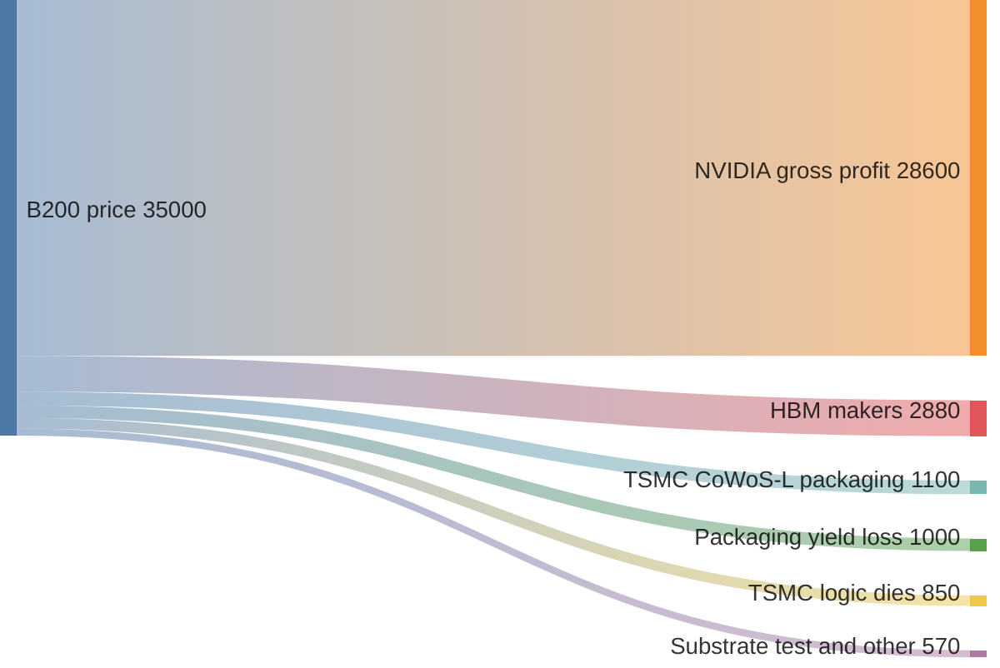
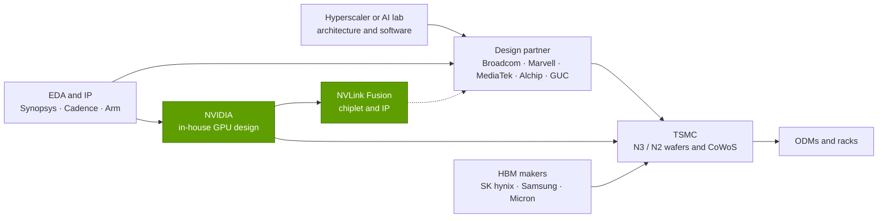

# GPU silicon: Value chain and corp dev angles

Layer 02 · GPU silicon · ~11 min read · Last verified: 2026-11-05

## ⚡ The Executive Take

- **NVIDIA keeps most of each GPU dollar.** Epoch AI estimates a B200 costs ~$6.4K to build against a $30–40K
  price: a chip-level [gross margin](../../glossary.md#gross-margin) near 80% (Est.) [[S35020]](../../sources/bibliography.md#s35020)[[S35026]](../../sources/bibliography.md#s35026). Company GAAP gross
  margin was 75.0% in Q2 FY2027 [[S405]](../../sources/bibliography.md#s405).
- **Memory is the largest supplier slice and growing:** HBM is ~45% of a B200's build cost (Est.) [[S35020]](../../sources/bibliography.md#s35020), and
  Bernstein expects HBM4 at ~$53/GB in 2027, ~3.5× the ~$15/GB assumed for B200 [[S333]](../../sources/bibliography.md#s333)[[S35020]](../../sources/bibliography.md#s35020).
- **TSMC is paid little per GPU but owns the scarcest capacity:** ~$1.95K per B200 for logic dies and CoWoS-L,
  plus ~$1K of parts scrapped in packaging (Est.) [[S35022]](../../sources/bibliography.md#s35022)[[S35039]](../../sources/bibliography.md#s35039); NVIDIA booked ~60% of 2026 CoWoS (Est.) [[S379]](../../sources/bibliography.md#s379).
- **The fastest-growing pool is custom silicon:** Broadcom's AI revenue reached $16.7B in the quarter to August
  2026 (+221% y/y) [[S2516]](../../sources/bibliography.md#s2516); MediaTek reportedly targets $2B of AI ASICs in 2026 (🟡) [[S2518]](../../sources/bibliography.md#s2518).
- **NVIDIA buys capability with licences and stakes, not big M&A:** Groq (~$20B licence and team, 🟡 price)
  [[S90019]](../../sources/bibliography.md#s90019), $5B in Intel [[S468]](../../sources/bibliography.md#s468), $2B in Synopsys [[S471]](../../sources/bibliography.md#s471), a reported $2B in Marvell [[S90037]](../../sources/bibliography.md#s90037); the $40B Arm bid was
  blocked [[S466]](../../sources/bibliography.md#s466).
- **Start-up values have polarised:** Cerebras' May 2026 IPO raised $5.55B [[S2504]](../../sources/bibliography.md#s2504) and Etched reportedly reached
  $10.3B (🟡) [[S2507]](../../sources/bibliography.md#s2507), while SambaNova talked at ~$1.6B including debt vs $5B in 2021 [[S2512]](../../sources/bibliography.md#s2512).

## Who captures the dollars

The mechanics are in [Primer P5 — chip economics](../../primers/P5-chip-economics-101.md): TSMC prints the logic dies
and packages them with HBM on a [CoWoS](../../glossary.md#cowos) interposer, memory makers sell the HBM, NVIDIA sells the
result. The flow splits a ~$35K B200 using Epoch AI and Silicon Analysts estimates (US$ per GPU, Est.)
[[S35020]](../../sources/bibliography.md#s35020)[[S35022]](../../sources/bibliography.md#s35022)[[S35039]](../../sources/bibliography.md#s35039).

> [!TIP]
> **Worked example — why the chip margin (~80%) exceeds the reported margin (~75%).** On a $35K B200, ~$6.4K of
> cost leaves ~82% [[S35020]](../../sources/bibliography.md#s35020). NVIDIA reports less because it also sells boards and racks with lower-margin content
> and books inventory charges: the $4.5B H20 charge pulled Q1 FY2026 GAAP margin to 60.5% [[S444]](../../sources/bibliography.md#s444)[[S414]](../../sources/bibliography.md#s414).

> [!TIP]
> **Worked example — memory makers' rising take.** B200: 192 GB × ~$15/GB ≈ $2.9K of HBM [[S35020]](../../sources/bibliography.md#s35020). Rubin: 288 GB
> × Bernstein's ~$53/GB ≈ **$15.3K per GPU** (Est.) [[S333]](../../sources/bibliography.md#s333), about 5× more. Unless prices follow, margin moves to
> SK hynix, Samsung and Micron; memory's share of an NVL72 rack's estimated cost rises from ~9% to ~26% between
> GB300 and Vera Rubin [[S332]](../../sources/bibliography.md#s332)[[S331]](../../sources/bibliography.md#s331) (see [Layer 03](../03-memory-packaging-supply-chain/index.md)).

## Suppliers, enablers and the custom-silicon chain

| Link | Who | What they capture or provide | Why it matters | Source |
|---|---|---|---|---|
| Foundry | TSMC | ~$850 of logic dies per B200 (Est.) | 72.5% of top-10 foundry revenue | [[S35022]](../../sources/bibliography.md#s35022)[[S35035]](../../sources/bibliography.md#s35035) |
| Packaging | TSMC CoWoS-L | ~$1.1K plus ~$1K yield loss (Est.) | NVIDIA ~60% of 2026 bookings (Est.) | [[S35040]](../../sources/bibliography.md#s35040)[[S35039]](../../sources/bibliography.md#s35039)[[S379]](../../sources/bibliography.md#s379) |
| Memory | SK hynix, Samsung, Micron | ~$2.9K HBM3E per B200 (Est.) | SK hynix >50% of NVIDIA's 2026 HBM | [[S35020]](../../sources/bibliography.md#s35020)[[S90039]](../../sources/bibliography.md#s90039) |
| [EDA](../../glossary.md#eda) and IP | Synopsys, Cadence, Arm | design tools, interface IP, CPU cores | NVIDIA owns $2B of Synopsys; all three back NVLink Fusion | [[S471]](../../sources/bibliography.md#s471)[[S90031]](../../sources/bibliography.md#s90031)[[S90036]](../../sources/bibliography.md#s90036) |
| Design services | Broadcom, Marvell, MediaTek, Alchip, GUC | turn hyperscaler designs into custom [XPUs](../../glossary.md#xpu) | the rivals' enablers; NVIDIA put $2B into Marvell (reported) | [[S2516]](../../sources/bibliography.md#s2516)[[S2517]](../../sources/bibliography.md#s2517)[[S90037]](../../sources/bibliography.md#s90037) |

An [ASIC design partner](../../glossary.md#asic-design-partner) supplies physical design, SerDes and packaging (Alchip
holds Trainium3 orders) [[S2517]](../../sources/bibliography.md#s2517); [NVLink Fusion](../../glossary.md#nvlink-fusion) puts NVIDIA's fabric in Trainium4 [[S90034]](../../sources/bibliography.md#s90034).

> [!TIP]
> **Worked example — the design-services pool is growing faster than NVIDIA.** In the quarter to August 2026
> Broadcom's AI revenue rose 221% y/y to $16.7B while NVIDIA's Data Center revenue rose 117% to $89.0B
> [[S2516]](../../sources/bibliography.md#s2516)[[S405]](../../sources/bibliography.md#s405). Broadcom's $21.7B guide is ~3.3× its $6.5B of a year earlier [[S661]](../../sources/bibliography.md#s661): the custom pool compounds
> from a smaller base, which is how share shifts begin.

## Private companies worth knowing

Public information only; values are not like-for-like.

| Company | What they do | Stage / last public funding | Why it matters | Source |
|---|---|---|---|---|
| Cerebras | [Wafer-scale](../../glossary.md#wafer-scale) engine, 44 GB SRAM | IPO May 2026, $5.55B raised; ~$40–56B reported value | a non-GPU architecture that listed | [[S2504]](../../sources/bibliography.md#s2504)[[S2505]](../../sources/bibliography.md#s2505)[[S166]](../../sources/bibliography.md#s166) |
| Groq | SRAM-based [LPU](../../glossary.md#lpu) | NVIDIA licence and team, ~$20B (Dec 2025); last round ~$6.9B | the incumbent paid ~3× to absorb it | [[S90018]](../../sources/bibliography.md#s90018)[[S90019]](../../sources/bibliography.md#s90019) |
| Etched | Transformer-only ASIC (Sohu) | $300M Series C at $10.3B (Jul 2026, 🟡) | maximum specialisation | [[S2507]](../../sources/bibliography.md#s2507)[[S171]](../../sources/bibliography.md#s171) |
| MatX | LLM-focused accelerator | $500M Series B (Feb 2026, 🟡); ships 2027 | well-funded newcomer at TSMC | [[S2508]](../../sources/bibliography.md#s2508) |
| Tenstorrent | RISC-V AI chips and licensable IP | $693M Series D, $2B pre-money (Dec 2024) | open IP model, not just chips | [[S2509]](../../sources/bibliography.md#s2509)[[S169]](../../sources/bibliography.md#s169) |
| d-Matrix | Digital in-memory compute | $275M Series C at $2B (Nov 2025) | attacks the memory wall | [[S2511]](../../sources/bibliography.md#s2511)[[S170]](../../sources/bibliography.md#s170) |
| Lightmatter | Photonic interconnect | $400M Series D at $4.4B (Oct 2024) | optical scale-up links | [[S2510]](../../sources/bibliography.md#s2510) |
| SambaNova | Reconfigurable dataflow chips | $5B (2021); Intel talks ~$1.6B incl. debt, stalled | down-round reference | [[S2512]](../../sources/bibliography.md#s2512) |

> [!TIP]
> **Worked example — reading a round.** Tenstorrent raised ~$693M at a $2B *pre*-money valuation [[S2509]](../../sources/bibliography.md#s2509), so
> post-money is ~$2.7B and new investors own ~26% (0.693 ÷ 2.693). Etched's reported move from >$5B (Jan 2026)
> to $10.3B (Jul 2026) doubled its value in six months on pre-orders, not shipped volume [[S2506]](../../sources/bibliography.md#s2506)[[S2507]](../../sources/bibliography.md#s2507).

## M&A history in the layer

| Year | Deal | Value | Outcome | Source |
|---|---|---|---|---|
| 2000 | NVIDIA buys 3dfx graphics assets | $70M | consolidated PC graphics | [[S400]](../../sources/bibliography.md#s400)[[S484]](../../sources/bibliography.md#s484) |
| 2006 | NVIDIA buys PortalPlayer | $357M | seeded the Tegra SoC line | [[S400]](../../sources/bibliography.md#s400)[[S484]](../../sources/bibliography.md#s484) |
| 2011 | NVIDIA buys Icera (modems) | $367M | wound down 2015 | [[S400]](../../sources/bibliography.md#s400)[[S484]](../../sources/bibliography.md#s484) |
| 2019 | Intel buys Habana Labs | ~$2B | Gaudi missed 2024 target | [[S2514]](../../sources/bibliography.md#s2514)[[S668]](../../sources/bibliography.md#s668) |
| 2020–22 | NVIDIA bids for Arm | $40B | blocked; terminated | [[S465]](../../sources/bibliography.md#s465)[[S466]](../../sources/bibliography.md#s466) |
| 2025 | NVIDIA licenses Groq, hires team | ~$20B (reported) | Groq 3 LPU in Vera Rubin | [[S90019]](../../sources/bibliography.md#s90019)[[S113]](../../sources/bibliography.md#s113) |
| 2025 | NVIDIA stakes in Intel and Synopsys | $5B and $2B | x86 + NVLink CPUs; accelerated EDA | [[S468]](../../sources/bibliography.md#s468)[[S471]](../../sources/bibliography.md#s471) |
| 2026 | Marvell buys Celestial AI | $3.25B upfront plus [earn-outs](../../glossary.md#earn-out) | photonic memory fabric | [[S2513]](../../sources/bibliography.md#s2513) |

> [!TIP]
> **Worked example — what NVIDIA paid for Groq, in its own currency.** ~$20B (🟡 reported) is ~2.9× Groq's last private
> valuation (~$6.9B) [[S90019]](../../sources/bibliography.md#s90019) and about **3 weeks** of NVIDIA's Q2 FY2027 Data Center revenue ($89.0B ÷ 13 weeks
> ≈ $6.8B a week) [[S405]](../../sources/bibliography.md#s405). The licence-plus-[acquihire](../../glossary.md#acquihire) avoided a merger review, though
> former Groq employees have sued its board [[S118]](../../sources/bibliography.md#s118).

**[Q8 · Value pools & M&A angles]** The largest pool is still NVIDIA's ~75–80% margin on the chip
[[S405]](../../sources/bibliography.md#s405)[[S35020]](../../sources/bibliography.md#s35020). Two pools grow faster: **memory**, as HBM heads toward a majority of chip cost, and **custom
silicon design services**, with Broadcom's AI revenue rising from ~12% to ~19% of NVIDIA's data-center revenue
[[S333]](../../sources/bibliography.md#s333)[[S2516]](../../sources/bibliography.md#s2516). NVIDIA's pattern is licences, acquihires and minority stakes that pull partners into its
ecosystem; large silicon acquisitions have been blocked (Arm) or disappointed (Habana at Intel).

🔧 Under the hood: why licensing beats acquiring for the incumbent

- **Regulatory path.** A non-exclusive licence plus hiring left Groq a going concern (GroqCloud continues) [[S90018]](../../sources/bibliography.md#s90018).
- **Speed.** The Groq 3 LPU entered production on Samsung 4 nm about eight months after the deal [[S506]](../../sources/bibliography.md#s506).
- **Leverage.** Stakes in Intel, Synopsys and Marvell tie CPUs, EDA and custom XPUs to NVLink without buying
  them [[S468]](../../sources/bibliography.md#s468)[[S471]](../../sources/bibliography.md#s471)[[S90037]](../../sources/bibliography.md#s90037).

## 🎯 Corp Dev Lens

1. Qualcomm is an NVLink Fusion partner for server CPUs [[S90031]](../../sources/bibliography.md#s90031) and sells the AI200/AI250 inference line
   [[S173]](../../sources/bibliography.md#s173). Which value pool does each bet address: NVIDIA's ecosystem, or the custom and inference pool?
2. Broadcom's AI revenue is ~19% of NVIDIA's data-center revenue and MediaTek reportedly targets $2B in 2026
   [[S2516]](../../sources/bibliography.md#s2516)[[S2518]](../../sources/bibliography.md#s2518). Do a mobile-SoC company's SerDes, packaging and power-efficiency skills map onto design
   services, and which anchor customers remain uncommitted?
3. Groq sold at ~3× its last round while SambaNova talked at a fraction of its 2021 value. Which diligence
   signals (production customers, software, team retention) separated them?
4. HBM is the scarcest, fastest-inflating input. With Celestial AI inside Marvell, which independent memory-wall
   approaches (in-memory compute, photonics, LPDDR-heavy designs) remain available as partners?
5. Licence-plus-acquihire structures move fast but invite litigation [[S118]](../../sources/bibliography.md#s118). How would regulators, employees and
   customers judge one where the buyer competes with the target's customers?

## 📚 Sources

<!-- Auto-generated from the [S…] citations on this page by `make build`. Edit sources/registry/*.csv, not this list. -->

- [**S113**](../../sources/bibliography.md#s113) Tom's Hardware, *How Nvidia's $20 billion Groq 3 LPU deal reshapes the Nvidia Vera Rubin Platform*, 2026-03. [Link](https://www.tomshardware.com/tech-industry/semiconductors/nvidias-20-billion-groq-deal-produces-its-first-chip)
- [**S118**](../../sources/bibliography.md#s118) Tom's Hardware, *Former Groq engineers sue board over $20 billion Nvidia deal*, 2026. [Link](https://www.tomshardware.com/tech-industry/semiconductors/former-groq-engineers-sue-board-over-usd20-billion-nvidia-deal-saying-it-handed-nvidia-the-lpu-and-the-team-that-built-it-plaintiffs-allege-the-board-kept-billions-from-other-shareholders)
- [**S166**](../../sources/bibliography.md#s166) Cerebras, *Cerebras Systems Unveils World's Fastest AI Chip with 4 Trillion Transistors (WSE-3)*, 2024-03-13. [Link](https://www.cerebras.ai/press-release/cerebras-announces-third-generation-wafer-scale-engine)
- [**S169**](../../sources/bibliography.md#s169) Tenstorrent, *Tenstorrent Blackhole*, 2025. [Link](https://tenstorrent.com/hardware/blackhole)
- [**S170**](../../sources/bibliography.md#s170) d-Matrix, *d-Matrix Corsair inference platform*, 2024-11-19. [Link](https://www.d-matrix.ai/product/)
- [**S171**](../../sources/bibliography.md#s171) Etched, *Etched is Making the Biggest Bet in AI (Sohu announcement)*, 2024-06-25. [Link](https://www.etched.com/announcing-etched)
- [**S173**](../../sources/bibliography.md#s173) Qualcomm, *Qualcomm Unveils AI200 and AI250 - Redefining Rack-Scale Data Center Inference*, 2025-10-27. [Link](https://www.qualcomm.com/news/releases/2025/10/qualcomm-unveils-ai200-and-ai250-redefining-rack-scale-data-cent)
- [**S331**](../../sources/bibliography.md#s331) Wccftech, *NVIDIA's Vera Rubin rack hit with 435% memory price surge, pushing HBM4 & LPDDR5X bill to $2M of $7.8M total*, 2026-05. [Link](https://wccftech.com/nvidia-vera-rubin-rack-hit-with-memory-price-surge-pushing-hbm4-lpddr5x-bill-to-2m-of-7-8m-total/)
- [**S332**](../../sources/bibliography.md#s332) Tiger Brokers (iTiger), *Morgan Stanley's BOM analysis of NVIDIA's Rubin: GPU share declines; PCB, MLCC and ABF substrate values soar*, 2026-05-20. [Link](https://www.itiger.com/news/1188068712)
- [**S333**](../../sources/bibliography.md#s333) Wccftech, *Bernstein warns NVIDIA's Vera Rubin racks will hit $9.1 million as HBM4 prices triple to $53 per gigabyte*, 2026-07. [Link](https://wccftech.com/bernstein-warns-nvidias-vera-rubin-racks-will-hit-9-1-million-as-hbm4-prices-triple-to-53-per-gigabyte/)
- [**S379**](../../sources/bibliography.md#s379) TrendForce News, *TSMC CoWoS capacity and customer allocation estimates (TrendForce / Morgan Stanley, as reported)*, 2025. [Link](https://www.trendforce.com/news/)
- [**S400**](../../sources/bibliography.md#s400) U.S. Securities and Exchange Commission (EDGAR), *NVIDIA Corporation Form 10-K annual reports FY2001–FY2019 (EDGAR filing index)*, 2019-02-21. [Link](https://www.sec.gov/cgi-bin/browse-edgar?action=getcompany&CIK=0001045810&type=10-K&dateb=&owner=include&count=40)
- [**S405**](../../sources/bibliography.md#s405) NVIDIA Corporation via SEC EDGAR, *NVIDIA Announces Financial Results for Second Quarter Fiscal 2027 (Form 8-K exhibit 99.1)*, 2026-08-26. [Link](https://www.sec.gov/Archives/edgar/data/0001045810/000104581026000073/q2fy27pr.htm)
- [**S414**](../../sources/bibliography.md#s414) NVIDIA Corporation via SEC EDGAR, *NVIDIA Corporation Form 10-Q for quarter ended April 27, 2025*, 2025-05-28. [Link](https://www.sec.gov/Archives/edgar/data/1045810/000104581025000116/nvda-20250427.htm)
- [**S444**](../../sources/bibliography.md#s444) NVIDIA Corporation, *NVIDIA Announces Financial Results for First Quarter Fiscal 2026 (press release with CFO commentary)*, 2025-05-28. [Link](https://nvidianews.nvidia.com/news/nvidia-announces-financial-results-for-first-quarter-fiscal-2026)
- [**S465**](../../sources/bibliography.md#s465) NVIDIA Newsroom, *NVIDIA to Acquire Arm for $40 Billion, Creating World's Premier Computing Company for the Age of AI*, 2020-09-13. [Link](https://nvidianews.nvidia.com/news/nvidia-to-acquire-arm-for-40-billion-creating-worlds-premier-computing-company-for-the-age-of-ai)
- [**S466**](../../sources/bibliography.md#s466) NVIDIA Newsroom, *NVIDIA and SoftBank Group Announce Termination of NVIDIA's Acquisition of Arm Limited*, 2022-02-08. [Link](https://nvidianews.nvidia.com/news/nvidia-and-softbank-group-announce-termination-of-nvidias-acquisition-of-arm-limited)
- [**S468**](../../sources/bibliography.md#s468) NVIDIA Newsroom, *NVIDIA and Intel to Develop AI Infrastructure and Personal Computing Products*, 2025-09-18. [Link](https://nvidianews.nvidia.com/news/nvidia-and-intel-to-develop-ai-infrastructure-and-personal-computing-products)
- [**S471**](../../sources/bibliography.md#s471) NVIDIA Newsroom, *NVIDIA and Synopsys strategic partnership; NVIDIA $2B investment in Synopsys common stock*, 2025-12-01. [Link](https://nvidianews.nvidia.com/)
- [**S484**](../../sources/bibliography.md#s484) NVIDIA press releases as summarised in NVIDIA 10-K filings and contemporaneous press, *History of NVIDIA acquisitions 2000–2013 (3dfx assets, MediaQ, ULi, Hybrid Graphics, PortalPlayer, mental images, Ageia, Icera, The Portland Group)*, 2013-07. [Link](https://en.wikipedia.org/wiki/Nvidia)
- [**S506**](../../sources/bibliography.md#s506) SamMobile, *Samsung Foundry begins mass production of NVIDIA Groq 3 LPX chip*, 2026-08-25. [Link](https://www.sammobile.com/news/samsung-foundry-mass-production-nvidia-groq-3-lpx-chip/)
- [**S661**](../../sources/bibliography.md#s661) Broadcom Inc., *Broadcom Inc. Announces Fourth Quarter and Fiscal Year 2025 Financial Results*, 2025-12-11. [Link](https://investors.broadcom.com/financial-information/quarterly-results)
- [**S668**](../../sources/bibliography.md#s668) Reuters (as reported), *Intel says it will not hit $500 million Gaudi 3 revenue target for 2024*, 2024-10-31. [Link](https://www.reuters.com/technology/)
- [**S2504**](../../sources/bibliography.md#s2504) TechCrunch, *Cerebras raises $5.5B kicking off 2026's IPO season with a bang*, 2026-05-14. [Link](https://techcrunch.com/2026/05/14/cerebras-raises-5-5b-kicking-off-2026s-ipo-season-with-a-bang)
- [**S2505**](../../sources/bibliography.md#s2505) Dealroom, *Cerebras raises $5.55B in biggest US IPO of 2026*, 2026-05. [Link](https://dealroom.co/news/128936-cerebras-raises-5-55b-in-biggest-us-ipo-of-2026/)
- [**S2506**](../../sources/bibliography.md#s2506) DatacenterDynamics, *Etched raises $500m for a $5bn valuation - report*, 2026-01. [Link](https://www.datacenterdynamics.com/en/news/etchedai-raises-500m-for-a-5bn-valuation-report/)
- [**S2507**](../../sources/bibliography.md#s2507) AI Weekly, *Etched closes $300M Series C at $10.3B led by Sequoia, books ~$1B in pre-orders for Sohu*, 2026-07. [Link](https://aiweekly.co/alerts/etched-closes-300m-series-c-at-103b-led-by-sequoia-books-1b-in-pre-orders-for)
- [**S2508**](../../sources/bibliography.md#s2508) AI2.Work, *MatX raises $500M to build AI chips*, 2026-02-24. [Link](https://ai2.work/blog/matx-raises-500m-to-build-ai-chips-that-beat-nvidia-by-10x)
- [**S2509**](../../sources/bibliography.md#s2509) TechPowerUp, *Tenstorrent closes $693M+ of Series D funding led by Samsung Securities and AFW Partners*, 2024-12-02. [Link](https://techpowerup.com/329396/tenstorrent-closes-usd-693m-of-series-d-funding-led-by-samsung-securities-and-afw-partners)
- [**S2510**](../../sources/bibliography.md#s2510) Bloomberg, *Photonic Computing Startup Lightmatter Reaches $4.4 Billion Valuation*, 2024-10-16. [Link](https://www.bloomberg.com/news/articles/2024-10-16/photonic-computing-startup-lightmatter-reaches-4-4-billion-valuation)
- [**S2511**](../../sources/bibliography.md#s2511) Converge Digest, *d-Matrix raises $275 million to accelerate the age of AI inference*, 2025-11-12. [Link](https://convergedigest.com/d-matrix-raises-275-million-to-accelerate-the-age-of-ai-inference/)
- [**S2512**](../../sources/bibliography.md#s2512) Verdict, *Intel pursues SambaNova acquisition amid AI expansion plans*, 2025-12. [Link](https://www.verdict.co.uk/intel-sambanova-acquisition/)
- [**S2513**](../../sources/bibliography.md#s2513) Business Wire (Marvell), *Marvell Completes Acquisition of Celestial AI*, 2026-02-02. [Link](https://www.businesswire.com/news/home/20260201331090/en/marvell-completes-acquisition-of-celestial-ai)
- [**S2514**](../../sources/bibliography.md#s2514) bit-tech, *Intel acquires AI chipmaker, Habana Labs*, 2019-12-16. [Link](https://www.bit-tech.net/news/tech/cpus/intel-acquires-ai-chipmaker-habana-labs/1/)
- [**S2516**](../../sources/bibliography.md#s2516) Broadcom Inc. via SEC EDGAR, *Broadcom Inc. Announces Third Quarter Fiscal Year 2026 Financial Results (Form 8-K exhibit 99.1)*, 2026-09. [Link](https://www.sec.gov/Archives/edgar/data/0001730168/000173016826000076/avgo-08022026x8kxex99.htm)
- [**S2517**](../../sources/bibliography.md#s2517) TrendForce, *CSPs accelerate ASIC push in 2H26, challenging NVIDIA as MediaTek, GUC, Alchip benefit*, 2026-03-20. [Link](https://www.trendforce.com/news/2026/03/20/news-csps-accelerate-asic-push-in-2h26-challenging-nvidia-as-mediatek-guc-alchip-benefit/)
- [**S2518**](../../sources/bibliography.md#s2518) TrendForce, *MediaTek reportedly doubles 2026 AI ASIC revenue target to $2B*, 2026-04-30. [Link](https://www.trendforce.com/news/2026/04/30/news-MediaTek-reportedly-doubles-2026-ai-asic-revenue-target-to-2b-aims-10-15-market-share)
- [**S35020**](../../sources/bibliography.md#s35020) Epoch AI, *NVIDIA's B200 costs around $6,400 to produce, with memory accounting for half*, 2025-12. [Link](https://epoch.ai/data-insights/b200-cost-breakdown)
- [**S35022**](../../sources/bibliography.md#s35022) Silicon Analysts, *NVIDIA B200 (Blackwell) cost breakdown*, 2026. [Link](https://siliconanalysts.com/analysis/nvidia-b200-blackwell-cost-breakdown)
- [**S35026**](../../sources/bibliography.md#s35026) Tom's Hardware, *Nvidia's Jensen Huang says Blackwell GPU to cost $30,000-$40,000, later clarifies that pricing will vary as they won't sell just the chip*, 2024-03-19. [Link](https://www.tomshardware.com/pc-components/gpus/nvidias-jensen-huang-says-blackwell-gpu-to-cost-dollar30000-dollar40000-later-clarifies-that-pricing-will-vary-as-they-wont-sell-just-the-chip)
- [**S35035**](../../sources/bibliography.md#s35035) TrendForce, *TrendForce: global top-10 foundry revenue and ranking 2Q26*, 2026-09-09. [Link](https://www.trendforce.com/presscenter/news/20260909-13225.html)
- [**S35039**](../../sources/bibliography.md#s35039) FourWeekMBA, *The 14% Paradox: Why Nvidia's GPU Silicon Costs Less Than Its Packaging*, 2026. [Link](https://fourweekmba.com/the-14-paradox-why-nvidias-gpu-silicon-costs-less-than-its-packaging)
- [**S35040**](../../sources/bibliography.md#s35040) Silicon Analysts, *CoWoS packaging cost: chiplet vs monolithic (2026)*, 2026. [Link](https://siliconanalysts.com/analysis/cowos-packaging-cost-chiplet-vs-monolithic-2026)
- [**S90018**](../../sources/bibliography.md#s90018) Constellation Research, *Nvidia's Groq deal: acquisition, acquihire or creative licensing deal?*, 2025-12. [Link](https://www.constellationr.com/insights/news/nvidias-groq-deal-acquisition-acquihire-or-creative-licensing-deal)
- [**S90019**](../../sources/bibliography.md#s90019) TechSpot, *Nvidia's $20 billion Groq deal looks a lot like an acquisition*, 2025-12. [Link](https://www.techspot.com/news/110723-nvidia-20-billion-groq-deal-looks-lot-like.html)
- [**S90031**](../../sources/bibliography.md#s90031) ServeTheHome, *NVIDIA announces NVLink Fusion bringing NVLink to third-party CPUs and accelerators*, 2025-05-19. [Link](https://www.servethehome.com/nvidia-announces-nvlink-fusion-bringing-nvlink-to-third-party-cpus-and-accelerators/nvlink-fusion-partners/)
- [**S90034**](../../sources/bibliography.md#s90034) NAND Research, *AWS releases Trainium3, teases Trainium4*, 2025-12. [Link](https://nand-research.com/research-note-aws-releases-trainium3-teases-trainium4/4/)
- [**S90036**](../../sources/bibliography.md#s90036) Converge Digest, *Arm extends Neoverse with NVIDIA NVLink Fusion*, 2025-11. [Link](https://convergedigest.com/arm-extends-neoverse-with-nvidia-nvlink-fusion/)
- [**S90037**](../../sources/bibliography.md#s90037) Converge Digest, *NVIDIA invests $2B in Marvell to extend NVLink Fusion AI ecosystem*, 2026-03. [Link](https://convergedigest.com/nvidia-invests-2b-in-marvell-to-extend-nvlink-fusion-ai-ecosystem/)
- [**S90039**](../../sources/bibliography.md#s90039) TrendForce, *Samsung, SK hynix reportedly tapped as NVIDIA Rubin HBM4 suppliers; shipments could start in March*, 2026-03-09. [Link](https://www.trendforce.com/news/2026/03/09/news-samsung-sk%E2%80%AFhynix-reportedly-tapped-as-nvidia-rubin-hbm4-suppliers-shipments-could-start-in-march/)
