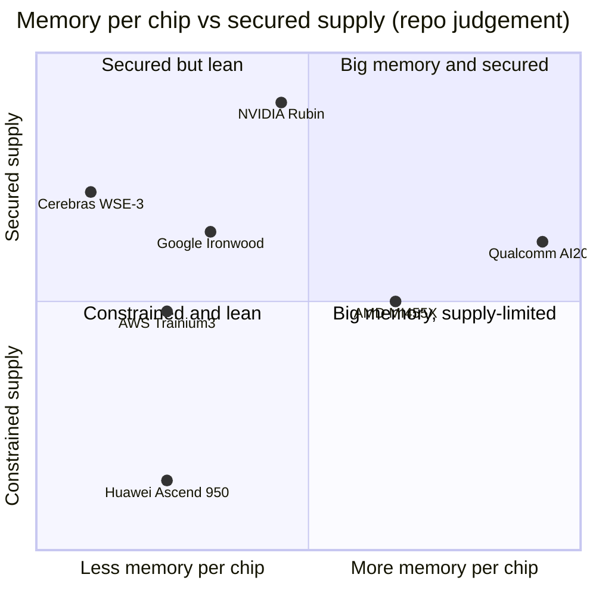

# Memory, packaging and supply chain: Competition

Layer 03 · Memory, packaging and supply chain · ~12 min read · Last verified: 2026-11-05

## ⚡ The Executive Take

- **Rivals compete for scarce supply as much as for design.** Every [HBM](../../glossary.md#hbm)-based accelerator needs the same TSMC [CoWoS](../../glossary.md#cowos) lines and three memory makers, so [capacity allocation](../../glossary.md#capacity-allocation) matters as much as the memory spec.
- **On per-chip memory, the gap has reversed.** AMD's MI455X carries 432 GB of HBM4 at 19.6 TB/s [[S144]](../../sources/bibliography.md#s144) against Rubin's 288 GB at 19.2 TB/s, which NVIDIA cut from 22 TB/s in Sep–Oct 2026 [[S103]](../../sources/bibliography.md#s103)[[S104]](../../sources/bibliography.md#s104). 🟢
- **At rack level AMD now edges ahead too.** Helios holds 31 TB of HBM4 [[S344]](../../sources/bibliography.md#s344) and ~1,411 TB/s (72 × 19.6 TB/s, repo calc) versus 20.7 TB and 1,400 TB/s for Vera Rubin NVL72 (was 1,580) [[S102]](../../sources/bibliography.md#s102)[[S90006]](../../sources/bibliography.md#s90006).
- **On supply, NVIDIA still leads by a wide margin.** It holds an estimated ~60% of 2026 CoWoS bookings (~595k wafers) versus ~105k for AMD and ~150k for Broadcom's custom-chip customers (Est., Morgan Stanley via press) [[S379]](../../sources/bibliography.md#s379); other reports put NVIDIA at 800–850k wafers [[S3003]](../../sources/bibliography.md#s3003). 🟡
- **Custom ASICs trail on memory per chip.** Google's Ironwood (192 GB, 7.37 TB/s) [[S151]](../../sources/bibliography.md#s151) and AWS Trainium3 (144 GB, 4.9 TB/s) [[S353]](../../sources/bibliography.md#s353) sit 2.6–3.9× below Rubin on bandwidth, though pod-level designs pool memory differently.
- **Different-approach players avoid the bottleneck.** Qualcomm's AI200 puts 768 GB of [LPDDR](../../glossary.md#lpddr) on each card and needs neither CoWoS nor HBM [[S173]](../../sources/bibliography.md#s173); SRAM-first designs (Cerebras, d-Matrix) trade capacity for on-chip bandwidth [[S166]](../../sources/bibliography.md#s166)[[S170]](../../sources/bibliography.md#s170).
- **[Q5 · Strongest challenger]** AMD: a 1.5× capacity lead and bandwidth parity, backed by OpenAI (up to 6 GW), Oracle (50,000 MI450) and Anthropic (up to 2 GW) commitments [[S546]](../../sources/bibliography.md#s546)[[S90022]](../../sources/bibliography.md#s90022)[[S538]](../../sources/bibliography.md#s538). Its gap is supply: ~1/6 of NVIDIA's estimated CoWoS wafers.

## The verdict matrix: specs versus supply

Think of two contests: a *spec contest* (how much memory sits next to each processor and how fast it is read; mechanics in [HBM explained](hbm-explained.md)) and a *supply contest* (who can buy enough wafers, HBM stacks and packaging slots to ship millions of units). NVIDIA no longer wins the first outright; it still wins the second. Compute competition is in [layer 02](../02-gpu-silicon/competition.md).

Verdicts below are the **challenger's position versus NVIDIA's 2026 flagship** (🟩 leads · 🟨 parity · 🟥 behind · 🟦 different approach).

| Challenger | Memory per accelerator | Bandwidth per accelerator | CoWoS / HBM allocation | Supplier relationships | Packaging alternative |
|---|---|---|---|---|---|
| AMD MI455X / Helios | 🟩 432 vs 288 GB [[S144]](../../sources/bibliography.md#s144) | 🟨 19.6 vs 19.2 TB/s [[S103]](../../sources/bibliography.md#s103) | 🟥 ~105k vs ~595k wafers (Est.) [[S379]](../../sources/bibliography.md#s379) | 🟨 Samsung named primary HBM4 supplier [[S3511]](../../sources/bibliography.md#s3511) | 🟨 same CoWoS dependency |
| Google TPU (+Broadcom) | 🟥 192 GB [[S151]](../../sources/bibliography.md#s151) | 🟥 7.37 TB/s [[S151]](../../sources/bibliography.md#s151) | 🟥 ~150k wafers shared with other ASICs (Est.) [[S379]](../../sources/bibliography.md#s379) | 🟦 Broadcom + MediaTek, four-partner chain [[S90027]](../../sources/bibliography.md#s90027) | 🟦 reported Intel EMIB talks [[S3532]](../../sources/bibliography.md#s3532) |
| AWS Trainium | 🟥 144 GB (Trn3) [[S353]](../../sources/bibliography.md#s353) | 🟥 4.9 TB/s; 4× claimed for Trn4 [[S156]](../../sources/bibliography.md#s156) | 🟥 via Alchip / Marvell [[S2517]](../../sources/bibliography.md#s2517) | 🟦 in-house + design partners | 🟦 reported Intel EMIB talks [[S3532]](../../sources/bibliography.md#s3532) |
| Huawei Ascend | 🟥 144 GB (950DT) [[S163]](../../sources/bibliography.md#s163) | 🟥 4.0 TB/s [[S163]](../../sources/bibliography.md#s163) | 🟥 export-controlled [[S90042]](../../sources/bibliography.md#s90042) | 🟦 in-house HBM; CXMT [[S3516]](../../sources/bibliography.md#s3516) | 🟦 domestic by necessity |
| Qualcomm AI200 / AI250 | 🟩 768 GB LPDDR [[S173]](../../sources/bibliography.md#s173) | 🟥 LPDDR, figure not published | 🟦 not needed | 🟦 mobile DRAM chain | 🟩 no CoWoS or HBM |
| SRAM start-ups | 🟥 44 GB SRAM (WSE-3) [[S166]](../../sources/bibliography.md#s166) | 🟩 21 PB/s on-wafer [[S166]](../../sources/bibliography.md#s166) | 🟦 not needed | 🟦 logic wafers only | 🟩 no CoWoS or HBM |

![Heatmap of six challengers against six memory-system dimensions. AMD leads on memory per accelerator (432 vs 288 GB), is at parity on per-GPU and rack bandwidth (19.6 vs 19.2 TB/s; 1,411 vs 1,400 TB/s) but is behind on CoWoS and HBM allocation (about 105k vs 595k wafers). Google TPU, AWS Trainium and Huawei are behind on per-chip memory and allocation; Qualcomm's LPDDR design leads on capacity (768 GB) and independence from CoWoS and HBM but is behind on bandwidth; SRAM start-ups lead on on-chip bandwidth and independence but trail on capacity.](../../assets/charts/03-memory-supply-verdict-heatmap.svg)

> [!TIP]
> **Worked example — AMD's spec lead versus NVIDIA's supply lead.** Suppose both firms fit a similar number of packages on each CoWoS wafer (🔴 simplifying assumption). AMD's ~105k wafers × 432 GB per package versus NVIDIA's ~595k × 288 GB gives AMD about (105 × 432) ÷ (595 × 288) ≈ **26%** of NVIDIA's deployable HBM in 2026 [[S379]](../../sources/bibliography.md#s379)[[S144]](../../sources/bibliography.md#s144). A 1.5× per-chip lead does not offset 5.7× fewer wafers. Capacity per chip wins benchmarks; allocation wins market share.

## The challengers, one by one

### AMD — capacity first

AMD has led on memory per GPU since MI300X (192 GB in 2023) [[S141]](../../sources/bibliography.md#s141) and matched B300's 288 GB with MI355X [[S143]](../../sources/bibliography.md#s143). Its best argument now: Helios offers ~1.5× the HBM per rack at equal bandwidth, and Samsung has named it a priority HBM4 customer [[S3512]](../../sources/bibliography.md#s3512). The gap that remains is volume, not design.

### Google TPU and Broadcom — memory at pod scale

A single Ironwood chip trails Rubin, but a 9,216-chip superpod shares 1.77 PB of HBM over Google's interconnect [[S151]](../../sources/bibliography.md#s151), and TPU 8t pods reach ~2 PB [[S239]](../../sources/bibliography.md#s239). Anthropic's commitment of up to 1M TPUs [[S90026]](../../sources/bibliography.md#s90026) gives Broadcom a strong claim on CoWoS slots.

### AWS Trainium — catching up on bandwidth

AWS says Trainium4 will have 4× Trainium3's memory bandwidth and 2× its capacity [[S156]](../../sources/bibliography.md#s156), roughly 19.6 TB/s and 288 GB by repo estimate. 🟡

### Huawei — self-sufficiency under export controls

Cut off from leading-edge HBM, Huawei announced in-house HBM: 128 GB at 1.6 TB/s for the 950PR and 144 GB at 4 TB/s for the 950DT [[S163]](../../sources/bibliography.md#s163). China's CXMT began small-scale HBM3E production in 2026 [[S3516]](../../sources/bibliography.md#s3516). Huawei compensates with scale: CloudMatrix 384 spreads 49 TB over 16 racks [[S340]](../../sources/bibliography.md#s340).

### Qualcomm (public information only) — the LPDDR bet

AI200 targets inference with 768 GB per card, 2.7× Rubin's capacity, using phone-style memory that avoids CoWoS and HBM entirely [[S173]](../../sources/bibliography.md#s173). The trade-off is bandwidth; AI250 claims >10× effective bandwidth through [near-memory computing](../../glossary.md#near-memory-compute) [[S173]](../../sources/bibliography.md#s173). No 2026 shipment confirmation was found (🔴) [[S90030]](../../sources/bibliography.md#s90030).

### SRAM-first start-ups

Cerebras keeps 44 GB of [SRAM](../../glossary.md#sram) on a wafer at 21 PB/s [[S166]](../../sources/bibliography.md#s166) and raised ~$5.5B in its May 2026 IPO [[S2504]](../../sources/bibliography.md#s2504); d-Matrix pairs 2 GB of SRAM with 256 GB of LPDDR5 [[S170]](../../sources/bibliography.md#s170). NVIDIA co-opted this route by licensing Groq's technology (~$20B reported) [[S90019]](../../sources/bibliography.md#s90019); a Groq 3 LPX rack holds 128 GB of SRAM [[S114]](../../sources/bibliography.md#s114).

### Net assessment

> [!TIP]
> **Worked example — what the Rubin revision cost in decode speed.** In memory-bound decode, each new token requires reading the model's weights and cache from HBM, so tokens per second scale with bandwidth (see [P3](../../primers/P3-the-four-bottlenecks.md)). Cutting 22 → 19.2 TB/s is −12.7% per GPU [[S103]](../../sources/bibliography.md#s103). MI455X's 19.6 TB/s is only +2% over Rubin, near-identical decode speed, but its 432 GB holds 50% more [KV cache](../../glossary.md#kv-cache): more concurrent long-context users per GPU.

🔧 Under the hood: why rack bandwidth comparisons are slippery

NVIDIA lists 1,400 TB/s for Vera Rubin NVL72 but 72 × 19.2 TB/s is 1,382 TB/s, and the HGX Rubin NVL8 page shows 130 TB/s, below 8 × 19.2 [[S105]](../../sources/bibliography.md#s105). AMD's figure here is a per-GPU multiple, not a measured rack number. Compare per-accelerator specs for design, and scale-up domains for serving capacity; treat ±2% differences as ties.

> [!NOTE]
> **🐂 Bull view.** Memory specs are table stakes that any HBM buyer can match; what cannot be matched quickly is ~60% of CoWoS, first claim on all three HBM makers (SK hynix alone is expected to supply >50% of NVIDIA's 2026 HBM) [[S90039]](../../sources/bibliography.md#s90039) and $279B of commitments [[S407]](../../sources/bibliography.md#s407). Rubin Ultra's 1 TB HBM4E retakes the capacity lead in 2027 [[S110]](../../sources/bibliography.md#s110).

> [!WARNING]
> **🐻 Bear view.** NVIDIA had to cut a launched spec while AMD did not [[S90006]](../../sources/bibliography.md#s90006); Samsung, the fastest-growing HBM supplier, is prioritising AMD [[S3512]](../../sources/bibliography.md#s3512); and CoWoS capacity may double by 2028 [[S3002]](../../sources/bibliography.md#s3002), eroding allocation as a moat just as Rubin Ultra reportedly shrinks to two dies [[S509]](../../sources/bibliography.md#s509).

## 🎯 Corp Dev Lens

1. If allocation is the moat, which supply contracts (HBM [long-term agreements](../../glossary.md#long-term-agreement), CoWoS slots) must a challenger sign before launch to be credible to hyperscalers?
2. Does the LPDDR route (AI200's 768 GB) cover enough capacity-bound inference to sustain a business outside the HBM queue?
3. AMD's capacity lead came from choosing 12 stacks per package: what package-size and cost penalties does that carry, and would a partner accept them?
4. Will Samsung's AMD priority survive if NVIDIA offers larger HBM4E volumes in 2027?
5. Can SRAM-first designs stay independent now that NVIDIA licensed Groq's approach?

## 📚 Sources

<!-- Auto-generated from the [S…] citations on this page by `make build`. Edit sources/registry/*.csv, not this list. -->

- [**S102**](../../sources/bibliography.md#s102) NVIDIA, *NVIDIA DGX Vera Rubin NVL72*, 2026. [Link](https://www.nvidia.com/en-us/data-center/dgx-vera-rubin-nvl72/)
- [**S103**](../../sources/bibliography.md#s103) VideoCardz, *NVIDIA quietly cuts Vera Rubin specs, HBM4 bandwidth and NVLink 6 speeds now lower*, 2026-10. [Link](https://videocardz.com/newz/nvidia-quietly-cuts-vera-rubin-specs-hbm4-bandwidth-and-nvlink-6-speeds-now-lower)
- [**S104**](../../sources/bibliography.md#s104) Wccftech, *NVIDIA's Official Statement on Vera Rubin Spec Change*, 2026-10-29. [Link](https://wccftech.com/nvidia-official-statement-on-vera-rubin-spec-change/)
- [**S105**](../../sources/bibliography.md#s105) Hardware Busters, *Nvidia Quietly Lowers Vera Rubin HBM4 Bandwidth, and the HGX NVL8 Loses a Quarter of It*, 2026-10. [Link](https://hwbusters.com/news/nvidia-quietly-lowers-vera-rubin-hbm4-bandwidth-and-the-hgx-nvl8-loses-a-quarter-of-it/)
- [**S110**](../../sources/bibliography.md#s110) Tom's Hardware, *Nvidia demonstrates Rubin Ultra tray, the world's first AI GPU with 1TB of HBM4E memory*, 2026-03. [Link](https://www.tomshardware.com/pc-components/gpus/nvidia-demonstrates-rubin-ultra-tray-worlds-1st-ai-gpu-with-1tb-of-hbm4e)
- [**S114**](../../sources/bibliography.md#s114) StorageReview, *NVIDIA Groq 3 LPX: Everything we know*, 2026-03. [Link](https://www.storagereview.com/news/nvidia-groq-3-lpx-everything-we-know)
- [**S141**](../../sources/bibliography.md#s141) AMD, *AMD Instinct MI300X Accelerator*, 2023-12-06. [Link](https://www.amd.com/en/products/accelerators/instinct/mi300/mi300x.html)
- [**S143**](../../sources/bibliography.md#s143) AMD, *AMD Instinct MI350 Series (MI350X, MI355X)*, 2025-06-12. [Link](https://www.amd.com/en/products/accelerators/instinct/mi350.html)
- [**S144**](../../sources/bibliography.md#s144) AMD Newsroom, *AMD Unveils Vision for an Open AI Ecosystem, Detailing New Silicon, Software and Systems at Advancing AI 2025*, 2025-06-12. [Link](https://www.amd.com/en/newsroom/press-releases/2025-6-12-amd-unveils-vision-for-an-open-ai-ecosystem-detai.html)
- [**S151**](../../sources/bibliography.md#s151) Google Blog (Amin Vahdat), *Ironwood: The first Google TPU for the age of inference*, 2025-04-09. [Link](https://blog.google/products/google-cloud/ironwood-tpu-age-of-inference/)
- [**S156**](../../sources/bibliography.md#s156) About Amazon, *AWS re:Invent 2025: top announcements (Trainium3 GA, Trainium4 preview, Graviton5)*, 2025-12-02. [Link](https://www.aboutamazon.com/news/aws/aws-re-invent-2025-ai-news-updates)
- [**S163**](../../sources/bibliography.md#s163) Huawei (Eric Xu), *Huawei Connect 2025 keynote: Ascend roadmap and SuperPoD interconnect (Eric Xu)*, 2025-09-18. [Link](https://www.huawei.com/en/news/2025/9/hc-xu-keynote-speech)
- [**S166**](../../sources/bibliography.md#s166) Cerebras, *Cerebras Systems Unveils World's Fastest AI Chip with 4 Trillion Transistors (WSE-3)*, 2024-03-13. [Link](https://www.cerebras.ai/press-release/cerebras-announces-third-generation-wafer-scale-engine)
- [**S170**](../../sources/bibliography.md#s170) d-Matrix, *d-Matrix Corsair inference platform*, 2024-11-19. [Link](https://www.d-matrix.ai/product/)
- [**S173**](../../sources/bibliography.md#s173) Qualcomm, *Qualcomm Unveils AI200 and AI250 - Redefining Rack-Scale Data Center Inference*, 2025-10-27. [Link](https://www.qualcomm.com/news/releases/2025/10/qualcomm-unveils-ai200-and-ai250-redefining-rack-scale-data-cent)
- [**S239**](../../sources/bibliography.md#s239) DatacenterDynamics, *Google unveils eighth-generation TPUs, two dedicated training and inference chips*, 2026-04-22. [Link](https://www.datacenterdynamics.com/en/news/google-unveils-eighth-generation-tpus-two-dedicated-training-and-inference-chips/)
- [**S340**](../../sources/bibliography.md#s340) SemiAnalysis (Dylan Patel et al.), *Huawei AI CloudMatrix 384 - China's answer to Nvidia GB200 NVL72*, 2025-04-16. [Link](https://newsletter.semianalysis.com/p/huawei-ai-cloudmatrix-384-chinas-answer-to-nvidia-gb200-nvl72)
- [**S344**](../../sources/bibliography.md#s344) AMD, *AMD Helios rack-scale AI infrastructure (product page)*, 2026. [Link](https://www.amd.com/ja/products/rackscale-solutions/helios.html)
- [**S353**](../../sources/bibliography.md#s353) AWS, *Announcing Amazon EC2 Trn3 UltraServers for faster, lower-cost generative AI training*, 2025-12-02. [Link](https://aws.amazon.com/about-aws/whats-new/2025/12/amazon-ec2-trn3-ultraservers/)
- [**S379**](../../sources/bibliography.md#s379) TrendForce News, *TSMC CoWoS capacity and customer allocation estimates (TrendForce / Morgan Stanley, as reported)*, 2025. [Link](https://www.trendforce.com/news/)
- [**S407**](../../sources/bibliography.md#s407) NVIDIA Corporation via SEC EDGAR, *NVIDIA Corporation Form 10-Q for quarter ended July 26, 2026*, 2026-08-28. [Link](https://www.sec.gov/Archives/edgar/data/1045810/000104581026000075/nvda-20260726.htm)
- [**S509**](../../sources/bibliography.md#s509) TrendForce, *NVIDIA Rubin Ultra four-die single-package design not adopted amid advanced-packaging constraints*, 2026-04-01. [Link](https://www.trendforce.com/news/?p=55442)
- [**S538**](../../sources/bibliography.md#s538) AMD Investor Relations, *AAI 2026: AMD Delivers Full-Stack Compute for the Agentic AI Era*, 2026-07-23. [Link](https://ir.amd.com/news-events/press-releases/detail/1294/aai-2026-amd-delivers-full-stack-compute-for-the-agentic-ai-era)
- [**S546**](../../sources/bibliography.md#s546) TechWire Asia, *AMD Advancing AI 2026: Helios, OpenAI, Meta, Anthropic*, 2026-07. [Link](https://techwireasia.com/2026/07/amd-advancing-ai-2026-helios-openai-meta-anthropic/)
- [**S2504**](../../sources/bibliography.md#s2504) TechCrunch, *Cerebras raises $5.5B kicking off 2026's IPO season with a bang*, 2026-05-14. [Link](https://techcrunch.com/2026/05/14/cerebras-raises-5-5b-kicking-off-2026s-ipo-season-with-a-bang)
- [**S2517**](../../sources/bibliography.md#s2517) TrendForce, *CSPs accelerate ASIC push in 2H26, challenging NVIDIA as MediaTek, GUC, Alchip benefit*, 2026-03-20. [Link](https://www.trendforce.com/news/2026/03/20/news-csps-accelerate-asic-push-in-2h26-challenging-nvidia-as-mediatek-guc-alchip-benefit/)
- [**S3002**](../../sources/bibliography.md#s3002) TrendForce, *TSMC reportedly targets 22% 2nm, 16% 3nm capacity boost by mid-2027; CoWoS to double by 2028*, 2026-09-14. [Link](https://www.trendforce.com/news/2026/09/14/news-tsmc-reportedly-targets-22-2nm-16-3nm-capacity-boost-by-mid-2027-cowos-to-double-by-2028/)
- [**S3003**](../../sources/bibliography.md#s3003) TrendForce, *TSMC reportedly expands outsourcing of key CoWoS front-end step to OSATs amid rising NVIDIA and ASIC demand*, 2026-08-05. [Link](https://www.trendforce.com/news/2026/08/05/news-tsmc-reportedly-expands-outsourcing-of-key-cowos-front-end-step-to-osats-amid-rising-nvidia-asic-demand/)
- [**S3511**](../../sources/bibliography.md#s3511) ITPro, *AMD and Samsung forge closer ties on AI memory, potential foundry deal*, 2026-03. [Link](https://itpro.com/hardware/amd-and-samsung-forge-closer-ties-on-ai-memory-potential-foundry-deal)
- [**S3512**](../../sources/bibliography.md#s3512) Asia Economy (Asiae), *Samsung Electronics to prioritize HBM4 supply for AMD AI accelerators*, 2026-03-18. [Link](https://view.asiae.co.kr/en/article/2026031817142143855)
- [**S3516**](../../sources/bibliography.md#s3516) Korea JoongAng Daily, *China's CXMT begins HBM3E production as chip battle with Korean powerhouses widens*, 2026-08. [Link](https://www.koreajoongangdaily.com/business/chinas-cxmt-begins-hbm3e-production-as-chip-battle-with-korean-powerhouses-widens/12854260)
- [**S3532**](../../sources/bibliography.md#s3532) Tom's Hardware, *Intel reportedly in talks with Google and Amazon over advanced packaging*, 2026. [Link](https://www.tomshardware.com/tech-industry/semiconductors/intel-reportedly-in-talks-with-google-and-amazon-over-advanced-packaging)
- [**S90006**](../../sources/bibliography.md#s90006) TweakTown, *Nvidia cuts Vera Rubin's memory bandwidth by up to 26% and AMD's Helios now leads in memory bandwidth*, 2026-10. [Link](https://www.tweaktown.com/news/114304/nvidia-cuts-vera-rubins-memory-bandwidth-by-up-to-26-percent-and-amds-helios-now-leads-in-memory-bandwidth/index.html)
- [**S90019**](../../sources/bibliography.md#s90019) TechSpot, *Nvidia's $20 billion Groq deal looks a lot like an acquisition*, 2025-12. [Link](https://www.techspot.com/news/110723-nvidia-20-billion-groq-deal-looks-lot-like.html)
- [**S90022**](../../sources/bibliography.md#s90022) Tom's Hardware, *AMD and Oracle partner to deploy 50,000 MI450 Instinct GPUs*, 2025-10. [Link](https://www.tomshardware.com/tech-industry/artificial-intelligence/amd-and-oracle-partner-to-deploy-50-000-mi450-instinct-gpus-in-new-ai-superclusters-deployment-of-expansion-set-for-2026-powered-by-amds-helios-rack)
- [**S90026**](../../sources/bibliography.md#s90026) Maginative, *Anthropic secures 1M Google TPUs while keeping Amazon as primary training partner*, 2025-10. [Link](https://www.maginative.com/anthropic-secures-1m-google-tpus-while-keeping-amazon-as-primary-training-partner)
- [**S90027**](../../sources/bibliography.md#s90027) The Next Web, *Google is building a four-partner chip supply chain to challenge Nvidia in AI inference*, 2026. [Link](https://thenextweb.com/news/google-inference-chips-nvidia-challenge-supply-chain)
- [**S90030**](../../sources/bibliography.md#s90030) Morningstar, *Qualcomm: Humain deal provides some AI upside*, 2025-10. [Link](https://www.morningstar.com/stocks/qualcomm-humain-deal-provides-some-ai-upside)
- [**S90039**](../../sources/bibliography.md#s90039) TrendForce, *Samsung, SK hynix reportedly tapped as NVIDIA Rubin HBM4 suppliers; shipments could start in March*, 2026-03-09. [Link](https://www.trendforce.com/news/2026/03/09/news-samsung-sk%E2%80%AFhynix-reportedly-tapped-as-nvidia-rubin-hbm4-suppliers-shipments-could-start-in-march/)
- [**S90042**](../../sources/bibliography.md#s90042) TrendForce, *Huawei unveils Ascend 950 with in-house HBM in 2026, touts SuperPoD to rival NVIDIA*, 2025-09-18. [Link](https://www.trendforce.com/news/2025/09/18/news-huawei-unveils-ascend-950-with-in-house-hbm-in-2026-touts-superpod-to-rival-nvidia/)
