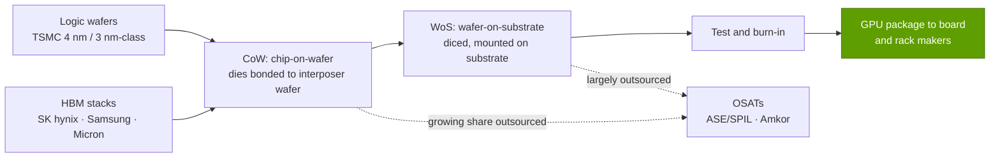

# CoWoS and advanced packaging

Layer 03 · Memory, packaging and supply chain · ~9 min read · Last verified: 2026-11-05

## ⚡ The Executive Take

- **An AI GPU is a package, not a chip.** No die can exceed the ~858 mm² [reticle limit](../../glossary.md#reticle-limit), and HBM must sit millimetres from the GPU [[S380]](../../sources/bibliography.md#s380). TSMC's [CoWoS](../../glossary.md#cowos) places dies and HBM side by side on a silicon [interposer](../../glossary.md#interposer) or bridges: [2.5D packaging](../../glossary.md#advanced-packaging).
- **Three flavours.** [CoWoS-S](../../glossary.md#cowos-s) uses one silicon interposer up to ~3.3× the reticle (H100). [CoWoS-L](../../glossary.md#cowos-l) embeds small silicon bridges in organic layers, targeting ~5.5× in 2026 and ~9.5× in 2027 (B200 onward). [CoWoS-R](../../glossary.md#cowos-r) drops silicon for cheaper wiring [[S380]](../../sources/bibliography.md#s380)[[S358]](../../sources/bibliography.md#s358).
- **Packages grow faster than capacity.** A 300-mm wafer holds ~28 interposers at 2× reticle but ~4 at 9.5× (Est.) [[S3000]](../../sources/bibliography.md#s3000). H100- to Rubin-class roughly halves GPUs per wafer.
- 🟡 **Capacity is growing but short.** Estimates run from ~15k wafers a month (end-2023) to ~115–130k (end-2026) and ~260k (end-2028) [[S379]](../../sources/bibliography.md#s379)[[S3002]](../../sources/bibliography.md#s3002), with a ~20% gap reported for 2026 [[S3003]](../../sources/bibliography.md#s3003).
- 🟡 **NVIDIA holds the largest allocation:** ~60% of 2026 bookings (~595k of ~1.0M wafers, Morgan Stanley via press) [[S379]](../../sources/bibliography.md#s379), or ~800–850k wafers in later reports [[S3003]](../../sources/bibliography.md#s3003).

## Why AI accelerators need 2.5D packaging

**Analogy.** A motherboard is a city street grid; an interposer is a silicon circuit board with wiring ~100× finer, so tens of thousands of short wires fit in a few square centimetres. Two forces push every flagship accelerator onto it: the reticle limit, which NVIDIA now beats by joining two reticle-size dies with a 10 TB/s link [[S35014]](../../sources/bibliography.md#s35014) (see [Layer 02](../02-gpu-silicon/index.md)), and HBM's wide bus (see [HBM explained](hbm-explained.md)).

> [!TIP]
> **Worked example — counting wires on a Rubin package.** 8 HBM4 stacks × 2,048 data wires = 16,384 memory data wires, before clocks, power and the die-to-die link [[S369]](../../sources/bibliography.md#s369)[[S360]](../../sources/bibliography.md#s360). A 12-channel DDR5 server socket has 768 [[S179]](../../sources/bibliography.md#s179). **Business reading:** packaging capacity, not just wafer capacity, caps GPU output, and NVIDIA, AMD, Google and AWS flagships all queue for the same CoWoS lines.

## CoWoS-S vs CoWoS-L vs CoWoS-R

| Variant | What carries the wires | Max size (TSMC) | Trade-off | NVIDIA use |
|---|---|---|---|---|
| **CoWoS-S** | One monolithic silicon interposer | ~3.3× reticle [[S380]](../../sources/bibliography.md#s380) | Finest wiring, but size-capped and costly | A100, H100, H200 [[S380]](../../sources/bibliography.md#s380) |
| **CoWoS-L** | Organic layers with embedded [local silicon bridges](../../glossary.md#local-silicon-interconnect) | ~5.5× (2026), ~9.5× (2027) [[S380]](../../sources/bibliography.md#s380) | Scales larger; harder assembly and warpage | B200, B300, Rubin [[S358]](../../sources/bibliography.md#s358)[[S35014]](../../sources/bibliography.md#s35014) |
| **CoWoS-R** | Organic [redistribution layers](../../glossary.md#redistribution-layer) only | — | Cheaper; coarser wiring | Not used for NVIDIA flagships |

🟡 Analysts put CoWoS-S at ~$750 per H100 and CoWoS-L at ~$1,100–1,500 per B200 (Est.) [[S35040]](../../sources/bibliography.md#s35040)[[S35020]](../../sources/bibliography.md#s35020), small next to ~$2,900 of HBM [[S35020]](../../sources/bibliography.md#s35020). The constraint is availability, not price.

🔧 Under the hood: why CoWoS-L, and why warpage matters

A silicon interposer is printed like a chip, so exceeding one reticle means stitching exposures into one large, fragile slab. CoWoS-L keeps silicon only under the die edges that need dense wiring [[S380]](../../sources/bibliography.md#s380). The cost is mechanical: silicon, organic layers and substrate expand differently when heated, so a 5–10× reticle package can warp during bonding. Warpage is the main risk TSMC cites for panel packaging [[S3004]](../../sources/bibliography.md#s3004), and reports that NVIDIA reworked the four-die Rubin Ultra amid packaging constraints show the limit is real [[S509]](../../sources/bibliography.md#s509).

## Package size growth and GPUs per wafer

Each GPU package uses one interposer, so **packages per wafer** falls as interposers grow.

> [!TIP]
> **Worked example — from wafers a month to GPUs a year.** GPUs per year ≈ wafers per month × 12 × packages per wafer × yield. 🔴 Assume ~16 packages (B300-class) or ~12 (Rubin-class) and 90% yield [[S3000]](../../sources/bibliography.md#s3000):
>
> - **10k wafers a month** of B300-class ≈ 10,000 × 12 × 16 × 0.9 ≈ **1.7M GPUs a year**.
> - **NVIDIA's ~595k 2026 wafers** [[S379]](../../sources/bibliography.md#s379) ≈ 6.4–8.6M packages; at ~800–850k [[S3003]](../../sources/bibliography.md#s3003), ≈ 8.6–12.2M.
> - **Cross-check:** ~$71.5B of Q2 FY2027 data-center compute revenue (Est.) [[S405]](../../sources/bibliography.md#s405)[[S408]](../../sources/bibliography.md#s408) at $30–40k per GPU [[S35026]](../../sources/bibliography.md#s35026) is ~7–10M GPUs a year.
>
> **Business reading:** one wafer gates ~$0.5–0.6M of GPU revenue, yet its CoWoS-L packaging costs ~$18–24k [[S35040]](../../sources/bibliography.md#s35040)[[S35020]](../../sources/bibliography.md#s35020), ~3–4%. TSMC charges little for the bottleneck it controls, so allocation, not price, is the currency.

## TSMC capacity and NVIDIA's allocation share

**[Q2 · Metrics that matter]** here: CoWoS wafers a month, each vendor's share, and packages per wafer, all estimates.

| Year end | CoWoS capacity, k wafers/month (Est.) | Source |
|---|---|---|
| 2023 | ~13–15 | [[S379]](../../sources/bibliography.md#s379) |
| 2024 | ~32–40; TSMC said it more than doubled | [[S379]](../../sources/bibliography.md#s379)[[S378]](../../sources/bibliography.md#s378) |
| 2025 | ~65–80 | [[S90039]](../../sources/bibliography.md#s90039) |
| 2026 | ~105–130 | [[S90039]](../../sources/bibliography.md#s90039)[[S3002]](../../sources/bibliography.md#s3002) |
| 2027 | 🟡 ~170 (KGI) | [[S3001]](../../sources/bibliography.md#s3001) |
| 2028 | 🟡 ~260 (Economic Daily News) | [[S3002]](../../sources/bibliography.md#s3002) |

🟡 Morgan Stanley (via press) splits ~1.0M 2026 wafers as NVIDIA ~595k, Broadcom ~150k, AMD ~105k, others ~150k [[S379]](../../sources/bibliography.md#s379); later reports say NVIDIA reserved ~800–850k [[S3003]](../../sources/bibliography.md#s3003), and KGI sees NVIDIA and Broadcom each gaining ~100k in 2027 [[S3001]](../../sources/bibliography.md#s3001).

> [!WARNING]
> **Myth vs. reality:** "CoWoS doubles, so GPU supply doubles." Package area grows too: from ~16 per wafer (B300-class) to ~12 (Rubin-class) and ~4–6 (four-die Rubin Ultra-class) (Est.) [[S3000]](../../sources/bibliography.md#s3000). HBM supply must also keep pace.

## Alternatives: EMIB, OSATs and panel-level packaging

| Option | What it is | Scale and timing | What it changes |
|---|---|---|---|
| **Intel [EMIB](../../glossary.md#emib)-T, [Foveros](../../glossary.md#foveros)** | Bridges in the substrate; Foveros stacks dies in 3D | 🟡 ~15–20k CoWoS-equivalent wafers a month in 2027, ~40–45k in 2028 (Est.) [[S3002]](../../sources/bibliography.md#s3002) | A non-TSMC route, including in the US |
| **[OSATs](../../glossary.md#osat)** (ASE/SPIL, Amkor) | Take more CoWoS steps; build CoWoS-like lines | 🟡 TSMC outsourcing more chip-on-wafer work [[S3003]](../../sources/bibliography.md#s3003); ~110k equivalent wafers a month by end-2028 [[S3002]](../../sources/bibliography.md#s3002) | More capacity; leading-edge flows stay TSMC-qualified |
| **[Panel-level](../../glossary.md#panel-level-packaging) / [CoPoS](../../glossary.md#copos)** | Square panels replace round wafers | 🟡 Pilot mid-2026; volume ~2H28–2029 [[S3004]](../../sources/bibliography.md#s3004)[[S3005]](../../sources/bibliography.md#s3005) | Less edge waste for huge packages; warpage risk |

> [!TIP]
> **Worked example — why panels.** 🔴 At 9.5× reticle, 4 interposers of ~8,150 mm² use ~32,600 mm² of a ~67,900 mm² usable wafer, under half [[S3000]](../../sources/bibliography.md#s3000)[[S380]](../../sources/bibliography.md#s380). Rectangles tile a square panel with far less waste. **Business reading:** CoPoS matters most for the giant 2027–28 packages, which is when it is due.

## 🎯 Corp Dev Lens

1. **The bottleneck is cheap to own and valuable to control.** CoWoS is ~3–4% of the revenue it gates (Est.) [[S3000]](../../sources/bibliography.md#s3000), which is why NVIDIA locks in allocation years ahead.
2. **Second sources matter most to ASIC programs behind NVIDIA in TSMC's queue.** Which hyperscaler or merchant programs commit first to EMIB-T, OSAT lines or CoPoS [[S3002]](../../sources/bibliography.md#s3002)[[S3003]](../../sources/bibliography.md#s3003)[[S3004]](../../sources/bibliography.md#s3004)?
3. **Package size is a roadmap risk.** The reported Rubin Ultra rework [[S509]](../../sources/bibliography.md#s509) shows packaging can redraw products. How exposed are rival roadmaps that assume 5–9× reticle packages in 2027? Suppliers riding the build-out are in [value chain](value-chain-and-corp-dev.md).

## 📚 Sources

<!-- Auto-generated from the [S…] citations on this page by `make build`. Edit sources/registry/*.csv, not this list. -->

- [**S179**](../../sources/bibliography.md#s179) Intel, *Intel Xeon 6 processors with P-cores (Granite Rapids, 6900P/6700P)*, 2024-09-24. [Link](https://www.intel.com/content/www/us/en/products/details/processors/xeon/xeon6-p-cores.html)
- [**S358**](../../sources/bibliography.md#s358) glennklockwood.com (Glenn K. Lockwood), *NVIDIA B200 processor notes*, 2025. [Link](https://glennklockwood.com/garden/processors/B200)
- [**S360**](../../sources/bibliography.md#s360) glennklockwood.com (Glenn K. Lockwood), *NVIDIA Rubin (R200) processor notes*, 2026. [Link](https://glennklockwood.com/garden/processors/r200)
- [**S369**](../../sources/bibliography.md#s369) JEDEC, *JESD270-4: High Bandwidth Memory (HBM4) standard*, 2025-04-16. [Link](https://www.jedec.org/standards-documents/docs/jesd270-4)
- [**S378**](../../sources/bibliography.md#s378) TSMC Investor Relations, *TSMC quarterly earnings conference calls (CoWoS capacity commentary)*, 2025. [Link](https://investor.tsmc.com/english/quarterly-results)
- [**S379**](../../sources/bibliography.md#s379) TrendForce News, *TSMC CoWoS capacity and customer allocation estimates (TrendForce / Morgan Stanley, as reported)*, 2025. [Link](https://www.trendforce.com/news/)
- [**S380**](../../sources/bibliography.md#s380) TSMC, *TSMC 3DFabric: CoWoS-S, CoWoS-R and CoWoS-L technology overview and roadmap*, 2025. [Link](https://3dfabric.tsmc.com/english/dedicatedFoundry/technology/cowos.htm)
- [**S405**](../../sources/bibliography.md#s405) NVIDIA Corporation via SEC EDGAR, *NVIDIA Announces Financial Results for Second Quarter Fiscal 2027 (Form 8-K exhibit 99.1)*, 2026-08-26. [Link](https://www.sec.gov/Archives/edgar/data/0001045810/000104581026000073/q2fy27pr.htm)
- [**S408**](../../sources/bibliography.md#s408) NVIDIA Corporation, *NVIDIA Corp. (NVDA) Q2 Fiscal 2027 earnings call transcript (26 August 2026)*, 2026-08-26. [Link](https://s201.q4cdn.com/141608511/files/content_files/TRANSCRIPT_-NVIDIA-Corp-NVDA-US-Q2-2027-Earnings-Call-26-August-2026-5_00-PM-ET.pdf)
- [**S509**](../../sources/bibliography.md#s509) TrendForce, *NVIDIA Rubin Ultra four-die single-package design not adopted amid advanced-packaging constraints*, 2026-04-01. [Link](https://www.trendforce.com/news/?p=55442)
- [**S3000**](../../sources/bibliography.md#s3000) nvidia_deep_dive_claude repository, *Repo analysis: layer 03 memory, packaging and supply-chain models (decode ceilings, HBM sizing, CoWoS packages per wafer)*, 2026-11-05. [Link](https://github.com/FrankHuang94/nvidia_deep_dive_claude/blob/main/layers/03-memory-packaging-supply-chain/index.md)
- [**S3001**](../../sources/bibliography.md#s3001) KGI Securities, *TSMC (2330 TT) research note: CoWoS expansion forecast raised*, 2026-03-09. [Link](https://www.kgi.com.hk/en/-/media/files/kgishk/research-reports/tw-reports/tsmc_2330-tt_09032026e.pdf)
- [**S3002**](../../sources/bibliography.md#s3002) TrendForce, *TSMC reportedly targets 22% 2nm, 16% 3nm capacity boost by mid-2027; CoWoS to double by 2028*, 2026-09-14. [Link](https://www.trendforce.com/news/2026/09/14/news-tsmc-reportedly-targets-22-2nm-16-3nm-capacity-boost-by-mid-2027-cowos-to-double-by-2028/)
- [**S3003**](../../sources/bibliography.md#s3003) TrendForce, *TSMC reportedly expands outsourcing of key CoWoS front-end step to OSATs amid rising NVIDIA and ASIC demand*, 2026-08-05. [Link](https://www.trendforce.com/news/2026/08/05/news-tsmc-reportedly-expands-outsourcing-of-key-cowos-front-end-step-to-osats-amid-rising-nvidia-asic-demand/)
- [**S3004**](../../sources/bibliography.md#s3004) TrendForce, *TSMC advances panel-level packaging: CoPoS pilot line reportedly set for June completion; 2028-29 ramp eyed*, 2026-04-13. [Link](https://www.trendforce.com/news/2026/04/13/news-tsmc-advances-panel-level-packaging-copos-pilot-line-reportedly-set-for-june-completion-2028-29-ramp-eyed/)
- [**S3005**](../../sources/bibliography.md#s3005) TrendForce, *TSMC reportedly eyes two AUO fabs worth TWD 30B for FOPLP and CoPoS*, 2026-08-10. [Link](https://www.trendforce.com/news/2026/08/10/news-tsmc-reportedly-eyes-two-auo-fabs-worth-twd-30b-for-foplp-and-copos-longtan-could-add-1-4nm/)
- [**S35014**](../../sources/bibliography.md#s35014) NVIDIA, *NVIDIA Blackwell Architecture*, 2024-03. [Link](https://www.nvidia.com/en-us/data-center/technologies/blackwell-architecture/)
- [**S35020**](../../sources/bibliography.md#s35020) Epoch AI, *NVIDIA's B200 costs around $6,400 to produce, with memory accounting for half*, 2025-12. [Link](https://epoch.ai/data-insights/b200-cost-breakdown)
- [**S35026**](../../sources/bibliography.md#s35026) Tom's Hardware, *Nvidia's Jensen Huang says Blackwell GPU to cost $30,000-$40,000, later clarifies that pricing will vary as they won't sell just the chip*, 2024-03-19. [Link](https://www.tomshardware.com/pc-components/gpus/nvidias-jensen-huang-says-blackwell-gpu-to-cost-dollar30000-dollar40000-later-clarifies-that-pricing-will-vary-as-they-wont-sell-just-the-chip)
- [**S35040**](../../sources/bibliography.md#s35040) Silicon Analysts, *CoWoS packaging cost: chiplet vs monolithic (2026)*, 2026. [Link](https://siliconanalysts.com/analysis/cowos-packaging-cost-chiplet-vs-monolithic-2026)
- [**S90039**](../../sources/bibliography.md#s90039) TrendForce, *Samsung, SK hynix reportedly tapped as NVIDIA Rubin HBM4 suppliers; shipments could start in March*, 2026-03-09. [Link](https://www.trendforce.com/news/2026/03/09/news-samsung-sk%E2%80%AFhynix-reportedly-tapped-as-nvidia-rubin-hbm4-suppliers-shipments-could-start-in-march/)
