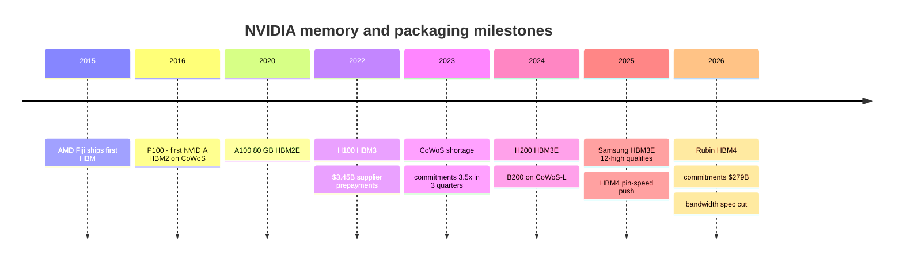
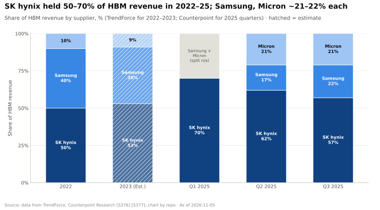

# Memory, packaging and supply chain: History and how NVIDIA built it

Layer 03 · Memory, packaging and supply chain · ~12 min read · Last verified: 2026-11-05

## ⚡ The Executive Take

- **NVIDIA did not invent stacked memory; AMD shipped the first [HBM](../../glossary.md#hbm) product in 2015** [[S370]](../../sources/bibliography.md#s370). NVIDIA's first was the 2016 P100: four HBM2 stacks, 16 GB and 732 GB/s on TSMC's [CoWoS](../../glossary.md#cowos) [[S125]](../../sources/bibliography.md#s125).
- **The advantage was built with the balance sheet.** NVIDIA's [purchase obligations](../../glossary.md#purchase-obligations) rose from $4.9B in January 2023 to $279B in July 2026, mostly memory and manufacturing capacity [[S419]](../../sources/bibliography.md#s419)[[S407]](../../sources/bibliography.md#s407); the disclosed line was broadened in 2026, so the multiple is indicative [[S90092]](../../sources/bibliography.md#s90092).
- **It was not free.** The FY2023 downturn brought ~$2.17B of inventory provisions [[S418]](../../sources/bibliography.md#s418) and a ~$348M charge for commitments above demand [[S421]](../../sources/bibliography.md#s421), after $3.45B of supplier [prepayments](../../glossary.md#prepayment) [[S419]](../../sources/bibliography.md#s419).
- **Commitments now outrun physical capacity.** Since end-2023 they grew 17× against 4.4× for quarterly revenue and ~8× for estimated CoWoS capacity [[S407]](../../sources/bibliography.md#s407)[[S379]](../../sources/bibliography.md#s379), because they now include multi-year memory contracts at supercycle prices.
- **Supplier qualification is a weapon and a risk.** Samsung needed ~19 months to pass NVIDIA's HBM3E tests (Sep 2025) [[S3514]](../../sources/bibliography.md#s3514); once in, its HBM share rose from 17% to 33% in a year [[S3500]](../../sources/bibliography.md#s3500).
- **[Q4 · Source of advantage]** Mostly scale, purchasing power and timing, not memory engineering: AMD out-specs Rubin on capacity and bandwidth [[S144]](../../sources/bibliography.md#s144)[[S90093]](../../sources/bibliography.md#s90093), while NVIDIA holds an estimated ~60% of CoWoS [[S379]](../../sources/bibliography.md#s379).
- **[Q6 · Replication cost]** Est. 3–5 years and $100–300B of multi-year commitments to match NVIDIA's supply position, but only a few hundred specialist engineers (🔴 repo estimate).

## From GDDR boards to a supply-chain weapon

Before P100, NVIDIA's data-center boards used [GDDR](../../glossary.md#gddr), graphics memory soldered around the chip [[S125]](../../sources/bibliography.md#s125). HBM changed the physics: stacks of DRAM dies sit millimetres from the GPU on a silicon [interposer](../../glossary.md#interposer), so bandwidth jumps but the GPU, memory and packaging must be assembled together. That turned memory from a board-level purchase into a three-party manufacturing dependency on TSMC and the HBM makers.

| Date | Decision | Why it mattered | Source |
|---|---|---|---|
| 2016 | HBM2 on CoWoS for P100 | Moved the flagship to stacked memory; began volume CoWoS work with TSMC | [[S125]](../../sources/bibliography.md#s125) |
| FY2023 | Prepay suppliers ($3.06–3.45B) | Secured capacity, then exposed NVIDIA to write-downs when demand fell | [[S420]](../../sources/bibliography.md#s420)[[S419]](../../sources/bibliography.md#s419) |
| 2023 | Commitments up 3.5× in three quarters | Locked CoWoS and HBM during the shortage, ahead of rivals | [[S419]](../../sources/bibliography.md#s419)[[S424]](../../sources/bibliography.md#s424) |
| 2024 | B200 on CoWoS-L (two dies) | First NVIDIA package on TSMC's bridge-based [CoWoS-L](../../glossary.md#cowos-l); two reticle-sized dies | [[S358]](../../sources/bibliography.md#s358) |
| 2024–25 | Multi-source HBM (Micron for H200; Samsung later) | More supply and bargaining power | [[S371]](../../sources/bibliography.md#s371)[[S3514]](../../sources/bibliography.md#s3514) |
| 2025 | Push HBM4 beyond JEDEC speeds | Aimed to beat AMD on bandwidth; cut in 2026, Rubin now trails MI455X (19.2 vs 23.3 TB/s) | [[S90041]](../../sources/bibliography.md#s90041)[[S103]](../../sources/bibliography.md#s103)[[S90093]](../../sources/bibliography.md#s90093) |
| 2026 | Commitments to $279B | Locks 2027+ supply at high memory prices | [[S407]](../../sources/bibliography.md#s407) |

> [!TIP]
> **Worked example — how big is the downside?** At the FY2023 peak, commitments were $9.6B, ~1.2–1.4× quarterly revenue [[S420]](../../sources/bibliography.md#s420); the bust cost ~$2.17B of provisions [[S418]](../../sources/bibliography.md#s418), about 23% of that peak. Today's $279B is 2.9× quarterly revenue of $96.2B [[S407]](../../sources/bibliography.md#s407)[[S405]](../../sources/bibliography.md#s405). The same 23% hit would be ~$63B (🔴 illustrative). Memory and capacity would find other buyers in a shortage, so real exposure is likely lower, but no longer immaterial.

## The qualification battle: why supplier count matters

An HBM maker cannot simply sell to NVIDIA. Each stack generation goes through [HBM qualification](../../glossary.md#hbm-qualification): months of tests for speed, heat, power and yield inside NVIDIA's package. Samsung's HBM3E suffered a reported ~18-month setback, and it denied a July 2024 approval rumour [[S3515]](../../sources/bibliography.md#s3515); its 12-high part cleared NVIDIA in September 2025, ~19 months after first samples [[S3514]](../../sources/bibliography.md#s3514)[[S3513]](../../sources/bibliography.md#s3513). That delay let SK hynix hold 57–70% of HBM revenue through 2025 [[S377]](../../sources/bibliography.md#s377).

> [!TIP]
> **Worked example — what a qualification is worth.** Samsung's share rose 16 points between Q2 2025 and Q2 2026 [[S377]](../../sources/bibliography.md#s377)[[S3500]](../../sources/bibliography.md#s3500). At Micron's ~$35B estimate of the 2025 HBM market [[S399]](../../sources/bibliography.md#s399), 16 points is ~$5.6B a year of revenue (repo calc). That is why suppliers accept NVIDIA's demands on pin speed and thermals, and why NVIDIA wants three qualified suppliers.

**[Q4 · Source of advantage]** The evidence points to **supply bought early with a risk-tolerant balance sheet**, not superior memory engineering. AMD fits more HBM and more bandwidth per GPU [[S144]](../../sources/bibliography.md#s144)[[S90093]](../../sources/bibliography.md#s90093); NVIDIA's own HBM4 speed target had to be revised [[S104]](../../sources/bibliography.md#s104). What rivals lack is NVIDIA's estimated ~60% CoWoS share [[S379]](../../sources/bibliography.md#s379) and first claim on three HBM makers [[S90039]](../../sources/bibliography.md#s90039). Engineering co-design matters (B200 was NVIDIA's first CoWoS-L package [[S358]](../../sources/bibliography.md#s358)) but TSMC sells the same process to everyone. 🔴 repo analysis; mechanics in [Supply chain as a weapon](supply-chain-as-a-weapon.md).

## What would it take to replicate?

**[Q6 · Replication cost]** Repo estimate (🔴), reasoning in each row:

| Ingredient | Estimate | Reasoning |
|---|---|---|
| Time | 3–5 years | CoWoS reportedly sold out to 2027 [[S3507]](../../sources/bibliography.md#s3507); SK hynix reports 14 [long-term agreements](../../glossary.md#long-term-agreement) with supply booked to 2029 [[S3503]](../../sources/bibliography.md#s3503); Micron has contracted most of its 2027 HBM [[S3534]](../../sources/bibliography.md#s3534); a new supplier qualification can take ~19 months [[S3514]](../../sources/bibliography.md#s3514) |
| Dollars | $100–300B of multi-year commitments | NVIDIA carries $279B [[S407]](../../sources/bibliography.md#s407), ~42× AMD's quarterly data-center revenue of $6.7B [[S543]](../../sources/bibliography.md#s543); a challenger also needs equity to absorb a ~20% write-down |
| Talent | A few hundred specialists | Packaging, signal and power integrity, thermal and supplier-quality engineers; scarce but hireable, not the binding constraint |
| Demand proof | Anchor customers | AMD used OpenAI, Oracle and Anthropic commitments [[S546]](../../sources/bibliography.md#s546)[[S90022]](../../sources/bibliography.md#s90022)[[S538]](../../sources/bibliography.md#s538); OpenAI signed letters of intent for up to ~900k DRAM wafers a month (units reported inconsistently) [[S3535]](../../sources/bibliography.md#s3535)[[S3536]](../../sources/bibliography.md#s3536), close to Samsung's and SK hynix's combined ~1.1M [[S3537]](../../sources/bibliography.md#s3537) |

> [!TIP]
> **Worked example — what 10 points of 2028 CoWoS would cost in memory.** At ~260k wafers a month by 2028 [[S3002]](../../sources/bibliography.md#s3002), 10% is ~312k wafers a year. At the repo's estimate of 11–16 Rubin-class packages per wafer [[S3000]](../../sources/bibliography.md#s3000), that is ~3.4–5.0M GPUs, each needing 288 GB of HBM at Bernstein's ~$53/GB (~$15K) [[S333]](../../sources/bibliography.md#s333): **~$52–76B a year of HBM** to contract before the chips exist (🔴 repo calc).

🔧 Under the hood: why commitments grew faster than CoWoS

CoWoS wafers count packaging slots; commitments count dollars. Between end-2023 and mid-2026 the dollar value per slot rose because each Rubin package carries more expensive HBM4, memory prices surged (DRAM industry revenue +81% q/q in Q1 2026) [[S3518]](../../sources/bibliography.md#s3518), and contracts lengthened to multi-year terms.

## Counterfactuals: what if NVIDIA hadn't…

- 🔴 **…pre-booked CoWoS in 2023?** Capacity was ~15k wafers a month at end-2023 [[S379]](../../sources/bibliography.md#s379). If NVIDIA had kept commitments near $5B instead of $17B [[S424]](../../sources/bibliography.md#s424), AMD's MI300X (192 GB, December 2023) [[S141]](../../sources/bibliography.md#s141) and Broadcom's ASICs would have won more 2024 slots, and the Blackwell ramp would have been smaller.
- 🔴 **…faced an early Samsung qualification?** Had Samsung passed in mid-2024, SK hynix's 62% share [[S377]](../../sources/bibliography.md#s377) would likely have fallen a year sooner, lowering NVIDIA's HBM3E costs, and Samsung would have had less spare HBM4 to promise AMD [[S3512]](../../sources/bibliography.md#s3512).

> [!TIP]
> **Worked example — the JEDEC-baseline counterfactual (🔴).** Had NVIDIA asked only for JEDEC's 8 Gb/s, eight 2,048-bit HBM4 stacks would give 8 × 2,048 × 8 ÷ 8 = 16.4 TB/s [[S369]](../../sources/bibliography.md#s369), below MI455X's 23.3 TB/s, which AMD reaches with 12 stacks at ~7.6 Gb/s (repo calc) [[S144]](../../sources/bibliography.md#s144)[[S90093]](../../sources/bibliography.md#s90093)[[S90094]](../../sources/bibliography.md#s90094). Its >10 Gb/s ask [[S90041]](../../sources/bibliography.md#s90041) landed at 19.2 TB/s: still ~18% short of AMD, bought at the cost of a public spec cut.

## 🎯 Corp Dev Lens

1. Which supply contracts would a new entrant need signed before launch, and could equity stakes or prepayments to memory makers substitute for NVIDIA-scale volume?
2. How much write-down risk sits in $279B of commitments if 2027 demand slows, and what do disclosures say about cancellability?
3. Does Samsung's late qualification make it the natural partner for challengers seeking priority supply?
4. Could a consortium of buyers (labs, hyperscalers) contract memory directly, as OpenAI's letters of intent suggest, and bypass chip vendors' allocation power?

## 📚 Sources

<!-- Auto-generated from the [S…] citations on this page by `make build`. Edit sources/registry/*.csv, not this list. -->

- [**S103**](../../sources/bibliography.md#s103) VideoCardz, *NVIDIA quietly cuts Vera Rubin specs, HBM4 bandwidth and NVLink 6 speeds now lower*, 2026-10. [Link](https://videocardz.com/newz/nvidia-quietly-cuts-vera-rubin-specs-hbm4-bandwidth-and-nvlink-6-speeds-now-lower)
- [**S104**](../../sources/bibliography.md#s104) Wccftech, *NVIDIA's Official Statement on Vera Rubin Spec Change*, 2026-10-29. [Link](https://wccftech.com/nvidia-official-statement-on-vera-rubin-spec-change/)
- [**S125**](../../sources/bibliography.md#s125) NVIDIA, *NVIDIA Tesla P100 (Pascal GP100) Architecture Whitepaper*, 2016-04. [Link](https://images.nvidia.com/content/pdf/tesla/whitepaper/pascal-architecture-whitepaper.pdf)
- [**S141**](../../sources/bibliography.md#s141) AMD, *AMD Instinct MI300X Accelerator*, 2023-12-06. [Link](https://www.amd.com/en/products/accelerators/instinct/mi300/mi300x.html)
- [**S144**](../../sources/bibliography.md#s144) AMD Newsroom, *AMD Unveils Vision for an Open AI Ecosystem, Detailing New Silicon, Software and Systems at Advancing AI 2025*, 2025-06-12. [Link](https://www.amd.com/en/newsroom/press-releases/2025-6-12-amd-unveils-vision-for-an-open-ai-ecosystem-detai.html)
- [**S333**](../../sources/bibliography.md#s333) Wccftech, *Bernstein warns NVIDIA's Vera Rubin racks will hit $9.1 million as HBM4 prices triple to $53 per gigabyte*, 2026-07. [Link](https://wccftech.com/bernstein-warns-nvidias-vera-rubin-racks-will-hit-9-1-million-as-hbm4-prices-triple-to-53-per-gigabyte/)
- [**S358**](../../sources/bibliography.md#s358) glennklockwood.com (Glenn K. Lockwood), *NVIDIA B200 processor notes*, 2025. [Link](https://glennklockwood.com/garden/processors/B200)
- [**S369**](../../sources/bibliography.md#s369) JEDEC, *JESD270-4: High Bandwidth Memory (HBM4) standard*, 2025-04-16. [Link](https://www.jedec.org/standards-documents/docs/jesd270-4)
- [**S370**](../../sources/bibliography.md#s370) JEDEC, *JESD235 High Bandwidth Memory (HBM / HBM2 / HBM2E) DRAM standard family*, 2013-10. [Link](https://www.jedec.org/standards-documents/docs/jesd235a)
- [**S371**](../../sources/bibliography.md#s371) Micron Technology, *Micron commences volume production of industry-leading HBM3E solution*, 2024-02-26. [Link](https://investors.micron.com/news-releases/news-release-details/micron-commences-volume-production-industry-leading-hbm3e-solution)
- [**S377**](../../sources/bibliography.md#s377) Counterpoint Research, *Counterpoint Research DRAM/HBM market trackers (Q1-Q3 2025 HBM shares)*, 2025. [Link](https://www.counterpointresearch.com/insights)
- [**S379**](../../sources/bibliography.md#s379) TrendForce News, *TSMC CoWoS capacity and customer allocation estimates (TrendForce / Morgan Stanley, as reported)*, 2025. [Link](https://www.trendforce.com/news/)
- [**S399**](../../sources/bibliography.md#s399) Micron Technology, *Micron fiscal Q1 2026 earnings (HBM total addressable market outlook)*, 2025-12-17. [Link](https://investors.micron.com/)
- [**S405**](../../sources/bibliography.md#s405) NVIDIA Corporation via SEC EDGAR, *NVIDIA Announces Financial Results for Second Quarter Fiscal 2027 (Form 8-K exhibit 99.1)*, 2026-08-26. [Link](https://www.sec.gov/Archives/edgar/data/0001045810/000104581026000073/q2fy27pr.htm)
- [**S407**](../../sources/bibliography.md#s407) NVIDIA Corporation via SEC EDGAR, *NVIDIA Corporation Form 10-Q for quarter ended July 26, 2026*, 2026-08-28. [Link](https://www.sec.gov/Archives/edgar/data/1045810/000104581026000075/nvda-20260726.htm)
- [**S418**](../../sources/bibliography.md#s418) NVIDIA Corporation via SEC EDGAR, *NVIDIA Corporation Form 10-K for fiscal year ended January 29, 2023*, 2023-02-24. [Link](https://www.sec.gov/Archives/edgar/data/1045810/000104581023000017/nvda-20230129.htm)
- [**S419**](../../sources/bibliography.md#s419) NVIDIA Corporation via SEC EDGAR (Colette Kress), *CFO Commentary on Fourth Quarter and Fiscal 2023 Results (Form 8-K exhibit 99.2)*, 2023-02-22. [Link](https://sec.gov/Archives/edgar/data/1045810/000104581023000014/q4fy23cfocommentary.htm)
- [**S420**](../../sources/bibliography.md#s420) NVIDIA Corporation (via CapEdge mirror of Form 8-K) (Colette Kress), *CFO Commentary on Second Quarter Fiscal 2023 Results*, 2022-08-24. [Link](https://capedge.com/filing/1045810/0001045810-22-000136/NVDA-8K/file/3)
- [**S421**](../../sources/bibliography.md#s421) NVIDIA Corporation (via CapEdge mirror of Form 8-K) (Colette Kress), *CFO Commentary on Third Quarter Fiscal 2023 Results*, 2022-11-16. [Link](https://capedge.com/filing/1045810/0001045810-22-000163/NVDA-8K/file/3)
- [**S424**](../../sources/bibliography.md#s424) NVIDIA Corporation via SEC EDGAR, *NVIDIA Corporation Form 10-Q for quarter ended October 29, 2023*, 2023-11-21. [Link](https://www.sec.gov/Archives/edgar/data/1045810/000104581023000227/nvda-20231029.htm)
- [**S538**](../../sources/bibliography.md#s538) AMD Investor Relations, *AAI 2026: AMD Delivers Full-Stack Compute for the Agentic AI Era*, 2026-07-23. [Link](https://ir.amd.com/news-events/press-releases/detail/1294/aai-2026-amd-delivers-full-stack-compute-for-the-agentic-ai-era)
- [**S543**](../../sources/bibliography.md#s543) AMD via SEC EDGAR, *AMD Q2 2026 earnings slides (Form 8-K)*, 2026-08-04. [Link](https://www.sec.gov/Archives/edgar/data/0000002488/000000248826000121/amdq22026earningsslidesf.htm)
- [**S546**](../../sources/bibliography.md#s546) TechWire Asia, *AMD Advancing AI 2026: Helios, OpenAI, Meta, Anthropic*, 2026-07. [Link](https://techwireasia.com/2026/07/amd-advancing-ai-2026-helios-openai-meta-anthropic/)
- [**S3000**](../../sources/bibliography.md#s3000) nvidia_deep_dive_claude repository, *Repo analysis: layer 03 memory, packaging and supply-chain models (decode ceilings, HBM sizing, CoWoS packages per wafer)*, 2026-11-05. [Link](https://github.com/FrankHuang94/nvidia_deep_dive_claude/blob/main/layers/03-memory-packaging-supply-chain/index.md)
- [**S3002**](../../sources/bibliography.md#s3002) TrendForce, *TSMC reportedly targets 22% 2nm, 16% 3nm capacity boost by mid-2027; CoWoS to double by 2028*, 2026-09-14. [Link](https://www.trendforce.com/news/2026/09/14/news-tsmc-reportedly-targets-22-2nm-16-3nm-capacity-boost-by-mid-2027-cowos-to-double-by-2028/)
- [**S3500**](../../sources/bibliography.md#s3500) Counterpoint Research (Korea), *Global HBM market share Q2 2026*, 2026-09. [Link](https://korea.counterpointresearch.com/global-hbm-market-share-q2-2026/)
- [**S3503**](../../sources/bibliography.md#s3503) SammyFans, *SK hynix Q3 margin hits record 80%, secures 14 LTAs with memory supply booked to 2029*, 2026-10-28. [Link](https://www.sammyfans.com/2026/10/28/sk-hynix-q3-margin-hits-record-80-secures-14-ltas-with-memory-supply-booked-to-2029/amp/)
- [**S3507**](../../sources/bibliography.md#s3507) AI Weekly, *TSMC pilots CoPoS panel packaging as CoWoS sells out to 2027*, 2026. [Link](https://aiweekly.co/alerts/tsmc-pilots-copos-panel-packaging-as-cowos-sells-out-to-2027)
- [**S3512**](../../sources/bibliography.md#s3512) Asia Economy (Asiae), *Samsung Electronics to prioritize HBM4 supply for AMD AI accelerators*, 2026-03-18. [Link](https://view.asiae.co.kr/en/article/2026031817142143855)
- [**S3513**](../../sources/bibliography.md#s3513) TrendForce, *Samsung 12H HBM3E reportedly clears NVIDIA tests after 18-month setback, HBM4 reaches final phase*, 2025-09-22. [Link](https://www.trendforce.com/news/2025/09/22/news-samsung-12h-hbm3e-reportedly-clears-nvidia-tests-after-18-month-setback-hbm4-reaches-final-phase/)
- [**S3514**](../../sources/bibliography.md#s3514) Asia Economy (Asiae), *Samsung Electronics passes NVIDIA HBM3E quality certification; supply resumes after 19 months*, 2025-09-19. [Link](https://www.asiae.co.kr/en/article/2025091919025243075)
- [**S3515**](../../sources/bibliography.md#s3515) TrendForce, *Samsung's HBM3E reportedly passed NVIDIA's certification, though it denies the rumor*, 2024-07-04. [Link](https://www.trendforce.com/news/2024/07/04/news-samsungs-hbm3e-reportedly-passed-nvidias-certification-though-it-denies-the-rumor/)
- [**S3518**](../../sources/bibliography.md#s3518) Tiger Brokers (iTiger), *DRAM industry revenue soars 81% to $97 billion in Q1 amid accelerating price hikes (TrendForce)*, 2026-06. [Link](https://www.itiger.com/hans/news/1108307708)
- [**S3534**](../../sources/bibliography.md#s3534) The Next Platform, *Micron's numbers show why HBM4 memory is worth 15x its weight in gold*, 2026-10-02. [Link](https://www.nextplatform.com/store/2026/10/02/microns-numbers-show-why-hbm4-memory-is-worth-15x-its-weight-in-gold/5300701)
- [**S3535**](../../sources/bibliography.md#s3535) TechCrunch, *OpenAI ropes in Samsung and SK hynix to source memory chips for Stargate*, 2025-10-01. [Link](https://techcrunch.com/2025/10/01/openai-ropes-in-samsung-sk-hynix-to-source-memory-chips-for-stargate)
- [**S3536**](../../sources/bibliography.md#s3536) The Register, *OpenAI ropes in Samsung and SK Hynix for Stargate memory*, 2025-10-02. [Link](https://www.theregister.com/2025/10/02/openai_ropes_in_samsung_and/)
- [**S3537**](../../sources/bibliography.md#s3537) DIGITIMES Asia, *OpenAI, Samsung and SK hynix: supply-chain implications for NVIDIA*, 2025-10-03. [Link](https://www.digitimes.com/news/a20251003PD218/openai-samsung-sk-hynix-supply-chain-nvidia.html)
- [**S90022**](../../sources/bibliography.md#s90022) Tom's Hardware, *AMD and Oracle partner to deploy 50,000 MI450 Instinct GPUs*, 2025-10. [Link](https://www.tomshardware.com/tech-industry/artificial-intelligence/amd-and-oracle-partner-to-deploy-50-000-mi450-instinct-gpus-in-new-ai-superclusters-deployment-of-expansion-set-for-2026-powered-by-amds-helios-rack)
- [**S90039**](../../sources/bibliography.md#s90039) TrendForce, *Samsung, SK hynix reportedly tapped as NVIDIA Rubin HBM4 suppliers; shipments could start in March*, 2026-03-09. [Link](https://www.trendforce.com/news/2026/03/09/news-samsung-sk%E2%80%AFhynix-reportedly-tapped-as-nvidia-rubin-hbm4-suppliers-shipments-could-start-in-march/)
- [**S90041**](../../sources/bibliography.md#s90041) I-Connect007 (TrendForce), *NVIDIA seeks to raise HBM4 specs in response to AMD competition; SK hynix expected to remain largest supplier in 2026*, 2025-09. [Link](https://iconnect007.com/article/146969/nvidia-seeks-to-raise-hbm4-specs-in-response-to-amd-competition-sk-hynix-expected-to-remain-largest-supplier-in-2026/146966/aep)
- [**S90092**](../../sources/bibliography.md#s90092) Nasdaq (Motley Fool), *Nvidia's supply commitments more than doubled to $279 billion: here's what it does to the stock*, 2026-09. [Link](https://www.nasdaq.com/articles/nvidias-supply-commitments-more-doubled-279-billion-heres-what-it-does-stock)
- [**S90093**](../../sources/bibliography.md#s90093) Tom's Hardware, *AMD takes the wraps off its Instinct MI455X AI accelerator: CDNA 5 and Helios rack-scale architecture*, 2026. [Link](https://www.tomshardware.com/pc-components/gpus/amd-takes-the-wraps-off-its-instinct-mi455x-ai-accelerator-cdna-5-and-helios-rack-scale-architecture-combine-to-take-the-fight-to-nvidia-in-the-data-center)
- [**S90094**](../../sources/bibliography.md#s90094) ServeTheHome, *AMD Instinct MI455X deep dive: CDNA 5 marks the next era of Instinct*, 2026. [Link](https://www.servethehome.com/amd-instinct-mi455x-deep-dive-cdna-5-marks-the-next-era-of-instinct/5/)
