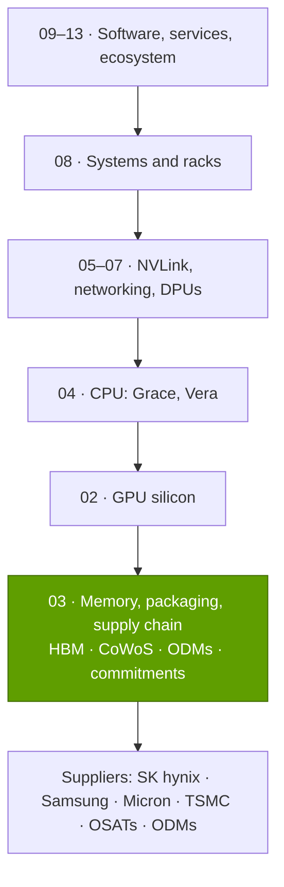
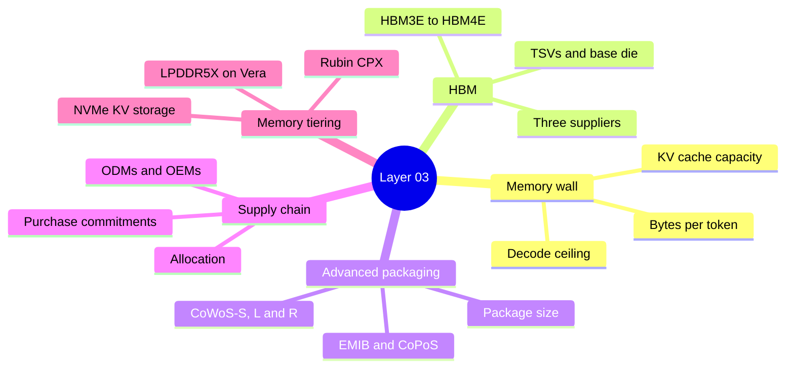

# Layer 03 — Memory, packaging and supply chain

Layer 03 of 12 · HBM, CoWoS packaging and the supply commitments that turn them into shipped GPUs · ~7 min read · Last verified: 2026-11-05

## ⚡ The Executive Take

- **For [LLM](../../glossary.md#llm) inference, memory binds before compute.** Since V100, dense low-precision compute rose ~280× but [HBM](../../glossary.md#hbm) bandwidth ~21× [[S33010]](../../sources/bibliography.md#s33010)[[S33005]](../../sources/bibliography.md#s33005)[[S33007]](../../sources/bibliography.md#s33007); bandwidth caps a 70B [FP8](../../glossary.md#fp8) chat stream at ~48 tokens/s on H100 and ~274 on Rubin [[S33002]](../../sources/bibliography.md#s33002)[[S32006]](../../sources/bibliography.md#s32006).
- **HBM is the costliest part of a GPU:** ~45% of a B200's build cost (Est., Epoch AI) [[S35020]](../../sources/bibliography.md#s35020); memory rises from ~9% to ~26% of an [NVL72](../../glossary.md#nvl72) rack's cost from GB300 to Vera Rubin (Est.) [[S330]](../../sources/bibliography.md#s330)[[S332]](../../sources/bibliography.md#s332).
- **[HBM4](../../glossary.md#hbm4) changes the product:** a 2,048-bit bus [[S369]](../../sources/bibliography.md#s369) and a logic-process base die, often made by TSMC [[S3007]](../../sources/bibliography.md#s3007)[[S3011]](../../sources/bibliography.md#s3011). 🟢 Rubin's HBM4 is listed at 19.2 TB/s, down from 22 [[S90006]](../../sources/bibliography.md#s90006)[[S33007]](../../sources/bibliography.md#s33007).
- **Packaging is the second gate.** 🟡 TSMC's [CoWoS](../../glossary.md#cowos) capacity rose from ~15k to ~115k wafers a month, end-2023 to end-2026 (Est.), and NVIDIA booked ~60% of 2026 wafers [[S379]](../../sources/bibliography.md#s379).
- **NVIDIA turns cash into allocation.** Supply and capacity commitments reached $279B at Q2 FY2027, up from $119B a quarter earlier, mostly memory and manufacturing [[S407]](../../sources/bibliography.md#s407)[[S404]](../../sources/bibliography.md#s404).
- **Biggest weakness:** NVIDIA buys HBM from the same three makers as rivals. AMD's MI455X carries 432 GB at 23.3 TB/s vs Rubin's 288 GB at 19.2, ~1.5× the capacity and ~1.2× the bandwidth [[S144]](../../sources/bibliography.md#s144)[[S90093]](../../sources/bibliography.md#s90093)[[S33007]](../../sources/bibliography.md#s33007). Fixed commitments also make NVIDIA the shock absorber, as the $4.5B H20 charge showed [[S414]](../../sources/bibliography.md#s414).

## Where this layer sits in the stack

> [!TIP]
> **Worked example — one Vera Rubin NVL72 rack, seen through this layer.** 72 GPUs × 8 stacks = 576 HBM4 stacks holding 72 × 288 GB ≈ 20.7 TB at 72 × 19.2 ≈ 1,400 TB/s [[S102]](../../sources/bibliography.md#s102)[[S33007]](../../sources/bibliography.md#s33007). At ~12 Rubin-class packages per CoWoS wafer (Est.) [[S3000]](../../sources/bibliography.md#s3000) the rack consumes ~6 CoWoS wafers. Its memory costs ~$2.0M of a ~$7.8M rack (Est., Morgan Stanley) [[S330]](../../sources/bibliography.md#s330). **Business reading:** each rack is as much a memory and packaging purchase as a GPU purchase.

🔧 Under the hood: how this layer's estimates are built

[Decode](../../glossary.md#decode) ceilings divide HBM bandwidth by bytes per token; HBM sizing adds FP8 weights to the KV cache implied by each model's layer and head counts; packages per wafer count interposers of a given reticle multiple on a 300-mm wafer. All are repo arithmetic on cited inputs [[S3000]](../../sources/bibliography.md#s3000), with assumptions in `data/l03_memory_scenarios.csv` and `data/l03_cowos_geometry.csv`.

## Layer map

## The eight questions at a glance

| # | Question | Short answer | Where answered |
|---|---|---|---|
| Q1 | Job, and what breaks if weak? | Feed tensor cores fast enough and hold model plus [KV cache](../../glossary.md#kv-cache); then build enough HBM and CoWoS. Weak: idle compute, unshipped GPUs. | [The memory wall](the-memory-wall.md) |
| Q2 | Metrics that matter? | HBM TB/s and GB per GPU, bytes per token, CoWoS wafers × packages per wafer, commitments ÷ revenue. | [The memory wall](the-memory-wall.md) |
| Q3 | Generational progress? | P100 → Rubin: 0.73 → 19.2 TB/s (26×), 16 → 288 GB (18×), 4 → 8 stacks [[S125]](../../sources/bibliography.md#s125)[[S33007]](../../sources/bibliography.md#s33007). | [HBM explained](hbm-explained.md) |
| Q4 | Source of advantage? | Supply and execution: the largest committed buyer, first onto each HBM generation. | [History and how built](history-and-how-built.md) |
| Q5 | Strongest challenger? | AMD, with capacity-heavy HBM4 (432 vs 288 GB) [[S144]](../../sources/bibliography.md#s144). | [Competition](competition.md) |
| Q6 | Replication cost? | Memory can be bought; years of allocation cannot. | [History and how built](history-and-how-built.md) |
| Q7 | Roadmap? | HBM4E with custom base dies (2027) [[S3007]](../../sources/bibliography.md#s3007); 🟡 CoWoS ~doubling by 2028 [[S3002]](../../sources/bibliography.md#s3002). | [Roadmap](roadmap.md) |
| Q8 | Value pools? | HBM makers, TSMC packaging, OSATs, substrates, ODMs. | [Value chain and corp dev](value-chain-and-corp-dev.md) |

## Pages in this layer

| Page | What you will learn |
|---|---|
| [The memory wall](the-memory-wall.md) | Why bandwidth and capacity limit decode; decode ceilings by GPU |
| [HBM explained](hbm-explained.md) | Stacks, TSVs, base dies, HBM2E → HBM4E, cost and yield |
| [CoWoS and advanced packaging](cowos-and-advanced-packaging.md) | CoWoS-S/L/R, GPUs per wafer, TSMC capacity, alternatives |
| [Supply chain as a weapon](supply-chain-as-a-weapon.md) | $279B of commitments, the ODM/OEM chain, allocation |
| [Memory tiering and Rubin CPX](memory-tiering-and-rubin-cpx.md) | HBM vs LPDDR vs GDDR7 vs NVMe; Rubin CPX; rival approaches |
| [Competition](competition.md) | Challengers in memory and packaging |
| [History and how NVIDIA built it](history-and-how-built.md) | Key supply decisions and replication cost |
| [Roadmap](roadmap.md) | HBM4E, Rubin Ultra memory, packaging timelines |
| [Value chain and corp dev angles](value-chain-and-corp-dev.md) | Who captures the dollars; private companies |

## 🎯 Corp Dev Lens

1. **Memory is the new margin battleground.** HBM is ~45% of a B200's cost [[S35020]](../../sources/bibliography.md#s35020). Who holds pricing power in 2027 [HBM4E](../../glossary.md#hbm4e) contracts, and what does it do to NVIDIA's ~75% gross margin [[S405]](../../sources/bibliography.md#s405)?
2. **Allocation is an asset that never shows on the balance sheet.** Can a new entrant buy priority with prepayments, or only with years of volume?
3. **Custom base dies open a seam.** Logic inside the HBM stack, made at TSMC [[S3007]](../../sources/bibliography.md#s3007)[[S3008]](../../sources/bibliography.md#s3008), needs interface and controller IP. Where could Qualcomm's IP fit?
4. **Capacity-first inference is a real alternative.** AMD (432 GB, with no bandwidth penalty) and Qualcomm AI200 (768 GB [LPDDR](../../glossary.md#lpddr), trading bandwidth for capacity) bet on capacity [[S144]](../../sources/bibliography.md#s144)[[S173]](../../sources/bibliography.md#s173). Which workloads reward that?

## 📚 Sources

<!-- Auto-generated from the [S…] citations on this page by `make build`. Edit sources/registry/*.csv, not this list. -->

- [**S102**](../../sources/bibliography.md#s102) NVIDIA, *NVIDIA DGX Vera Rubin NVL72*, 2026. [Link](https://www.nvidia.com/en-us/data-center/dgx-vera-rubin-nvl72/)
- [**S125**](../../sources/bibliography.md#s125) NVIDIA, *NVIDIA Tesla P100 (Pascal GP100) Architecture Whitepaper*, 2016-04. [Link](https://images.nvidia.com/content/pdf/tesla/whitepaper/pascal-architecture-whitepaper.pdf)
- [**S144**](../../sources/bibliography.md#s144) AMD Newsroom, *AMD Unveils Vision for an Open AI Ecosystem, Detailing New Silicon, Software and Systems at Advancing AI 2025*, 2025-06-12. [Link](https://www.amd.com/en/newsroom/press-releases/2025-6-12-amd-unveils-vision-for-an-open-ai-ecosystem-detai.html)
- [**S173**](../../sources/bibliography.md#s173) Qualcomm, *Qualcomm Unveils AI200 and AI250 - Redefining Rack-Scale Data Center Inference*, 2025-10-27. [Link](https://www.qualcomm.com/news/releases/2025/10/qualcomm-unveils-ai200-and-ai250-redefining-rack-scale-data-cent)
- [**S330**](../../sources/bibliography.md#s330) PC Gamer, *A single Nvidia Vera Rubin rack is estimated to cost $7,803,148 with over $2 million of that figure spent on memory alone*, 2026-05. [Link](https://pcgamer.com/hardware/a-single-nvidia-vera-rubin-rack-is-estimated-to-cost-usd7-803-148-with-over-usd2-million-of-that-figure-spent-on-memory-alone)
- [**S332**](../../sources/bibliography.md#s332) Tiger Brokers (iTiger), *Morgan Stanley's BOM analysis of NVIDIA's Rubin: GPU share declines; PCB, MLCC and ABF substrate values soar*, 2026-05-20. [Link](https://www.itiger.com/news/1188068712)
- [**S369**](../../sources/bibliography.md#s369) JEDEC, *JESD270-4: High Bandwidth Memory (HBM4) standard*, 2025-04-16. [Link](https://www.jedec.org/standards-documents/docs/jesd270-4)
- [**S379**](../../sources/bibliography.md#s379) TrendForce News, *TSMC CoWoS capacity and customer allocation estimates (TrendForce / Morgan Stanley, as reported)*, 2025. [Link](https://www.trendforce.com/news/)
- [**S404**](../../sources/bibliography.md#s404) NVIDIA Corporation via SEC EDGAR, *NVIDIA Corporation Form 10-Q for quarter ended April 26, 2026*, 2026-05-27. [Link](https://www.sec.gov/Archives/edgar/data/1045810/000104581026000052/nvda-20260426.htm)
- [**S405**](../../sources/bibliography.md#s405) NVIDIA Corporation via SEC EDGAR, *NVIDIA Announces Financial Results for Second Quarter Fiscal 2027 (Form 8-K exhibit 99.1)*, 2026-08-26. [Link](https://www.sec.gov/Archives/edgar/data/0001045810/000104581026000073/q2fy27pr.htm)
- [**S407**](../../sources/bibliography.md#s407) NVIDIA Corporation via SEC EDGAR, *NVIDIA Corporation Form 10-Q for quarter ended July 26, 2026*, 2026-08-28. [Link](https://www.sec.gov/Archives/edgar/data/1045810/000104581026000075/nvda-20260726.htm)
- [**S414**](../../sources/bibliography.md#s414) NVIDIA Corporation via SEC EDGAR, *NVIDIA Corporation Form 10-Q for quarter ended April 27, 2025*, 2025-05-28. [Link](https://www.sec.gov/Archives/edgar/data/1045810/000104581025000116/nvda-20250427.htm)
- [**S3000**](../../sources/bibliography.md#s3000) nvidia_deep_dive_claude repository, *Repo analysis: layer 03 memory, packaging and supply-chain models (decode ceilings, HBM sizing, CoWoS packages per wafer)*, 2026-11-05. [Link](https://github.com/FrankHuang94/nvidia_deep_dive_claude/blob/main/layers/03-memory-packaging-supply-chain/index.md)
- [**S3002**](../../sources/bibliography.md#s3002) TrendForce, *TSMC reportedly targets 22% 2nm, 16% 3nm capacity boost by mid-2027; CoWoS to double by 2028*, 2026-09-14. [Link](https://www.trendforce.com/news/2026/09/14/news-tsmc-reportedly-targets-22-2nm-16-3nm-capacity-boost-by-mid-2027-cowos-to-double-by-2028/)
- [**S3007**](../../sources/bibliography.md#s3007) Tom's Hardware, *Micron teams up with TSMC to deliver HBM4E, targeted for 2027*, 2025-09. [Link](https://www.tomshardware.com/micron-hands-tsmc-the-keys-to-hbm4e)
- [**S3008**](../../sources/bibliography.md#s3008) TrendForce, *TSMC unveils custom C-HBM4E details: N3P logic dies reportedly target 2x efficiency gain*, 2025-12-01. [Link](https://www.trendforce.com/news/2025/12/01/news-tsmc-unveils-custom-c-hbm4e-details-n3p-logic-dies-reportedly-target-2x-efficiency-gain/)
- [**S3011**](../../sources/bibliography.md#s3011) TrendForce, *Samsung's custom HBM4E design reportedly aimed for mid-2026, parallels SK hynix and Micron*, 2026-01-23. [Link](https://www.trendforce.com/news/2026/01/23/news-samsungs-custom-hbm4e-design-reportedly-aimed-for-mid-2026-parallels-sk-hynix-and-micron/)
- [**S32006**](../../sources/bibliography.md#s32006) Meta via Hugging Face, *Llama 3.1 70B configuration (config.json)*, 2024-07-23. [Link](https://huggingface.co/meta-llama/Llama-3.1-70B/blob/main/config.json)
- [**S33002**](../../sources/bibliography.md#s33002) NVIDIA, *NVIDIA H100 Tensor Core GPU (product page and datasheet)*, 2022-03-22. [Link](https://www.nvidia.com/en-us/data-center/h100/)
- [**S33005**](../../sources/bibliography.md#s33005) NVIDIA, *NVIDIA Vera Rubin NVL72 (product page and specifications)*, 2026. [Link](https://www.nvidia.com/en-us/data-center/vera-rubin-nvl72/)
- [**S33007**](../../sources/bibliography.md#s33007) Dataconomy, *Nvidia Quietly Cuts Vera Rubin HBM4 And NVLink Bandwidth Specs*, 2026-11-02. [Link](https://dataconomy.com/2026/11/02/nvidia-quietly-cuts-vera-rubin-hbm4-and-nvlink-bandwidth/)
- [**S33010**](../../sources/bibliography.md#s33010) NVIDIA, *NVIDIA V100 Tensor Core GPU datasheet*, 2018. [Link](https://images.nvidia.com/content/technologies/volta/pdf/volta-v100-datasheet-update-us-1165301-r5.pdf)
- [**S35020**](../../sources/bibliography.md#s35020) Epoch AI, *NVIDIA's B200 costs around $6,400 to produce, with memory accounting for half*, 2025-12. [Link](https://epoch.ai/data-insights/b200-cost-breakdown)
- [**S90006**](../../sources/bibliography.md#s90006) TweakTown, *Nvidia cuts Vera Rubin's memory bandwidth by up to 26% and AMD's Helios now leads in memory bandwidth*, 2026-10. [Link](https://www.tweaktown.com/news/114304/nvidia-cuts-vera-rubins-memory-bandwidth-by-up-to-26-percent-and-amds-helios-now-leads-in-memory-bandwidth/index.html)
- [**S90093**](../../sources/bibliography.md#s90093) Tom's Hardware, *AMD takes the wraps off its Instinct MI455X AI accelerator: CDNA 5 and Helios rack-scale architecture*, 2026. [Link](https://www.tomshardware.com/pc-components/gpus/amd-takes-the-wraps-off-its-instinct-mi455x-ai-accelerator-cdna-5-and-helios-rack-scale-architecture-combine-to-take-the-fight-to-nvidia-in-the-data-center)
