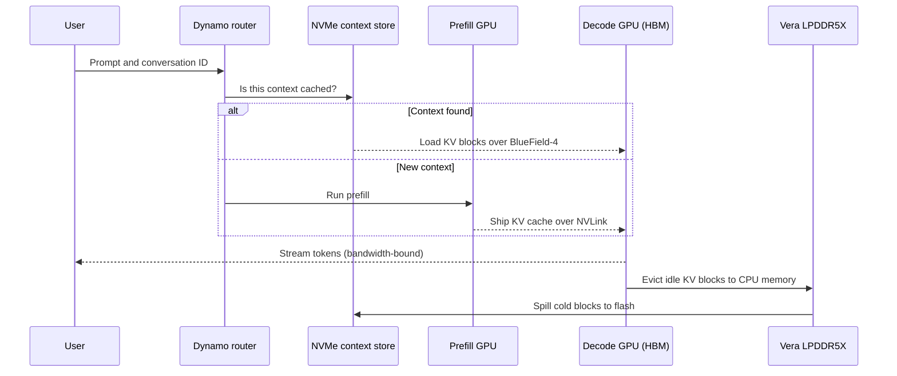

# Memory tiering and Rubin CPX

Layer 03 · Memory, packaging and supply chain · ~9 min read · Last verified: 2026-11-05

## ⚡ The Executive Take

- **Inference uses a ladder of memories.** Each step down trades bandwidth for capacity: on-chip [SRAM](../../glossary.md#sram), [HBM](../../glossary.md#hbm), [GDDR7](../../glossary.md#gddr), [LPDDR5X](../../glossary.md#lpddr5x), then NVMe flash. Rubin's HBM4 is 16× faster than Vera's LPDDR5X but holds a fifth as much (19.2 TB/s, 288 GB vs 1.2 TB/s, 1.5 TB) [[S33007]](../../sources/bibliography.md#s33007)[[S100]](../../sources/bibliography.md#s100).
- **[Prefill](../../glossary.md#prefill) and [decode](../../glossary.md#decode) want different memory.** Prefill is compute-bound, decode bandwidth-bound [[S33025]](../../sources/bibliography.md#s33025), so [disaggregated serving](../../glossary.md#disaggregated-serving) splits them [[S32014]](../../sources/bibliography.md#s32014); NVIDIA's Dynamo has scheduled this in production since March 2026 [[S520]](../../sources/bibliography.md#s520)[[S90066]](../../sources/bibliography.md#s90066).
- **NVIDIA now sells every tier.** Vera adds up to 1.5 TB of LPDDR5X behind two GPUs over a 1.8 TB/s link [[S100]](../../sources/bibliography.md#s100); 🟢 BlueField-4 storage adds an NVMe tier for [KV-cache offload](../../glossary.md#kv-cache-offload) [[S3012]](../../sources/bibliography.md#s3012); Groq-derived LPUs add SRAM [[S114]](../../sources/bibliography.md#s114).
- 🟡 **[Rubin CPX](../../glossary.md#rubin-cpx) is in limbo.** Announced in 2025 as a GDDR7 prefill GPU (30 PFLOPS NVFP4, 128 GB) [[S33023]](../../sources/bibliography.md#s33023), it was missing from the GTC 2026 roadmap [[S115]](../../sources/bibliography.md#s115); 🔴 an analyst reports an HBM4 revival for Q1 2027 [[S117]](../../sources/bibliography.md#s117).
- **Rivals attack the capacity end.** AMD's MI455X has 432 GB of HBM4 [[S144]](../../sources/bibliography.md#s144); Qualcomm's AI200 has 768 GB of LPDDR per card, and its 2028 AI300 claims 54× AI200's memory bandwidth (public information) [[S173]](../../sources/bibliography.md#s173)[[S90060]](../../sources/bibliography.md#s90060).

![Log-log scatter of memory capacity versus bandwidth per chip. SRAM designs sit top-left: NVIDIA's Groq 3 LPU 0.5 GB at about 150 TB/s, d-Matrix Corsair 2 GB at 150 TB/s and Cerebras WSE-3 44 GB at 21,000 TB/s. HBM sits in the middle: H100 80 GB at 3.35 TB/s, B300 288 GB at 8 TB/s, Rubin 288 GB at 19.2 TB/s and AMD MI455X 432 GB at 19.6 TB/s. LPDDR sits bottom-right: Grace 480 GB at 0.5 TB/s, Vera 1,536 GB at 1.2 TB/s and Qualcomm AI 100 Ultra 128 GB at 0.55 TB/s; Qualcomm AI200 (768 GB) and Rubin CPX (128 GB GDDR7) have no disclosed bandwidth. A BlueField-4 link to NVMe context storage moves ~0.1 TB/s.](../../assets/charts/03-memory-tiers-bandwidth-vs-capacity.svg)

## Prefill vs decode: two jobs with opposite memory needs

**Mechanism.** Prefill reads the whole prompt at once, reusing each weight across thousands of tokens: a 2,048-token prompt runs at ~1,365 FLOPs per byte, so FLOPS bind [[S33025]](../../sources/bibliography.md#s33025). Decode then re-reads weights and [KV cache](../../glossary.md#kv-cache) for every token, so bandwidth binds (see [the memory wall](the-memory-wall.md)). **Analogy:** a big press for the first print run, a fast courier for each follow-up page.

> [!TIP]
> **Worked example — a 128k-token prompt on a 70B model.** Prefill ≈ 2 × 70B × 131,072 ≈ 1.8 × 10¹⁶ FLOPs, plus attention. At 50% of Rubin's 17.5 PFLOPS dense FP8 that is ~2.1 s; at 50% of Rubin CPX's announced 30 PFLOPS NVFP4, ~1.2 s, with no HBM [[S33005]](../../sources/bibliography.md#s33005)[[S33023]](../../sources/bibliography.md#s33023)[[S32025]](../../sources/bibliography.md#s32025). It leaves ~21.5 GB of FP8 KV cache for the decode GPU: ~7 ms over NVLink 6 at 3.0 TB/s, ~0.2 s over an 800 Gb/s link [[S33007]](../../sources/bibliography.md#s33007)[[S272]](../../sources/bibliography.md#s272). **Business reading:** disaggregation pays only if the hand-off is fast, which favours NVLink racks.

## The tiers: HBM, LPDDR, GDDR7 and NVMe

| Tier | NVIDIA example | Capacity | Bandwidth | Job |
|---|---|---|---|---|
| On-chip SRAM | Groq 3 LPU | ~0.5 GB per chip; 128 GB per rack | ~150 TB/s per chip | Ultra-low-latency decode [[S114]](../../sources/bibliography.md#s114) |
| HBM4 | Rubin | 288 GB | 19.2 TB/s | Weights, hot KV cache [[S33007]](../../sources/bibliography.md#s33007) |
| GDDR7 | Rubin CPX (announced) | 128 GB | not in repo data | Prefill [[S33023]](../../sources/bibliography.md#s33023) |
| LPDDR5X ([SOCAMM](../../glossary.md#socamm)) | Vera, shared by two GPUs | up to 1.5 TB | ~1.2 TB/s; 1.8 TB/s to GPUs | Warm KV cache [[S100]](../../sources/bibliography.md#s100) |
| NVMe flash | BlueField-4 storage | pod-scale | ~0.1 TB/s per 800 Gb/s BlueField-4 | Cold, shared KV cache [[S3012]](../../sources/bibliography.md#s3012)[[S272]](../../sources/bibliography.md#s272) |

🟢 NVIDIA's [inference context memory storage](../../glossary.md#context-memory-storage) platform (CES 2026) shares KV-cache blocks across nodes via BlueField-4 and Dynamo, claiming up to 5× tokens per second over traditional storage (vendor claim) [[S3012]](../../sources/bibliography.md#s3012)[[S3013]](../../sources/bibliography.md#s3013).

> [!TIP]
> **Worked example — reload beats recompute.** 🔴 An agent returns to a 60k-token conversation on a 70B FP8 model: ~9.8 GB of KV cache [[S32006]](../../sources/bibliography.md#s32006). Reloading over Vera's 1.8 TB/s link takes ~5.5 ms [[S100]](../../sources/bibliography.md#s100); from flash over 800 Gb/s, ~0.1 s [[S272]](../../sources/bibliography.md#s272); recomputing (8.4 × 10¹⁵ FLOPs) ~1 s at 50% of Rubin's FP8 peak [[S33005]](../../sources/bibliography.md#s33005). **Business reading:** cheap tiers turn repeated context into a memory cost 10–175× smaller than recompute, raising tokens per GPU without more HBM.

🔧 Under the hood: why LPDDR5X and GDDR7 are not just slow HBM

All three are DRAM; the difference is packaging and signalling. HBM uses thousands of slow wires through an interposer. GDDR7 uses a few hundred very fast wires across an ordinary circuit board, so it needs no CoWoS but burns more energy per bit. LPDDR5X, built for phones, trades speed for low power and high density; on Vera it is mounted on replaceable SOCAMM modules next to the CPU [[S100]](../../sources/bibliography.md#s100). A GPU reaches it over NVLink-C2C, so to the GPU it looks like a slower, much larger memory pool.

## Rubin CPX: announced, dropped, reportedly revived

| Date | Event | Status |
|---|---|---|
| 2025-09-09 | Announced: 30 PFLOPS NVFP4, 128 GB GDDR7; NVL144 CPX rack at 8 EF NVFP4 for end-2026 [[S33023]](../../sources/bibliography.md#s33023)[[S304]](../../sources/bibliography.md#s304) | 🟢 |
| 2026-03-16 | Absent from GTC 2026 roadmap; Groq 3 LPX took the slot [[S115]](../../sources/bibliography.md#s115)[[S308]](../../sources/bibliography.md#s308) | 🟢 |
| 2026-03 | Ian Buck: pushed out, not dropped [[S116]](../../sources/bibliography.md#s116) | 🟡 |
| 2026-05-27 | No CPX memory or substrate orders seen in supply chain [[S3015]](../../sources/bibliography.md#s3015) | 🟡 |
| 2026-09-02 | Ming-Chi Kuo: revived with 168 GB HBM4, production from Q1 2027 [[S117]](../../sources/bibliography.md#s117) | 🔴 |

**Why GDDR7.** Prefill needs FLOPS, not HBM bandwidth, and GDDR7 needs no CoWoS, freeing HBM and packaging for decode GPUs. 🔴 An HBM4 CPX would compete for the same HBM4 and CoWoS as Rubin, while Groq's SRAM now covers the latency-critical end [[S114]](../../sources/bibliography.md#s114)[[S90018]](../../sources/bibliography.md#s90018).

## Competing approaches

| Product | Memory approach | Key numbers | Verdict vs Rubin (memory only) |
|---|---|---|---|
| AMD MI455X | 12 HBM4 stacks | 432 GB, 19.6 TB/s [[S144]](../../sources/bibliography.md#s144)[[S361]](../../sources/bibliography.md#s361) | 🟩 Leads on capacity; 🟨 parity on bandwidth |
| Qualcomm AI200 | LPDDR per card | 768 GB; bandwidth not disclosed [[S173]](../../sources/bibliography.md#s173) | 🟦 GB per dollar over speed |
| Qualcomm AI250 / AI300 | Near-memory compute | >10× AI200 effective bandwidth (2027); 54× (2028), vendor claims [[S173]](../../sources/bibliography.md#s173)[[S90060]](../../sources/bibliography.md#s90060) | 🟦 Unproven |
| Cerebras WSE-3 | Wafer-scale SRAM | 44 GB at 21 PB/s [[S166]](../../sources/bibliography.md#s166) | 🟦 Extreme bandwidth, little capacity |
| Intel Crescent Island | LPDDR5X GPU | 160 GB [[S162]](../../sources/bibliography.md#s162) | 🟦 Different |

> [!TIP]
> **Worked example — capacity-first vs bandwidth-first for a big MoE model.** DeepSeek-V3 at FP8 for 64 users at 32k context needs ~745 GB (Est.) [[S3000]](../../sources/bibliography.md#s3000): one 768 GB AI200 card or three Rubins [[S173]](../../sources/bibliography.md#s173). But decode reads ~37 GB of active parameters per token [[S34007]](../../sources/bibliography.md#s34007). 🔴 At an assumed ~1.2 TB/s (Vera-class LPDDR5X; Qualcomm has not disclosed bandwidth), one stream tops out near ~30 tokens/s vs ~500 on Rubin's 19.2 TB/s. **Business reading:** capacity-first designs fit whole models cheaply and suit batch and background agent work more than interactive chat.

> [!NOTE]
> **🐂 Bull view:** NVIDIA has stitched every tier — HBM GPUs, Vera LPDDR5X, BlueField-4 flash, Groq SRAM — into one Dynamo-scheduled system [[S3012]](../../sources/bibliography.md#s3012)[[S520]](../../sources/bibliography.md#s520). Most rivals offer one tier.

> [!WARNING]
> **🐻 Bear view:** Dynamo is open source [[S90066]](../../sources/bibliography.md#s90066), and smart tiering plus compact attention cut HBM needed per user, eroding the premium on HBM-heavy GPUs. The CPX zig-zag shows NVIDIA's inference roadmap is still moving [[S115]](../../sources/bibliography.md#s115)[[S117]](../../sources/bibliography.md#s117).

## 🎯 Corp Dev Lens

1. **The KV-cache tier is a new market.** Dell, IBM, VAST and WEKA back NVIDIA's context storage [[S3012]](../../sources/bibliography.md#s3012). Which private storage, CXL-memory or KV-software firms fit (see [value chain](value-chain-and-corp-dev.md))?
2. **Qualcomm's public bet sits at the capacity and near-memory end** [[S173]](../../sources/bibliography.md#s173)[[S90060]](../../sources/bibliography.md#s90060), where HBM is costliest. What evidence, such as tokens per dollar at a stated latency, would validate it?
3. **Watch CPX as a signal.** A GDDR7 CPX would show NVIDIA moving work off HBM; an HBM4 CPX would suggest HBM supply easing [[S117]](../../sources/bibliography.md#s117).

## 📚 Sources

<!-- Auto-generated from the [S…] citations on this page by `make build`. Edit sources/registry/*.csv, not this list. -->

- [**S100**](../../sources/bibliography.md#s100) NVIDIA Technical Blog, *Inside the NVIDIA Vera Rubin Platform: Six New Chips, One AI Supercomputer*, 2026-01-05. [Link](https://developer.nvidia.com/blog/inside-the-nvidia-rubin-platform-six-new-chips-one-ai-supercomputer/)
- [**S114**](../../sources/bibliography.md#s114) StorageReview, *NVIDIA Groq 3 LPX: Everything we know*, 2026-03. [Link](https://www.storagereview.com/news/nvidia-groq-3-lpx-everything-we-know)
- [**S115**](../../sources/bibliography.md#s115) Tom's Hardware, *Nvidia removes Rubin CPX accelerators from its roadmap - Groq 3 LPUs take center stage*, 2026-03. [Link](https://www.tomshardware.com/pc-components/gpus/nvidia-removes-rubin-cpx-accelerators-from-its-roadmap-groq-3-lpus-take-center-stage-as-cpx-is-removed)
- [**S116**](../../sources/bibliography.md#s116) Wccftech, *NVIDIA's Rubin CPX Is Off the Roadmap, Replaced by Groq LPUs for Inference, But May Return With Feynman in 2028*, 2026-03. [Link](https://wccftech.com/nvidia-rubin-cpx-is-off-the-roadmap-but-may-return-with-feynman-in-2028/)
- [**S117**](../../sources/bibliography.md#s117) TechNews (Taiwan), *Nvidia Rubin CPX re-enters roadmap with HBM4 for AI prefill*, 2026-09-02. [Link](https://technews.tw/2026/09/02/nvidia-rubin-cpx-reenters-roadmap-hbm4-ai-prefill/)
- [**S144**](../../sources/bibliography.md#s144) AMD Newsroom, *AMD Unveils Vision for an Open AI Ecosystem, Detailing New Silicon, Software and Systems at Advancing AI 2025*, 2025-06-12. [Link](https://www.amd.com/en/newsroom/press-releases/2025-6-12-amd-unveils-vision-for-an-open-ai-ecosystem-detai.html)
- [**S162**](../../sources/bibliography.md#s162) Intel Newsroom, *Intel to Expand AI Accelerator Portfolio with New GPU (Crescent Island)*, 2025-10-14. [Link](https://newsroom.intel.com/artificial-intelligence/intel-to-expand-ai-accelerator-portfolio-with-new-gpu)
- [**S166**](../../sources/bibliography.md#s166) Cerebras, *Cerebras Systems Unveils World's Fastest AI Chip with 4 Trillion Transistors (WSE-3)*, 2024-03-13. [Link](https://www.cerebras.ai/press-release/cerebras-announces-third-generation-wafer-scale-engine)
- [**S173**](../../sources/bibliography.md#s173) Qualcomm, *Qualcomm Unveils AI200 and AI250 - Redefining Rack-Scale Data Center Inference*, 2025-10-27. [Link](https://www.qualcomm.com/news/releases/2025/10/qualcomm-unveils-ai200-and-ai250-redefining-rack-scale-data-cent)
- [**S272**](../../sources/bibliography.md#s272) NVIDIA, *NVIDIA BlueField Networking Platform / DPU product page (BlueField-4)*, 2025-10. [Link](https://www.nvidia.com/en-us/networking/products/data-processing-unit/)
- [**S304**](../../sources/bibliography.md#s304) Hackster.io, *NVIDIA unveils the 30-PetaFLOP Rubin CPX for million-token-scale context windows*, 2025-09-09. [Link](https://www.hackster.io/news/nvidia-unveils-the-30-petaflop-rubin-cpx-for-million-token-scale-context-windows-89c894104872)
- [**S308**](../../sources/bibliography.md#s308) The Decoder, *GTC 2026: with Groq 3 LPX Nvidia adds dedicated inference hardware to its platform for the first time*, 2026-03. [Link](https://the-decoder.com/gtc-2026-with-groq-3-lpx-nvidia-adds-dedicated-inference-hardware-to-its-platform-for-the-first-time/)
- [**S361**](../../sources/bibliography.md#s361) Digital Citizen, *AMD Instinct MI455X brings 432GB of HBM4 and 40 PFLOPs of AI compute to Helios*, 2026-01. [Link](https://www.digitalcitizen.life/amd-instinct-mi455x-brings-432gb-of-hbm4-and-40-pflops-of-ai-compute-to-helios/)
- [**S520**](../../sources/bibliography.md#s520) NVIDIA via ResearchPool, *NVIDIA Enters Production With Dynamo, the Broadly Adopted Inference Operating System for AI Factories (press release mirror)*, 2026-03-16. [Link](https://app.researchpool.com/company/nvda-us67066g1040-nvidia-corp-e9VqYYGjs8/press/nvidia-corporation-nvda-nvidia-enters-production-with-dynamo-the-broadly-adopted-inference-ope-DxMC1Gq48d)
- [**S3000**](../../sources/bibliography.md#s3000) nvidia_deep_dive_claude repository, *Repo analysis: layer 03 memory, packaging and supply-chain models (decode ceilings, HBM sizing, CoWoS packages per wafer)*, 2026-11-05. [Link](https://github.com/FrankHuang94/nvidia_deep_dive_claude/blob/main/layers/03-memory-packaging-supply-chain/index.md)
- [**S3012**](../../sources/bibliography.md#s3012) NVIDIA Newsroom, *NVIDIA BlueField-4 Powers New Class of AI-Native Storage Infrastructure for the Next Frontier of AI*, 2026-01-05. [Link](https://nvidianews.nvidia.com/news/nvidia-bluefield-4-powers-new-class-of-ai-native-storage-infrastructure-for-the-next-frontier-of-ai)
- [**S3013**](../../sources/bibliography.md#s3013) Blocks and Files, *Nvidia standardizes GPU cluster KV cache offload to NVMe SSDs*, 2026-01-06. [Link](https://blocksandfiles.com/2026/01/06/nvidia-standardizes-gpu-cluster-kv-cache-offload-to-nvme-ssds/)
- [**S3015**](../../sources/bibliography.md#s3015) TechNews (Taiwan), *Rubin CPX progress unclear; no memory or substrate orders seen in supply chain*, 2026-05-27. [Link](https://technews.tw/?p=1562676)
- [**S32006**](../../sources/bibliography.md#s32006) Meta via Hugging Face, *Llama 3.1 70B configuration (config.json)*, 2024-07-23. [Link](https://huggingface.co/meta-llama/Llama-3.1-70B/blob/main/config.json)
- [**S32014**](../../sources/bibliography.md#s32014) USENIX OSDI 2024 (arXiv 2401.09670) (Zhong et al.), *DistServe: Disaggregating Prefill and Decoding for Goodput-optimized LLM Serving*, 2024-01. [Link](https://arxiv.org/abs/2401.09670)
- [**S32025**](../../sources/bibliography.md#s32025) nvidia_deep_dive_claude repository, *Repo analysis: inference token-budget scenarios and roofline serving model (Primer P2)*, 2026-11-05. [Link](https://github.com/FrankHuang94/nvidia_deep_dive_claude/blob/main/primers/P2-how-ai-inference-works.md)
- [**S33005**](../../sources/bibliography.md#s33005) NVIDIA, *NVIDIA Vera Rubin NVL72 (product page and specifications)*, 2026. [Link](https://www.nvidia.com/en-us/data-center/vera-rubin-nvl72/)
- [**S33007**](../../sources/bibliography.md#s33007) Dataconomy, *Nvidia Quietly Cuts Vera Rubin HBM4 And NVLink Bandwidth Specs*, 2026-11-02. [Link](https://dataconomy.com/2026/11/02/nvidia-quietly-cuts-vera-rubin-hbm4-and-nvlink-bandwidth/)
- [**S33023**](../../sources/bibliography.md#s33023) NVIDIA Newsroom, *NVIDIA Unveils Rubin CPX: A New Class of GPU Designed for Massive-Context Inference*, 2025-09-09. [Link](https://nvidianews.nvidia.com/news/nvidia-unveils-rubin-cpx-a-new-class-of-gpu-designed-for-massive-context-inference)
- [**S33025**](../../sources/bibliography.md#s33025) arXiv:2402.16363 (Zhihang Yuan, Yuzhang Shang, Yang Zhou et al.), *LLM Inference Unveiled: Survey and Roofline Model Insights*, 2024-02-26. [Link](https://arxiv.org/abs/2402.16363)
- [**S34007**](../../sources/bibliography.md#s34007) arXiv:2412.19437 (DeepSeek-AI), *DeepSeek-V3 Technical Report*, 2024-12-27. [Link](https://arxiv.org/abs/2412.19437)
- [**S90018**](../../sources/bibliography.md#s90018) Constellation Research, *Nvidia's Groq deal: acquisition, acquihire or creative licensing deal?*, 2025-12. [Link](https://www.constellationr.com/insights/news/nvidias-groq-deal-acquisition-acquihire-or-creative-licensing-deal)
- [**S90060**](../../sources/bibliography.md#s90060) Qualcomm, *Qualcomm Dragonfly AI300 (product page)*, 2026-06. [Link](https://www.qualcomm.com/data-center/products/qualcomm-dragonfly-ai300)
- [**S90066**](../../sources/bibliography.md#s90066) HPCwire (NVIDIA press release), *NVIDIA enters production with Dynamo, the broadly adopted inference operating system for AI factories*, 2026-03-17. [Link](https://www.hpcwire.com/aiwire/tag/dynamo-1-0/)
