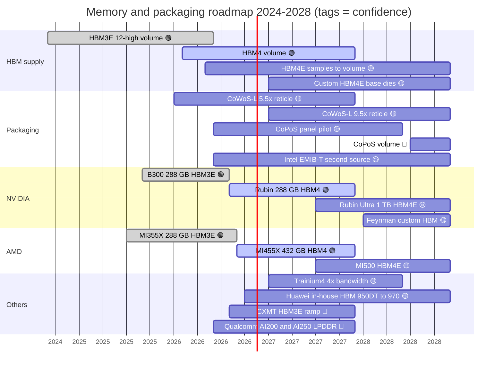

# Memory, packaging and supply chain: Roadmap

Layer 03 · Memory, packaging and supply chain · ~11 min read · Last verified: 2026-11-05

## ⚡ The Executive Take

- **2026 is the [HBM4](../../glossary.md#hbm) year, and it started with a stumble.** Rubin shipped with 288 GB of HBM4 but its listed bandwidth fell from 22 to 19.2 TB/s [[S103]](../../sources/bibliography.md#s103)[[S104]](../../sources/bibliography.md#s104); an analyst ties this to ~9.4 versus ~10.7 Gb/s [pin speeds](../../glossary.md#pin-speed) (🔴 cause) [[S90006]](../../sources/bibliography.md#s90006).
- **2027 brings [HBM4E](../../glossary.md#hbm4e) and custom base dies.** Samsung and SK hynix sampled HBM4E in May–June 2026 [[S3528]](../../sources/bibliography.md#s3528); TrendForce expects HBM4E to be ~40% of the 2027 market [[S3531]](../../sources/bibliography.md#s3531), with [HBM base dies](../../glossary.md#hbm-base-die) moving to logic processes such as TSMC N3P [[S3008]](../../sources/bibliography.md#s3008)[[S3011]](../../sources/bibliography.md#s3011).
- **NVIDIA's announced 2027 jump is Rubin Ultra with 1 TB of HBM4E in 16 stacks** [[S35018]](../../sources/bibliography.md#s35018)[[S110]](../../sources/bibliography.md#s110). 🟡 Reports say it may ship with 768 GB or as a two-die package [[S111]](../../sources/bibliography.md#s111)[[S509]](../../sources/bibliography.md#s509); NVIDIA says its roadmap is intact [[S508]](../../sources/bibliography.md#s508).
- **AMD stays capacity-first.** MI455X (432 GB, 19.6 TB/s) ships in 2026 and MI500 follows in 2027 [[S144]](../../sources/bibliography.md#s144)[[S538]](../../sources/bibliography.md#s538); AWS claims Trainium4 will quadruple Trainium3's memory bandwidth [[S156]](../../sources/bibliography.md#s156).
- **Packaging capacity keeps compounding.** Estimates put [CoWoS](../../glossary.md#cowos) at ~105–130k wafers a month at end-2026, 170–200k in 2027 and ~260k by 2028 [[S90039]](../../sources/bibliography.md#s90039)[[S3510]](../../sources/bibliography.md#s3510)[[S3002]](../../sources/bibliography.md#s3002). 🟡 Panel-level [CoPoS](../../glossary.md#copos) volume is not expected before 2H 2028 [[S3004]](../../sources/bibliography.md#s3004).
- > [!TIP]
> **Worked example — memory-price sensitivity.** Memory is ~$2.0M of a ~$7.8M Vera Rubin rack (Est.) [[S330]](../../sources/bibliography.md#s330). Each +10% on memory adds ~$200K (+2.6%) per rack; a doubling adds ~$2.0M (+26%) that NVIDIA must pass on or absorb (🔴 repo calc).

**[Q7 · Roadmap & what changes the picture]** HBM4E pin speed and yield, Samsung's share, whether CoWoS supply overtakes demand, memory prices and China's domestic HBM decide whether NVIDIA's supply moat widens or erodes.

![Two line charts of memory per accelerator, 2024-2028. Capacity: NVIDIA B200 180 GB, B300 288, Rubin 288, Rubin Ultra 1,024 GB announced for 2027 (a report says 768 GB); AMD MI325X 256, MI355X 288, MI455X 432; Google Trillium 32 and Ironwood 192; AWS Trainium2 96, Trainium3 144, Trainium4 about 288 (estimate); Huawei 910C 128, 950DT 144, 960 and 970 288. Bandwidth: Rubin 19.2 TB/s (launch target 22), MI455X 19.6, Trainium4 about 19.6 (estimate), Ironwood 7.37, Huawei 950DT 4.0 rising to 14.4 in 2028, Rubin Ultra about 32 TB/s.](../../assets/charts/03-memory-roadmap-by-vendor.svg)

## The roadmap at a glance

| Item | Window | Status | Confidence | Source |
|---|---|---|---|---|
| Rubin: 288 GB HBM4, 19.2 TB/s (launch 22) | 2026-Q3 → | shipping | 🟢 | [[S102]](../../sources/bibliography.md#s102)[[S104]](../../sources/bibliography.md#s104) |
| Rubin Ultra: 1 TB HBM4E, 16 stacks, ~32 TB/s | 2H 2027 | roadmap | 🟢 announced / 🟡 768 GB or two-die reports | [[S35018]](../../sources/bibliography.md#s35018)[[S110]](../../sources/bibliography.md#s110)[[S111]](../../sources/bibliography.md#s111)[[S509]](../../sources/bibliography.md#s509) |
| Kyber NVL144 rack for Rubin Ultra | 2H 2027 (slip to 2028 reported) | roadmap | 🟡 | [[S507]](../../sources/bibliography.md#s507)[[S508]](../../sources/bibliography.md#s508) |
| Feynman: custom HBM, stacked dies | 2028 | roadmap | 🟡 | [[S502]](../../sources/bibliography.md#s502)[[S119]](../../sources/bibliography.md#s119) |
| Rubin CPX revived with HBM4 instead of GDDR7 | 1Q 2027 | reported | 🔴 | [[S117]](../../sources/bibliography.md#s117) |
| AMD MI455X 432 GB HBM4; MI500 | 2026; 2027 | shipping; roadmap | 🟢 | [[S144]](../../sources/bibliography.md#s144)[[S538]](../../sources/bibliography.md#s538) |
| Samsung + SK hynix HBM4E samples | May–Jun 2026 | sampling | 🟡 | [[S3528]](../../sources/bibliography.md#s3528) |
| Micron HBM4E with TSMC-made base die | 2027 | roadmap | 🟡 | [[S3007]](../../sources/bibliography.md#s3007) |
| CoWoS ~170–200k wafers/month | end-2027 | projection | 🟡 | [[S3510]](../../sources/bibliography.md#s3510)[[S3001]](../../sources/bibliography.md#s3001) |
| CoPoS panel packaging volume | 2H 2028–2029 (or later) | pilot | 🔴 | [[S3004]](../../sources/bibliography.md#s3004)[[S3508]](../../sources/bibliography.md#s3508) |
| Huawei Ascend 960 / 970 in-house HBM (960: 288 GB; 9.6 / 14.4 TB/s) | 2027 / 2028 | roadmap | 🟡 | [[S163]](../../sources/bibliography.md#s163) |

> [!TIP]
> **Worked example — wafers are not packages.** CoWoS capacity may grow ~2.2× from ~120k (end-2026) to ~260k wafers a month (2028) [[S3002]](../../sources/bibliography.md#s3002). But a 300 mm wafer fits ~11–16 Rubin packages and only ~4–6 four-die Rubin Ultra-class packages (repo estimate) [[S3000]](../../sources/bibliography.md#s3000). If output shifted to Ultra-class packages, 2.2× the wafers would yield roughly the same number of GPUs or fewer (🔴), which is why bigger packages keep packaging tight even as capacity grows.

## HBM4 to HBM4E: where the bandwidth comes from

Per-stack bandwidth is simply *bus width × pin speed*. HBM4 doubled the bus from 1,024 to 2,048 wires (mechanics in [HBM explained](hbm-explained.md)) [[S369]](../../sources/bibliography.md#s369); within a generation, the only lever is how fast each wire toggles, and that is exactly where Rubin fell short.

| Per stack | HBM3E 12-high | HBM4 (JEDEC) | HBM4 in Rubin | HBM4E (2027) |
|---|---|---|---|---|
| Interface | 1,024 bits | 2,048 bits [[S369]](../../sources/bibliography.md#s369) | 2,048 bits | 2,048 bits (assumed) |
| Pin speed | 9.6–9.8 Gb/s [[S373]](../../sources/bibliography.md#s373)[[S372]](../../sources/bibliography.md#s372) | 8 Gb/s [[S369]](../../sources/bibliography.md#s369) | ~9.4 Gb/s implied [[S90006]](../../sources/bibliography.md#s90006) | up to 12.8 Gb/s targeted [[S3009]](../../sources/bibliography.md#s3009) |
| Bandwidth | ~1.2–1.3 TB/s | 2.0 TB/s | ~2.4 TB/s | ~3.3 TB/s (repo calc) |
| Capacity | 36 GB | up to 64 GB [[S369]](../../sources/bibliography.md#s369) | 36 GB | 48–64 GB [[S111]](../../sources/bibliography.md#s111)[[S35041]](../../sources/bibliography.md#s35041) |
| Base die | DRAM process | logic option | — | custom logic, TSMC N3P / N12 or Samsung 4 nm [[S3008]](../../sources/bibliography.md#s3008)[[S3011]](../../sources/bibliography.md#s3011) |

> [!TIP]
> **Worked example — pin speed explains the Rubin revision.** Rubin has eight HBM4 stacks of 2,048 bits [[S360]](../../sources/bibliography.md#s360). At 8 Gb/s (JEDEC): 8 × 2,048 × 8 ÷ 8 = 16.4 TB/s. At ~9.4 Gb/s: 19.2 TB/s, the revised figure. At ~10.7 Gb/s: ~21.9 TB/s, the 22 TB/s launch target [[S103]](../../sources/bibliography.md#s103)[[S90006]](../../sources/bibliography.md#s90006). NVIDIA asked suppliers for >10–11 Gb/s [[S90041]](../../sources/bibliography.md#s90041); volume parts reportedly landed lower. Rubin Ultra's ~32 TB/s from 16 stacks needs only ~7.8 Gb/s per pin (repo calc), a safer bet that relies on stack count rather than speed.

> [!TIP]
> **Worked example — the memory bill for 1 TB.** At Bernstein's forecast of ~$53/GB for HBM4 in 2027 [[S333]](../../sources/bibliography.md#s333), Rubin Ultra's 1 TB would cost ~$54K of HBM per GPU, versus ~$15K for Rubin's 288 GB at the same price (🔴 repo calc). The 768 GB option would save ~$14K per GPU, one plausible reason behind the reports. TrendForce expects blended HBM prices to rise 121% in 2027 [[S3520]](../../sources/bibliography.md#s3520).

🔧 Under the hood: why panel packaging and custom base dies matter

A 300 mm round wafer fits fewer large rectangular interposers as packages grow toward 9.5× reticle; square panels waste less area, which is why TSMC is piloting CoPoS (see [CoWoS and advanced packaging](cowos-and-advanced-packaging.md)) [[S3004]](../../sources/bibliography.md#s3004). Separately, a logic-process HBM base die lets buyers put their own controllers or simple compute under the DRAM stack: a design lever beyond buying NVIDIA's stacks.

## What would change the picture

- **HBM4E speed and yield.** Another miss like Rubin's would hand AMD a second bandwidth story; a clean ramp restores NVIDIA's lead with Rubin Ultra.
- **Samsung's share.** Forecasts put it near 40% by Q4 2026 [[S3501]](../../sources/bibliography.md#s3501); if that capacity tilts to AMD [[S3512]](../../sources/bibliography.md#s3512), NVIDIA's multi-sourcing advantage shrinks.
- **CoWoS supply overtaking demand.** The shortfall is seen narrowing from ~20% to ~10% by end-2026 [[S3505]](../../sources/bibliography.md#s3505); KGI sees NVIDIA and Broadcom each gaining ~100k wafers in 2027 [[S3001]](../../sources/bibliography.md#s3001). Abundant packaging erodes allocation as a moat.
- **Memory prices.** Memory is already ~26% of a Vera Rubin rack's cost (Est.) [[S330]](../../sources/bibliography.md#s330); further HBM inflation squeezes either NVIDIA's margin or customers' budgets.
- **China.** CXMT plans to ramp HBM3E in 2027 [[S3516]](../../sources/bibliography.md#s3516); Huawei targets 14.4 TB/s by 2028 [[S163]](../../sources/bibliography.md#s163).

**[Q7 · Roadmap & what changes the picture]** NVIDIA's roadmap regains the capacity lead in 2027 only if 1 TB Rubin Ultra ships as announced; the bigger swing factor is whether packaging and HBM supply stop being scarce.

## 🎯 Corp Dev Lens

1. Custom HBM base dies open a new design surface: could a challenger differentiate on memory-side logic rather than on stack count?
2. If CoWoS capacity roughly doubles by 2028 [[S3002]](../../sources/bibliography.md#s3002), how much of today's supply advantage is temporary?
3. Do HBM4E delays favour designs that rely on more stacks at lower pin speed (AMD's 12 stacks, Rubin Ultra's 16)?
4. Which packaging alternatives (Intel [EMIB-T](../../glossary.md#emib), CoPoS, [OSAT](../../glossary.md#osat) capacity) would a second-tier buyer need to reserve now for 2028?

## 📚 Sources

<!-- Auto-generated from the [S…] citations on this page by `make build`. Edit sources/registry/*.csv, not this list. -->

- [**S102**](../../sources/bibliography.md#s102) NVIDIA, *NVIDIA DGX Vera Rubin NVL72*, 2026. [Link](https://www.nvidia.com/en-us/data-center/dgx-vera-rubin-nvl72/)
- [**S103**](../../sources/bibliography.md#s103) VideoCardz, *NVIDIA quietly cuts Vera Rubin specs, HBM4 bandwidth and NVLink 6 speeds now lower*, 2026-10. [Link](https://videocardz.com/newz/nvidia-quietly-cuts-vera-rubin-specs-hbm4-bandwidth-and-nvlink-6-speeds-now-lower)
- [**S104**](../../sources/bibliography.md#s104) Wccftech, *NVIDIA's Official Statement on Vera Rubin Spec Change*, 2026-10-29. [Link](https://wccftech.com/nvidia-official-statement-on-vera-rubin-spec-change/)
- [**S110**](../../sources/bibliography.md#s110) Tom's Hardware, *Nvidia demonstrates Rubin Ultra tray, the world's first AI GPU with 1TB of HBM4E memory*, 2026-03. [Link](https://www.tomshardware.com/pc-components/gpus/nvidia-demonstrates-rubin-ultra-tray-worlds-1st-ai-gpu-with-1tb-of-hbm4e)
- [**S111**](../../sources/bibliography.md#s111) Crypto Briefing, *Nvidia's Rubin Ultra targets 768GB of HBM4E as Kyber platform stays on schedule*, 2026. [Link](https://cryptobriefing.com/nvidia-rubin-ultra-hbm4e-kyber-2027/)
- [**S117**](../../sources/bibliography.md#s117) TechNews (Taiwan), *Nvidia Rubin CPX re-enters roadmap with HBM4 for AI prefill*, 2026-09-02. [Link](https://technews.tw/2026/09/02/nvidia-rubin-cpx-reenters-roadmap-hbm4-ai-prefill/)
- [**S119**](../../sources/bibliography.md#s119) XenoSpectrum, *NVIDIA's Feynman May Combine TSMC A16 and N3P, Reports Say*, 2026. [Link](https://xenospectrum.com/en/nvidia-feynman-tsmc-a16-report/)
- [**S144**](../../sources/bibliography.md#s144) AMD Newsroom, *AMD Unveils Vision for an Open AI Ecosystem, Detailing New Silicon, Software and Systems at Advancing AI 2025*, 2025-06-12. [Link](https://www.amd.com/en/newsroom/press-releases/2025-6-12-amd-unveils-vision-for-an-open-ai-ecosystem-detai.html)
- [**S156**](../../sources/bibliography.md#s156) About Amazon, *AWS re:Invent 2025: top announcements (Trainium3 GA, Trainium4 preview, Graviton5)*, 2025-12-02. [Link](https://www.aboutamazon.com/news/aws/aws-re-invent-2025-ai-news-updates)
- [**S163**](../../sources/bibliography.md#s163) Huawei (Eric Xu), *Huawei Connect 2025 keynote: Ascend roadmap and SuperPoD interconnect (Eric Xu)*, 2025-09-18. [Link](https://www.huawei.com/en/news/2025/9/hc-xu-keynote-speech)
- [**S330**](../../sources/bibliography.md#s330) PC Gamer, *A single Nvidia Vera Rubin rack is estimated to cost $7,803,148 with over $2 million of that figure spent on memory alone*, 2026-05. [Link](https://pcgamer.com/hardware/a-single-nvidia-vera-rubin-rack-is-estimated-to-cost-usd7-803-148-with-over-usd2-million-of-that-figure-spent-on-memory-alone)
- [**S333**](../../sources/bibliography.md#s333) Wccftech, *Bernstein warns NVIDIA's Vera Rubin racks will hit $9.1 million as HBM4 prices triple to $53 per gigabyte*, 2026-07. [Link](https://wccftech.com/bernstein-warns-nvidias-vera-rubin-racks-will-hit-9-1-million-as-hbm4-prices-triple-to-53-per-gigabyte/)
- [**S360**](../../sources/bibliography.md#s360) glennklockwood.com (Glenn K. Lockwood), *NVIDIA Rubin (R200) processor notes*, 2026. [Link](https://glennklockwood.com/garden/processors/r200)
- [**S369**](../../sources/bibliography.md#s369) JEDEC, *JESD270-4: High Bandwidth Memory (HBM4) standard*, 2025-04-16. [Link](https://www.jedec.org/standards-documents/docs/jesd270-4)
- [**S372**](../../sources/bibliography.md#s372) Samsung Electronics, *Samsung develops industry-first 36GB HBM3E 12H DRAM*, 2024-02-27. [Link](https://news.samsung.com/global/samsung-develops-industry-first-36gb-hbm3e-12h-dram)
- [**S373**](../../sources/bibliography.md#s373) SK hynix Newsroom, *SK hynix begins industry's first mass production of 12-layer HBM3E*, 2024-09-26. [Link](https://news.skhynix.com/sk-hynix-begins-industrys-first-mass-production-of-12-layer-hbm3e/)
- [**S502**](../../sources/bibliography.md#s502) Tom's Hardware, *Nvidia updates data center roadmap with Rosa CPU and stacked Feynman GPUs; optical NVLink; Groq LPUs with NVFP4 and NVLink also on deck*, 2026-03-17. [Link](https://www.tomshardware.com/pc-components/gpus/nvidia-updates-data-center-roadmap-with-rosa-cpu-and-stacked-feynman-gpus-optical-nvlink-groq-lpus-with-nvfp4-and-nvlink-also-on-deck)
- [**S507**](../../sources/bibliography.md#s507) Tom's Hardware, *Nvidia's Kyber rack for Rubin Ultra slips to 2028*, 2026-07-06. [Link](https://www.tomshardware.com/pc-components/gpus/nvidias-kyber-rack-for-rubin-ultra-slips-to-2028)
- [**S508**](../../sources/bibliography.md#s508) Wccftech, *NVIDIA Quashes Rubin & Kyber Rack Delay Rumors, Says 'Chip Roadmap Is Intact'*, 2026-07. [Link](https://wccftech.com/nvidia-quashes-rubin-kyber-rack-delay-rumors-says-chip-roadmap-is-intact/)
- [**S509**](../../sources/bibliography.md#s509) TrendForce, *NVIDIA Rubin Ultra four-die single-package design not adopted amid advanced-packaging constraints*, 2026-04-01. [Link](https://www.trendforce.com/news/?p=55442)
- [**S538**](../../sources/bibliography.md#s538) AMD Investor Relations, *AAI 2026: AMD Delivers Full-Stack Compute for the Agentic AI Era*, 2026-07-23. [Link](https://ir.amd.com/news-events/press-releases/detail/1294/aai-2026-amd-delivers-full-stack-compute-for-the-agentic-ai-era)
- [**S3000**](../../sources/bibliography.md#s3000) nvidia_deep_dive_claude repository, *Repo analysis: layer 03 memory, packaging and supply-chain models (decode ceilings, HBM sizing, CoWoS packages per wafer)*, 2026-11-05. [Link](https://github.com/FrankHuang94/nvidia_deep_dive_claude/blob/main/layers/03-memory-packaging-supply-chain/index.md)
- [**S3001**](../../sources/bibliography.md#s3001) KGI Securities, *TSMC (2330 TT) research note: CoWoS expansion forecast raised*, 2026-03-09. [Link](https://www.kgi.com.hk/en/-/media/files/kgishk/research-reports/tw-reports/tsmc_2330-tt_09032026e.pdf)
- [**S3002**](../../sources/bibliography.md#s3002) TrendForce, *TSMC reportedly targets 22% 2nm, 16% 3nm capacity boost by mid-2027; CoWoS to double by 2028*, 2026-09-14. [Link](https://www.trendforce.com/news/2026/09/14/news-tsmc-reportedly-targets-22-2nm-16-3nm-capacity-boost-by-mid-2027-cowos-to-double-by-2028/)
- [**S3004**](../../sources/bibliography.md#s3004) TrendForce, *TSMC advances panel-level packaging: CoPoS pilot line reportedly set for June completion; 2028-29 ramp eyed*, 2026-04-13. [Link](https://www.trendforce.com/news/2026/04/13/news-tsmc-advances-panel-level-packaging-copos-pilot-line-reportedly-set-for-june-completion-2028-29-ramp-eyed/)
- [**S3007**](../../sources/bibliography.md#s3007) Tom's Hardware, *Micron teams up with TSMC to deliver HBM4E, targeted for 2027*, 2025-09. [Link](https://www.tomshardware.com/micron-hands-tsmc-the-keys-to-hbm4e)
- [**S3008**](../../sources/bibliography.md#s3008) TrendForce, *TSMC unveils custom C-HBM4E details: N3P logic dies reportedly target 2x efficiency gain*, 2025-12-01. [Link](https://www.trendforce.com/news/2025/12/01/news-tsmc-unveils-custom-c-hbm4e-details-n3p-logic-dies-reportedly-target-2x-efficiency-gain/)
- [**S3009**](../../sources/bibliography.md#s3009) Tom's Hardware, *HBM undergoes major architectural shakeup as TSMC and GUC detail HBM4, HBM4E and C-HBM4E 3nm base dies, up to 12.8 GT/s by 2027*, 2025. [Link](https://www.tomshardware.com/pc-components/dram/hbm-undergoes-major-architectural-shakeup-as-tsmc-and-guc-detail-hbm4-hbm4e-and-c-hbm4e-3nm-base-dies-to-enable-2-5x-performance-boost-with-speeds-of-up-to-12-8gt-s-by-2027)
- [**S3011**](../../sources/bibliography.md#s3011) TrendForce, *Samsung's custom HBM4E design reportedly aimed for mid-2026, parallels SK hynix and Micron*, 2026-01-23. [Link](https://www.trendforce.com/news/2026/01/23/news-samsungs-custom-hbm4e-design-reportedly-aimed-for-mid-2026-parallels-sk-hynix-and-micron/)
- [**S3501**](../../sources/bibliography.md#s3501) Edaily, *SK hynix keeps HBM lead at 50% in Q2 as Samsung jumps to 33% (Counterpoint)*, 2026-09-03. [Link](https://en.edaily.co.kr/news/eda202609035608/)
- [**S3505**](../../sources/bibliography.md#s3505) TrendForce, *TSMC CoWoS supply-demand gap reportedly seen narrowing from 20% to 10% by end-2026 as capacity expands*, 2026-06-15. [Link](https://www.trendforce.com/news/2026/06/15/news-tsmc-cowos-supply-demand-gap-reportedly-seen-narrowing-from-20-to-10-by-end-2026-as-capacity-expands)
- [**S3508**](../../sources/bibliography.md#s3508) Tiger Brokers (iTiger), *TSMC's advanced packaging timeline shifts: CoWoS gains extended lifespan, next-gen CoPoS delayed until late 2030*, 2026. [Link](https://www.itiger.com/news/1179706576)
- [**S3510**](../../sources/bibliography.md#s3510) AI Weekly, *TSMC mulls up to 20% CoWoS hike and 2027 wafer price rise*, 2026. [Link](https://aiweekly.co/alerts/tsmc-mulls-up-to-20-cowos-hike-and-2027-wafer-price-rise)
- [**S3512**](../../sources/bibliography.md#s3512) Asia Economy (Asiae), *Samsung Electronics to prioritize HBM4 supply for AMD AI accelerators*, 2026-03-18. [Link](https://view.asiae.co.kr/en/article/2026031817142143855)
- [**S3516**](../../sources/bibliography.md#s3516) Korea JoongAng Daily, *China's CXMT begins HBM3E production as chip battle with Korean powerhouses widens*, 2026-08. [Link](https://www.koreajoongangdaily.com/business/chinas-cxmt-begins-hbm3e-production-as-chip-battle-with-korean-powerhouses-widens/12854260)
- [**S3520**](../../sources/bibliography.md#s3520) Silicon Analysts, *TrendForce: 2027 HBM blended ASP to jump 121% as HBM4/HBM4E mix shifts*, 2026-10-06. [Link](https://siliconanalysts.com/market/trendforce-2027-hbm-blended-asp-to-jump-121-as-hbm4-hbm4e-mix-shifts-2026-10-06)
- [**S3528**](../../sources/bibliography.md#s3528) TrendForce, *SK hynix reportedly pulls forward HBM4E sample timeline, eyeing June-July shipments to key customers*, 2026-06-15. [Link](https://www.trendforce.com/news/2026/06/15/news-sk-hynix-reportedly-pulls-forward-hbm4e-sample-timeline-eyeing-june-july-shipments-to-key-customers/)
- [**S3531**](../../sources/bibliography.md#s3531) TrendForce, *HBM4E seen hitting 40% of 2027 market; Samsung, SK hynix reportedly aim for 1H26 completion*, 2025-11-13. [Link](https://www.trendforce.com/news/2025/11/13/news-hbm4e-seen-hitting-40-of-2027-market-samsung-sk-hynix-reportedly-aim-for-1h26-completion/)
- [**S35018**](../../sources/bibliography.md#s35018) Tom's Hardware, *Nvidia announces Rubin GPUs in 2026, Rubin Ultra in 2027, Feynman also added to roadmap*, 2025-03-18. [Link](https://www.tomshardware.com/pc-components/gpus/nvidia-announces-rubin-gpus-in-2026-rubin-ultra-in-2027-feynam-after)
- [**S35041**](../../sources/bibliography.md#s35041) Glenn K. Lockwood (Glenn K. Lockwood), *Rubin Ultra (R300) notes*, 2026. [Link](https://glennklockwood.com/garden/processors/R300)
- [**S90006**](../../sources/bibliography.md#s90006) TweakTown, *Nvidia cuts Vera Rubin's memory bandwidth by up to 26% and AMD's Helios now leads in memory bandwidth*, 2026-10. [Link](https://www.tweaktown.com/news/114304/nvidia-cuts-vera-rubins-memory-bandwidth-by-up-to-26-percent-and-amds-helios-now-leads-in-memory-bandwidth/index.html)
- [**S90039**](../../sources/bibliography.md#s90039) TrendForce, *Samsung, SK hynix reportedly tapped as NVIDIA Rubin HBM4 suppliers; shipments could start in March*, 2026-03-09. [Link](https://www.trendforce.com/news/2026/03/09/news-samsung-sk%E2%80%AFhynix-reportedly-tapped-as-nvidia-rubin-hbm4-suppliers-shipments-could-start-in-march/)
- [**S90041**](../../sources/bibliography.md#s90041) I-Connect007 (TrendForce), *NVIDIA seeks to raise HBM4 specs in response to AMD competition; SK hynix expected to remain largest supplier in 2026*, 2025-09. [Link](https://iconnect007.com/article/146969/nvidia-seeks-to-raise-hbm4-specs-in-response-to-amd-competition-sk-hynix-expected-to-remain-largest-supplier-in-2026/146966/aep)
