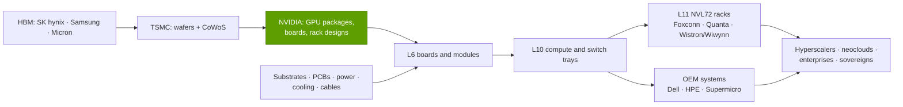
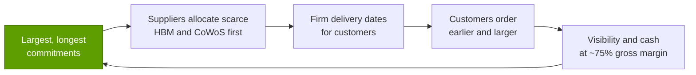

# Supply chain as a weapon

Layer 03 · Memory, packaging and supply chain · ~8 min read · Last verified: 2026-11-05

## ⚡ The Executive Take

- **NVIDIA buys the bottleneck in advance.** Supply and capacity commitments ([purchase obligations](../../glossary.md#purchase-obligations)) were $279B at Q2 FY2027, up from $119B a quarter earlier, mostly memory and manufacturing capacity [[S407]](../../sources/bibliography.md#s407)[[S404]](../../sources/bibliography.md#s404).
- **The scale is new.** They were $4.9B at the end of FY2023 and $95.2B at the end of FY2026 [[S419]](../../sources/bibliography.md#s419)[[S401]](../../sources/bibliography.md#s401); now ~2.9× quarterly revenue of $96.2B [[S405]](../../sources/bibliography.md#s405). The 10-Q also lists $29B of cloud service agreements and $36B of AI-cloud capacity backstops [[S407]](../../sources/bibliography.md#s407).
- **A long chain turns chips into racks.** [ODMs](../../glossary.md#odm) (Foxconn, Quanta, Wistron) build boards, trays and racks ([L6/L10/L11](../../glossary.md#l6-l10-l11)); [OEMs](../../glossary.md#oem) (Dell, HPE, Supermicro) sell branded systems. 🟡 Foxconn says it holds ~40% of the AI server market [[S3014]](../../sources/bibliography.md#s3014).
- **In a shortage, allocation compounds.** 🟡 NVIDIA reportedly holds more than half of TSMC's 2026 CoWoS [[S379]](../../sources/bibliography.md#s379)[[S3003]](../../sources/bibliography.md#s3003) and SK hynix's largest HBM allocation [[S90041]](../../sources/bibliography.md#s90041); the CFO called FY2028 "supply-constrained" [[S90012]](../../sources/bibliography.md#s90012).
- **🐻 The lever cuts both ways.** In 2022 NVIDIA took ~$1.34B of inventory charges in one quarter [[S433]](../../sources/bibliography.md#s433); the 2025 H20 ban cost $4.5B in inventory and obligation charges [[S414]](../../sources/bibliography.md#s414).

## Commitments and prepayments: buying capacity before it exists

**Mechanism.** HBM lines, CoWoS tools and substrate plants take one to two years to build, and suppliers build only against firm demand. NVIDIA supplies it as non-cancellable commitments, sometimes with cash up front ([prepayments](../../glossary.md#prepayment)). The supplier gets a guaranteed return; NVIDIA gets first claim on output. **Analogy:** booking every good hotel in town for an event two years out, with deposits.

> [!TIP]
> **Worked example — how big is $279B?** $96.2B of quarterly revenue at ~75% gross margin implies ~$24B of quarterly cost of revenue [[S405]](../../sources/bibliography.md#s405), so $279B equals ~11.6 quarters, ~2.9 years, of current cost of goods (🔴 repo arithmetic) [[S407]](../../sources/bibliography.md#s407). In mid-2022, $9.2B of obligations was ~1.4× quarterly revenue of $6.7B [[S420]](../../sources/bibliography.md#s420)[[S433]](../../sources/bibliography.md#s433). **Business reading:** NVIDIA has locked in roughly three years of inputs, a moat while demand holds and a fixed liability if not.

Prepaid supply agreements were $3.1–3.5B through FY2023 [[S420]](../../sources/bibliography.md#s420)[[S419]](../../sources/bibliography.md#s419); the current balance is not in this repo's data. Memory makers sign long-term deals with others too (🟡 Micron reportedly ~$22B in 2026) [[S3018]](../../sources/bibliography.md#s3018); NVIDIA is simply the largest.

🔧 Under the hood: what is inside "commitments", and how losses appear

The line covers inventory purchase obligations and long-term capacity reservations, relabelled "manufacturing, supply and capacity commitments" from Q3 FY2026 [[S412]](../../sources/bibliography.md#s412); cloud agreements are disclosed separately [[S407]](../../sources/bibliography.md#s407). If demand falls short, NVIDIA books charges, such as ~$348M for excess obligations in Q3 FY2023 [[S421]](../../sources/bibliography.md#s421) and $4.5B for H20 in Q1 FY2026 [[S414]](../../sources/bibliography.md#s414). Commitments nearly tripled from $95B in six months, a jump bears flagged [[S431]](../../sources/bibliography.md#s431), while inventory rose to $31.6B [[S407]](../../sources/bibliography.md#s407).

## Who builds the box: the ODM and OEM chain

Integration depth is labelled by level: **L6** a populated board, **L10** a tested server or tray, **L11** a full rack with networking, power and cooling validated as one unit.

| Company | Main role | What to know |
|---|---|---|
| Foxconn (Hon Hai) | L6 to L11: modules, trays, NVL72 racks | 🟡 ~40% AI server share; rack shipments could double in 2026 [[S3014]](../../sources/bibliography.md#s3014) |
| Quanta | L10–L11 hyperscaler racks | 🟡 Initial Rubin deliveries by August 2026 [[S90010]](../../sources/bibliography.md#s90010) |
| Wistron / Wiwynn | Boards and trays; hyperscaler racks incl. custom-ASIC programs | Exposure spans NVIDIA and in-house chips |
| Supermicro, Dell, HPE | OEM systems, services, financing | Neocloud, enterprise and sovereign channels |
| Celestica | Hyperscaler racks and switches | 🟡 First in AI back-end switch sales, 1Q 2026 [[S90054]](../../sources/bibliography.md#s90054) |

> [!TIP]
> **Worked example — who earns what on a rack.** Of ~$4.8M for a GB300 NVL72 plus network, NVIDIA's GPU gross profit is ~$2.27M (~47%), HBM makers ~$0.31M, TSMC ~$0.23M and the ODM ~$0.11M (~2%) (Est.) [[S332]](../../sources/bibliography.md#s332)[[S331]](../../sources/bibliography.md#s331)[[S35020]](../../sources/bibliography.md#s35020). **Business reading:** ODMs are low-margin integrators, but capacity to build ~100 kW+ liquid-cooled racks is itself scarce.

**Lead times.** 🟡 TSMC's 2026 CoWoS is fully booked [[S90039]](../../sources/bibliography.md#s90039) with a ~20% gap [[S3003]](../../sources/bibliography.md#s3003); Rubin volume ramps through H1 2027 [[S90009]](../../sources/bibliography.md#s90009)[[S500]](../../sources/bibliography.md#s500). Late buyers wait or take the prior generation.

## Why allocation in a shortage reinforces NVIDIA's position

A supplier in shortage serves the buyer that is largest, most certain, prepaid and committed to future generations. Each round makes NVIDIA's delivery dates more credible, pulling in orders and cash for the next round.

> [!TIP]
> **Worked example — who absorbs a 20% shortfall?** 🔴 Stylized: ~1.0M wafers of 2026 demand, NVIDIA ~595k [[S379]](../../sources/bibliography.md#s379), ~20% short [[S3003]](../../sources/bibliography.md#s3003), so ~800k available. If NVIDIA is served in full, everyone else shares ~205k against ~405k of demand: a ~51% fill rate versus NVIDIA's 100%. **Business reading:** a shortage widens share gaps, not just lead times.

> [!NOTE]
> **🐂 Bull view:** Few rivals can pledge ~$279B or prepay at that scale for first claim on HBM4 and CoWoS-L, and an annual cadence ties supplier roadmaps to NVIDIA's.

> [!WARNING]
> **🐻 Bear view:** Commitments are fixed; demand is not. A capex pause, an export shock or a faster shift to ASICs would leave NVIDIA holding obligations, and memory is ~26% of a Vera Rubin rack's cost (Est.) [[S330]](../../sources/bibliography.md#s330)[[S332]](../../sources/bibliography.md#s332). CoWoS doubling by 2028 [[S3002]](../../sources/bibliography.md#s3002) will erode allocation as a weapon.

## 🎯 Corp Dev Lens

1. **Allocation cannot be bought quickly.** A challenger needs prepayments, multi-year volume and co-engineering. Could a consortium or anchor-customer structure substitute?
2. **ODMs are the swing capacity.** Foxconn's ~40% share [[S3014]](../../sources/bibliography.md#s3014) makes it a gatekeeper for any new accelerator's time to market; a second-tier ODM partnership may be the realistic path.
3. **Read the 10-Q, not the press release.** Commitments, prepayments, cloud backstops ($36B) [[S407]](../../sources/bibliography.md#s407) and inventory lead both supply strength and downside risk. When CoWoS and HBM catch up [[S3002]](../../sources/bibliography.md#s3002)[[S3017]](../../sources/bibliography.md#s3017), allocation stops being a moat and commitments become a cost.

## 📚 Sources

<!-- Auto-generated from the [S…] citations on this page by `make build`. Edit sources/registry/*.csv, not this list. -->

- [**S330**](../../sources/bibliography.md#s330) PC Gamer, *A single Nvidia Vera Rubin rack is estimated to cost $7,803,148 with over $2 million of that figure spent on memory alone*, 2026-05. [Link](https://pcgamer.com/hardware/a-single-nvidia-vera-rubin-rack-is-estimated-to-cost-usd7-803-148-with-over-usd2-million-of-that-figure-spent-on-memory-alone)
- [**S331**](../../sources/bibliography.md#s331) Wccftech, *NVIDIA's Vera Rubin rack hit with 435% memory price surge, pushing HBM4 & LPDDR5X bill to $2M of $7.8M total*, 2026-05. [Link](https://wccftech.com/nvidia-vera-rubin-rack-hit-with-memory-price-surge-pushing-hbm4-lpddr5x-bill-to-2m-of-7-8m-total/)
- [**S332**](../../sources/bibliography.md#s332) Tiger Brokers (iTiger), *Morgan Stanley's BOM analysis of NVIDIA's Rubin: GPU share declines; PCB, MLCC and ABF substrate values soar*, 2026-05-20. [Link](https://www.itiger.com/news/1188068712)
- [**S379**](../../sources/bibliography.md#s379) TrendForce News, *TSMC CoWoS capacity and customer allocation estimates (TrendForce / Morgan Stanley, as reported)*, 2025. [Link](https://www.trendforce.com/news/)
- [**S401**](../../sources/bibliography.md#s401) NVIDIA Corporation via SEC EDGAR, *NVIDIA Corporation Form 10-K for fiscal year ended January 25, 2026*, 2026-02-25. [Link](https://www.sec.gov/Archives/edgar/data/1045810/000104581026000021/nvda-20260125.htm)
- [**S404**](../../sources/bibliography.md#s404) NVIDIA Corporation via SEC EDGAR, *NVIDIA Corporation Form 10-Q for quarter ended April 26, 2026*, 2026-05-27. [Link](https://www.sec.gov/Archives/edgar/data/1045810/000104581026000052/nvda-20260426.htm)
- [**S405**](../../sources/bibliography.md#s405) NVIDIA Corporation via SEC EDGAR, *NVIDIA Announces Financial Results for Second Quarter Fiscal 2027 (Form 8-K exhibit 99.1)*, 2026-08-26. [Link](https://www.sec.gov/Archives/edgar/data/0001045810/000104581026000073/q2fy27pr.htm)
- [**S407**](../../sources/bibliography.md#s407) NVIDIA Corporation via SEC EDGAR, *NVIDIA Corporation Form 10-Q for quarter ended July 26, 2026*, 2026-08-28. [Link](https://www.sec.gov/Archives/edgar/data/1045810/000104581026000075/nvda-20260726.htm)
- [**S412**](../../sources/bibliography.md#s412) NVIDIA Corporation via SEC EDGAR, *NVIDIA Corporation Form 10-Q for quarter ended October 26, 2025*, 2025-11-19. [Link](https://www.sec.gov/Archives/edgar/data/1045810/000104581025000230/nvda-20251026.htm)
- [**S414**](../../sources/bibliography.md#s414) NVIDIA Corporation via SEC EDGAR, *NVIDIA Corporation Form 10-Q for quarter ended April 27, 2025*, 2025-05-28. [Link](https://www.sec.gov/Archives/edgar/data/1045810/000104581025000116/nvda-20250427.htm)
- [**S419**](../../sources/bibliography.md#s419) NVIDIA Corporation via SEC EDGAR (Colette Kress), *CFO Commentary on Fourth Quarter and Fiscal 2023 Results (Form 8-K exhibit 99.2)*, 2023-02-22. [Link](https://sec.gov/Archives/edgar/data/1045810/000104581023000014/q4fy23cfocommentary.htm)
- [**S420**](../../sources/bibliography.md#s420) NVIDIA Corporation (via CapEdge mirror of Form 8-K) (Colette Kress), *CFO Commentary on Second Quarter Fiscal 2023 Results*, 2022-08-24. [Link](https://capedge.com/filing/1045810/0001045810-22-000136/NVDA-8K/file/3)
- [**S421**](../../sources/bibliography.md#s421) NVIDIA Corporation (via CapEdge mirror of Form 8-K) (Colette Kress), *CFO Commentary on Third Quarter Fiscal 2023 Results*, 2022-11-16. [Link](https://capedge.com/filing/1045810/0001045810-22-000163/NVDA-8K/file/3)
- [**S431**](../../sources/bibliography.md#s431) Barchart, *Michael Burry called Nvidia's $95 billion in purchase obligations 'troubling' in February; six months later the filings show $279 billion*, 2026-09. [Link](https://www.barchart.com/story/news/4406785/michael-burry-called-nvidias-95-billion-in-purchase-obligations-troubling-in-february-six-months-later-the-filings-show-that-number-ballooned-to-279-billion)
- [**S433**](../../sources/bibliography.md#s433) NVIDIA Corporation, *NVIDIA Announces Financial Results for Second Quarter Fiscal 2023 (press release with CFO commentary)*, 2022-08-24. [Link](https://nvidianews.nvidia.com/news/nvidia-announces-financial-results-for-second-quarter-fiscal-2023)
- [**S500**](../../sources/bibliography.md#s500) NVIDIA Corporation, *NVIDIA Q2 Fiscal 2027 Quarterly Presentation (CFO commentary deck)*, 2026-08-26. [Link](https://s201.q4cdn.com/141608511/files/doc_financials/2027/Q227/NVDA-F2Q27-Quarterly-Presentation-final-1.pdf)
- [**S3002**](../../sources/bibliography.md#s3002) TrendForce, *TSMC reportedly targets 22% 2nm, 16% 3nm capacity boost by mid-2027; CoWoS to double by 2028*, 2026-09-14. [Link](https://www.trendforce.com/news/2026/09/14/news-tsmc-reportedly-targets-22-2nm-16-3nm-capacity-boost-by-mid-2027-cowos-to-double-by-2028/)
- [**S3003**](../../sources/bibliography.md#s3003) TrendForce, *TSMC reportedly expands outsourcing of key CoWoS front-end step to OSATs amid rising NVIDIA and ASIC demand*, 2026-08-05. [Link](https://www.trendforce.com/news/2026/08/05/news-tsmc-reportedly-expands-outsourcing-of-key-cowos-front-end-step-to-osats-amid-rising-nvidia-asic-demand/)
- [**S3014**](../../sources/bibliography.md#s3014) Focus Taiwan (CNA), *Foxconn expects AI server rack shipments to double in 2026*, 2026-03-16. [Link](https://focustaiwan.tw/business/202603160022)
- [**S3017**](../../sources/bibliography.md#s3017) TrendForce, *Micron reportedly to add 60K HBM wafers/month, reaching 100K by year-end to narrow gap with Samsung, SK hynix*, 2026-09-04. [Link](https://www.trendforce.com/news/2026/09/04/news-micron-reportedly-to-add-60k-hbm-wafersm-reaching-100k-by-year-end-to-narrow-gap-with-samsung-sk-hynix/)
- [**S3018**](../../sources/bibliography.md#s3018) The Express Tribune, *Micron secures $22B in long-term chip deals*, 2026-08-06. [Link](https://tribune.com.pk/story/2615188/micron-secures-22b-in-long-term-chip-deals)
- [**S35020**](../../sources/bibliography.md#s35020) Epoch AI, *NVIDIA's B200 costs around $6,400 to produce, with memory accounting for half*, 2025-12. [Link](https://epoch.ai/data-insights/b200-cost-breakdown)
- [**S90009**](../../sources/bibliography.md#s90009) GamesBeat, *Nvidia Vera Rubin ramps into full production for fall launch*, 2026. [Link](https://gamesbeat.com/nvidia-vera-rubin-ramps-into-full-production-for-fall-launch-again/)
- [**S90010**](../../sources/bibliography.md#s90010) Wccftech, *Nvidia Rubin AI servers to ship to customers by August this year*, 2026. [Link](https://wccftech.com/nvidia-rubin-ai-servers-to-ship-to-customers-by-august-this-year)
- [**S90012**](../../sources/bibliography.md#s90012) Tomasz Tunguz (Tomasz Tunguz), *Nvidia Q2 FY27 earnings*, 2026-08. [Link](https://www.tomtunguz.com/nvidia-q2-fy27-earnings/index.md)
- [**S90039**](../../sources/bibliography.md#s90039) TrendForce, *Samsung, SK hynix reportedly tapped as NVIDIA Rubin HBM4 suppliers; shipments could start in March*, 2026-03-09. [Link](https://www.trendforce.com/news/2026/03/09/news-samsung-sk%E2%80%AFhynix-reportedly-tapped-as-nvidia-rubin-hbm4-suppliers-shipments-could-start-in-march/)
- [**S90041**](../../sources/bibliography.md#s90041) I-Connect007 (TrendForce), *NVIDIA seeks to raise HBM4 specs in response to AMD competition; SK hynix expected to remain largest supplier in 2026*, 2025-09. [Link](https://iconnect007.com/article/146969/nvidia-seeks-to-raise-hbm4-specs-in-response-to-amd-competition-sk-hynix-expected-to-remain-largest-supplier-in-2026/146966/aep)
- [**S90054**](../../sources/bibliography.md#s90054) Dell'Oro Group, *Ethernet extends lead in AI scale-out networks despite strong InfiniBand rebound*, 2026. [Link](https://www.delloro.com/news/ethernet-extends-lead-in-ai-scale-out-networks-despite-strong-infiniband-rebound/)
