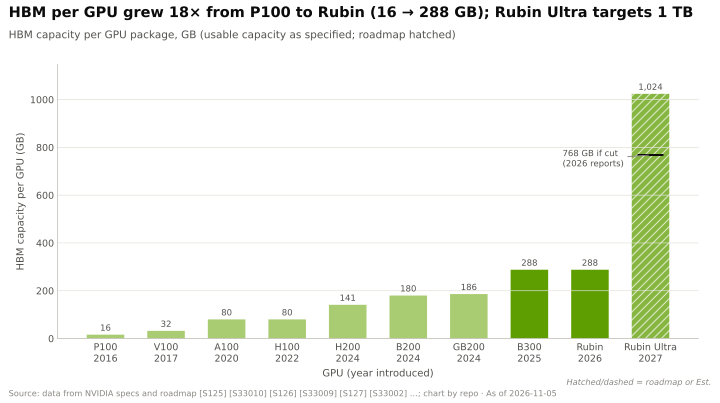

# The memory wall

Layer 03 · Memory, packaging and supply chain · ~9 min read · Last verified: 2026-11-05

## ⚡ The Executive Take

- **Generating text is a memory job.** In [decode](../../glossary.md#decode), every new [token](../../glossary.md#token) re-reads every weight. A 70B [FP8](../../glossary.md#fp8) model moves ~70 GB per token at batch 1, capping one stream at ~48 tokens/s on H100 (3.35 TB/s) and ~274 on Rubin (19.2 TB/s) [[S33002]](../../sources/bibliography.md#s33002)[[S33007]](../../sources/bibliography.md#s33007)[[S32006]](../../sources/bibliography.md#s32006).
- **Compute outran bandwidth.** Since V100, dense low-precision compute grew ~280× but [HBM](../../glossary.md#hbm) bandwidth ~21× [[S33010]](../../sources/bibliography.md#s33010)[[S33005]](../../sources/bibliography.md#s33005)[[S33007]](../../sources/bibliography.md#s33007). Micron told Hot Chips 2026 the gap is not closing [[S3006]](../../sources/bibliography.md#s3006).
- **More work is memory-bound.** The FP8 [ridge point](../../glossary.md#ridge-point) rose from ~591 FLOPs per byte (H100) to ~911 (Rubin) [[S33002]](../../sources/bibliography.md#s33002)[[S33005]](../../sources/bibliography.md#s33005)[[S33007]](../../sources/bibliography.md#s33007).
- **Capacity is the second wall.** At 32k context a 70B FP8 model needs ~5.4 GB of [KV cache](../../glossary.md#kv-cache) per user, so a 288 GB GPU fills at ~35 users (Est.) [[S3000]](../../sources/bibliography.md#s3000). Four serving scenarios need 1–3 Rubin GPUs or 4–11 H100s (Est.) [[S3000]](../../sources/bibliography.md#s3000).
- 🟢 **The binding resource is bought in.** Rubin's HBM4 listing fell from 22 to 19.2 TB/s, cutting the batch-1 ceiling ~13% [[S90006]](../../sources/bibliography.md#s90006)[[S33007]](../../sources/bibliography.md#s33007). AMD's MI455X pairs 19.6 TB/s with 432 GB [[S144]](../../sources/bibliography.md#s144)[[S361]](../../sources/bibliography.md#s361).

## Why bytes, not FLOPS, set the speed of decode

**Analogy.** Picture a chef who must re-read the whole cookbook before writing each word. A faster pen does not help; a faster reader does. The cookbook is the weights in HBM; reading speed is bandwidth.

**Mechanism.** Each FP8 weight (one byte) is used for ~2 operations per token. Rubin can do ~17,500 TFLOPS of dense FP8 but read only 19.2 TB/s [[S33005]](../../sources/bibliography.md#s33005)[[S33007]](../../sources/bibliography.md#s33007), so it needs ~900 FLOPs per byte to stay busy. Batch-1 decode supplies ~2, so it is [memory-bound](../../glossary.md#memory-bound) (see the [roofline model](../../glossary.md#roofline-model) in [Primer P3](../../primers/P3-the-four-bottlenecks.md)). The useful number is **[bytes per token](../../glossary.md#bytes-per-token)**; bandwidth divided by it is the **[decode ceiling](../../glossary.md#decode-ceiling)**.

> [!TIP]
> **Worked example — the decode ceiling for a 70B FP8 model.** Ceiling = bandwidth ÷ 70 GB.
>
> | GPU | HBM | Bandwidth | Tokens/s | Room for KV cache (90% use) |
> |---|---|---|---|---|
> | H100 | 80 GB | 3.35 TB/s | ~48 | ~2 GB |
> | H200 | 141 GB | 4.8 TB/s | ~69 | ~57 GB |
> | B200 (HGX) | 180 GB | 8 TB/s | ~114 | ~92 GB |
> | Rubin, launch | 288 GB | 22 TB/s | ~314 | ~189 GB |
> | Rubin, revised | 288 GB | 19.2 TB/s | ~274 | ~189 GB |
>
> Inputs [[S33002]](../../sources/bibliography.md#s33002)[[S32002]](../../sources/bibliography.md#s32002)[[S33003]](../../sources/bibliography.md#s33003)[[S33006]](../../sources/bibliography.md#s33006)[[S33007]](../../sources/bibliography.md#s33007); arithmetic [[S3000]](../../sources/bibliography.md#s3000). **Business reading:** Rubin's ~5.7× single-stream gain over H100 tracks bandwidth (5.7×), not FP8 compute (8.8×).

**[Q1 · Job & failure mode]** This layer feeds the tensor cores: bytes must arrive fast enough, the model and every user's context must fit, and enough HBM and packaging must exist to build GPUs at all. When it is weak, compute idles, batches shrink, cost per token rises and orders wait.

**[Q2 · Metrics that matter]**

| Metric | Why it matters | H100 → Rubin | Best rival on paper |
|---|---|---|---|
| HBM TB/s per GPU | Sets the decode ceiling | 3.35 → 19.2 [[S33002]](../../sources/bibliography.md#s33002)[[S33007]](../../sources/bibliography.md#s33007) | MI455X 19.6 [[S144]](../../sources/bibliography.md#s144) |
| HBM GB per GPU | Sets users per GPU, GPUs per model | 80 → 288 [[S33005]](../../sources/bibliography.md#s33005) | MI455X 432; AI200 768 LPDDR [[S173]](../../sources/bibliography.md#s173) |
| Bytes per token | The denominator | 70B FP8: ~70 GB + ~0.16 MB per context token [[S32006]](../../sources/bibliography.md#s32006) | Latent attention cuts KV ~93% [[S32026]](../../sources/bibliography.md#s32026) |
| CoWoS wafers × packages per wafer | Converts designs into shipments | [CoWoS](cowos-and-advanced-packaging.md) | — |
| Commitments ÷ quarterly revenue | Supply locked in | 2.9× at Q2 FY2027 [[S407]](../../sources/bibliography.md#s407)[[S405]](../../sources/bibliography.md#s405) | — |

🔧 Under the hood: batching helps weights, not the KV cache

[Batching](../../glossary.md#batching) B users reads weights W once per step, but each user's KV cache K is read separately: tokens/s ≈ B × bandwidth ÷ (W + B × K). As B grows the ceiling approaches bandwidth ÷ K. For Llama 3.1 70B at FP8, K ≈ 2 × 80 layers × 8 KV heads × 128 × 1 byte ≈ 0.16 MB per context token [[S32006]](../../sources/bibliography.md#s32006), or ~5.4 GB at 32k context, so Rubin tops out near ~3,600 tokens/s however much memory is added [[S3000]](../../sources/bibliography.md#s3000). That is why [grouped-query attention](../../glossary.md#grouped-query-attention) and [multi-head latent attention](../../glossary.md#multi-head-latent-attention) matter commercially: they shrink K.

## Compute ran ahead of bandwidth

The [memory wall](../../glossary.md#memory-wall) is a growth-rate gap: industry-wide, peak FLOPS grew ~3.0× every two years vs ~1.6× for DRAM bandwidth [[S33011]](../../sources/bibliography.md#s33011).

> [!TIP]
> **Worked example — H100 to Rubin, like for like.** Dense FP8 rose 8.8× (1,979 → 17,500 TFLOPS), bandwidth 5.7× (3.35 → 19.2 TB/s) [[S33002]](../../sources/bibliography.md#s33002)[[S33005]](../../sources/bibliography.md#s33005)[[S33007]](../../sources/bibliography.md#s33007). Work at 600 FLOPs per byte kept an H100 busy but idles a third of Rubin's FP8 units. **Business reading:** ask for tokens per second at a stated latency, not peak FLOPS.

> [!WARNING]
> **Myth vs. reality:** "Rubin's 50 PFLOPS NVFP4 makes chat ~10× faster." Decode is capped by bandwidth, 2.4× B300's (19.2 vs 8 TB/s) [[S33007]](../../sources/bibliography.md#s33007)[[S32004]](../../sources/bibliography.md#s32004); FP4 helps mainly by halving bytes per token.

## Capacity: the second wall

Bandwidth sets speed. Capacity sets **how many users share each read of the weights**, and so cost per token.

> [!TIP]
> **Worked example — why capacity is worth money.** At 32k context a Rubin holds (259 − 70) ÷ 5.4 ≈ 35 users, a ceiling of ~2,600 tokens/s. An MI455X (432 GB, 19.6 TB/s) holds ~59 users for ~3,000 tokens/s, ~15% more (Est.) [[S3000]](../../sources/bibliography.md#s3000)[[S144]](../../sources/bibliography.md#s144)[[S361]](../../sources/bibliography.md#s361). 🔴 These ceilings ignore software and networking, where NVIDIA's measured results lead (see [Competition](competition.md)). **Business reading:** at long context, extra GB raise revenue per GPU almost as much as extra TB/s.

NVIDIA's answer is more capacity per GPU (1 TB planned for Rubin Ultra; reports suggest 768 GB) [[S35041]](../../sources/bibliography.md#s35041)[[S111]](../../sources/bibliography.md#s111) and cheaper tiers behind HBM (see [memory tiering](memory-tiering-and-rubin-cpx.md)).

> [!NOTE]
> **🐂 Bull view:** NVIDIA is early onto each HBM generation and pushed suppliers to faster HBM4 bins [[S90040]](../../sources/bibliography.md#s90040); its software turns each TB/s into more tokens.

> [!WARNING]
> **🐻 Bear view:** The binding resource is a commodity bought from three suppliers [[S90039]](../../sources/bibliography.md#s90039). MI455X already matches Rubin's bandwidth and beats its capacity [[S144]](../../sources/bibliography.md#s144), and the spec cut, which an analyst ties to slower HBM4 pins (🔴 cause unconfirmed), shows how little NVIDIA controls memory speed [[S90006]](../../sources/bibliography.md#s90006).

## 🎯 Corp Dev Lens

1. **Price inference hardware in bytes, not FLOPS.** Diligence ratio: TB/s and GB per dollar and per watt, then tokens per second at a stated latency.
2. **Model architecture moves hardware value.** Latent attention cut DeepSeek's KV cache ~93% [[S32026]](../../sources/bibliography.md#s32026). Who owns IP that shrinks bytes per token?
3. **Capacity-heavy designs have a niche.** Long-context agents and large MoE models reward GB per dollar, the AMD and Qualcomm AI200 pitch [[S144]](../../sources/bibliography.md#s144)[[S173]](../../sources/bibliography.md#s173). Which customers would trade per-stream speed for it?

## 📚 Sources

<!-- Auto-generated from the [S…] citations on this page by `make build`. Edit sources/registry/*.csv, not this list. -->

- [**S111**](../../sources/bibliography.md#s111) Crypto Briefing, *Nvidia's Rubin Ultra targets 768GB of HBM4E as Kyber platform stays on schedule*, 2026. [Link](https://cryptobriefing.com/nvidia-rubin-ultra-hbm4e-kyber-2027/)
- [**S144**](../../sources/bibliography.md#s144) AMD Newsroom, *AMD Unveils Vision for an Open AI Ecosystem, Detailing New Silicon, Software and Systems at Advancing AI 2025*, 2025-06-12. [Link](https://www.amd.com/en/newsroom/press-releases/2025-6-12-amd-unveils-vision-for-an-open-ai-ecosystem-detai.html)
- [**S173**](../../sources/bibliography.md#s173) Qualcomm, *Qualcomm Unveils AI200 and AI250 - Redefining Rack-Scale Data Center Inference*, 2025-10-27. [Link](https://www.qualcomm.com/news/releases/2025/10/qualcomm-unveils-ai200-and-ai250-redefining-rack-scale-data-cent)
- [**S361**](../../sources/bibliography.md#s361) Digital Citizen, *AMD Instinct MI455X brings 432GB of HBM4 and 40 PFLOPs of AI compute to Helios*, 2026-01. [Link](https://www.digitalcitizen.life/amd-instinct-mi455x-brings-432gb-of-hbm4-and-40-pflops-of-ai-compute-to-helios/)
- [**S405**](../../sources/bibliography.md#s405) NVIDIA Corporation via SEC EDGAR, *NVIDIA Announces Financial Results for Second Quarter Fiscal 2027 (Form 8-K exhibit 99.1)*, 2026-08-26. [Link](https://www.sec.gov/Archives/edgar/data/0001045810/000104581026000073/q2fy27pr.htm)
- [**S407**](../../sources/bibliography.md#s407) NVIDIA Corporation via SEC EDGAR, *NVIDIA Corporation Form 10-Q for quarter ended July 26, 2026*, 2026-08-28. [Link](https://www.sec.gov/Archives/edgar/data/1045810/000104581026000075/nvda-20260726.htm)
- [**S3000**](../../sources/bibliography.md#s3000) nvidia_deep_dive_claude repository, *Repo analysis: layer 03 memory, packaging and supply-chain models (decode ceilings, HBM sizing, CoWoS packages per wafer)*, 2026-11-05. [Link](https://github.com/FrankHuang94/nvidia_deep_dive_claude/blob/main/layers/03-memory-packaging-supply-chain/index.md)
- [**S3006**](../../sources/bibliography.md#s3006) Tom's Hardware, *Micron says the silicon gap between HBM and DDR5 is widening with every generation*, 2026-08. [Link](https://www.tomshardware.com/tech-industry/semiconductors/micron-says-the-silicon-gap-between-hbm-and-ddr5-is-widening-with-every-generation)
- [**S32002**](../../sources/bibliography.md#s32002) NVIDIA, *NVIDIA H200 Tensor Core GPU (product page)*, 2023-11. [Link](https://www.nvidia.com/en-us/data-center/h200/)
- [**S32004**](../../sources/bibliography.md#s32004) NVIDIA, *NVIDIA GB300 NVL72 / Blackwell Ultra (product page)*, 2025-03. [Link](https://www.nvidia.com/en-us/data-center/gb300-nvl72/)
- [**S32006**](../../sources/bibliography.md#s32006) Meta via Hugging Face, *Llama 3.1 70B configuration (config.json)*, 2024-07-23. [Link](https://huggingface.co/meta-llama/Llama-3.1-70B/blob/main/config.json)
- [**S32026**](../../sources/bibliography.md#s32026) DeepSeek-AI (arXiv 2405.04434) (DeepSeek-AI), *DeepSeek-V2: A Strong, Economical, and Efficient Mixture-of-Experts Language Model*, 2024-05. [Link](https://arxiv.org/abs/2405.04434)
- [**S33002**](../../sources/bibliography.md#s33002) NVIDIA, *NVIDIA H100 Tensor Core GPU (product page and datasheet)*, 2022-03-22. [Link](https://www.nvidia.com/en-us/data-center/h100/)
- [**S33003**](../../sources/bibliography.md#s33003) Lenovo Press, *ThinkSystem NVIDIA B200 180GB 1000W GPU product guide*, 2025. [Link](https://lenovopress.lenovo.com/lp2226-thinksystem-nvidia-b200-180gb-1000w-gpu)
- [**S33005**](../../sources/bibliography.md#s33005) NVIDIA, *NVIDIA Vera Rubin NVL72 (product page and specifications)*, 2026. [Link](https://www.nvidia.com/en-us/data-center/vera-rubin-nvl72/)
- [**S33006**](../../sources/bibliography.md#s33006) Tom's Hardware, *Nvidia launches Vera Rubin NVL72 AI supercomputer at CES*, 2026-01-05. [Link](https://www.tomshardware.com/pc-components/gpus/nvidia-launches-vera-rubin-nvl72-ai-supercomputer-at-ces-promises-up-to-5x-greater-inference-performance-and-10x-lower-cost-per-token-than-blackwell-coming-2h-2026)
- [**S33007**](../../sources/bibliography.md#s33007) Dataconomy, *Nvidia Quietly Cuts Vera Rubin HBM4 And NVLink Bandwidth Specs*, 2026-11-02. [Link](https://dataconomy.com/2026/11/02/nvidia-quietly-cuts-vera-rubin-hbm4-and-nvlink-bandwidth/)
- [**S33010**](../../sources/bibliography.md#s33010) NVIDIA, *NVIDIA V100 Tensor Core GPU datasheet*, 2018. [Link](https://images.nvidia.com/content/technologies/volta/pdf/volta-v100-datasheet-update-us-1165301-r5.pdf)
- [**S33011**](../../sources/bibliography.md#s33011) IEEE Micro (arXiv:2403.14123) (Amir Gholami, Zhewei Yao, Sehoon Kim, Coleman Hooper, Michael W. Mahoney, Kurt Keutzer), *AI and Memory Wall*, 2024-03-21. [Link](https://arxiv.org/abs/2403.14123)
- [**S35041**](../../sources/bibliography.md#s35041) Glenn K. Lockwood (Glenn K. Lockwood), *Rubin Ultra (R300) notes*, 2026. [Link](https://glennklockwood.com/garden/processors/R300)
- [**S90006**](../../sources/bibliography.md#s90006) TweakTown, *Nvidia cuts Vera Rubin's memory bandwidth by up to 26% and AMD's Helios now leads in memory bandwidth*, 2026-10. [Link](https://www.tweaktown.com/news/114304/nvidia-cuts-vera-rubins-memory-bandwidth-by-up-to-26-percent-and-amds-helios-now-leads-in-memory-bandwidth/index.html)
- [**S90039**](../../sources/bibliography.md#s90039) TrendForce, *Samsung, SK hynix reportedly tapped as NVIDIA Rubin HBM4 suppliers; shipments could start in March*, 2026-03-09. [Link](https://www.trendforce.com/news/2026/03/09/news-samsung-sk%E2%80%AFhynix-reportedly-tapped-as-nvidia-rubin-hbm4-suppliers-shipments-could-start-in-march/)
- [**S90040**](../../sources/bibliography.md#s90040) Tom's Hardware, *HBM4 mass production delayed as Nvidia pushes memory specs higher*, 2025. [Link](https://www.tomshardware.com/tech-industry/hbm4-mass-production-delayed-as-nvidia-pushes-memory-specs-higher)
