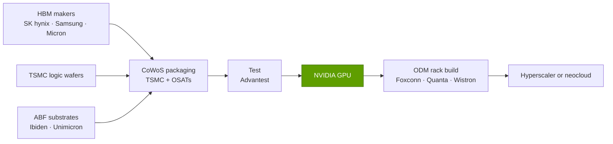
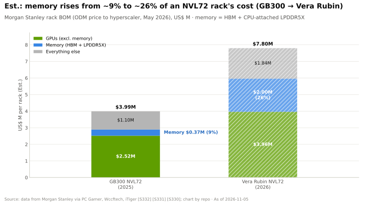

# Memory, packaging and supply chain: Value chain and corp dev angles

Layer 03 · Memory, packaging and supply chain · ~12 min read · Last verified: 2026-11-05

## ⚡ The Executive Take

- **Memory has become the biggest new value pool in an AI rack.** Morgan Stanley estimates memory at ~$2.0M of a ~$7.8M Vera Rubin [NVL72](../../glossary.md#nvl72) (~26%), up from ~$0.37M of ~$4.0M (~9%) for GB300 NVL72 (Est.) [[S330]](../../sources/bibliography.md#s330)[[S331]](../../sources/bibliography.md#s331)[[S332]](../../sources/bibliography.md#s332).
- **Memory makers now out-earn NVIDIA on margin.** Micron reported an 86.8% GAAP gross margin for its quarter to September 2026 [[S3533]](../../sources/bibliography.md#s3533) and SK hynix an ~80% operating margin in Q3 2026 [[S3502]](../../sources/bibliography.md#s3502), against NVIDIA's 75.0% gross margin [[S405]](../../sources/bibliography.md#s405).
- **TSMC monetises packaging steadily but less spectacularly.** Its Q3 2026 gross margin was 66.4% [[S3538]](../../sources/bibliography.md#s3538); advanced packaging was ~10% of 2025 revenue [[S3509]](../../sources/bibliography.md#s3509), and CoWoS prices are reported to rise 10–20% (🟡) [[S3510]](../../sources/bibliography.md#s3510).
- **Test and connectivity specialists earn chip-like margins.** Advantest forecasts a 51.9% operating margin for FY2026 [[S3521]](../../sources/bibliography.md#s3521); Astera Labs guides ~72% gross margin [[S3525]](../../sources/bibliography.md#s3525).
- **Rack builders keep crumbs.** An [ODM](../../glossary.md#odm) earns an estimated 1.9% gross margin on a Vera Rubin rack (Est.) [[S332]](../../sources/bibliography.md#s332); Foxconn, with ~40% of AI servers [[S3014]](../../sources/bibliography.md#s3014), reported a ~6.3% company gross margin [[S3522]](../../sources/bibliography.md#s3522).
- **NVIDIA's "M&A" in this layer is contracts, not acquisitions.** It holds $279B of supply commitments [[S407]](../../sources/bibliography.md#s407); its relevant deals are the Enfabrica acquihire (>$900M) [[S475]](../../sources/bibliography.md#s475), the Groq licence (~$20B reported) [[S90019]](../../sources/bibliography.md#s90019) and a $5B Intel stake [[S468]](../../sources/bibliography.md#s468).
- **[Q8 · Value pools & M&A angles]** The fastest-growing pools are HBM and packaging; the investable private angles sit in memory tiers outside HBM ([CXL](../../glossary.md#cxl), [SRAM](../../glossary.md#sram), photonic fabrics), where Marvell paid ~$3.25B upfront for Celestial AI [[S2513]](../../sources/bibliography.md#s2513).

## Who captures the dollars on a rack

Most of a rack dollar flows to NVIDIA, but inside NVIDIA's cost of goods the largest item is no longer silicon: Epoch AI estimates [HBM](../../glossary.md#hbm) at ~45% of a B200's build cost [[S35020]](../../sources/bibliography.md#s35020) and memory at ~63% of AI-chip component spend by Q4 2025 [[S35021]](../../sources/bibliography.md#s35021). The [memory supercycle](../../glossary.md#memory-supercycle) of 2026 (DRAM industry revenue +81% q/q in Q1 2026 to $97B) [[S3518]](../../sources/bibliography.md#s3518) pushed that share higher (cost mechanics in [P5](../../primers/P5-chip-economics-101.md); rack economics in [layer 08](../08-systems-racks-ai-factories/index.md)).

> [!TIP]
> **Worked example — gross profit per Vera Rubin rack, by link (🔴 illustrative).** Apply each firm's latest margin to its slice of Morgan Stanley's $7.8M rack [[S332]](../../sources/bibliography.md#s332): GPUs $3.96M × 75% ≈ **$3.0M** to NVIDIA [[S405]](../../sources/bibliography.md#s405); memory $2.0M × ~80% ≈ **$1.6M** to memory makers [[S3502]](../../sources/bibliography.md#s3502); ODM 1.9% × $7.8M ≈ **$0.15M** [[S332]](../../sources/bibliography.md#s332). Company margins are only proxies, but memory makers now capture roughly half NVIDIA's gross profit per rack. Morgan Stanley also estimates the rack at ~$6.7M if the buyer sources [SOCAMM](../../glossary.md#socamm) memory directly [[S332]](../../sources/bibliography.md#s332), ~$1.1M of pass-through that inflates the invoice without adding margin.

| Link | Main players | Margin signal | Pricing power, 2026 |
|---|---|---|---|
| HBM / DRAM | SK hynix, Samsung, Micron | 80–87% [[S3502]](../../sources/bibliography.md#s3502)[[S3533]](../../sources/bibliography.md#s3533) | High: 2027 HBM largely contracted at higher prices [[S3534]](../../sources/bibliography.md#s3534); 14 [long-term agreements](../../glossary.md#long-term-agreement) at SK hynix [[S3503]](../../sources/bibliography.md#s3503) |
| Foundry + [CoWoS](../../glossary.md#cowos) | TSMC | 66.4% gross [[S3538]](../../sources/bibliography.md#s3538) | Rising: CoWoS wafer prices near 7 nm logic levels [[S3509]](../../sources/bibliography.md#s3509) |
| OSAT | ASE/SPIL, Amkor | n/a in sources | Growing: TSMC outsourcing more of the CoW step [[S3003]](../../sources/bibliography.md#s3003) |
| [ABF substrates](../../glossary.md#abf-substrate), PCB | Ibiden, Unimicron and others | n/a in sources | Rising content per Rubin rack [[S332]](../../sources/bibliography.md#s332); buyers offer [prepayments](../../glossary.md#prepayment) [[S3532]](../../sources/bibliography.md#s3532) |
| Test | Advantest | 51.9% operating (FY2026 forecast) [[S3521]](../../sources/bibliography.md#s3521) | High in SoC testers |
| Rack integration | Foxconn, Quanta, Wistron | ~2% on the rack (Est.) [[S332]](../../sources/bibliography.md#s332) | Low |

🔧 Under the hood: why memory margins can exceed NVIDIA's

DRAM is normally a commodity with boom-bust margins. In 2026 conventional DRAM contract prices rose 93–98% in one quarter [[S3518]](../../sources/bibliography.md#s3518) because HBM consumes far more wafer area per bit, Micron says about 3× DDR5's for [HBM3E](../../glossary.md#hbm3e) [[S3006]](../../sources/bibliography.md#s3006). Every HBM wafer start removes conventional supply, so prices rise across the product line. Memory margins are cyclical, which matters for anyone underwriting long-term supply contracts.

## Private companies worth knowing (public information only)

| Company | What it does | Stage / last public funding | Why it matters |
|---|---|---|---|
| Panmnesia | CXL 3.x switch silicon and IP for [memory pooling](../../glossary.md#memory-pooling) | Series A >$60M (Nov 2024); valuation >$250M [[S3523]](../../sources/bibliography.md#s3523) | A capacity tier outside HBM for KV cache and large models |
| d-Matrix | SRAM plus LPDDR in-memory-compute inference cards | Series C $275M at $2B (Nov 2025) [[S2511]](../../sources/bibliography.md#s2511) | Memory-centric inference without HBM [[S170]](../../sources/bibliography.md#s170) |
| SambaNova | Three-tier memory: SRAM, 64 GB HBM, up to 1.5 TB DDR [[S168]](../../sources/bibliography.md#s168) | Intel talks at ~$1.6B incl. debt stalled [[S2512]](../../sources/bibliography.md#s2512) | Tiering proof point; possible distressed asset |
| Lightmatter | Photonic interconnect | $400M Series D at $4.4B (Oct 2024) [[S2510]](../../sources/bibliography.md#s2510) | Optical links could separate memory from compute |
| Groq (GroqCloud) | SRAM-based LPU cloud, after licensing to NVIDIA | ~$20B NVIDIA licence (reported) [[S90019]](../../sources/bibliography.md#s90019) | Shows the price NVIDIA pays to absorb an alternative memory architecture |

> [!TIP]
> **Worked example — what a memory tier adds.** Enfabrica's EMFASYS claims up to 18 TB of DDR5 behind one Ethernet-attached appliance [[S3526]](../../sources/bibliography.md#s3526), the HBM capacity of ~62 Rubin GPUs (18,000 ÷ 288 GB) [[S100]](../../sources/bibliography.md#s100), at DDR5 rather than HBM bandwidth. For rarely read [KV cache](../../glossary.md#kv-cache), such a tier can beat buying GPUs for their memory; the vendor claims up to 50% lower cost per token [[S3526]](../../sources/bibliography.md#s3526). See also [Memory tiering and Rubin CPX](memory-tiering-and-rubin-cpx.md).

Public peers to watch: Astera Labs ([PCIe](../../glossary.md#pcie)/CXL connectivity; Q2 2026 revenue $392M, +104% y/y) [[S3524]](../../sources/bibliography.md#s3524) and Cerebras (public since May 2026) [[S2504]](../../sources/bibliography.md#s2504).

## M&A history in this layer

| Date | Deal | Value | Relevance | Source |
|---|---|---|---|---|
| 2025-09 | NVIDIA acquihire and licence: Enfabrica | >$900M (reported) | SuperNIC plus EMFASYS: up to 18 TB of CXL memory over Ethernet | [[S475]](../../sources/bibliography.md#s475)[[S3526]](../../sources/bibliography.md#s3526) |
| 2025-09 | NVIDIA equity: Intel | $5B | Option on a US foundry and EMIB packaging partner | [[S468]](../../sources/bibliography.md#s468) |
| 2025-10 | OpenAI letters of intent with Samsung, SK hynix | non-binding | Buyers contracting memory directly | [[S3535]](../../sources/bibliography.md#s3535) |
| 2025-12 | NVIDIA licence and team hire: Groq | ~$20B (reported) | SRAM inference without HBM | [[S90019]](../../sources/bibliography.md#s90019) |
| 2026-02 | Marvell acquires Celestial AI | ~$3.25B upfront + earn-outs | Photonic memory fabric | [[S2513]](../../sources/bibliography.md#s2513) |
| 2026-03 | AMD–Samsung HBM4 MOU | n/a | Supply priority as a deal currency | [[S3511]](../../sources/bibliography.md#s3511) |

> [!TIP]
> **Worked example — prepay or buy?** Celestial AI's ~$3.25B upfront [[S2513]](../../sources/bibliography.md#s2513) equals about 1.2% of NVIDIA's $279B commitments [[S407]](../../sources/bibliography.md#s407). For a challenger, the same ~$3.25B could instead prepay roughly 210,000 Rubin-class HBM sets (288 GB at Bernstein's ~$53/GB 2027 forecast, ~$15K each) [[S333]](../../sources/bibliography.md#s333) (🔴 repo calc). At today's memory margins, securing supply may buy more competitiveness than acquiring a memory-architecture start-up.

**[Q8 · Value pools & M&A angles]** The largest incremental pools sit with memory makers and TSMC; they are not acquirable, so the angles are contracts (prepayments, LTAs, co-designed custom HBM base dies) and minority stakes in memory-tier start-ups.

## 🎯 Corp Dev Lens

1. For LPDDR-heavy inference such as AI200's 768 GB per card [[S173]](../../sources/bibliography.md#s173), at what bandwidth per gigabyte does [LPDDR](../../glossary.md#lpddr) beat HBM on cost per token?
2. Would a stake in a CXL switch or memory-fabric company (Panmnesia, or partnership with Astera Labs) give a challenger a capacity tier that NVIDIA's HBM-only package lacks?
3. At ~$2–3B entry valuations (d-Matrix, Celestial AI), do SRAM and photonic memory architectures look like buy, partner or watch?
4. Is capital better spent on supply prepayments and LTAs with memory makers earning 80%+ margins, or on equity in them?
5. Could co-designing a custom HBM base die with SK hynix, Samsung or TSMC [[S3011]](../../sources/bibliography.md#s3011)[[S3008]](../../sources/bibliography.md#s3008) deliver near-memory compute benefits like those AI250 claims [[S173]](../../sources/bibliography.md#s173)?

## 📚 Sources

<!-- Auto-generated from the [S…] citations on this page by `make build`. Edit sources/registry/*.csv, not this list. -->

- [**S100**](../../sources/bibliography.md#s100) NVIDIA Technical Blog, *Inside the NVIDIA Vera Rubin Platform: Six New Chips, One AI Supercomputer*, 2026-01-05. [Link](https://developer.nvidia.com/blog/inside-the-nvidia-rubin-platform-six-new-chips-one-ai-supercomputer/)
- [**S168**](../../sources/bibliography.md#s168) arXiv 2405.07518 (Raghu Prabhakar et al.), *SambaNova SN40L: Scaling the AI Memory Wall with Dataflow and Composition of Experts*, 2024-05-13. [Link](https://arxiv.org/abs/2405.07518)
- [**S170**](../../sources/bibliography.md#s170) d-Matrix, *d-Matrix Corsair inference platform*, 2024-11-19. [Link](https://www.d-matrix.ai/product/)
- [**S173**](../../sources/bibliography.md#s173) Qualcomm, *Qualcomm Unveils AI200 and AI250 - Redefining Rack-Scale Data Center Inference*, 2025-10-27. [Link](https://www.qualcomm.com/news/releases/2025/10/qualcomm-unveils-ai200-and-ai250-redefining-rack-scale-data-cent)
- [**S330**](../../sources/bibliography.md#s330) PC Gamer, *A single Nvidia Vera Rubin rack is estimated to cost $7,803,148 with over $2 million of that figure spent on memory alone*, 2026-05. [Link](https://pcgamer.com/hardware/a-single-nvidia-vera-rubin-rack-is-estimated-to-cost-usd7-803-148-with-over-usd2-million-of-that-figure-spent-on-memory-alone)
- [**S331**](../../sources/bibliography.md#s331) Wccftech, *NVIDIA's Vera Rubin rack hit with 435% memory price surge, pushing HBM4 & LPDDR5X bill to $2M of $7.8M total*, 2026-05. [Link](https://wccftech.com/nvidia-vera-rubin-rack-hit-with-memory-price-surge-pushing-hbm4-lpddr5x-bill-to-2m-of-7-8m-total/)
- [**S332**](../../sources/bibliography.md#s332) Tiger Brokers (iTiger), *Morgan Stanley's BOM analysis of NVIDIA's Rubin: GPU share declines; PCB, MLCC and ABF substrate values soar*, 2026-05-20. [Link](https://www.itiger.com/news/1188068712)
- [**S333**](../../sources/bibliography.md#s333) Wccftech, *Bernstein warns NVIDIA's Vera Rubin racks will hit $9.1 million as HBM4 prices triple to $53 per gigabyte*, 2026-07. [Link](https://wccftech.com/bernstein-warns-nvidias-vera-rubin-racks-will-hit-9-1-million-as-hbm4-prices-triple-to-53-per-gigabyte/)
- [**S405**](../../sources/bibliography.md#s405) NVIDIA Corporation via SEC EDGAR, *NVIDIA Announces Financial Results for Second Quarter Fiscal 2027 (Form 8-K exhibit 99.1)*, 2026-08-26. [Link](https://www.sec.gov/Archives/edgar/data/0001045810/000104581026000073/q2fy27pr.htm)
- [**S407**](../../sources/bibliography.md#s407) NVIDIA Corporation via SEC EDGAR, *NVIDIA Corporation Form 10-Q for quarter ended July 26, 2026*, 2026-08-28. [Link](https://www.sec.gov/Archives/edgar/data/1045810/000104581026000075/nvda-20260726.htm)
- [**S468**](../../sources/bibliography.md#s468) NVIDIA Newsroom, *NVIDIA and Intel to Develop AI Infrastructure and Personal Computing Products*, 2025-09-18. [Link](https://nvidianews.nvidia.com/news/nvidia-and-intel-to-develop-ai-infrastructure-and-personal-computing-products)
- [**S475**](../../sources/bibliography.md#s475) CNBC, *Nvidia spends over $900 million on Enfabrica CEO, AI startup technology*, 2025-09-18. [Link](https://www.cnbc.com/technology/)
- [**S2504**](../../sources/bibliography.md#s2504) TechCrunch, *Cerebras raises $5.5B kicking off 2026's IPO season with a bang*, 2026-05-14. [Link](https://techcrunch.com/2026/05/14/cerebras-raises-5-5b-kicking-off-2026s-ipo-season-with-a-bang)
- [**S2510**](../../sources/bibliography.md#s2510) Bloomberg, *Photonic Computing Startup Lightmatter Reaches $4.4 Billion Valuation*, 2024-10-16. [Link](https://www.bloomberg.com/news/articles/2024-10-16/photonic-computing-startup-lightmatter-reaches-4-4-billion-valuation)
- [**S2511**](../../sources/bibliography.md#s2511) Converge Digest, *d-Matrix raises $275 million to accelerate the age of AI inference*, 2025-11-12. [Link](https://convergedigest.com/d-matrix-raises-275-million-to-accelerate-the-age-of-ai-inference/)
- [**S2512**](../../sources/bibliography.md#s2512) Verdict, *Intel pursues SambaNova acquisition amid AI expansion plans*, 2025-12. [Link](https://www.verdict.co.uk/intel-sambanova-acquisition/)
- [**S2513**](../../sources/bibliography.md#s2513) Business Wire (Marvell), *Marvell Completes Acquisition of Celestial AI*, 2026-02-02. [Link](https://www.businesswire.com/news/home/20260201331090/en/marvell-completes-acquisition-of-celestial-ai)
- [**S3003**](../../sources/bibliography.md#s3003) TrendForce, *TSMC reportedly expands outsourcing of key CoWoS front-end step to OSATs amid rising NVIDIA and ASIC demand*, 2026-08-05. [Link](https://www.trendforce.com/news/2026/08/05/news-tsmc-reportedly-expands-outsourcing-of-key-cowos-front-end-step-to-osats-amid-rising-nvidia-asic-demand/)
- [**S3006**](../../sources/bibliography.md#s3006) Tom's Hardware, *Micron says the silicon gap between HBM and DDR5 is widening with every generation*, 2026-08. [Link](https://www.tomshardware.com/tech-industry/semiconductors/micron-says-the-silicon-gap-between-hbm-and-ddr5-is-widening-with-every-generation)
- [**S3008**](../../sources/bibliography.md#s3008) TrendForce, *TSMC unveils custom C-HBM4E details: N3P logic dies reportedly target 2x efficiency gain*, 2025-12-01. [Link](https://www.trendforce.com/news/2025/12/01/news-tsmc-unveils-custom-c-hbm4e-details-n3p-logic-dies-reportedly-target-2x-efficiency-gain/)
- [**S3011**](../../sources/bibliography.md#s3011) TrendForce, *Samsung's custom HBM4E design reportedly aimed for mid-2026, parallels SK hynix and Micron*, 2026-01-23. [Link](https://www.trendforce.com/news/2026/01/23/news-samsungs-custom-hbm4e-design-reportedly-aimed-for-mid-2026-parallels-sk-hynix-and-micron/)
- [**S3014**](../../sources/bibliography.md#s3014) Focus Taiwan (CNA), *Foxconn expects AI server rack shipments to double in 2026*, 2026-03-16. [Link](https://focustaiwan.tw/business/202603160022)
- [**S3502**](../../sources/bibliography.md#s3502) The Korea Times, *SK hynix logs record Q3 operating profit*, 2026-10-28. [Link](https://www.koreatimes.co.kr/business/companies/20261028/sk-hynix-logs-record-q3-operating-profit-of-628-bil)
- [**S3503**](../../sources/bibliography.md#s3503) SammyFans, *SK hynix Q3 margin hits record 80%, secures 14 LTAs with memory supply booked to 2029*, 2026-10-28. [Link](https://www.sammyfans.com/2026/10/28/sk-hynix-q3-margin-hits-record-80-secures-14-ltas-with-memory-supply-booked-to-2029/amp/)
- [**S3509**](../../sources/bibliography.md#s3509) TrendForce, *TSMC CoWoS wafer ASP reportedly nears 7nm levels, advanced packaging poised to become a key profit driver*, 2026-04-28. [Link](https://www.trendforce.com/news/2026/04/28/news-tsmc-cowos-wafer-asp-reportedly-nears-7nm-levels-advanced-packaging-poised-to-become-a-key-profit-driver/)
- [**S3510**](../../sources/bibliography.md#s3510) AI Weekly, *TSMC mulls up to 20% CoWoS hike and 2027 wafer price rise*, 2026. [Link](https://aiweekly.co/alerts/tsmc-mulls-up-to-20-cowos-hike-and-2027-wafer-price-rise)
- [**S3511**](../../sources/bibliography.md#s3511) ITPro, *AMD and Samsung forge closer ties on AI memory, potential foundry deal*, 2026-03. [Link](https://itpro.com/hardware/amd-and-samsung-forge-closer-ties-on-ai-memory-potential-foundry-deal)
- [**S3518**](../../sources/bibliography.md#s3518) Tiger Brokers (iTiger), *DRAM industry revenue soars 81% to $97 billion in Q1 amid accelerating price hikes (TrendForce)*, 2026-06. [Link](https://www.itiger.com/hans/news/1108307708)
- [**S3521**](../../sources/bibliography.md#s3521) Advantest Corporation, *Advantest Q2 FY2026 financial results briefing (notes)*, 2026-10-28. [Link](https://www.advantest.com/document/ja/investors/ir-library/result/JE_BIZ_261028_note.pdf)
- [**S3522**](../../sources/bibliography.md#s3522) AI CERTS News, *Foxconn results and AI server margin pressure*, 2026. [Link](https://www.aicerts.ai/news/?p=29781)
- [**S3523**](../../sources/bibliography.md#s3523) Blocks and Files, *Panmnesia scores $60M to push CXL switch chip designs*, 2024-11-25. [Link](https://www.blocksandfiles.com/ai-ml/2024/11/25/panmnesia-scores-60m-to-push-cxl-switch-chip-designs/1611800)
- [**S3524**](../../sources/bibliography.md#s3524) Dealroom, *Astera Labs revenue doubles to $392M as new investors pile in*, 2026-08. [Link](https://dealroom.co/news/147670-astera-labs-revenue-doubles-to-392m-as-new-investors-pile-in/)
- [**S3525**](../../sources/bibliography.md#s3525) TS2 Tech, *Astera Labs climbs after hours as Q3 revenue forecast beats consensus*, 2026-08. [Link](https://ts2.tech/en/astera-labs-nasdaqalab-climbs-in-after-hours-as-q3-revenue-forecast-beats-consensus-by-32/)
- [**S3526**](../../sources/bibliography.md#s3526) Tom's Hardware, *NVIDIA-backed startup invents Ethernet memory pool to help power AI (Enfabrica EMFASYS)*, 2025-07-29. [Link](https://www.tomshardware.com/tech-industry/nvidia-backed-startup-invents-ethernet-memory-pool-to-help-power-ai-claims-it-can-add-up-to-18tb-of-ddr5-capacity-for-large-scale-inference-workloads-and-reduce-per-token-generation-costs-by-up-to-50-percent)
- [**S3532**](../../sources/bibliography.md#s3532) Tom's Hardware, *Intel reportedly in talks with Google and Amazon over advanced packaging*, 2026. [Link](https://www.tomshardware.com/tech-industry/semiconductors/intel-reportedly-in-talks-with-google-and-amazon-over-advanced-packaging)
- [**S3533**](../../sources/bibliography.md#s3533) Micron Technology via SEC EDGAR, *Micron Technology fiscal Q4 2026 results (Form 8-K exhibit 99.1)*, 2026-09. [Link](https://www.sec.gov/Archives/edgar/data/0000723125/000072312526000018/a2026q4ex991-pressrelease.htm)
- [**S3534**](../../sources/bibliography.md#s3534) The Next Platform, *Micron's numbers show why HBM4 memory is worth 15x its weight in gold*, 2026-10-02. [Link](https://www.nextplatform.com/store/2026/10/02/microns-numbers-show-why-hbm4-memory-is-worth-15x-its-weight-in-gold/5300701)
- [**S3535**](../../sources/bibliography.md#s3535) TechCrunch, *OpenAI ropes in Samsung and SK hynix to source memory chips for Stargate*, 2025-10-01. [Link](https://techcrunch.com/2025/10/01/openai-ropes-in-samsung-sk-hynix-to-source-memory-chips-for-stargate)
- [**S3538**](../../sources/bibliography.md#s3538) TSMC, *TSMC reports third quarter 2026 results*, 2026-10. [Link](https://pr.tsmc.com/english/news/3346)
- [**S35020**](../../sources/bibliography.md#s35020) Epoch AI, *NVIDIA's B200 costs around $6,400 to produce, with memory accounting for half*, 2025-12. [Link](https://epoch.ai/data-insights/b200-cost-breakdown)
- [**S35021**](../../sources/bibliography.md#s35021) Epoch AI, *Memory has grown to nearly two-thirds of AI chip component costs*, 2026-05-21. [Link](https://epoch.ai/data-insights/ai-chip-component-cost-shares)
- [**S90019**](../../sources/bibliography.md#s90019) TechSpot, *Nvidia's $20 billion Groq deal looks a lot like an acquisition*, 2025-12. [Link](https://www.techspot.com/news/110723-nvidia-20-billion-groq-deal-looks-lot-like.html)
