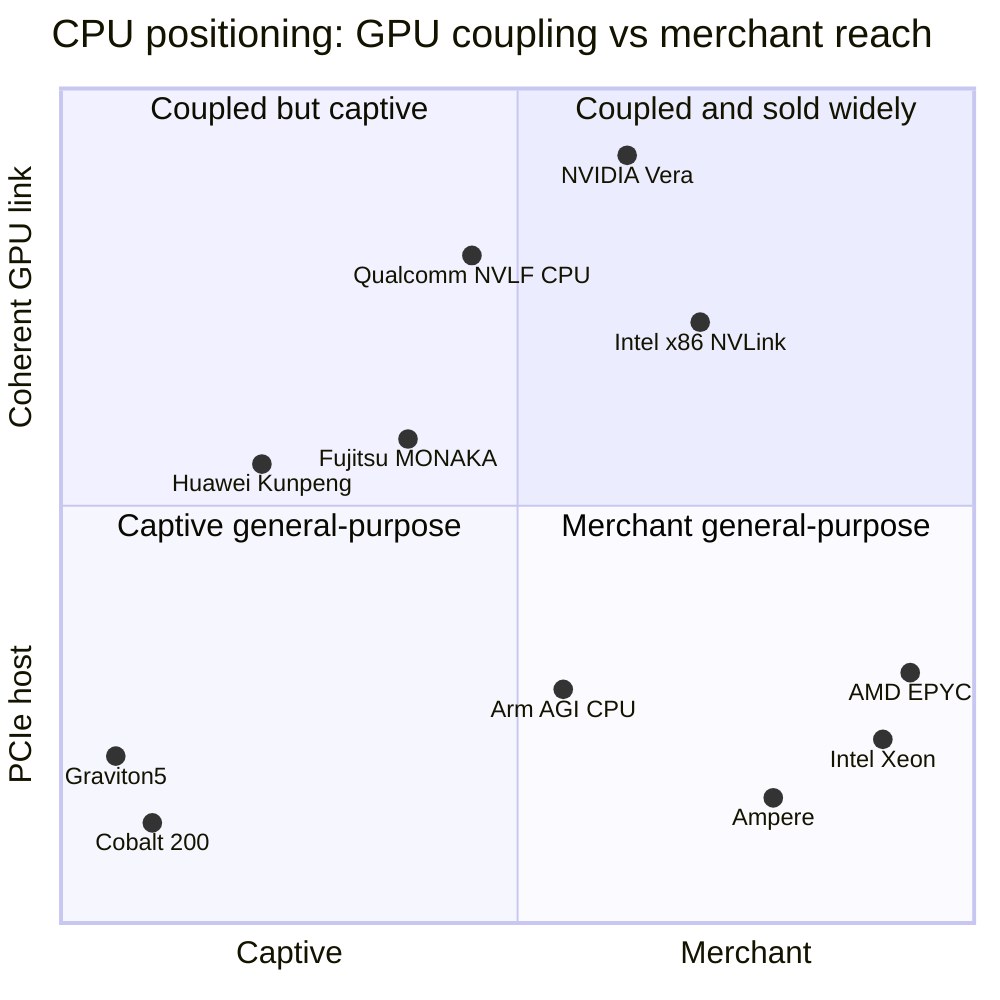

# CPU (Grace, Vera): Competition

Layer 04 · CPU (Grace, Vera) · ~12 min read · Last verified: 2026-11-05

## ⚡ The Executive Take

- **Two contests, not one.** NVIDIA wins the [host CPU](../../glossary.md#host-cpu) socket inside its own GPU racks almost by default; it is a newcomer in the much larger general-purpose server CPU market, where x86 still held ~90% of 2025 units [[S4500]](../../sources/bibliography.md#s4500).
- **[Arm](../../glossary.md#arm-isa)'s share depends on how you count:** 13.2% (Mercury) to 17.7% (UBS) of server CPU units in Q1 2026, but non-x86 systems took 47.9% of server *revenue* because Grace ships inside very expensive GPU racks [[S4502]](../../sources/bibliography.md#s4502)[[S4503]](../../sources/bibliography.md#s4503)[[S4501]](../../sources/bibliography.md#s4501).
- **NVIDIA does not compete on cores.** Vera has 88; EPYC Venice has up to 256, Graviton5 192 and Xeon 6+ 288 E-cores [[S100]](../../sources/bibliography.md#s100)[[S144]](../../sources/bibliography.md#s144)[[S4526]](../../sources/bibliography.md#s4526)[[S4525]](../../sources/bibliography.md#s4525).
- **Where Vera leads is the GPU link:** a 1.8 TB/s coherent [NVLink-C2C](../../glossary.md#nvlink-c2c) versus ~256 GB/s for a PCIe Gen6 x16 host link, about 7× [[S100]](../../sources/bibliography.md#s100)[[S144]](../../sources/bibliography.md#s144). Its memory-bandwidth lead (1.2 TB/s) is already matched by Venice's claimed 1.6 TB/s [[S144]](../../sources/bibliography.md#s144).
- **[Q5 · Strongest challenger]** x86 incumbency, led by AMD: 34.5% of x86 server units and ~46% by value in 2026, and the host CPU in AMD's Helios rack [[S4505]](../../sources/bibliography.md#s4505)[[S4503]](../../sources/bibliography.md#s4503)[[S538]](../../sources/bibliography.md#s538).
- **[Hyperscaler](../../glossary.md#hyperscaler) in-house Arm** (Graviton, Axion, Cobalt) caps how much of the largest buyers' general-purpose fleet NVIDIA can win: AWS says more than half its new CPU capacity is Graviton [[S4527]](../../sources/bibliography.md#s4527).
- **The socket inside NVIDIA's rack is becoming contestable:** Qualcomm and Fujitsu CPUs via [NVLink Fusion](../../glossary.md#nvlink-fusion), Intel x86 with NVLink, and Arm's own AGI CPU 🟡 [[S90031]](../../sources/bibliography.md#s90031)[[S468]](../../sources/bibliography.md#s468)[[S4510]](../../sources/bibliography.md#s4510).

## How the CPU contest is scored

A server CPU plays two roles. In an AI rack it is the **air-traffic controller**: it schedules work, feeds data and holds overflow memory for the GPUs. In a general-purpose server it is the **aircraft itself**. The first role rewards a fast, [cache-coherent](../../glossary.md#cache-coherence) link to the GPU and lots of nearby memory. The second rewards cores, performance per watt, price, availability as [merchant silicon](../../glossary.md#merchant-silicon) and compatibility with decades of [x86](../../glossary.md#x86) software. NVIDIA's [Grace and Vera](index.md) were designed for the first role. The standalone Vera push since GTC 2026 (a "multi-billion-dollar business" per NVIDIA) is NVIDIA's first real bid for the second [[S90003]](../../sources/bibliography.md#s90003).

| Rival (product basis) | Cores per socket | Memory bandwidth | CPU–GPU link & coherence | Software / ISA | Merchant availability |
|---|---|---|---|---|---|
| AMD EPYC Venice (2026) | 🟩 256 vs 88 | 🟩 1.6 vs 1.2 TB/s (AMD claim) | 🟥 PCIe Gen6, ~256 GB/s, not coherent | 🟩 x86 native | 🟩 every OEM and cloud |
| Intel Xeon 6 / 6+ (2024–26) | 🟩 128 P / 288 E | 🟥 845 GB/s; ~2× due 2027 | 🟥 PCIe Gen5; NVLink x86 undated | 🟩 x86 native | 🟩 host in DGX B300 |
| AWS Graviton5 (2026) | 🟩 192 | 🟥 DDR5-8800, not disclosed | 🟥 PCIe Gen6 | 🟨 same Arm ISA | 🟦 rented, not sold |
| Microsoft Cobalt 200 (2026) | 🟩 132 | 🟥 12-ch DDR5 | 🟥 no coherent GPU link | 🟨 Arm | 🟦 Azure only |
| Ampere AmpereOne (2023–25) | 🟩 192 | 🟥 333 GB/s | 🟥 PCIe Gen5 | 🟨 Arm | 🟩 merchant |
| Qualcomm DC CPU (announced) | 🟥 80 reported 🔴 | 🟥 not disclosed | 🟨 NVLink Fusion planned | 🟨 Arm | 🟥 not shipping |

Verdict = rival vs Vera. Specs: [[S144]](../../sources/bibliography.md#s144)[[S179]](../../sources/bibliography.md#s179)[[S4525]](../../sources/bibliography.md#s4525)[[S4526]](../../sources/bibliography.md#s4526)[[S184]](../../sources/bibliography.md#s184)[[S185]](../../sources/bibliography.md#s185)[[S4515]](../../sources/bibliography.md#s4515)[[S131]](../../sources/bibliography.md#s131); all ten rivals in the heatmap below.

> [!TIP]
> **Worked example — why the link matters more than the cores in an AI rack.** A Vera Rubin NVL72 has 36 Vera × 88 = 3,168 cores for 72 GPUs (44 per GPU) [[S102]](../../sources/bibliography.md#s102)[[S100]](../../sources/bibliography.md#s100); AMD's Helios has 18 Venice × 256 = 4,608 cores for 72 MI455X (64 per GPU) [[S538]](../../sources/bibliography.md#s538)[[S144]](../../sources/bibliography.md#s144). Both suffice for scheduling. Now spill 100 GB of [KV cache](../../glossary.md#kv-cache) to CPU memory and back: at ~256 GB/s (PCIe Gen6 x16) that takes ~0.39 s; at 1.8 TB/s (NVLink-C2C) ~0.06 s. For sub-second chat responses, that gap decides whether CPU memory is a usable second tier.

🔧 Under the hood: what "coherent" buys the GPU

With PCIe, CPU and GPU memories are separate address spaces: software must copy data across explicitly and keep track of which copy is current. With a coherent link, the GPU can load from and store to CPU memory using normal pointers, and hardware keeps the cached copies consistent. That is why NVIDIA can present the 480 GB of LPDDR5X on a Grace (1.5 TB on Vera) as an extension of the GPU’s memory [[S129]](../../sources/bibliography.md#s129)[[S100]](../../sources/bibliography.md#s100). CXL gives x86 hosts coherence too, but at PCIe-class bandwidth.

## Challenger by challenger

### AMD EPYC: the strongest challenger

AMD went from 27.2% of x86 server CPU units in Q1 2025 to 34.5% in Q2 2026, and to ~46% by value [[S4504]](../../sources/bibliography.md#s4504)[[S4505]](../../sources/bibliography.md#s4505)[[S4503]](../../sources/bibliography.md#s4503). Venice (2 nm, up to 256 cores, 1.6 TB/s) launched with Helios, where 18 Venice CPUs host 72 MI455X [[S144]](../../sources/bibliography.md#s144)[[S538]](../../sources/bibliography.md#s538). AMD's Q3 2026 Data Center revenue rose 97% y/y [[S542]](../../sources/bibliography.md#s542).

**Best argument:** most AI-adjacent CPU work (data preparation, agent tool calls, databases) is ordinary x86 software that needs cores and compatibility, not a 1.8 TB/s GPU link. **Gap closed:** memory bandwidth, yes; GPU link, no (~7× behind).

### Intel Xeon: incumbent, supplier and partner

Intel still ships most server units (54.9% in Q1 2026 per UBS) [[S4503]](../../sources/bibliography.md#s4503). Clearwater Forest (288 E-cores, Intel 18A) launched at Computex 2026; Diamond Rapids (+50% cores, ~2× memory bandwidth, PCIe Gen6) is reported for mid-2027 after a slip 🟡 [[S4525]](../../sources/bibliography.md#s4525)[[S4524]](../../sources/bibliography.md#s4524). NVIDIA's $5B Intel stake (September 2025) buys custom x86 CPUs that attach over NVLink; no product date is public 🔴 [[S468]](../../sources/bibliography.md#s468).

### Hyperscaler in-house Arm

Graviton5 (192 cores, DDR5-8800, PCIe Gen6) reached general availability on 2026-06-10 [[S4526]](../../sources/bibliography.md#s4526). Microsoft's 132-core Cobalt 200 was still in preview in mid-2026, and Google's Axion runs C4A and newer VMs [[S184]](../../sources/bibliography.md#s184)[[S4526]](../../sources/bibliography.md#s4526)[[S547]](../../sources/bibliography.md#s547). Same Arm ISA as Grace: they validate NVIDIA's software ecosystem but keep it out of the largest general-purpose fleets.

### Merchant, national and new Arm entrants

SoftBank closed its $6.5B purchase of Ampere in November 2025 [[S4530]](../../sources/bibliography.md#s4530). Arm launched its first in-house chip, the 136-core AGI CPU, with Meta as first customer (2026-03-24) [[S4510]](../../sources/bibliography.md#s4510). Fujitsu's 144-core MONAKA (2027) plans an NVLink Fusion variant; Huawei's Kunpeng 950 (192 cores) and 960 (256+) target Q4 2026 and Q1 2028 [[S187]](../../sources/bibliography.md#s187)[[S4529]](../../sources/bibliography.md#s4529)[[S4528]](../../sources/bibliography.md#s4528).

### Qualcomm (public information only)

Qualcomm launched the 48-core Centriq 2400 in November 2017, then cut the unit from ~1,000 to ~50 people in 2018 [[S4542]](../../sources/bibliography.md#s4542)[[S4543]](../../sources/bibliography.md#s4543)[[S4544]](../../sources/bibliography.md#s4544). It bought NUVIA for $1.4B in 2021, announced Oryon-based datacenter CPUs with NVLink Fusion at Computex 2025 [[S4517]](../../sources/bibliography.md#s4517), and added Ventana ([RISC-V](../../glossary.md#risc-v)) and Alphawave (connectivity) in December 2025 [[S4538]](../../sources/bibliography.md#s4538)[[S4516]](../../sources/bibliography.md#s4516)[[S4512]](../../sources/bibliography.md#s4512)[[S4513]](../../sources/bibliography.md#s4513). No 2026 shipments are confirmed 🔴 [[S90028]](../../sources/bibliography.md#s90028). Open questions: which socket it targets (NVIDIA-attached host or standalone) and how its RISC-V and Arm roadmaps divide.

> [!TIP]
> **Worked example — why revenue share overstates Arm.** IDC's $58.7B of Q1 2026 non-x86 server revenue [[S4501]](../../sources/bibliography.md#s4501) equals ~14,700 racks at the ~$3.99M Morgan Stanley estimate for a GB300 NVL72 [[S332]](../../sources/bibliography.md#s332). Those racks hold ~530,000 Grace CPUs (36 each) [[S396]](../../sources/bibliography.md#s396), worth ~2% of rack cost ([value chain](value-chain-and-corp-dev.md)). The GPU carries the CPU along.

> [!NOTE]
> **🐂 Bull view.** Every NVL72 rack ships 36 NVIDIA CPUs and standalone Vera reportedly has visibility to ~$20B of FY2027 revenue 🟡 [[S4502]](../../sources/bibliography.md#s4502)[[S4522]](../../sources/bibliography.md#s4522). Meta is deploying standalone Grace at scale, and NVIDIA says it has shipped hundreds of thousands of Grace-only servers [[S4519]](../../sources/bibliography.md#s4519)[[S4521]](../../sources/bibliography.md#s4521).

> [!WARNING]
> **🐻 Bear view.** Outside the rack NVIDIA has no core-count, price or x86 edge; Venice beats Vera's memory bandwidth; NVLink Fusion invites Qualcomm, Fujitsu and Intel into the one socket NVIDIA owned [[S144]](../../sources/bibliography.md#s144)[[S90031]](../../sources/bibliography.md#s90031).

## 🎯 Corp Dev Lens

1. If NVLink Fusion makes the host socket contestable, what share of NVIDIA-attached racks could a third-party CPU win, and on what basis (price, power, customer control)?
2. Is the standalone "agentic CPU" market a new value pool or a share shift from x86, given NVIDIA does not report CPU revenue separately [[S4523]](../../sources/bibliography.md#s4523)?
3. Hyperscalers already own Arm CPU teams; which buyers (neoclouds, sovereign AI, enterprises) are left for merchant Arm CPUs?
4. With AMD near half of x86 server value, does the x86 duopoly respond on price, on coherent links (CXL, UALink) or on partnerships?

## 📚 Sources

<!-- Auto-generated from the [S…] citations on this page by `make build`. Edit sources/registry/*.csv, not this list. -->

- [**S100**](../../sources/bibliography.md#s100) NVIDIA Technical Blog, *Inside the NVIDIA Vera Rubin Platform: Six New Chips, One AI Supercomputer*, 2026-01-05. [Link](https://developer.nvidia.com/blog/inside-the-nvidia-rubin-platform-six-new-chips-one-ai-supercomputer/)
- [**S102**](../../sources/bibliography.md#s102) NVIDIA, *NVIDIA DGX Vera Rubin NVL72*, 2026. [Link](https://www.nvidia.com/en-us/data-center/dgx-vera-rubin-nvl72/)
- [**S129**](../../sources/bibliography.md#s129) NVIDIA, *NVIDIA Grace CPU*, 2023. [Link](https://www.nvidia.com/en-us/data-center/grace-cpu/)
- [**S131**](../../sources/bibliography.md#s131) NVIDIA Newsroom, *NVIDIA NVLink Fusion: semi-custom AI infrastructure partner ecosystem (Computex 2025)*, 2025-05-19. [Link](https://nvidianews.nvidia.com/news/nvidia-nvlink-fusion-semi-custom-ai-infrastructure-partner-ecosystem)
- [**S144**](../../sources/bibliography.md#s144) AMD Newsroom, *AMD Unveils Vision for an Open AI Ecosystem, Detailing New Silicon, Software and Systems at Advancing AI 2025*, 2025-06-12. [Link](https://www.amd.com/en/newsroom/press-releases/2025-6-12-amd-unveils-vision-for-an-open-ai-ecosystem-detai.html)
- [**S179**](../../sources/bibliography.md#s179) Intel, *Intel Xeon 6 processors with P-cores (Granite Rapids, 6900P/6700P)*, 2024-09-24. [Link](https://www.intel.com/content/www/us/en/products/details/processors/xeon/xeon6-p-cores.html)
- [**S184**](../../sources/bibliography.md#s184) Microsoft Tech Community, *Announcing Cobalt 200: Azure's next cloud-native CPU*, 2025-11-18. [Link](https://techcommunity.microsoft.com/blog/azurecompute/announcing-cobalt-200-azures-next-cloud-native-cpu/4469807)
- [**S185**](../../sources/bibliography.md#s185) Ampere Computing, *AmpereOne processors*, 2023-05. [Link](https://amperecomputing.com/products/processors/ampereone)
- [**S187**](../../sources/bibliography.md#s187) Fujitsu, *FUJITSU-MONAKA: next-generation Arm-based processor*, 2025. [Link](https://www.fujitsu.com/global/about/research/technology/monaka/)
- [**S332**](../../sources/bibliography.md#s332) Tiger Brokers (iTiger), *Morgan Stanley's BOM analysis of NVIDIA's Rubin: GPU share declines; PCB, MLCC and ABF substrate values soar*, 2026-05-20. [Link](https://www.itiger.com/news/1188068712)
- [**S396**](../../sources/bibliography.md#s396) NVIDIA Newsroom, *NVIDIA Blackwell platform arrives to power a new era of computing*, 2024-03-18. [Link](https://nvidianews.nvidia.com/news/nvidia-blackwell-platform-arrives-to-power-a-new-era-of-computing)
- [**S468**](../../sources/bibliography.md#s468) NVIDIA Newsroom, *NVIDIA and Intel to Develop AI Infrastructure and Personal Computing Products*, 2025-09-18. [Link](https://nvidianews.nvidia.com/news/nvidia-and-intel-to-develop-ai-infrastructure-and-personal-computing-products)
- [**S538**](../../sources/bibliography.md#s538) AMD Investor Relations, *AAI 2026: AMD Delivers Full-Stack Compute for the Agentic AI Era*, 2026-07-23. [Link](https://ir.amd.com/news-events/press-releases/detail/1294/aai-2026-amd-delivers-full-stack-compute-for-the-agentic-ai-era)
- [**S542**](../../sources/bibliography.md#s542) AMD via SEC EDGAR, *AMD Reports Third Quarter 2026 Financial Results (Form 8-K Exhibit 99.1)*, 2026-11-03. [Link](https://www.sec.gov/Archives/edgar/data/0000002488/000000248826000188/q32026991.htm)
- [**S547**](../../sources/bibliography.md#s547) Google Cloud Blog, *Ironwood TPUs and new Axion-based VMs for your AI workloads*, 2025-11-06. [Link](https://cloud.google.com/blog/products/compute/ironwood-tpus-and-new-axion-based-vms-for-your-ai-workloads)
- [**S4500**](../../sources/bibliography.md#s4500) TrendForce, *Server CPU shipments to grow over 40% in 2027 as Arm gains share (press release)*, 2026-10-22. [Link](https://www.trendforce.com/presscenter/news/20261022-13279.html)
- [**S4501**](../../sources/bibliography.md#s4501) Tom's Hardware, *Arm servers capture over 45 percent of data center market revenue (IDC Q1 2026 server tracker)*, 2026-06. [Link](https://www.tomshardware.com/desktops/servers/arm-servers-capture-over-45-percent-of-data-center-market-revenue-gpu-clusters-and-high-end-ai-infrastructure-fuel-a-tectonic-shift-away-from-x86)
- [**S4502**](../../sources/bibliography.md#s4502) Techzine, *AMD gains ground in servers thanks to AI boom; Intel remains market leader (Mercury Research Q1 2026)*, 2026-05. [Link](https://www.techzine.eu/news/infrastructure/141872/amd-gains-ground-in-servers-thanks-to-ai-boom-intel-remains-market-leader/)
- [**S4503**](../../sources/bibliography.md#s4503) Analytics Insight, *AMD server CPU revenue share hits record 46.2% as Intel faces pressure*, 2026-05. [Link](https://www.analyticsinsight.net/news/amd-server-cpu-revenue-share-hits-record-462-as-intel-faces-pressure)
- [**S4504**](../../sources/bibliography.md#s4504) CIO.com (Korea), *AMD server CPU share expands to 27.2%, narrowing gap with Intel (Mercury Research)*, 2025-05. [Link](https://www.cio.com/article/3991730)
- [**S4505**](../../sources/bibliography.md#s4505) CloudNews.tech, *AMD pushes Intel to its lowest x86 share in 31 years and closes in on servers*, 2026-08. [Link](https://cloudnews.tech/amd-leads-intel-to-its-lowest-x86-market-share-in-31-years-and-closes-in-on-servers/)
- [**S4510**](../../sources/bibliography.md#s4510) TechCrunch, *Arm is releasing its first in-house chip in its 35-year history*, 2026-03-24. [Link](https://techcrunch.com/2026/03/24/arm-is-releasing-its-first-in-house-chip-in-its-35-year-history/)
- [**S4512**](../../sources/bibliography.md#s4512) DatacenterDynamics, *Qualcomm buys RISC-V server chip maker Ventana Micro Systems*, 2025-12-10. [Link](https://www.datacenterdynamics.com/en/news/qualcomm-buys-risc-v-server-chip-maker-ventana-microsystems/)
- [**S4513**](../../sources/bibliography.md#s4513) I-Connect007, *Qualcomm completes acquisition of Alphawave Semi*, 2025-12-18. [Link](https://iconnect007.com/article/148161/qualcomm-completes-acquisition-of-alphawave-semi/148158/ein)
- [**S4515**](../../sources/bibliography.md#s4515) 3DNews, *Qualcomm server processor to get 80 Oryon cores, NVLink Fusion, PCIe 5.0 and HBM support (DigiTimes report)*, 2025. [Link](https://3dnews.ru/1123267/serverniy-protsessor-qualcomm-poluchit-80-yader-oryon-poddergku-nvlink-fusionpcie-50-i-pamyatihbm/amp)
- [**S4516**](../../sources/bibliography.md#s4516) DatacenterDynamics, *Qualcomm to return to data center market with AI CPUs*, 2025-05. [Link](https://www.datacenterdynamics.com/en/news/qualcomm-to-return-to-data-center-market-with-ai-cpus/)
- [**S4517**](../../sources/bibliography.md#s4517) Futurum Group, *Qualcomm's Arm-based data center CPUs to smoothly integrate with NVIDIA*, 2025-05. [Link](https://futurumgroup.com/insights/qualcomms-arm-based-data-center-cpus-to-smoothly-integrate-with-nvidia)
- [**S4519**](../../sources/bibliography.md#s4519) The Register, *GPU who? Meta to deploy Nvidia CPUs at large scale*, 2026-02-17. [Link](https://www.theregister.com/2026/02/17/meta_nvidia_cpu/)
- [**S4521**](../../sources/bibliography.md#s4521) Tom's Hardware, *Nvidia has shipped hundreds of thousands of Grace standalone servers as CPUs take center stage in agentic data centers*, 2026. [Link](https://www.tomshardware.com/pc-components/cpus/nvidia-has-shipped-hundreds-of-thousands-of-grace-standalone-servers-gpu-firm-pivots-messaging-as-cpus-take-center-stage-in-agentic-data-centers)
- [**S4522**](../../sources/bibliography.md#s4522) The Stack, *Nvidia: Vera CPU opportunity sits on top of $1 trillion GPU forecast*, 2026-05. [Link](https://www.thestack.technology/nvidia-vera-cpu-gpu-1-trillion/)
- [**S4523**](../../sources/bibliography.md#s4523) TIKR, *Nvidia says its CPU revenue sits outside the $1 trillion forecast*, 2026-05. [Link](https://www.tikr.com/es/blog/nvidia-says-its-cpu-revenue-sits-outside-the-1-trillion-forecast-heres-where-the-stock-could-go)
- [**S4524**](../../sources/bibliography.md#s4524) TweakTown, *Intel Xeon 7 Diamond Rapids reportedly delayed to mid-2027, followed by Coral Rapids in 2028*, 2026-08. [Link](https://www.tweaktown.com/news/111284/intel-xeon-7-diamond-rapids-reportedly-delayed-to-mid-2027-followed-by-coral-in-2028/index.html)
- [**S4525**](../../sources/bibliography.md#s4525) TechSpot, *Intel launches Xeon 6+ Clearwater Forest with 288 E-cores on 18A, teases Diamond Rapids for 2027*, 2026-06. [Link](https://www.techspot.com/community/topics/intel-launches-xeon-6-clearwater-forest-with-288-e-cores-on-18a-node-teases-diamond-rapids-for-2027.297679/)
- [**S4526**](../../sources/bibliography.md#s4526) Amazon Web Services, *Amazon EC2 M9g and M9gd instances powered by AWS Graviton5 are now available*, 2026-06-10. [Link](https://aws.amazon.com/about-aws/whats-new/2026/06/ec2-m9g-m9gd-instances-graviton5-processors-available)
- [**S4527**](../../sources/bibliography.md#s4527) Converge Digest, *AWS debuts Graviton5: 192 cores, bigger caches and new Nitro security*, 2025-12. [Link](https://convergedigest.com/aws-debuts-graviton5-192-cores-bigger-caches-and-new-nitro-security/?amp=1)
- [**S4528**](../../sources/bibliography.md#s4528) Wccftech, *Huawei next-gen Kunpeng chips: 950 series up to 192 cores in Q4 2026, 960 series over 256 cores in Q1 2028*, 2025-09. [Link](https://wccftech.com/huawei-next-gen-kungpeng-chips-950-series-up-to-192-cores-q4-2026-960-series-over-256-cores-q1-2028/)
- [**S4529**](../../sources/bibliography.md#s4529) Converge Digest, *Fujitsu taps NVLink Fusion for MONAKA CPUs + NVIDIA GPUs for industrial AI*, 2025-10. [Link](https://convergedigest.com/fujitsu-taps-nvlink-fusion-for-monaka-cpus-nvidia-gpus-for-industrial-ai/)
- [**S4530**](../../sources/bibliography.md#s4530) SoftBank Group, *Completion of acquisition of Ampere Computing Holdings LLC*, 2025-11-26. [Link](https://group.softbank/en/news/press/20251126)
- [**S4538**](../../sources/bibliography.md#s4538) Qualcomm Investor Relations, *Qualcomm completes acquisition of NUVIA*, 2021-03-16. [Link](https://investor.qualcomm.com/news-events/press-releases/news-details/2021/Qualcomm-Completes-Acquisition-of-NUVIA-03-16-2021/default.aspx)
- [**S4542**](../../sources/bibliography.md#s4542) AnandTech, *Qualcomm launches 48-core Centriq for $1,995: Arm servers for cloud native applications*, 2017-11-08. [Link](https://www.anandtech.com/show/12025)
- [**S4543**](../../sources/bibliography.md#s4543) The Next Platform, *What Qualcomm's exit from Arm server chips means*, 2018-05-10. [Link](https://www.nextplatform.com/2018/05/10/what-qualcomms-exit-from-arm-server-chips-means)
- [**S4544**](../../sources/bibliography.md#s4544) Network World, *Qualcomm makes it official: no more data center chip*, 2018-12. [Link](https://www.networkworld.com/article/3327214/qualcomm-makes-it-official-no-more-data-center-chip.html)
- [**S90003**](../../sources/bibliography.md#s90003) eWeek, *Everything Nvidia Just Announced at GTC 2026: 7 Chips, 5 Racks, 1 Giant Bet on Agentic AI*, 2026-03-17. [Link](https://www.eweek.com/news/nvidia-gtc-2026-ai-inference-vera-rubin-neuron/)
- [**S90028**](../../sources/bibliography.md#s90028) TechRepublic, *Qualcomm unveils AI chips to rival Nvidia, AMD*, 2025-10-27. [Link](https://techrepublic.com/article/news-qualcomm-unveils-ai-chips-to-rival-nvidia-amd)
- [**S90031**](../../sources/bibliography.md#s90031) ServeTheHome, *NVIDIA announces NVLink Fusion bringing NVLink to third-party CPUs and accelerators*, 2025-05-19. [Link](https://www.servethehome.com/nvidia-announces-nvlink-fusion-bringing-nvlink-to-third-party-cpus-and-accelerators/nvlink-fusion-partners/)
