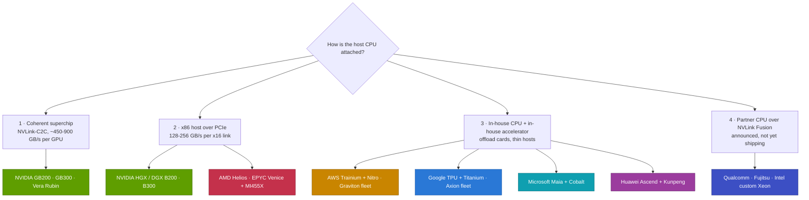

# CPU attach strategies across the industry

Layer 04 · CPU (Grace, Vera) · ~10 min read · Last verified: 2026-11-05

## ⚡ The Executive Take

- **Four patterns pair host CPUs with accelerators:** a coherent superchip (NVIDIA Grace and Vera), an x86 host over [PCIe](../../glossary.md#pcie) (NVIDIA HGX, AMD Helios), in-house CPU plus in-house accelerator (AWS, Google, Microsoft, Huawei), and partner CPUs over [NVLink Fusion](../../glossary.md#nvlink-fusion) (announced: Qualcomm, Fujitsu and an Intel custom Xeon, though Intel also backs the rival UALink) [[S90031]](../../sources/bibliography.md#s90031)[[S130]](../../sources/bibliography.md#s130).
- **Only NVIDIA ships a coherent CPU–GPU link at rack scale:** ~450–900 GB/s per GPU over NVLink-C2C versus 128–256 GB/s for a PCIe Gen5–Gen6 x16 link [[S4019]](../../sources/bibliography.md#s4019)[[S100]](../../sources/bibliography.md#s100)[[S222]](../../sources/bibliography.md#s222).
- **AMD competes on cores, not coherence.** Helios pairs 18 EPYC Venice CPUs (up to 256 Zen 6 cores each) with 72 MI455X GPUs, 1:4 [[S538]](../../sources/bibliography.md#s538)[[S4028]](../../sources/bibliography.md#s4028); first shipments were reported around the end of Q3 2026 🟡 [[S90020]](../../sources/bibliography.md#s90020).
- **Hyperscalers keep the host thin and the CPU fleet separate.** AWS gives each Trainium3 16 host vCPUs [[S354]](../../sources/bibliography.md#s354) while selling 192-core Graviton5 instances [[S4022]](../../sources/bibliography.md#s4022)[[S4023]](../../sources/bibliography.md#s4023); Google pairs TPUs with Axion VMs and Titanium offload [[S4026]](../../sources/bibliography.md#s4026)[[S4027]](../../sources/bibliography.md#s4027); Microsoft fields 132-core Cobalt 200 beside Maia 200 [[S4024]](../../sources/bibliography.md#s4024)[[S90044]](../../sources/bibliography.md#s90044).
- **Attach is becoming a licence.** Qualcomm and Fujitsu signed as Fusion CPU partners in May 2025, Arm added Fusion to Neoverse, and AWS says Trainium4 will support it [[S90031]](../../sources/bibliography.md#s90031)[[S90036]](../../sources/bibliography.md#s90036)[[S90034]](../../sources/bibliography.md#s90034).
- **Qualcomm (public information only):** its announced Oryon-based Dragonfly C1000 (~250 cores, PCIe Gen7, CXL) targets AI head nodes for H2 2028 🟡 [[S4029]](../../sources/bibliography.md#s4029)[[S4030]](../../sources/bibliography.md#s4030); Qualcomm has not named the AI200 rack's host CPU in the materials reviewed [[S173]](../../sources/bibliography.md#s173).

## 1. Four attach patterns

The attach choice decides how fast accelerators reach CPU memory and who supplies the CPU socket.

Coherent superchips give the highest host bandwidth and one memory space ([Grace and the superchip](grace-and-the-superchip.md)). x86 hosts keep familiar software; NVIDIA's own HGX and DGX boxes still use them [[S319]](../../sources/bibliography.md#s319)[[S179]](../../sources/bibliography.md#s179). In-house pairs keep hosts thin and move I/O and security onto offload cards (AWS Nitro, Google Titanium [[S4027]](../../sources/bibliography.md#s4027), Microsoft Azure Boost [[S4024]](../../sources/bibliography.md#s4024)). Fusion licenses NVIDIA's fabric to partner CPUs and accelerators [[S90031]](../../sources/bibliography.md#s90031) ([Layer 05](../05-scale-up-nvlink-nvswitch/index.md)).

> [!TIP]
> **Worked example — Helios versus Vera Rubin, host side.** Vera Rubin NVL72: 36 Vera × 88 cores = **3,168 cores**, ~44 per GPU, each GPU reaching CPU memory at ~900 GB/s [[S102]](../../sources/bibliography.md#s102)[[S4000]](../../sources/bibliography.md#s4000)[[S100]](../../sources/bibliography.md#s100). AMD Helios: 18 Venice CPUs [[S538]](../../sources/bibliography.md#s538); AMD has not named the SKU. *If* it were the 256-core flagship [[S4028]](../../sources/bibliography.md#s4028), the rack would carry **4,608 cores**, ~64 per GPU, reaching host memory over PCIe Gen6 x16 at ~**256 GB/s** [[S222]](../../sources/bibliography.md#s222) (🔴 repo scenario). **Conclusion:** AMD can match NVIDIA on host compute per GPU but not on coherent bandwidth; the contest turns on whether workloads need a fast second memory tier.

🔧 Under the hood: why a PCIe host cannot simply become coherent

- **PCIe moves blocks, not cache lines.** A GPU on PCIe can read host memory, but without a coherence protocol the CPU's caches may hold newer data, so software must copy and synchronize explicitly.
- **[CXL](../../glossary.md#cxl) adds coherence over PCIe wiring,** but at PCIe link rates (~256 GB/s for a Gen6 x16) and with limited accelerator support so far.
- **Coherent links are proprietary today:** NVLink-C2C (NVIDIA), AMD's Infinity Fabric inside its own packages, and NVLink Fusion for licensed partners.

## 2. Vendor by vendor

| Vendor | Host CPU | Accelerator | CPU↔accelerator link | Ratio or host per chip | Status (2026-11) |
|---|---|---|---|---|---|
| NVIDIA racks | Grace → Vera | Blackwell → Rubin | NVLink-C2C, coherent | 1:2 | Vera H2 2026 [[S396]](../../sources/bibliography.md#s396)[[S4000]](../../sources/bibliography.md#s4000)[[S90009]](../../sources/bibliography.md#s90009) |
| NVIDIA HGX | Xeon 6 or EPYC | B200 / B300 | PCIe Gen5 | 1:4 | Shipping [[S319]](../../sources/bibliography.md#s319)[[S179]](../../sources/bibliography.md#s179) |
| AMD | EPYC Venice, ≤256 cores | MI455X | PCIe (Gen6 claimed) | 1:4 | ~End Q3 2026 🟡 [[S538]](../../sources/bibliography.md#s538)[[S4028]](../../sources/bibliography.md#s4028)[[S90020]](../../sources/bibliography.md#s90020) |
| AWS | Graviton5 fleet, 192 cores | Trainium2/3 | Not disclosed | 12–16 vCPUs | Graviton5 GA Jun 2026 [[S4022]](../../sources/bibliography.md#s4022)[[S4023]](../../sources/bibliography.md#s4023)[[S354]](../../sources/bibliography.md#s354) |
| Google | Axion C4A / N4A | TPU Ironwood | Not disclosed | Not disclosed | N4A GA Jan 2026 [[S182]](../../sources/bibliography.md#s182)[[S4026]](../../sources/bibliography.md#s4026)[[S547]](../../sources/bibliography.md#s547) |
| Microsoft | Cobalt 200, 132 cores | Maia 200 | Not disclosed | Not disclosed | GA 2026 [[S4024]](../../sources/bibliography.md#s4024)[[S4025]](../../sources/bibliography.md#s4025)[[S90044]](../../sources/bibliography.md#s90044) |
| Meta | x86; standalone Grace, Vera from 2027 | MTIA, NVIDIA | — | — | 🟡 [[S4006]](../../sources/bibliography.md#s4006)[[S4008]](../../sources/bibliography.md#s4008) |
| Huawei | Kunpeng → 950 (≤192 cores) | Ascend 910C → 950 | Own fabric | 1:2 (CM384) | 950 due 2026 🟡 [[S340]](../../sources/bibliography.md#s340)[[S4031]](../../sources/bibliography.md#s4031) |
| Qualcomm | Dragonfly C1000, ~250 cores | AI200 / AI250 | Fusion planned for NVIDIA GPUs | — | H2 2028 🟡 [[S4029]](../../sources/bibliography.md#s4029)[[S4030]](../../sources/bibliography.md#s4030)[[S131]](../../sources/bibliography.md#s131) |
| Fujitsu | MONAKA, 144 cores | NVIDIA GPUs | Fusion planned | — | FY2027 [[S187]](../../sources/bibliography.md#s187)[[S131]](../../sources/bibliography.md#s131) |

**Strongest rival arguments.** AMD offers the only merchant alternative to a full NVIDIA rack, with 1.6 TB/s of memory bandwidth per Venice socket [[S4028]](../../sources/bibliography.md#s4028) and a low-power Verano CPU planned for its 2027 rack [[S538]](../../sources/bibliography.md#s538)[[S540]](../../sources/bibliography.md#s540). Hyperscalers argue host CPUs should be sized separately: Graviton5 brings 192 MB of L3 and DDR5-8800 [[S4022]](../../sources/bibliography.md#s4022), so agent sandboxes can run outside the accelerator rack. Huawei's roadmap adds a 192-core Kunpeng 950 in 2026 and a >256-core Kunpeng 960 in 2028 [[S4031]](../../sources/bibliography.md#s4031)[[S163]](../../sources/bibliography.md#s163).

> [!TIP]
> **Worked example — host memory per accelerator: NVIDIA versus AWS.** A Trn3 Gen2 UltraServer has 27,648 GiB of host memory for 144 Trainium3: **192 GiB per chip** beside 144 GiB of HBM [[S354]](../../sources/bibliography.md#s354). A Vera Rubin NVL72 has 54 TB of LPDDR5X for 72 GPUs: **~750 GB per GPU** beside 288 GB of HBM4 [[S102]](../../sources/bibliography.md#s102). **Conclusion:** NVIDIA puts ~4× more host memory next to each accelerator and makes it coherent; AWS bets memory-hungry host work belongs elsewhere. Long agent sessions, which need warm KV cache close to the accelerator, decide which bet wins.

### Qualcomm: public information only

- **May 2025:** named with Fujitsu as an NVLink Fusion CPU partner for custom datacenter CPUs [[S131]](../../sources/bibliography.md#s131)[[S90031]](../../sources/bibliography.md#s90031).
- **October 2025:** AI200 (2026) and AI250 (2027) rack-scale inference systems with 768 GB of LPDDR per card [[S173]](../../sources/bibliography.md#s173)[[S90028]](../../sources/bibliography.md#s90028). Counterpoint reports AI200 sampling with first deployments in H2 2026 🟡 [[S4030]](../../sources/bibliography.md#s4030); no 2026 shipment confirmation was found 🔴 [[S90028]](../../sources/bibliography.md#s90028).
- **June 2026:** Dragonfly C1000, ~250 Oryon cores above 5 GHz with PCIe Gen7 and CXL, for agentic orchestration and AI head nodes, expected H2 2028; a multi-year Meta agreement was reported 🟡 [[S4029]](../../sources/bibliography.md#s4029)[[S4030]](../../sources/bibliography.md#s4030).

| Attach dimension (vs NVIDIA Vera Rubin) | AMD Helios | AWS Trainium | Google TPU | Huawei CloudMatrix |
|---|---|---|---|---|
| CPU↔accelerator bandwidth | 🟥 PCIe ~256 vs ~900 GB/s | 🟦 thin host, undisclosed | 🟦 undisclosed | 🟦 own fabric |
| Host cores per accelerator | 🟨 similar or higher (SKU undisclosed) | 🟥 16 vCPUs vs 88 threads | 🟦 undisclosed | 🟨 same 1:2 socket ratio |
| Coherent shared memory | 🟥 no | 🟥 no | 🟥 no public evidence | 🟦 undisclosed |
| Separate CPU fleet for agents | 🟨 EPYC | 🟩 Graviton5 | 🟩 Axion | 🟨 Kunpeng |

Verdicts are repo judgements (🔴) on the public specifications cited above.

> [!NOTE]
> **🐂 Bull view:** coherent attach is a moat that grows with context length; only NVIDIA ships hundreds of GB of coherent CPU memory per GPU at 450–900 GB/s [[S102]](../../sources/bibliography.md#s102)[[S4019]](../../sources/bibliography.md#s4019).

> [!WARNING]
> **🐻 Bear view:** hyperscalers already own excellent Arm CPUs and offload cards. If KV-cache tiers move to pooled memory or storage behind the network ([Layer 07](../07-dpu-supernic-storage-security/index.md)), the superchip becomes a cost, not a moat.

## 🎯 Corp Dev Lens

1. **Who owns the host socket in 2028?** NVIDIA (Vera, Rosa), Intel (NVLink Xeon), AMD (Venice, Verano), hyperscaler Arm or Fusion partners; attach decides who sits closest to the accelerator's memory.
2. **Fusion economics are opaque.** What does a partner pay, in royalties, chiplets or roadmap dependence, to attach coherently, and can NVIDIA still compete with Vera in the same socket?
3. **Offload silicon is a parallel value pool.** Nitro, Titanium, Azure Boost and BlueField all take work off the host; which independent DPU or SmartNIC vendors remain partnerable?
4. **Qualcomm question (public information only):** Qualcomm is at once a Fusion CPU partner [[S131]](../../sources/bibliography.md#s131), an accelerator-rack vendor [[S173]](../../sources/bibliography.md#s173) and a reported Meta CPU supplier 🟡 [[S4030]](../../sources/bibliography.md#s4030). Which position is most defensible if NVIDIA keeps expanding Vera?

## 📚 Sources

<!-- Auto-generated from the [S…] citations on this page by `make build`. Edit sources/registry/*.csv, not this list. -->

- [**S100**](../../sources/bibliography.md#s100) NVIDIA Technical Blog, *Inside the NVIDIA Vera Rubin Platform: Six New Chips, One AI Supercomputer*, 2026-01-05. [Link](https://developer.nvidia.com/blog/inside-the-nvidia-rubin-platform-six-new-chips-one-ai-supercomputer/)
- [**S102**](../../sources/bibliography.md#s102) NVIDIA, *NVIDIA DGX Vera Rubin NVL72*, 2026. [Link](https://www.nvidia.com/en-us/data-center/dgx-vera-rubin-nvl72/)
- [**S130**](../../sources/bibliography.md#s130) NVIDIA Newsroom, *NVIDIA and Intel to Develop AI Infrastructure and Personal Computing Products*, 2025-09-18. [Link](https://nvidianews.nvidia.com/news/nvidia-and-intel-to-develop-ai-infrastructure-and-personal-computing-products)
- [**S131**](../../sources/bibliography.md#s131) NVIDIA Newsroom, *NVIDIA NVLink Fusion: semi-custom AI infrastructure partner ecosystem (Computex 2025)*, 2025-05-19. [Link](https://nvidianews.nvidia.com/news/nvidia-nvlink-fusion-semi-custom-ai-infrastructure-partner-ecosystem)
- [**S163**](../../sources/bibliography.md#s163) Huawei (Eric Xu), *Huawei Connect 2025 keynote: Ascend roadmap and SuperPoD interconnect (Eric Xu)*, 2025-09-18. [Link](https://www.huawei.com/en/news/2025/9/hc-xu-keynote-speech)
- [**S173**](../../sources/bibliography.md#s173) Qualcomm, *Qualcomm Unveils AI200 and AI250 - Redefining Rack-Scale Data Center Inference*, 2025-10-27. [Link](https://www.qualcomm.com/news/releases/2025/10/qualcomm-unveils-ai200-and-ai250-redefining-rack-scale-data-cent)
- [**S179**](../../sources/bibliography.md#s179) Intel, *Intel Xeon 6 processors with P-cores (Granite Rapids, 6900P/6700P)*, 2024-09-24. [Link](https://www.intel.com/content/www/us/en/products/details/processors/xeon/xeon6-p-cores.html)
- [**S182**](../../sources/bibliography.md#s182) Google Cloud Blog, *Introducing Google Axion Processors, our new Arm-based CPUs*, 2024-04-09. [Link](https://cloud.google.com/blog/products/compute/introducing-googles-new-arm-based-cpu)
- [**S187**](../../sources/bibliography.md#s187) Fujitsu, *FUJITSU-MONAKA: next-generation Arm-based processor*, 2025. [Link](https://www.fujitsu.com/global/about/research/technology/monaka/)
- [**S222**](../../sources/bibliography.md#s222) Tom's Hardware, *PCI Express roadmap: the path to 1TB/s with PCIe 8.0, the challenges of integration, and beyond*, 2025. [Link](https://www.tomshardware.com/pc-components/motherboards/pci-express-roadmap-the-path-to-1tb-s-with-pci-8-0-the-challenges-of-integration-and-beyond)
- [**S319**](../../sources/bibliography.md#s319) NVIDIA (mirror hosted by OpenZeka), *NVIDIA DGX B200 datasheet*, 2024. [Link](https://openzeka.com/wp-content/uploads/2024/11/dgx-scale-ai-infrastructure-dgx-b200-datasheet-nvidia-web-1-1.pdf)
- [**S340**](../../sources/bibliography.md#s340) SemiAnalysis (Dylan Patel et al.), *Huawei AI CloudMatrix 384 - China's answer to Nvidia GB200 NVL72*, 2025-04-16. [Link](https://newsletter.semianalysis.com/p/huawei-ai-cloudmatrix-384-chinas-answer-to-nvidia-gb200-nvl72)
- [**S354**](../../sources/bibliography.md#s354) AWS, *Trn3 architecture (AWS Neuron documentation)*, 2026. [Link](https://awsdocs-neuron.readthedocs-hosted.com/en/v2.28.0/_sources/about-neuron/arch/neuron-hardware/trn3-arch.rst)
- [**S396**](../../sources/bibliography.md#s396) NVIDIA Newsroom, *NVIDIA Blackwell platform arrives to power a new era of computing*, 2024-03-18. [Link](https://nvidianews.nvidia.com/news/nvidia-blackwell-platform-arrives-to-power-a-new-era-of-computing)
- [**S538**](../../sources/bibliography.md#s538) AMD Investor Relations, *AAI 2026: AMD Delivers Full-Stack Compute for the Agentic AI Era*, 2026-07-23. [Link](https://ir.amd.com/news-events/press-releases/detail/1294/aai-2026-amd-delivers-full-stack-compute-for-the-agentic-ai-era)
- [**S540**](../../sources/bibliography.md#s540) Tom's Hardware, *AMD unwraps 2027 AI plans: Verano CPU, Instinct MI500X GPU, next-gen AI rack*, 2026-07. [Link](https://www.tomshardware.com/pc-components/cpus/amd-unwraps-2027-ai-plans-verano-cpu-instinct-mi500x-gpu-next-gen-ai-rack)
- [**S547**](../../sources/bibliography.md#s547) Google Cloud Blog, *Ironwood TPUs and new Axion-based VMs for your AI workloads*, 2025-11-06. [Link](https://cloud.google.com/blog/products/compute/ironwood-tpus-and-new-axion-based-vms-for-your-ai-workloads)
- [**S4000**](../../sources/bibliography.md#s4000) NVIDIA Newsroom, *NVIDIA Launches Vera CPU, Purpose-Built for Agentic AI*, 2026-03-16. [Link](https://nvidianews.nvidia.com/news/nvidia-launches-vera-cpu-purpose-built-for-agentic-ai)
- [**S4006**](../../sources/bibliography.md#s4006) SiliconANGLE, *Meta agrees to buy millions of AI chips from Nvidia, raising doubts about its in-house hardware*, 2026-02-17. [Link](https://siliconangle.com/2026/02/17/meta-agrees-buy-millions-ai-chips-nvidia-raising-doubts-house-hardware/)
- [**S4008**](../../sources/bibliography.md#s4008) Futurum Group, *Will NVIDIA's Meta Deal Ignite a CPU Supercycle?*, 2026-02. [Link](https://futurumgroup.com/insights/will-nvidias-meta-deal-ignite-a-cpu-supercycle/)
- [**S4019**](../../sources/bibliography.md#s4019) heise online, *Blackwell: Nvidia unveils its next generation of AI accelerators*, 2024-03-19. [Link](https://heise.de/en/news/Blackwell-Nvidia-unveils-its-next-generation-of-AI-accelerators-9782399.html)
- [**S4022**](../../sources/bibliography.md#s4022) Amazon Science, *Graviton5's improved design increases speed and energy efficiency beyond Moore's law*, 2025-12. [Link](https://www.amazon.science/blog/graviton5s-improved-design-increases-speed-and-energy-efficiency-beyond-moores-law)
- [**S4023**](../../sources/bibliography.md#s4023) The Next Platform, *AWS Tunes Up Graviton5 For Agentic AI*, 2026-06-11. [Link](https://nextplatform.com/compute/2026/06/11/aws-tunes-up-graviton5-for-agentic-ai-boosts-bang-for-the-buck-bigtime/5254538)
- [**S4024**](../../sources/bibliography.md#s4024) DatacenterDynamics, *Microsoft reveals next-generation Cobalt CPU and Azure Boost*, 2025-11-18. [Link](https://www.datacenterdynamics.com/en/news/microsoft-reveals-next-generation-cobalt-cpu-and-azure-boost/)
- [**S4025**](../../sources/bibliography.md#s4025) ServeTheHome, *Microsoft Azure Cobalt 200 launched with 132 Arm Neoverse V3 cores*, 2025-11. [Link](https://www.servethehome.com/microsoft-azure-cobalt-200-launched-with-132-arm-neoverse-v3-cores/)
- [**S4026**](../../sources/bibliography.md#s4026) Phoronix, *Google Axion CPU performance with the new Google Cloud N4A instances*, 2026-01. [Link](https://www.phoronix.com/review/google-cloud-n4a-axion)
- [**S4027**](../../sources/bibliography.md#s4027) Tom's Hardware, *Google deploys new Axion CPUs and seventh-gen Ironwood TPU training and inferencing pods*, 2025-11. [Link](https://www.tomshardware.com/tech-industry/artificial-intelligence/google-deploys-new-axion-cpus-and-seventh-gen-ironwood-tpu-training-and-inferencing-pods-beat-nvidia-gb300-and-shape-ai-hypercomputer-model)
- [**S4028**](../../sources/bibliography.md#s4028) Digital Citizen, *AMD EPYC Venice launches with up to 256 Zen 6 cores and strong agentic AI performance claims*, 2026-07-22. [Link](https://www.digitalcitizen.life/amd-epyc-venice-launches-with-up-to-256-zen-6-cores-and-strong-agentic-ai-performance-claims/)
- [**S4029**](../../sources/bibliography.md#s4029) StorageReview, *Qualcomm unveils Dragonfly data center roadmap: C1000 CPU, AI300 accelerator*, 2026-06-24. [Link](https://www.storagereview.com/news/qualcomm-unveils-dragonfly-data-center-roadmap-c1000-cpu-ai300-accelerator-and-modular-acquisition)
- [**S4030**](../../sources/bibliography.md#s4030) Counterpoint Research, *Qualcomm unveils data center roadmap at Investor Day 2026*, 2026-06. [Link](https://counterpointresearch.com/cn/reports/qualcomm-unveils-data-center-roadmap-at-investor-day-2026)
- [**S4031**](../../sources/bibliography.md#s4031) Wccftech, *Huawei next-gen Kunpeng chips: 950 series up to 192 cores, 960 series over 256 cores*, 2025-09. [Link](https://wccftech.com/huawei-next-gen-kungpeng-chips-950-series-up-to-192-cores-q4-2026-960-series-over-256-cores-q1-2028/)
- [**S90009**](../../sources/bibliography.md#s90009) GamesBeat, *Nvidia Vera Rubin ramps into full production for fall launch*, 2026. [Link](https://gamesbeat.com/nvidia-vera-rubin-ramps-into-full-production-for-fall-launch-again/)
- [**S90020**](../../sources/bibliography.md#s90020) Shacknews, *AMD Helios AI rack system on track for initial shipments in Q3 2026*, 2026. [Link](https://www.shacknews.com/article/150249/amd-helios-ai-system-shipping-q3-2026)
- [**S90028**](../../sources/bibliography.md#s90028) TechRepublic, *Qualcomm unveils AI chips to rival Nvidia, AMD*, 2025-10-27. [Link](https://techrepublic.com/article/news-qualcomm-unveils-ai-chips-to-rival-nvidia-amd)
- [**S90031**](../../sources/bibliography.md#s90031) ServeTheHome, *NVIDIA announces NVLink Fusion bringing NVLink to third-party CPUs and accelerators*, 2025-05-19. [Link](https://www.servethehome.com/nvidia-announces-nvlink-fusion-bringing-nvlink-to-third-party-cpus-and-accelerators/nvlink-fusion-partners/)
- [**S90034**](../../sources/bibliography.md#s90034) NAND Research, *AWS releases Trainium3, teases Trainium4*, 2025-12. [Link](https://nand-research.com/research-note-aws-releases-trainium3-teases-trainium4/4/)
- [**S90036**](../../sources/bibliography.md#s90036) Converge Digest, *Arm extends Neoverse with NVIDIA NVLink Fusion*, 2025-11. [Link](https://convergedigest.com/arm-extends-neoverse-with-nvidia-nvlink-fusion/)
- [**S90044**](../../sources/bibliography.md#s90044) eWeek, *Microsoft introduces Maia 200, its most powerful AI chip yet*, 2026-01-27. [Link](https://www.eweek.com/news/microsoft-maia-200-ai-chip/)
