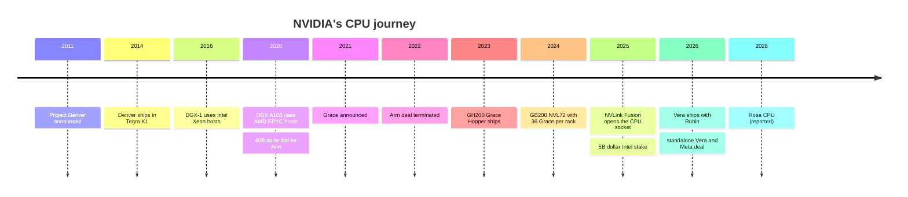
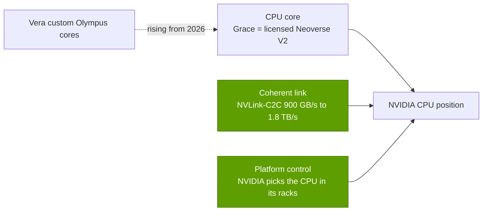

# CPU (Grace, Vera): History and how NVIDIA built it

Layer 04 · CPU (Grace, Vera) · ~11 min read · Last verified: 2026-11-05

## ⚡ The Executive Take

- **Fifteen years from first try to a credible server CPU.** Project Denver (CES 2011) shipped only in Tegra mobile and automotive chips from 2014 [[S4536]](../../sources/bibliography.md#s4536)[[S4537]](../../sources/bibliography.md#s4537).
- **The shortcut that failed:** NVIDIA's $40B bid for Arm (September 2020) would have bought the [instruction set](../../glossary.md#isa) every Arm rival licenses; it died in February 2022 (~$1.36B charge), but NVIDIA kept a 20-year licence [[S465]](../../sources/bibliography.md#s465)[[S466]](../../sources/bibliography.md#s466).
- **Grace (announced April 2021) won with licensed cores** (Arm [Neoverse](../../glossary.md#neoverse) V2, the same family as Graviton4) and a differentiated 900 GB/s [NVLink-C2C](../../glossary.md#nvlink-c2c) link [[S537]](../../sources/bibliography.md#s537)[[S129]](../../sources/bibliography.md#s129)[[S181]](../../sources/bibliography.md#s181).
- **The rack made the CPU business:** GB200 NVL72 put 36 Grace in every rack, and Mercury credits Grace for Arm's server-unit gains [[S396]](../../sources/bibliography.md#s396)[[S4502]](../../sources/bibliography.md#s4502).
- **Vera (2026) adds NVIDIA's first custom datacenter cores** (88 Olympus) and a standalone CPU business; a Feynman-era Rosa CPU is reported for 2028 🟡 [[S100]](../../sources/bibliography.md#s100)[[S90003]](../../sources/bibliography.md#s90003)[[S90004]](../../sources/bibliography.md#s90004).
- **NVIDIA also hedged:** NVLink Fusion opened the host socket to Qualcomm and Fujitsu (May 2025) and a $5B Intel stake buys NVLink-attached x86 (September 2025) [[S90031]](../../sources/bibliography.md#s90031)[[S468]](../../sources/bibliography.md#s468).
- **[Q4]** The edge has been the coherent attach and platform control more than the core; **[Q6]** a competitive custom server CPU takes ~5–7 years and ~$1.5–3B 🔴.

## From Denver to Vera: the path

Three phases. **Phase 1 (2011–2018): the ambitious detour.** Denver used [binary translation](../../glossary.md#binary-translation)-style "dynamic code optimisation" and reportedly began as an x86 design; without an x86 licence it shipped as Arm cores in the Nexus 9 tablet (2014) and later in car chips [[S4536]](../../sources/bibliography.md#s4536)[[S4537]](../../sources/bibliography.md#s4537). **Phase 2 (2016–2022): buying hosts from rivals.** DGX-1 used Intel Xeon and DGX A100 used AMD EPYC, so NVIDIA's flagship systems depended on competitors' CPUs and on PCIe [[S189]](../../sources/bibliography.md#s189)[[S188]](../../sources/bibliography.md#s188). **Phase 3 (2020–): own the host, then open it.**

| Date | Decision | Why it mattered | Source |
|---|---|---|---|
| 2011-01 | Project Denver: custom Arm cores | Built CPU design muscle; ended up in mobile and auto only | [[S4536]](../../sources/bibliography.md#s4536) |
| 2016 / 2020 | Buy hosts from Intel, then AMD | GPU systems tied to rivals' CPUs and PCIe | [[S189]](../../sources/bibliography.md#s189)[[S188]](../../sources/bibliography.md#s188) |
| 2020-09-13 | Bid $40B for Arm | Would have owned the ISA behind every Arm rival | [[S465]](../../sources/bibliography.md#s465) |
| 2021-04-12 | Grace with licensed Neoverse cores | Fastest path; differentiate on link and memory | [[S537]](../../sources/bibliography.md#s537) |
| 2022-02-08 | Arm deal terminated, licence kept | ~$1.36B charge; 20-year licence secured | [[S466]](../../sources/bibliography.md#s466) |
| 2024-03-18 | GB200 NVL72: 36 Grace per rack | CPU attach captive at 1 CPU per 2 GPUs | [[S396]](../../sources/bibliography.md#s396) |
| 2025-05-19 | NVLink Fusion for third-party CPUs | Trades socket exclusivity for NVLink reach | [[S90031]](../../sources/bibliography.md#s90031) |
| 2025-09-18 | $5B Intel stake, NVLink x86 | Covers customers who insist on x86 | [[S468]](../../sources/bibliography.md#s468) |
| 2026 | Vera custom cores; standalone sales | First bid for the general-purpose CPU market | [[S100]](../../sources/bibliography.md#s100)[[S90003]](../../sources/bibliography.md#s90003) |

> [!TIP]
> **Worked example — how NVIDIA doubled CPU attach and kept the dollars.** A DGX H100 carried two Intel Xeon 8480C for eight GPUs: one CPU per four GPUs, bought from Intel [[S33022]](../../sources/bibliography.md#s33022). A GB200 NVL72 carries 36 Grace for 72 GPUs: one per two, supplied by NVIDIA [[S396]](../../sources/bibliography.md#s396). Every 1,000 Vera Rubin racks therefore means 36,000 NVIDIA CPUs; at Morgan Stanley's ~$5,000 per Vera that is ~$180M of CPU silicon [[S331]](../../sources/bibliography.md#s331), volume Intel or AMD would otherwise have shipped.

## [Q4 · Source of advantage] Is it the CPU, the link or the platform?

**Answer:** through 2025, mostly the link and the platform. Grace's cores were the same family AWS used in Graviton4, so the core was not the edge [[S129]](../../sources/bibliography.md#s129)[[S181]](../../sources/bibliography.md#s181). The edge was a cache-coherent link about 7× a PCIe Gen5 x16 slot, plus NVIDIA's ability to specify the CPU in every [superchip](../../glossary.md#superchip) and rack it sells [[S129]](../../sources/bibliography.md#s129)[[S396]](../../sources/bibliography.md#s396). Vera shifts some advantage into the CPU itself (custom cores built under an Arm [architecture licence](../../glossary.md#architecture-licence), 1.2 TB/s memory), and Meta reports up to 2× performance per watt on some CPU-only workloads with Grace [[S100]](../../sources/bibliography.md#s100)[[S4520]](../../sources/bibliography.md#s4520). Volume still follows the platform: Arm's server-unit gains track NVL72 shipments [[S4502]](../../sources/bibliography.md#s4502).

> [!TIP]
> **Worked example — what the link is worth in time.** Reading the full 480 GB LPDDR5X pool on a Grace takes ~0.9 s at 512 GB/s of memory bandwidth, and moving it to the GPU at 900 GB/s keeps pace [[S129]](../../sources/bibliography.md#s129); over a 128 GB/s PCIe Gen5 x16 link the same transfer takes ~3.8 s. The CPU is the same class of silicon; the plumbing differs by 7×.

## [Q6 · Replication cost] Time, dollars and talent

Evidence: what others paid and how long they took. Amazon bought Annapurna Labs for a reported ~$350–370M in 2015, launched the first Graviton in 2018 and reached a 192-core Graviton5 in 2026 [[S4540]](../../sources/bibliography.md#s4540)[[S4541]](../../sources/bibliography.md#s4541)[[S4526]](../../sources/bibliography.md#s4526). Qualcomm paid $1.4B for NUVIA, a pre-product team, in 2021 [[S4539]](../../sources/bibliography.md#s4539). SoftBank paid $6.5B for Ampere [[S4530]](../../sources/bibliography.md#s4530). Qualcomm's Centriq effort peaked at ~1,000 staff before the 2018 exit [[S4544]](../../sources/bibliography.md#s4544).

| Path | Time to competitive part | Dollars (Est., repo 🔴) | Talent |
|---|---|---|---|
| Licensed Neoverse / CSS SoC, PCIe host | 2–3 years (Grace: 2021 → 2023) [[S537]](../../sources/bibliography.md#s537)[[S128]](../../sources/bibliography.md#s128) | ~$0.3–0.7B | 200–400 engineers |
| Custom core competitive with x86 | 5–7 years (Annapurna 2015 → Graviton 2018 and later gens; NUVIA 2021 → no server part yet) [[S4540]](../../sources/bibliography.md#s4540)[[S4541]](../../sources/bibliography.md#s4541)[[S4539]](../../sources/bibliography.md#s4539) | ~$1.5–3B incl. team purchase | 300–600, incl. ~100 core architects |
| NVIDIA's position (coherent link + GPU + rack) | Not replicable with a CPU alone | CPU cost plus a GPU platform | Requires an accelerator franchise |

> [!TIP]
> **Worked example — buy versus build.** Buying NUVIA cost $1.4B up front [[S4539]](../../sources/bibliography.md#s4539); Qualcomm's own Centriq unit, ~1,000 people at peak before the 2018 exit [[S4544]](../../sources/bibliography.md#s4544), implies a comparable build cost before any revenue (Est., repo, assuming ~$0.3M loaded cost per person and ~4 years: 1,000 × $0.3M × 4 ≈ $1.2B 🔴). Either way, the price of entry is about $1–1.5B, and the scarce input is CPU-architect talent, not money.

## Counterfactuals — what if NVIDIA hadn't…

- 🔴 **…lost the Arm deal?** NVIDIA would collect royalties from Graviton, Axion and Cobalt and could steer Arm's roadmap, the very fear that sank the deal [[S466]](../../sources/bibliography.md#s466).
- 🔴 **…built its own CPU (stayed x86-only)?** Hosts would be Intel or AMD over PCIe or CXL, capping CPU-GPU bandwidth near 256 GB/s, with AMD selling its own GPUs into the same racks. No GH200, no coherent memory tier, and no standalone-CPU line.
- 🔴 **…opened NVLink to partners?** No partner CPUs or Intel deal; more x86-loyal buyers might have chosen AMD's Helios [[S538]](../../sources/bibliography.md#s538).

> [!TIP]
> **Worked example — the Arm counterfactual in dollars.** Annualising Arm's $670M quarterly royalty gives ~$2.7B a year [[S4506]](../../sources/bibliography.md#s4506); NVIDIA's FY2026 revenue was $215.9B [[S1]](../../sources/bibliography.md#s1). Owning Arm would have added ~1% of revenue but control over every rival's CPU roadmap, which is why regulators objected.

🔧 Under the hood: why custom cores are hard

A competitive server core needs a wide out-of-order engine, good branch prediction, large caches, a mesh linking 100+ cores and years of validation. Denver's translation approach saved decode hardware but suffered on unpredictable code [[S4537]](../../sources/bibliography.md#s4537). Vera's Olympus cores add "spatial multithreading" (176 threads on 88 cores) [[S100]](../../sources/bibliography.md#s100). Each generation also needs firmware, compiler and Linux-kernel work, which is why licensees usually start with Arm's own cores.

## 🎯 Corp Dev Lens

1. Grace shows licensed cores plus a differentiated link can win a socket: is the scarce asset the core team or the interconnect IP?
2. Annapurna (~$0.37B) and NUVIA ($1.4B) bought teams, not revenue; which remaining CPU teams (Arm or RISC-V) are of that kind?
3. NVIDIA opened NVLink to CPU partners rather than defend the socket: does it value NVLink reach above the CPU dollar?
4. If Arm's royalty and own-silicon strategy keeps rising, does a RISC-V option become a negotiating lever, a product path or both?

## 📚 Sources

<!-- Auto-generated from the [S…] citations on this page by `make build`. Edit sources/registry/*.csv, not this list. -->

- [**S1**](../../sources/bibliography.md#s1) NVIDIA Corporation via SEC EDGAR, *NVIDIA Announces Financial Results for Fourth Quarter and Fiscal 2026 (Form 8-K exhibit 99.1)*, 2026-02-25. [Link](https://www.sec.gov/Archives/edgar/data/1045810/000104581026000019/q4fy26pr.htm)
- [**S100**](../../sources/bibliography.md#s100) NVIDIA Technical Blog, *Inside the NVIDIA Vera Rubin Platform: Six New Chips, One AI Supercomputer*, 2026-01-05. [Link](https://developer.nvidia.com/blog/inside-the-nvidia-rubin-platform-six-new-chips-one-ai-supercomputer/)
- [**S128**](../../sources/bibliography.md#s128) NVIDIA, *NVIDIA GH200 Grace Hopper Superchip*, 2023-08. [Link](https://www.nvidia.com/en-us/data-center/grace-hopper-superchip/)
- [**S129**](../../sources/bibliography.md#s129) NVIDIA, *NVIDIA Grace CPU*, 2023. [Link](https://www.nvidia.com/en-us/data-center/grace-cpu/)
- [**S181**](../../sources/bibliography.md#s181) Amazon Web Services, *AWS Graviton Processor*, 2024. [Link](https://aws.amazon.com/ec2/graviton/)
- [**S188**](../../sources/bibliography.md#s188) NVIDIA Docs, *NVIDIA DGX A100 User Guide - Introduction (system specifications)*, 2020. [Link](https://docs.nvidia.com/dgx/dgxa100-user-guide/introduction-to-dgxa100.html)
- [**S189**](../../sources/bibliography.md#s189) NVIDIA Docs, *NVIDIA DGX-1 User Guide - Introduction (system specifications)*, 2017. [Link](https://docs.nvidia.com/dgx/dgx1-user-guide/introduction-to-dgx1.html)
- [**S331**](../../sources/bibliography.md#s331) Wccftech, *NVIDIA's Vera Rubin rack hit with 435% memory price surge, pushing HBM4 & LPDDR5X bill to $2M of $7.8M total*, 2026-05. [Link](https://wccftech.com/nvidia-vera-rubin-rack-hit-with-memory-price-surge-pushing-hbm4-lpddr5x-bill-to-2m-of-7-8m-total/)
- [**S396**](../../sources/bibliography.md#s396) NVIDIA Newsroom, *NVIDIA Blackwell platform arrives to power a new era of computing*, 2024-03-18. [Link](https://nvidianews.nvidia.com/news/nvidia-blackwell-platform-arrives-to-power-a-new-era-of-computing)
- [**S465**](../../sources/bibliography.md#s465) NVIDIA Newsroom, *NVIDIA to Acquire Arm for $40 Billion, Creating World's Premier Computing Company for the Age of AI*, 2020-09-13. [Link](https://nvidianews.nvidia.com/news/nvidia-to-acquire-arm-for-40-billion-creating-worlds-premier-computing-company-for-the-age-of-ai)
- [**S466**](../../sources/bibliography.md#s466) NVIDIA Newsroom, *NVIDIA and SoftBank Group Announce Termination of NVIDIA's Acquisition of Arm Limited*, 2022-02-08. [Link](https://nvidianews.nvidia.com/news/nvidia-and-softbank-group-announce-termination-of-nvidias-acquisition-of-arm-limited)
- [**S468**](../../sources/bibliography.md#s468) NVIDIA Newsroom, *NVIDIA and Intel to Develop AI Infrastructure and Personal Computing Products*, 2025-09-18. [Link](https://nvidianews.nvidia.com/news/nvidia-and-intel-to-develop-ai-infrastructure-and-personal-computing-products)
- [**S537**](../../sources/bibliography.md#s537) NVIDIA press release via Yahoo Finance, *NVIDIA Announces CPU for Giant AI and High Performance Computing Workloads*, 2021-04-12. [Link](https://sg.finance.yahoo.com/news/nvidia-announces-cpu-giant-ai-161900753.html)
- [**S538**](../../sources/bibliography.md#s538) AMD Investor Relations, *AAI 2026: AMD Delivers Full-Stack Compute for the Agentic AI Era*, 2026-07-23. [Link](https://ir.amd.com/news-events/press-releases/detail/1294/aai-2026-amd-delivers-full-stack-compute-for-the-agentic-ai-era)
- [**S4502**](../../sources/bibliography.md#s4502) Techzine, *AMD gains ground in servers thanks to AI boom; Intel remains market leader (Mercury Research Q1 2026)*, 2026-05. [Link](https://www.techzine.eu/news/infrastructure/141872/amd-gains-ground-in-servers-thanks-to-ai-boom-intel-remains-market-leader/)
- [**S4506**](../../sources/bibliography.md#s4506) Arm Holdings plc via SEC EDGAR, *Arm Holdings plc Form 6-K, Exhibit 99.2: results for the quarter ended September 30, 2026 (Q2 FYE27)*, 2026-11. [Link](https://www.sec.gov/Archives/edgar/data/0001973239/000197323926000141/exhibit992fye27q230-sepx26.htm)
- [**S4520**](../../sources/bibliography.md#s4520) Tom's Hardware, *Meta will deploy standalone Nvidia Grace CPUs in production, with Vera to follow*, 2026-02. [Link](https://www.tomshardware.com/pc-components/cpus/meta-will-deploy-standalone-nvidia-grace-cpus-in-production-with-vera-to-follow-company-sees-perf-per-watt-improvements-of-up-to-2x-in-some-cpu-workloads)
- [**S4526**](../../sources/bibliography.md#s4526) Amazon Web Services, *Amazon EC2 M9g and M9gd instances powered by AWS Graviton5 are now available*, 2026-06-10. [Link](https://aws.amazon.com/about-aws/whats-new/2026/06/ec2-m9g-m9gd-instances-graviton5-processors-available)
- [**S4530**](../../sources/bibliography.md#s4530) SoftBank Group, *Completion of acquisition of Ampere Computing Holdings LLC*, 2025-11-26. [Link](https://group.softbank/en/news/press/20251126)
- [**S4536**](../../sources/bibliography.md#s4536) Wikipedia, *Project Denver*, 2026. [Link](https://en.wikipedia.org/wiki/Project_Denver)
- [**S4537**](../../sources/bibliography.md#s4537) AnandTech, *The Google Nexus 9 review (Denver CPU architecture)*, 2015-02. [Link](https://www.anandtech.com/show/8701/the-google-nexus-9-review/2)
- [**S4539**](../../sources/bibliography.md#s4539) PYMNTS, *Qualcomm inks $1.4 billion acquisition deal with chip startup NUVIA*, 2021-01-13. [Link](https://www.pymnts.com/partnerships/2021/qualcomm-inks-1-4-billion-acquisition-deal-with-chip-startup-nuvia/)
- [**S4540**](../../sources/bibliography.md#s4540) Global Venturing, *Arm exits Annapurna Labs in $370m acquisition*, 2015-01-23. [Link](https://globalventuring.com/blog/2015/01/23/arm-exits-annapurna-labs-in-370m-acquisition/)
- [**S4541**](../../sources/bibliography.md#s4541) The Register, *Amazon AWS puts custom Arm server chip (Graviton) into the cloud: A1 instances*, 2018-11-27. [Link](https://www.theregister.com/2018/11/27/amazon_aws_a1/)
- [**S4544**](../../sources/bibliography.md#s4544) Network World, *Qualcomm makes it official: no more data center chip*, 2018-12. [Link](https://www.networkworld.com/article/3327214/qualcomm-makes-it-official-no-more-data-center-chip.html)
- [**S33022**](../../sources/bibliography.md#s33022) NVIDIA Docs, *NVIDIA DGX H100 User Guide — Introduction (system specifications)*, 2023. [Link](https://docs.nvidia.com/dgx/dgxh100-user-guide/introduction-to-dgxh100.html)
- [**S90003**](../../sources/bibliography.md#s90003) eWeek, *Everything Nvidia Just Announced at GTC 2026: 7 Chips, 5 Racks, 1 Giant Bet on Agentic AI*, 2026-03-17. [Link](https://www.eweek.com/news/nvidia-gtc-2026-ai-inference-vera-rubin-neuron/)
- [**S90004**](../../sources/bibliography.md#s90004) TrendForce, *Key GTC takeaways: how Samsung, Micron, Intel and more power NVIDIA's Vera Rubin and Feynman*, 2026-03-17. [Link](https://www.trendforce.com/news/2026/03/17/news-key-gtc-takeaways-how-samsung-micron-intel-more-power-nvidias-vera-rubin-and-feynman/)
- [**S90031**](../../sources/bibliography.md#s90031) ServeTheHome, *NVIDIA announces NVLink Fusion bringing NVLink to third-party CPUs and accelerators*, 2025-05-19. [Link](https://www.servethehome.com/nvidia-announces-nvlink-fusion-bringing-nvlink-to-third-party-cpus-and-accelerators/nvlink-fusion-partners/)
